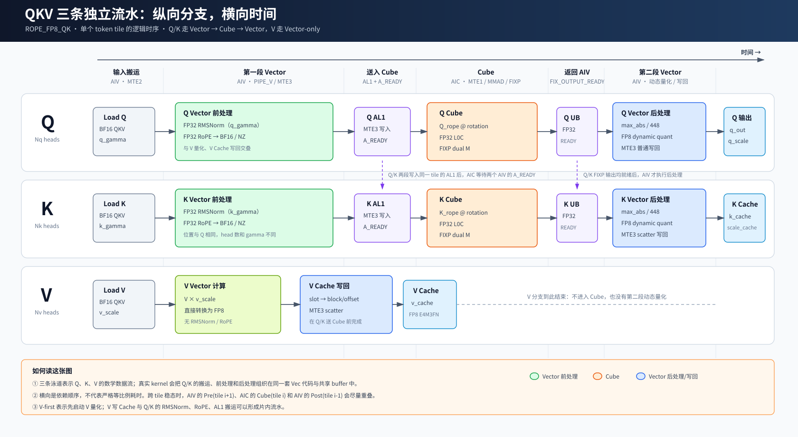
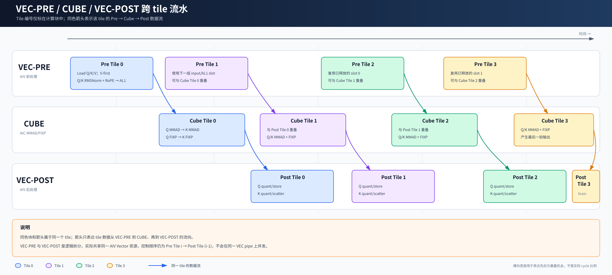
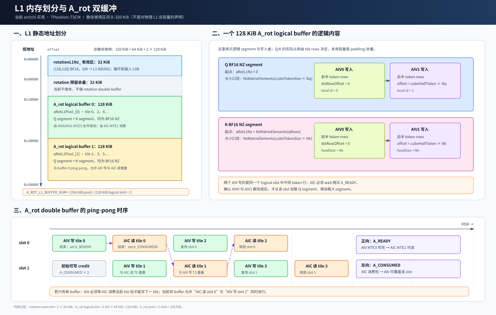
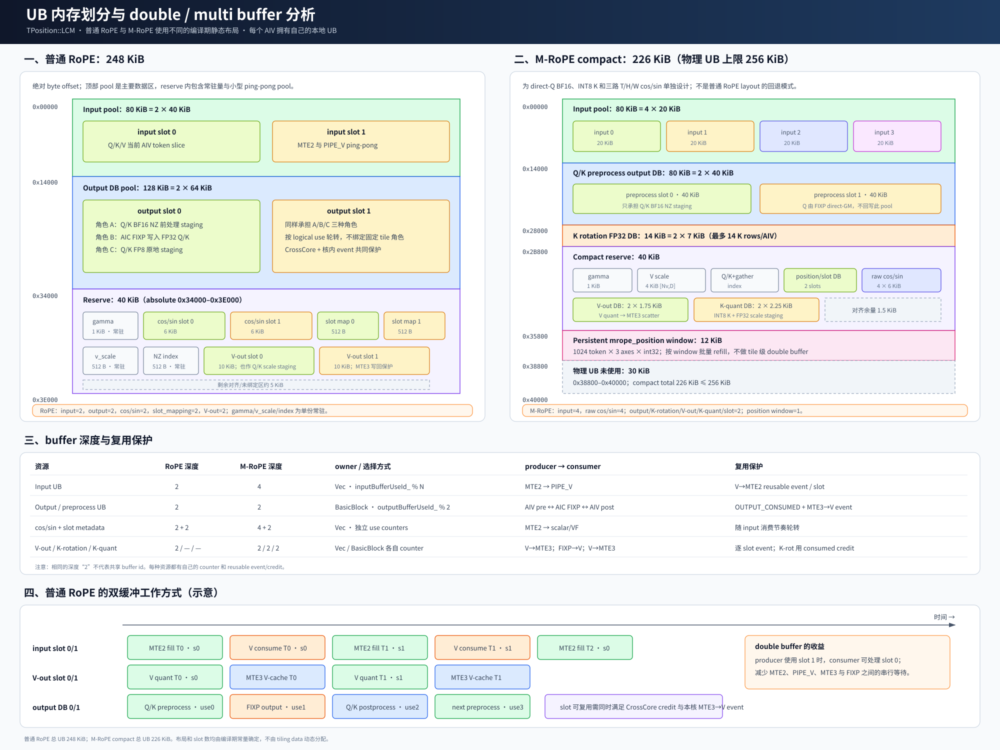

# QkvRmsNormRopeCacheWithKScale 流水与内存分配讲解

## 1. 文档目标

本文结合算子的四张结构图，集中说明两个问题：

1. Q、K、V 在 AIV/VEC 与 AIC/CUBE 上按照什么顺序计算；
2. 为了让不同 tile 重叠运行，L1 和 UB 如何划分，以及 double buffer 如何避免覆盖仍在使用的数据。

本文以当前 arch35 实现为准。相关 kernel 位于：

```text
posembedding/qkv_rms_norm_rope_cache_with_k_scale/op_kernel/arch35/
```

本文中的 `VEC` 表示 AIV 的 Vector 计算资源，不能与 Q/K/V 中的 Value 张量 `V` 混淆。

图中横向宽度用于表达计算先后和重叠机会，不表示真实执行耗时比例。

## 2. 硬件执行模型

kernel 使用：

```text
KERNEL_TYPE_MIX_AIC_1_2
```

一个核组包含：

```text
1 个 AIC/CUBE
2 个 AIV/VEC
```

同一 token tile 会被两个 AIV 沿 token 方向切分：

```text
cubeTokenSize     = AlignUp(tokenSize, 2)
cubeHalfTokenSize = cubeTokenSize / 2

AIV0：处理前半 token
AIV1：处理后半 token
```

如果实际 token 数是奇数，AIV1 的有效 token 可能少一个。补齐的 padding row 只用于 Cube/FIXP 的 M 轴对齐，不参与最终量化和 Cache 写回。

## 3. Q、K、V 三条数据流水



从数据语义上，可以把算子拆成三条流水。

### 3.1 Q 流水

```text
Q
→ RMSNorm(q_gamma)
→ RoPE
→ BF16/NZ
→ Q_rope @ rotation
→ FP8 dynamic quant
→ q_out + q_scale
```

Q 的主要阶段是：

| 阶段 | 执行资源 | 主要结果 |
|---|---|---|
| RMSNorm、RoPE | AIV/VEC | FP32 计算结果 |
| FP32 转 BF16、NZ 排布 | AIV/VEC | Cube 的 A 矩阵 |
| 右乘 `rotation` | AIC/CUBE | FP32 Cube 输出 |
| `max_abs/448`、FP8 转换 | AIV/VEC | `q_out`、`q_scale` |

因此，普通 RoPE 场景中的 Q 是完整的：

```text
Vector → Cube → Vector
```

### 3.2 K 流水

```text
K
→ RMSNorm(k_gamma)
→ RoPE
→ BF16/NZ
→ K_rope @ rotation
→ FP8 dynamic quant
→ k_cache + k_scale_cache
```

K 与 Q 共用位置编码和右矩阵 `rotation`，但使用自己的 `k_gamma`，最终根据 `slot_mapping` 散写到分页 K Cache。

普通 RoPE 场景中的 K 同样是：

```text
Vector → Cube → Vector
```

### 3.3 V 流水

```text
V
→ V × v_scale
→ FP8
→ v_cache
```

V 不进行：

```text
RMSNorm
RoPE
rotation matmul
基于 max_abs 的动态 scale 计算
```

因此 V 是一条独立的 Vector-only 路径。当前实现先启动 V 量化，所以称为 V-first；这表示 `QuantVToFp8` 先于 Q/K 前处理发起，并不表示所有 V Cache 写回都必须早于 Q/K 计算完成。

## 4. VEC-PRE/CUBE/VEC-POST 跨 tile 计算顺序



图中将 AIV 的前处理和后处理拆成两条逻辑泳道，以便观察：

```text
Pre(tile i+1)
Cube(tile i)
Post(tile i-1)
```

之间的稳态重叠。两条 VEC 泳道并不代表存在两套 Vector 计算资源；同一 AIV 仍按照 `Pre(tile i) → Post(tile i-1)` 的顺序串行 issue。

### 4.1 VEC 前处理顺序

`Vec::ComputeTile` 中普通 RoPE 路径的主要顺序是：

```text
1. 等待 input UB 可复用
2. MTE2 搬入 Q/K/V、cos_sin、slot_mapping
3. 构造 Cache offset
4. QuantVToFp8
5. BuildRopeBf16NzUb
   5.1 Q RMSNorm + RoPE
   5.2 K RMSNorm + RoPE
6. ScatterVCache
7. CopyRopeBf16NzUbToL1Nz
8. 发送 A_READY
```

其中，第 4 步只启动 V 的 Vector 量化；V Cache 的实际 MTE3 写回位于 Q/K 前处理之后、Q/K 写 AL1 之前。

### 4.2 CUBE 顺序

CUBE 在 tile loop 之前完成一次性准备：

```text
rotation GM → L1 NZ → L0B resident
```

每个普通 RoPE tile 的主要顺序是：

```text
wait A_READY from AIV0
wait A_READY from AIV1

Q segment：MTE1 → MMAD
K segment：MTE1 → MMAD

Q segment：FIXP → 两个 AIV UB
K segment：FIXP → 两个 AIV UB

set A_CONSUMED
set FIX_OUTPUT_READY
```

普通 RoPE 中 Q segment 先于 K segment 发起。M-RoPE 为满足 direct-Q 路径的顺序要求，在 Cube 内先处理 K，再处理 Q。

### 4.3 VEC 后处理顺序

收到 `FIX_OUTPUT_READY` 后，普通 RoPE 的 `PostprocessRopeQk` 按以下顺序执行：

```text
1. QuantQToFp8
2. StoreQOutputs
3. QuantKToFp8
4. ScatterKOutputs
```

所以在单个 tile 的后处理内部，Q 先量化和写回，K 后量化和散写 Cache。

## 5. 跨 tile rolling pipeline

算子不是等一个 tile 完成全部 `VEC → CUBE → VEC` 后再启动下一个 tile，而是一拍延迟的 rolling pipeline。

AIV 的控制顺序是：

```text
Pre(tile 0)
Pre(tile 1) → Post(tile 0)
Pre(tile 2) → Post(tile 1)
Pre(tile 3) → Post(tile 2)
...
End          → Post(last tile)
```

其中：

```text
Pre(tile i):
  搬入输入
  V quant
  Q/K RMSNorm + RoPE
  V Cache 写回
  Q/K 写入 AL1
  set A_READY(i)

Post(tile i):
  Q dynamic quant + 输出
  K dynamic quant + Cache 写回
```

CUBE 的 tile loop 是：

```text
wait A_READY(0) → Cube(0)
wait A_READY(1) → Cube(1)
wait A_READY(2) → Cube(2)
...
```

理想稳态下会出现：

```text
VEC：Pre(tile i+1)
CUBE：Cube(tile i)
VEC：Post(tile i-1)
```

在不同硬件资源上的重叠。

需要注意：同一个 AIV 的 `Pre` 和 `Post` 仍按照代码顺序串行 issue。这里的并行主要发生在 AIV/VEC 与 AIC/CUBE 之间，而不是同一条 Vector pipe 同时执行两个 Vector 函数。

## 6. 核间同步闭环

普通 RoPE 使用四条主要 CrossCore 同步边：

| 同步 | 方向 | 含义 |
|---|---|---|
| `A_READY` | AIV → AIC | 当前 tile 的 Q/K BF16 NZ 已写入 AL1 |
| `A_CONSUMED` | AIC → AIV | AIC 已消费 AL1，该 logical slot 可以覆盖 |
| `FIX_OUTPUT_READY` | AIC → AIV | Cube/FIXP 输出已经写入 AIV output UB |
| `FIX_OUTPUT_CONSUMED` | AIV → AIC | Q/K 后处理和写回完成，output slot 可以被 FIXP 复用 |

它们构成两个 buffer 生命周期闭环。

### 6.1 AL1 闭环

```text
A_CONSUMED credit
→ AIV MTE3 写 AL1
→ A_READY
→ AIC MTE1/MMAD 消费 AL1
→ A_CONSUMED credit
```

### 6.2 Output UB 闭环

```text
FIX_OUTPUT_CONSUMED credit
→ AIC FIXP 写 AIV output UB
→ FIX_OUTPUT_READY
→ AIV Q/K 后处理与 MTE3 写回
→ FIX_OUTPUT_CONSUMED credit
```

M-RoPE 的 Q 由 FIXP 直接写 BF16 `q_out`，K rotation 才发送给 AIV，因此反向复用 credit 使用 `MROPE_K_CONSUMED` 替代普通 RoPE 的 `FIX_OUTPUT_CONSUMED`。

## 7. 内存层次与数据流向

与本算子流水直接相关的片上存储可以简化为：

```text
GM
 ↓ MTE2
UB：输入、RMSNorm/RoPE、V quant、Q/K 后处理
 ↓ AIV MTE3
L1/AL1：Q/K BF16 NZ
 ↓ AIC MTE1
L0A × L0B(rotation)
 ↓ MMAD
L0C：FP32 Q/K
 ↓ FIXP
UB 或 GM
```

这里有两个容易混淆的点：

1. `rotation` 从 GM 搬到 L1 后再进入 L0B，并在 tile loop 中常驻复用；
2. Q/K 的 RMSNorm/RoPE 结果从 UB 搬到 L1/AL1，属于每个 tile 都会更新的 A 矩阵。

## 8. L1 内存划分



当前代码在 `TPosition::TSCM` 中静态使用的地址范围为：

```text
0–320 KiB
```

这是当前 kernel 的静态使用区间，不是在声明硬件物理 L1 的总容量。

### 8.1 L1 总体布局

| Offset | 大小 | 区域 | 用途 |
|---:|---:|---|---|
| `0` | 32 KiB 有效 | `rotationL1Nz_` | `[128,128]` BF16 rotation NZ |
| 32 KiB | 32 KiB | rotation 预留余量 | 当前不填充 |
| 64 KiB | 128 KiB | A_rot logical slot 0 | Q/K BF16 NZ，供部分 tile 使用 |
| 192 KiB | 128 KiB | A_rot logical slot 1 | Q/K BF16 NZ，与 slot 0 ping-pong |

所以：

```text
rotation reserved = 64 KiB
A_rot pool         = 256 KiB
A_rot slot size    = 128 KiB
A_ROT_L1_BUFFER_NUM = 256 / 128 = 2
```

### 8.2 rotation 为什么不是 double buffer

`rotation` 的有效数据大小为：

```text
128 × 128 × sizeof(bfloat16_t) = 32 KiB
```

代码为它预留 64 KiB，但当前只写入一份 32 KiB 矩阵。它在循环开始前一次性加载到 L0B，所有 Q/K segment 共用，所以当前并不存在 rotation ping-pong。

### 8.3 一个 A_rot logical slot 内有什么

一个 128 KiB logical slot 逻辑上按顺序保存：

```text
Q BF16 NZ segment
K BF16 NZ segment
```

K segment 起点为：

```text
aRotL1Nz + NzMatrixElements(qRows)
```

AIV0 和 AIV1 写同一个 logical slot 的不同 token row：

```text
AIV0：dstRowOffset = 0
AIV1：dstRowOffset = cubeHalfTokenSize × headSize
```

AIC 必须等待两个 AIV 的 `A_READY`，才能确认一个完整 tile 的 Q/K segment 都已经可读。

### 8.4 A_rot double buffer

当前实现的 A_rot double buffer 不是可选 runtime 开关，而是由编译期 pool 大小推导出的两个 physical slot：

```text
aRotL1BufferId = aRotL1BufferUseId_ % 2
```

典型时序为：

```text
AIV 写 tile 0 → slot 0
AIC 读 tile 0 ← slot 0
                         AIV 写 tile 1 → slot 1
AIC 读 tile 1 ← slot 1
                         AIV 写 tile 2 → slot 0
```

当 AIC 消费 slot 0 时，AIV 可以写 slot 1。AIC 消费完 slot 0 后发送 `A_CONSUMED`，AIV 才能让后续 tile 覆盖 slot 0。

如果只有一个 A_rot buffer，那么：

```text
AIV 写 tile i
→ 等 AIC 读完 tile i
→ AIV 才能写 tile i+1
```

这会削弱 `Pre(tile i+1)` 与 `Cube(tile i)` 的重叠。

## 9. UB 内存划分



普通 RoPE 和 M-RoPE 使用两套不同的编译期 UB layout。

### 9.1 普通 RoPE：248 KiB

顶层布局为：

| Offset | 大小 | 区域 |
|---:|---:|---|
| `0x00000` | 80 KiB | input pool，`2 × 40 KiB` |
| `0x14000` | 128 KiB | output DB pool，`2 × 64 KiB` |
| `0x34000` | 40 KiB | reserve |
| `0x3E000` | — | 当前布局结束 |

#### Input pool

两个 40 KiB input slot 保存当前 AIV slice 的 Q/K/V staging：

```text
inputBufferId = inputBufferUseId_ % 2
```

生命周期为：

```text
MTE2 写 input slot
→ PIPE_V 消费
→ V→MTE2 reusable event
→ 下一轮 MTE2 可以覆盖
```

#### Output DB pool

两个 64 KiB slot 没有永久固定角色。同一物理 slot 在不同时刻可能作为：

1. 当前 tile 的 Q/K BF16 NZ 前处理 staging；
2. AIC FIXP 写入的 Q/K FP32 输出；
3. Q/K dynamic quant 后的 FP8 原地 staging。

因此代码按“逻辑使用次数”选择 slot：

```text
outputBufferId = outputBufferUseId_ % 2
```

它不是简单的：

```text
tile 0 永远使用 slot 0
tile 1 永远使用 slot 1
```

因为每个 tile 附近会发生前处理使用和上一 tile 后处理使用，`outputBufferUseId_` 统计的是 logical uses，而不只是 tile 数。

该 pool 的复用需要同时满足：

- 核间 `FIX_OUTPUT_CONSUMED` credit；
- 本 AIV 内 `MTE3 → PIPE_V` reusable event。

前者保证 AIC/AIV 之间的数据生命周期，后者保证本核 MTE3 写回结束后 Vector 才重新使用该 UB slot。

#### Reserve

普通 RoPE 的 40 KiB reserve 包含：

| 子区 | 大小 | 缓冲深度 |
|---|---:|---:|
| Q/K gamma | 1 KiB | 单份常驻 |
| cos/sin | `2 × 6 KiB` | 2 |
| slot mapping | `2 × 512 B` | 2 |
| `v_scale` | 512 B | 单份常驻 |
| Q/K NZ scatter index | 512 B | 单份常驻 |
| V output | `2 × 10 KiB` | 2 |
| 剩余对齐/未绑定 | 约 5 KiB | — |

V output pool 在 V 分支中保存 FP8 staging；Q/K 后处理时，还会按 FP32 reinterpret 作为 Q/K scale staging 使用。

### 9.2 M-RoPE compact：226 KiB

M-RoPE 使用独立布局：

| 区域 | 大小 | 缓冲深度 |
|---|---:|---:|
| input pool | 80 KiB，`4 × 20 KiB` | 4 |
| Q/K preprocess output | 80 KiB，`2 × 40 KiB` | 2 |
| K rotation FP32 | 14 KiB，`2 × 7 KiB` | 2 |
| compact reserve | 40 KiB | 混合 |
| position window | 12 KiB | 单窗口 |
| 合计 | 226 KiB | — |

物理 UB 按 256 KiB 约束，因此还有：

```text
256 - 226 = 30 KiB
```

未使用。

M-RoPE 的 input 和 raw T/H/W cos/sin 使用四槽，以支持 compact 路径的搬运节奏；preprocess output、K rotation、V-out、K quant 和 slot mapping 仍使用双缓冲。

12 KiB `mrope_position` window 保存：

```text
1024 token × 3 axes × int32
```

它是按 token window 批量 refill 的持久化缓存，不是 tile 级 double buffer。

## 10. 各资源的 buffer id 相互独立

即使多种资源的深度都等于 2，也不意味着它们共享同一个 `bufferId`。

当前主要 owner 和 counter 为：

| 资源 | Owner | 选择方式 |
|---|---|---|
| A_rot AL1 | `BasicBlock` | `aRotL1BufferUseId_ % A_ROT_L1_BUFFER_NUM` |
| input UB | `Vec` | `inputBufferUseId_ % INPUT_BUFFER_NUM` |
| cos/sin | `Vec` | `cosSinBufferUseId_ % COS_SIN_BUFFER_NUM` |
| slot mapping | `Vec` | `slotMappingBufferUseId_ % SLOT_MAPPING_BUFFER_NUM` |
| output UB | `BasicBlock` | `outputBufferUseId_ % OUTPUT_BUFFER_NUM` |
| V output UB | `Vec` | `vOutBufferUseId_ % V_OUT_BUFFER_NUM` |
| M-RoPE K rotation | `BasicBlock` | `kRotationBufferUseId_ % K_ROTATION_BUFFER_NUM` |
| M-RoPE K quant | `Vec` | `kQuantBufferUseId_ % K_QUANT_BUFFER_NUM` |
| L0C | `Cube` | `l0cBufferUseId_ % AIC_L0C_BUFFER_NUM` |

每个资源必须由自己的 owner 和 use counter 选择 slot，否则不同流水阶段推进速度不一致时容易产生错位覆盖。

Controller 中保存 current/previous tile 参数的两槽 `TileParam` ring 也不是数据 buffer id，不能用它选择 UB、L1 或 L0C slot。

## 11. 一个 tile 的完整数据生命周期

以普通 RoPE tile `i` 为例：

```text
1. input UB
   MTE2 搬入 Q/K/V 和 metadata

2. V-out UB
   PIPE_V 计算 V FP8
   MTE3 散写 V Cache

3. output UB：preprocess 角色
   PIPE_V 计算 Q/K RMSNorm + RoPE
   生成 Q/K BF16 NZ

4. A_rot L1 slot
   AIV MTE3 写入 Q/K BF16 NZ
   set A_READY(i)

5. L0A/L0B/L0C
   AIC MTE1 加载 A
   MMAD: A @ rotation
   FIXP: L0C → AIV output UB
   set A_CONSUMED(i)
   set FIX_OUTPUT_READY(i)

6. output UB：postprocess 角色
   Q/K dynamic quant
   MTE3 写 q_out/q_scale/K Cache/K Scale Cache
   set FIX_OUTPUT_CONSUMED(i)
```

从这个生命周期可以看到，流水正确性依赖的不只是计算公式，还依赖：

- 每种资源独立选择 physical slot；
- producer 完成后的正向 ready；
- consumer 完成后的反向 reusable credit/event；
- kernel 结束阶段对最后一个 tile 和剩余 credit 的 drain。

## 12. 性能分析时应该观察什么

### 12.1 CUBE 等待 `A_READY`

如果 AIC 经常等待 `A_READY`，说明前段 Vector/MTE 路径较慢，可能原因包括：

- Q/K RMSNorm、RoPE 开销较大；
- input GM 搬运较慢；
- V Cache 写回或 Q/K AL1 写入占用 MTE3；
- A_rot slot 尚未收到 `A_CONSUMED`，无法复用。

### 12.2 VEC 等待 `FIX_OUTPUT_READY`

如果 AIV 经常等待 Cube 输出，说明 Cube 或 FIXP 是较慢阶段，可能原因包括：

- `Q/K @ rotation` MMAD 开销较大；
- L0A 的 D 方向分块较多；
- output UB 缺少可用 credit；
- FIXP 受上一轮 output slot 生命周期限制。

### 12.3 `FIX_OUTPUT_CONSUMED` 返回较慢

如果 Q/K 后处理或 Cache scatter 较慢，AIV 会较晚返还 output slot，进一步阻塞 AIC FIXP：

```text
Q/K dynamic quant
q_out/q_scale 写回
K Cache/K Scale Cache scatter
```

都可能成为瓶颈。

### 12.4 Double buffer 的目标

Double buffer 不能减少单个阶段本身的计算量，它的目标是把 producer 和 consumer 放到不同 physical slot，使以下工作尽量重叠：

```text
MTE2 fill next input
PIPE_V consume current input
MTE3 write previous output
AIV write next AL1
AIC consume current AL1
AIC FIXP current Cube output
```

最终吞吐仍由稳态中最慢的阶段以及无法隐藏的同步等待决定。

## 13. 推荐源码阅读路径

建议把本文中的图与以下代码对应阅读：

1. `qkv_rms_norm_rope_cache_with_k_scale_controller.h`
   - token range、tile 展开、AIV0/AIV1 token 切分；
2. `qkv_rms_norm_rope_cache_with_k_scale_basic_block.h`
   - AIV/AIC rolling、L1/output slot owner、CrossCore 同步；
3. `qkv_rms_norm_rope_cache_with_k_scale_vec.h`
   - UB 绑定、V-first、Q/K 前后处理和 Cache 写回；
4. `qkv_rms_norm_rope_cache_with_k_scale_cube.h`
   - rotation 常驻、L0A/L0C double buffer、Q/K MMAD 和 FIXP；
5. `qkv_rms_norm_rope_cache_with_k_scale_common.h`
   - UB/L1 静态 offset、pool 大小和 slot 容量。

设计层面的同步细节可以继续阅读：

- `05_kernel_design.md`；
- `06_inter_core_sync_design.md`；
- `07_intra_core_sync_design.md`。

## 14. 总结

这个算子的核心不是一条简单的串行 VCV，而是：

```text
Q：Vector → Cube → Vector
K：Vector → Cube → Vector
V：Vector-only
```

再配合：

```text
1 AIC + 2 AIV
跨 tile rolling
L1 A_rot double buffer
UB 多类独立 double/multi buffer
正向 ready + 反向 reusable credit/event
```

形成的融合流水。

理解源码时，可以始终围绕两个问题追踪：

1. 当前 tile 的数据位于哪个 physical slot；
2. 谁产生它、谁消费它，以及哪个同步信号表示该 slot 可以再次覆盖。

只要这两个问题明确，复杂的 AIV/AIC 交错和内存复用就会清晰很多。
