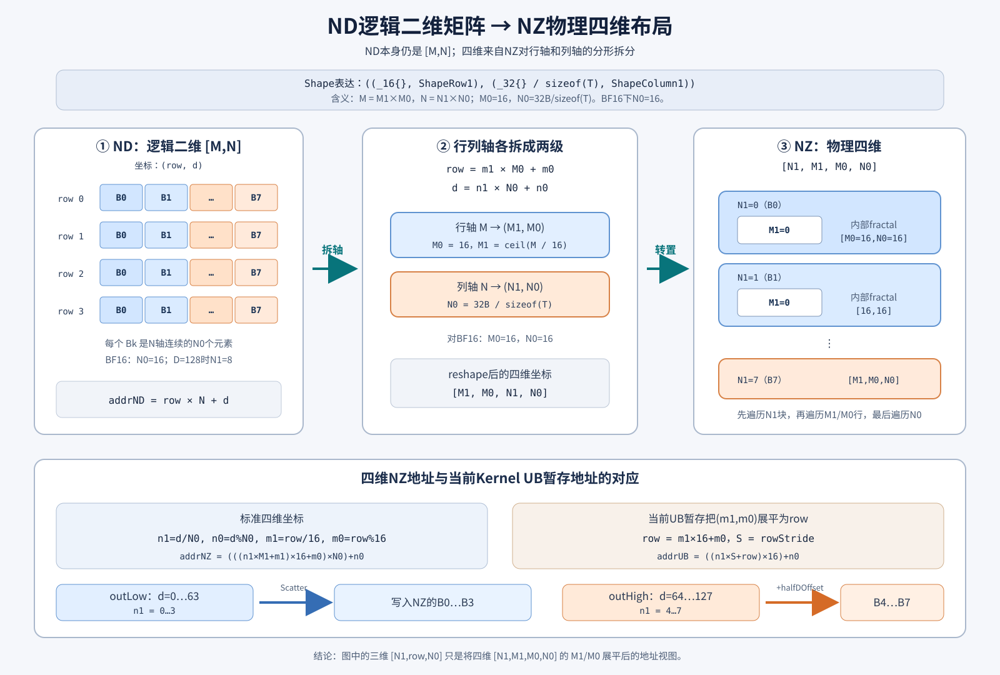

# QkvRmsNormRopeCacheWithKScale：M-RoPE 数学逻辑与推导

## 1. 文档目标

本文单独讲解 `QkvRmsNormRopeCacheWithKScale` 当前 M-RoPE 模式的数学语义，并从普通 RoPE 逐步推导出
三轴 M-RoPE 的选源公式。

本文讨论的是本算子的当前实现合同，不是对所有模型中 M-RoPE 变体的通用定义。当前唯一支持的
M-RoPE 组合固定为：

```text
M-RoPE + TND 输入 + TND Q 输出
+ BF16 Q
+ INT8 K Cache
+ FP8 V Cache
```

完整数据流为：

```text
qkv[T,Nq+Nk+Nv,128]
 ├─ Q → RMSNorm → 三轴 M-RoPE → × rotation → BF16 q_out
 ├─ K → RMSNorm → 三轴 M-RoPE → × rotation → INT8 k_cache + FP32 k_scale_cache
 └─ V → × v_scale[Nv,128] → FP8 v_cache
```

与普通 RoPE 相比，M-RoPE 的核心差异不是改变二维旋转公式，而是为每个旋转 lane 从 T/H/W 三个位置轴中
选择不同的 cos 和 sin。选完以后，Q/K 仍使用普通 RoPE 的二维旋转公式。

## 2. 模式合同和符号

### 2.1 Shape 约束

当前 M-RoPE 模式要求：

```text
0 < Nq <= 64
Nq = 8 × Nk
Nk = Nv
D = 128
layout_qkv = TND
layout_q_out = TND
```

主要输入与输出为：

| 名称 | dtype | shape | 说明 |
|---|---|---|---|
| `qkv` | BF16 | `[T,Nq+Nk+Nv,128]` | 融合 Q/K/V |
| `q_gamma` | FP32 | `[128]` | Q RMSNorm 权重 |
| `k_gamma` | FP32 | `[128]` | K RMSNorm 权重 |
| `cos_sin` | FP32 | `[MaxSeqLen,128]` | 前 64 列是 cos，后 64 列是 sin |
| `mrope_position` | INT32 | `[T,3]` | 每个 token 的 T/H/W 三路位置 |
| `mrope_section` | ListInt | `[t,h,w]` | H/W lane 覆盖范围及合法性约束 |
| `rotation` | BF16 | `[128,128]` | M-RoPE 后的稠密右乘矩阵 |
| `v_scale` | FP32 | `[Nv,128]` | V 的逐 head、逐通道乘数 |
| `q_out` | BF16 | `[T,Nq,128]` | 不量化的 Q 输出 |
| `q_scale` | — | `None` | M-RoPE 模式不产生 Q scale |
| `k_cache` | INT8 | `[BlockNum,Nk,BlockSize,128]` | K Cache |
| `v_cache` | FP8 | `[BlockNum,Nv,BlockSize,128]` | V Cache |
| `k_scale_cache` | FP32 | `[BlockNum,Nk,BlockSize,1]` | K 的逐 token、逐 head scale |

M-RoPE 使用 `mrope_position + 非空 mrope_section` 作为位置源，因此：

```text
query_start_loc = None
seq_lens = None
q_quant_mode = NoQuant
q_out_dtype = BF16
```

### 2.2 数学符号

本文使用：

| 符号 | 含义 |
|---|---|
| $u$ | token 下标，$0\le u<T$ |
| $n$ | head 下标 |
| $d$ | 完整 head 维下标，$0\le d<D$ |
| $\ell$ | half lane 下标，$0\le\ell<D/2$ |
| $a$ | 位置轴，$a\in\{\mathrm T,\mathrm H,\mathrm W\}$ |
| $C$ | `cos_sin` 矩阵 |
| $P$ | `mrope_position` 矩阵 |
| $W$ | `rotation` 矩阵 |
| $D_h$ | $D/2$，当前为 64 |

## 3. 第一步：从融合 QKV 拆分三条分支

TND 逻辑视图记为：

$$
X_{u,n,d}=\mathrm{qkv}[u,n,d].
$$

融合 N 轴的排列为：

```text
[Q heads | K heads | V heads]
```

因此：

$$
Q_{u,n,d}=X_{u,n,d},\qquad 0\le n<N_q,
$$

$$
K_{u,n,d}=X_{u,N_q+n,d},\qquad 0\le n<N_k,
$$

$$
V_{u,n,d}=X_{u,N_q+N_k+n,d},\qquad 0\le n<N_v.
$$

拆分后的逻辑 shape 为：

```text
Q: [T,Nq,128]
K: [T,Nk,128]
V: [T,Nv,128]
```

## 4. 第二步：Q/K 执行 RMSNorm

M-RoPE 不改变 RMSNorm。对 $A\in\{Q,K\}$ 的某个 token/head 向量，先计算均方值：

$$
\mu^A_{u,n}=\frac{1}{D}\sum_{j=0}^{D-1}A_{u,n,j}^2.
$$

再计算倒数 RMS：

$$
r^A_{u,n}=\frac{1}{\sqrt{\mu^A_{u,n}+\epsilon}}.
$$

最后乘各自的 gamma：

$$
Y^Q_{u,n,d}=Q_{u,n,d}\,r^Q_{u,n}\,q\_gamma_d,
$$

$$
Y^K_{u,n,d}=K_{u,n,d}\,r^K_{u,n}\,k\_gamma_d.
$$

平方、归约、开根和 gamma 乘法按 FP32 语义计算。V 不执行 RMSNorm。

## 5. 第三步：理解三轴位置输入

### 5.1 一个 token 有三个位置

普通 RoPE 中，一个 token 只选择 `cos_sin` 的一行。M-RoPE 中，每个 token 给出三路位置：

$$
P_{u,:}=(P_{u,0},P_{u,1},P_{u,2}),
$$

其中：

```text
P[u,0]：T 轴位置
P[u,1]：H 轴位置
P[u,2]：W 轴位置
```

每个值都必须满足：

$$
0\le P_{u,a}<\mathrm{MaxSeqLen}.
$$

三路位置彼此独立，不要求相等、连续或单调。例如以下输入合法：

```text
mrope_position[u] = [7, 31, 12]
```

### 5.2 先把三路完整行取出来

定义轴到 `mrope_position` 列号的映射：

$$
\iota(\mathrm T)=0,\qquad
\iota(\mathrm H)=1,\qquad
\iota(\mathrm W)=2.
$$

对轴 $a$，读取：

$$
R_{a,u,d}=C_{P_{u,\iota(a)},d}.
$$

因此一个 token 会得到三行长度为 $D$ 的原始数据：

```text
R_T[u,:] = cos_sin[P[u,0],:]
R_H[u,:] = cos_sin[P[u,1],:]
R_W[u,:] = cos_sin[P[u,2],:]
```

每一行内部仍然是：

```text
0 ........ 63 | 64 ....... 127
      cos      |       sin
```

注意：算子会读取 T/H/W 三路的完整 128 个元素，之后才根据 lane 选择最终来源。

## 6. 第四步：推导 T/H/W 交织选源

这是 M-RoPE 与普通 RoPE 的核心差异。

### 6.1 从 lane 编号得到三元组编号

当前 $D=128$，所以 cos 和 sin 各有 $D_h=64$ 个 lane。对局部 half lane $\ell$，定义：

$$
r(\ell)=\left\lfloor\frac{\ell}{3}\right\rfloor,
\qquad
\rho(\ell)=\ell\bmod 3.
$$

$r(\ell)$ 表示第几个三元组，$\rho(\ell)$ 表示这个 lane 在三元组中的位置：

| $\rho(\ell)$ | 候选轴 | lane 序列 |
|---:|---|---|
| 0 | T | 0、3、6、9、… |
| 1 | H | 1、4、7、10、… |
| 2 | W | 2、5、8、11、… |

如果不考虑 section 截断，理想交织序列就是：

```text
T0, H0, W0, T1, H1, W1, T2, H2, W2, ...
```

这里的 `T0/H0/W0` 表示第 0 个三元组的三个位置轴来源，不是 `cos_sin` 的列号都等于 0。实际物理列仍是
$3r$、$3r+1$、$3r+2$。

### 6.2 section 如何控制 H/W 覆盖

令：

$$
\mathrm{mrope\_section}=[s_T,s_H,s_W].
$$

当前算子的真实选源公式为：

$$
\sigma(\ell)=
\begin{cases}
\mathrm H,&\rho(\ell)=1\ \land\ r(\ell)<s_H,\\
\mathrm W,&\rho(\ell)=2\ \land\ r(\ell)<s_W,\\
\mathrm T,&\text{其他情况}.
\end{cases}
$$

这意味着：

1. T 是默认来源；
2. 前 $s_H$ 个 H 候选 lane 改用 H 轴；
3. 前 $s_W$ 个 W 候选 lane 改用 W 轴；
4. 超出 H/W 覆盖范围的 lane 回退到同一物理列的 T 轴；
5. $s_T$ 不参与 $\sigma(\ell)$，因此不改变数值选源。

第 5 点是当前实现合同中最容易误解的地方。$s_T$ 仍必须非负，并参与总和约束：

$$
s_T+s_H+s_W\le64.
$$

但在 $s_H,s_W$ 不变时，改变 $s_T$ 不应改变 M-RoPE 计算结果。

### 6.3 为什么 H/W 上限都是 21

在 $\ell=0,\ldots,63$ 中：

```text
余数为 0 的 T 候选 lane：22 个
余数为 1 的 H 候选 lane：21 个
余数为 2 的 W 候选 lane：21 个
```

因此 D128 下：

$$
0\le s_H\le21,\qquad 0\le s_W\le21.
$$

合法性条件完整写为：

$$
s_T\ge0,\quad
0\le s_H\le21,\quad
0\le s_W\le21,\quad
s_T+s_H+s_W\le64.
$$

例如：

```text
[22,21,21]：合法，总和恰好为 64
[0,21,21]：合法，H/W 全覆盖
[0,22,0] ：非法，H 超过 21
[23,21,21]：非法，总和超过 64
```

### 6.4 得到最终有效 cos 和 sin

选源函数确定后，最终 cos/sin 为：

$$
\widehat c_{u,\ell}=R_{\sigma(\ell),u,\ell},
$$

$$
\widehat s_{u,\ell}=R_{\sigma(\ell),u,D_h+\ell}.
$$

cos 和 sin 必须使用同一个 $\sigma(\ell)$。也就是说，某个 lane 如果选择 H 轴，那么它的 cos 和 sin 都来自
H 轴对应位置，不能 cos 来自 H、sin 来自 T。

## 7. 第五步：把选出的 cos/sin 应用于 Q/K

### 7.1 half-split 配对

对 RMSNorm 后的 $Y^A$，其中 $A\in\{Q,K\}$，拆成前后两半：

$$
Y^{A,L}_{u,n,\ell}=Y^A_{u,n,\ell},
$$

$$
Y^{A,H}_{u,n,\ell}=Y^A_{u,n,D_h+\ell}.
$$

D128 对应的维度对为：

```text
0 ↔ 64
1 ↔ 65
...
63 ↔ 127
```

### 7.2 二维旋转公式

对每个 token、head 和 lane：

$$
Z^{A,L}_{u,n,\ell}
=Y^{A,L}_{u,n,\ell}\widehat c_{u,\ell}
-Y^{A,H}_{u,n,\ell}\widehat s_{u,\ell},
$$

$$
Z^{A,H}_{u,n,\ell}
=Y^{A,H}_{u,n,\ell}\widehat c_{u,\ell}
+Y^{A,L}_{u,n,\ell}\widehat s_{u,\ell}.
$$

拼接得到：

$$
Z^A_{u,n,:}=Z^{A,L}_{u,n,:}\mathbin\Vert Z^{A,H}_{u,n,:}.
$$

可见 M-RoPE 的二维旋转矩阵本身仍然是：

$$
\begin{bmatrix}
z_L\\z_H
\end{bmatrix}
=
\begin{bmatrix}
\widehat c&-\widehat s\\
\widehat s&\widehat c
\end{bmatrix}
\begin{bmatrix}
y_L\\y_H
\end{bmatrix}.
$$

例如 $y_L=2$、$y_H=3$、$\widehat c=0.8$、$\widehat s=0.6$：

$$
z_L=2\times0.8-3\times0.6=-0.2,
$$

$$
z_H=3\times0.8+2\times0.6=3.6.
$$

Q 和 K 对同一个 token 使用同一组 $\widehat c,\widehat s$，并沿 head 维广播；但二者输入和 gamma 不同，
因此旋转结果不同。

## 8. 第六步：右乘 rotation 矩阵

M-RoPE 后，Q/K 还要右乘同一个外部矩阵 $W=\mathrm{rotation}$：

$$
C^Q_{u,n,j}=\sum_{r=0}^{D-1}Z^Q_{u,n,r}W_{r,j},
$$

$$
C^K_{u,n,j}=\sum_{r=0}^{D-1}Z^K_{u,n,r}W_{r,j}.
$$

逻辑矩阵 shape 为：

```text
[T×Nq,128] @ [128,128] → [T×Nq,128]
[T×Nk,128] @ [128,128] → [T×Nk,128]
```

`rotation` 不属于 M-RoPE。M-RoPE 负责构造 $Z^Q/Z^K$，`rotation` 是随后独立执行的稠密线性变换。

数值路径上，M-RoPE 结果在进入 Cube 前转为 BF16，`rotation` 也是 BF16，Cube 以 FP32 累加并产生
$C^Q/C^K$。

## 9. 第七步：Q 输出 BF16，不产生 q_scale

M-RoPE 组合固定使用：

```text
q_quant_mode = NoQuant
q_out_dtype  = BF16
```

因此 Q 不执行 max-abs、scale、除法和 FP8 cast，直接将 Cube FP32 输出转换为 BF16：

$$
Q^{out}_{u,n,d}=\operatorname{RNE}_{BF16}(C^Q_{u,n,d}).
$$

输出 shape 为：

$$
Q^{out}\in\mathrm{BF16}^{T\times N_q\times128}.
$$

同时：

```text
q_scale = None
```

这里不是生成一个全 1 或全 0 的 q_scale，而是根本没有 Q 量化 scale。

## 10. 第八步：K 动态量化为 INT8

K 按 token、按 head 独立计算动态 scale。对每个 $[u,n,:]$ 行：

$$
m^K_{u,n}=\max_{0\le d<D}|C^K_{u,n,d}|.
$$

INT8 对称量化上限使用 127：

$$
\alpha^K_{u,n}=\frac{m^K_{u,n}}{127}.
$$

量化值为：

$$
K^{int8}_{u,n,d}
=\operatorname{sat}_{[-127,127]}
\left(
\operatorname{RINT}\left(\frac{C^K_{u,n,d}}{\alpha^K_{u,n}}\right)
\right).
$$

近似反量化关系为：

$$
C^K_{u,n,d}\approx K^{int8}_{u,n,d}\,\alpha^K_{u,n}.
$$

因此一个 K head 的 128 个值共用一个 scale，而不同 token/head 使用不同 scale：

```text
K value shape（逻辑）：[T,Nk,128]
K scale shape（逻辑）：[T,Nk]
```

设备转换包含舍入与饱和；当前 Golden/NPU 验收要求 INT8 K 所有元素绝对误差不大于 1。

## 11. 第九步：V 使用逐通道 v_scale 并转 FP8

M-RoPE 的 V 分支不执行 RMSNorm、M-RoPE 或 rotation。它使用二维 `v_scale[Nv,128]`：

$$
V^{scaled}_{u,n,d}=\operatorname{FP32}(V_{u,n,d})\,v\_scale_{n,d}.
$$

再饱和转换为 FP8 E4M3FN：

$$
V^{fp8}_{u,n,d}
=\operatorname{cast}^{RINT,SAT}_{FP8\ E4M3FN}
\left(V^{scaled}_{u,n,d}\right).
$$

`v_scale[n,d]` 只沿 token 维广播。它与普通 RoPE 的 `[Nv]` head scale 不同：

```text
普通 RoPE：V[u,n,d] × v_scale[n]
M-RoPE   ：V[u,n,d] × v_scale[n,d]
```

`v_scale` 是调用者给定的乘数，不是像 K scale 那样由 kernel 根据 max-abs 动态生成。

## 12. 第十步：按照 slot_mapping 写入 Cache

令：

$$
s_u=\mathrm{slot\_mapping}[u].
$$

若 Cache 的 block 大小为 $B_s=\mathrm{BlockSize}$，则：

$$
b_u=\left\lfloor\frac{s_u}{B_s}\right\rfloor,
\qquad
o_u=s_u\bmod B_s.
$$

写回公式为：

$$
k\_cache[b_u,n,o_u,d]=K^{int8}_{u,n,d},
$$

$$
k\_scale\_cache[b_u,n,o_u,0]=\alpha^K_{u,n},
$$

$$
v\_cache[b_u,n,o_u,d]=V^{fp8}_{u,n,d}.
$$

`slot_mapping` 只决定写到哪里，不改变 M-RoPE 的位置选择。`mrope_position` 决定用哪组 cos/sin，
`slot_mapping` 决定最终 K/V 落到哪个 cache slot，两者是独立概念。

## 13. 用一组公式总结完整 M-RoPE 流程

对 $A\in\{Q,K\}$：

### 13.1 RMSNorm

$$
Y^A_{u,n,d}
=\frac{A_{u,n,d}}
{\sqrt{\frac1D\sum_jA_{u,n,j}^2+\epsilon}}
\,\gamma^A_d.
$$

### 13.2 三轴选源

$$
R_{a,u,d}=C_{P_{u,\iota(a)},d},
$$

$$
\sigma(\ell)=
\begin{cases}
H,&\ell\bmod3=1\land\lfloor\ell/3\rfloor<s_H,\\
W,&\ell\bmod3=2\land\lfloor\ell/3\rfloor<s_W,\\
T,&\text{其他}.
\end{cases}
$$

$$
\widehat c_{u,\ell}=R_{\sigma(\ell),u,\ell},\qquad
\widehat s_{u,\ell}=R_{\sigma(\ell),u,64+\ell}.
$$

### 13.3 half-split M-RoPE

$$
Z^A_{u,n,\ell}
=Y^A_{u,n,\ell}\widehat c_{u,\ell}
-Y^A_{u,n,64+\ell}\widehat s_{u,\ell},
$$

$$
Z^A_{u,n,64+\ell}
=Y^A_{u,n,64+\ell}\widehat c_{u,\ell}
+Y^A_{u,n,\ell}\widehat s_{u,\ell}.
$$

### 13.4 rotation

$$
C^A_{u,n,j}=\sum_{r=0}^{127}Z^A_{u,n,r}W_{r,j}.
$$

### 13.5 Q 输出

$$
Q^{out}_{u,n,d}=\operatorname{BF16}(C^Q_{u,n,d}),
\qquad q\_scale=None.
$$

### 13.6 K 输出

$$
\alpha^K_{u,n}=\frac{\max_d|C^K_{u,n,d}|}{127},
$$

$$
K^{int8}_{u,n,d}
=\operatorname{INT8}\left(\frac{C^K_{u,n,d}}{\alpha^K_{u,n}}\right).
$$

### 13.7 V 输出

$$
V^{fp8}_{u,n,d}
=\operatorname{FP8}\left(\operatorname{FP32}(V_{u,n,d})v\_scale_{n,d}\right).
$$

最后将 $K^{int8}$、$\alpha^K$ 和 $V^{fp8}$ 按 `slot_mapping` scatter 到三块 Cache。

## 14. 当前代码实现伪代码

当前实现分成两个阶段：算子开始时根据 `mrope_section` 构造一次选源索引；处理每个 token 时读取三路
`cos_sin`，使用该索引选择有效 cos/sin，然后对所有 Q/K head 执行 RMSNorm 和二维旋转。

这里需要区分逻辑 shape 和物理分形：ND 逻辑矩阵是二维 `[M,N]`；NZ 将行列分别拆为
`M=M1×M0`、`N=N1×N0`，物理坐标为 `[N1,M1,M0,N0]`。当前 UB 地址公式把 `M1/M0`
展平为一个 `row`，所以也可以暂时写成 `[N1,row,N0]`，但它不是完整的 NZ shape 表达。



```text
常量：
    D      = 128
    HALF_D = 64
    AXIS_T = 0
    AXIS_H = 1
    AXIS_W = 2

输入：
    cos_sin[MaxSeqLen, 128]
    mrope_position[T, 3]
    mrope_section = [section_t, section_h, section_w]


阶段一：算子初始化时构造64项选源索引

    for lane in 0 .. 63:
        group         = lane // 3
        axis_in_group = lane % 3

        # T轴是默认来源
        axis = AXIS_T

        # H候选lane只有在section覆盖范围内才选择H轴
        if axis_in_group == 1 and group < section_h:
            axis = AXIS_H

        # W候选lane只有在section覆盖范围内才选择W轴
        else if axis_in_group == 2 and group < section_w:
            axis = AXIS_W

        # 三路原始数据按[T的128个元素 | H的128个元素 | W的128个元素]平铺
        gather_index[lane] = axis * D + lane

    # section_t不进入上面的选源过程，只在Host侧参与非负和总和校验


阶段二：为每个token准备T/H/W三路原始位置数据

    for token in 0 .. T-1:
        position_t = mrope_position[token, AXIS_T]
        position_h = mrope_position[token, AXIS_H]
        position_w = mrope_position[token, AXIS_W]

        raw[AXIS_T, 0:128] = cos_sin[position_t, 0:128]
        raw[AXIS_H, 0:128] = cos_sin[position_h, 0:128]
        raw[AXIS_W, 0:128] = cos_sin[position_w, 0:128]
        raw_flat = 按T/H/W轴顺序平铺raw


阶段三：使用同一份选源索引取得64个cos和64个sin

        for lane in 0 .. 63:
            index = gather_index[lane]

            # index已经包含选中的T/H/W轴偏移
            selected_cos[lane] = raw_flat[index]
            selected_sin[lane] = raw_flat[index + HALF_D]


阶段四：对当前token的每个Q/K head执行RMSNorm和M-RoPE

        for branch in [Q, K]:
            gamma = q_gamma if branch == Q else k_gamma

            for head in branch.heads:
                x[0:128] = 从融合qkv中读取当前token/head

                mean_square = sum(x[d] * x[d] for d in 0 .. 127) / 128
                reciprocal_rms = 1 / sqrt(mean_square + epsilon)

                for lane in 0 .. 63:
                    low  = float32(x[lane])      * reciprocal_rms * gamma[lane]
                    high = float32(x[64 + lane]) * reciprocal_rms * gamma[64 + lane]

                    cos_value = selected_cos[lane]
                    sin_value = selected_sin[lane]

                    rope_low  = low  * cos_value - high * sin_value
                    rope_high = high * cos_value + low  * sin_value

                    mrope_output[lane]      = BF16(rope_low)
                    mrope_output[64 + lane] = BF16(rope_high)

                将mrope_output整理成Cube需要的NZ布局


阶段五：M-RoPE之后的Q/K/V处理

    Q:
        cube_q = mrope_q @ rotation
        q_out  = BF16(cube_q)
        q_scale = None

    K:
        cube_k = mrope_k @ rotation
        k_scale[token, head] = max_abs(cube_k[token, head, :]) / 127
        k_int8 = RINT_AND_SAT(cube_k / k_scale, [-127, 127])
        按slot_mapping写入k_cache和k_scale_cache

    V:
        v_fp8[token, head, d] = FP8_SAT(
            float32(v[token, head, d]) * v_scale[head, d]
        )
        按slot_mapping写入v_cache
```

这段伪代码体现了三个关键实现事实：

1. 64 个 lane 同时决定 64 个 cos 和 64 个 sin，sin 只是在同一轴内增加 64 列偏移；
2. `gather_index` 对一次调用中的全部 token 复用，因为 `mrope_section` 不随 token 变化；
3. Q/K 共用同一个 token 的有效 cos/sin，但分别使用自己的输入 head 和 gamma。

## 15. 与普通 RoPE 的数学差异

| 项目 | 普通 RoPE | 当前 M-RoPE |
|---|---|---|
| token 位置输入 | 每个 token 一个最终位置 | 每个 token 有 T/H/W 三个位置 |
| 位置输入形式 | `query_start_loc + seq_lens` 推导 | 直接传 `mrope_position[T,3]` |
| cos/sin 选择 | 整个向量来自同一行 | 每个 lane 按 T/H/W 交织选源 |
| 二维旋转公式 | half-split RoPE | 完全相同 |
| Q 后处理 | FP8动态量化，产生q_scale | BF16直接输出，q_scale=None |
| K 后处理 | FP8动态量化 | INT8动态量化 |
| V scale | `[Nv]`，按head广播 | `[Nv,128]`，逐head逐通道 |
| 支持布局 | NTD→NTD、TND→TND、TND→NTD | 仅TND→TND |

所以可以把 M-RoPE 理解为：

```text
普通 half-split RoPE 公式
+ 三轴位置表
+ lane 级 T/H/W cos/sin 选源
+ 固定的 BF16-Q / INT8-K / 逐通道-V 后处理组合
```
