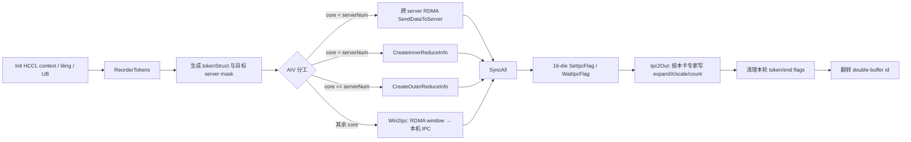
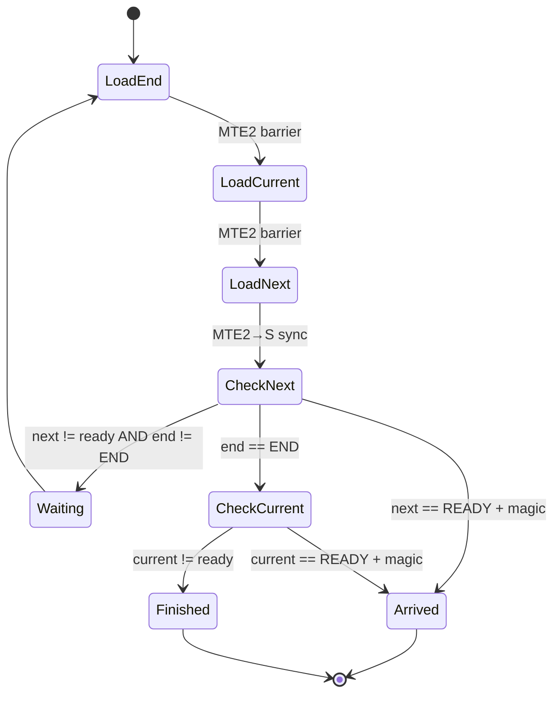
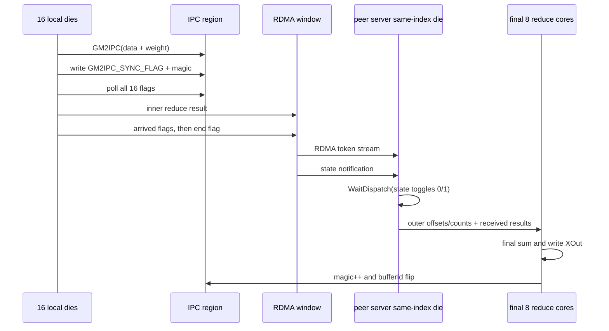

# A3 MoeDistribute Dispatch/Combine V2 hierarchy 白盒走读报告

## 1. 结论摘要

审查范围为 A3 `MoeDistributeDispatchV2` / `MoeDistributeCombineV2` 的 hierarchy tiling、kernel 入口、AIV kernel、HCCL window/IPC 布局，以及其与 A2 hierarchy 的提交历史和实现差异。

结论：A3 hierarchy **存在未继承的 A2 可观测性 feature，并曾存在多个明显逻辑风险**。本分支已同步 issue #4501 的结束标志时序、magic、64 位地址偏移、紧凑 flag 和 BS 上限等修复，并修复本次扫描发现的 Inner ReduceInfo UB 溢出、Combine 空指针、全零动态量化除零、固定数组尾后读取和两处 UB 视图范围问题。

优先级结论：

| 等级 | 结论 | 建议 |
|---|---|---|
| P0 | Dispatch `CreateInnerReduceInfo` 的 `expertsPerServer * realBS` 映射在 BS=512/128 专家时需 227.6 KiB | **已修复**：改为稳定计数排序，最大形状约 106.6 KiB |
| P1 | Combine hierarchy 缺少 `expandScales` 时，host 先解引用空指针再校验 | **已修复**：先判空再访问 shape |
| P1 | Dispatch/Combine 动态量化对全零向量存在除零风险 | **已修复**：量化值和对外 scale 均约定为 0，内部使用安全分母 |
| P1 | A3 未继承 A2 hierarchy 的 ADump/通信执行打点 | 明确是否列入 A3 feature parity；若需要，需同时重排 HCCL/UB 状态区 |
| P2 | Combine `SumToWindowAdd` 会在无 token 或最后一个 token 后读取未初始化/越界的 65 项数组 | **已修复**：删除固定数组，按本核步长直接流式处理 token |
| P2 | A3 hierarchy 不支持 A2 已有的 `performanceInfo`，host 明确拒绝 | 属于公开能力差距，不是隐藏 bug；由产品需求决定是否补齐 |
| P3 | 未使用的 `winSizeMin`、错误的“100 MB”注释、token-count 2 KiB 小视图 | **已清理** |

## 2. 审查边界与验证状态

主要文件：

- `mc2/moe_distribute_dispatch_v2/op_kernel/arch22/moe_distribute_dispatch_v2_a3.cpp`
- `mc2/moe_distribute_dispatch_v2/op_kernel/arch22/moe_distribute_dispatch_v2_layered.h`
- `mc2/moe_distribute_dispatch_v2/op_host/op_tiling/moe_distribute_dispatch_v2_tiling.cpp`
- `mc2/moe_distribute_dispatch_v2/op_host/op_tiling/moe_distribute_check_win_size.h`
- `mc2/moe_distribute_combine_v2/op_kernel/arch22/moe_distribute_combine_v2_a3.cpp`
- `mc2/moe_distribute_combine_v2/op_kernel/arch22/moe_distribute_combine_v2_layered.h`
- `mc2/moe_distribute_combine_v2/op_host/op_tiling/moe_distribute_combine_v2_tiling.cpp`
- A2 对应 entry/layered kernel 及 2025-09 至 2026-07 的相关提交历史

当前分支已快进到主仓 `master@1fd3f950c`，并在该基线上完成以下验证：

| 项目 | 结果 |
|---|---|
| A3 Dispatch + Combine 指定算子编译/打包（`ascend910_93`, `-j2`） | 通过 |
| 安装包完整性检查 | `--check` 通过，最终包 SHA-256 `fbb3eecfb863a99fc5ffe744e8002213c0f5d023089aaf036f3513ed38770a45` |
| 单机 16 rank，BS=1/2，4 种路由，Both hierarchy，100 loops/case | 8/8 case、所有 rank 精度通过 |
| 单机 16 rank，BS=512，Both hierarchy | 通过 |
| 单机 16 rank，BS=512/K=16/H=1024/128 experts（旧 UB 超限构型） | 通过 |
| 单机 16 rank，全零 Dispatch/Combine 动态通信量化 | 2/2 case 通过，无 NaN/Inf |
| 单机 16 rank，全 false 一维 token mask / 空路由 | 通过 |
| 测试工程专项及相关单测 | 93 passed, 1 skipped（真实 NPU 预检集成测试默认跳过） |

上述结果已覆盖本次白盒发现的大专家数 UB、全零量化和空 token 流；`expandScales=nullptr` 属于负向 host 校验，已由代码路径检查覆盖。受单机环境限制，本文未执行 32/64 rank 的跨 server RDMA 回归，因此单机 ready 不等价于多机 ready，也不等价于形式化证明。

## 3. A2 → A3 feature / bugfix 继承矩阵

| 能力或修复 | A2 hierarchy | A3 hierarchy 当前状态 | 判定 |
|---|---|---|---|
| magic 每轮递增，避免旧 flag 串轮 | 已有 | 当前分支已同步 | 必需 bugfix |
| token flag 使用 8-byte 有效载荷 | 已有 | 当前分支已同步 | 必需 bugfix |
| end flag / current token / next token 的有序读取 | 2026-05 `8b4b39be6` 修复 | 当前分支已同步等价逻辑 | issue #4501 根因修复 |
| 地址及 IPC offset 使用 64 位 | 已有修复 | 当前分支已同步 | 必需 bugfix |
| hierarchy BS=512 | A2 Dispatch/Combine 已支持 | A3 kernel/tiling 已放开到 512，Inner ReduceInfo 已重构 | 代码已同步；README 规格表述仍需 owner 统一 |
| HCCL buffer 地址布局重构 | 2026-03 `77411b7de` | 未直接继承；A3 保持 16-rank/server、固定 400 MiB RDMA + IPC 设计 | 架构差异，不能机械 cherry-pick |
| ADump、执行位置和通信信息记录 | 2026-05 `5a32325da` | A3 layered kernel 无 ADump | 明确遗漏的可观测性 feature |
| `performanceInfo` 通信耗时 | A2 layered kernel 支持 | A3 tiling 对 hierarchy 显式拒绝 | 明确 feature gap，当前属于受控限制 |
| AICPU/AIV dataplane 动态选择 | A2 entry 支持 | A3 hierarchy 仅 AIV RMA 路径 | A3 架构选择，不建议直接同步 |
| 带 smooth scale 的 per-token 动态量化实例 | A2 entry 有 `ScaleMode=true` 实例 | A3 hierarchy 固定 `IsSmoothScaleExist=false`，且文档声明 hierarchy 不支持 `scalesOptional` | 公开契约下不是遗漏；模板参数应简化避免误导 |
| 一维 active mask | A3 kernel 已实现 | host 只拒绝二维 mask | A3 已有能力；全 false 空路由已实测，尾部 false 仍建议扩充 |

### BS=512 契约冲突

- 公共 tiling 常量当前为 hierarchy 512。
- A3 Dispatch README 的一处产品说明仍写 `fullmesh_v2/hierarchy <= 256`，另一处及 Combine 文档写 A3 BS 可到 512。
- 单机 16-die、当前测试专家配置下 BS=512 已通过。
- 大专家数下的 Inner ReduceInfo UB 溢出已用 O(BS + experts) 稳定计数排序取代 O(BS * experts) 映射。

建议由接口 owner 确认 A3 hierarchy 的正式上限并统一 README/aclnn 文档；代码与专项用例已按 512 收口。

## 4. Dispatch 代码走读

### 4.1 入口与 tiling

1. Host 校验 hierarchy 的 `epWorldSize` 为 16 的整数倍、无共享专家、不可变 BS、无二维 mask/特殊专家/performanceInfo。
2. 计算 `localMoeExpertNum = moeExpertNum / epWorldSize`，并填充 BS/H/K/world/rank/AIV 数。
3. hierarchy window 校验使用 `404 MiB + moeExpertNum * maxBS * tokenStruct` 近似上界。
4. TilingKey 路由到 A3 entry；非量化实例为 `<X, Out, false, false, false>`，per-token int8 为 `<X, int8, false, true, false>`。
5. hierarchy 的 Inner ReduceInfo 已不再依赖 `expertsPerServer * BS` 的 UB 大表；最大参数下仍低于 190 KiB。

### 4.2 Kernel 流水



### 4.3 TokenStruct

```text
offset 0
┌───────────────┬──────────────────┬───────────────────┬───────────────────┬───────────────┐
│ flag 32 B     │ token H*dtype    │ expertIds         │ expert weights    │ scale 32 B    │
│ magic+ready   │ fp16/bf16/int8   │ Align8(K)*4 B     │ Align8(K)*4 B     │ dynamic quant │
└───────────────┴──────────────────┴───────────────────┴───────────────────┴───────────────┘
```

跨 server 发送时，一个 token 对同一 server 只发送一次；server 内根据 topK 再拆到目标 expert/rank 的 IPC slice。

## 5. Combine 代码走读

### 5.1 入口与流水

1. Host 复用 Dispatch 输出的 `assistInfoForCombine`、`epSendCount`、`expandScales`，校验 hierarchy 的固定 BS 和 16-rank/server 拓扑。
2. `GM2IPC` 把各专家结果和权重写入同号 die 可见的 IPC 区。
3. 16 个 AIV 交换 `GM2IPC_SYNC_FLAG + magic`，确保机内数据就绪。
4. 大部分 AIV 执行 server 内同 token/topK 累加；每 server 一个 AIV 将紧凑结果发到其他 server 同号 die。
5. 8 个 AIV 根据 Outer ReduceInfo 对 server 结果做最终累加并写 `XOut`。

```mermaid
flowchart LR
    A[expandX + expandScales] --> B[GM2IPC 按 dst rank 聚合]
    B --> C[16-die IPC flag barrier]
    C --> D[Inner reduce: 同 server 同 token 的 topK 加权和]
    D --> E[写 RDMA window + arrived/end flag]
    E --> F[每 server 1 core 跨 server RDMA]
    F --> G[状态通知 / WaitDispatch]
    G --> H[Outer reduce: 最多 8 cores]
    H --> I[XOut]
    D -. commQuantMode=2 .-> Q[重新量化 int8 + 分组 scale]
    Q --> E
```



## 6. HCCL buffer 设计图

每个 rank 同时有 WindowIn/WindowOut，下面是单个 window 的逻辑布局。地址均应使用 64 位计算。

```text
0 MiB                                                                                     winSize
│                                                                                              │
├──────────────────────────── 400 MiB RDMA region ────────────────────────────┬── 4 MiB ───────┼──────── IPC data ────────┤
│                                                                            │ IPC control     │                         │
│  Buffer 0: 200 MiB                    Buffer 1: 200 MiB                    │ flags/magic     │ expert/rank slices      │
│  ┌───────────────────────────────┐     ┌───────────────────────────────┐    │                 │                         │
│  │ dataSpace ≈199 MiB            │     │ dataSpace ≈199 MiB            │    │ 1 MiB flag      │ rankSizeOnIpc =          │
│  │ 按 server/rank 分片           │     │ 按 server/rank 分片           │    │ 2 MiB magic/cnt │ (win-404MiB)/(expert*EP)│
│  ├───────────────────────────────┤     ├───────────────────────────────┤    │                 │ 512B 对齐                │
│  │ stateSpace 1 MiB              │     │ stateSpace 1 MiB              │    │                 │                         │
│  │ end/state + bufferId          │     │ end/state + bufferId          │    │                 │                         │
│  └───────────────────────────────┘     └───────────────────────────────┘    │                 │                         │
└────────────────────────────────────────────────────────────────────────────┴─────────────────┴─────────────────────────┘
```

关键约束：

- `RDMA_DATA_SIZE = 400 MiB`，双 buffer 各 200 MiB；每半区最后 1 MiB 为状态区。
- IPC 基址为 `window + 400 MiB`，前 4 MiB 放 barrier、magic、token count，之后才是数据。
- host hierarchy 校验显式加入 404 MiB，因此固定布局与当前 tiling 是一致的。
- A2 的 HCCL buffer 重构引入了地址信息抽象和 ADump 预留；A3 的 16-die 固定布局不同，不能直接套 A2 offset。

## 7. 同步逻辑图

### 7.1 Dispatch 跨 server token 到达判定

RDMA 消息只有相邻消息首分片具备所依赖的顺序保证，因此接收方使用“下一个 token 的 flag 证明当前 token 完整到达”；收到 end flag 后，再用当前 token flag 判断是否还有最后一个 token。



issue #4501 的核心风险正是 end/current/next 异步加载顺序不确定，可能把新 end 与旧 token flag 配对，提前结束。当前分支已强制三次按序发起读取。

### 7.2 Combine 全流程 barrier



同步状态使用 magic 区分轮次，RDMA data 使用双 buffer 区分相邻调用；Combine 的 self-state 使用 0/1 翻转，避免每轮清零全部状态。

## 8. UB 分配与风险

### 8.1 Dispatch UB

固定 `tBuf = 190 KiB`。BS=512、K=16 时：

```text
0                                                       190 KiB
├──── reduction scratch / flags ────┬───────────────────────┬─────────────────┤
0                                 32.5 KiB                ~174 KiB          190 KiB
                                    │                       │
                                    │ token batch / ReduceInfo│ expertIds int16
                                    └─ TBUF_TEMP_OFFSET      └─ 从尾部反向保留
```

`CreateInnerReduceInfo` 原峰值不是 token batch，而是：

```text
TBUF_TEMP_OFFSET
+ Align512(expertsPerServer * realBS) * sizeof(int16)  // expRecvTokenIdxMap
+ Align512(expertsPerServer) * sizeof(int32)           // expCntMap
+ 2 * Align512(realBS * Align8(K)) * sizeof(int32)     // tokenOffset + innerOffset
+ Align16(realBS + aivNum) * sizeof(int16)             // innerCnt
```

以 BS=512、K=16、AIV=48 为例，原布局为：

| expertsPerServer | 估算末地址 | 相对 190 KiB |
|---:|---:|---:|
| 16 | 115.6 KiB | +74.4 KiB |
| 32 | 131.6 KiB | +58.4 KiB |
| 64 | 163.6 KiB | +26.4 KiB |
| 128 | 227.6 KiB | **-37.6 KiB** |
| 512 | 611.6 KiB | **-421.6 KiB** |

本分支删除 `expertsPerServer * realBS` 映射，先为每个 token 记录本 server 的最小目标 expert，再通过专家计数、前缀和和写指针完成稳定排序。输出顺序仍为“最小 expert 分组，组内保持原 token 顺序”，与旧算法一致。新峰值公式为：

```text
TBUF_TEMP_OFFSET
+ Align512(realBS) * sizeof(int16)                     // stable token order
+ Align512(realBS) * sizeof(int32)                     // minimum expert per token
+ 3 * Align512(expertsPerServer) * sizeof(int32)       // count/count/cursor
+ 2 * Align512(realBS * Align8(K)) * sizeof(int32)     // tokenOffset + innerOffset
+ Align16(realBS + aivNum) * sizeof(int16)             // innerCnt
```

在 BS=512、K=16、AIV=48、`expertsPerServer<=512` 时末地址约 **106.6 KiB**，距 190 KiB 还有约 83.4 KiB，不再随 `expertsPerServer * BS` 增长。

### 8.2 Combine UB

Combine 固定 `tBuf = 185 KiB`，各阶段复用同一空间：

```text
GM2IPC:
┌ sendCount(moeExpertNum*4) ┬ scales(maxBS*4) ┬ token(H*2+32) ┐

Inner reduce / SumToWindow:
┌ innerCnt(maxBS*2) ┬ innerOffset(maxBS*K*4) ┬ token ┬ fp32 accum ┬ quant scratch ┐

Outer reduce / SumToServer:
┌ outerOffset(maxBS*serverNum*4) ┬ outerCnt(maxBS*4) ┬ accum/data/scale/cast scratch ┐
```

按当前最大 H=7168、BS=512、serverNum=16 估算，BF16 int8 Outer reduce 末地址约 144.2 KiB，小于 185 KiB。原固定数组 `offsetIndexs/copyNums/dataOffsets[65]` 已删除，`SumToWindow` 直接按 `coreServerId + n * coreNumPerServer` 的步长流式处理，不再存在容量公式和尾后读取。

## 9. 详细问题清单

### 9.1 P0（已修复）：Dispatch hierarchy Inner ReduceInfo UB 溢出

- Kernel：`CreateInnerReduceInfo` 按 `expertsPerServer * realBS` 一次性分配映射。
- Host：`CheckSizeAndSetRelevantCfg` 只在 `isSetFullMeshV2` 时执行 `CheckUBSize`。
- 影响：UB 踩踏可表现为精度错误、死等或随机异常；当前小专家数测试无法覆盖。
- 修复：改为 O(BS + experts) 稳定计数排序，保持旧输出顺序；最大约 106.6 KiB。

### 9.2 P1（已修复）：Combine host 空指针检查顺序错误

`CheckOptionalScalesTensorDim` 中：

```cpp
const auto *shape = context->GetOptionalInputShape(EXPAND_SCALES_INDEX);
const int64_t dim = shape->GetStorageShape().GetDimNum(); // 先解引用
OP_TILING_CHECK(shape == nullptr, ...);                   // 后检查
```

缺少 hierarchy 必选的 `expandScales` 时可能直接崩溃，而不是返回参数错误。

### 9.3 P1（已修复）：全零动态量化除零

- Dispatch：`dynamicScale = 127 / maxVal`；全零 token 时 `maxVal=0`。
- Combine：先得到 `scale=dmax/127=0`，随后执行 `data/scale`。
- 修复：`amax == 0` 时输出全零量化数据和零 scale；Combine 的内部除法改用安全分母。

### 9.4 P2（已修复）：Combine token 描述数组尾后读取

`SumToWindowAdd` 在进入循环前无条件读数组第 0 项；每完成一个 token 后无条件 `processTokenNum++` 并读取下一项。零 token 时读未初始化数据，最后一个 token 后也会读未初始化项；当恰好 65 项时会访问 index 65。

修复后不再预存描述数组，直接从元数据计算当前 token 的 `copyNum/offset/dataOffset`，并在循环结束后只写 end flag。

### 9.5 P2（已消除）：核数与固定数组容量未绑定

固定 65 项数组已删除，容量不再与 reduce core 数耦合。

### 9.6 P2：缺少 A3 ADump 与超时可观测性

A2 的 2026-05 feature 会记录阶段位置、跨 server send/recv、token 数以及超时状态；A3 的多个轮询循环没有对应记录。发生死等时只能依赖外部日志，定位成本高。移植时必须重新规划 A3 固定 window/UB，不能只复制调用点。

### 9.7 P3：可维护性检查

- `RDMA_DATA_SIZE` 错误注释和 Combine 未使用的 `winSizeMin` 已清理。
- Dispatch `tokenCntTensor_` 视图改为按 `serverNum * 16 * localExperts * 8` 精确声明。
- `CreateZeroInnerCnt` 的 `GetWithOffset<int16_t>` 由字节数改为对齐后的元素数。
- 多处 `PipeBarrier<PIPE_ALL>` 可进一步细化，但在正确性确认前不建议以性能清理为由删除。

## 10. 开发过程问题记录

| 阶段 | 现象/根因 | 处理结果 |
|---|---|---|
| 主仓更新 | 工作分支落后主仓 489 个提交 | 先保存本地修改，快进到 `upstream/master@1fd3f950c` 后恢复修改；无文本冲突，随后按新 ABI 重新审查 |
| 测试仓更新 | 远端 fetch refspec 只跟踪已删除的旧分支 | 改为获取全部远端分支，工作分支快进到 `origin/main@7cb5c18`，无文本冲突 |
| 首次启动 | 临时 YAML 写入 `172.17.0.3`，当前节点实际为 `172.17.0.2` | 修正临时配置；失败发生在 Case/算子启动前，不计入算子结果 |
| 最新测试框架适配 | A3 fullmesh 新增 `elastic_info`，hierarchy 旧生成器未初始化该 dataclass 字段 | hierarchy 为每 rank 显式生成 `None`，增加完整 `Case` 构造测试 |
| 大专家 UB 用例 | 初版 H=256 违反主仓 tiling 的 `[1024,8192]` 约束 | 改为 H=1024；UB 压力参数 BS/K/experts 不变，重新生成并实测通过 |
| 空路由用例 | 表中声明全 false mask，但 hierarchy 旧生成器静默丢弃 1D token mask | 补齐 1D prefix mask 及 hierarchy Golden 元数据；测试确认真实入参全 false，真机通过 |
| 最终 diff 复核 | 新稳定排序仅写当前 server 有效 token，消费循环仍遍历全部 `realBS`；部分 server 路由会读到尾部 `-1` | 让排序函数返回 `validTokenNum` 并按其遍历；全模板重新编译和安装包自检通过，32-rank 用例已生成待多机验证 |
| 构建 | 最新主仓将指定 V2 目标与 V3 模板联动，完整构建时间明显增长 | 保留完整构建，不裁剪目标；公共/三方代码原有 warning 未扩散修改范围 |
| 真机重跑环境竞争 | 一次边界用例在 HCCL AICPU 初始化时报 `libccl_kernel.so open failed`；同期 `npu-smi` 显示全部 16 die 被非本次测试 PID 占用 | 未终止外部进程；待其退出后同一安装包、同一用例重跑通过，判定为瞬时设备竞争而非算子失败 |
| NPU 预检解析 | 外部容器进程在宿主 PID namespace 中名称为空，测试框架把有效 `npu-smi` 进程行误判成未知格式 | 允许空名称并记为 `<unknown>`，仍按 busy 失败关闭；增加 parser/checker 单测，避免误报格式错误 |
| 回归说明索引 | 零量化 README 使用 `-i 0,1`，半开区间语义只运行第 0 条 | 修正为 `-i 0,2`，确认两条用例均实际执行并通过 |

## 11. 建议的人工检查顺序

1. 先确认公开规格：A3 hierarchy BS 到底是 256 还是 512，`performanceInfo`/ADump 是否要求与 A2 对齐。
2. 用第 8.1 节公式逐组核对 `BS × K × expertsPerServer`，确认新增参数组合仍落在 190 KiB 内。
3. 检查 Dispatch 的三类索引：tokenStruct byte offset、Inner/Outer metadata element offset、IPC rank/expert slice offset；不要混用元素和字节单位。
4. 对每个 polling loop 检查四件事：谁写、写 data 与 flag 的顺序、magic/bufferId 如何隔轮、谁负责清理。
5. 对 Combine 检查 Inner count 是否始终为非零前缀；若未来放开任意 active mask，`break on zero` 必须重新评估。
6. 最后检查 quant 分支的 dtype reinterpret、scale 存储位置和全零/极值行为。

## 12. 用例覆盖与后续建议

| 用例 | 当前状态 | 目的 |
|---|---|---|
| BS=512, K=16, EP=16, moeExpertNum=128 | 单机已通过 | 捕获 Dispatch Inner UB 边界 |
| hierarchy 且 `expandScales=nullptr` | 代码检查 | 验证 host 返回错误而非崩溃 |
| Dispatch per-token quant 全零 token | 单机 2 case 已通过 | 验证 int8=0、scale 契约和无 NaN/Inf |
| Combine int8 通信，所有 partial sum 为零 | 同上 | 验证重量化零保护 |
| active mask 全 false | 单机已通过 | 覆盖零 token/空路由 |
| EP=32/64，token 只落到部分 server | 已生成 32-rank 表，未运行 | 覆盖 arrived/end flag 和空 server 流 |
| 连续 1000 轮，交替 BS/路由模式 | 未运行 | 加强 magic 与 double buffer 串轮压力 |
| active mask 单 true、尾部 false | 未运行 | 扩充有效前缀边界 |
| moeExpertNum=256/512 | 未运行 | 扩充新 UB 公式的更大专家数边界 |

最终单机日志证据：

- 基线 8 case：`log/log_both_16EP_20260905_1355/172.17.0.2.log`（8 个 `acc_pass: True`）
- BS=512：`log/log_both_16EP_20260905_1401/172.17.0.2.log`
- 128 experts / UB 压力：`log/log_both_16EP_20260905_1403/172.17.0.2.log`
- 全零动态量化 2 case：`log/log_both_16EP_20260905_1405/172.17.0.2.log`（2 个 `acc_pass: True`）
- 全 false mask / 空路由：`log/log_both_16EP_20260905_1407/172.17.0.2.log`

## 13. 最终判定

- issue #4501 对应的结束标志竞态已在当前分支修复，并完成最新主仓基线上的单机 A3 16-die 回归。
- A3 确有未继承 feature：最明确的是 ADump/执行打点和 performanceInfo；AICPU dataplane 属于架构差异，不应视为简单遗漏。
- 白盒扫描确认的确定性逻辑问题均已修复；Dispatch 的 O(BS×experts) UB 布局已降为 O(BS+experts)，Combine 配套的空指针、量化零值和数组尾后读取也已收口。
- 当前代码可判定为 **A3 单机 hierarchy 功能 ready**；跨 server 的 32/64-rank RDMA 路径仍需多机环境验证后才能宣称多机 ready。
