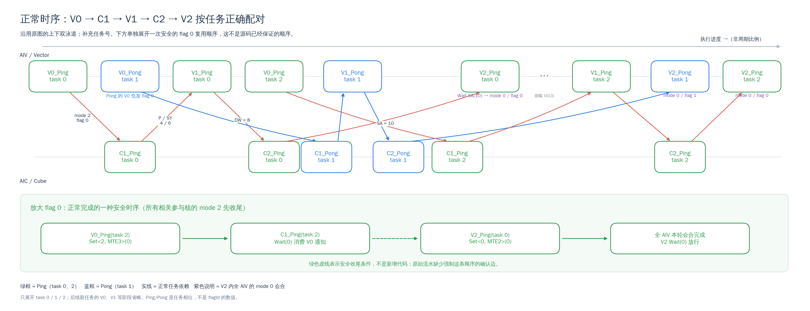
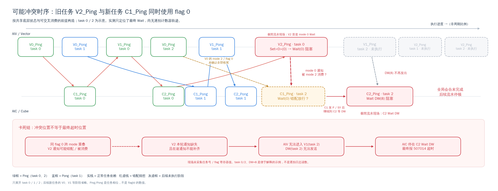

# KL Loss 确定性流水同步超时：背景、原因与证据

日期：2026-09-29。阅读顺序：[一键复现](../../README.klloss.md) → 本文 → [验收摘要](VALIDATION.md)。
这里交付的是可审查、可复跑的**故障诊断样例**，不是完整训练算子的数值实现，也不是正式生产修复。

## 1. 给客户的结论

本例的核心问题是：**两个生命周期可能重叠的同步协议，跨 mode 复用了相同 flagId，
却没有建立足够的隔离或完成确认。不能把 mode 不同理解成拥有不同的底层计数器。**

重点的两组定义来自 before 确定性流水：

```cpp
SYNC_V0_TO_C1_P_SY_FLAG[2] = {0, 1};            // AIV V0 → AIC C1，mode 2
SYNC_C2_TO_V2_DETER_SA_FLAG_MOD0[2] = {0, 1};  // AIV V2 内全 AIV 会合，mode 0
```

后者虽然名字带 `C2_TO_V2`，但 mode 0 的 Set 实际由 **V2/AIV** 发出，不是 Cube 发出。
真正 C2→V2 的数据就绪事件是 SA=10/3，不能与这个全 AIV 会合混为一谈。

目前证据支持到以下层次：

| 层次 | 能明确说什么 | 不能据此说什么 |
|---|---|---|
| 源码 | 两个协议的 ID 重叠，选 ID 的索引也不同 | 同 ID 在所有位置、所有时序都会死锁 |
| 本机 SDK/ELF | 910B Wait 指令只携带 flagId；Set 消息带 mode | 单靠指令编码就知道全部硬件计数器变化 |
| 最小 A/B | 去掉计算后，同 ID 可超时，分离 ID 可连续完成 | 原始整网故障的所有其他原因已排除 |
| 故障 PC | 本次停在某条 Wait，与实际 ELF 对得上 | 这条 Wait 就是最早破坏同步状态的位置 |
| 候选机制 | mode 0 通知可能被 Cube 的 mode 2 Wait 消费，造成后续缺通知 | 已逐拍抓到了哪次 Set 被哪个核消费 |

“相同 flagId 的 mode 0 / mode 2 共享底层同步状态、mode 0 通知可能被 Cube 消费”
是本次讨论中用户提供的底层机制信息。代码审查与本机实验强支持这个方向，但未获取硬件
计数器/路由逐拍轨迹；下文的异常时序图明确按**候选机制**绘制。

## 2. 事情是怎样收敛到这里的

1. 用户报告：整网中的完整 `before` 偶发卡死，修改后的完整 `new` 未观察到该问题。
   本地抽出的完整计算算子，用合成确定性输入压测，未稳定复现完整 before 的整网偶发故障。
2. 单纯删除同步、只保留计算，不能重放 CV 协议本身的问题。随后把极简版重新向 before
   的确定性同步拓扑对齐，去掉业务计算，保留 V0/C1/V1/C2/V2 的事件和流水推进。
3. 对齐后的纯同步流水复现设备超时：AIV 在 V2 等 mode 0，AIC 在 C2 等 DW。
   初步隔离 flag 0 的对照通过，而仅隔离 flag 1 仍失败，疑点集中到实际使用的 flag 0。
4. 审查反汇编又发现 CANN MIX wrapper 会隐式发 flag 15；早期选 15 的对照存在干扰，
   不能把“算子里没写 15”当成“15 彻底空闲”。旧观测有效，但解释需要加上这个限制。
5. 用户提出最小验证：AIV 先发 V→C mode 2，再做全 AIV mode 0；Cube 只 Wait。
   独立实现去掉隐式 workspace 通知后，仅两轮就能复现同 ID 超时，分离 ID 则通过。
6. 本仓库将两层复现一并迁移，**完整重编 Host/ACLNN/kernel**，重新上卡验证。
   没有把旧 OPP 包作为输入，没有复制 `.so` / `.o` 当作可编译源码交付。

历史步骤用于解释调查过程；本次实测结论与验收规则见 [验收摘要](VALIDATION.md)。
本 patch 不携带历史运行产物，原始日志和反汇编可用所附脚本重新生成。
用户的“整网 before 偶发、new 未观察到”仍是现场报告，不能表述成这里已经完成了整网 A/B 证明。

## 3. 场景与两层实现

固定输入：B=1、TND、Q_len=KV_len=1024、BF16、Q heads=64、Index heads=32、topK=2048，
确定性开启；DQ/DK=512、DIndex=128、RoPE=64。ABI 的序列前缀数组传 `[0,1024]`，
即一个长度 1024 的序列。索引超过有效 token 的槽位为 -1；mask 前 1/3 为 0、其余为 1，
沿用原合成脚本，并非宣称拿到了客户整网真实 mask 分布。

| 实现 | 保留什么 | 去掉什么 | 用途 |
|---|---|---|---|
| `pipeline` | before 对齐的各级事件、全核会合、排空、SyncAll、flag 14、原 mixed wrapper | Matmul/gather/数值归约等业务工作 | 对应原始流水，定位阻塞传播 |
| `same` / `split` | 每轮两个 AIV Set、一个 AIV Wait、一个 AIC Wait | 其他流水、SyncAll、ACK、延迟、Matmul/KFC 初始化、GM 打点 | 检验跨 mode 同 ID 这一个协议组合是否足够触发 |

两者都不读取上述数值输入来计算 KL Loss；测试输出零值只验证接口契约，不是精度验证。
Host 均使用全 mixed 核、AIC:AIV=1:2、`SetScheduleMode(1)`；没有故意注入快慢核。
“数值确定性”不等于“各核每一次事件到达时间完全确定”。

### 3.1 正常每条同步在保护什么

| 阶段 | Set → Wait | mode / flag | 配对索引及含义 |
|---|---|---|---|
| V0 → C1 | AIV MTE3 → AIC | 2 / `{0,1}` | 按 KV 块奇偶；P/SY 输入已准备 |
| C1 → V1 | AIC FIX → AIV | 2 / P=`{4,5}`、SY=`{6,7}` | 按 task 奇偶；两路矩阵输出已准备 |
| V1 内会合 | 同组两个 AIV MTE3 → AIV | 1 / `8` | P/SY 两条 Vector 支路会合 |
| V1 → C2 | AIV MTE3 → AIC | 2 / DW=`{8,9}` | 按 task 奇偶；C2 输入已准备 |
| C2 → V2 | AIC FIX → AIV | 2 / SA=`{10,3}` | 按 task 奇偶；scatter-add 输入已准备 |
| V2 首道会合 | AIV MTE2 → 全 AIV | 0 / `{0,1}` | 按 task 奇偶；进入确定性归约阶段 |
| V2 后续会合 | AIV MTE3 → 全 AIV | 0 / `2` | 控制确定性归约的后续执行阶段 |

当前 KV 有效长度不超过 1024，一个有效 KV 块，所以 V0 实际只发 flag 0；
V2 仍按 task 奇偶交替 0/1。**Ping/Pong 不等于 V0 一定交替用 flag 0/1。**
静态扫描会看到 0/1 都有交叉，必须结合 shape、有效块数和动态索引收敛。
表中 mode 1 / mode 2 对 8 的复用也应单独审查，但不是本次最小 CV/VV 实验引入的事件。

## 4. 正常时序：卡死前原本应当怎样运行



[放大 SVG](diagrams/normal_timing.svg) · [用户提供的参考图](diagrams/user_reference.png)

绿框为 Ping，蓝框为 Pong；上排 AIV，下排 AIC。为避免同名 Ping 混淆，图中补了 task 0/1/2。
根据依赖关系，将参考图中重复的第二个 `C1_Pong` 标为 `C2_Pong`，最右绿色 `V2_Pong`
标为 `V2_Ping(task 2)`。只展开主要阶段，后续新任务的 V0/V1 等工作有省略。

正常逻辑：V0 通知让 C1 读取输入；C1 的 P/SY 通知让 V1 继续；V1 发 DW 让 C2 计算；
C2 发 SA 让 V2 读取结果；V2 的全核会合正确完成后，流水继续向后推进。

图下半部给出同 flag 0 安全复用的一种时序：**所有相关 mode 2 使用先收尾，再开始 mode 0**。
绿色虚线表示安全条件，不表示原始代码已加了 ACK、也不表示源码强制了这个先后顺序。
从图上看到“V0 在 V2 左边”不等于远端 C1 已经把 V0 通知消费完。

## 5. 候选冲突及卡死后的停顿



[放大 SVG](diagrams/conflict_timing.svg)

这不是硬件采样逐拍图，而是能解释实测 Wait 位置的一种候选时序：

1. 新任务 C1 与旧任务 V2 在时间上重叠，虽然任务不同，却都使用 flag 0。
2. AIV 已发 V0 的 mode 2，但不能据此确认所有相关通知都已正确消费、底层状态已收尾。
3. V2 又以 mode 0 在同一 flag 0 发通知；按共享状态前提，它可能被 Cube 的 mode 2 Wait
   错配消费。其他状态错配/轮次混淆也尚未被硬件轨迹排除。
4. 若 V2 全核会合因此缺失完成条件，且在途通知不能补齐，AIV 停在 V2 Wait。
5. 该 AIV 无法执行后续 V1，也就不再发后续任务的 DW；AIC 最终停在 C2 Wait DW，报 507014。

所以最初争用的是 `SYNC_C2_TO_V2_DETER_SA_FLAG_MOD0` 与 `SYNC_V0_TO_C1_P_SY_FLAG`，
而报错 Cube 的最后 PC 可以在 **DW=8/9 的 Wait**，不是 flag 0 的 Wait。
图中 task 0/2 和 DW=8 是示例，不是日志采到了该任务号或寄存器值；只看到最终 PC，不能还原全部核的进度。
如果在途正确通知能补齐，可能只是短暂阻塞或错误放行，不一定发展为持续卡死。

## 6. 最小集合为什么能够说明问题

```cpp
// 每个 AIV
for (unsigned i = 0; i < N; ++i) {
    CrossCoreSetFlag<2, PIPE_MTE3>(0);
    CrossCoreSetFlag<0, PIPE_MTE2>(VV);
    CrossCoreWaitFlag<0, PIPE_MTE2>(VV);
}
// 每个 AIC
for (unsigned i = 0; i < N; ++i) {
    CrossCoreWaitFlag<2, PIPE_MTE2>(0);
}
```

same：VV=0；split：VV=15，其他协议不变。两轮时 Cube 连续执行两个 Wait，
不参与 VV 屏障，也没有反向确认；它进入后一个 Wait 时，AIV 可能仍在处理前一轮或本轮的 mode 0。
AIV 的源码先 Set2 后 Set0，不保证跨 MTE3/MTE2 的完成顺序，更不保证远端消费已退休。

最初实验中单轮 same 连续 1000 次通过；迁移后的扩展验收中，**相同 SHA256 的单轮 ELF
也出现首次调用超时**，PC 是唯一的 AIV Wait（`.text+0xf4`）。两轮和 1024 轮 same
也已复现；对应 split 对照见验收记录。因此不仅不需要原多级计算或大量累积，**跨轮重叠也不是
触发的必要条件**：同一轮不同管线/不同核的 mode 2 与 mode 0 就可能重叠。
后一个 Cube Wait 可以增加重叠机会，但不是唯一窗口。“至少两轮才会卡”的说法已被本次新观测否定。

### 6.1 必须从最终 ELF 排除隐式同步

CANN 9.1 MIX wrapper 自动调用 `matmul::clearWorkspace(workspace)`，真实实现会从 Cube
发 mode 2 flag 15。只删除用户 kernel 中的额外 Set，不代表 Cube 二进制真的只有 Wait。

最小版通过自己的 `cann_mix_wrapper_shim.h` 提供空实现，因为它完全不用 Matmul/KFC/workspace；
没有改 SDK，也没有改默认 pipeline。编译后自动核对 AIC 无 CrossCore Set，AIV 每轮恰好
MTE3/MTE2 两个 Set，Wait 的 ID 正确，排除这个对照干扰。
**该 shim 不是正式 Matmul 算子的优化或修复，不能照搬到需要 KFC 初始化的 kernel。**

### 6.2 与实际指令相匹配

本机 SDK `asc/impl/basic_api/dav_c220/kernel_operator_sync_impl.h` 中 Set 消息编码为：
`1 + ((mode & 3) << 4) + ((flagId & 15) << 8)`。所以 0x21 是 mode 2/flag 0，
0x01 是 mode 0/flag 0，0xf01 是 mode 0/flag 15。
Wait 的实现丢弃 mode，最终是 `wait_flag_dev(flagId)`。
公开接口资料入口：[Ascend C API](https://asc.gitcode.com/api/README.html)；精确实现以本机版本和本次 ELF 为准。

两轮 same 完全展开后的关键指令：

```text
AIC .text+0x60  WAIT_FLAG_DEV #0        第 1 轮
AIC .text+0x64  WAIT_FLAG_DEV #0        第 2 轮
AIV .text+0xf0  SET_CROSS_CORE.MTE3 X1  X1=0x21
AIV .text+0xf4  SET_CROSS_CORE.MTE2 X0  X0=0x01
AIV .text+0xf8  WAIT_FLAG_DEV #0        第 1 轮
AIV .text+0xfc  SET_CROSS_CORE.MTE3 X1
AIV .text+0x100 SET_CROSS_CORE.MTE2 X0
AIV .text+0x104 WAIT_FLAG_DEV #0        报错的 AIV 已到达自己的第二个 Wait
```

该 AIV 的符号起点为 `.text+0x78`。日志 `current - pc start=0x8c`，需要加 0x78
才是 `.text+0x104`，不能直接拿 0x8c 查 `.text`。
1024 轮 same 的 Cube PC 对应 `.text+0x70` 的循环 Wait；没有循环寄存器值，不能判断第几轮。
两轮 AIV Wait 与长循环 AIC Wait 是不同试验的末端表现，不能拼成一次运行的全核快照。

split 的源码只改变 VV 常量，但常量变化会影响 MOV 和寄存器分配；不能宣称 same/split 的
`.text` 完全相同。本仓库完整重编出来的对应 BF16 ELF 与迁移前相同配置的 hash 一致。
实际新构建的故障 PC、hash、反汇编见 [验收记录](VALIDATION.md)。

## 7. 为什么整网偶发问题很难复现

- **输入一致不代表事件到达一致。** mask/gather 工作量、缓存、核间不均衡、MTE 排队和尾任务
  都会改变同步重叠窗口。BF16、topK、shape 固定，只约束了输入/计算场景。
- **完整计算可能掩盖，也可能放大窗口。** VectorLoss、Mm5/Mm6、搬运等使通知与 Wait 的相对
  进度变化；不能推导“有计算就安全”。没有注入快慢核也能复现最小例子，所以不能只归罪于慢核。
- **抽取过多或过少都可能改变现象。** 删除关键同步就丢掉问题；保留计算又可能降低窗口命中率。
  需要先保持拓扑复现，再逐层缩减，而不是假设一个空循环天然等价于整网。
- **插桩本身改变时序。** 额外 SyncAll、ACK、GM 打点、sleep、printf、调试编译都可能让故障消失。
  本次设备侧没有新增打点或延迟，日志在 Host；实际 ELF 必须确认没有编译器/库插入的新通知。
- **末端 PC 不是第一现场。** Cube 等 DW 可能只是 AIV 前面已卡住的后果。只看一个核或一个 Wait
  很容易沿错误方向排查搬运、越界或“DW 丢了”。
- **对照可能有隐藏变量。** 早期合并 `{0,1}` 到单一 ID 同时改变了两个维度；隐式 flag 15 又使
  “看似空闲 ID”的对照不纯。必须检查生成 wrapper、SDK、反汇编、实际加载路径和 hash。
- **复现率不是证明。** 本机第一次就失败，不保证客户任意环境也必现；对照通过数千次也不是
  全 shape 永不死锁的证明。自动矩阵会把“未复现”明确报告出来，不伪装成验收成功。

## 8. 工程修复方向与边界

优先按底层实际共享资源分配不重叠 ID，并审核整个 kernel 加库/wrapper 的生命周期；若必须复用，
则建立可证明的前一协议完成确认。两者都需要在完整算子中重新验证数值正确性、性能、尾块和整网。
不要直接照搬 new 中某个 ID（例如 before 的 SY 仍占 6/7），也不要直接使用本实验的 15。
增加延迟、调低并发、调大 timeout、均衡快慢核只可能改变概率，不能修复不完整的同步协议。

本 PR 不改生产算子，不宣称完成了生产修复；它交付问题的可验证最小证据和排查工具。
仍待获得：客户整网完整现场、各核事件生命周期/计数器轨迹，以及候选修复在完整计算与整网中的验证。

## 9. 用 skill 固化后续审查

仓库提供 [ascend-flag-conflict-audit](../../skills/ascend-flag-conflict-audit/SKILL.md)，未安装到全局环境。
可让支持技能的审查工具显式读取这个 `SKILL.md`；在其他工具中也可按其步骤人工执行。

```bash
python3 skills/ascend-flag-conflict-audit/scripts/scan_flags.py \
  attention/mlp_sparse_lightning_indexer_grad_kl_loss/op_kernel
python3 scripts/klloss/test_tools.py -v
```

扫描先收集 Set/Wait、常量/数组候选和未知项，再由技能要求审核 shape、索引、生产/消费核、
动态次数、生命周期和隐式同步，最后才进入二进制与硬件验证。按 **Set** 判断跨 mode 协议复用；
Wait 默认 mode=0 在此 SDK 中并不意味着它消费的是一个独立 mode 0 协议。

它是保守的词法扫描，不是编译器：条件编译分支、数组索引和同名符号会过近似，不自动解析系统 include，
运行时 ID 必须列为未知。候选不等于缺陷，没有告警也不等于无风险，不能自动改 ID 或声称生产安全。
未来可接入真实编译配置的预处理/AST、按调用图建立 ID 生命周期，再与 ELF/PC 审核形成持续审查流程。
