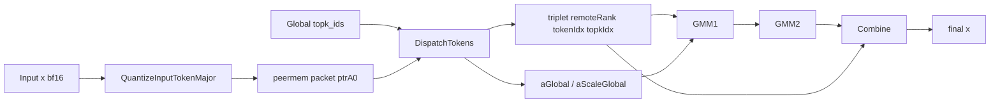

# MegaMoe Dispatch Quant Fix

## 结论

`dispatch` 新路径本身没有把路由和 combine 弄错，真正导致 `bs=8` 精度失败的是 sender 侧 `QuantizeInputTokenMajor()` 里传给 `quant::ComputeScale()` 的 `mxScaleNum` 语义错了。

## 根因

旧实现里把 `mxScaleNum` 当成了 `CeilDiv(H, 64) * 2` 语义来推，虽然最终 `scaleLen` 字节数仍然看起来是对的，但 `quant::ComputeScale()` 实际要求的是和 `dispatch_v2` 一致的 packed MX-scale count：

- 正确语义：`Align2(Ceil32(H))`
- 错误后果：`halfScale` / `mxScale` 在 UB 内的步进和 packed 写法不匹配
- 表现现象：
  - `expert_token_nums PASS`
  - `recvTokenPerExpert` 正常
  - `combine triplet` 自洽
  - 但 `x` 与 golden 有系统性偏差

## 修复

`mega_moe/op_kernel/mega_moe.h` 中做了两件事：

1. 将 `mxScaleNum` 改成和 `dispatch_v2` 一致的 `Ceil32(H)` packed-scale 计数
2. 增加 sender packet raw-byte 打印，便于继续核对 `data` / `scale` 字节头

## 数据流

## 这次验证结果

- `expert_token_nums`: PASS
- `tensor x output`: PASS
- `rank0` / `rank1` 的 `npu_x` 与脚本级联输出完全一致

## 后续排障建议

如果后续再改 dispatch sender：

- 先看 `expert_token_nums` 是否仍是 `[12, 12, 12, 12]`
- 再看 `AIV QuantPacketBytes` 的 raw byte 是否和脚本里 `dispatch_*_raw_head` 对上
- 最后再看 `combine triplet`，不要一开始就怀疑 combine
