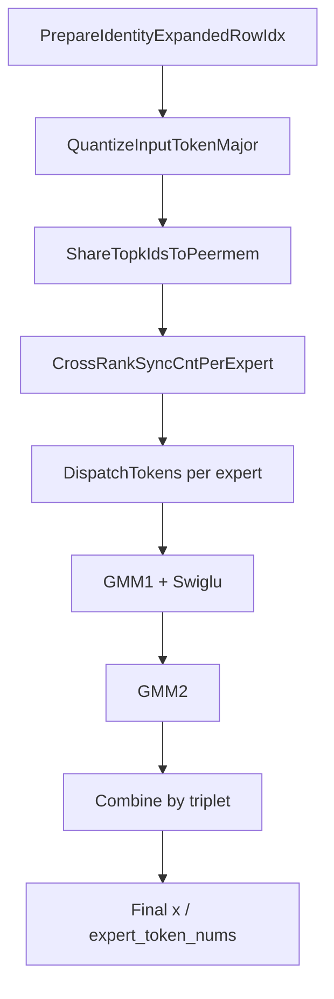

# MegaMoe 端到端流程拆解

## 1. 先给结论：这套代码到底在做什么

这套 `mega_moe` 代码的目标，是把下面这条原本分散的链路融合成一个端到端算子，同时保留脚本级联作为 reference：

1. `dispatch`：根据 `topk_ids` 把 token 发到目标 expert
2. `gmm1 + swiglu`：每个 expert 处理自己收到的 token
3. `gmm2`：第二层投影
4. `combine`：按 `(toRank, tokenId, topkId)` 把结果写回原 token 位置

当前版本最核心的 dispatch 改造，不再依赖 `moe_init_routing_v3` 先做排序再连续搬运，而是改成：

1. 全局共享 `topk_ids`
2. 每个 rank 把输入 token 先量化成固定 packet 放到 `peermem`
3. 接收端按“我是哪个 rank、我有哪些 expert”去扫描所有 rank 的路由表
4. 找出“哪些 token 应该归我”
5. 直接去远端按 `tokenIdx/topkIdx` 拉对应量化 packet
6. 现场生成 `triplet = [remoteRankIdx, tokenIdx, topkIdx]`
7. 重排成 `expert-major` 输入给 `GMM1`
8. `combine` 再根据 triplet 写回最终输出位置

这也是为什么你现在看到的融合算子主流程已经不再从 `moe_init_routing_v3` 起步，而是从“自己做 token-major 量化 + 自己扫描 topk 路由表”起步。

---

## 2. 先看脚本层：怎么验收这条链

### 2.1 入口脚本干什么

入口脚本是：`/home/0506/moe_test/mega_moe/mega_moe.py`

建议先看这些位置：

- `bs` 和量化模式配置：`mega_moe.py:29`, `mega_moe.py:55`
- 差异统计函数：`mega_moe.py:186`, `mega_moe.py:200`
- 最终 compare：`mega_moe.py:979` 往后

脚本层实际做了三件事：

1. 生成输入、golden、expert 路由
2. 同时跑两条链
   - 小算子级联 reference
   - 融合算子 `mega_moe`
3. 对比输出 `x` 和 `expert_token_nums`

最终验收口径就是：

```text
[INFO] tensor x output 精度结果为：PASS
```

### 2.2 小算子级联 reference 是什么

reference 在：`/home/0506/moe_test/mega_moe/graph.py`

建议先看：

- `torch_npu.npu_moe_distribute_dispatch_v2`：`graph.py:29`
- dispatch 输出调试打印：`graph.py:50`, `graph.py:57`
- `npu_grouped_matmul_swiglu_quant_v2`：`graph.py:69`
- `npu_moe_distribute_combine_v2`：`graph.py:121`

级联链路可以概括为：

```python
output_dispatch_npu = torch_npu.npu_moe_distribute_dispatch_v2(...)
y1, y1_scale = torch_npu.npu_grouped_matmul_swiglu_quant_v2(...)
y2 = torch_npu.npu_grouped_matmul(...)
output_combine_npu = torch_npu.npu_moe_distribute_combine_v2(...)
```

也就是说，脚本层的 reference 本质上就是：

`dispatch_v2 -> grouped_matmul_swiglu_quant_v2 -> grouped_matmul -> combine_v2`

融合算子要做的，就是把这几步揉成一条统一的数据流，同时保证结果和这条 reference 链一致。

---

## 3. 再看数据结构：整个融合算子靠什么在传递信息

### 3.1 `PeermemInfo` 是这套设计的骨架

定义在：`/home/0506/dispatch_combine/ops-transformer/mc2/mega_moe/op_kernel/mega_moe_base.h:48`

关键字段：

- `ptrTopkIds`：共享出去的全局 `topk_ids`
- `ptrA0`：发送端写入的量化 token packet
- `ptrTriplet`：和 token 对齐的三元组信息
- `ptrD`：combine 最终写回结果的远端输出缓冲

其中新的偏移量：

- `PEERMEM_TOPK_IDS_OFFSET`：`mega_moe_base.h:28`

`PeermemInfo` 初始化时，已经把 peermem 划分成了下面这些区域：

```text
ptrBase
  ├─ ptrTopkIds
  ├─ ptrTokenPerExpert
  ├─ ptrA0        // token-major 量化包
  ├─ ptrTriplet   // triplet 元信息
  └─ ptrD         // combine 写回结果
```

### 3.2 triplet 是 combine 能写回正确位置的核心契约

triplet 编解码定义在：`mega_moe_base.h:68-81`

编码方式：

```cpp
(rankId << 20) | (tokenId << 4) | topkId
```

也就是说，一个 triplet 精确表达的是：

- 这行结果最终应该回写到哪个 rank
- 对应哪个 token
- 是这个 token 的第几个 topk 槽位

这也是为什么 dispatch 阶段必须现场构造 triplet，因为 combine 阶段已经不再知道 dispatch 时是怎么扫描出来这行 token 的，它只认 triplet。

---

## 4. 主流程总览：`Process()` 才是真正的“总导演”

主流程在：`/home/0506/dispatch_combine/ops-transformer/mc2/mega_moe/op_kernel/mega_moe.h:921`

按逻辑分，`Process()` 可以拆成 5 个阶段：



对应到代码里的注释也基本就是这个顺序：

1. 构造 token-major 量化包
2. 共享 `topk_ids`
3. 全 rank 同步每个 expert 的 token 计数
4. 按 expert 做 dispatch，然后跑 GMM1
5. 再做 GMM2 和 combine

`Process()` 里最关键的一句其实是这句注释：

```cpp
// 1. 直接构造 token-major 量化包，不再依赖 moe_init_routing_v3
```

这句话决定了整个新路径的思想：

- 不再先排序
- 不再把 dispatch 绑定在 `init_routing` 的输出布局上
- 发送端只负责“把自己的 token 量化好并共享路由表”
- 接收端负责“决定自己该拉哪些 token”

---

## 5. 阶段一：发送端如何准备 token-major 量化包

函数：`mega_moe.h:306`，`QuantizeInputTokenMajor()`

它做的事情很直接：

1. 遍历所有 `(tokenIdx, topkIdx)`，也就是 `m * topK` 个 packet 槽位
2. 对每个 token 从 `aGmAddr` 读 BF16 输入
3. 在 UB 里调用量化原语
   - `quant::ComputeMaxExp`
   - `quant::ComputeScale`
   - `quant::ComputeFp8Data`
4. 把结果按 `data + scale` 的 packet 形式写入 `ptrA0`

关键代码形态：

```cpp
quant::ComputeMaxExp(srcAddr, maxExpAddr, H);
quant::ComputeScale<QuantOutType>(maxExpAddr, mxScaleAddr, halfScaleAddr, mxScaleNum);
quant::ComputeFp8Data<bfloat16_t, QuantOutType, ...>(srcAddr, halfScaleAddr, outDataAddr, H);
```

### 5.1 这里为什么是这次修复的根因

这次真正导致精度失败的点就出在这里。

之前的问题不是：

- 路由错了
- expert_token_nums 错了
- combine 写回错了

而是这里给 `quant::ComputeScale()` 的 `mxScaleNum` 语义错了。

最终修复后的语义是：

```cpp
int32_t mxScaleNum = CeilAlign(CeilDiv(H, 32), 2)
```

也就是和 `dispatch_v2` 的 packed MX-scale 计数保持一致，而不是按错误理解去推导 scale 区布局。

### 5.2 packet 长什么样

这里生成的 packet 是：

```text
[data(H bytes)] + [scale(scaleLen bytes)]
```

写入位置：

```cpp
packetGm[flatIdx * copyInNum]
```

所以 `ptrA0` 里的内容，本质是一个按 `(tokenIdx, topkIdx)` 平铺的 token-major 包数组。

这正是新 dispatch 模式的核心前提：

- 量化只做一次
- 量化结果可复用
- 接收端之后可以直接按 `flatIdx` 去远端拉

---

## 6. 阶段二：全局共享 `topk_ids`

函数：`mega_moe.h:385`，`ShareTopkIdsToPeermem()`

逻辑非常简单：

1. 从 `params_.expertIdxGmAddr` 读取全局 `topk_ids`
2. 拷到 `params_.peermemInfo.ptrTopkIds`
3. 写 `routeReady=1`，通知别的 rank 可以读了

也就是说，发送端此时对外暴露了两类信息：

1. `ptrTopkIds`：我每个 token 的 topk expert 是谁
2. `ptrA0`：我每个 `(token, topk)` 对应的量化 packet 是什么

接收端拿到这两样，就足够自己决定要拉什么。

---

## 7. 阶段三：接收端如何根据共享路由表统计“我该收多少 token”

函数：`mega_moe.h:410`，`BuildRoutesFromSharedTopkIds()`

这个阶段干的不是搬运数据，而是统计计数。

核心思路：

1. 对每个 `srcRank`
2. 读它共享出来的 `topk_ids`
3. 扫描所有 `tokenIdx/topkIdx`
4. 如果某个 `globalExpertIdx` 属于我这个 rank 的某个本地 expert
5. 就把 `tokenPerExpertWin_(srcRank, dstRank=self, localExpert)` 加一

也就是说，这个函数回答的问题是：

> “来自每个远端 rank 的哪些 token，最后归我这个 rank 的哪个 expert？”

这一步算出来的 `tokenPerExpertWin_`，后面既用于：

- `DispatchTokens()` 分块搬运
- `expert_token_nums` 输出
- GMM 输入分组

所以它是整个“接收端主导 dispatch”设计里的计数中枢。

---

## 8. 阶段四：真正的 dispatch 是怎么做的

函数：`mega_moe.h:544` 和 `mega_moe.h:600`

- `CopyGMToGMPerTokenV2()`：负责把单个 packet 拆成 `aGlobal + aScaleGlobal`
- `DispatchTokens()`：负责扫描远端路由表、拉取 packet、生成 triplet

### 8.1 `DispatchTokens()` 的关键逻辑

这个函数的核心循环就是：

1. 遍历每个 `srcRank`
2. 确定当前 expert 该从这个 `srcRank` 收多少行
3. 读取远端 `ptrTopkIds` 和 `ptrA0`
4. 扫描 `tokenIdx/topkIdx`
5. 找出 `remoteExpertIdx == globalExpertIdx` 的项
6. 对匹配项：
   - 从 `ptrA0[flatIdx]` 拉出 packet
   - 写到本地 `aGlobal/aScaleGlobal`
   - 生成 `EncodeTriplet(srcRankIdx, tokenIdx, topkIdx)`

关键代码骨架：

```cpp
int32_t remoteExpertIdx = remoteTopkIdsGm.GetValue(flatIdx);
if (remoteExpertIdx != globalExpertIdx) continue;

CopyGMToGMPerTokenV2(..., gmRemoteA[flatIdx * copyInNum], ...);
WriteGmByPassDCache(ptrTriplet + globalTripletRow, EncodeTriplet(srcRankIdx, tokenIdx, topkIdx));
```

### 8.2 为什么这一步叫“接收端主导”

因为它不是发送端把自己排好序然后整块发出来，而是：

- 发送端只共享原始路由表和 packet 池
- 接收端自己扫描全局路由表
- 接收端自己决定哪些 token 属于自己
- 接收端自己去远端按索引拉数据

这就是你最初想要的那种模式。

### 8.3 `CopyGMToGMPerTokenV2()` 为什么重要

`CopyGMToGMPerTokenV2()` 定义在 `mega_moe.h:544`。

它把 `ptrA0` 里的 packet 拆成两部分：

- `aGlobal`：量化数据区
- `aScaleGlobal`：scale 区

这一步相当于把 sender packet 变成 GMM1 可以直接消费的输入张量布局。

所以从数据流角度看：

```text
ptrA0(packet-major) -> CopyGMToGMPerTokenV2 -> aGlobal + aScaleGlobal -> GMM1
```

---

## 9. 阶段五：GMM1 / GMM2 / Combine 怎么串起来

### 9.1 GMM1

在 `Process()` 第一轮 expert 循环里：

```cpp
DispatchTokens(...)
GroupMatmulSwigluQuant(...)
```

这里的输入已经是按 `expert-major` 连续组织好的 `aGlobal/aScaleGlobal`，所以每个 expert 的 token 会被连续送入 `GMM1 + Swiglu`。

### 9.2 GMM2

在 `Process()` 第二轮 expert 循环里：

```cpp
GroupMatmul2(...)
```

这一步消费的是 GMM1 的结果，完成第二层投影。

### 9.3 Combine

真正的 combine 写回逻辑在：

`/home/0506/dispatch_combine/ops-transformer/mc2/mega_moe/op_kernel/mega_moe_combine_send.h`

关键位置：

- `CombineTriplet` 打印：`mega_moe_combine_send.h:41`
- `CombineWrite` 打印：`mega_moe_combine_send.h:51`

这里的逻辑非常清晰：

1. 取当前输出行对应的 `tripletRow`
2. 读出 `packedTriplet`
3. 解码得到 `toRankId/tokenId/topkId`
4. 定位到远端输出 `ptrD`
5. 按 `(tokenId * topK + topkId) * n + nLoc` 写回

关键代码骨架：

```cpp
int32_t packedTriplet = ReadGmByPassDCache(ptrTriplet + tripletRow);
uint32_t toRankId = DecodeTripletRank(packedTriplet);
uint32_t tokenId = DecodeTripletToken(packedTriplet);
uint32_t topkId = DecodeTripletTopk(packedTriplet);
uint64_t gmDstOffset = (tokenId * topK + topkId) * n + nLoc;
DataCopyPad(gmRowD, ...)
```

这说明 combine 从头到尾都不关心 dispatch 是怎么找 token 的，它只认 triplet。

所以只要 triplet 对，combine 的写回就会对。

---

## 10. 脚本 reference 和融合算子的对照关系

这部分最重要，因为它能帮助你把“脚本里的小算子级联”映射到“融合算子的内核阶段”。

| 脚本 reference | 融合算子内核阶段 | 对应代码 |
|---|---|---|
| `npu_moe_distribute_dispatch_v2` | `ShareTopkIdsToPeermem + BuildRoutesFromSharedTopkIds + DispatchTokens` | `graph.py:29`, `mega_moe.h:385`, `410`, `600` |
| `expand_x_npu` | `aGlobal` | `graph.py:50`, `mega_moe.h:660` |
| `dynamic_scales_npu` | `aScaleGlobal` | `graph.py:57`, `mega_moe.h:660` |
| `npu_grouped_matmul_swiglu_quant_v2` | `GroupMatmulSwigluQuant` | `graph.py:69`, `mega_moe.h:976` |
| `npu_grouped_matmul` | `GroupMatmul2` | `graph.py` 中 GMM2 调用, `mega_moe.h:1025` 附近 |
| `npu_moe_distribute_combine_v2` | `CombineTokens` | `graph.py:121`, `mega_moe_combine_send.h` |

你可以把这理解成：

- 脚本 reference 用多个算子把数据一段段传下去
- 融合算子把中间张量隐到 kernel 内部
- 但逻辑边界并没有变

---

## 11. 为什么这次排障最后锁定到“量化包契约”，而不是路由/Combine

因为证据链非常完整：

1. `expert_token_nums` 一直 PASS
2. `RecvTokenPerExpert` 打印能证明接收计数对
3. `DispatchTripletWrite` 能证明 dispatch 生成 triplet 对
4. `CombineTriplet` / `CombineWrite` 能证明 combine 消费 triplet 并写回的位置对
5. 但 `x` 仍然 FAIL

这说明问题不在“收了哪些 token”，而在“收回来的 token 数值到底对不对”。

于是可疑点就只剩：

- sender 写进 `ptrA0` 的量化 packet
- receiver 从 packet 中拆 `aGlobal/aScaleGlobal` 的方式
- GMM1 读取 `aScaleGlobal` 的契约

最后修复点也确实落在 `QuantizeInputTokenMajor()` 的 scale 计数语义上。

---

## 12. 我建议你真正吃透代码时的阅读顺序

不要一上来啃整个 `mega_moe.h`，按下面顺序读会最清楚。

### 第一遍：先建立全局地图

1. `mega_moe.py`
2. `graph.py`
3. `mega_moe_base.h`
4. `mega_moe.h::Process()`

目标：先知道有哪些阶段、哪些 buffer、哪些输出。

### 第二遍：专盯 dispatch 改造

1. `QuantizeInputTokenMajor()`
2. `ShareTopkIdsToPeermem()`
3. `BuildRoutesFromSharedTopkIds()`
4. `DispatchTokens()`
5. `CopyGMToGMPerTokenV2()`

目标：理解“发送端共享什么，接收端如何决定收什么”。

### 第三遍：盯 GMM / Combine

1. `UpdateGlobalBuffer()`
2. `GroupMatmulSwigluQuant(...)` 调用点
3. `GroupMatmul2(...)` 调用点
4. `mega_moe_combine_send.h::CombineTokens()`

目标：理解 `expert-major` 输入如何变成最终输出。

### 第四遍：盯调试和验收

1. `mega_moe.py` 里的 `print_tensor_diff_summary`
2. `mega_moe.py` 里的 `print_token_value_samples`
3. kernel 里的 `AIV DispatchTripletWrite`
4. kernel 里的 `AIV CombineTriplet` / `AIV CombineWrite`

目标：学会以后自己定位问题。

---

## 13. 一句话再总结这套设计

这版 `mega_moe` 的本质不是“把旧 dispatch 改快一点”，而是把 dispatch 的控制权从 `moe_init_routing_v3` 的排序结果手里拿回来，变成：

- 发送端只负责共享 `topk_ids` 和 token-major 量化包
- 接收端按本地 expert 自主扫描全局路由表
- 接收端按索引直拉远端 packet
- 接收端现场生成 triplet
- combine 只靠 triplet 做精确写回

所以你真正需要记住的主线只有一句：

> `topk_ids` 决定“该收谁”，`ptrA0` 提供“收什么”，`triplet` 决定“最后写回到哪里”。

