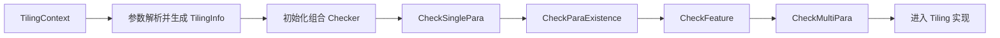
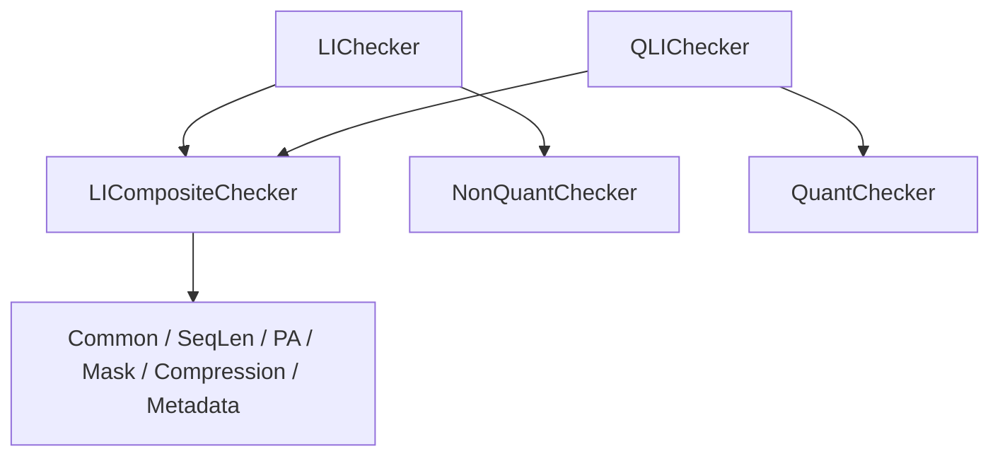

# FlashAttn 与 LightningIndexer 系列拦截检查说明

## 1. 文档目的

本文集中说明以下三个算子的 Host 侧拦截代码，便于开发、联调和问题定位：

- `flash_attn`
- `lightning_indexer_v2`
- `quant_lightning_indexer_v2`

其中，`flash_attn` 是代码结构参考；两个 Indexer 算子的约束来源于无 `v2` 后缀的接口文档，并按照 `flash_attn` 的四阶段 Checker 模型实现：

- [lightning_indexer.md](../../../torch_extension/cann_ops_transformer/docs/zh/lightning_indexer.md)
- [quant_lightning_indexer.md](../../../torch_extension/cann_ops_transformer/docs/zh/quant_lightning_indexer.md)

本文用于快速查看拦截内容。若本文与代码存在差异，以当前 Checker 源码为准。

## 2. 总体结构

三个算子的检查入口均位于 Tiling 流程中。参数完成解析后，由组合 Checker 依次执行四类检查；任一 Checker 返回失败，当前阶段及后续流程立即终止。



四个阶段的职责如下。

| 阶段 | 主要职责 | 典型检查 |
| --- | --- | --- |
| `CheckSinglePara` | 单个参数自身是否合法 | dtype、format、rank、shape、枚举值、标量范围 |
| `CheckParaExistence` | 参数是否应当存在 | 必选输入、条件必选输入、互斥输入 |
| `CheckFeature` | 当前硬件或功能是否支持 | 不同 NPU 架构的能力差异、暂不支持特性 |
| `CheckMultiPara` | 多参数之间是否一致 | layout 组合、关联 shape、序列边界、stride、输出关系 |

执行顺序是“阶段优先”：先让全部子 Checker 执行 `CheckSinglePara`，再执行全部子 Checker 的 `CheckParaExistence`，依次类推。各阶段内部按照注册顺序执行，并采用 fail-fast 策略。

## 3. 代码目录与入口

### 3.1 `flash_attn`

目录：[attention/flash_attn/op_host/checkers](../../../attention/flash_attn/op_host/checkers)

| 文件 | 职责 |
| --- | --- |
| `base_checker.*` | Checker 抽象基类及 dtype、format、数值等基础校验工具 |
| `fa_checker.*` | 组合 Checker，注册并调度全部子 Checker |
| `common_checker.*` | Q/K/V/输出、layout、dtype、轴和 shape 的公共检查 |
| `seq_len_checker.*` | `cu_seqlens_*`、`seqused_*`、`max_seqlen_*` 检查 |
| `paged_attention_checker.*` | PA 模式、`block_table`、block size 和 stride 检查 |
| `mask_checker.*` | `mask_mode`、`attn_mask`、滑窗参数检查 |
| `sinks_checker.*` | `sinks` 特性拦截 |
| `metadata_checker.*` | `metadata` 检查 |
| `softmax_lse_checker.*` | `return_softmax_lse` 和 `lse_out` 检查 |

Tiling 入口在 [flash_attn_tiling.cpp](../../../attention/flash_attn/op_host/flash_attn_tiling.cpp)，子 Checker 注册顺序为：

```text
CommonChecker
ActualSeqLenChecker
PagedAttentionChecker
MaskChecker
SinksChecker
MetadataChecker
SoftmaxLSEChecker
```

### 3.2 `lightning_indexer_v2`

目录：[attention/lightning_indexer_v2/op_host/checkers](../../../attention/lightning_indexer_v2/op_host/checkers)

| 文件 | 职责 | 复用范围 |
| --- | --- | --- |
| `checker_info.h` | 两种 Indexer 共用的规范化参数视图、layout 枚举、常量和 shape 工具 | 公共 |
| `base_checker.*` | 四阶段基类和基础检查工具 | 公共 |
| `checker_runner.h` | 组合 Checker 调度器 `LICompositeChecker` | 公共 |
| `common_checker.*` | 基础输入、layout、shape、架构和输出检查 | 公共 |
| `seq_len_checker.*` | 序列长度张量及数据检查 | 公共 |
| `paged_attention_checker.*` | PA、block table 和 stride 检查 | 公共 |
| `mask_checker.*` | mask mode 检查 | 公共 |
| `compression_checker.*` | 压缩参数检查 | 公共 |
| `metadata_checker.*` | metadata 检查 | 公共 |
| `non_quant_checker.*` | 非量化 dtype 检查 | 仅 `lightning_indexer_v2` |
| `li_checker.*` | `LIV2TilingInfo` 适配及子 Checker 注册 | 仅 `lightning_indexer_v2` |

Tiling 入口在 [lightning_indexer_v2_tiling.cpp](../../../attention/lightning_indexer_v2/op_host/lightning_indexer_v2_tiling.cpp)，注册顺序为：

```text
CommonChecker
NonQuantChecker
SeqLenChecker
PagedAttentionChecker
MaskChecker
CompressionChecker
MetadataChecker
```

### 3.3 `quant_lightning_indexer_v2`

目录：[attention/quant_lightning_indexer_v2/op_host/checkers](../../../attention/quant_lightning_indexer_v2/op_host/checkers)

该目录只保留量化算子自身的差异代码：

| 文件 | 职责 |
| --- | --- |
| `qli_checker.*` | 将 `QLIV2TilingInfo` 转换为公共 `IndexerCheckerInfo`，并注册子 Checker |
| `quant_checker.*` | `quant_mode`、量化 dtype、descale shape 和架构支持检查 |

其余 Checker 直接复用 `lightning_indexer_v2/op_host/checkers` 下的公共实现。Tiling 入口在 [quant_lightning_indexer_v2_tiling.cpp](../../../attention/quant_lightning_indexer_v2/op_host/quant_lightning_indexer_v2_tiling.cpp)，注册顺序为：

```text
CommonChecker
QuantChecker
SeqLenChecker
PagedAttentionChecker
MaskChecker
CompressionChecker
MetadataChecker
```

量化算子的 Host CMake 通过 `quant_lightning_indexer_v2_depends` 声明对 `attention/lightning_indexer_v2` 的依赖，避免复制公共 Checker 源码。



## 4. 三个算子能力速查

| 检查项 | `flash_attn` | `lightning_indexer_v2` | `quant_lightning_indexer_v2` |
| --- | --- | --- | --- |
| Q layout | `BNSD`、`BSND`、`TND` | `BSND`、`TND` | `BSND`、`TND` |
| K/KV layout | `BNSD`、`BSND`、`TND`、三种 PA | `BSND`、`TND`、`PA_BBND` | 同左 |
| Q/K dtype | FP16、BF16，Q/K/V/输出一致 | FP16 或 BF16，Q/K 一致 | 由 `quant_mode` 决定 |
| head dim | 64、128、256，QK 与 V 相等 | 固定 128 | 固定 128 |
| key head 数 | Q head 不小于且整除 KV head | 固定 1 | 固定 1 |
| mask mode | 0、3、4 | 0、3 | 0、3 |
| PA block size | `[16, 1024]` 且 16 对齐，并满足 dtype 对齐 | `[16, 1024]` 且 16 对齐 | 同左 |
| metadata | 必选，INT32，一维且非空 | 必选，INT32，shape `[1024]` | 同左 |
| 额外输出 | 可选 `lse_out` | `sparse_indices`，可选返回有效 `sparse_values` | 同左，values 为 BF16 |

## 5. `flash_attn` 拦截内容

### 5.1 基础输入、layout、dtype 与 shape

| 类别 | 拦截规则 |
| --- | --- |
| 必选参数 | `query`、`key`、`value`、`attn_out` 的 desc 和 shape 均不可为空 |
| format | Q/K/V/输出仅支持 ND |
| dtype | Q/K/V/输出仅支持 FP16、BF16，且 K/V/输出必须与 Q 同 dtype |
| Q layout | `BNSD`、`BSND`、`TND` |
| KV layout | `BNSD`、`BSND`、`TND`、`PA_BBND`、`PA_BNBD`、`PA_NZ` |
| 输出 layout | `BNSD`、`BSND`、`TND` |
| B 轴 | `0 < B < B_LIMIT` |
| 序列和头数 | S/T/N 必须大于 0；Q head 数必须不小于 KV head 数并可被其整除 |
| D 轴 | QK head dim 和 V head dim 均为 64、128 或 256，且二者相等 |
| 空张量 | Q/K/V/输出任一维为 0 时，`FAChecker::Process` 直接失败 |

layout 组合约束：

| Q layout | 允许的 KV layout | 允许的输出 layout |
| --- | --- | --- |
| `BNSD` | `BNSD` 或任一 PA layout | `BNSD`、`BSND` |
| `BSND` | `BSND` 或任一 PA layout | `BSND` |
| `TND` | `TND` 或任一 PA layout | `TND` |

Checker 会根据解析出的 B、S/T、N、D、block 数和 block size 回验 Q/K/V/输出的实际 shape。PA 模式下 block size 还必须是 `32 / sizeof(kv_dtype)` 的整数倍。

### 5.2 序列长度参数

| 参数 | 拦截规则 |
| --- | --- |
| `cu_seqlens_q`、`cu_seqlens_kv` | 可选；存在时为 INT32、ND、一维，shape 为 `[B + 1]` |
| `seqused_q`、`seqused_kv` | 可选；存在时为 INT32、ND、一维，shape 为 `[B]` |
| `max_seqlen_q`、`max_seqlen_kv` | 必须不小于 -1 |
| Q/KV 为 TND | 对应 `cu_seqlens_*` 必须存在 |
| Q/KV 非 TND | 对应 `cu_seqlens_*` 不得存在 |
| PA 模式 | `seqused_kv` 必须存在 |

当前 `flash_attn` 的序列 Checker 主要校验张量元信息及存在性，不读取 `cu_seqlens_*`、`seqused_*` 的逐元素数据。

### 5.3 PagedAttention

| 类别 | 拦截规则 |
| --- | --- |
| `block_table` 存在性 | PA layout 必须提供；非 PA layout 禁止提供 |
| `block_table` 类型 | INT32、ND、二维，第一维必须等于 B |
| block size | 范围 `[16, 1024]`，16 对齐，并满足 KV dtype 对齐要求 |
| 连续性 | 非 PA 模式要求 K/V 连续 |
| `PA_BBND` | K/V 仅允许第 0 维不连续 |
| `PA_BNBD`、`PA_NZ` | K/V 仅允许第 0 或第 1 维不连续 |

### 5.4 Mask、metadata、sinks 与 LSE

| 参数或功能 | 拦截规则 |
| --- | --- |
| `mask_mode` | 仅支持 0（NO_MASK）、3（CAUSAL）、4（BAND） |
| `attn_mask` | 存在时必须为 INT8、ND、二维，shape 固定为 `[2048, 2048]` |
| mode 0 | 不得提供 `attn_mask`，`win_left = win_right = -1` |
| mode 3 | 必须提供 `attn_mask`，`win_left = win_right = -1` |
| mode 4 | 必须提供 `attn_mask`，`win_left`、`win_right` 均不小于 -1 |
| `metadata` | 必选，INT32、ND、一维，长度大于 0 |
| `sinks` | 当前不支持，提供后直接失败 |
| `return_softmax_lse` | 存在时只允许 0 或 1 |
| `lse_out` | 开启 softmax LSE 时 shape 必须存在；desc 存在时要求 FP32、ND |

## 6. 两种 Indexer 的公共拦截内容

以下规则由 `lightning_indexer_v2/op_host/checkers` 中的公共 Checker 同时服务两个算子。

### 6.1 基础参数与输出

| 类别 | 拦截规则 |
| --- | --- |
| 必选张量 | `q`、`k`、`w`、`sparse_indices`、`sparse_values`；量化算子额外要求 `q_descale`、`k_descale` |
| format | 所有被检查张量均为 ND |
| Q layout | `BSND`、`TND` |
| K layout | `BSND`、`TND`、`PA_BBND` |
| layout 组合 | BSND Q 只搭配 BSND/PA K；TND Q 只搭配 TND/PA K |
| B | `0 < B < 65536` |
| S/T | Q 和 K 的序列维必须大于 0 |
| head dim | 固定 128 |
| key head 数 | 固定 1 |
| group size | 等于 `num_heads_q / num_heads_k` |
| `max_seqlen_q` | 当前不生效，只允许 -1 |
| `return_value` | 只允许 0 或 1 |

shape 回验规则：

| 张量 | BSND Q | TND Q |
| --- | --- | --- |
| Q | `[B, Sq, Nq, 128]` | `[Tq, Nq, 128]` |
| W | `[B, Sq, Nq]` | `[Tq, Nq]` |
| `sparse_indices` | `[B, Sq, Nk, topk]` | `[Tq, Nk, topk]` |
| `sparse_values` | `return_value=1` 时与 indices 同 shape，否则 `[0]` | 同左 |

K 的 shape 按 layout 分别为：

- BSND：`[B, Sk, Nk, 128]`
- TND：`[Tk, Nk, 128]`
- PA_BBND：`[block_num, block_size, Nk, 128]`

### 6.2 架构能力

| 约束 | Ascend 950（DAV_3510） | Ascend A2/A3 |
| --- | --- | --- |
| `num_heads_q` | `[1, 64]` | 固定 64 |
| `topk` | `[1, 8192]` | `[1, 2048]` |
| `cmp_ratio` | `[1, 128]` | `[1, 128]` 内的 2 的幂 |
| K layout | BSND、TND、PA_BBND | 仅 PA_BBND |
| `output_idx_offset` | 支持 | 不支持 |
| `return_value` | 0 或 1 | 固定 0 |
| 量化模式 | 1～5 | 仅模式 2 |

### 6.3 序列长度、PA 与压缩参数

| 类别 | 拦截规则 |
| --- | --- |
| `cu_seqlens_q/k` | 仅且必须在对应 layout 为 TND 时提供；INT32、ND、shape `[B+1]` |
| `cu_seqlens_q/k` 数据 | 首元素为 0、单调不减、非负，末元素等于对应展平长度 T |
| `seqused_q/k` | 可选；INT32、ND、shape `[B]`；每项非负且不超过对应序列长度 |
| A2/A3 TND | 不支持对应的 `seqused_q/k` |
| PA 模式 | `block_table` 和 `seqused_k` 必须存在；非 PA 模式禁止 `block_table` |
| `block_table` | INT32、ND、二维，shape 为 `[B, max_block_num_per_batch]`；block id 必须在 `[0, key_block_num)` |
| block size | `[16, 1024]` 且为 16 的整数倍 |
| stride | 非 PA 模式 K 必须连续；PA 模式仅第 0 维可不连续；量化 K descale 使用相同规则 |
| `cmp_residual_k` | 当且仅当 `cmp_ratio > 1 && mask_mode == 3` 时提供；INT32、ND、shape `[B]`，值域 `[0, cmp_ratio)` |
| `metadata` | 必选，INT32、ND、shape 固定为 `[1024]` |
| `mask_mode` | 仅支持 0 或 3 |

### 6.4 `output_idx_offset`

`output_idx_offset` 仅 Ascend 950 支持。存在时：

- dtype 为 INT32，format 为 ND，所有维度非 0；
- BSND Q 的 shape 为 `[B, Sq, Nk]`，TND Q 的 shape 为 `[Tq, Nk]`；
- 每个 offset 必须大于 0；
- `offset + (key_sequence_length - 1)` 不得超过 `INT32_MAX`。

## 7. 非量化与量化差异

### 7.1 `lightning_indexer_v2`

| 张量 | dtype |
| --- | --- |
| Q、K | FP16 或 BF16，且二者必须一致 |
| W | FP32 |
| `sparse_indices` | INT32 |
| `sparse_values` | FP32 |

### 7.2 `quant_lightning_indexer_v2`

| `quant_mode` | Q/K | W | Q/K descale | descale 形态 |
| --- | --- | --- | --- | --- |
| 1 | FLOAT8_E4M3FN | FP32 | FP32 | 每 token、每 head |
| 2 | INT8 | FP16 | FP16 | 每 token、每 head |
| 3 | FLOAT8_E4M3FN | FP32 | FLOAT8_E8M0 | MX 分组，尾维 `[D/64, 2]` |
| 4 | HIFLOAT8 | FP32 | FP32 | Q/K descale 均为 `[1]` |
| 5 | FLOAT4_E2M1 | FP32 | FLOAT8_E8M0 | MX 分组，尾维 `[D/64, 2]` |

所有量化模式下：

- `sparse_indices` 为 INT32；
- `sparse_values` 为 BF16；
- Q 和 K 必须使用当前 `quant_mode` 对应的同一种 dtype；
- mode 1、2 的 descale shape 等于对应 Q/K shape 去掉 D 轴后的 shape；
- mode 3、5 的 descale shape 等于对应 Q/K shape 去掉 D 轴后，再追加 `[D/64, 2]`；
- PA K 的 descale 前缀为 `[block_num, block_size, Nk]`。

## 8. 公共代码复用关系

两个 Indexer 算子通过一个统一的 `IndexerCheckerInfo` 隔离原始 TilingInfo 差异：

1. `LIChecker::BuildInfo` 将 `LIV2TilingInfo` 转为 `IndexerCheckerInfo`。
2. `QLIChecker::BuildInfo` 将 `QLIV2TilingInfo` 转为相同的 `IndexerCheckerInfo`，并补充量化字段。
3. 两个入口都继承 `LICompositeChecker`，复用相同的四阶段调度逻辑。
4. 通用参数由同一组 Checker 检查。
5. 仅 dtype、量化模式和 descale shape 分别进入 `NonQuantChecker` 或 `QuantChecker`。

这样新增公共规则时只需修改 `lightning_indexer_v2/op_host/checkers`；只有量化专属规则才修改 `quant_lightning_indexer_v2/op_host/checkers/quant_checker.*`。

## 9. 排查与扩展建议

遇到参数拦截失败时，建议按以下顺序定位：

1. 确认失败来自参数解析阶段还是 Checker 阶段。两个 Indexer 当前先执行原有 `ParseAndCheck`，再执行新增 Checker。
2. 根据日志中的参数名定位对应子 Checker。
3. 根据错误类型判断四阶段：自身格式问题通常在 `SinglePara`，缺参在 `ParaExistence`，硬件限制在 `Feature`，关联 shape 或数据边界在 `MultiPara`。
4. 若两个 Indexer 都应生效，将规则放入公共 Checker；若只涉及非量化或量化 dtype，则分别放入 `NonQuantChecker`、`QuantChecker`。
5. 新增子 Checker 时，在对应 `RegisterCheckers` 中显式注册，并保持检查职责单一。
6. `lightning_indexer_v2` 和 `quant_lightning_indexer_v2` 的 Checker 禁止使用裸 `OP_LOGE(...)`；应按照错误类型使用 `OP_LOGE_FOR_INVALID_FORMAT*`、`OP_LOGE_FOR_INVALID_VALUE*`、`OP_LOGE_FOR_INVALID_DTYPE*`、`OP_LOGE_FOR_INVALID_SHAPE*` 或 `OP_LOGE_FOR_INVALID_ARGUMENT_WITH_REASON`，并记录参数名、实际值或失败原因。此要求不改写作为结构参考的 `flash_attn` Checker。

主要源码索引：

- [flash_attn/fa_checker.cpp](../../../attention/flash_attn/op_host/checkers/fa_checker.cpp)
- [lightning_indexer_v2/checker_runner.h](../../../attention/lightning_indexer_v2/op_host/checkers/checker_runner.h)
- [lightning_indexer_v2/li_checker.cpp](../../../attention/lightning_indexer_v2/op_host/checkers/li_checker.cpp)
- [quant_lightning_indexer_v2/qli_checker.cpp](../../../attention/quant_lightning_indexer_v2/op_host/checkers/qli_checker.cpp)
- [quant_lightning_indexer_v2/quant_checker.cpp](../../../attention/quant_lightning_indexer_v2/op_host/checkers/quant_checker.cpp)
