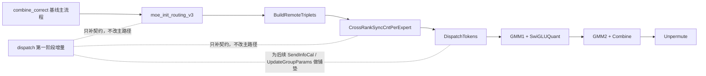

# MegaMoe Dispatch Stage1 最小增量说明

## 结论

当前 `ops-transformer/mc2/mega_moe` 已先回落到 `combine_correct` 的正确基线，再只叠加 dispatch 第一阶段必须的结构契约扩展。
这一阶段不切换 `Process()` 主流程，不替换 `dispatch/combine/unpermute` 正确闭环，只把后续 dispatch 优化需要的 metadata 和布局能力先接进来。

## 本次改动点

- `MegaMoeTilingData` 新增 `aicNum`
- `WorkspaceInfo` 保持 combine 基线旧字段偏移不变，尾部追加 `expertRevTokenNumsPtr`
- `WorkspaceInfo` 增加 dispatch 兼容别名
  - `dispatchRevDataPtr <-> ptrA`
  - `dispatchRevScalePtr <-> ptrAScale`
  - `tripleInfoPtr <-> ptrTriplet`
  - `swigluQuantDataPtr <-> ptrA2`
  - `swigluQuantScalePtr <-> ptrA2Scale`
  - `flagSwiGluToGmm2Ptr <-> ptrFlagSwiGluToGmm2`
  - `flagDispatchToGmm1Ptr <-> ptrFlagDispatchToGmm1`
- `PeermemInfo` 增加 dispatch 兼容别名
  - `topKInfoInWorldSizePtr <-> ptrTokenPerExpert`
  - `quantTokenScalePtr <-> ptrA0`
  - `combineSendPtr <-> ptrTriplet`
- host tiling 阶段写入 `tilingData->aicNum`
- kernel `Init()` 阶段缓存 `aicNum_`，并把 `expertRevNumsGlobalTensor_` 绑到新增 workspace 尾区

## 为什么先这样做

- `combine_correct` 当前已经验证过端到端精度
- `dispatch_opt` 里真正想优化的点主要有两层：
  - 结构布局契约
  - front-half 的 dispatch 统计/同步逻辑
- 如果第一步就把 `SendInfoCal`、`UpdateGroupParams`、`TopKIdsAllGather` 到 `DispatchTokens` 整段替换进去，很容易把已经正确的 combine 主链打坏
- 所以第一步只做“结构先对齐、行为先不切换”

## 当前数据流状态

## 本阶段保证

- `combine_correct` 的 packed triplet 语义不变
- `CombineTokens` / `Unpermute` 的读写协议不变
- 旧 workspace 核心偏移不变
- 本次新增字段全部是“向后兼容追加”或“同地址别名”

## 下一阶段建议

第二阶段再只切一件事：

- 引入 dispatch 版 `SendInfoCal` 的 flag 修正
  - `CrossCoreSetFlag<SYNC_AIC_AIV_MODE, PIPE_MTE3>(6)` 改成 `2`
- 同步改 `UpdateGroupParams`
  - `CrossCoreWaitFlag<SYNC_AIC_AIV_MODE, PIPE_S>(6)` 改成 `2`
- AIV 侧优先直接通过 `expertRevNumsGlobalTensor_` 读每个 expert 收到的 token 数

注意第二阶段仍然应保持：

- `BuildRemoteTriplets`
- `DispatchTokens`
- `CombineTokens`
- `Unpermute`

这四段尽量不动，先只替换统计与同步点。

## 校验建议

- host tiling UT 先覆盖 `aicNum` 与 `WorkspaceInfo/PeermemInfo` 契约
- 再做 `mega_moe` 小 batch 精度回归
  - `bs = 1, 4, 8, 16`
- 如果第二阶段改完精度退化，优先对比：
  - `expertRevNumsGlobalTensor_` 写入位置
  - `UpdateGroupParams` 读到的 `m`
  - `flag 2/6` 同步点前后时序
