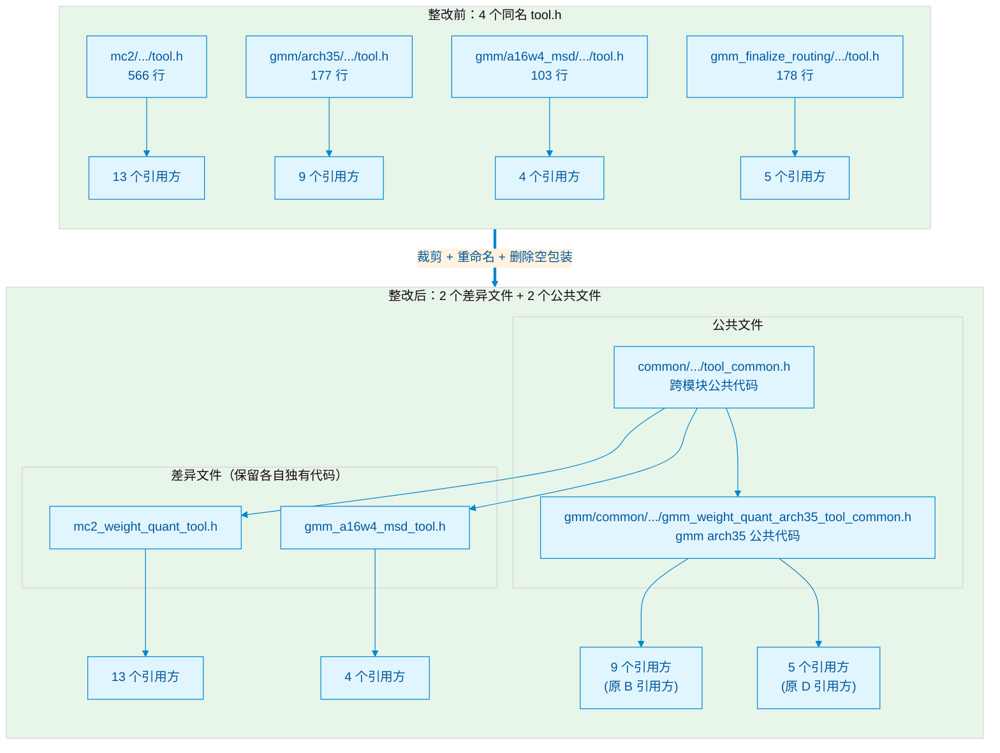

# 同名头文件整改技术方案

## 1. 背景与目标

项目中存在多组同名头文件（`grouped_matmul_utils.h`、`static_diag_constant.h`、`tool.h`），分布在不同模块目录下。同名文件会带来编译歧义、头文件保护宏冲突、重复代码难以维护等隐患。

**整改目标：**
1. 消除所有同名文件；
2. 不允许存在同名但内容不同的文件；
3. **将逻辑相同的代码段（常量、函数、结构体）抽取到公共文件**，统一格式与命名；
4. **逻辑不一致的代码段保留差异**；仅仅是代码格式、变量命名差异的，统一后抽取；
5. **宏和条件编译宏块不处理重复**，仅处理常量和方法；
6. 无风险修改，引用方代码无需改动。

---

## 2. grouped_matmul_utils.h

全仓共存在 **2** 个同名文件。

### 3.1 文件分布

| 文件 | 路径 | 行数 | 头文件保护宏 | 命名空间 |
|------|------|------|--------------|----------|
| A | `mc2/3rd/grouped_matmul/op_kernel/grouped_matmul_utils.h` | 370 | `MC2_GROUPED_MATMUL_UTILS_H` | `MC2_GROUPED_MATMUL` |
| B | `gmm/grouped_matmul/op_kernel/grouped_matmul_utils.h` | 378 | `ASCENDC_GROUPED_MATMUL_UTILS_H` | `GROUPED_MATMUL` |

### 3.2 代码段差异分析

| 代码段 | 文件 A | 文件 B | 差异类型 | 处理结论 |
|--------|--------|--------|----------|----------|
| 版权头、头文件包含逻辑 | 年份 2026，无 `ASC_DEVKIT_MAJOR` 判断 | 年份 2025，有 `ASC_DEVKIT_MAJOR >= 9` | 文件头基础设施 | 保留差异 |
| 宏定义块（`DTYPE_L0C_LOCAL`、`V310_GMM_QUANT` 等） | 缩进方式 A | 缩进方式 B | 宏块 | **按原则不处理** |
| `INT8_BITS` 等常量 | 注释前空格数不同 | 注释前空格数不同 | 格式差异 | **逻辑相同，抽取** |
| `MMType`、`MMImplType` | 字段排列相同，换行格式不同 | 字段排列相同，换行格式不同 | 格式差异 | **逻辑相同，抽取** |
| `ActiveType` 枚举 | 换行格式不同 | 换行格式不同 | 格式差异 | **逻辑相同，抽取** |
| `GreatestCommonDivisor` | 参数名 `(T x, T b)` | 参数名 `(T a, T b)` | 变量命名差异 | **逻辑相同，统一命名后抽取** |
| `Max`、`Min`、`AlignUp`、`AlignDown`、`GetTensorAddr`、`GetTypeBits` | 签名换行/缩进不同 | 签名换行/缩进不同 | 格式差异 | **逻辑相同，抽取** |
| `GenGmmConf` | 字段排列相同，缩进不同 | 字段排列相同，缩进不同 | 格式差异 | **逻辑相同，抽取** |
| `GetSplitValueFromGroupList` | 参数类型 `MC2GMMBaseParams`，条件编译不含 `__NPU_ARCH__ == 3113` | 参数类型 `GMMBaseParams`，条件编译含 `__NPU_ARCH__ == 3113` | 逻辑不一致（类型+条件编译） | **保留差异** |
| `NZ_CFG_MDL`、`matmulCFGUnitFlag` | 被 `#if/#else/#endif` 包裹 | 被 `#if/#else/#endif` 包裹 | 条件编译包裹 | **按原则不处理** |

### 3.3 公共代码段提取方案

新建公共文件：`common/include/op_kernel/grouped_matmul_utils_common.h`

- **头文件保护宏：** `GROUPED_MATMUL_UTILS_COMMON_H`
- **命名空间：** `CommonGMMUtils`
- **内容：** 包含 A、B 中逻辑相同的全部常量、函数模板、结构体/枚举（约 30 个代码段，150+ 行）

公共文件中的 `GreatestCommonDivisor` 统一参数名为 `(T a, T b)`。其余代码统一采用规范格式（4 空格缩进、函数签名换行等）。

### 3.4 文件重命名与裁剪方案

| 原路径 | 新文件名 | 新头文件保护宏 | 裁剪后保留内容 |
|--------|----------|----------------|----------------|
| `mc2/3rd/grouped_matmul/op_kernel/grouped_matmul_utils.h` | `mc2_grouped_matmul_utils.h` | `MC2_GROUPED_MATMUL_UTILS_H` | 版权头、头文件包含逻辑、宏定义块、`#include` 公共文件、`using namespace CommonGMMUtils;`、`GetSplitValueFromGroupList`（差异函数）、`NZ_CFG_MDL`（条件编译） |
| `gmm/grouped_matmul/op_kernel/grouped_matmul_utils.h` | （保持原名） | `ASCENDC_GROUPED_MATMUL_UTILS_H` | 同上，保留各自的差异代码 |

**裁剪后文件内容示例（mc2 版本）：**


> **设计说明：** `using namespace CommonGMMUtils;` 将公共符号全部引入 `MC2_GROUPED_MATMUL` 命名空间。引用方通过 `using namespace MC2_GROUPED_MATMUL;` 或完全限定名访问时，行为与整改前完全一致，**无需任何修改**。

### 3.5 被引用位置与 #include 更新

**共 20 处引用：**

| 序号 | 引用方路径 | 原 #include | 新 #include |
|------|-----------|-------------|-------------|
| 1 | `mc2/3rd/grouped_matmul/op_kernel/quant_utils.h` | `"grouped_matmul_utils.h"` | `"mc2_grouped_matmul_utils.h"` |
| 2 | `mc2/3rd/grouped_matmul/op_kernel/gqmm_cube_on_the_fly.h` | `"grouped_matmul_utils.h"` | `"mc2_grouped_matmul_utils.h"` |
| 3 | `gmm/grouped_matmul/op_kernel/grouped_matmul_a4w4.h` | `"grouped_matmul_utils.h"` | `"grouped_matmul_utils.h"` |
| 4 | `gmm/grouped_matmul/op_kernel/grouped_matmul.cpp` | `"grouped_matmul_utils.h"` | `"grouped_matmul_utils.h"` |
| 5 | `gmm/grouped_matmul/op_kernel/grouped_matmul_vector.h` | `"grouped_matmul_utils.h"` | `"grouped_matmul_utils.h"` |
| 6 | `gmm/grouped_matmul/op_kernel/grouped_matmul_antiquant_a16w8_msd.h` | `"grouped_matmul_utils.h"` | `"grouped_matmul_utils.h"` |
| 7 | `gmm/grouped_matmul/op_kernel/grouped_matmul_apt.cpp` | `"grouped_matmul_utils.h"` | `"grouped_matmul_utils.h"` |
| 8 | `gmm/grouped_matmul/op_kernel/grouped_matmul_antiquant_a8w4_msd_new.h` | `"grouped_matmul_utils.h"` | `"grouped_matmul_utils.h"` |
| 9 | `gmm/grouped_matmul/op_kernel/grouped_matmul_quant_mixcore.h` | `"grouped_matmul_utils.h"` | `"grouped_matmul_utils.h"` |
| 10 | `gmm/grouped_matmul/op_kernel/grouped_matmul_antiquant_a8w4_msd.h` | `"grouped_matmul_utils.h"` | `"grouped_matmul_utils.h"` |
| 11 | `gmm/grouped_matmul/op_kernel/grouped_matmul.h` | `"grouped_matmul_utils.h"` | `"grouped_matmul_utils.h"` |
| 12 | `gmm/grouped_matmul/op_kernel/grouped_matmul_autotiling_a8w4.h` | `"grouped_matmul_utils.h"` | `"grouped_matmul_utils.h"` |
| 13 | `gmm/grouped_matmul/op_kernel/grouped_matmul_antiquant_a8w4.h` | `"grouped_matmul_utils.h"` | `"grouped_matmul_utils.h"` |
| 14 | `gmm/grouped_matmul/op_kernel/arch35/quant_adaptive_sliding_window_templates/gqmm_cgmct_mx_kernel.h` | `"../../grouped_matmul_utils.h"` | `"../../grouped_matmul_utils.h"` |
| 15 | `gmm/grouped_matmul/op_kernel/arch35/quant_adaptive_sliding_window_templates/gqmm_mix_online_dynamic.h` | `"../../grouped_matmul_utils.h"` | `"../../grouped_matmul_utils.h"` |
| 16 | `gmm/grouped_matmul/op_kernel/arch35/quant_adaptive_sliding_window_templates/gqmm_cube_on_the_fly.h` | `"../../grouped_matmul_utils.h"` | `"../../grouped_matmul_utils.h"` |
| 17 | `gmm/grouped_matmul/op_kernel/arch35/quant_adaptive_sliding_window_templates/gqmm_cgmct_pertile_kernel.h` | `"../../grouped_matmul_utils.h"` | `"../../grouped_matmul_utils.h"` |
| 18 | `gmm/grouped_matmul/op_kernel/arch35/non_quant/grouped_matmul_basic_kernel.h` | `"../../grouped_matmul_utils.h"` | `"../../grouped_matmul_utils.h"` |
| 19 | `gmm/grouped_matmul/op_kernel/a16w4_msd/grouped_matmul_weight_quant_a16w4_msd_controller.h` | `"../grouped_matmul_utils.h"` | `"../grouped_matmul_utils.h"` |
| 20 | `examples/fast_kernel_launch_example/csrc/grouped_matmul/ascend910b/op_kernel/grouped_matmul.h` | `"gmm/grouped_matmul/op_kernel/grouped_matmul_utils.h"` | `"gmm/grouped_matmul/op_kernel/grouped_matmul_utils.h"` |

---

## 3. static_diag_constant.h

全仓共存在 **2** 个同名文件。

### 4.1 文件分布

| 文件 | 路径 | 行数 | 头文件保护宏 | 命名空间 | 内容 |
|------|------|------|--------------|----------|------|
| A | `mc2/3rd/weight_quant_batch_matmul_v2/op_kernel/fixpipe/static_diag_constant.h` | 49 | `WEIGHT_QUANT_BATCHMATMUL_V2_STATIC_DIAG_CONSTANT_H` | `Mc2WeightQuantBatchMatmulV2` | `int8_t FIXP_EYE_DIAG[1024]` |
| B | `gmm/grouped_matmul/op_kernel/a16w4_msd/static_diag_constant.h` | 34 | `GROUPED_MATMUL_WEIGHT_QUANT_STATIC_DIAG_CONSTANT_H` | `GROUPED_MATMUL::A16W4Msd` | `int16_t C1C2_EYE_DIAG[256]` |

### 4.2 代码段差异分析

| 代码段 | 文件 A | 文件 B | 差异类型 | 处理结论 |
|--------|--------|--------|----------|----------|
| 数组类型 | `int8_t[1024]` | `int16_t[256]` | 逻辑不一致 | 保留差异 |
| 数组数值 | eye 矩阵 `1, 0, 0...` | 缩放后 eye 矩阵 `7176, 0, 0...` | 逻辑不一致 | 保留差异 |
| `#include` | 无 | 有 `kernel_operator.h` | 文件头差异 | 保留差异 |
| 命名空间 | `Mc2WeightQuantBatchMatmulV2` | `GROUPED_MATMUL::A16W4Msd` | 模块差异 | 保留差异 |

**关键结论：** 两个文件内容完全不同，不存在任何逻辑相同的代码段。**不抽取公共文件**。

### 4.3 整改方案

| 原路径 | 新文件名 | 新头文件保护宏 | 处理说明 |
|--------|----------|----------------|----------|
| `mc2/3rd/weight_quant_batch_matmul_v2/op_kernel/fixpipe/static_diag_constant.h` | `mc2_weight_quant_static_diag_constant.h` | `MC2_WEIGHT_QUANT_STATIC_DIAG_CONSTANT_H` | 保留全部内容 |
| `gmm/grouped_matmul/op_kernel/a16w4_msd/static_diag_constant.h` | `gmm_a16w4_msd_static_diag_constant.h` | `GMM_A16W4_MSD_STATIC_DIAG_CONSTANT_H` | 保留全部内容，顺带修复末尾注释与宏名不一致的 bug |

### 4.4 被引用位置与 #include 更新

| 序号 | 引用方路径 | 原 #include | 新 #include |
|------|-----------|-------------|-------------|
| 1 | `mc2/3rd/weight_quant_batch_matmul_v2/op_kernel/fixpipe/weight_quant_batch_matmul_v2_fixpipe.h` | `"static_diag_constant.h"` | `"mc2_weight_quant_static_diag_constant.h"` |
| 2 | `gmm/grouped_matmul/op_kernel/a16w4_msd/grouped_matmul_weight_quant_a16w4_msd_cube_service.h` | `"static_diag_constant.h"` | `"gmm_a16w4_msd_static_diag_constant.h"` |

---

## 4. tool.h

全仓共存在 **4** 个同名文件。

### 5.1 文件分布

| 文件 | 路径 | 行数 | 头文件保护宏 | 命名空间 |
|------|------|------|--------------|----------|
| A | `mc2/3rd/weight_quant_batch_matmul_v2/op_kernel/tool.h` | 566 | `TOOL_H` | `Mc2WeightQuantBatchMatmulV2` |
| B | `gmm/grouped_matmul/op_kernel/arch35/weight_quant_basic_block/tool.h` | 177 | `GROUPED_MATMUL_WEIGHT_QUANT_TOOL_H` | `WeightQuantBatchMatmulV2::Arch35` |
| C | `gmm/grouped_matmul/op_kernel/a16w4_msd/tool.h` | 103 | `GROUPED_MATMUL_WEIGHT_QUANT_TOOL_H` | `GROUPED_MATMUL::A16W4Msd` |
| D | `gmm/grouped_matmul_finalize_routing/op_kernel/arch35/common/tool.h` | 178 | `GROUPED_MATMUL_WEIGHT_QUANT_TOOL_H` | `WeightQuantBatchMatmulV2::Arch35` |

> **隐患：** B、C、D 三个文件头文件保护宏完全相同，若在同一编译单元被同时包含，后两个文件内容会被预处理器跳过。

### 5.2 整改前后结构示意图



**说明：**
- **红色删除线文件**：`gmm_arch35_weight_quant_tool.h`、`gmm_finalize_routing_arch35_tool.h` 裁剪后仅剩单条 `#include`，判定为空包装文件，直接删除。
- **蓝色差异文件**：`mc2_weight_quant_tool.h`、`gmm_a16w4_msd_tool.h` 保留各自独有函数/常量，通过 `#include` 引入公共代码。
- **绿色公共文件**：`tool_common.h` 供跨模块使用；`gmm_weight_quant_arch35_tool_common.h` 供 gmm arch35 场景内使用。
- **引用方零改动**：业务代码中访问的符号命名空间与整改前完全一致。

### 5.3 代码段差异分析

#### A（mc2） vs B（gmm/arch35）

| 代码段 | 文件 A | 文件 B | 差异类型 | 处理结论 |
|--------|--------|--------|----------|----------|
| `Min` | 完整函数，格式不同 | 完整函数，格式不同 | 格式差异 | **逻辑相同，抽取** |
| `CeilAlign<T>` | 完整函数，格式不同 | 完整函数，格式不同 | 格式差异 | **逻辑相同，抽取** |
| `CeilAlign(uint32_t)` | 完整函数，格式不同 | 完整函数，格式不同 | 格式差异 | **逻辑相同，抽取** |
| `QUADRUPLE_BUFFER_NUM` 等 13 个常量 | 字符级相同 | 字符级相同 | 格式/位置差异 | **逻辑相同，抽取** |
| `DataCopyPad2D` | 4 个重载，含 `InitAtomicAddr` 等 | 2 个重载，无 `InitAtomicAddr` | 功能差异 | 保留差异 |
| `CeilDiv` | `CeilDiv`（A 已有） | `CeilDiv`（B 原有） | 函数名差异 | 统一改名为 `CeilDiv`，抽取到 `tool_common.h` |
| `SyncProcessor`、`InitAtomicAddr` | A 独有 | B 无 | 功能差异 | 保留差异 |
| `MatmulL1GmType` | A 有类似定义 | B 有类似定义 | 字段排列/格式差异 | **逻辑相同，抽取到 gmm 模块公共文件** |
| `using` 声明块 | 部分相同 | 部分相同 | 文件头基础设施 | 保留差异 |

#### B（gmm/arch35） vs C（gmm/a16w4_msd）

| 代码段 | 文件 B | 文件 C | 差异类型 | 处理结论 |
|--------|--------|--------|----------|----------|
| `CeilAlign<T>` | 完整函数 | 完整函数 | 格式差异 | **逻辑相同，抽取** |
| `DataCopyPad2D`（LocalTensor←GlobalTensor） | 支持 `fp4x2` 类型，无中文注释 | 仅支持 `int4b_t`，有中文注释 | 逻辑不一致（支持类型不同） | 保留差异 |
| `CeilDiv` | `CeilDiv`（B 改名后） | `CeilDiv`（C 已有） | 已统一 | 统一为 `CeilDiv`，抽取到 `tool_common.h` |
| `GetKBUnit` | 泛型 `1024/sizeof(T)` | 分支实现（int4/int8/float/half） | 逻辑不一致 | 保留差异 |

#### B（gmm/arch35） vs D（gmm_finalize_routing）

| 代码段 | 文件 B | 文件 D | 差异类型 | 处理结论 |
|--------|--------|--------|----------|----------|
| 全部常量、函数、结构体 | 字符级相同 | 字符级相同 | 格式差异 | **逻辑相同，抽取到 gmm 模块公共文件** |
| `VEC_MAX_ELEM_B32` | **无** | 有 | 功能差异 | 保留在 D（通过公共文件 + 差异常量方式） |
| 末尾换行 | 无 | 有 | 格式差异 | 公共文件补全换行 |

### 5.4 公共代码段提取方案

**公共文件 1（跨模块公共代码段）：**
- **路径：** `common/include/op_kernel/tool_common.h`
- **头文件保护宏：** `TOOL_COMMON_H`
- **命名空间：** `CommonTool`
- **内容：** A、B、C 中逻辑相同的常量与函数模板（约 16 个代码段）


**公共文件 2（gmm 模块内 arch35 场景公共代码段）：**
- **路径：** `gmm/common/op_kernel/gmm_weight_quant_arch35_tool_common.h`
- **头文件保护宏：** `GMM_WEIGHT_QUANT_ARCH35_TOOL_COMMON_H`
- **命名空间：** `WeightQuantBatchMatmulV2::Arch35`
- **内容：** B、D 中逻辑相同的全部代码（约 160+ 行），去除已在公共文件 1 中的内容


### 5.5 文件重命名与裁剪方案

| 原路径 | 新文件名 | 新头文件保护宏 | 裁剪后保留内容 |
|--------|----------|----------------|----------------|
| `mc2/3rd/weight_quant_batch_matmul_v2/op_kernel/tool.h` | `mc2_weight_quant_tool.h` | `MC2_WEIGHT_QUANT_TOOL_H` | 版权头、mc2 独有的 `using` 声明、`#include` 公共文件 1、`using namespace CommonTool;`、调试打印模板（`Mc2DoPrintData`、`PRINT_DATA`）、独有常量（`SYNC_MODE0` 等）、独有函数（`CeilDiv`、`FloorDiv`、`InitAtomicAddr`、`SyncProcessor` 等） |
| `gmm/grouped_matmul/op/kernel/arch35/weight_quant_basic_block/tool.h` | ~~`gmm_arch35_weight_quant_tool.h`~~ | ~~`GMM_ARCH35_WEIGHT_QUANT_TOOL_H`~~ | **已删除**（空包装文件） |
| `gmm/grouped_matmul/op/kernel/a16w4_msd/tool.h` | `gmm_a16w4_msd_tool.h` | `GMM_A16W4_MSD_TOOL_H` | 版权头、a16w4_msd 独有的 `using` 声明、`#include` 公共文件 1、`using CommonTool::CeilAlign;`、独有函数（`CeilDiv`、`DataCopyPad2D`、`GetKBUnit`） |
| `gmm/grouped_matmul_finalize_routing/op/kernel/arch35/common/tool.h` | ~~`gmm_finalize_routing_arch35_tool.h`~~ | ~~`GMM_FINALIZE_ROUTING_ARCH35_TOOL_H`~~ | **已删除**（空包装文件） |

**裁剪后文件内容示例：**

**`mc2_weight_quant_tool.h`（原 A）：**

**`gmm_a16w4_msd_tool.h`（原 C）：**

> **设计说明：**
> - `mc2_weight_quant_tool.h`、`gmm_a16w4_msd_tool.h` 的引用方**无需修改任何业务代码**。
> - 原 `gmm_arch35_weight_quant_tool.h` 和 `gmm_finalize_routing_arch35_tool.h` 因裁剪后仅剩单条 `#include`，被判定为空包装文件，直接删除。
> - 它们的引用方改为直接 `#include gmm_weight_quant_arch35_tool_common.h`，所有符号的可见性与整改前完全一致。

### 5.6 被引用位置与 #include 更新

**引用文件 A（共 13 处）：**

| 序号 | 引用方路径 | 原 #include | 新 #include |
|------|-----------|-------------|-------------|
| 1 | `mc2/3rd/weight_quant_batch_matmul_v2/op_kernel/weight_quant_batch_matmul_v2_custom_nz_splitk.h` | `"tool.h"` | `"mc2_weight_quant_tool.h"` |
| 2 | `mc2/3rd/weight_quant_batch_matmul_v2/op/kernel/weight_quant_batch_matmul_v2.cpp` | `"tool.h"` | `"mc2_weight_quant_tool.h"` |
| 3 | `mc2/3rd/weight_quant_batch_matmul_v2/op/kernel/weight_quant_batch_matmul_v2_msd_multicore.h` | `"tool.h"` | `"mc2_weight_quant_tool.h"` |
| 4 | `mc2/3rd/weight_quant_batch_matmul_v2/op/kernel/weight_quant_batch_matmul_v2_msd_split_k.h` | `"tool.h"` | `"mc2_weight_quant_tool.h"` |
| 5 | `mc2/3rd/weight_quant_batch_matmul_v2/op/kernel/weight_quant_batch_matmul_v2_custom.h` | `"tool.h"` | `"mc2_weight_quant_tool.h"` |
| 6 | `mc2/3rd/weight_quant_batch_matmul_v2/op/kernel/weight_quant_batch_matmul_v2_msd_group.h` | `"tool.h"` | `"mc2_weight_quant_tool.h"` |
| 7 | `mc2/3rd/weight_quant_batch_matmul_v2/op/kernel/weight_quant_batch_matmul_v2_custom_weight_nz.h` | `"tool.h"` | `"mc2_weight_quant_tool.h"` |
| 8 | `mc2/3rd/weight_quant_batch_matmul_v2/op/kernel/weight_quant_batch_matmul_v2_custom_mix_splitk.h` | `"tool.h"` | `"mc2_weight_quant_tool.h"` |
| 9 | `mc2/3rd/weight_quant_batch_matmul_v2/op/kernel/fixpipe/weight_quant_batch_matmul_v2_fixpipe.h` | `"../tool.h"` | `"../mc2_weight_quant_tool.h"` |
| 10 | `mc2/3rd/weight_quant_batch_matmul_v2/op/kernel/fixpipe/weight_quant_batch_matmul_v2_fixpipe_stage2.h` | `"../tool.h"` | `"../mc2_weight_quant_tool.h"` |
| 11 | `mc2/3rd/weight_quant_batch_matmul_v2/op/kernel/fixpipe/weight_quant_batch_matmul_v2_fixpipe_stage1.h` | `"../tool.h"` | `"../mc2_weight_quant_tool.h"` |
| 12 | `mc2/3rd/weight_quant_batch_matmul_v2/op/kernel/arch35/weight_quant_batch_matmul_v2_asw_block.h` | `"../tool.h"` | `"../mc2_weight_quant_tool.h"` |
| 13 | `mc2/3rd/weight_quant_batch_matmul_v2/op/kernel/arch35/weight_quant_batch_matmul_v2_adaptive_sliding_window.h` | `"../tool.h"` | `"../mc2_weight_quant_tool.h"` |

**原引用文件 B（共 9 处，现已改为直接引用公共文件 2）：**

| 序号 | 引用方路径 | 原 #include | 新 #include |
|------|-----------|-------------|-------------|
| 1 | `gmm/grouped_matmul/op/kernel/arch35/weight_quant_basic_block/basic_block_vf_nd.h` | `"tool.h"` | `"../../../../common/op_kernel/gmm_weight_quant_arch35_tool_common.h"` |
| 2 | `gmm/grouped_matmul/op/kernel/arch35/weight_quant_basic_block/basic_block_vf_nz.h` | `"tool.h"` | `"../../../../common/op_kernel/gmm_weight_quant_arch35_tool_common.h"` |
| 3 | `gmm/grouped_matmul/op/kernel/arch35/weight_quant_basic_block/weight_quant_basic_block.h` | `"tool.h"` | `"../../../../common/op_kernel/gmm_weight_quant_arch35_tool_common.h"` |
| 4 | `gmm/grouped_matmul/op/kernel/arch35/weight_quant_basic_block/basic_block_config.h` | `"tool.h"` | `"../../../../common/op_kernel/gmm_weight_quant_arch35_tool_common.h"` |
| 5 | `gmm/grouped_matmul/op/kernel/arch35/weight_quant_basic_block/weight_quant_cube_compute.h` | `"tool.h"` | `"../../../../common/op_kernel/gmm_weight_quant_arch35_tool_common.h"` |
| 6 | `gmm/grouped_matmul/op/kernel/arch35/weight_quant_basic_block/weight_quant_vec_compute.h` | `"tool.h"` | `"../../../../common/op_kernel/gmm_weight_quant_arch35_tool_common.h"` |
| 7 | `gmm/grouped_matmul/op/kernel/arch35/weight_quant_basic_block/anti_quant_y_vf.h` | `"tool.h"` | `"../../../../common/op_kernel/gmm_weight_quant_arch35_tool_common.h"` |
| 8 | `gmm/grouped_matmul/op/kernel/arch35/weight_quant_basic_block/weight_quant_vcv_basic_block.h` | `"tool.h"` | `"../../../../common/op_kernel/gmm_weight_quant_arch35_tool_common.h"` |
| 9 | `gmm/grouped_matmul/op/kernel/arch35/weight_quant_basic_block/basic_api/weight_quant_basic_api_v1.h` | `"../tool.h"` | `"../../../../../common/op_kernel/gmm_weight_quant_arch35_tool_common.h"` |

**引用文件 C（共 4 处）：**

| 序号 | 引用方路径 | 原 #include | 新 #include |
|------|-----------|-------------|-------------|
| 1 | `gmm/grouped_matmul/op/kernel/a16w4_msd/grouped_matmul_weight_quant_a16w4_msd_controller.h` | `"tool.h"` | `"gmm_a16w4_msd_tool.h"` |
| 2 | `gmm/grouped_matmul/op/kernel/a16w4_msd/grouped_matmul_weight_quant_a16w4_msd_vector_service.h` | `"tool.h"` | `"gmm_a16w4_msd_tool.h"` |
| 3 | `gmm/grouped_matmul/op/kernel/a16w4_msd/grouped_matmul_weight_quant_a16w4_msd_cube_service.h` | `"tool.h"` | `"gmm_a16w4_msd_tool.h"` |
| 4 | `gmm/grouped_matmul/op/kernel/a16w4_msd/grouped_matmul_weight_quant_a16w4_msd_basic_block.h` | `"tool.h"` | `"gmm_a16w4_msd_tool.h"` |

**原引用文件 D（共 5 处，现已改为直接引用公共文件 2）：**

| 序号 | 引用方路径 | 原 #include | 新 #include |
|------|-----------|-------------|-------------|
| 1 | `gmm/grouped_matmul_finalize_routing/op/kernel/arch35/common/basic_block_config.h` | `"tool.h"` | `"../../../../common/op_kernel/gmm_weight_quant_arch35_tool_common.h"` |
| 2 | `gmm/grouped_matmul_finalize_routing/op/kernel/arch35/weight_quant_basic_block/gmm_fr_weight_quant_resplit_controller.h` | `"../common/tool.h"` | `"../../../../../common/op_kernel/gmm_weight_quant_arch35_tool_common.h"` |
| 3 | `gmm/grouped_matmul_finalize_routing/op/kernel/arch35/weight_quant_basic_block/gmm_fr_weight_quant_vcv_basic_block.h` | `"../common/tool.h"` | `"../../../../../common/op_kernel/gmm_weight_quant_arch35_tool_common.h"` |
| 4 | `gmm/grouped_matmul_finalize_routing/op/kernel/arch35/weight_quant_basic_block/gmm_fr_weight_quant_cube_compute.h` | `"../common/tool.h"` | `"../../../../../common/op_kernel/gmm_weight_quant_arch35_tool_common.h"` |
| 5 | `gmm/grouped_matmul_finalize_routing/op/kernel/arch35/weight_quant_basic_block/gmm_fr_weight_quant_vec_compute.h` | `"../common/tool.h"` | `"../../../../../common/op_kernel/gmm_weight_quant_arch35_tool_common.h"` |

---

## 5. 测试方案

### 6.1 编译测试

**目标：** 验证所有文件重命名、路径修改、头文件保护宏变更后，全仓能够编译通过。

**步骤：**
1. 清理历史构建缓存：`rm -rf build/`。
2. 重新执行 CMake 配置：`mkdir -p build && cd build && cmake .. -DENABLE_TEST=ON`。
3. 执行全量编译：`make -j$(nproc)`。
4. 若编译失败，根据报错定位遗漏的 `#include` 更新或保护宏冲突，修复后重新编译。

**通过标准：** 全量编译零报错、零警告（与整改前基线一致）。

### 6.2 头文件残留检查

**目标：** 确认旧文件名在全仓源码中已无残留。

**步骤：**
1. 执行全量搜索（排除 `build/`、`.git/` 目录）：
   ```bash
   grep -rn '"grouped_matmul_utils.h"' --include="*.h" --include="*.cpp" --include="*.c" . | grep -v build | grep -v '.git/'
   grep -rn '"static_diag_constant.h"' --include="*.h" --include="*.cpp" --include="*.c" . | grep -v build | grep -v '.git/'
   grep -rn '"tool.h"' --include="*.h" --include="*.cpp" --include="*.c" . | grep -v build | grep -v '.git/'
   ```
2. 若搜索结果不为空，检查是否为误匹配（如第三方库、文档中的文字描述），否则补充更新对应的 `#include`。

**通过标准：** 三个 `grep` 命令在源码目录中返回空结果。

### 6.3 头文件保护宏唯一性检查

**目标：** 确认新增/修改的保护宏不存在全局冲突。

**步骤：**
1. 提取全仓所有 `.h` 文件的保护宏定义：
   ```bash
   grep -rh '^#define [A-Z].*_H$' --include="*.h" . | sort | uniq -d
   ```
2. 检查是否有重复项。

**通过标准：** 无重复的保护宏定义。

### 6.4 功能回归测试

**目标：** 验证整改后的代码行为与整改前完全一致。

**步骤：**
1. 运行仓库已有的单元测试套件：`cd build && ctest --output-on-failure`。
2. 若仓库无单元测试，至少编译并运行与整改模块相关的示例程序或集成测试脚本。
3. 对比整改前后的测试输出，确认无新增失败用例。

**通过标准：** 测试通过率不低于整改前基线。

## 6. 附录：整改前后对照总表

| 原文件名 | 原数量 | 整改后文件清单 | 说明 |
|----------|--------|----------------|------|
| `grouped_matmul_utils.h` | 2 → 0 | `mc2_grouped_matmul_utils.h` + `grouped_matmul_utils.h` + `grouped_matmul_utils_common.h` | gmm 版本保持原名；逻辑相同的常量/函数/结构体抽取到公共文件 |
| `static_diag_constant.h` | 2 → 0 | `mc2_weight_quant_static_diag_constant.h` + `gmm_a16w4_msd_static_diag_constant.h` | 内容完全不同，无公共代码段 |
| `tool.h` | 4 → 0 | `mc2_weight_quant_tool.h` + `gmm_a16w4_msd_tool.h` + `tool_common.h` + `gmm_weight_quant_arch35_tool_common.h` | 跨模块公共代码抽取到 tool_common.h；gmm arch35 公共代码抽取到 gmm_weight_quant_arch35_tool_common.h；空包装文件直接删除 |

**整改完成后，全仓库范围内上述三个旧文件名将不再存在。**
