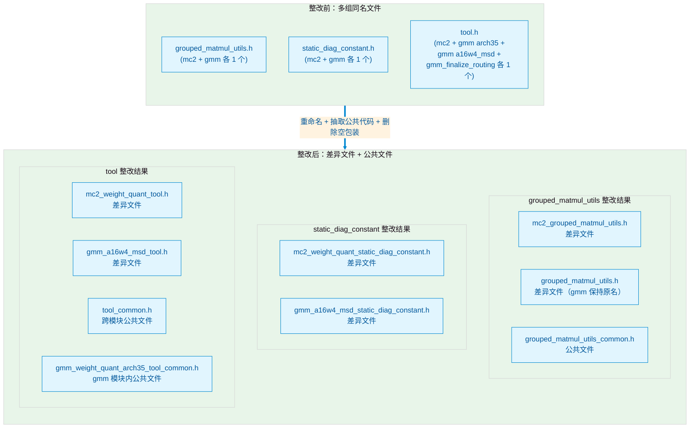
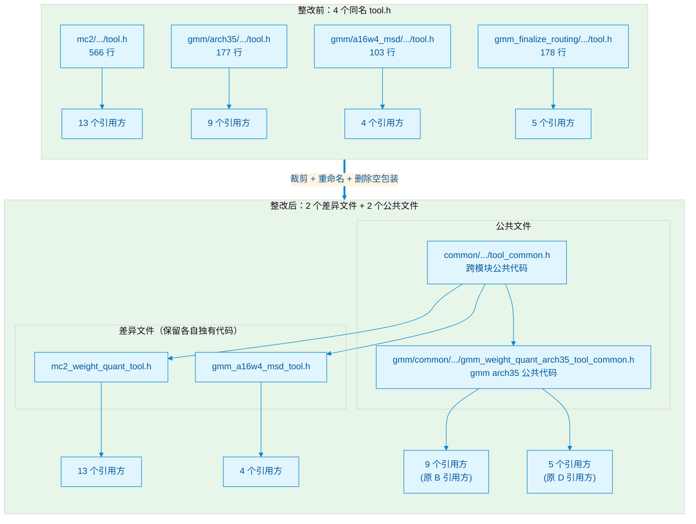

# 同名头文件整改技术方案

## 1. 项目背景

在 `ops-transformer` 仓库中，存在多组**同名头文件**分布在不同模块目录下，主要包括以下三组：

- `grouped_matmul_utils.h`
- `static_diag_constant.h`
- `tool.h`

同名头文件会带来以下隐患：

1. **编译歧义**：不同目录下的同名文件在编译器搜索路径中可能产生冲突，导致包含到错误的文件。
2. **头文件保护宏冲突**：多个同名文件若使用相同的保护宏，后包含的文件内容会被预处理器跳过，导致符号缺失。
3. **重复代码难以维护**：逻辑相同的常量、函数模板在多处重复定义，后续修改容易遗漏。
4. **代码审查困难**：同名文件在 diff、代码搜索时难以区分来源模块。

## 2. 整改目标

1. 消除全仓范围内的同名头文件。
2. 对逻辑相同的代码段（常量、函数模板、结构体/枚举）抽取到公共文件中统一维护。
3. 对逻辑不一致的代码段保留差异，不重命名、不强制统一。
4. 对宏定义和条件编译块保持原样，不参与抽取。
5. 确保引用方的业务代码**零改动**，访问方式与整改前完全一致。
6. 裁剪后若头文件仅剩版权头 + 保护宏 + 单条 `#include`，视为空包装文件，直接删除。

## 3. 整改原则

| 原则 | 说明 |
|------|------|
| **唯一文件名** | 整改后全仓库范围内不再存在同名头文件。 |
| **逻辑相同则抽取** | 仅格式、命名、注释差异的代码段，统一后抽取到公共文件。 |
| **逻辑不同则保留** | 参数类型不同、条件编译不同、实现逻辑不同的代码段保留在各自差异文件中。 |
| **宏与条件编译不处理** | `#define` 宏块、`#if/#ifdef` 包裹的代码段保持原样。 |
| **零引用方修改** | 通过 `using` 声明将公共符号引入原命名空间，确保引用方访问方式不变。 |
| **宏名同步** | 重命名文件时同步更新头文件保护宏，确保全局唯一。 |
| **空文件删除** | 若裁剪后仅剩单条 `#include`，直接删除，引用方改引公共文件。 |

## 4. 总体架构

## 5. grouped_matmul_utils.h 整改方案

### 5.1 问题描述

全仓存在 **2** 个同名文件，分别位于 `mc2` 和 `gmm` 模块。两文件包含约 150+ 行逻辑完全相同的常量、函数模板和结构体，但因分属不同模块而重复定义。

| 维度 | mc2 版本 | gmm 版本 |
|------|---------|---------|
| 路径 | `mc2/3rd/grouped_matmul/op_kernel/grouped_matmul_utils.h` | `gmm/grouped_matmul/op_kernel/grouped_matmul_utils.h` |
| 头文件保护宏 | `MC2_GROUPED_MATMUL_UTILS_H` | `ASCENDC_GROUPED_MATMUL_UTILS_H` |
| 命名空间 | `MC2_GROUPED_MATMUL` | `GROUPED_MATMUL` |
| 行数 | 约 370 | 约 378 |

**关键差异：**
- 版权头年份、`ASC_DEVKIT_MAJOR` 判断逻辑不同（保留差异）。
- 宏定义块（`DTYPE_L0C_LOCAL`、`V310_GMM_QUANT` 等）属于条件编译，不参与抽取。
- `GetSplitValueFromGroupList` 函数参数类型和条件编译逻辑不同（保留差异）。
- 其余常量、函数模板、结构体/枚举逻辑相同，仅存在格式、命名、注释差异。

### 5.2 整改策略

**新建公共文件：**

- 路径：`common/include/op_kernel/grouped_matmul_utils_common.h`
- 命名空间：`CommonGMMUtils`
- 内容：提取两文件中逻辑相同的全部常量、函数模板、结构体/枚举（约 30 个代码段）。

**差异文件处理：**

| 原文件 | 新文件名 | 保护宏 | 保留内容 |
|--------|---------|--------|---------|
| mc2 版本 | `mc2_grouped_matmul_utils.h` | `MC2_GROUPED_MATMUL_UTILS_H` | 版权头、头文件包含逻辑、宏定义块、差异函数 `GetSplitValueFromGroupList`、条件编译代码块 |
| gmm 版本 | 保持原名 `grouped_matmul_utils.h` | 保持 `ASCENDC_GROUPED_MATMUL_UTILS_H` | 同上，保留各自的差异代码 |

**符号引入机制：**

在差异文件的命名空间内通过 `using namespace CommonGMMUtils;` 将公共符号全部引入原命名空间。引用方通过 `using namespace MC2_GROUPED_MATMUL;` 或完全限定名访问时，行为与整改前完全一致，无需任何业务代码修改。

### 5.3 引用方更新

全仓共 **20** 处引用需要更新 `#include` 路径：

- **mc2 模块内（2 处）**：原 `"grouped_matmul_utils.h"` → 新 `"mc2_grouped_matmul_utils.h"`。
- **gmm 模块内（17 处）**：保持 `"grouped_matmul_utils.h"` 不变（gmm 版本未重命名）。
- **examples（1 处）**：保持 `"gmm/grouped_matmul/op/kernel/grouped_matmul_utils.h"` 不变。

## 6. static_diag_constant.h 整改方案

### 6.1 问题描述

全仓存在 **2** 个同名文件，分别位于 `mc2` 和 `gmm` 模块。但两文件内容完全不同：

| 维度 | mc2 版本 | gmm 版本 |
|------|---------|---------|
| 路径 | `mc2/.../fixpipe/static_diag_constant.h` | `gmm/.../a16w4_msd/static_diag_constant.h` |
| 数组类型 | `int8_t[1024]` | `int16_t[256]` |
| 数组含义 | eye 对角阵 | 缩放后 eye 对角阵 |
| 命名空间 | `Mc2WeightQuantBatchMatmulV2` | `GROUPED_MATMUL::A16W4Msd` |

**关键结论：** 两个文件内容完全不同，不存在任何逻辑相同的代码段，**不抽取公共文件**。

### 6.2 整改策略

仅执行重命名，添加模块前缀以避免同名冲突：

| 原文件 | 新文件名 | 保护宏 |
|--------|---------|--------|
| mc2 版本 | `mc2_weight_quant_static_diag_constant.h` | `MC2_WEIGHT_QUANT_STATIC_DIAG_CONSTANT_H` |
| gmm 版本 | `gmm_a16w4_msd_static_diag_constant.h` | `GMM_A16W4_MSD_STATIC_DIAG_CONSTANT_H` |

顺带修复 gmm 版本末尾注释与保护宏名不一致的问题。

### 6.3 引用方更新

全仓共 **2** 处引用需要更新 `#include` 路径：

- mc2 模块内（1 处）：原 `"static_diag_constant.h"` → 新 `"mc2_weight_quant_static_diag_constant.h"`。
- gmm 模块内（1 处）：原 `"static_diag_constant.h"` → 新 `"gmm_a16w4_msd_static_diag_constant.h"`。

## 7. tool.h 整改方案

### 7.1 问题描述

全仓存在 **4** 个同名文件，是本次整改最复杂的组别。隐患包括：

1. **头文件保护宏冲突**：其中 3 个文件使用完全相同的保护宏 `GROUPED_MATMUL_WEIGHT_QUANT_TOOL_H`，在同一编译单元中后两个文件会被跳过。
2. **跨模块与模块内双重重复**：
   - 跨模块层面：`mc2`、`gmm arch35`、`gmm a16w4_msd` 之间存在逻辑相同的常量与函数。
   - 模块内层面：`gmm arch35` 与 `gmm_finalize_routing` 的两份 `tool.h` 内容几乎完全相同。

### 7.2 整改前后结构示意图

### 7.3 代码差异分析

#### 7.3.1 mc2 版本 vs gmm arch35 版本

| 代码段 | 差异类型 | 处理结论 |
|--------|---------|---------|
| `Min`、`CeilAlign`、13 个基础常量 | 格式/位置差异 | **抽取到跨模块公共文件** |
| `DataCopyPad2D` | 重载数量和功能差异 | 保留差异 |
| `CeilDiv` / `CeilDivide` | 函数名差异 + 跨模块 | 各自保留，不跨模块抽取 |
| `SyncProcessor`、`InitAtomicAddr` | mc2 独有功能 | 保留差异 |
| `MatmulL1GmType` | 字段排列/格式差异 | **抽取到 gmm 模块内公共文件** |

#### 7.3.2 gmm arch35 版本 vs gmm a16w4_msd 版本

| 代码段 | 差异类型 | 处理结论 |
|--------|---------|---------|
| `CeilAlign` | 格式差异 | **抽取到跨模块公共文件** |
| `DataCopyPad2D`（LocalTensor←GlobalTensor） | 支持类型不同 | 保留差异 |
| `CeilDivide` / `CeilDiv` | 函数名差异 | 各自保留 |
| `GetKBUnit` | 实现逻辑不同 | 保留差异 |

#### 7.3.3 gmm arch35 版本 vs gmm_finalize_routing 版本

| 代码段 | 差异类型 | 处理结论 |
|--------|---------|---------|
| 全部常量、函数、结构体 | 字符级相同 | **抽取到 gmm 模块内公共文件** |
| `VEC_MAX_ELEM_B32` | gmm_finalize_routing 独有 | 保留差异（通过公共文件 + 差异常量方式） |

### 7.4 整改策略

**公共文件 1：跨模块公共代码**

- 路径：`common/include/op_kernel/tool_common.h`
- 命名空间：`CommonTool`
- 内容：提取 mc2、gmm arch35、gmm a16w4_msd 中逻辑相同的常量与函数模板（约 16 个代码段）。
- 被引用方：`mc2_weight_quant_tool.h`、`gmm_a16w4_msd_tool.h`、`gmm_weight_quant_arch35_tool_common.h`。

**公共文件 2：gmm 模块内 arch35 公共代码**

- 路径：`gmm/common/op_kernel/gmm_weight_quant_arch35_tool_common.h`
- 命名空间：`WeightQuantBatchMatmulV2::Arch35`
- 内容：提取 gmm arch35 与 gmm_finalize_routing 中逻辑相同的全部代码（约 160+ 行），去除已在公共文件 1 中的内容。
- 被引用方：原 gmm arch35 的 9 个引用方 + 原 gmm_finalize_routing 的 5 个引用方，**直接引用**。

**差异文件处理：**

| 原文件 | 新文件名 | 保护宏 | 处理结论 |
|--------|---------|--------|---------|
| mc2 版本 | `mc2_weight_quant_tool.h` | `MC2_WEIGHT_QUANT_TOOL_H` | 保留 mc2 独有的调试打印、常量、函数；引入公共文件 1 |
| gmm arch35 版本 | ~~`gmm_arch35_weight_quant_tool.h`~~ | ~~`GMM_ARCH35_WEIGHT_QUANT_TOOL_H`~~ | **已删除**（裁剪后仅剩单条 `#include`，判定为空包装文件） |
| gmm a16w4_msd 版本 | `gmm_a16w4_msd_tool.h` | `GMM_A16W4_MSD_TOOL_H` | 保留 a16w4_msd 独有函数；引入公共文件 1 |
| gmm_finalize_routing 版本 | ~~`gmm_finalize_routing_arch35_tool.h`~~ | ~~`GMM_FINALIZE_ROUTING_ARCH35_TOOL_H`~~ | **已删除**（裁剪后仅剩单条 `#include`，判定为空包装文件） |

### 7.5 引用方更新

**mc2 模块内（13 处）：** 原 `"tool.h"` → 新 `"mc2_weight_quant_tool.h"`。

**gmm a16w4_msd 模块内（4 处）：** 原 `"tool.h"` → 新 `"gmm_a16w4_msd_tool.h"`。

**原 gmm arch35 引用方（9 处）：** 原 `"tool.h"` 或 `"../tool.h"` → **直接引用** `gmm_weight_quant_arch35_tool_common.h`。

**原 gmm_finalize_routing 引用方（5 处）：** 原 `"tool.h"` 或 `"../common/tool.h"` → **直接引用** `gmm_weight_quant_arch35_tool_common.h`。

## 8. 实施步骤

1. **创建特性分支**：在独立分支上进行整改，避免影响主干。
2. **创建公共目录**：新建 `common/include/op_kernel/` 和 `gmm/common/op_kernel/` 子目录。
3. **创建公共文件**：按第 5、6、7 章的方案填充 3 个公共文件。
4. **Git 重命名与裁剪**：
   - 对需要重命名的文件执行 `git mv`。
   - 对 gmm 的 `grouped_matmul_utils.h` 保持原名。
   - 对裁剪后为空包装的文件直接 `rm` 并删除。
5. **同步更新头文件保护宏**：确保每个文件的保护宏全局唯一。
6. **裁剪原文件内容**：删除已抽取到公共文件的代码段，添加 `#include` 与 `using` 声明。
7. **批量更新 #include**：按各章节的引用映射表对所有引用方进行字符串替换。
8. **全量搜索残留**：使用 `grep` 确认旧文件名在仓库中无残留（`build` 目录除外）。
9. **编译验证**：执行全量编译，确认无编译错误。
10. **提交代码**：整理 commit message，说明整改范围与影响。

## 9. 风险与应对措施

| 风险项 | 风险等级 | 应对措施 |
|--------|---------|---------|
| 遗漏某处 `#include` 未更新 | 中 | 实施步骤第 8 步全量搜索；编译阶段会立即报错（文件找不到），可快速定位。 |
| 头文件保护宏替换不完整 | 低 | 宏只在本文件内生效；编译阶段若有冲突会报重定义。 |
| `using` 引入后符号不可见 | 低 | `using namespace` 在命名空间内部使用，将公共符号引入原命名空间，引用方访问方式与整改前完全一致。 |
| 公共文件 `#include` 路径错误 | 中 | 裁剪后的差异文件包含 `#include`，编译时若路径错误会立即报找不到文件。可先 `touch` 空文件验证路径。 |
| 新目录对编译配置的影响 | 低 | `common/include` 与 `gmm/common` 均为现有目录，新增子目录不影响 CMake 配置。 |
| 不同分支合并冲突 | 低 | 整改在独立分支进行，合并时若其他分支新增了旧文件名引用，按映射表同步更新。 |

**回滚方案：**
整改包含公共文件创建、原文件裁剪、字符串替换。若发现问题，可直接丢弃该分支或 `git revert` 整个提交。

## 10. 验证 Checklist

- [ ] 8 个目标旧文件已全部重命名或删除，旧文件名在仓库中不存在（`build` 目录除外）。
- [ ] 新建 3 个公共文件：
  - `common/include/op_kernel/grouped_matmul_utils_common.h`
  - `common/include/op_kernel/tool_common.h`
  - `gmm/common/op_kernel/gmm_weight_quant_arch35_tool_common.h`
- [ ] mc2/gmm 的 `grouped_matmul_utils.h` 已裁剪，删除公共代码段，添加 `using namespace CommonGMMUtils;`。
- [ ] gmm 的 `grouped_matmul_utils.h` 保持原文件名和保护宏。
- [ ] `gmm_arch35_weight_quant_tool.h`（空包装文件）已删除，其引用方直接引用 `gmm_weight_quant_arch35_tool_common.h`。
- [ ] `gmm_finalize_routing_arch35_tool.h`（空包装文件）已删除，其引用方直接引用 `gmm_weight_quant_arch35_tool_common.h`。
- [ ] `mc2_weight_quant_tool.h` 已删除公共代码段，添加 `using namespace CommonTool;`。
- [ ] `gmm_a16w4_msd_tool.h` 已删除公共 `CeilAlign`，添加 `using CommonTool::CeilAlign;`。
- [ ] 所有文件的头文件保护宏已更新，且全局唯一。
- [ ] 全仓 `#include` 引用已全部更新为新文件名/路径。
- [ ] `grep` 确认无旧文件名残留。
- [ ] 全量编译通过。
- [ ] 单元测试通过（如有）。

## 11. 附录：整改前后对照总表

| 原文件名 | 原数量 | 整改后文件清单 | 说明 |
|----------|--------|----------------|------|
| `grouped_matmul_utils.h` | 2 → 0 | `mc2_grouped_matmul_utils.h` + `grouped_matmul_utils.h` + `grouped_matmul_utils_common.h` | gmm 版本保持原名；逻辑相同的常量/函数/结构体抽取到公共文件。 |
| `static_diag_constant.h` | 2 → 0 | `mc2_weight_quant_static_diag_constant.h` + `gmm_a16w4_msd_static_diag_constant.h` | 内容完全不同，无公共代码段，仅重命名。 |
| `tool.h` | 4 → 0 | `mc2_weight_quant_tool.h` + `gmm_a16w4_msd_tool.h` + `tool_common.h` + `gmm_weight_quant_arch35_tool_common.h` | 跨模块公共代码抽取到 `tool_common.h`；gmm arch35 公共代码抽取到 `gmm_weight_quant_arch35_tool_common.h`；空包装文件直接删除。 |

**整改完成后，全仓库范围内上述三个旧文件名将不再存在。**
