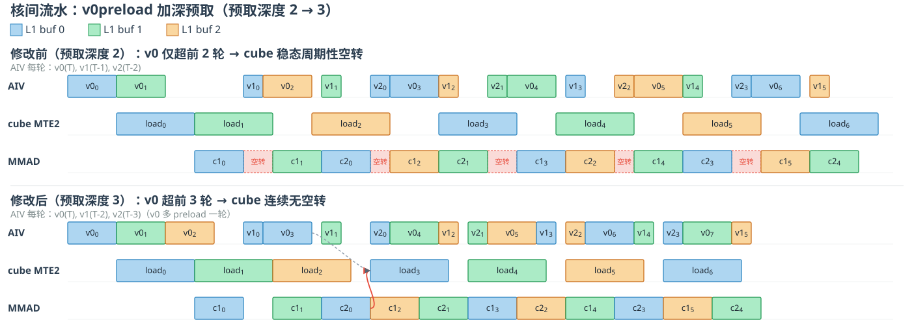

# Compressed Sparse Attention（CSA）算子技术细节

## 1. 概述

<!-- > 简述 CSA 算子的目标、应用场景及核心思想。

- **算子功能**：
- **输入/输出**：
- **核心优化点**： -->
CSA 是一种融合了**压缩**与**稀疏选择**的高效注意力机制。其核心流程为：

- 将每 $m$ 个 token 的 KV cache **压缩**为一个压缩条目（compressed KV entry），实现 $m\times$ 的序列长度压缩；
- 通过 **Lightning Indexer** 从压缩后的 KV 条目中**稀疏选取 Top-$k$** 个与当前 query 最相关的条目；
- 对选中的稀疏 KV 条目执行 **Shared Key-Value MQA**（Multi-Query Attention），完成最终的注意力计算。

目标是在**极长上下文场景**下大幅降低注意力的计算开销，使百万 token 级别的上下文在工程上可行。

### 1.1. 应用场景

- **超长文本推理**：当上下文长度达到极端规模（如百万 token），注意力成为模型的计算瓶颈时，CSA 作为 DeepSeek-V4 的核心注意力架构之一发挥作用。
- **与 HCA 混合部署**：CSA 与 HCA（Heavily Compressed Attention，以更大的压缩粒度 $m' \gg m$ 进行极简压缩）交织混合使用，在不同层或不同场景下互补，兼顾效率与精度。

### 1.2. 核心思想

| 优化点 | 具体做法 |
|---|---|
| **KV 压缩** | 用两组可学习的压缩权重 $Z^a, Z^b$ 和位置偏置 $B^a, B^b$，经 Softmax 归一化后对每 $m$ 个 token 的 KV 做加权聚合（Hadamard product + 求和），将序列长度压缩 $m$ 倍 |
| **低秩索引器（Lightning Indexer）** | 通过 Down/Up Projection 矩阵将 query 先压缩至低维隐空间，再升维生成 indexer queries；配合 ReLU 激活和加权求和计算每个压缩块与 query 的 index score |
| **Top-$k$ 稀疏选择** | 基于 index score 对压缩块做 Top-$k$ 筛选，每个 query 仅关注最相关的 $k$ 个压缩 KV 条目，避免全量注意力计算 |
| **Shared Key-Value MQA** | 压缩 KV 条目同时作为 attention 的 Key 和 Value，共用一份隐空间表示，减少存储和计算冗余 |
| **Grouped Output Projection** | 将 $n_h$ 个注意力头输出分为 $g$ 组，先在组内投影到较小的中间维度 $d_g$，再拼接投影到最终输出，避免 $c \cdot n_h \to d$ 直接投影带来的大矩阵乘法开销 |

总体而言，CSA = KV 压缩（$m\times$）+ 低秩索引稀疏选择（Top-$k$）+ 共享 KV 的 MQA + 分组输出投影。

**CSA 算子是 DeepSeek V4中最为核心的组件之一，其性能优化对于DeepSeek V4的部署至关重要。本文主要介绍 CSA 算子在950上的极致性能优化。**

---
## 2. Chromosomal Crossover：双 AI Core 共享 KV Cache

### 2.1 动机与问题

950 卡为 CV 直连架构，Cube 核与 Vector 核之间存在通路。对于这种 CV 不分离架构来说，优势在于融合算子的中间数据变量传输不需要出核（经过 L2 cache 或者 HBM），但是这也会给算子的 tiling 设计带来一些挑战：Cube 核或者 Vector 核产生的数据需要即时地被另一个核消费，L1 cache 及 UB 的空间会更加紧张，同时流水的排布更加复杂。

<div align="center">
   
</div>

对于 DeepSeek V4 的 Attention 机制，K 和 V 为同一份 tensor，单 head，`head_dim = 512`。考虑 K 和 V 实际上是同一份到因此我们需要在 L1 Cache 中为 KV 预留三份 buffer，这样可以保证访存没有 bubble。如下图所示，仅考虑 FlashAttention 主要的计算流程，其中 Sx 表示第 x 次 softmax 计算，Oy 表示第 y 次 rescale 计算。

<div align="center">

</div>

L1 cache 中 3buffer KV 占用空间大小为：`128 × 512 × 2 × 3 = 384 KB`，L1 cache 还剩余空间大小为 `128 KB`，由于还需要存储每次 softmax 的结果 P，因此行方向基本块大小只能切到 64，为 Q 预留空间大小为 `64 × 512 × 2 = 64 KB`。此处如果通过减少 KV 序列方向的基本块大小调大行方向基本块大小，会导致 rescale 计算次数过多，引入大量向量化计算，同时在 UB 上需要常驻更大尺寸的输出 tensor (rescale 计算需要保持 FP32，如果行方向基本块过大会导致占用 UB 过多)，依然不可行。

对于稀疏 Attention 而言，性能瓶颈在于对 KV 的离散搬运，也就是 V0 阶段的 mergeKV 操作，这一部分我们会利用 Vector 核进行搬运，通过聚合两个 token 的访存减少指令数，对于量化场景还会涉及到对 KV 的反量化。

当 Group Size `G = 128` 时，单个 token 对应的 attention 需要处理 128 行 Q，而基本块仅能容纳 64 行，因此 **需要两次迭代** 才能完成一个 token 的计算，这意味着 V0（mergeKV）阶段对同一批 KV 需要搬运两次，带来大量冗余的数据搬运开销，性能较差。

**核心矛盾**：L1/UB 容量不足 → 基本块行数受限 → 迭代次数翻倍 → KV 搬运冗余。

### 2.2 Chromosomal Crossover

为解决上述矛盾，我们采用一种染色体交错(Chromosomal Crossover)实现方式：**每两个 AICore 配对，协同处理同一个 token 对应的 G=128 的计算**。DeepSeek 的 FlashMLA 仓也采用了这种方式：[A Deep Dive Into The Flash MLA FP8 Decoding Kernel on Hopper](https://github.com/deepseek-ai/FlashMLA/blob/main/docs/20250929-hopper-fp8-sparse-deep-dive.md#crossover)。

具体流程如下：

1. **V0 阶段（mergeKV）**：两个 AICore 处理同一个 token`G=128`的计算，各自负责离散搬运并聚合当前 token 所需 KV 的一半。各自对离散的 KV Cache 做反量化后，将聚合结果写出到 GM 上的共享区域进行交叉共享。
2. **C1 阶段（Q@Kᵀ 计算）**：两个 AICore 在 C1 阶段**读取同一块共享的 KV**，各自用自己那部分`G=64`的 Q 与共享 KV 做 MatMul，进而完成后续的 attention 计算。
3. 
<div align="center">

</div>

这样，每个 AICore 的 L1 只需容纳 `S_inner = 128` 的 KV（三份 buffer 共 384 KB）+ `S_q = 64` 的 Q（64 KB）+ `(64,128)` 的 P（16 KB*2， 开启 double buffer），满足容量约束；而 G=128 的计算由两个 AICore 并行完成，无需迭代两次。

*需要注意的是，V4 flash 模型的 `G = 64`，正好与一个基本块的行数相等，不会产生额外的离散搬运，可以不需要使用上述的复杂流程。*

## 3. Cube 优化

### 3.1 动机与问题
---

#### 1. CUBE 队列满导致 Scalar 阻塞，流水线指令下发晚

旧代码中，C 侧流水排布为 `mm1 mm1 mm2 mm1 mm2...`，对一个s2Loop内 mm1+mm2 的指令数统计如下：

| 队列 | mm1 (splitK) | mm2 (splitN) | 合计 |
|------|-------------|-------------|------|
| MTE1 | 18 | 11 | **29** |
| CUBE | 13 | 10 | **23** |

`mm1`及`mm2` 指令序列：

```
WaitFlag(M_MTE1) -> LoadDataToL0A -> LoadDataToL0B -> SetFlag(MTE1_M) -> WaitFlag(MTE1_M) -> Mmad -> SetFlag(M_MTE1)
```

对于 D=512, kBase=NBase=128，mm1 Q、K均切D，循环搬运4次：
```
MTE1 侧：4 × 2 (LOAD q/k) + 4 × 2 (L0AB M_MTE1) + 1 (L1Q MTE2_MTE1) + 1 (L1KV MTE2_MTE1) = 18
CUBE 侧：4 × 2(L0AB MTE1_M) + 4 (MMAD) + 1 (FIX_M) = 13
```

mm2 Q搬运1次，v切D，循环搬运4次：
```
MTE1 侧：1(LOAD q) + 4(LOAD k) + 1(L0A M_MTE1) + 4(L0B M_MTE1) + 1 (L1Q MTE2_MTE1)= 11
CUBE 侧：1(L0A MTE1_M) + 4(L0B MTE1_M) + 4 (MMAD) + 1 (FIX_M) = 10
```

CUBE 队列仅 16 深度，而 mm1+mm2 连续下发时 CUBE 指令积压，加上同步指令也进入 CUBE 队列，导致队列溢出。
```
MTE1 queue size = 32，CUBE queue size = 16
CUBE queue size(16) < CUBE 指令数 (23)，CUBE 队列中指令会溢出
```

当 CUBE 队列满后，**所有 Scalar 指令被阻塞**，MTE1、MTE2的搬运指令也无法下发。仿真日志中明确观察到 CUBE queue 满的现象，导致 CUBE、MTE1、MTE2 出现断流，算力利用率及流水情况不及预期。例如在mm1完成后，进行mm2计算时，理论上MTE2可以进行数据搬运，但CUBE队列满导致MTE2指令无法下发。

#### 2. mm1计算依赖MTE2搬运
CUBE侧mm1计算依赖KV的MTE2搬运，搬运与计算在同一轮发射，导致计算与搬运间存在数据依赖，计算启动及完成时间延后，进一步阻塞了整个流水的进行。

### 3.2 改进方案
#### 1. 减少CUBE队列中指令
分析代码可知，在mmad前，L0A、L0B分别执行一次WaitFlag，占用4 * 2条指令，实际在L0A、L0B的搬运后插入一条等待MTE1的指令即可。  
```cpp
for (uint32_t k = 0; k < kLoops; k++) {
    // 1. 等待 M 侧 L0AB 可用
    WaitFlag<HardEvent::M_MTE1>(l0ABBufId);

    // 2. MTE1 搬运 L0A / L0B
    LoadDataToL0A(curAL0Tensor, ...);
    LoadDataToL0B(curBL0Tensor, ...);

    // 3. 通知 M 侧数据就绪 & 等待。修改后Wait指令数由8减少到4
    SetFlag<HardEvent::MTE1_M>(l0ABBufId);
    WaitFlag<HardEvent::MTE1_M>(l0ABBufId);

    // 4. Mmad 计算
    Mmad(cL0Tensor, curAL0Tensor, curBL0Tensor);

    // 5. 释放 L0AB 给 MTE1
    SetFlag<HardEvent::M_MTE1>(l0ABBufId);

    // 6. ping-pong 切换
    l0ABBufId ^= 1;
}
```
#### 2. Q与KV MTE2搬运preload一轮，解除本轮mm1与本轮MTE2搬运依赖

|轮次|优化前|优化后||
|----|---|----|----|
|  |CUBE|CUBE|
|taskId=0|C1|LoadQK|
|taskId=1|C1 C2|LoadQK C1|
|taskId=2|C1 C2|LoadQK C1 C2|
```cpp
uint32_t taskId = 0；
for (int64_t s2LoopCount = 0; s2LoopCount <= s2LoopLimit; ++s2LoopCount) {
      // 从taskId=0开始执行LoadQK，实现预发
      if (notLastTwoLoop) {
         LoadQK(l1KVBuffer, v0ResGmBuffers);
      }
      // 从taskId=1开始执行mm1，落后LoadQK一轮，计算taskId - 1 轮LoadQK搬运的数据，实现mm1与MTE2搬运解依赖
      if (taskId > 0 && notLast) {
         Mm1(mm1ResBuffer, l1QBuffer, l1KVBuffer);
      }
      // 从taskId=2开始执行mm2，占用taskId - 2 轮LoadQK搬运的KV，执行完后释放对应l1 buffer
      if (taskId > 1) {
         Mm2(mm2ResBuffer, l1PBuffer, l1KVBuffer);
      }
      ++taskId;
}
```
#### 3. L1QBuffer MTE2搬运及mm1计算切D
由于mm1计算要等待Q的MTE2完成，且L1Buffer仍有剩余，可以将L1Qbuffer D由512再切分为两个256，每搬运完256后，mm1就可以开启计算，Q搬运CopyQGmToL1及mm1阶段切D伪码示意如下：
```cpp
// CopyQGmToL1
// D轴切256，搬运由 1次512 -> 2次256 
for (uint32_t i = 0; i < 2; i++) {
   uint32_t curL1QBufId = (l1QBufId + i) % 3; // 3 buffer轮转
   WaitFlag<HardEvent::MTE1_MTE2>(curL1QBufId);
   // singleKSize为s1Base * 256个元素的地址偏移，乘以curL1QBufId偏移前续buffer的写入长度
   CopyToL1<Q_T>(l1QTensor[curL1QBufId * singleKSize], mRealSize, constInfo.dSize >> 1);
   SetFlag<HardEvent::MTE2_MTE1>(curL1QBufId);
}
```
```cpp
// mm1
// 第一半 D
param.singleK = constInfo.dSize >> 1; // 512 / 2 = 256
param.isOutKFisrt = true;
MatmulK1<...>(l1QTensor[curL1QBufId * singleKSize], ...); //对应CopyQGmToL1中第一轮循环搬入的Q

// 切换到下一个 L1Q buffer
curL1QBufId = (curL1QBufId + 1) % 3;

// 第二半 D
param.singleK = constInfo.dSize - param.singleK; // 512 / 2 = 256
param.isOutKFisrt = false;
MatmulK1<...>(l1QTensor[curL1QBufId * singleKSize], ...); //对应CopyQGmToL1中第二轮循环搬入的Q
```
### 3.3 优化前后流水对比
- 修改前  
MTE2断流处，CUBE队列满为高电平，直到MTE2指令pop期间，scalar也发生了断流。结合仿真log数据发现，MTE2搬运指令直到MTE2恢复高电平前(即搬运指令pop前)才刚刚push进指令队列，在断流期间没能push到队列中，push指令的scalar操作持续被CUBE队列满阻塞，可以说明瓶颈在于CUBE队列满导致了MTE2指令无法及时发射，经确认后续MTE2断流基本也为同样原因。  

- 修改后
直观可见CUBE侧流水基本达到CUBE bound，且MTE2流水中断位置发生了变化。  
尽管从流水图中看CUBE队列仍然有溢出现象，但结合仿真log数据发现，MTE2的搬运指令在MTE2为低电平前的时间段已push进入队列，pop前一直在等待MTE1消耗完毕，与优化前断流原因不同，且CUBE已达CUBE bound，可得出此时CUBE队列满不再是CUBE性能瓶颈，C侧获得了预期优化收益。  

### 3.4 性能数据

Prefill 场景（N=128, S1=8k, S2=128k）下，Cube 优化把 Cube 总体耗时从 9965µs 降到 6690µs，降幅约三分之一：

| N=128 prefill（S1=8k, S2=128k） | Cube 总体耗时 (µs) |
|---|---:|
| 优化前 | 9965 |
| 优化后 | 6691 |
| **Δ** | **−33%** |

---

## 4. GetKVPhyAddr：VF 向量化实现

### 4.1 动机与功能

PagedAttention 下,KV cache 按 block 物理分页存放,逻辑上连续的 KV 序列在物理上被 `block_table` 重映射到任意物理块。稀疏注意力又只选中部分 block(`sparse_indices`)。因此每个被选中的逻辑索引 `s2Idx` 需要换算成真实物理地址:


```
blkIdx  = s2Idx / blockSize                       // 落在第几个逻辑块
blkOff  = s2Idx % blockSize                        // 块内偏移
phyBlk  = block_table[blkIdx]                       // 逻辑块 → 物理块号(查表)
phys_addr(元素) = phyBlk * kvStride + blkOff * kvDim
```

- `kvStride`: KV cache物理块之间的元素跨度。
- `kvDim`:单 token 的特征维(每行元素数)。
- **结果是 int64**:`phyBlk * kvStride` 会超过 2^32, 必须用 64 位地址。

`GetKVPhyAddr` 要做的事情是把一整行 query 选中的 `total` 个逻辑索引批量换算成 `total` 个 int64 物理地址,写回 `kvPhyAddrGm`,供后续 `GetRealS2Addr` 取址搬 KV。 `GetKVPhyAddr` 用 VF 实现，把以上换算物理地址换算公式**向量化、并把查表从 GM 标量访问改成 UB 向量 gather**。

### 4.2 标量实现 vs 向量化实现

> 对比标量逐元素计算与 VF 向量化的差异，说明向量化的收益。

<!-- | 维度 | 标量实现 | VF 向量化 |
|------|----------|-----------|
| 每次处理元素数 | 1 | N（向量宽度） |
| 指令条数 | O(N) | O(1) |
| 延迟 | 高 | 低 | -->

向量寄存器以 **256B 为单位**:`RegTensor<uint32_t>` 64 个 int32 = 64×4B = **256B**。内核每个 loop 用 **2 个寄存器**(`_1`/`_2`)→ 一次处理 **128 个逻辑索引**; 输出是 int64 (拆成 L/H 两个 int32)。

| 维度 | 标量 `GetkeyOffset`(逐元素) | 向量 `GetKVPhyAddrVFImpl`(VF) |
|---|---|---|
| 处理粒度 | 1 个索引 / 次调用 | **128 个索引 / loop**(2 reg × 64) |
| 除 blockSize | `s2Idx / blockSize` 除法 | `ShiftRights`(blockSize=2^7 → 右移 7 位) |
| 模 blockSize | `s2Idx % blockSize` 取模 | `Muls(blkIdx,blockSize)` + `Sub` 还原余数 |
| 块内 offset | `blkOff * kvDim` | `Muls(pa_offset, kvDim)` |
| block_table 查表 | `blockTableGm.GetValue(...)` **GM 标量逐个**,延迟敏感 | 先 `CopyPaTableToUb` 预载 UB,再 `DataCopyGather` **向量 gather** |
| int64 乘 | 标量 64 位乘 | `Mull` → 低 32 位 + overflow 高 32 位 |
| int64 加 | 标量 `+` | `Add`(出 carry) + `AddC`(吃 carry) 高低分算 |
| 写出 | 1 个 int64 | `StoreAlign<DIST_INTLV_B32>` 交织 L/H 成 int64 |
| 访存形态 | GetValue 逐元素访问 | UB 批量 + 全程寄存器内 SIMD |

**向量化收益:**
1. **循环次数 ÷128**:`total` 个索引从 `total` 次标量迭代降到 `ceil(total/128)` 次 VF 迭代。
2. **消除 GM 标量查表延迟**:`block_table` 一次性 `CopyPaTableToUb` 到 UB，之后用 `DataCopyGather` 替代 `GetValue` 逐个访 GM。
3. **除/模变移位**:`blockSize` 取 2 的幂, 除法和取模降为 `ShiftRights`+`Muls`+`Sub`。
4. **int64 地址 SIMD 化**:用 `Mull`/`Add`/`AddC` + carry mask 在寄存器内完成 64 位运算, 无需标量 64 位 ALU 逐个算。

---

### 4.3 向量化算法细节

<!--  -->
### 4.3.1 常量与排布

```cpp
s2NumPerLoop   = 128   // 每 loop 处理 128 个逻辑索引
s2NumPerReg    = 64    // 每寄存器 64 个 int32 = 256B
outOffsetPerLoop = 256 // 输出 int64 → 翻倍:128 索引 × 2(L/H) = 256 个 uint32
outOffsetPerReg  = 128 // 64 索引 × 2
```
每 loop 用 `_1`(前 64)、`_2`(后 64)两套寄存器并行同一套运算。

### 4.3.2 VF 指令序列(每 loop,以 `_1` 为例)

逻辑公式为 `addr = block_table[idx>>7]*kvStride + (idx - (idx>>7)*blockSize)*kvDim`,

1. 载入 64 个逻辑索引 (256B 对齐)
```cpp
LoadAlign(vreg_sparse_idx_1, sparseIdxUb + i*128);  // _2: + 64
```
2. 右移求逻辑块号, 取代除法
$$
pa\_blk\_idx = idx/128 = idx >> 7,
$$
```cpp
ShiftRights(vreg_pa_blk_idx_1, vreg_sparse_idx_1, shiftRightNum, preg_all_b32);
```
3. 求块内偏移
$$
pa\_offset = idx - pa\_blk\_idx*blockSize,
$$
```cpp
Muls(vreg_pa_tmp_1, vreg_pa_blk_idx_1, blockSize, preg_all_b32);
Sub (vreg_pa_offset_1, vreg_sparse_idx_1, vreg_pa_tmp_1, preg_all_b32);
```
4. 计算块内元素物理 offset
$$
offset = pa\_offset * kvDim,
$$
```cpp
Muls(vreg_phy_offset_1, vreg_pa_offset_1, kvDim, preg_all_b32);
```
5. 查 block_table: 逻辑块号 → 物理块号(UB 向量 gather)
$$
phyBlk  = block\_table[blkIdx],
$$
```cpp
DataCopyGather(vreg_phy_blk_idx_1, blkTableUb, vreg_pa_blk_idx_1, preg_all_b32);
```
6. 现在要计算 $$P = phyBlk * kvStride,$$ 需要用 int64 表示，先拆分高低 32 位uint32 进行表示：
$$
   P = P_L + P_H*2^{32},
$$ 此时的物理地址是 addr = P + offset 之和
$$
addr = 
\begin{cases}
P_H*2^{32} + (P_L+offset),\ \ \ \ \ (P_L+offset) < 2^{32}\\
(P_H + 1)*2^{32} + (P_L+offset-2^{32}),\ \ \ \ \ \ \ \  else.
\end{cases}
$$
```cpp
Mull(vreg_blk_id_mul_stride_L_1, vreg_mul_overflow_L_1, vreg_phy_blk_idx_1, vreg_kvStride, preg_all_b32);
Add (add_carry_l_1, vreg_total_offset_L_1, vreg_blk_id_mul_stride_L_1, vreg_phy_offset_1, preg_all_b32);
AddC(add_carry_h_1, vreg_total_offset_H_1, vreg_mul_overflow_L_1, vreg_zero, add_carry_l_1, preg_all_b32);
```
7. 交织写出物理地址的高32位和低32位
```cpp
StoreAlign<DIST_INTLV_B32>(kvPhyAddrUb + i*256, vreg_total_offset_L_1, vreg_total_offset_H_1, preg_all_b32);
```
<!-- ### 4.3.2 VF 指令序列(每 loop,以 `_1` 为例)

逻辑公式 `addr = block_table[idx>>7]*kvStride + (idx - (idx>>7)*blockSize)*kvDim`:

```cpp
// ① 载入 64 个逻辑索引(256B 对齐)
LoadAlign(vreg_sparse_idx_1, sparseIdxUb + i*128);              // _2: + 64
// ② 右移求逻辑块号  pa_blk_idx = idx >> shiftRightNum(=7,即 /128)
ShiftRights(vreg_pa_blk_idx_1, vreg_sparse_idx_1, shiftRightNum, preg_all_b32);
// ③ 求块内偏移  pa_offset = idx - pa_blk_idx*blockSize
Muls(vreg_pa_tmp_1, vreg_pa_blk_idx_1, blockSize, preg_all_b32);
Sub (vreg_pa_offset_1, vreg_sparse_idx_1, vreg_pa_tmp_1, preg_all_b32);
// ④ 块内元素 offset = pa_offset * kvDim
Muls(vreg_phy_offset_1, vreg_pa_offset_1, kvDim, preg_all_b32);
// ⑤ 查 block_table:逻辑块号 → 物理块号(UB 向量 gather)
DataCopyGather(vreg_phy_blk_idx_1, blkTableUb, vreg_pa_blk_idx_1, preg_all_b32);
// ⑥ int64 乘:phyBlk * kvStride → 低位 + overflow 高位
Mull(vreg_blk_id_mul_stride_L_1, vreg_mul_overflow_L_1, vreg_phy_blk_idx_1, vreg_kvStride, preg_all_b32);
// ⑦ int64 加:+ phy_offset(低位出 carry)
Add (add_carry_l_1, vreg_total_offset_L_1, vreg_blk_id_mul_stride_L_1, vreg_phy_offset_1, preg_all_b32);
// ⑧ 高位 = overflow + 0 + carry
AddC(add_carry_h_1, vreg_total_offset_H_1, vreg_mul_overflow_L_1, vreg_zero, add_carry_l_1, preg_all_b32);
// ⑨ 交织 L/H 写出成 int64 地址
StoreAlign<DIST_INTLV_B32>(kvPhyAddrUb + i*256, vreg_total_offset_L_1, vreg_total_offset_H_1, preg_all_b32);
```

循环外预置:`Duplicate(vreg_zero, 0)`、`Duplicate(vreg_kvStride, kvStride)`。 -->

### 4.3.3 掩码处理(两类 MaskReg,作用不同)

1. **谓词掩码** `preg_all_b32 = CreateMask<MaskPattern::ALL>()`:每条算术指令的 lane 使能, 当前实现**全开**(所有 64 lane 都算)。
2. **进位掩码** `add_carry_l_1` / `add_carry_h_1`:**不是 lane 谓词,而是 64 位加法的进位**。
   `Add` 把低 32 位相加产生的进位写入 `add_carry_l_1`,`AddC` 再把它吃进高 32 位 (`高 = overflow + 0 + carry`)。这是用 MaskReg 承载 carry 实现寄存器内 int64 加法的关键。

### 4.3.4 边界条件(非对齐长度 `total % 128 ≠ 0`)

首先计算循环参数:
```cpp
s2Loop = (total + 128 - 1) / 128;     // 向上取整
s2Tail = total - (s2Loop - 1) * 128;  // 尾块有效数
```
当前 VFImpl 的处理方式:
- **VF 内核按 `s2Loop` 跑满**，每 loop 都用 `preg_all`(128 个)→ **尾块会多算最多 127 个**地址到 UB 缓冲。
- 输入 `sparseIdxUb` 由 `DataCopyPad` 零填充，多余的部分最终物理地址为-1。
<!-- - **正确性靠"写出时按 `total` 截断"保证**:`CopyPhyAddrToGm(..., total, ...)`(`blockLen = total*sizeof(int32)*2/32`)只把前 `total` 个有效地址搬回 GM,多算的尾块不写出。 -->

### 4.4 性能数据
当前物理地址向量化的收益明显，Scalar下降约38\%，Vector部分的收益约35\%，端到端收益约 5\%。

| 场景 | 指标 | 优化前 | 优化后 | 减少量 | 优化幅度 |
|:---|:---|---:|---:|---:|---:|
| **N=128 Decode** | 总耗时 | 140.18 | 133.38 | 6.80 | **↓ 4.85%** |
|            | Vec 耗时 | 130.36 | 84.32 | 46.04 | **↓ 35.3%** |
|            | Vec 部分 Scalar 耗时 | 125.18 | 77.87 | 47.31 | **↓ 37.8%** |
| **N=128 Prefill** | 总耗时 | 10732.04 | 10242.30 | 489.74 | **↓ 4.56%** |
|             | Vec 耗时 | 10588.48 | 6644.36 | 3944.12 | **↓ 37.3%** |
|            | Vec 部分 Scalar 耗时 | 10461.82 | 6500.41 | 3961.41 | **↓ 37.9%** |

---

## 5. 核间流水排布

### 5.1 动机与问题

通过 [§4.4](#44-性能数据) 的表格数据可见，向量化大幅降低了 AIV scalar 耗时，但这部分性能收益并未完全转化为端到端的性能收益。

本节从**核间流水排布**入手，通过加深流水与改变核间同步的方式降低端到端耗时。

### 5.2 v0preload：加深一级 KV 矩阵预取流水（预取深度 2→3，N=128）

每个 S2 基本块均需用到一份 bf16 的 KV 矩阵（`s2BaseSize=128 × D=512`，合计 **128KB**）。N=128 的场景下，该 KV 矩阵经 GM 在两个 AIC 间共享（G=128 跨 2 个 AIC、各算 64 头）：由 AIV 的 `ProcessVec0` 在 UB 算出后写到 GM 的 `v0ResGm`，AIC 使用时再经 `IterateLoadQK` 从 GM `DataCopy` 到 L1 的 KV 矩阵缓冲 `l1RightBuffers`。该 KV 矩阵自产出起持续驻留至被 bmm2 消费——既作为 bmm1 的 KV 矩阵（当 K，算 Q·Kᵀ），又作为 bmm2 的 KV 矩阵（当 V，算 P·V）。

回顾 [$2.1](#21-动机与问题)：正因为一份 KV 矩阵要在 L1 里被 `load→bmm1→bmm2` 连续消费，因此需要在 L1 预留**三份 buffer**（`l1RightBuffers`，按 `taskIdMod3` 轮转），使相邻基本块的取数与计算彼此错开、消除访存 bubble。

这三份 buffer 能否被持续填满、连续周转，正是本节流水排布要解决的问题。

一份 KV 矩阵每经过一轮基本块循环便前进一步，依次走 **vec0 产出（AIV）→ load 取数 GM→L1（AIC）→ bmm1（AIC）→ bmm2（AIC）** 四步。收益的关键，在于 `load` 与 `vec0` 落在哪一轮基本块循环：

**修改前（预取深度 2）——取数与产出同一轮**：`PRELOAD_NUM = 2`、`runInfo[3]`，参与轮转的 KV 矩阵 3 份。`load` 与 `vec0` 落在同一轮、且取的是同一块；AIC 必须等 AIV 的 `ProcessVec0` 产出并跨核同步后才能 `IterateLoadQK`，故 cube 每轮均需空等一次。

**修改后（预取深度 3）——load 比 vec0 晚一轮**：把预取 `PRELOAD_NUM` 从 2 提到 3（`runInfo[4]`），让 `load` 与 `vec0` 解耦到相邻两轮基本块循环——`vec0` 在本轮产出并写 GM，`load` 推迟到下一轮才从 GM 取到 L1。AIV 因此有一整轮时间完成"产出 + 跨核交付"，AIC 取数时数据已在 GM 就绪、不再等待，这段延迟被掩盖到前序基本块的 cube 计算之后。



加深预取后，vec0 / load / bmm1 / bmm2 四个阶段各持有一份 KV 矩阵，参与轮转的 KV 矩阵从 3 份增加到 4 份。**但在 N=128 上，这一份的增加无需为存储额外分配空间**，原因是：N=128 的 KV 矩阵经 GM 中转（G=128 跨 2 个 AIC 共享），承接这第 4 份 KV 矩阵的 GM 空间来自更早一轮 v0 释放后的复用——第 N+3 轮的 v0 发起前，已先完成若干轮 bmm（v1）计算，更早一轮 v0 写入 GM 的数据早已被 `load` 搬入 L1、对应的 GM 中转槽位随之释放，恰好用于承接这第 4 份 KV 矩阵。故 L1 侧仍只用 `l1RightBuffers` 的 3 块缓冲（按 `taskIdMod3` 轮转）、分配不变。

从 buffer 角度看，上图中每一份 KV 矩阵（绿框）从 `vec0` 产出到被 `bmm2` 消费，需在 L1 的 3 块 `l1RightBuffers` 中驻留 `load → bmm1 → bmm2` 三轮（图中同色块即同一块 buffer，3 块按 `taskIdMod3` 轮转）。修改前 `load` 与 `vec0` 同轮，cube 每轮须先等 `vec0` 产出，方能填入当前轮转到的 buffer（上图红框），3 块 buffer 无法连续周转、cube 周期性空等；修改后 `load` 提前一轮、取上一轮已就绪的 KV，3 块 buffer 依次被 `load / bmm1 / bmm2` 占满、连续周转，cube 空转大幅收窄。这正是第 2 节“以三份 buffer 消除 bubble”的设计得以落实——cube MFU 从 55.8% 提升至 74%。

### 5.3 推广到 N=64：核间同步重构

N=128 的第 4 份 KV 矩阵本就位于既有的 GM 中转区；而 N=64 原先由 AIV 把 KV 矩阵从 UB 直接搬到 L1（`CopyOutKvUb2L1`），未走 GM，若要再多保留一份 KV 矩阵，则需为其新增存放空间。

但该场景下 **L1 已被占满**——L1 共 512KB，分配为：KV 矩阵区 `l1RightBuffers` `3×128KB = 384KB`、P 缓冲 `l1P` `2×16KB = 32KB`、Q 缓冲 `l1Q` `3×32KB = 96KB`，合计 `384 + 32 + 96 = 512KB`，无法容纳第 4 个 128KB 的 KV 矩阵。

为了在 N=64 场景下使能该优化，**需要把 KV 矩阵也改走 GM 中转**：`ProcessVec0` 算出后由 `CopyOutKvUb2Gm` 写到 GM 上的 `v0ResGm`，AIC `IterateLoadQK` 从 GM `DataCopy` 回 `l1RightBuffers`。由此所有 KV 矩阵均先在 GM 周转、再按需载入 L1；GM 中转区与 L1 一样是 3 缓冲、按 `taskIdMod3` 轮转（每份 KV 矩阵驻留 ≤3 轮：load→bmm1→bmm2），代价是每个 AIC 的 workspace 有限增大 `3×128KB = 384KB`，L1 分配不变。

随之**核间同步的锚点从「L1 写完处」前移到「AIC 预取处」**——两端都是 CV 核间同步（1 个 AIC 与其配对的 2 个 AIV 之间的 `CrossCoreSetFlag`/`CrossCoreWaitFlag`，见 `buffer.h`），并非全核同步：原先 N=64 由 AIV 直写 L1 后在该 L1 buffer 上同步（`CopyOutKvUb2L1` + `outputL1.SetCrossCore`，AIC 在 `MTE1` 等待），改为写 GM 后在 GM buffer 上同步（`CopyOutKvUb2Gm` + `v0ResGm` 的 `CROSS_CORE_SYNC_BACKWARD`，AIC 在 `IterateLoadQK` 内以 `MTE2` 等待后再 `DataCopy`），使 AIC 能提前发起 GM→L1 预取、与前序 cube 计算 overlap。这条改写同时删去了 N=64 直写 L1 的冗余路径、统一了代码：N=64 与 N=128 不再按 `IS_SPLIT_G` 分作两条路径，双主循环 `ProcessMainLoopN64`/`ProcessMainLoopN128` 合并为单一 `ProcessMainLoop`。

### 5.4 性能数据

| 场景 | 总耗时优化前 | 总耗时优化后 | MFU 优化前 | MFU 优化后 | 优化幅度 |
|:---|---:|---:|---:|---:|---:|
| **N=128 Decode** | 133.38 | 101.39 | 50.25% | 66.11% | **31.6%** |
| **N=128 Prefill** | 10242.30 | 7734.07 | 55.84% | 73.95% | **32.4%** |
| **N=64 Decode** | 113.69 | 79.15 | 29.48% | 42.34% | **43.6%** |
| **N=64 Prefill** | 8422.47 | 6174.28 | 33.95% | 46.32% | **36.4%** |

CSA 算子在 N=64/128 的 Decode、Prefill 场景下，性能提升均达 **30%+**；在 Prefill、N=128 场景下，MFU 可达 **74%**。

流水编排修改前后，cube MAC、AIV scalar、AIV vec 等各类 pipe 的耗时均无下降，cube、vec 的 MTE2（搬运）耗时甚至略有增加；但端到端性能有明显收益。这说明，**新的流水排布把第 3 节的 Cube（MAC）优化与第 4 节的向量化优化真正转化为端到端的性能收益**。需要强调，前两项优化是流水编排优化的基础：若无它们降低各类 pipe 的耗时，端到端收益便无从取得。

---

## 6. 端到端性能

<!-- > 整合以上优化后的端到端性能数据。

| 配置 | 延迟 (ms) | 带宽利用率 | 内存节省 |
|------|-----------|-----------|----------|
| Baseline | | | |
| + SharedKV | | | |
| + VF GetKVPhyAddr | | | |
| + 核间流水 | | | | -->
当前 QSMLA 算子在 NPU 上的 MFU 可达74%，优于 DeepSeek 的 FlashMLA 仓中 H800 和 B200 的 Peak MFU [FlashMLA: Test & benchmark MLA prefill (Sparse)](https://github.com/deepseek-ai/FlashMLA#test--benchmark-mla-prefill-sparse)。

| 场景 | 规格 | 950DT | H800 | B200 |
|:---|:---|---:|---:|---:|
| **flash Decode** | gb=2496 seq=8K | 44.4% | 25.1% | 19.7% | 
|            | gb=1664 seq=128K DP=16 CP=1| 37.1% | 22.9% | 20.2% | 
| **pro Decode** | gb=7168 seq=8K DP=128 CP=1| 72.3% | 35.7% | 25.3% | 
|            | gb=5376 seq=128K DP=128 CP=1| 65.0% | 35.1% | 24.0% | 
| **flash Prefill** | gb=16 seq=8K| 34.5% | 30.6% | 21.2% | 
|            | gb=5 seq=128K DP=1 CP=16 zigzag| 47.0% | 28.8% | 22.0% | 
| **pro Prefill** | gb=16 seq=8K DP=16 CP=1| 49.2% | 41.7% | 29.8% | 
|            | gb=1 seq=128K DP=1 CP=16 zigzag| 74.0% | 41.4% | 29.8% |
| **pro Prefill 非量化** | gb=16 seq=8K DP=16 CP=1| -------- | 59.3% | 68.3% | 
|            | gb=1 seq=128K DP=1 CP=16 zigzag| -------- | 58.7% | 56.1% |
|            | gb=1 seq=1M DP=1 CP=128 zigzag| -------- | 53.6% | 55.5% |
| **PeakMFU (Prefill)** | QSMLA/FlashMLA | **74.0%** | 64.7% | 64.4%|

**备注1：pro Prefill 非量化场景的GPU性能，是用 FlashMLA 开源仓flash_mla_sparse_fwd在当前case下测得的性能。**

**备注2：其中 FlashMLA 开源仓官宣的峰值性能 64.7%(H800) 和 64.4%(B200)，是在Deepseek v3.2模型case达成的。**

---

## 7. 附录

### 7.1 关键数据结构

> KV Cache 的内存布局结构体定义等。

### 7.2 术语表

| 术语 | 说明 |
|------|------|
| AI Core | 昇腾 NPU 中的计算核心 |
| VF | Vector Functional unit，向量功能单元 |
| GM | Global Memory，全局存储 |
| UB | Unified Buffer，统一缓冲区 |
| KV Cache | Key-Value 缓存 |
| AIC | AI Cube，矩阵计算核（执行 bmm1/bmm2） |
| AIV | AI Vector，向量计算核（产出 KV 矩阵/反量化 KV） |
| L1 | 片上 L1 缓冲（存 KV 矩阵 `l1RightBuffers`、P、Q） |
| bmm1 / bmm2 | 批量矩阵乘：bmm1 = Q·Kᵀ，bmm2 = P·V |
| KV 矩阵 | bmm 的右操作数，即反量化后的 KV（每块 128KB），由 AIV 产出 |
| v0preload | 本章优化：加深软件流水预取 KV 矩阵，掩盖核间交付延迟 |
| MFU | 理论 cube 矩阵乘耗时 / 实测内核耗时，越高越接近计算瓶颈 |