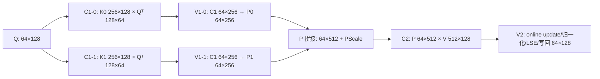
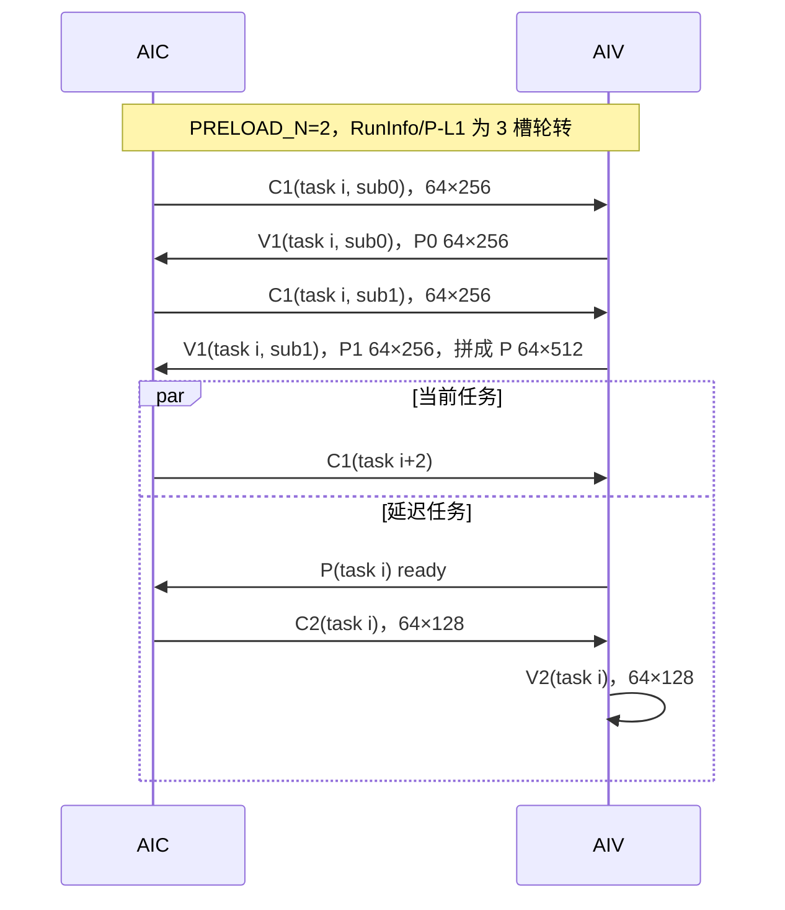

# QuantBlockSparseAttn MXFP8 arch-9102r1 C:V=1:1 首版穿刺设计

## 1. 目标与范围

本版为 `DAV_9201`、`DAV_9202` 增加 MXFP8 全量化的 C:V=1:1 kernel 路径，目标如下：

- Host、tiling data、tiling key 和 metadata 格式与 arch35 共用；
- softmax、MXFP8 P 量化、C2 累加、LSE 和输出转换的算法保持与 arch35 一致，但源码物理复制到新目录；
- 新架构全部 kernel 源码位于 `op_kernel/arch-9102r1`；
- arch35 与 arch-9102r1 独立编译，两个目录之间不存在相互 include；
- arch35 保持原始 C:V=1:2 实现，9102r1 使用 C:V=1:1、计算 M=64；
- `q_block_size=64/128` 都完整覆盖，输出行及稀疏列表语义与 arch35 一致。

本次性能与精度改造针对当前讨论的 `MXFullQuantMode`。FP8 非 MX 文件也已复制到 arch-9102r1 以保证编译隔离，但其 C:V=1:1 功能适配和精度回归仍需单独完成。

## 2. 代码组织和复用关系

```text
quant_block_sparse_attn.cpp
  ├─ [default] arch35/                                # 只包含 arch35 本地文件
  │    ├─ quant_block_sparse_attn_kernel.h
  │    ├─ quant_block_sparse_attn_mx_kernel.h
  │    ├─ common/
  │    └─ vf/
  └─ [DAV_9201/9202] arch-9102r1/                    # 只包含 9102r1 本地文件
       ├─ quant_block_sparse_attn_kernel.h
       ├─ quant_block_sparse_attn_mx_kernel.h
       ├─ common/
       └─ vf/
```

平台选择头同时识别以下形式：

- `DAV_9201`、`DAV_9202`；
- `__DAV_9201__`、`__DAV_9202__`；
- `__NPU_ARCH__ == 9201/9202`。

未命中时只编译 arch35 路径。命中 DAV_9201/9202 时只编译 arch-9102r1 路径。9102r1 kernel task 类型为 `KERNEL_TYPE_MIX_AIC_1_1`，arch35 为 `KERNEL_TYPE_MIX_AIC_1_2`。

arch-9102r1 目录拥有独立的 `Buffer`、`BufferManager`、`BuffersPolicy`、matmul、搬运和 VF 文件。arch35 已恢复为原始实现，因此修改任一架构目录不会触发另一个架构重新编译。

## 3. 计算拆分与数值等价

### 3.1 一个 64×512 基本块



每个 logical S2 tile 仍是 512，C1/V1 保持两个 256-token subLoop；C2 仍按两个 K=256 子循环累加。`PRELOAD_N` 保持 2，不增大到 4。

### 3.2 q_block_size=128

Host 和 metadata 仍以一个 128 行 sparse Q block 分配任务。9102r1 在 kernel 内部拆成两个连续的 M-part：

| M-part | Q 行范围 | C1/V1 输出 | C2/V2 输出 |
|---|---:|---:|---:|
| 0 | `[0, 64)` | `P[64,512]` | `O[64,128]` |
| 1 | `[64, 128)` | `P[64,512]` | `O[64,128]` |

两个 M-part 使用同一条 sparse block 列表，但 Q/输出地址按 64 行偏移。注意力不同 Q 行之间没有归约依赖，所以按 M 轴拆分不会改变数学结果。q_block_size=64 时 M-part 数量为 1。

## 4. RunInfo 和流水

RunInfo 仍为 `PRELOAD_N + 1 = 3` 个槽。新增的 `mPart` 只在 FillRunInfo 时转换为 `s1Idx`，不改变 tiling data ABI。



稳态任务关系：

| 逻辑拍 | AIC | AIV | 保活状态 |
|---:|---|---|---|
| `t` | C1/V1 生产 task `i` | 消费 C1 并写 P | RunInfo/P slot `i%3` |
| `t+1` | C1/V1 生产 task `i+1` | 消费 C1 并写 P | RunInfo/P slot `(i+1)%3` |
| `t+2` | C1(task `i+2`) 与 C2(task `i`) 顺序发射 | V1(task `i+2`) 与 V2(task `i`) 顺序执行 | 释放 task `i` |

C1 使用三槽是为了对应三个在途 RunInfo；C2 结果使用单槽，因为 C2 与 V2 之间有双向跨核事件，V2 消费完成后才允许复用。这样还能满足共享实现的 11 个跨核事件 ID 上限：C1 三槽占 6 个、C2 单槽占 2 个、P-L1 三槽占 3 个。

## 5. 内存分配

以下按最坏配置 `mask=true、LSE=true` 计算；1 KiB=1024 B。

### 5.1 L0A/L0B/L0C

| 存储 | 策略 | 单槽 | 槽数/保留 | 使用/保留 |
|---|---|---:|---:|---:|
| L0A | MM 双缓冲 | 32 KiB | 2 | 64 KiB |
| L0B | MM 双缓冲 | 32 KiB | 2 | 64 KiB |
| L0C | C1/C2 共用双缓冲 | 64 KiB | 2 | 128 KiB |
| L0C manager | 硬件空间预留 | - | - | 256 KiB |

C1 单槽上限为 `256×64×4 = 65,536 B`；C2 实际为 `64×128×4 = 32,768 B`，复用 64 KiB 槽。首版优先保证共享实现和编译穿刺，因此没有引入专用的 C1 三槽+C2 双槽 L0C allocator；剩余 L0C 可在性能版中用于更深的 MTE1/MM/FIXPipe 重叠。

### 5.2 L1

| 数据 | 单槽字节数 | 槽数 | 合计 |
|---|---:|---:|---:|
| Q+QScale | 8,448 | 2 | 16,896 B = 16.5 KiB |
| K+KScale | 33,792 | 4 | 135,168 B = 132 KiB |
| V+VScale | 33,792 | 2 | 67,584 B = 66 KiB |
| P+PScale | 33,792 | 3 | 101,376 B = 99 KiB |
| 合计 | - | - | **321,024 B = 313.5 KiB** |

L1 manager 保留 512 KiB，当前显式槽位占 313.5 KiB，余量 198.5 KiB。该余量用于后续把 K/V 预取深度分别扩展到 6/3；首版不改变内部 `BuffersPolicy4buff/DB`，避免同时扩大功能穿刺和性能重排的风险。

### 5.3 UB

| 数据 | 形状/说明 | 合计 |
|---|---|---:|
| C1 result | 3×`64×256×fp32` | 196,608 B = 192 KiB |
| C2 result | 1×`64×128×fp32` | 32,768 B = 32 KiB |
| V2 accumulator | `64×128×fp32` | 32,768 B = 32 KiB |
| V1 packed P stage | 2×`64×264×fp8` | 33,792 B = 33 KiB |
| PScale stage | `64×256/32` | 512 B = 0.5 KiB |
| softmax sum/max/exp | 9×`64×fp32` | 2,304 B = 2.25 KiB |
| online softmax temporary | 3×`64×fp32` | 768 B = 0.75 KiB |
| LSE queue | 最大配置 | 2,048 B = 2 KiB |
| attention mask | `256×64×uint8` | 16,384 B = 16 KiB |
| DN index | 256 B | 256 B = 0.25 KiB |
| 合计 | - | **318,208 B = 310.75 KiB** |

相对 380 KiB 可用 UB，余量为 70,912 B（69.25 KiB）；若“380k”按十进制 380,000 B 计算，仍有 61,792 B 余量。UB 占用率约 81.8%，并保留了编译器/平台实现差异的安全余量。

## 6. 精度保持原理

9102r1 保持以下数值算法不变：

- Q/K/V MXFP8 data+E8M0 scale 的 L1 搬运与随路反量化；
- `ProcessVec1VfDnMxfp8` 的缩放、mask、online softmax 和 P/PScale 量化；
- C2 的两个 K=256 累加顺序；
- `FlashUpdateNew/Last`、`LastDivNew`、LSE 和 bf16 cast；
- sparse block 排序、PA 地址和 causal mask 地址计算。

变化只有：一个 AIV 独占 64 行、FixPipe `dualDstCtl` 从 2 变为 1，以及 q_block=128 时在 M 轴串行两次。每个 64 行基本块内部的 S2 遍历、softmax 更新顺序和 C2 K 轴累加顺序与 arch35 相同，因此不会引入新的浮点重排。

## 7. 编译与回归建议

目标工具链应分别覆盖 DAV_9201 和 DAV_9202：

```bash
bash build.sh --experimental --opkernel --ops=quant_block_sparse_attn --soc=<DAV_9201对应soc>
bash build.sh --experimental --opkernel --ops=quant_block_sparse_attn --soc=<DAV_9202对应soc>
```

发布前至少回归以下组合：

- q_block_size：64、128；kv_block_size：64、128；
- mask：none、causal；LSE：false、true；
- S1：小于64、64、65、127、128及多 Q block；
- sparseLen：1、刚好一组、跨两个 512 tile、tail block、含负 block id；
- PScale 缺省/提供；PA block tail；
- 与 arch35 golden 对比 attentionOut、softmaxLse，并单独检查空 sparse 行。

建议精度门限沿用现有 arch35 用例；若要求 bitwise 一致，应同时固定编译器版本、FP8 cast mode 和 VF 优化选项。
