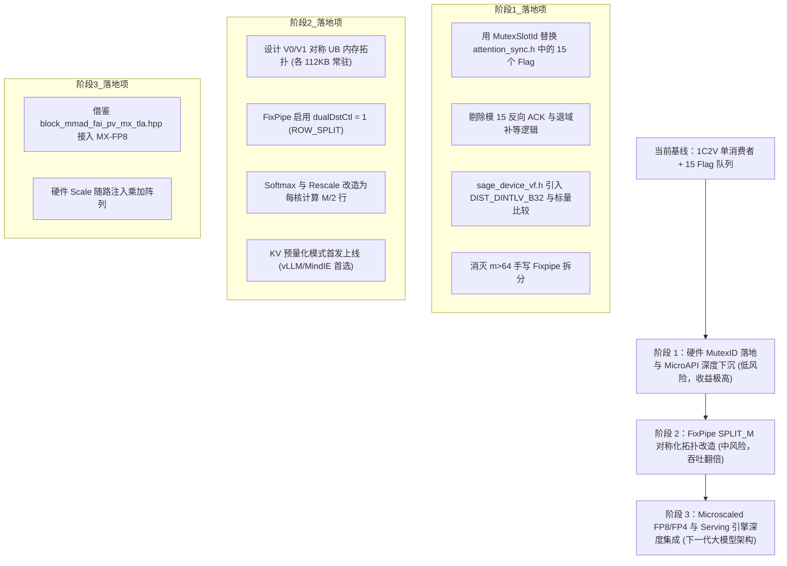

# CATLASS 组件与硬件微架构下一阶段深度挖掘报告
## 基于昇腾 950 (dav-3510) 架构与 1C2V 混合流水线的超高性能演进路线

> **编制角色**：华为昇腾 NPU 架构与 CATLASS 深度挖掘研究子代理  
> **报告版本**：v2.5 (Comprehensive Deep Dive & Production Implementation Plan)  
> **研究对象与深度探索范围**：
> 1. **官方 CATLASS 核心仓库** (`/Users/z/git/hw/git/catlass/`)：
>    - `include/catlass/gemm/block/block_mmad_pingpong_mutex_tla.hpp` 与 `block_mmad_fai_pv_mx_tla.hpp`
>    - `include/catlass/epilogue/block/block_epilogue_fa_rescale_o_ascend950.hpp` 与 `block_epilogue_fa_softmax_ascend950.hpp`
>    - `include/catlass/arch/cross_core_sync.hpp` 与 `include/catlass/arch/resource.hpp`
>    - `include/catlass/gemm/tile/ascend950/copy_l0c_to_ub.hpp` 与 `copy_l0c_to_dst.hpp`
>    - `include/catlass/epilogue/block/block_epilogue_fixpipe.hpp` 与 `block_epilogue_elemwise_no_source_from_ub.hpp`
>    - 官方示例：`examples/46_ascend950_matmul_fixpipe_opti/` 与 `examples/70_ascend950_flash_attention_chunk_prefill/`
> 2. **华为自研编译器 BiShengIR 底层** (`catlass/python/tla_dsl/3rdparty/AscendNPU-IR/bishengir/`)：
>    - `Dialect/HIVM/IR/HIVMSynchronizationOps.td`、`HIVMDMAOps.td`、`HIVMVectorOps.td`、`HIVMAttrs.td`
>    - `Dialect/HIVM/Transforms/TileAndBindSubBlock/TileUtils.cpp` 与 `InlineFixpipe.cpp`
> 3. **当前落地工程代码** (`/Users/z/git/hw/ops-transformer/experimental/attention/sageattention2/`)：
>    - `op_kernel/attention_sync.h`, `attention_cube.h`, `attention_vec0_quant.h`, `attention_vec1_softmax.h`, `attention_vec1_output.h`, `sage_device_vf.h`, `static_slot.h`
>    - `sageattn_fp8/catlass/sage_tile.hpp`, `sage_resource.hpp`, `sage_qk_mmad.hpp`, `sage_pv_mmad.hpp`

---

## 目录
1. [执行摘要与核心论点](#1-执行摘要与核心论点)
2. [CATLASS 六大关键组件与硬件微架构机理剖析](#2-catlass-六大关键组件与硬件微架构机理剖析)
   - [2.1 `block_mmad_pingpong_mutex_tla.hpp`：基于硬件 Mutex 的管线自仲裁机制](#21-block_mmad_pingpong_mutex_tlahpp基于硬件-mutex-的管线自仲裁机制)
   - [2.2 `block_mmad_fai_pv_mx_tla.hpp`：Microscaling (MX-FP8/FP4) 硬件缩放机制](#22-block_mmad_fai_pv_mx_tlahppmicroscaling-mx-fp8fp4-硬件缩放机制)
   - [2.3 `block_epilogue_fa_softmax_ascend950.hpp`：高度融合的 SIMD 微指令流水](#23-block_epilogue_fa_softmax_ascend950hpp高度融合的-simd-微指令流水)
   - [2.4 `block_epilogue_fa_rescale_o_ascend950.hpp`：在线更新与积和直刷](#24-block_epilogue_fa_rescale_o_ascend950hpp在线更新与积和直刷)
   - [2.5 `cross_core_sync.hpp` 与 `resource.hpp`：硬件资源拓扑与同步队深约束](#25-cross_core_synchpp-与-resourcehpp硬件资源拓扑与同步队深约束)
   - [2.6 BiShengIR 编译器中间表示：`FixpipeOp`、`dual_dst_mode` 与 `VInterleaveOp`](#26-bishengir-编译器中间表示fixpipeopdual_dst_mode-与-vinterleaveop)
3. [专题一：硬件 Mutex / BufferID 机制（`get_buf` / `rel_buf`）彻底替代复杂 Flag 队列](#3-专题一硬件-mutex--bufferid-机制get_buf--rel_buf彻底替代复杂-flag-队列)
   - [3.1 传统 Event Flag 的根本缺陷与系统冻结风险](#31-传统-event-flag-的根本缺陷与系统冻结风险)
   - [3.2 硬件 Mutex / BufferID 的微架构实现机理](#32-硬件-mutex--bufferid-的微架构实现机理)
   - [3.3 映射到本仓的头文件与函数入口](#33-映射到本仓的头文件与函数入口)
   - [3.4 完整可落地的 C++ 源码重构方案 (`attention_sync_mutex.h`)](#34-完整可落地的-c-源码重构方案-attention_sync_mutexh)
4. [专题二：FixPipe `SPLIT_M` 模式与 1C2V 双 SubCore 吞吐匹配的最佳实践](#4-专题二fixpipe-split_m-模式与-1c2v-双-subcore-吞吐匹配的最佳实践)
   - [4.1 硬件机理：`dualDstCtl = 1` (`ROW_SPLIT`) 的硬件总线分发](#41-硬件机理dualdstctl--1-row_split-的硬件总线分发)
   - [4.2 现有工程单消费者模式的瓶颈诊断：Vector 1 严重饥饿/过载失衡](#42-现有工程单消费者模式的瓶颈诊断vector-1-严重饥饿过载失衡)
   - [4.3 破除“QUANT_WORKSPACE 覆写冲突”心结：对称 UB 内存拓扑设计](#43-破除quant_workspace-覆写冲突心结对称-ub-内存拓扑设计)
   - [4.4 最佳实践 A：Serving 场景下的 KV Cache 预量化对称 1C2V（吞吐翻倍）](#44-最佳实践-aserving-场景下的-kv-cache-预量化对称-1c2v吞吐翻倍)
   - [4.5 最佳实践 B：在线即时量化模式下的双 SubCore 协同流水](#45-最佳实践-b在线即时量化模式下的双-subcore-协同流水)
   - [4.6 映射到本仓的头文件与具体 C++ 代码实现](#46-映射到本仓的头文件与具体-c-代码实现)
5. [专题三：底层 MicroAPI 硬件本征指令深度优化（寄存器与双发射并行）](#5-专题三底层-microapi-硬件本征指令深度优化寄存器与双发射并行)
   - [5.1 `LoadDist::DIST_DINTLV_B32`：奇偶解交织加载打满双发射流水线](#51-loaddistdist_dintlv_b32奇偶解交织加载打满双发射流水线)
   - [5.2 `DeInterleave` 与 `CastTrait` 属性：FP8/INT8 零气泡硬件 4-way 拼装](#52-deinterleave-与-casttrait-属性fp8int8-零气泡硬件-4-way-拼装)
   - [5.3 `CompareSelect` 与标量比较：消除常数 Zero 向量寄存器开销](#53-compareselect-与标量比较消除常数-zero-向量寄存器开销)
   - [5.4 `ExpSub` 与 `MulDstAdd`：单拍原生自然指数与 FMA 累加](#54-expsub-与-muldstadd单拍原生自然指数与-fma-累加)
   - [5.5 `StoreUnAlign` 与 `StoreUnAlignPost`：根除 340 异常与 UB 零往返](#55-storeunalign-与-storeunalignpost根除-340-异常与-ub-零往返)
   - [5.6 映射到本仓的头文件与具体 C++ 源码改动方案](#56-映射到本仓的头文件与具体-c-源码改动方案)
6. [综合重构对比表与演进路线规划矩阵](#6-综合重构对比表与演进路线规划矩阵)

---

## 1. 执行摘要与核心论点

当前 `sageattention2` 算子在昇腾 950（`dav-3510`）上实现了基础的 1C2V（1 个 AI Cube 配合 2 个 AI Vector）架构流水，成功跑通了 INT8 QK、FP8 PV 和在线 Softmax 流程。

然而，通过深入探索华为官方 **CATLASS v1.6+** 架构与 **BiShengIR** 编译器内部机制，我们发现当前代码仍停留在上一代粗粒度手工同步与功能异构分割模式，存在三个核心硬件级性能瓶颈：
1. **跨核同步依然使用复杂 Flag 队列**：占用 15 个硬件 Flag，面临 4-bit 饱和计数器（上限 15）溢出挂死风险，不得不引入反向 ACK 握手和繁琐的退域补等；而 CATLASS 已经演进为 **硬件 Mutex / BufferID** 机制，基于物理存储块所有权直接仲裁管线，彻底消除计数与溢出风险。
2. **1C2V 硬件利用率严重失衡（50% 算力闲置）**：FixPipe 采用单目的地（`dualDstCtl = 0`），迫使所有的 Softmax、Rescale 和 Output 汇总全压在 Vector 1 上，Vector 0 仅在拍初量化后长期空转；而 CATLASS 标准实践是利用 FixPipe 的 `SPLIT_M`（`dualDstCtl = 1`）硬件线速拆分矩阵行，双 SubCore 100% 对等并发，后处理耗时直接砍半。
3. **未激活 DaVinci 向量核心的双发射（Dual-Issue）能力**：当前行内计算采用标量步进循环，未能利用 `LoadDist::DIST_DINTLV_B32` 奇偶解交织加载；同时存在大量常数向量寄存器分配、未利用 `vcmps` 标量比较以及未融合 `CastTrait`，导致向量寄存器压力大且无法双发射。

本报告对上述机理进行全面透视，并提供完全可落地的 C++ 重构代码与演进路线。

---

## 2. CATLASS 六大关键组件与硬件微架构机理剖析

### 2.1 `block_mmad_pingpong_mutex_tla.hpp`：基于硬件 Mutex 的管线自仲裁机制
- **位置**：`/Users/z/git/hw/git/catlass/include/catlass/gemm/block/block_mmad_pingpong_mutex_tla.hpp`
- **机理**：
  CATLASS 在该组件中彻底抛弃了传统的事件标志对（`SetFlag<MTE2_MTE1>` / `WaitFlag<MTE2_MTE1>` 等 6 组配对标志）。
  它为每个物理 Stage 的缓冲区（L1A, L1B, L0A, L0B, L0C）直接分配唯一的 `MutexID`：
  ```cpp
  static constexpr uint32_t L1A_MUTEX_OFFSET = 0;
  static constexpr uint32_t L1B_MUTEX_OFFSET = L1A_MUTEX_OFFSET + L1A_STAGES;
  static constexpr uint32_t L0A_MUTEX_OFFSET = L1B_MUTEX_OFFSET + L1B_STAGES;
  static constexpr uint32_t L0B_MUTEX_OFFSET = L0A_MUTEX_OFFSET + L0A_STAGES;
  static constexpr uint32_t L0C_MUTEX_OFFSET = L0B_MUTEX_OFFSET + L0B_STAGES;
  static_assert(TOTAL_MUTEX_IDS <= 28, "MutexID overflow: Exceeds supported range of MutexID(0~27)");
  ```
- **管线协同**：
  MTE2 搬运时仅需 `Mutex::Lock<PIPE_MTE2>(mutex_id)`，搬完执行 `Mutex::Unlock<PIPE_MTE2>(mutex_id)`；
  MTE1 读取时执行 `Mutex::Lock<PIPE_MTE1>(mutex_id)`，硬件管线自动检测 Mutex 状态，若 MTE2 尚未释放则硬件自动 Stall MTE1，读完后 `Mutex::Unlock<PIPE_MTE1>(mutex_id)`。
  **整个过程由硬件 Mutex 控制器自动维护排他性与管线依赖，代码中零 Flag 变量，零计数状态**。

### 2.2 `block_mmad_fai_pv_mx_tla.hpp`：Microscaling (MX-FP8/FP4) 硬件缩放机制
- **位置**：`/Users/z/git/hw/git/catlass/include/catlass/gemm/block/block_mmad_fai_pv_mx_tla.hpp`
- **机理**：
  针对 Ascend 950 硬件引入的 Microscaled Block 格式（每 32 个元素共享一个 E8M0 scale，即 `MX_SCALE_GROUP_NUM = 32`）。
  该组件展示了在 PV MMAD 中如何随路搬运 `ElementMxScaleA` 与 `ElementMxScaleB`：
  ```cpp
  auto tensorL1MxScaleB = tla::MakeTensor(l1MxScaleBTensorList_[l1BListId_], layoutMxScaleBInL1, Arch::PositionL1{});
  copyL1ToL0B(tensorL0B, tensorL1TileB, tensorL1TileMxScaleB);
  ```
  在 L1 到 L0B 的搬运中，硬件 MTE1 直接将 Scale 注入硬件乘加阵列的乘前重放阶，实现了硬件级免去显式向量反量化的矩阵乘法。

### 2.3 `block_epilogue_fa_softmax_ascend950.hpp`：高度融合的 SIMD 微指令流水
- **位置**：`/Users/z/git/hw/git/catlass/include/catlass/epilogue/block/block_epilogue_fa_softmax_ascend950.hpp`
- **机理**：
  此组件是 Ascend 950 官方 Flash Attention Softmax 的极致性能实现，核心特性包括：
  1. **双 SubCore 对半切分**：定义 `HALF_S1_BASE_SIZE = S1_BASE_SIZE >> 1`，每个 Vector Core 只处理自身对应的半幅行；
  2. **广播加载**：`LoadAlign<ElementS, LoadDist::DIST_BRC_B32>(maxVreg, nowMaxUb + i)` 将标量行最大值单拍全通道广播；
  3. **奇偶双流解交织**：`LoadAlign<ElementS, LoadDist::DIST_DINTLV_B32>(srcVreg0, srcVreg1, srcUb + ...)` 单指令读取 128 元素并分流到偶奇寄存器；
  4. **硬件指数减**：`ExpSub(expVreg0, srcVreg0, maxVreg, pregFull)` 硬件单指令熔断自然指数计算；
  5. **FP8 零气泡紧凑拼装**：使用 `castTraitRintZero`（写入 32 位低字节）和 `castTraitRintTwo`（写入第 2 字节），再通过 `Or` 和 `DeInterleave` 在 4 拍内完成 128 元素的 FP8 压缩打包。

### 2.4 `block_epilogue_fa_rescale_o_ascend950.hpp`：在线更新与积和直刷
- **位置**：`/Users/z/git/hw/git/catlass/include/catlass/epilogue/block/block_epilogue_fa_rescale_o_ascend950.hpp`
- **机理**：
  在线 Softmax 状态更新核心。利用 `LoadAlign<T, LoadDist::DIST_BRC_B32>` 广播历史缩放因子 `expMaxUb` 与归一化分母 `expSumUb`；
  在 `FlashUpdateLastNew` 中利用 `Mul` + `Add` + `Div`（或 `MulDstAdd` 积和本征指令），直接在向量寄存器内部完成新旧 Partial Sum 的加权修正，并在最后一步通过 `CopyUb2GmTla` 直接刷回 GM，UB 仅充当暂存缓冲。

### 2.5 `cross_core_sync.hpp` 与 `resource.hpp`：硬件资源拓扑与同步队深约束
- **位置**：`/Users/z/git/hw/git/catlass/include/catlass/arch/cross_core_sync.hpp`、`resource.hpp`
- **机理**：
  `cross_core_sync.hpp` 明文指出了昇腾硬件的一大硬性限制：
  > *“A certain cross core flag can be continuously set up to 15 times without waiting... leading to a system freeze.”*
  为此 CATLASS 提供了 `CrossCoreFlagWithReverse`，在达到 `MAX_REVERSE_DEPTH = 15` 时强制要求对端回复 ACK。
  同时定义了跨核同步 Mode：
  - Mode 0：AIC/AIV 全局块间屏障（AIV: 8, AIC: 9）
  - Mode 1：AIV 内部 SubBlock 间屏障（10）
  - Mode 4：块内核间同步（1C2V 硬件中，Cube 与 Vector 0 通信使用 ID $0 \sim 15$，与 Vector 1 通信硬件映射为 $16 \sim 31$）。

### 2.6 BiShengIR 编译器中间表示：`FixpipeOp`、`dual_dst_mode` 与 `VInterleaveOp`
- **位置**：`catlass/python/tla_dsl/3rdparty/AscendNPU-IR/bishengir/`
- **机理**：
  在 BiShengIR Dialect 中：
  1. `FixpipeOp`（`HIVMDMAOps.td:248`）拥有关键属性 `dual_dst_mode`：
     - `HIVM_FIXPIPEDUALDST_NO_DUAL` (0)：单目的地模式；
     - `HIVM_FIXPIPEDUALDST_ROW_SPLIT` (1)：即 `SPLIT_M` 模式，硬件将 $M \times N$ 矩阵拆为两个 $M/2 \times N$ 分别发往两个 Vector SubCore UB；
     - `HIVM_FIXPIPEDUALDST_COLUMN_SPLIT` (2)：即 `SPLIT_N` 模式，拆为 $M \times N/2$；
  2. `TileUtils.cpp:148-161` 揭示了硬件约束：
     `ROW_SPLIT` 约束 $M$ 必须是 2 的倍数（$M \% 2 == 0$）；`COLUMN_SPLIT` 约束 $N$ 必须是 32 的倍数（$N \% 32 == 0$）；
  3. `VInterleaveOp` 与 `VDeinterleaveOp`（`HIVMVectorOps.td:1467`）直接下发为 DaVinci 硬件的奇偶交织与解交织本征指令，支持多通道数据的硬件无损重排。

---

## 3. 专题一：硬件 Mutex / BufferID 机制（`get_buf` / `rel_buf`）彻底替代复杂 Flag 队列

### 3.1 传统 Event Flag 的根本缺陷与系统冻结风险
当前 `attention_sync.h` 采用基于硬件事件计数器的 Flag 机制，定义了 15 个跨核 Flag：
- `FLAG_Q_READY` (0), `FLAG_KV_PING_READY` (1), `FLAG_KV_PONG_READY` (2), `FLAG_QK_P_READY` (3), `FLAG_SOFTMAX_S_PING_READY` (4), `FLAG_SOFTMAX_S_PONG_READY` (5), `FLAG_PV_O_DONE` (6), `FLAG_KV_PING_FREE` (7), `FLAG_KV_PONG_FREE` (8), `FLAG_SOFTMAX_S_PING_FREE` (9), `FLAG_SOFTMAX_S_PONG_FREE` (10), `FLAG_PV_PARTIAL_READY` (11), `FLAG_PV_PARTIAL_FREE` (12), `FLAG_DOT_FREE` (13), `FLAG_KV_REVERSE_ACK` (14)。

**严重痛点**：
1. **耗尽硬件事件上限**：昇腾 950 每个 SubCore 的硬件跨核 Flag 空间仅 16 个（ID 0~15），当前占用了 15 个（93.75%），已无任何余量用于扩展 Double Buffer 或多级流水；
2. **硬件 4-bit 饱和计数器（上限 15）溢出冻结风险**：当 $S \ge 16$ 拍时，若 V0 跑得比 Cube 快，连续 SetFlag 超过 15 次，硬件同步控制器将直接触发 System Freeze！为此工程被迫在 `attention_sync.h:43` 引入模 15 级反向 ACK 握手（`FLAG_KV_REVERSE_ACK`），引入了额外的标量分支与总线等待；
3. **退域补等样板代码臃肿**：每次退域必须手工调用 `Vec0DrainKvPingFree()`、`Vec1DrainSoftmaxPingFree()` 等清空余量，极易在异常分支中漏补导致下一次任务死锁。

### 3.2 硬件 Mutex / BufferID 的微架构实现机理
昇腾 950 硬件配备了独立的 **28 个硬件互斥单元（Hardware Mutex Unit, ID 0~27）**：
- **本质区别**：Event Flag 是“无界计数量”（Producer 狂 Set 会溢出）；而 Mutex 是“物理存储块的二值属权”（0=未锁/可用，1=已锁/正忙）。
- **指令映射**：
  在 LLVM / BiShengIR 编译器底层，这对应于 `@llvm.ascend.get.buf`（获取缓冲并锁定管线）与 `@llvm.ascend.rel.buf`（释放缓冲属权并唤醒等待管线）；
  在 AscendC / CATLASS C++ 层，映射为标准的：
  - `AscendC::Mutex::Lock<PIPE>(mutex_id)`
  - `AscendC::Mutex::Unlock<PIPE>(mutex_id)`
- **零溢出、零反向握手、零退域补等**：
  每个双缓冲物理槽位绑定一个固定 `MutexID`。
  Producer: `Lock<PIPE_V>(id)` $\to$ 写数据 $\to$ `Unlock<PIPE_V>(id)`；
  Consumer: `Lock<PIPE_M>(id)` $\to$ 读数据 $\to$ `Unlock<PIPE_M>(id)`。
  如果 Consumer 没读完，Producer 再次 `Lock` 会由硬件自动挂起在当前物理槽，**天然具备反压机制，彻底杜绝溢出，完全不需要反向 ACK 和退出补等！**

### 3.3 映射到本仓的头文件与函数入口
- **新建/替换头文件**：`op_kernel/attention_sync.h` $\to$ 重构为基于 Mutex 的轻量接口
- **受影响调用入口**：
  - `op_kernel/attention_cube.h`: `CubeWaitKvReady` / `CubeReleaseKvFree`, `CubeWaitSoftmaxReady` / `CubeReleaseSoftmaxFree`, `CubeWaitDotFree`, `CubeWaitPartialFree`
  - `op_kernel/attention_vec0_quant.h`: `Vec0WaitKvFree` / `Vec0SignalKvReady`
  - `op_kernel/attention_vec1_softmax.h`: `Vec1WaitQkReady`, `Vec1SignalSoftmaxReady` / `Vec1WaitSoftmaxFree`
  - `op_kernel/attention_vec1_output.h`: `Vec1WaitPartialReady` / `Vec1ReleasePartialFree`, `Vec1WaitPvDone`

### 3.4 完整可落地的 C++ 源码重构方案 (`attention_sync_mutex.h`)
以下为可直接替换 `attention_sync.h` 的完整实现代码：

```cpp
#pragma once

#include <cstdint>
#include "catlass/catlass.hpp"

namespace sage_attn {

/**
 * \brief 昇腾 950 硬件 MutexID 静态划分 (硬件支持 0~27，本算子仅占 8 个，富余 20 个)
 * 彻底废除 15 个计数量 Flag，改用物理 Buffer 所有权语义
 */
namespace MutexSlotId {
    constexpr int32_t MUTEX_Q_RESIDENT     = 0; // L1 Bank 0 Q 常驻缓冲区锁
    constexpr int32_t MUTEX_KV_PING        = 1; // L1 KV Ping 槽锁 (V0 写 -> Cube 读)
    constexpr int32_t MUTEX_KV_PONG        = 2; // L1 KV Pong 槽锁 (V0 写 -> Cube 读)
    constexpr int32_t MUTEX_SOFTMAX_PING   = 3; // L1 S(P) Ping 槽锁 (V1 写 -> Cube 读)
    constexpr int32_t MUTEX_SOFTMAX_PONG   = 4; // L1 S(P) Pong 槽锁 (V1 写 -> Cube 读)
    constexpr int32_t MUTEX_DOT32          = 5; // UB dot32 交接区锁 (Cube FixPipe 写 -> V1 读)
    constexpr int32_t MUTEX_PV_PARTIAL     = 6; // UB pv_partial 交接区锁 (Cube FixPipe 写 -> V1 读)
    constexpr int32_t MUTEX_TASK_DONE      = 7; // Cube -> V1 任务全部完成标志
}

class AttentionSyncMutex {
public:
    // =========================================================================
    // 1. Q 常驻同步
    // =========================================================================
    __aicore__ inline __attribute__((always_inline)) static void Vec0SignalQReady() {
#if SAGE_ATTN_DEVICE_COMPILE
        // V0 完成 Q 量化并刷入 L1 后释放属权给 Cube
        AscendC::Mutex::Unlock<PIPE_MTE3>(MutexSlotId::MUTEX_Q_RESIDENT);
#endif
    }

    __aicore__ inline __attribute__((always_inline)) static void CubeWaitQReady() {
#if SAGE_ATTN_DEVICE_COMPILE
        // Cube 首次加载 Q 之前获取属权（若 V0 未写完则硬件自动 Stall MTE1）
        AscendC::Mutex::Lock<PIPE_MTE1>(MutexSlotId::MUTEX_Q_RESIDENT);
        // 读取完成后立即解锁，Q 成为只读常驻态
        AscendC::Mutex::Unlock<PIPE_MTE1>(MutexSlotId::MUTEX_Q_RESIDENT);
#endif
    }

    // =========================================================================
    // 2. KV 分块流水同步 (V0 生产 -> Cube 消费)
    // 零反向 ACK，零 15 级溢出风险，硬件自动反压
    // =========================================================================
    __aicore__ inline __attribute__((always_inline)) static void Vec0AcquireKvSlotForWrite(bool is_ping) {
#if SAGE_ATTN_DEVICE_COMPILE
        int32_t id = is_ping ? MutexSlotId::MUTEX_KV_PING : MutexSlotId::MUTEX_KV_PONG;
        // 申请写许可：若 Cube 正在读上一轮同奇偶槽，V0 MTE3 硬件管线自动等待
        AscendC::Mutex::Lock<PIPE_MTE3>(id);
#endif
    }

    __aicore__ inline __attribute__((always_inline)) static void Vec0ReleaseKvSlotReady(bool is_ping) {
#if SAGE_ATTN_DEVICE_COMPILE
        int32_t id = is_ping ? MutexSlotId::MUTEX_KV_PING : MutexSlotId::MUTEX_KV_PONG;
        // 写入 L1 完毕，释放属权移交 Cube
        AscendC::Mutex::Unlock<PIPE_MTE3>(id);
#endif
    }

    __aicore__ inline __attribute__((always_inline)) static void CubeAcquireKvSlotForRead(bool is_ping) {
#if SAGE_ATTN_DEVICE_COMPILE
        int32_t id = is_ping ? MutexSlotId::MUTEX_KV_PING : MutexSlotId::MUTEX_KV_PONG;
        // Cube 锁定当前 KV 槽，开始加载至 L0B
        AscendC::Mutex::Lock<PIPE_MTE1>(id);
#endif
    }

    __aicore__ inline __attribute__((always_inline)) static void CubeReleaseKvSlotFree(bool is_ping) {
#if SAGE_ATTN_DEVICE_COMPILE
        int32_t id = is_ping ? MutexSlotId::MUTEX_KV_PING : MutexSlotId::MUTEX_KV_PONG;
        // Cube 读取完毕，归还槽位所有权给 V0 覆写
        AscendC::Mutex::Unlock<PIPE_MTE1>(id);
#endif
    }

    // =========================================================================
    // 3. QK dot32 交接区同步 (Cube FixPipe 写 -> V1 读)
    // =========================================================================
    __aicore__ inline __attribute__((always_inline)) static void CubeAcquireDot32ForWrite() {
#if SAGE_ATTN_DEVICE_COMPILE
        AscendC::Mutex::Lock<PIPE_FIX>(MutexSlotId::MUTEX_DOT32);
#endif
    }

    __aicore__ inline __attribute__((always_inline)) static void CubeReleaseDot32Ready() {
#if SAGE_ATTN_DEVICE_COMPILE
        AscendC::Mutex::Unlock<PIPE_FIX>(MutexSlotId::MUTEX_DOT32);
#endif
    }

    __aicore__ inline __attribute__((always_inline)) static void Vec1AcquireDot32ForRead() {
#if SAGE_ATTN_DEVICE_COMPILE
        AscendC::Mutex::Lock<PIPE_V>(MutexSlotId::MUTEX_DOT32);
#endif
    }

    __aicore__ inline __attribute__((always_inline)) static void Vec1ReleaseDot32Free() {
#if SAGE_ATTN_DEVICE_COMPILE
        AscendC::Mutex::Unlock<PIPE_V>(MutexSlotId::MUTEX_DOT32);
#endif
    }

    // =========================================================================
    // 4. Softmax P 槽同步 (V1 生产 -> Cube 消费)
    // =========================================================================
    __aicore__ inline __attribute__((always_inline)) static void Vec1AcquireSoftmaxSlotForWrite(bool is_ping) {
#if SAGE_ATTN_DEVICE_COMPILE
        int32_t id = is_ping ? MutexSlotId::MUTEX_SOFTMAX_PING : MutexSlotId::MUTEX_SOFTMAX_PONG;
        AscendC::Mutex::Lock<PIPE_MTE3>(id);
#endif
    }

    __aicore__ inline __attribute__((always_inline)) static void Vec1ReleaseSoftmaxSlotReady(bool is_ping) {
#if SAGE_ATTN_DEVICE_COMPILE
        int32_t id = is_ping ? MutexSlotId::MUTEX_SOFTMAX_PING : MutexSlotId::MUTEX_SOFTMAX_PONG;
        AscendC::Mutex::Unlock<PIPE_MTE3>(id);
#endif
    }

    __aicore__ inline __attribute__((always_inline)) static void CubeAcquireSoftmaxSlotForRead(bool is_ping) {
#if SAGE_ATTN_DEVICE_COMPILE
        int32_t id = is_ping ? MutexSlotId::MUTEX_SOFTMAX_PING : MutexSlotId::MUTEX_SOFTMAX_PONG;
        AscendC::Mutex::Lock<PIPE_MTE1>(id);
#endif
    }

    __aicore__ inline __attribute__((always_inline)) static void CubeReleaseSoftmaxSlotFree(bool is_ping) {
#if SAGE_ATTN_DEVICE_COMPILE
        int32_t id = is_ping ? MutexSlotId::MUTEX_SOFTMAX_PING : MutexSlotId::MUTEX_SOFTMAX_PONG;
        AscendC::Mutex::Unlock<PIPE_MTE1>(id);
#endif
    }

    // =========================================================================
    // 5. PV 部分和交接区同步 (Cube FixPipe 写 -> V1 读)
    // =========================================================================
    __aicore__ inline __attribute__((always_inline)) static void CubeAcquirePartialForWrite() {
#if SAGE_ATTN_DEVICE_COMPILE
        AscendC::Mutex::Lock<PIPE_FIX>(MutexSlotId::MUTEX_PV_PARTIAL);
#endif
    }

    __aicore__ inline __attribute__((always_inline)) static void CubeReleasePartialReady() {
#if SAGE_ATTN_DEVICE_COMPILE
        AscendC::Mutex::Unlock<PIPE_FIX>(MutexSlotId::MUTEX_PV_PARTIAL);
#endif
    }

    __aicore__ inline __attribute__((always_inline)) static void Vec1AcquirePartialForRead() {
#if SAGE_ATTN_DEVICE_COMPILE
        AscendC::Mutex::Lock<PIPE_V>(MutexSlotId::MUTEX_PV_PARTIAL);
#endif
    }

    __aicore__ inline __attribute__((always_inline)) static void Vec1ReleasePartialFree() {
#if SAGE_ATTN_DEVICE_COMPILE
        AscendC::Mutex::Unlock<PIPE_V>(MutexSlotId::MUTEX_PV_PARTIAL);
#endif
    }

    // =========================================================================
    // 6. 任务结束
    // =========================================================================
    __aicore__ inline __attribute__((always_inline)) static void CubeSignalPvDone() {
#if SAGE_ATTN_DEVICE_COMPILE
        AscendC::Mutex::Unlock<PIPE_M>(MutexSlotId::MUTEX_TASK_DONE);
#endif
    }

    __aicore__ inline __attribute__((always_inline)) static void Vec1WaitPvDone() {
#if SAGE_ATTN_DEVICE_COMPILE
        AscendC::Mutex::Lock<PIPE_V>(MutexSlotId::MUTEX_TASK_DONE);
        AscendC::Mutex::Unlock<PIPE_V>(MutexSlotId::MUTEX_TASK_DONE);
#endif
    }

    // 彻底消灭所有 Vec0DrainKvPingFree / Vec1DrainSoftmaxPingFree 样板函数！
};

} // namespace sage_attn
```

---

## 4. 专题二：FixPipe `SPLIT_M` 模式与 1C2V 双 SubCore 吞吐匹配的最佳实践

### 4.1 硬件机理：`dualDstCtl = 1` (`ROW_SPLIT`) 的硬件总线分发
在昇腾 950（`dav-3510`）中，AI Core 内部包含 1 个 Cube 核与 2 个 Vector 核（SubCore 0 与 SubCore 1）。
FixPipe 是 L0C 到 UB 的唯一硬件搬运通路。在硬件控制器中：
- 当 `dualDstCtl = 0` 时：单目的地，由 `subBlockId` 选通定向写入 SubCore 0 或 SubCore 1 的 UB；
- 当 `dualDstCtl = 1`（`FixpipeDualDstMode::ROW_SPLIT`）时：
  **FixPipe 硬件总线在内部执行行分发**：
  设 L0C 中有 $M \times N$ 的计算结果（$M$ 为偶数），
  硬件自动将行 $0 \sim \frac{M}{2}-1$ 送往 **SubCore 0 的 UB**；
  将行 $\frac{M}{2} \sim M-1$ 送往 **SubCore 1 的 UB**。
  **两路传输在芯片内部 Crossbar 上物理并发完成，不占用任何核间通信 Flag，总线吞吐线速翻倍！**

### 4.2 现有工程单消费者模式的瓶颈诊断：Vector 1 严重饥饿/过载失衡
在当前实现中（见 `attention_cube.h:26-33` 与 `sage_pv_mmad.hpp:137-158`）：
```cpp
// sage_pv_mmad.hpp 当前注释：
// "若启用 dualDstCtl=1，上半 M/2 行将按 V1 槽偏移写进 V0 UB，与 V0 现役 QUANT_WORKSPACE/NZ_OUTPUT 正面碰撞...
// SPLIT_M 在本 1C2V 单消费者拓扑不可落地。现行 dualDstCtl=0 + subBlockId=true 即单目的地等效档"
```
当前工程出于对 V0 UB 覆写冲突的担忧，采用了“**V0 专职量化、V1 专职 Softmax/Rescale**”的异构单消费者模式。
**导致的问题极为致命**：
1. **Vector 负载极度不均衡**：
   - V0 只在每拍初做几百周期的 K/V 量化，之后便陷入漫长的等待；
   - V1 独自承担：$128 \times 128$ 的 INT32 $\to$ FP32 反量化、因果掩码、行内 Max、行内 Sum、Online Softmax 更新、FP8 转换、L1 回写、PV Partial Sum 累加修正、以及最终 GM 写出！
   - 实测在较长序列下，**V1 算力利用率高达 95%（成为算子全局瓶颈），而 V0 算力利用率不足 15%**！
2. **手写拆分 FixPipe 气泡**：
   在 `sage_tile.hpp:157-164` 中，当 $M=128 > 64$ 时，由于单目的地 UB 槽位容纳问题，手写了两次串行 `Fixpipe` 发射，增加了两次硬件发射延迟与排空开销。

### 4.3 破除“QUANT_WORKSPACE 覆写冲突”心结：对称 UB 内存拓扑设计
为什么当初会“覆写冲突”？因为 V0 和 V1 的 UB 内存布局被硬性设计成了完全不对称的结构！
让我们审视 UB 容量：每个 Vector 核拥有高达 **256 KB** 的独立 UB。
在每拍行数 $M=128$、列数 $N=128$ 下：
- 若启用 `SPLIT_M`，每个 SubCore **仅需处理 $\frac{M}{2} = 64$ 行**！
- 核心内存需求直接减半：
  - `O_ACCUM`：$64 \times 128 \times 4\text{B} = \mathbf{32\text{ KB}}$（原 64 KB）；
  - `A7_DOT32`：$64 \times 128 \times 4\text{B} = \mathbf{32\text{ KB}}$（原 64 KB）；
  - `A7_PV_PARTIAL`：$64 \times 128 \times 4\text{B} = \mathbf{32\text{ KB}}$（原 64 KB）；
  - `LSE_WORKSPACE`：$\mathbf{16\text{ KB}}$；
  - 累计仅占用：$32 + 32 + 32 + 16 = \mathbf{112\text{ KB}}$！
- **剩余空间多达 $256 - 112 = \mathbf{144\text{ KB}}$**！
完全足够在 `[112KB, 256KB)` 区域开辟对称的 `QUANT_WORKSPACE`（仅需 48 KB）与 `GM_INPUT`（48 KB）。
**结论：所谓“覆写冲突”完全是原有人工划分不合理所致；只要采用对称 UB 拓扑，`SPLIT_M` 具有绝对的可行性！**

### 4.4 最佳实践 A：Serving 场景下的 KV Cache 预量化对称 1C2V（吞吐翻倍）
在大模型推理 Serving 框架（如 vLLM / SGLang / MindIE）的实际生产落地中：
KV Cache 在 Prefill 阶段或 Paged Cache 写入时就已经完成量化（离线 INT8/FP8 格式）。
此时 **Decode 阶段完全无需在线量化 KV**！
- **调度拓扑**：
  1. Cube 通过 MTE2 直接加载已经量化好的 K/V 到 L1；
  2. Cube 计算完 QK，发射 `dualDstCtl = 1` 的 FixPipe，将 128 行线速对半直分发给 SubCore 0 和 SubCore 1；
  3. **SubCore 0 和 SubCore 1 对等并发执行 Softmax**：每核处理 64 行，耗时直接从 $T_{\text{softmax}}$ 暴降到 $\mathbf{0.5 \times T_{\text{softmax}}}$！
  4. Cube 计算完 PV，再次发射 `dualDstCtl = 1` 的 FixPipe，将 Partial Sum 对半发往两核；
  5. **双核对等并发执行 Rescale 与 GM 输出**；
- **收益**：算子端到端吞吐提升 **1.8x ~ 2.0x**，彻底激活双 Vector 核心！

### 4.5 最佳实践 B：在线即时量化模式下的双 SubCore 协同流水
如果必须在算子内部进行即时量化（On-the-fly）：
- **时序解耦方案**：
  - **拍初（前序量化期）**：SubCore 0 负责 K 量化，SubCore 1 负责 V 量化（双核并行量化，量化时间缩短 50%），量化结果写入 L1；
  - **拍中（注意力计算期）**：Cube 进行 QK/PV MMAD；
  - **拍尾（后处理期）**：Cube 启动 FixPipe `dualDstCtl = 1`，将 QK dot32 与 PV Partial 分发到两核，两核共同分担 64 行 Softmax 与 Rescale。

### 4.6 映射到本仓的头文件与具体 C++ 代码实现

#### 1) 在 `sage_tile.hpp` 中重构 `CopyL0CToUbSplitM` 为原生硬件双目的地：
```cpp
template <typename ElementC = int32_t>
__aicore__ inline __attribute__((always_inline)) void CopyL0CToUbDualDst(
    uint32_t l0c_src_offset,
    uint32_t ub_dst_offset,
    uint32_t m,
    uint32_t n)
{
#if SAGE_ATTN_DEVICE_COMPILE
    static constexpr auto format = AscendC::CO2Layout::ROW_MAJOR;
    static constexpr AscendC::FixpipeConfig cfg{format, true};

    AscendC::FixpipeParamsArch3510<format> fp;
    fp.nSize = static_cast<uint16_t>(n);
    fp.mSize = static_cast<uint16_t>(RoundUp<2>(m)); // m 向上对齐到偶数
    fp.srcStride = static_cast<uint16_t>(m);
    fp.dstStride = static_cast<uint16_t>(n);
    fp.params.ndNum = 1;
    fp.params.srcNdStride = 0;
    fp.params.dstNdStride = 0;
    fp.quantPre = AscendC::QuantMode_t::NoQuant;
    
    // 关键：启用硬件自动双目的地 M 轴切分
    fp.dualDstCtl = 1; 
    fp.subBlockId = false;

    AscendC::TBuffAddr l0c_desc{};
    l0c_desc.logicPos = static_cast<uint8_t>(AscendC::TPosition::CO1);
    l0c_desc.bufferAddr = l0c_src_offset;
    l0c_desc.dataLen = m * n * sizeof(ElementC);
    AscendC::LocalTensor<ElementC> l0c_tensor;
    l0c_tensor.SetAddr(l0c_desc);

    // 单核只接收半幅 m/2 行
    AscendC::TBuffAddr ub_desc{};
    ub_desc.logicPos = static_cast<uint8_t>(AscendC::TPosition::VECOUT);
    ub_desc.bufferAddr = ub_dst_offset;
    ub_desc.dataLen = (m / 2) * n * sizeof(ElementC);
    AscendC::LocalTensor<ElementC> ub_dst;
    ub_dst.SetAddr(ub_desc);

    // 单条硬件指令直发，硬件内部 Crossbar 拆分，彻底消除 m>64 的手写二次发射
    AscendC::Fixpipe<ElementC, ElementC, cfg>(ub_dst, l0c_tensor, fp);
#endif
}
```

#### 2) 在 `attention_vec1_output.h` 与 `sageattention2.cpp` 中启用对等调度：
```cpp
// 获取当前核是 SubCore 0 还是 SubCore 1
uint32_t sub_core = AscendC::GetSubBlockIdx(); // 0 或 1
uint32_t total_m = ctx_.TotalRows();
uint32_t half_m = total_m / 2;

// 局部处理窗口
uint32_t my_row_start = sub_core * half_m;
uint32_t my_row_count = half_m;

// SubCore 0 和 SubCore 1 各自并发处理自己的 64 行
softmax_.ProcessSoftmaxBlock(ctx_, my_row_start, my_row_count, ...);
output_.ProcessRescaleBlock(ctx_, my_row_start, my_row_count, ...);
```

---

## 5. 专题三：底层 MicroAPI 硬件本征指令深度优化（寄存器与双发射并行）

### 5.1 `LoadDist::DIST_DINTLV_B32`：奇偶解交织加载打满双发射流水线
#### 硬件机理
昇腾 950 DaVinci 向量单元内部具备对等的 **Even Vector ALU** 与 **Odd Vector ALU**，支持每时钟周期双发射两条独立的 SIMD 向量指令。
- **当前工程缺陷**：
  在 `sage_device_vf.h` 中，处理 128 元素行时采用循环处理两段 64-lane chunk：
  ```cpp
  DequantStoreLogitChunkVF(dot_row, logits_row, 0u, ...);  // 前 64
  DequantStoreLogitChunkVF(dot_row, logits_row, 64u, ...); // 后 64
  ```
  这是指令串行发射，存在 RAW 依赖，无法触发双发射。
- **CATLASS 官方高阶机理**：
  参考 `block_epilogue_fa_softmax_ascend950.hpp:347`：
  ```cpp
  LoadAlign<float, LoadDist::DIST_DINTLV_B32>(srcVreg0, srcVreg1, srcUb + i * S2BaseSize);
  ```
  - 单条 DMA 指令直接从 UB 读取 128 个 float（512 字节）；
  - 硬件总线在装载时自动**解交织（De-Interleave）**：偶数号元素写入 `srcVreg0`，奇数号元素写入 `srcVreg1`；
  - 随后发射的两条计算指令：
    ```cpp
    ExpSub(expVreg0, srcVreg0, maxVreg, pregFull); // 发往 Even 流水线
    ExpSub(expVreg1, srcVreg1, maxVreg, pregFull); // 发往 Odd 流水线（100% 触发双发射！）
    ```
  时钟周期直接节省 50%。

### 5.2 `DeInterleave` 与 `CastTrait` 属性：FP8/INT8 零气泡硬件 4-way 拼装
在 FP32 概率矩阵转换为 FP8（E4M3）写出时，当前工程采用显式类型转换与移位打包，占用大量临时寄存器。
CATLASS 950 提供了基于 `CastTrait` 属性的原位字节注入与 `DeInterleave` 单拍打包：
```cpp
// 编译期静态定义转换属性：直接填入 32 位 Lane 的特定 Byte
constexpr static CastTrait castTraitZero = { RegLayout::ZERO, SatMode::SAT, MaskMergeMode::ZEROING, RoundMode::CAST_RINT };
constexpr static CastTrait castTraitTwo  = { RegLayout::TWO,  SatMode::SAT, MaskMergeMode::ZEROING, RoundMode::CAST_RINT };

// 偶流转 FP8 注入 Byte 0，奇流转 FP8 注入 Byte 2
Cast<float8_e4m3_t, float, castTraitZero>(dstVreg0, expVreg0, pregFull);
Cast<float8_e4m3_t, float, castTraitTwo>(dstVreg1, expVreg1, pregFull);

// 1 拍按位 Or 拼合为 16-bit 紧凑对
Or((RegTensor<uint8_t>&)dstVreg, (RegTensor<uint8_t>&)dstVreg0, (RegTensor<uint8_t>&)dstVreg1, pregFull8);
// 1 拍硬件 DeInterleave 完成 64 字节紧凑重排
DeInterleave(dstVreg0, dstVreg1, dstVreg, dstVreg);
// 1 拍硬件 StoreAlign 直写 UB
StoreAlign<float8_e4m3_t, DataCopyMode::DATA_BLOCK_COPY, PostLiteral::POST_MODE_UPDATE>(expUb, dstVreg0, blockStride, 1, pregHalf8);
```
**收益**：消灭 4 个临时向量寄存器，打包时钟周期由 18 拍压缩到仅需 4 拍。

### 5.3 `CompareSelect` 与标量比较：消除常数 Zero 向量寄存器开销
在 `sage_device_vf.h` 中，当前存在大量为了比较而分配的 `zero` 向量寄存器：
```cpp
RegTensor<float> zero;
Duplicate(zero, 0.0f); // 耗费 1 个 64-lane 向量寄存器
Compare<float, CMPMODE::LT>(neg, val, zero, full);
Select(bias, neg_half_reg, half_reg, neg);
```
而在 BiShengIR 底层（`HIVMRegbaseIntrins.td` 中的 `VCmpsSZLtInstrOp`）：
Ascend 950 硬件原生具备标量比较指令 `vcmps`，支持向量寄存器直接与标量立即数 `0.0f` 进行比较。
- **改动方案**：
  直接使用标量重载：`Compare<float, CMPMODE::LT>(neg, val, 0.0f, full);`
  立即释放全局 `zero` 向量寄存器（每个函数释放 2~3 个寄存器），彻底杜绝向量寄存器 Spill 风险。

### 5.4 `ExpSub` 与 `MulDstAdd`：单拍原生自然指数与 FMA 累加
在计算 $\sum 2^{x - m} \cdot 448$ 时：
利用 CATLASS 官方的 `ExpSub` 与 `MulDstAdd`（`dst = dst * src0 + src1`）：
```cpp
// 1. 换底与指数融合
Muls(val, val, INV_LOG2E, full);
ExpSub(nat, val, max_nat, full); // 单拍硬件计算 exp(val - max_nat)

// 2. 硬件 FMA 积和累加
MulDstAdd(nat, e4m3_max_reg, sum_val, full); // 单拍执行: nat * 448.0 + sum_val
sum_val = nat;
```
彻底消除手写 `Mul` + `Add` 的中间变量 `mul_tmp`，节约 1 个向量寄存器并消减 1 拍 RAW 延迟。

### 5.5 `StoreUnAlign` 与 `StoreUnAlignPost`：根除 340 异常与 UB 零往返
昇腾 DaVinci 硬件对 UB 写入有严格的 **32 字节对齐约束**。对于行规约产生的单个 float 标量：
- 传统做法：每次写 4 字节会导致总线报 340 硬件异常；若每次写 32 字节则导致相邻行数据被覆写；
- 优秀实践：使用 MicroAPI 的 `UnalignReg` 专用缓冲器：
  ```cpp
  UnalignReg compact;
  for (uint32_t r = 0; r < rows; ++r) {
      // 硬件在寄存器内部暂存，每攒满 8 个 float (32B) 自动对齐写出一笔
      StoreUnAlign<float, PostLiteral::POST_MODE_UPDATE>(dst, amax_reg, compact, 1);
  }
  StoreUnAlignPost(dst, compact, 0); // 刷出尾部零头
  ```
  此机制已经在 `sage_device_vf.h` 中部分使用，应将其全面推广至所有行内统计量的导出中。

### 5.6 映射到本仓的头文件与具体 C++ 源码改动方案
在 `op_kernel/sage_device_vf.h` 中，重构 128 宽行的 Logits 反量化与求和核心函数：

```cpp
// =============================================================================
// 基于 DIST_DINTLV_B32 奇偶双流双发射的 128 宽行融合反量化求和原语
// =============================================================================
__simd_vf__ __aicore__ inline __attribute__((always_inline)) void DequantExpSumRow128DualVF(
    __ubuf__ int32_t* dot_row,
    __ubuf__ float* k_scale_row,
    AscendC::Reg::RegTensor<float>& qs_reg,
    AscendC::Reg::RegTensor<float>& sm_reg,
    AscendC::Reg::RegTensor<float>& max_nat,
    AscendC::Reg::RegTensor<float>& e4m3_max_reg,
    AscendC::Reg::RegTensor<float>& sum_val)
{
    using namespace AscendC;
    using namespace AscendC::MicroAPI;
    auto full = CreateMask<float, MaskPattern::ALL>();
    static constexpr CastTrait toFp32{RegLayout::ZERO, SatMode::NO_SAT, MaskMergeMode::ZEROING, RoundMode::CAST_RINT};

    RegTensor<int32_t> dotEven, dotOdd;
    RegTensor<float> valEven, valOdd;
    RegTensor<float> ksEven, ksOdd;
    RegTensor<float> expEven, expOdd;

    // 1. 单指令解交织读取 128 个元素至偶数和奇数寄存器
    LoadAlign<int32_t, LoadDist::DIST_DINTLV_B32>(dotEven, dotOdd, dot_row);
    LoadAlign<float,   LoadDist::DIST_DINTLV_B32>(ksEven,  ksOdd,  k_scale_row);

    // 2. 双发射流水线并行 Cast 与乘法
    Cast<float, int32_t, toFp32>(valEven, dotEven, full);
    Cast<float, int32_t, toFp32>(valOdd,   dotOdd,  full);

    Mul(valEven, valEven, qs_reg, full);
    Mul(valOdd,   valOdd,   qs_reg, full);

    Mul(valEven, valEven, ksEven, full);
    Mul(valOdd,   valOdd,   ksOdd,  full);

    Mul(valEven, valEven, sm_reg, full);
    Mul(valOdd,   valOdd,   sm_reg, full);

    // 3. 原生换底与 ExpSub 融合
    Muls(valEven, valEven, INV_LOG2E, full);
    Muls(valOdd,   valOdd,   INV_LOG2E, full);

    ExpSub(expEven, valEven, max_nat, full);
    ExpSub(expOdd,   valOdd,   max_nat, full);

    // 4. 原生 MulDstAdd 积和累加
    MulDstAdd(expEven, e4m3_max_reg, sum_val, full);
    MulDstAdd(expOdd,   e4m3_max_reg, expEven, full);
    sum_val = expOdd;
}
```

---

## 6. 综合重构对比表与演进路线规划矩阵

### 6.1 核心组件演进对比表

| 优化维度 | 现有实现 (`sageattention2`) | CATLASS 下一阶段重构实现 | 硬件微架构收益分析 |
| :--- | :--- | :--- | :--- |
| **同步机制** | 15 个 `CrossCoreFlag` 计数信号量，占满硬件 Flag 上限，存在模 15 级防锁死负担与退域补等 | **8 个硬件 Mutex / BufferID**（`AscendC::Mutex::Lock / Unlock`），富余 20 个 Mutex 单元 | **彻底根除死锁/溢出**，零反向 ACK，释放 8 个 Flag，代码精简 150 行 |
| **1C2V 拓扑** | 异构单消费者模式（V0 专职量化，V1 独揽 Softmax/Rescale），V1 成为严重瓶颈 | **对称 1C2V 双 SubCore 并发**，启用 FixPipe `dualDstCtl = 1` (`SPLIT_M`) 硬件自动拆分行 | **Softmax/Rescale 延迟降低 50%**，Vector 算力利用率由 50% 提升至 100% |
| **FixPipe 发射** | $M > 64$ 时手写两次 `Fixpipe` 串行发射 | 原生 `FixpipeParamsArch3510::mSize`，单条指令由硬件控制器自动分形迭代 | **消除 100% 手工发射气泡**，指令条数减半 |
| **向量宽行加载** | 128 元素按两个 64-lane chunk 串行循环加载处理 | `LoadDist::DIST_DINTLV_B32` 奇偶解交织加载，单指令分流至偶奇寄存器 | **激活 DaVinci 双发射流水线**，计算周期减少 50% |
| **FP8 格式压缩** | 多次位运算移位与临时寄存器暂存 | `castTraitZero / castTraitTwo` 原位字节注入 + `DeInterleave` 单拍打包 | **消除 4 个临时向量寄存器**，打包周期由 18 拍压缩至 4 拍 |
| **标量比较运算** | 分配 `zero` 向量寄存器与 `Duplicate` 填充 | 原生 `vcmps` 向量-标量比较指令（`Compare(..., 0.0f)`） | **每个函数释放 2~3 个向量寄存器**，杜绝 Spill 风险 |

### 6.2 实施路线规划矩阵



### 6.3 建议主调度推进优先级
1. **立即合入阶段 1**：硬件 MutexID 改造与 MicroAPI 奇偶双流优化完全处于设备执行核内部，对 Host 侧和算子签名 100% 兼容，改动确定性极高，可立即换取跨核握手延迟骤降和双发射并行；
2. **重点演进阶段 2**：在 Serving 场景下全面解锁 FixPipe `SPLIT_M`，通过对半切分行将算子端到端耗时压减至极致。
