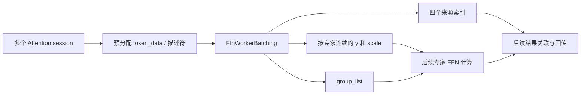
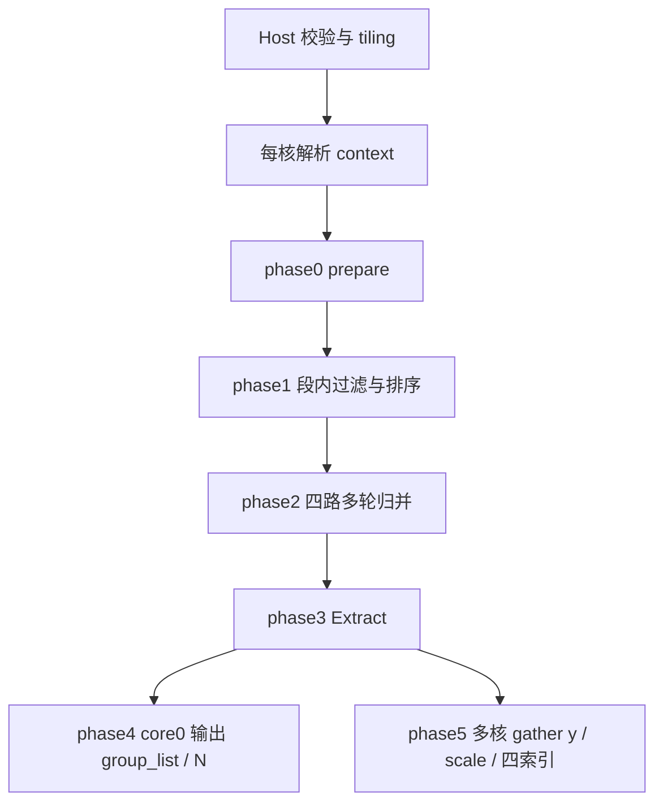

# FfnWorkerBatching arch35 算子介绍与源码导读

| 项目 | 说明 |
| --- | --- |
| 适用实现 | Ascend950 / arch35 / DAV_3510 |
| 源码基线 | `399be5bfcc2c88e6d47c225a9ab82a1539e7dd6e` |
| 文档版本 | 1.0，2026-09-17，Codex 编写 |
| 修订内容 | 首次整理完整流程、字段字典、阶段实现、核心代码和应用示例 |
| 阅读对象 | 算子使用者、集成开发者、kernel/tiling 维护者 |

本文介绍当前完整算子，不只介绍最近四个提交的增量。变更追溯见 [需求分析](REQUIREMENTS.md)，更详细的预算推导与评审风险见 [详细设计](DESIGN.md)。本文中的手工示例和 Python 演算用于解释语义，不代表新执行了一轮 NPU 验证。

## 1. 算子做什么

在 Attention 与 FFN 分离部署场景中，不同 Attention worker 将 token 按路由结果写入 FFN worker 的预分配设备内存。数据原本按 session、micro batch、token、路由槽位组织，FFN 计算希望得到按专家连续排列的数据。

FfnWorkerBatching 完成三件事：

1. 选择本次需要处理的数据，读取专家 ID，过滤 mask，并按专家排序。
2. 按排序生成的源位置，原样搬运 token 与量化 scale，使同一专家的数据连续。
3. 输出专家计数和每行 token 的来源，供后续专家计算及结果回传使用。

它不执行 FFN 矩阵乘，不计算路由概率，不执行量化或反量化，也不负责把计算结果发回 Attention。一个输入 token 的多个路由槽可以形成多条输出记录；因此 actual_token_num 统计的是有效路由条目，不一定等于去重后的 token 数。



### 1.1 三种工作方式

| 方式 | 属性 | 数据来源 | 适用场景 |
| --- | --- | --- | --- |
| NORM | need_schedule=0，sync_flag 任意 | 外部已经整理好的专家 ID 与 session/micro batch 路由表 | 调度已在上游完成，只需 batching |
| 同步 RECV | need_schedule=1，sync_flag=false | 当前 polling_index 对应的全部 session 描述符 | 必须等当前批次所有 session 就绪 |
| 异步 RECV | need_schedule=1，sync_flag=true | 环形扫描后首个非空 micro batch 的 ready 快照 | session 到达不齐，希望先消费已就绪部分 |

注意命名：`sync_flag=false` 是等待全部 session，`true` 是消费部分 ready 快照。异步模式仍会在所有 micro batch 都为空时等待，没有立即返回空结果的查询语义。

## 2. 先理解尺寸、位置和三种数据

### 2.1 尺寸符号

| 符号 | 意义 | 来源 |
| --- | --- | --- |
| Amax、BSmax、Kmax、H | 输出容量维度 | 属性 max_out_shape |
| A | 实际 Attention session 数 | context.common.session_num |
| M | 每个 session 的 micro batch 槽数 | context.common.micro_batch_num |
| BS | 每个 micro batch 的 token 数 | context.common.micro_batch_size |
| K | 每个 token 的路由槽数，已经包含共享专家槽 | context.common.selected_expert_num |
| HS | 源数据中一条路由 token 占用的字节步长 | context.common.attn_to_ffn_token_size |
| Y | 输出容量 Amax×BSmax×Kmax | Host 推导 |
| N | 本次有效输出条数 | actual_token_num[0] |
| E、L、Ep | 本卡专家总数、层数、每层专家数 E/L | expert_num、layer_num；Ep 仅异步使用 |
| P | RECV 私有 ID 每行跨度 align_up(BS×K,8) | 32B 对齐的 int32 元素数 |

本文 K 已是接口文档里的 topK+1，公式中不再加一次 1。H 是逻辑元素数，HS 是源行字节数，二者不可混用。

属性定义容量，context 定义实际数据；实际数据和各二级缓冲必须受容量及分配大小覆盖。不能把静态容量用于替代实际 BS/K 的源寻址。

### 2.2 专家 key、原位置、token payload

| 数据 | 例子 | 处理方式 |
| --- | --- | --- |
| 专家 key | expert_id=3 | 用于比较排序；异步时先加 layer 偏移 |
| 原位置 | 第 a 行、第 b 个 token、第 k 个槽 | 跟随排序移动，用于最后 gather |
| token payload | H 个 FP16、FP8 或 FP4 逻辑元素 | 不参与排序比较，最后按字节搬运 |

排序中间结果是一对 `float key + uint32 position`，占 8B。只有专家 key 转为 float；原位置不通过 float 数值转换保存，避免大位置精度丢失。

## 3. 对外字段说明

### 3.1 输入与属性

| 字段 | 类型/默认值 | 作用与限制 |
| --- | --- | --- |
| schedule_context | 一维 ND INT8，至少 1024B | 调度头，内含真实设备地址；不是把所有输入内联打包到这 1024B 中 |
| expert_num | int64，必填 | E，1..8192；group_list 行容量；异步时为所有层在本卡的专家总数 |
| max_out_shape | int64[4]，必填 | `[Amax,BSmax,Kmax,H]`；Amax=1..1024，BSmax>0，Kmax=1..64，H>0 |
| token_dtype | int64，默认 0 | 选择 y 类型和 token/scale 存储布局，见下表 |
| need_schedule | int64，默认 0 | 0 只重排；1 先接收再重排 |
| layer_num | int64，默认 0 | 0..E；仅异步要求 L>0 且 E%L=0 |
| sync_flag | bool，默认 false | 仅 RECV 区分同步与异步；ACLNN 参数名为 syncFlag |
| mx_output_uint8 | Torch 专属 bool，默认 false | 返回 FP4 y / MX scale 的原始 uint8 视图，方便图通路；不是 kernel 属性 |

Y 和 RECV 对齐后的 flatElements 都必须不超过 INT32_MAX。Host 还检查乘积是否溢出、H 是否可用 uint32 表示、行载荷是否能放入 512B 对齐的 uint32 HS。维度合法不代表实际能分配所需设备内存。

### 3.2 dtype 与一行载荷

令 S=ceil(H/32)。

| token_dtype | y 类型 | token 字节数 T | scale 字节数 Q | dynamic_scale shape/type |
| ---: | --- | ---: | ---: | --- |
| 0 | FP16 | 2H | 0 | `[Y]` / FP32，占位无有效值 |
| 1 | BF16 | 2H | 0 | `[Y]` / FP32，占位无有效值 |
| 2 | INT8 | H | 4 | `[Y]` / FP32 |
| 3 | FLOAT8_E5M2 | H | S | `[Y,S]` / FLOAT8_E8M0 |
| 4 | FLOAT8_E4M3FN | H | S | `[Y,S]` / FLOAT8_E8M0 |
| 5 | FLOAT4_E2M1 | H/2 | S | `[Y,S]` / FLOAT8_E8M0 |

```text
源行 row_base
  ├── [0,T)       : token 原始字节
  ├── [T,T+Q)     : scale 原始字节
  └── [T+Q,HS)    : 行尾 padding，不输出
```

FP4 要求 H 偶数；低 nibble 放前一个逻辑元素，高 nibble 放后一个。MX scale 对应每 32 个逻辑元素，最后不足 32 个元素仍占一个 scale。scale 全部放在整行 token 之后，不与 token 块交错。

### 3.3 八个输出

| 顺序 | 字段 | 类型/形状 | 作用 |
| ---: | --- | --- | --- |
| 0 | y | `[Y,H]`，由 token_dtype 决定 | 按专家升序排列的 token，有效前缀 N 行 |
| 1 | group_list | int64 `[E,2]` | 非空专家的 `[expert_id,count]` 紧凑表，剩余行 `[0,0]` |
| 2 | session_ids | int32 `[Y]` | 来源 session |
| 3 | micro_batch_ids | int32 `[Y]` | 来源 micro batch |
| 4 | token_ids | int32 `[Y]` | 来源 BS 维索引 b |
| 5 | expert_offsets | int32 `[Y]` | 来源 K 维路由槽 k；不是专家输出分组内的行偏移 |
| 6 | dynamic_scale | 见 dtype 表 | 与 y 同步重排的 scale |
| 7 | actual_token_num | int64 `[1]` | N=所有专家 count 之和 |

Torch 的 FP4 x2 dtype 按打包字节计元素，因此 y 物理 shape 为 `[Y,H/2]`；ACLNN 逻辑 shape 仍是 `[Y,H]`。

N=0 时 actual_token_num 和整个 group_list 必须写零。y、四个来源索引和有效 scale 只保证前 N 行，容量尾部不保证初始化。group_list 是紧凑非空表，不能用 `group_list[expert_id]` 直接索引某专家计数。

## 4. ScheduleContext：各字段如何被使用

权威结构在 [attention_ffn_schedule.h](../../../common/include/op_kernel/attention_ffn_schedule.h)，pack(1)，大小固定 1024B。kernel 在 [ScheduleContextParse](../op_kernel/arch35/ffn_wb_a5_context.h) 中通过 offsetof 定位字段。

### 4.1 common 区

| 字段 | 类型 | arch35 本算子的作用 |
| --- | --- | --- |
| session_num | uint32 | A，决定 RECV 需扫描的 session 数 |
| micro_batch_num | uint32 | M，描述符和 token_data 寻址、cursor 环回；调用方提供正数，现有接口文档范围 1..64 |
| micro_batch_size | uint32 | BS，ID 行长度与 token 地址计算 |
| selected_expert_num | uint32 | K，已包含共享专家槽 |
| expert_num | uint32 | 公共协议中每层专家数；本实现 ctx.expertNum 来自属性 E，异步 Ep=E/L，不能用此字段代替属性 |
| attn_to_ffn_token_size | uint32 | HS，token_data 源行的字节步长，按协议 512B 对齐 |
| ffn_to_attn_token_size | uint32 | 回传窗口协议字段；本算子不用于输入 gather |
| schedule_mode | int32 | 外部调度协议字段；本算子 NORM/RECV 分支由 need_schedule 属性决定 |
| reserve0 | int8[96] | ABI 保留区，不参与计算 |

### 4.2 control 与 attention 区

| 字段 | 作用 |
| --- | --- |
| control.run_flag | 外部调度运行状态；当前 waiter 不以它作为退出或超时条件 |
| control.reserve2 | 124B 保留区 |
| attention.token_info_buf / token_info_buf_size | Attention 侧描述符地址及大小；本算子不读取 |
| attention.token_data_buf / token_data_buf_size | Attention 侧数据地址及大小；本算子不读取 |
| attention.micro_batch_id | Attention 侧批次记录；不是本算子 RECV 的选批来源 |
| attention.reserve5 | 92B 保留区 |

### 4.3 ffn 区

这一部分保存 FFN 接收窗口和调度结果。`*_buf` 是设备内存地址，配套的 `*_buf_size` 是缓冲区容量，单位均为**字节**，不是元素个数，也不是本轮有效条目数。下面的 A、M、BS、K 取自 common 区的实际调度尺寸。

| 字段 | 类型 | NORM | RECV | 说明 |
| --- | --- | --- | --- | --- |
| token_info_buf | uint64 | 不使用 | 读取并清理 | 指向 `[A,M,FfnDataDesc]` |
| token_info_buf_size | uint64 | 不使用 | 长度元数据 | kernel 不据此全面校验指针访问，调用方保证足够 |
| token_data_buf | uint64 | 读取 | 读取 | 指向 `[A,M,BS,K,HS]` 字节区 |
| token_data_buf_size | uint64 | 长度元数据 | 长度元数据 | 同样不能替代真实缓冲范围保证 |
| polling_index | uint64 | 不更新 | 读写 | 入口扫描起点；成功选批后写 `(selectedMb+1)%M` |
| reserve3 | int8[88] | 不使用 | 不使用 | ABI 保留 |
| layer_ids_buf / layer_ids_buf_size | uint64/uint64 | 不使用 | 不使用 | 异步读取描述符中的 layer_id，不从此表取层号 |
| session_ids_buf / session_ids_buf_size | uint64/uint64 | 读取地址所指路由表 | 不读取 | NORM 路由行 → 真实 session |
| micro_batch_ids_buf / micro_batch_ids_buf_size | uint64/uint64 | 读取地址所指路由表 | 不读取 | NORM 路由行 → 真实 micro batch |
| expert_ids_buf / expert_ids_buf_size | uint64/uint64 | 读取有效前缀 | 不读取 | NORM 扁平专家 ID |
| out_num | uint32 | 决定有效路由行数 | 不用于选批 | NORM 只读 out_num×BS×K 个 IDs |
| reserve4 | int8[60] | 不使用 | 不使用 | ABI 保留 |

几个主要缓冲区可以这样理解：

- **`token_info_buf / token_info_buf_size`：接收窗口中的就绪状态和专家路由。** 每个 `(session, micro_batch)` 对应一条描述符，包含 `flag`、`layer_id` 和 `BS*K` 个专家编号，均为 int32，因此所需容量为 `A*M*(2+BS*K)*sizeof(int32_t)`。RECV 直接从这里选择就绪数据、读取路由并清理已消费描述符；其中不存放 token 数值，容量也不随 token dtype 改变。
- **`token_data_buf / token_data_buf_size`：实际 token 载荷。** 按 `[A,M,BS,K]` 定位记录，每条记录占 HS 字节，总容量需覆盖 `A*M*BS*K*HS`。记录中保存 token 数据及适用格式的 scale，剩余部分是行尾对齐空间；NORM 和 RECV 最终都从这里搬运数据。
- **`session_ids_buf / session_ids_buf_size`：调度条目到原始 session 的映射。** 数组元素为 int32，通常分配 A 项，即 `A*sizeof(int32_t)` 字节，前 `out_num` 项有效。`session_ids_buf[i]` 表示本轮第 i 个调度条目来自哪个 session，NORM 用它恢复 token 的源地址。它是每个调度条目一个编号，而算子输出 `session_ids` 是排序后每个 token 一个来源编号。
- **`micro_batch_ids_buf / micro_batch_ids_buf_size`：调度条目到原始 micro batch 的映射。** 与 session 表逐项配对，同样通常为 A 个 int32，前 `out_num` 项有效；两张表共同确定条目来自哪个接收窗口位置。
- **`expert_ids_buf / expert_ids_buf_size`：调度整理后的专家路由。** int32 数组的逻辑形状为 `[A,BS,K]`，通常分配 `A*BS*K*sizeof(int32_t)` 字节。前 `out_num*BS*K` 个编号有效，`expert_ids_buf[i,b,k]` 表示第 i 个调度条目中，第 b 个 token 的第 k 个专家选择。NORM 按这些编号排序并生成 group_list，同时保留原始位置用于 gather；这里不存放 token 数值。

例如 `out_num=2`，`session_ids_buf` 的有效前缀为 `[1,3]`，`micro_batch_ids_buf` 的有效前缀为 `[0,2]`：第 0 个条目来自 session 1 的 micro batch 0，第 1 个条目来自 session 3 的 micro batch 2。`expert_ids_buf[0,:,:]` 和 `[1,:,:]` 分别提供这两个条目的专家路由，不能把调度条目下标直接当成原始 session 编号。

NORM（`need_schedule=0`）要求外部调度器或调用方提前填好上述三张路由表及 `out_num`。RECV（`need_schedule=1`）直接从 `token_info_buf` 取得专家编号，并从描述符位置和本轮选中的 micro batch 恢复来源，不读取这三张独立路由表。

FFN Worker Scheduler 会使用 `token_info_buf_size`、`session_ids_buf_size`、`micro_batch_ids_buf_size` 和 `expert_ids_buf_size` 校验所需容量；当前 arch35 batching kernel 不读取这些 size 字段做容量检查，而是根据实际尺寸、`out_num` 和设备指针计算访问范围。因此，修改 size 字段不会扩大真实分配的内存，也不会改变本轮处理数量，调用方仍须保证地址和容量匹配。

ScheduleContext 末尾 reserve6 为 384B，不再存在通过 magic 标志把二级指针解释为相对偏移的测试模式。

### 4.4 FfnDataDesc

```cpp
struct FfnDataDesc {
    volatile int32_t flag;
    volatile int32_t layer_id;
    volatile int32_t expert_ids[0];
};
```

| 字段 | 含义 | 消费后的值 |
| --- | --- | --- |
| flag | 0 未就绪，1 就绪；生产者完成其余数据写入后发布 | 选中的描述符清为 0 |
| layer_id | 本描述符所属层；仅异步参与专家编号 | 保持原值 |
| expert_ids | 后续 BS×K 个 int32；柔性尾数组 | 选中的真实 ID 区写 INT32_MAX |

一个描述符实际占 `4*(2+BS*K)` 字节。`(session=a,mb=m)` 的描述符偏移为 `(a*M+m)*(2+BS*K)` 个 int32。描述符自身没有 RECV 私有 flatIds 的 32B 行补齐。

## 5. Host 下发字段与 kernel 内部字段

### 5.1 TilingData 全字段字典

定义见 [ffn_worker_batching_arch35_tiling_def.h](../op_kernel/arch35/ffn_worker_batching_arch35_tiling_def.h)。除 syncFlag 为 bool 外，下表字段均为 int64。

| 字段 | 单位/意义 | 消费阶段 |
| --- | --- | --- |
| Y、H | 输出行容量、逻辑 hidden 长度 | 全局/gather |
| tokenDtype、expertNum | token 类型、总专家数 | context/gather/group |
| coreNum、ubSize | Host 选择的 block 数、平台可用 UB 字节 | 分工/缓冲分配 |
| flatElements | 静态私有 ID 容量，RECV 包含每行 padding | workspace/prepare |
| preparePerLoopRows | prepare 批处理行数预算 | prepare；异步实际选择粒度为一行 |
| preparePerLoopElements | prepare ID 缓冲元素容量 | 大行行内分块 |
| sortSegNum | 排序段数，可多于核数 | sort/merge |
| sortPerSegElements | 每段最多原始 ID 数 | sort |
| sortLenPerSeg | 每段 proposal 占用的 4B word 数 | pair A/B 寻址 |
| expertStart | mask 阈值，当前为 1000000 | sort |
| mergeRounds | 四路归并轮数 | merge 编排 |
| mergeOneLoopElements | 单路一次归并输入最多元素数 | 流式 merge |
| mergeCountCacheSegments | 本地缓存段计数槽数，最多 128 | merge 计数读取 |
| extractPerLoopElements | 一轮拆 proposal 的有效元素上限 | Extract |
| glRowsPerLoop | 一轮拼装输出的 group_list 行容量 | group_list |
| syncFlag | bool，RECV 模式开关 | waiter/prepare |
| layerNum | 仅异步下发的层数，其余路径为 0 | 跨层编码 |
| wsFlatIds | 私有 ID 区偏移 | prepare/sort |
| wsPairA、wsPairB | proposal 乒乓区偏移 | sort/merge/Extract |
| wsSegCnt | 每段有效数量区偏移 | sort/merge |
| wsSortedIds | 有序专家 ID 区偏移 | Extract/group |
| wsGatherIdx | 有序原位置区偏移 | Extract/gather |
| wsReady | 本次 mb 与 flags 快照区偏移 | 异步 waiter/prepare |

所有 ws 偏移单位为 **int32 word，即 4B**，相对 userWorkspace，不是字节偏移。Host/kernel 必须使用同一版结构布局，不能混用旧 int64 syncFlag 与新 bool 版本。

### 5.2 ScheduleContextInfo 内部派生字段

A/M/BS/K/HS 从 context 读取；H/Y/tokenDtype/expertNum/coreNum/ubSize 从 tiling 读取。剩余字段如下：

| 字段 | 类型 | 意义 |
| --- | --- | --- |
| curMicroBatchID | uint64 | 本次消费 mb；异步发布快照后由每核重新加载 |
| outNum | uint32 | NORM 路由有效行数 |
| layerNum、expertsPerLayer | uint32 | 异步 L 与 Ep |
| asyncRecv | bool | `isRecv && tilingData->syncFlag` |
| validGatherIdxLength | int64 | 排序过滤后的 N |
| BsKPaddingCount | int64 | align8(BS×K)−BS×K |
| bufferPtr | BufferInfo | tokenInfoBuf/tokenDataBuf/sessionIdsBuf/microBatchIdsBuf/expertIdsBuf 五个 uint64 地址 |

Y 字段虽然在内部结构中为 uint32，但 Host 已限制 Y<=INT32_MAX；不能只看该字段类型就认为索引可覆盖 UINT32_MAX。

## 6. 整体执行流程与文件导航



| 阶段 | 入口类/函数 | 文件 |
| --- | --- | --- |
| 注册/输出推导 | FfnWorkerBatching 定义、InferShape/InferDataType | [OpDef](../op_host/ffn_worker_batching_def.cpp)、[推导](../op_host/ffn_worker_batching_infershape.cpp) |
| Host 切分 | FfnWorkerBatchingTilingArch35 | [tiling_arch35.cpp](../op_host/ffn_worker_batching_tiling_arch35.cpp) |
| 总编排 | FfnWorkerBatchingA5、RunPrepare、RunSortPipeline、RunEmitAndGather | [apt.cpp](../op_kernel/ffn_worker_batching_apt.cpp) |
| context | ScheduleContextParse、GetFlatAivIdx/GetFlatAivNum | [context.h](../op_kernel/arch35/ffn_wb_a5_context.h) |
| 等待与准备 | FfnWbA5RecvWait、LoadSelectedMicroBatch、FfnWbPrepareArch35 | [prepare.h](../op_kernel/arch35/ffn_wb_a5_prepare.h) |
| 排序/归并/拆包 | FfnWbA5SegSort、FfnWbA5MrgSort、FfnWbA5Extract | [sort.h](../op_kernel/arch35/ffn_wb_a5_sort.h) |
| 专家统计 | FfnWbA5GroupList | [group_list.h](../op_kernel/arch35/ffn_wb_a5_group_list.h) |
| 数据搬运 | FfnWbA5Gather | [gather.h](../op_kernel/arch35/ffn_wb_a5_gather.h) |

kernel 入口跳过 AIC，仅 AIV 工作。key100 调用 `FfnWorkerBatchingA5<false>`，key101 调用 `<true>`；dtype 和 bool 不增加 tiling key。

整体核心调用摘录：

```cpp
RunPrepare<isRecv>(schedule_context, flatIdsWs, readyWs, ctx, tilingData, activeElements, pipe);
const int64_t totalValid = RunSortPipeline(flatIdsWs, pairAWs, pairBWs, segCntWs, sortedIdsWs, gatherIdxWs, ctx,
                                           tilingData, activeElements, pipe);
RunEmitAndGather<isRecv>(sortedIdsWs, gatherIdxWs, group_list, y, session_ids, micro_batch_ids, token_ids,
                         expert_offsets, dynamic_scale, actual_token_num, totalValid, ctx, tilingData, pipe);
```

## 7. 各阶段核心逻辑与代码解释

### 7.1 Host：资源、分块和边界

Host 查询运行时 AIV 数和 UB；先声明 32KB 系统预留，再查询可用 UB，不重复扣减。block 数按 `max(1,min(aivNum,ceil(Y/32)))` 选择。

核心输入检查包括 context>=1024B、shape 4 维、属性范围、异步层数整除、FP4 H 偶数、Y 和 padded flatElements 的 int32 表示范围。对应真实检查：

```cpp
OP_CHECK_IF(Y_ > std::numeric_limits<int32_t>::max(),
            OP_LOGE(context_->GetNodeName(), "Y exceeds int32 index/count capacity"), return ge::GRAPH_FAILED);
```

大形状不要求整行/整组进入 UB：prepare 可拆 ID 行，sort 可增加段数，merge 流式四路归并，gather 可拆 token 和 scale 行。每阶段预算必须包括同时存活的固定缓冲与对齐余量。

| 阶段 | 关键预算 |
| --- | --- |
| waiter | 两份 A×32B flag 相关缓冲，加 32B cursor 区 |
| sort | `12*align64(n)+24*align32(n)+160` 字节 |
| merge | 最多 128 个 32B 计数槽，四路 proposal 输入及输出 |
| Extract | 每元素 16B 加固定 96B，最多 255×32 元素/指令分块上限 |
| group_list | 行拼装区预算约 UB 的 1/16；剩余空间分配游程向量 |
| gather | 扣除双缓冲队列和索引分道后，剩余用于 token 字节块 |

### 7.2 context：实际消费长度

```cpp
const int64_t rowElements = static_cast<int64_t>(ctx.BS) * ctx.K + (isRecv ? ctx.BsKPaddingCount : 0);
const int64_t activeElements = rowElements * (isRecv ? ctx.A : ctx.outNum);
```

NORM 的 activeElements 为 outNum×BS×K，RECV 为 A×P。只用实际有效前缀参与排序，避免静态容量尾部的历史 ID 混入输出。

DAV_3510 `GetBlockIdx()` 已展平 AIV 编号，不再手动乘 taskRatio；总 AIV 数由 GetBlockNum×taskRatio 得到。所有阶段采用同一编号口径，防止重复或遗漏工作。

### 7.3 phase0a：RECV 等待和快照

core0 每轮读取选定 mb 的 A 个 flag，在 UB 每个占 32B，padding 为 0。独立 work 缓冲执行 Cast/ReduceSum，原始 flag 读取值保留不变。

```cpp
const float readyNum = work.GetValue(0);
const bool ready = ctx_->asyncRecv ? readyNum > 0 : static_cast<uint32_t>(readyNum) >= ctx_->A;
```

同步等待当前 mb 的 readyNum>=A。异步若为空则本地 cursor 环回扫描；首次 readyNum>0，保存同一次 DMA 观察到的 flags，不重新读取生产者的实时 flag。

```text
ready workspace:
  头 32B：低 8B 是 selectedMb（本次）
  后 A 个 32B：每块低 4B 是一个 session 的 flag
共享 context.polling_index：写成 (selectedMb+1)%M（下次）
```

快照不是全局同一时刻的原子读取；它保证本次所有核使用一致的成员集合。快照读后才到达的 session 留给后续调用。

### 7.4 phase0b：复制 IDs、编码层号、消费描述符

每核分配不重叠的 session 行。异步只读快照 flag；未选中行在私有 flatIds 填 mask，不读取或清理源描述符。

异步跨层专家号计算为：

```text
Ep = expert_num / layer_num
valid = 0 <= layer_id < layer_num and 0 <= local_id < Ep
global_id = layer_id*Ep + local_id if valid else INT32_MAX
```

ReadLayerOffset 的核心代码：

```cpp
const int32_t id = layer.GetValue(0);
return static_cast<uint32_t>(id) < contextInfo_->layerNum ?
           id * static_cast<int32_t>(contextInfo_->expertsPerLayer) :
           -1;
```

编码使用 unsigned 比较先剔除负数、越界 local ID 和 mask，再加 bias；不能对 INT32_MAX 先加偏移。同步/NORM 沿用原 ID 和大值 mask 约定，其合法非 mask ID 由上游保证。

选中行先写好私有 IDs，再把源 IDs 置 INT32_MAX、flag 置 0，layer 保持不变。大行由 ProcessRecvLargeRow 行内分块，仅最后一块处理私有 padding，全部块完成后清 flag。

### 7.5 phase1：段内排序

源位置用 int32 连续序列生成：

```cpp
ArithProgression<int32_t>(idxLocal, static_cast<int32_t>(begin), 1, len);
```

专家 ID 转 float 并取负，硬件降序对应专家升序。以 expertStart=1000000 过滤 mask，相同 mask 同时压缩 key 与位置，再 Sort32 排序。位置作为 uint32 payload 跟随 key，不转成 float 数值。

CompareScalar 按 64 lane 读取，Sort 按 32 lane 操作。即使最终只输出有效 len，实际被指令读取的尾 lane 也必须初始化。尾部写从对齐 repeat 起点配合 mask 执行，不能从不对齐的 keys[len] 直接发向量写。

### 7.6 phase2：多轮四路归并

各段已排序，但全局还未有序。每轮将最多四个有序列表归并到另一块 workspace，A/B 乒乓，直到剩一个列表。多核按归并组分工，每轮完成后 SyncAll。

各列表可能超过 UB，所以每路只加载一块，根据实际 consumed 数推进。段数很多时只缓存最多 128 个段计数，按需换块；不是限制总排序段数为 128。

输出仍是 key/position proposal。载荷 token 没有在此阶段被读写。

### 7.7 phase3：Extract

最终 proposal 拆成 `sortedIds` 与 `gatherIdx`。专家负 key 恢复为原正 ID，位置保持原始整数位。向量部分按 Sort32 对齐，GM 写出只覆盖有效条数。总有效数量 N 是各段有效数之和。

这里的 proposal 是排序记录，每条包含两个 32 位字段：

```text
proposal = [key：负的专家编号（FP32） | payload：排序前的原始位置（uint32）]
```

排序和归并只按 key 比较，payload 随对应的 key 一起移动。Extract 将这些成对记录拆成两列，随后只对 key 列取反并转换为 int32，得到专家编号；位置列保留原始整数位，不经过浮点数值转换。

例如，排序前的专家编号为 `[3, INT32_MAX, 1, 3]`，原始位置为 `[0,1,2,3]`。过滤无效项并按专家升序排列后：

```text
有序 proposal： [(-1, 2), (-3, 0), (-3, 3)]
                        ↓ Extract 拆包并恢复专家编号
sortedIds：     [ 1,  3,  3]
gatherIdx：     [ 2,  0,  3]
```

拆包不改变记录顺序，两个数组的同一下标仍对应同一条输出记录：

| 数组 | 第 i 项的含义 | 后续用途 |
| --- | --- | --- |
| sortedIds[i] | 第 i 条输出属于哪个专家 | 相同专家已连续排列，供 group_list 统计各专家 token 数；上例有效分组为 `[[1,1],[3,2]]` |
| gatherIdx[i] | 第 i 条输出在排序前 flatIds 中的位置 | 供 gather 恢复来源，按上例的位置 `2、0、3` 搬运对应 token |

`gatherIdx` 不是 token 的字节地址，也不是专家编号。NORM 按 `BS*K` 的行跨度解码，再查 session/micro batch 路由表；RECV 按 `BS*K+BsKPaddingCount` 的行跨度解码，再结合 selectedMb 和 HS 计算 token_data_buf 的读取地址。异步路径中 sortedIds 可以是编码后的跨层专家号，gatherIdx 仍保持原始位置。

即使 proposal 工作区用 float 容器表示，位置字段也只是借用其中一个 32 位存储单元，不能把它数值转换成 FP32。例如整数位置 `16777217` 转成 FP32 会变为 `16777216`，再转回整数也无法恢复，最终可能搬错 token。

此阶段尚未搬运 token 的 H 维载荷；它只拆分路由信息，让后续 group_list 使用专家编号、gather 使用原始位置，各自完成统计和数据搬运。

若 N=0，跳过 Extract 与 gather，但仍输出零 actual_token_num 和完整零 group_list。

### 7.8 phase4：group_list 与 N

core0 对 sortedIds 做游程编码：与前一个不同是起点，与后一个不同是终点，count=end−start+1。跨 UB 块的长游程用 pendingId/pendingCnt 衔接。

例如 sortedIds=`[0,0,3,5,5]`，E=6：

```text
group_list = [[0,2],[3,1],[5,2],[0,0],[0,0],[0,0]]
actual_token_num = [5]
```

在 UB 拼 int64 行，再分块 DMA 写 GM；未用行显式清零。输出 actual_token_num 也经 UB 搬运写出，不依赖逐项 GM 标量写加单条 cache flush。

### 7.9 phase5：gather

对每个原位置 p，以 R=BS×K（NORM）或 P（RECV）解码：

```text
a = p // R
r = p - a*R
b = r // K
k = r - b*K
```

NORM：a 查 session_ids_buf 和 micro_batch_ids_buf 得到真实 s/m。RECV：s=a、m=selectedMb。

```text
rowOffset = (((s*M + m)*BS + b)*K + k)*HS
```

首次乘法前提升为 int64，避免 uint32 中间结果先溢出。源地址算好后，分块搬 T 字节 token；INT8 读取紧随其后的 4B scale，MX 分块搬 S 字节 scale。

小索引空间走向量倒数乘法并用余数修正商；`A*R>2^24` 时，在 Cast 前走标量整数除法，避免 FP32 无法精确表示大位置。判断依据是位置空间，不是 N，单个有效 token 也可能处在很大的源位置。

## 8. 同步、workspace 和生命周期

### 8.1 跨核阶段边界

| 屏障位置 | 原因 |
| --- | --- |
| 所有核解析 context 后、core0 改 cursor 前 | 避免晚启动核读到下一批 cursor |
| waiter 完成后 | 发布同一份 selectedMb/flags 快照 |
| prepare 完成后 | 所有私有 flatIds 已写好才能排序 |
| 段内排序后 | 所有段及计数可供归并 |
| 每轮归并后 | 下一轮不能读取未完成输出 |
| Extract 后 | group 和 gather 可读取完整结果 |

`pipe.Reset()` 只负责本核阶段资源复用，不等价于 SyncAll。实际 RunEmitAndGather 中，其他核可以在 core0 做 group_list 时开始自己的 gather，二者输出互不依赖；不存在必须等 group_list 完成的全核屏障。应以函数实现为准，不把文件头的简化流程注释当作精确时序。

### 8.2 Workspace 分区

```text
128 words 保留区
→ flatIds
→ pairA
→ pairB
→ 每段一个 32B 计数槽
→ sortedIds（Y 个 int32）
→ gatherIdx（Y 个 int32）
→ 对齐到 32B
→ 异步 ready 快照（Amax+1 个 32B 块）
```

偏移和总容量由 Host 同一次累加得到，kernel 只转换为字节地址。不同 phase 复用 UB，但 GM workspace 中这些区域按各自生命周期保留。

### 8.3 集成时的生命周期

- context 中保存的是设备地址，所有被引用内存必须与算子执行在正确设备/流上，并存活到执行结束。
- 生产者完成 payload/IDs/layer 写入并建立可见性后才能置 ready。
- prepare 清 flag 时 token_data 尚未被 gather 完全读取。生产者不能仅凭 flag=0 就覆盖该 payload；必须遵守消费窗口内不覆盖的外部协议。
- RECV 后再次调用或图重放，需要重新准备已消费的描述符；同一个地址不等于同一份有效输入。
- 不允许未排序的多个消费者同时修改同一 context 的 cursor/描述符。

## 9. 应用示例一：NORM 重排的完整演算

设 A=2、M=2、BS=2、K=2、H=4、E=3，容量 Y=8，out_num=2。上游路由表为：

```text
session_ids_buf     = [1,0]
micro_batch_ids_buf = [0,1]
expert_ids_buf      = [2,0, 1,MASK, 0,2, 1,0]
MASK = INT32_MAX
```

用 T(s,m,b,k) 表示源 token 行，以此区分 token 内容。NORM 的扁平行号 a 是路由表索引，不一定等于真实 session。

| 原位置 p | 路由行 a | 真实 s,m | b,k | 专家 |
| ---: | ---: | --- | --- | --- |
| 0 | 0 | 1,0 | 0,0 | 2 |
| 1 | 0 | 1,0 | 0,1 | 0 |
| 2 | 0 | 1,0 | 1,0 | 1 |
| 3 | 0 | 1,0 | 1,1 | MASK |
| 4 | 1 | 0,1 | 0,0 | 0 |
| 5 | 1 | 0,1 | 0,1 | 2 |
| 6 | 1 | 0,1 | 1,0 | 1 |
| 7 | 1 | 0,1 | 1,1 | 0 |

按当前 golden 的稳定排序口径：

```text
sortedIds = [0,0,0,1,1,2,2]
gatherIdx = [1,4,7,2,6,0,5]
group_list = [[0,3],[1,2],[2,2]]
actual_token_num = [7]
```

最终有效输出：

| 输出行 | y 对应源 token | session_ids | micro_batch_ids | token_ids | expert_offsets |
| ---: | --- | ---: | ---: | ---: | ---: |
| 0 | T(1,0,0,1) | 1 | 0 | 0 | 1 |
| 1 | T(0,1,0,0) | 0 | 1 | 0 | 0 |
| 2 | T(0,1,1,1) | 0 | 1 | 1 | 1 |
| 3 | T(1,0,1,0) | 1 | 0 | 1 | 0 |
| 4 | T(0,1,1,0) | 0 | 1 | 1 | 0 |
| 5 | T(1,0,0,0) | 1 | 0 | 0 | 0 |
| 6 | T(0,1,0,1) | 0 | 1 | 0 | 1 |

y 仍分配 8 行，只有前 7 行有效。后续专家计算可由 group_list 的 count 前缀和定位：专家0处理 y[0:3]，专家1处理 y[3:5]，专家2处理 y[5:7]。这也说明 expert_offsets 不承担输出分组偏移的作用。

## 10. 应用示例二：异步、多层与跳过空 micro batch

设 A=3、M=3、BS=1、K=2、E=8、L=2，Ep=4，need_schedule=1、sync_flag=true，入口 cursor=1。

```text
mb1 flags = [0,0,0]  → 空，继续扫描
mb2 flags = [1,0,1]  → 本次选中 mb2，固定该快照
```

mb2 描述符：

| session | flag | layer_id | local IDs | 本次处理 |
| ---: | ---: | ---: | --- | --- |
| 0 | 1 | 1 | [0,3] | global IDs=[4,7] |
| 1 | 0 | 任意已存值 | 任意已存值 | 不读、不清，私有行填 mask |
| 2 | 1 | 0 | [1,MASK] | global IDs=[1,MASK] |

BS×K=2，RECV 行跨度 P=8。因此有效原位置是 0、1、16，而不是紧凑序列的 0、1、2；排序结果为：

```text
sortedIds = [1,4,7]
gatherIdx = [16,0,1]
actual_token_num = [3]
group_list = [[1,1],[4,1],[7,1],[0,0],[0,0],[0,0],[0,0],[0,0]]
```

| 输出行 | 源位置 p | s,m,b,k |
| ---: | ---: | --- |
| 0 | 16 | 2,2,0,0 |
| 1 | 0 | 0,2,0,0 |
| 2 | 1 | 0,2,0,1 |

状态变化：

- ready 头记录 selectedMb=2，所有输出 micro_batch_ids 都是 2。
- 共享 polling_index 更新为 0，供下一次调用使用。
- session0/2 的 mb2 IDs 失效、flag 清零、layer 保留；session1 描述符不变。
- 若 session1 在快照之后才置 flag=1，本次仍不处理它。

若改为 sync_flag=false，算子一直等待入口 mb1 的全部 session，不能跳到 mb2；并且不会执行上述跨层 ID 编码。

## 11. 应用示例三：MXFP4 数据布局

设 token_dtype=5、H=34、Y=2、N=2：

```text
T = H/2 = 17 字节
S = ceil(34/32) = 2 字节 E8M0 scale
HS = align_up(T+S,512) = 512 字节（一种合法源步长）
```

一行内容：

```text
byte 0  : element0 的 nibble | element1 的 nibble
...
byte 16 : element32 的 nibble | element33 的 nibble
byte 17 : scale0，对应 element0..31
byte 18 : scale1，对应 element32..33
byte 19..511 : padding
```

若排序要求交换两个源行，输出复制源行1的17个 token 字节，再复制源行0的17个 token 字节；scale 同样交换对应的2字节行。不会把源 padding 带入输出。

| 接口 | y | dynamic_scale |
| --- | --- | --- |
| ACLNN | 逻辑 `[2,34]` FLOAT4_E2M1，存储34B | `[2,2]` E8M0，存储4B |
| Torch 原生 | `[2,17]` float4_e2m1fn_x2 | `[2,2]` float8_e8m0fnu |
| Torch mx_output_uint8=True | `[2,17]` uint8 原始字节视图 | `[2,2]` uint8 原始字节视图 |

uint8 view 不做数值转换。调用方若要解释数值，应按 FP4/E8M0 编码处理，不能把这些字节当作普通整数 token 或整数 scale。

## 12. API 接入示例与现有样例解释

### 12.1 ACLNN V2 的两阶段调用

以下为集成骨架，省略分配及错误处理；完整代码见 [test_aclnn_ffn_worker_batching_v2.cpp](../examples/test_aclnn_ffn_worker_batching_v2.cpp)。

```cpp
// 伪代码：所有 aclTensor、二级设备缓冲和 stream 已正确创建。
bool syncFlag = true;
aclnnFfnWorkerBatchingV2GetWorkspaceSize(
    scheduleContext, expertNum, maxOutShape, tokenDtype,
    needSchedule, layerNum, syncFlag,
    y, groupList, sessionIds, microBatchIds, tokenIds,
    expertOffsets, dynamicScale, actualTokenNum,
    &workspaceSize, &executor);
// 分配 workspaceSize 字节，并逐项检查 API 返回值。
aclnnFfnWorkerBatchingV2(workspace, workspaceSize, executor, stream);
aclrtSynchronizeStream(stream);
// 执行完成后读取 N、group_list、有效前缀，并释放相关内存。
```

V1 没有 syncFlag 入参，wrapper 内补 false；需要 ready 快照语义时应使用 V2。Host tiling、kernel、生成的内部 ACLNN、GE 原型及 Torch extension 应来自匹配构建。

### 12.2 当前仓内 V2 示例实际验证什么

当前示例是 **FP16 NORM**：needSchedule=0，传入 syncFlag=false。它构建真实设备指针 context，并分配 token_data、NORM 专家 IDs 和路由表；虽然同时初始化了 token_info，该字段在此 NORM 路径中不参与选批。

示例按 `i % expertNum` 生成专家 ID，并检查 N=Y、每个专家 count=Y/E。token 数据统一使用 int16 原始位模式 1；它不是在构造 FP16 数值 1.0。

统一载荷适合检查基本搬运和接口，但无法充分区分“搬错了哪一行”。实际应用回归应像第9/10节那样为每个 `(s,m,b,k)` 填可区分数据，并校验四个来源索引。该示例也不能当作异步多层消费的运行证据。

### 12.3 Torch eager

以下片段假设 extension 已注册、schedule_context 已在 NPU 上构造，且其中保存的二级地址真实有效；不能用零张量代替生产 context。

```python
outputs = torch.ops.cann_ops_transformer.ffn_worker_batching(
    schedule_context,
    8,                     # expert_num
    [3, 1, 2, 64],         # 容量 Amax, BSmax, Kmax, H
    token_dtype=0,
    need_schedule=1,
    layer_num=2,
    sync_flag=True,
    mx_output_uint8=False,
)
y, groups, sessions, micro_batches, tokens, slots, scales, count = outputs
# count[0] 是有效行数；读取为 CPU 标量会引入同步，按应用需求处理。
```

对应代码：[Python schema/Meta](../torch_extension/ffn_worker_batching.py)、[C++ wrapper](../torch_extension/csrc/ffn_worker_batching.cpp)。schema 中 `Tensor(a!) schedule_context` 标注可变输入；Meta 只计算容量 shape，不读取真实 context；C++ 使用设备 guard 包住分配和 ACLNN 下发。

### 12.4 图模式

固定形状推理可以采用 npugraph_ex；MX 图通路使用 mx_output_uint8=True。需确保 context 及二级设备缓冲在图生命周期内存活，并在 RECV 重放前恢复/发布描述符。

[GE converter](../torch_extension/graph_convert_ffn_worker_batching.py) 会检查包含 bool sync_flag 的新版原型，即使值为 false 也检查。GE 当前显式拒绝 FP4 以及 MX uint8 输出视图组合；不应将 npugraph_ex 和 GE 视为同一个后端。没有反向实现，不承诺任意动态形状图。

## 13. 阅读代码与验证结果的建议顺序

1. 先读公共 ScheduleContext 和本文字段字典，区分属性容量、实际尺寸、二级指针。
2. 读 apt.cpp 的三个 Run 函数，明确各阶段和屏障。
3. 读 prepare 的 waiter、LoadSelectedMicroBatch、ProcessRecv 和 EncodeLayerExperts，理解本次成员集合及副作用。
4. 读 sort 的 key/position 分离、merge 的计数缓存与乒乓，再读 group_list 的跨块游程。
5. 读 gather 的 DecomposeIndices、EmitTokens、CopyMxScale，核对地址、源槽位与类型字节布局。
6. 最后对照 Host 分块预算，确认每个 InitBuffer 都被预算覆盖。

测试入口见 [tests/st/arch35](../tests/st/arch35)，golden 见 [tests/assets/golden.py](../tests/assets/golden.py)。golden 使用真实二级设备内存，比较八输出元数据和有效前缀，对 group_list 比较完整容量。FP4/FP8/BF16 等按原始字节检查。

当前仓内快速集为 ACLNN30、直调6、Torch6、TorchGraph6。用例存在或本文算例演算通过，不等同于新完成硬件回归；此前历史验证的证据范围与缺失项见 [需求文档第8节](REQUIREMENTS.md)。

## 14. 易混淆问题速查

| 问题 | 正确理解 |
| --- | --- |
| K 是否还要加 1？ | 不加，K 已包含共享专家槽 |
| H 是否等于 HS？ | H 是逻辑元素数，HS 是源行字节步长 |
| context 是否包含完整 token？ | 不包含，它保存真实二级设备地址 |
| layer_ids_buf 是否控制异步层号？ | 不控制，读取选中描述符中的 layer_id |
| sync_flag=true 是否立即返回？ | 不保证，无 ready 时继续等待 |
| cursor 是否就是本次输出 mb？ | 入口是扫描起点，返回后是下次起点；本次值在 selectedMb |
| ready 是否表示有有效 token？ | 只表示描述符就绪，全 mask 也必须消费 |
| group_list 是否按专家号直接寻址？ | 不是，它是紧凑非空专家表 |
| expert_offsets 是否为输出分组内偏移？ | 不是，是原路由槽位 k |
| N 是 int64，是否能支持任意大索引？ | 不能，内部位置为 int32，Host 有对应容量限制 |
| flag 清零后是否可覆盖 payload？ | 不能仅凭 flag 判断，gather 可能尚未结束 |
| MX uint8 输出是否进行了整数转换？ | 没有，只是字节视图 |
