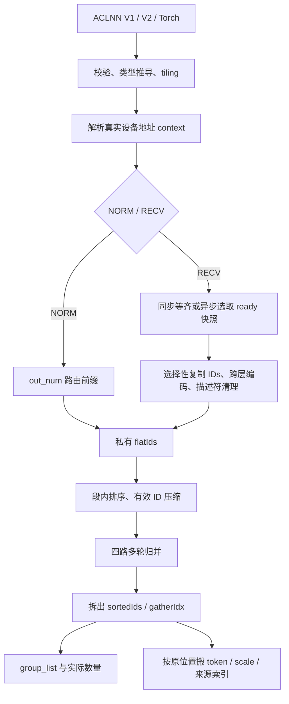
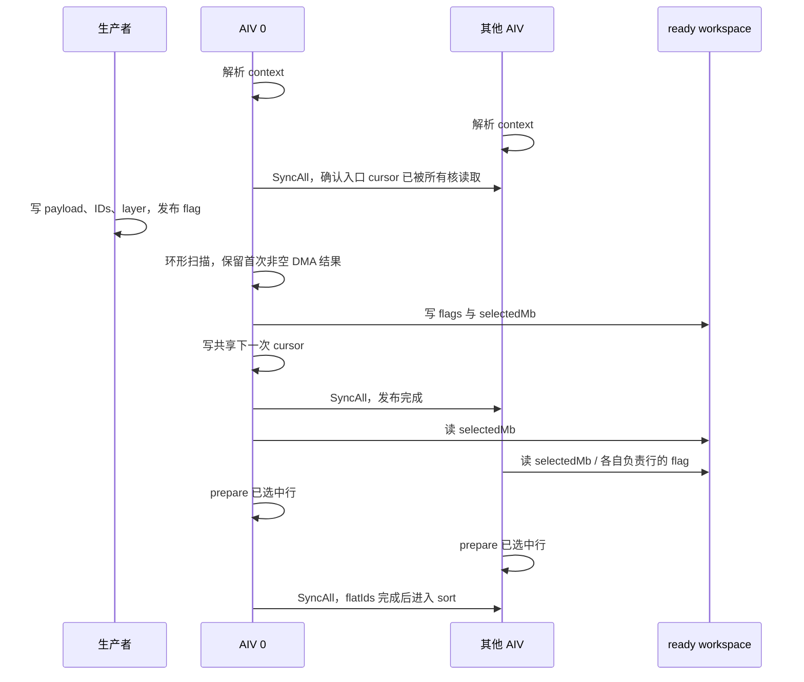

# FfnWorkerBatching 四提交详细设计

从完整算子流程和应用示例开始阅读，可先看 [arch35 算子介绍与源码导读](ARCH35_OPERATOR_GUIDE.md)。

## 1. 设计基线与变更地图

| 项目 | 内容 |
| --- | --- |
| 版本/日期 | 1.0 / 2026-09-17 |
| 编写 | Codex，根据提交差异和最终源码整理 |
| 需求来源 | [REQUIREMENTS.md](REQUIREMENTS.md) |
| 差异范围 | `d967eeb08ceef7c394d0d5e27767e5b08b77aa58..399be5bfcc2c88e6d47c225a9ab82a1539e7dd6e` |
| 提交顺序 | `f2c3c7d5d9` → `b2f11facc2` → `b4c5e09d0b` → `399be5bfcc` |
| 修订记录 | 1.0：建立接口、调度、内存、排序、搬运、Torch 和测试的完整设计说明 |

本文代码摘录以目标 HEAD 为准；标注“伪代码”的段落用于解释控制流，不是可直接替换源码的实现。源码链接使用文件与函数名定位，避免后续文档编辑导致行号失效。

### 1.1 基线已经具备什么

基线已有 arch35 独立 tiling/kernel、key100 NORM/key101 RECV、私有 ID 展平、分段排序、四路归并、输出索引拆包、group_list 游程统计以及 gather。运行时核数/UB 查询与阶段间 Reset 也不是本次从零新增。

本次重点是扩展这些阶段的输入协议，并补齐各阶段在新场景下的容量、地址和尾块约束。不能把未改变的整体算法当成四提交全部新增代码。

### 1.2 文件级变更与目的

| 模块/最终文件 | 主要变更 | 作用/需求 |
| --- | --- | --- |
| [OpDef](../op_host/ffn_worker_batching_def.cpp) | 追加 Bool sync_flag；Ascend950 扩展 6 组 dtype 配对 | FR-06/07 |
| [GE 原型](../op_graph/ffn_worker_batching_proto.h) | 扩展 y/scale 类型、Bool 属性 | 注册与图属性一致 |
| [Ascend950 配置](../op_host/config/ascend950/ffn_worker_batching.json) | MX 类型签名与 bool 属性 | 编译/注册可发现性 |
| [推导](../op_host/ffn_worker_batching_infershape.cpp) | MX scale rank2、dtype 推导、shape 乘积溢出保护 | 输出契约 |
| [Host CMake](../op_host/CMakeLists.txt) | 内部 ACLNN 生成与公共 wrapper 分离 | V1 ABI 稳定 |
| [V1 wrapper](../op_host/op_api/aclnn_ffn_worker_batching.cpp) / [V2 wrapper](../op_host/op_api/aclnn_ffn_worker_batching_v2.cpp) | V1 补 false，V2 透传 bool | FR-07/08 |
| [arch35 tiling](../op_host/ffn_worker_batching_tiling_arch35.cpp) | 属性/容量校验、ready 区、分块预算、有界计数缓存 | FR-03/11 |
| [tiling struct](../op_kernel/arch35/ffn_worker_batching_arch35_tiling_def.h) | syncFlag、wsReady、prepare 元素容量、计数缓存槽数、layerNum | Host/kernel 共用 ABI |
| [context](../op_kernel/arch35/ffn_wb_a5_context.h) | offsetof 字段访问、真实地址、异步信息 | FR-01/04/14 |
| [prepare](../op_kernel/arch35/ffn_wb_a5_prepare.h) | ready 快照、环形选批、选择性消费、跨层编码、大行分块 | FR-02..05 |
| [sort](../op_kernel/arch35/ffn_wb_a5_sort.h) | 比较/Extract 尾部初始化、计数缓存分块等边界保护 | FR-09/11 |
| [group_list](../op_kernel/arch35/ffn_wb_a5_group_list.h) | 尾块完整初始化、缓冲复用依赖 | FR-09 |
| [gather](../op_kernel/arch35/ffn_wb_a5_gather.h) | 字节载荷、MX scale、INT64 步长、大位置整数解码 | FR-06/10 |
| [kernel 编排](../op_kernel/ffn_worker_batching_apt.cpp) | 快照发布/加载、实际消费长度贯穿各阶段 | FR-01/04 |
| [旧架构 context](../op_kernel/ffn_wb_get_schedule_context.h) | 去除 TEST_MAGIC 相对地址解释，直接使用设备地址 | 生产/测试协议统一 |
| [Torch Python](../torch_extension/ffn_worker_batching.py) / [C++](../torch_extension/csrc/ffn_worker_batching.cpp) / [GE converter](../torch_extension/graph_convert_ffn_worker_batching.py) | schema、Meta、NPU wrapper、图转换 | FR-12/13 |
| [golden](../tests/assets/golden.py) | HBM 指针、归档/恢复、MX/异步数据生成、严格比较器 | FR-14 |
| [UT](../tests/ut/op_host) / [ST](../tests/st/arch35) | 边界与功能测试、四入口快速集 | FR-15 |
| [V2 示例](../examples/test_aclnn_ffn_worker_batching_v2.cpp) | bool 模式与真实 context 的完整调用示例 | 集成参考 |

`ffn_wb_arch35_constants.h` 在第一个提交中出现，在 cleancode 中删除。最终 Host 使用 `Arch35Config`，kernel 保留本地常量；本文不引用已经删除的临时头文件。Host 预算常量与 kernel 缓冲宽度仍需成对维护。

### 1.3 总体数据流



控制数据与载荷分离：排序只处理专家 key 和原位置，完整 token 不进入 sort/merge UB；gather 最后按位置访问 token_data。这也是层号编码只修改 key、不修改原位置的依据。

## 2. API、注册和 bool 传播

### 2.1 为什么新增 V2，而不直接扩展 V1

V1 的公开 `GetWorkspaceSize` 在 layerNum 后直接接 y。若在原符号中插入 syncFlag，旧二进制调用者传入的 y 指针会落入属性位置，后续输出参数整体错位。为此公开 V1/V2 由手写 wrapper 维护，OpDef 生成内部 `aclnnInner` 接口。

V1 的关键源码摘录：

```cpp
constexpr bool SYNC_FLAG_WAIT_ALL = false;
return aclnnInnerFfnWorkerBatchingGetWorkspaceSize(
    scheduleContext, expertNum, maxOutShape, tokenDtype, needSchedule, layerNum, SYNC_FLAG_WAIT_ALL, y, groupList,
    sessionIds, microBatchIds, tokenIds, expertOffsets, dynamicScale, actualTokenNum, workspaceSize, executor);
```

V2 的公开完整参数顺序见 [头文件](../op_host/op_api/aclnn_ffn_worker_batching_v2.h)：

```cpp
ACLNN_API aclnnStatus aclnnFfnWorkerBatchingV2GetWorkspaceSize(
    const aclTensor *scheduleContext, int64_t expertNum, const aclIntArray *maxOutShape, int64_t tokenDtype,
    int64_t needSchedule, int64_t layerNum, bool syncFlag, const aclTensor *y, const aclTensor *groupList,
    const aclTensor *sessionIds, const aclTensor *microBatchIds, const aclTensor *tokenIds,
    const aclTensor *expertOffsets, const aclTensor *dynamicScale, const aclTensor *actualTokenNum,
    uint64_t *workspaceSize, aclOpExecutor **executor);
```

两版执行阶段接口仍接收 workspace、workspaceSize、executor、stream；V2 GetWorkspaceSize 将 bool 原样交给内部接口。公共八输出顺序没有改变。

CMake 将定义文件交给 `op_host_aclnnInner`，`add_modules_sources` 使用 `ACLNNTYPE aclnn_inner`，避免自动生成与手写公开签名冲突。Ascend950 专属编译分支保留其 dcci 选项；不能把这些选项推广到所有 SoC。

### 2.2 属性传播表

| 层次 | 名称 | 最终类型/默认值 | 必须保持的约束 |
| --- | --- | --- | --- |
| ACLNN V2 | syncFlag | C++ bool | 位于 layerNum 与 y 之间 |
| ACLNN V1 | 无此公开入参 | wrapper 内 false | 旧 ABI 不改 |
| OpDef/GE 原型 | sync_flag | Bool / false | 追加属性序号 5，0..4 不移动 |
| Host tiling | syncFlag_ | bool / false | `GetAttrPointer<bool>(5)` |
| tiling struct | syncFlag | bool / false | Host 与 kernel 布局配套 |
| kernel context | asyncRecv | bool | `isRecv && tilingData->syncFlag` |
| Torch schema/Python/C++ | sync_flag | bool / False | Python 检查 bool，C++ 接收 bool |
| GE converter | sync_flag | `attr.Bool` | 即使默认 false 也检查新版原型 |
| CSV | syncFlag 或 sync_flag | Python 字面量 True/False | V1 不传该属性；省略值按默认 false |

从中间 int64 属性版本迁移为 bool 时，必须重建关联产物；不能假定字段名未变就能混用旧生成代码或 tiling 二进制。

### 2.3 类型注册与推导

Ascend950 OpDef 的 y 支持 6 个 dtype，dynamic_scale 与其配对为 FP32/FP32/FP32/E8M0/E8M0/E8M0。A2/A3 保持原 3 组签名。GE 原型列出类型集合，Ascend950 JSON 提供对应注册配置。

推导使用属性容量：y 为 `[Y,H]`；group_list `[E,2]`；四个索引 `[Y]`；N `[1]`。当 token_dtype>=3 时 scale 为 `[Y,ceil(H/32)]`，否则 `[Y]`。FP4 在算子逻辑描述中不缩短 H；打包字节 shape 是 Torch 适配层的责任。

推导与 tiling 不是同一套校验器。非法 token_dtype 的最终拒绝依赖 Host tiling 等入口校验，不能声称 InferDataType 单独覆盖所有非法值。

## 3. ScheduleContext ABI 与运行时寻址

### 3.1 ABI 来源

结构唯一来源：[attention_ffn_schedule.h](../../../common/include/op_kernel/attention_ffn_schedule.h)。它使用 pack(1)，并静态断言 `sizeof(ScheduleContext)==1024`。arch35 使用 `offsetof`/`sizeof`，避免手写 magic offset 与结构变化分离。

| 区域/字段 | 起始字节偏移 | 访问方式与含义 |
| --- | ---: | --- |
| common | 0 | 128B；session_num、micro_batch_num、micro_batch_size、selected_expert_num 等 |
| control | 128 | 128B；本算子不将 run_flag 作为本次轮询超时/退出接口 |
| attention | 256 | 128B |
| ffn.token_info_buf | 384 | uint64，RECV 描述符设备地址 |
| ffn.token_data_buf | 400 | uint64，token/scale 数据区设备地址 |
| ffn.polling_index | 416 | uint64，下次扫描起始 micro batch |
| ffn.layer_ids_buf | 512 | 公共结构字段；异步层号实际取 FfnDataDesc.layer_id |
| ffn.session_ids_buf | 528 | NORM 路由表设备地址 |
| ffn.micro_batch_ids_buf | 544 | NORM 路由表设备地址 |
| ffn.expert_ids_buf | 560 | NORM ID 数组设备地址 |
| ffn.out_num | 576 | uint32，NORM 有效路由行数 |
| 末尾 reserve | 640 | 384B；不再用 TEST_MAGIC 标记相对地址模式 |

这些偏移是当前 ABI 的解释性记录，代码仍以公共结构为准。读取一个 context 张量不能验证其中任意地址都有效；缓冲分配与设备归属由调用方保证。

### 3.2 容量与实际长度

Host 使用 `max_out_shape` 预算资源；kernel 从 context 读取实际 A/BS/K/M/HS。入口代码摘录：

```cpp
const int64_t rowElements = static_cast<int64_t>(ctx.BS) * ctx.K + (isRecv ? ctx.BsKPaddingCount : 0);
const int64_t activeElements = rowElements * (isRecv ? ctx.A : ctx.outNum);
```

NORM 只消费 `outNum*BS*K`，并只加载 outNum 条 session/micro batch 路由。RECV 消费 `A*align8(BS*K)` 的私有扁平区，补位为 mask。静态 flat 容量除以实际 A 不能用于推导运行时行跨度，否则动态有效前缀会错位。

M 必须为正，入口 polling_index 必须 `<M`，运行时尺寸和路由表索引必须落在已分配缓冲及静态容量内。kernel 的断言不是对全部生产者输入的全面防护。

### 3.3 二级内存布局

```text
schedule_context (1024B)
  token_info_buf ──> [A][M][ flag:int32 | layer_id:int32 | IDs:BS*K*4B ]
  token_data_buf ──> [A][M][BS][K][ token:T B | scale:Q B | padding ]
  session_ids_buf ─> NORM 路由 row -> session
  micro_batch_ids_buf -> NORM 路由 row -> micro batch
  expert_ids_buf ──> NORM [有效路由行][BS][K]
```

描述符不因 32B 补位改变物理跨度；补位仅存在于消费者私有 flatIds。描述符字数 `F=2+BS*K`，源描述符 `(a,m)` 的字偏移为 `(a*M+m)*F`。

## 4. Host 校验与 tiling 推导

实现位置：[FfnWorkerBatchingTilingArch35](../op_host/ffn_worker_batching_tiling_arch35.cpp)。

### 4.1 校验顺序与失败边界

| 阶段 | 检查 | 避免的故障 |
| --- | --- | --- |
| CheckInputParam | context INT8、rank1、至少 sizeof(context) | 固定 1024B DMA 越界 |
| 必选属性 | E 范围、shape 长度与各维正值、A<=1024、K<=64 | 非法循环/容量 |
| shape 乘积 | 先检查 `A<=INT64_MAX/BS`，再检查 `A*BS<=INT64_MAX/K` | 有符号乘法先溢出后判断无效 |
| 索引容量 | Y<=INT32_MAX；RECV 对齐后的 flatElements 同样受限 | int32 源位置/计数溢出 |
| dtype | 0..5，FP4 H 偶数 | 错误字宽或半字节缺失 |
| mode/layer | need_schedule 0/1；L 范围；异步 L>0 且 E%L==0 | 除零、跨层号不合法 |
| H/HS 表示 | H<=UINT32_MAX；T+Q<=floor(UINT32_MAX/512)*512 | context 字段截断、HS 无法表示 |
| UB | 每阶段最小缓冲预算可满足 | 初始化 UB 越界、除数变零 |

这里只验证 HS“存在可表示值”，没有在 Host 读取设备 context 的真实 HS 并比对载荷长度。生产者仍需填写足够且符合协议的 HS。

### 4.2 平台资源与核数

先 `ReserveLocalMemory(RESERVED_SIZE_32K)`，再查询 `GetCoreMemSize(UB)`。返回 UB 已扣系统预留，不再手动减一次 32KB。

令 U 为该可用 UB，C 为平台 AIV 数：

```text
coreNum = max(1, min(C, ceil(Y/32)))
flatElements = NORM ? Y : Amax * align_up(BSmax*Kmax, 8)
tilingKey = need_schedule == 0 ? 100 : 101
```

dtype、syncFlag 与 key 正交，不为 6 dtype×2 bool 新增 key。PostTiling 下发 blockDim、BATCH_MODE 和 workspace 字节数。

DAV_3510 的 `GetBlockIdx()` 已包含 AIV 展平，`GetFlatAivIdx()` 直接返回它；`GetFlatAivNum()` 使用 `GetBlockNum()*max(GetTaskRation(),1)`。重复执行 `blockIdx*ratio+subBlockIdx` 会跳号或重复认领工作。

### 4.3 最小 UB 与阶段复用

phase 间 Reset 允许复用整块 UB，但每个 phase 内同时存活的缓冲必须全部计入。Host 求 context、waiter、gather、group 等最小合法预算的最大值作为下限。

waiter 的最小预算为 `2*Amax*32+32`：一份 padded int32 flag、一份 float 归约区、一块 cursor 临时区。两份 flags 相关缓冲不能合并，否则归约会破坏用于发布快照的原读取值。

gather 固定预算包含双缓冲输出/索引队列、路由数组、逐 token scale 暂存、7 路 float 索引中间值和 3 路 int32 结果。大 H 不要求整行常驻 UB，仅要求至少一个 32B 数据块；INT8 另留 scale 块。

### 4.4 Prepare 分块

令 `Pmax=align8(BSmax*Kmax)`，异步额外 selectionBytes=32，否则 0：

```text
prepBytesPerRow = 4*Pmax + 32
prepRows = clamp(floor((U-selectionBytes)/prepBytesPerRow), 1, Amax)
idBudget = U-selectionBytes-32*prepRows
idCapacity = floor(idBudget/32)*8
preparePerLoopElements = min(prepRows*Pmax, idCapacity)
```

“至少处理一行”不等于“整行必须装入 UB”。当 P 大于元素容量，kernel 进入行内分块路径。异步的选择粒度为一行，读取其快照 flag 后再决定是否处理；同步/NORM 保留批量行能力。

### 4.5 Sort、Merge、Extract 预算

| 阶段 | 预算公式/限制 | 说明 |
| --- | --- | --- |
| 段内排序 | 实际 `12*align64(n)+24*align32(n)+160` 字节 | 输入 ID/位置/掩码与三块 proposal 区及固定余量 |
| 单段上限 | `floor((U-160)/36/64)*64`，再按实现最小粒度防御 | 先按 coreNum 均分；超 UB 则增加段数 |
| proposal 段槽 | `sortLenPerSeg=2*align32(perSeg)` 个 4B word | 一对为 key(float)+原位置(uint32)，共 8B |
| 归并轮数 | 循环 `lists=ceil(lists/4)`，直到 1 | 等价 ceil(log4(segNum)) |
| 计数缓存 | `cacheSlots=min(segNum,128)`，每槽 32B | 是软件有界缓存策略，不是最多 128 段 |
| 每路归并块长 | `floor((U-cacheSlots*32-96)/64/32)*32` | 四路输入+同宽输出，每 proposal 8B |
| Extract | `floor((U-96)/16/32)*32`，再限 `<=255*32` | proposal 8B + ID 4B + idx 4B；API repeat 上限 |

小 Y 时实际下发的 extractPerLoopElements 可小于 32；kernel 分配/执行向量部分再按 32 对齐，写出只覆盖有效 len。不能机械地把所有下发值都描述成 32 的倍数。

计数缓存超过一块时按段号换页，TotalValid/ListLength 从对应槽读取；不因大量段数把所有计数一次塞进 UB。

### 4.6 GroupList 分块

Host 行拼装预算取 U 的 1/16，每行 16B，按 2 行向下对齐，再以 E 限定并保持最少 2 行的缓冲容量。E=1 时缓冲可容纳两行，但写出仍严格止于 E。

kernel 从 U 扣除行区和 13 个缓冲的 32B 余量，再按 10 路 int32 向量和两路 mask 的保守每元素预算计算 chunk，向下对齐到 64。实现用于容量推导的 `bytesPerElem=10*4+2=42`，mask 实际是 bit，不应把这条保守公式误写为精确 bit 占用公式。

## 5. Workspace 布局与 ABI

所有 `ws*` 偏移以 int32 word 为单位，相对 **userWorkspace**；kernel 取地址时乘 4。系统 workspace 另加在返回总量中。

令 Fcap=flatElements、D=sortSegNum、Q=sortLenPerSeg：

| 顺序 | 区域 | word 数 | 用途 |
| --- | --- | ---: | --- |
| 0 | 初始保留 | 128 | 沿用保留空间 |
| 1 | wsFlatIds | Fcap | prepare 后私有专家 key |
| 2 | wsPairA | D*Q | sort/merge proposal |
| 3 | wsPairB | D*Q | merge 乒乓 |
| 4 | wsSegCnt | D*8 | 每段一个 32B 计数槽 |
| 5 | wsSortedIds | Y | 有效有序 ID |
| 6 | wsGatherIdx | Y | 原位置 |
| 7 | 对齐空隙 | 0..7 | ready 起点对齐 32B |
| 8 | wsReady | 异步 `(Amax+1)*8`，否则 0 | 本次 selectedMb + padded flags |

```text
wsReady + 0B      : uint64 selectedMb + 24B unused
wsReady + 32B     : int32 flag[session0] + 28B padding
wsReady + 64B     : int32 flag[session1] + 28B padding
...
wsReady + A*32B   : int32 flag[session A-1] + 28B padding
```

Amax=1024 时 ready 载荷 32800B，另有最多 28B 起点对齐开销。NORM/同步只记录 wsReady 起点，不分配载荷，也不访问它。

关键源码摘录（LayoutWorkspace 尾部）：

```cpp
off = (off + NUM_EIGHT - 1) / NUM_EIGHT * NUM_EIGHT;
tilingDataPtr_->wsReady = off;
if (needSchedule_ == 1 && syncFlag_) {
    off += (A_ + 1) * (ONE_BLK_BYTES / static_cast<int64_t>(sizeof(int32_t)));
}
userWorkspaceWords_ = off;
```

`GetWorkspaceSize` 使用同一次累加的 `userWorkspaceWords_*4+sysWorkspaceSize_`；避免“偏移一套公式、总量另一套公式”导致段尾越界。

tiling struct 新增/调整 bool 与容量字段后，Host/kernel 必须统一构建。不根据“某个字段追加在尾部”推断全部历史布局均兼容，因为 syncFlag 等字段本身也在本次范围中发生类型调整。

## 6. RECV 选择算法与跨核同步

### 6.1 等待器的单一写入者

`FfnWbA5RecvWait::Process` 只由 flattened AIV 0 执行；其他核等待发布屏障。每轮跨 session 读取当前 selectedMb 的一个 int32 flag：源 stride 为 `(M*F-1)*4` 字节。每个 flag 在 UB 占 32B，剩余 7 个 int32 补 0。

将 padded flags Cast 到独立 float work 后 ReduceSum；因为 flag 只允许 0/1，sum 即本轮观测 ready 数。原始 flags 保留供快照发布。

关键源码摘录：

```cpp
const float readyNum = work.GetValue(0);
const bool ready = ctx_->asyncRecv ? readyNum > 0 : static_cast<uint32_t>(readyNum) >= ctx_->A;
```

### 6.2 模式伪代码

```text
selectedMb = entry_polling_index
loop:
    flags = DMA_read_flags_of(selectedMb)   # padded, snapshot candidate
    count = sum(flags)
    if async ? count > 0 : count >= A:
        if async:
            publish_the_same_flags(flags) # 不重新读生产者 flag
        break
    if async:
        selectedMb = (selectedMb + 1) % M
    # sync 保持原 micro batch；没有 ready 时两种模式都继续等

if async:
    ready.header.selectedMb = selectedMb   # 本次消费项
context.polling_index = (selectedMb+1)%M    # 下次起始项
```

空轮只推进 core0 的局部变量；只有选中后才更新共享 cursor。ready 取决于描述符，不扫描 ID 判断有没有有效 token，否则全 mask 数据永远不能被消费。

### 6.3 两个 micro batch 索引必须分开

例：M=4，入口 cursor=1，mb1/mb2 空，mb3 有 ready。则本次 selectedMb=3，输出 micro_batch_ids=3；共享 cursor=0 为下一次使用。

所有核的 ctx 是私有变量。core0 更新自己的 selectedMb 不会更新其他核，故快照发布后每个核必须调用 `LoadSelectedMicroBatch` 从 ready 头块读取本次值。不能重新从共享 context 读取已推进的 polling_index。

### 6.4 时序图



### 6.5 同步点与故障对应关系

| 同步点 | 保证 | 缺失时的结果 |
| --- | --- | --- |
| 解析 context 后、waiter 前 SyncAll | 所有核读到同一入口 cursor | 晚启动核读到 core0 已推进的下一批 |
| flags DMA→归约 | work 消费已完成的 flag 数据 | ready 判定错误 |
| 快照 MTE3 完成再释放 flags | UB 不提前复用 | 快照内容被下一轮覆盖 |
| waiter 后 SyncAll | ready 头和 flag 对所有核发布 | 读取旧/未完成快照 |
| LoadSelectedMicroBatch 的 MTE2_S | 标量读取 DMA 完成的数据 | 本次 mb 随机/陈旧 |
| prepare 后 SyncAll | sort 看到完整 flatIds | 部分行未写入即开始排序 |
| sort 后/每轮 merge 后 SyncAll | 下一阶段只读已完成段 | 跨核排序结果撕裂 |
| Extract 后 SyncAll | group/gather 读取完整 IDs/位置 | 输出错位 |

`pipe.Reset()` 回收本核阶段缓冲，不能代替上述 SyncAll。group_list 与各核 gather 使用独立输出，其他核不必等待 core0 完成 group_list 后才开始自己的 gather；整个 kernel 完成是调用者使用全部输出的边界。

### 6.6 异步“快照”的保证边界

DMA 跨 session 读取存在时间跨度，不保证全局同一时刻。保证的是：后续所有核使用同一次读取的成员集合。若 session1 在快照读取后才置 ready，本次仍不消费它；下一次重新扫描再处理。

接口没有取消/超时检查，生产者永不发布 ready 可导致持续等待。多消费者同时操作同一 context 没有仲裁；调用方必须建立执行顺序。

## 7. Prepare：选择性消费、层号编码与大行

### 7.1 行分工

实际 AIV 数决定每核 session 行段，各核 flatIds 写区和描述符清理区互不重叠。异步逐行检查 ready workspace，不能重新读实时 flag 作为成员判据。

| 行状态 | 私有 flatIds | 源描述符行为 |
| --- | --- | --- |
| 异步未选中 | 整行填 INT32_MAX，包括补位 | 不读/不清源 IDs、flag、layer |
| 选中且层号/ID 合法 | 复制并编码专家号 | 完成私有副本后源 IDs 失效、flag 清零 |
| 选中但非法 layer 或全部 mask | 整行 mask | 仍消费描述符，不能永久保留 ready |
| 同步 | 复制全部 session 原始 ID，补位 mask | 清理已消费描述符 |
| NORM | 复制 out_num 前缀原始 ID | 不执行 RECV flag 协议 |

### 7.2 跨层编码

只在异步 RECV 计算 `Ep=E/L`，同步/NORM 不解释默认 L=0，避免除零及改变旧专家语义。

```text
if layer_id < 0 or layer_id >= L:
    all IDs of descriptor -> INT32_MAX
else:
    for local_id:
        if unsigned(local_id) < Ep:
            global_id = layer_id*Ep + local_id
        else:
            global_id = INT32_MAX
```

使用 unsigned 范围比较同时拒绝负数、超出层内范围的 ID 和大值 mask；必须先判合法再加偏移，不能对 INT32_MAX 先加 layer bias 导致回绕。

`ReadLayerOffset` 关键摘录：

```cpp
const int32_t id = layer.GetValue(0);
return static_cast<uint32_t>(id) < contextInfo_->layerNum ?
           id * static_cast<int32_t>(contextInfo_->expertsPerLayer) :
           -1;
```

例：E=8、L=2、Ep=4：

| layer | local IDs | 私有排序 key |
| ---: | --- | --- |
| 0 | 0,1,3 | 0,1,3 |
| 1 | 0,1,3 | 4,5,7 |
| 1 | -1,4,INT32_MAX | 全部 mask |
| 2 | 0,1 | 非法 layer，全部 mask |

源 token 位置依旧是 `(a,m,b,k)`；layer 只改变分组，不改变 token_data 地址。新编码不依赖 context.common.expert_num 替代属性 E，Ep 来自经过校验的属性。

### 7.3 清理顺序与所有权

每个选中行：复制 IDs 到 UB → 写私有 flatIds → 等待 MTE3 完成读取 → 将本地 IDs 改成 sentinel → 发出源 IDs 失效写 → 发出 flag=0 写 → 等待搬出完成后复用 UB。

layer_id 保留不改。源 IDs 清理仅覆盖真实 BS*K 元素，不把 private flatIds 的对齐补位写回描述符。

**token_data 未提前复制到 workspace。** 后续 gather 仍读原 payload。因此 flag=0 表示描述符已被消费，不自动构成 payload 可覆盖的充分条件；生产者必须等到本次消费/gather 完成所要求的外部同步点。不能通过文档把此窗口描述为任意生产者都可安全复用的完整握手协议。

### 7.4 ProcessRecvLargeRow

当一行 ID 数超过 perLoopElements，按行内块处理：层偏移每行读一次；每块应用相同编码；只在最后一块补私有尾部；源清理只写当前真实 ID 区间；所有块完成后再清 flag。这样既保持一行一次选择的语义，也不要求整行常驻 UB。

## 8. 排序、归并、Extract 与统计

### 8.1 专家 key 和原位置分别处理

段内生成全局原位置 `begin+i`，类型 int32；转为 uint32 payload 交给 Sort/MrgSort。只有专家 key 被转换为 float。专家号上界 8192，合法 key 可精确表示；原位置可能超过 2^24，不能先转成 float 存储。

有效性沿用阈值 `expertStart=1000000`。合法专家取负 key，再用硬件降序排列，得到专家升序。异步 prepare 已把非法 layer/local ID 变为 sentinel；同步/NORM 调用者仍负责提供合法非 mask 专家号。

关键摘录：

```cpp
ArithProgression<int32_t>(idxLocal, static_cast<int32_t>(begin), 1, len);
```

```cpp
GatherMask(keys, keys, maskBits, true, static_cast<uint32_t>(len), gp, rsvd);
PipeBarrier<PIPE_V>();
LocalTensor<uint32_t> idxU32 = idxLocal.template ReinterpretCast<uint32_t>();
GatherMask(idxU32, idxU32, maskBits, true, static_cast<uint32_t>(len), gp, rsvd);
```

同一 mask 同时压缩 key 和 position，确保二者一一对应。当前 golden 用 stable argsort，ST 逐元素验证来源顺序；维护 Sort/MrgSort 时不能仅按专家计数相同就接受组内任意重排。

### 8.2 两级尾部初始化

1. CompareScalar 按 64 个 FP32 读取。真实 len 不满 64 时，从该 repeat 的对齐起点用 mask 仅填充尾 lane，且不对填充值执行专家 key 取负。
2. 压缩后的 validCnt 按 Sort32 对齐。最后一个 repeat 只在尾 lane 填最小 key，使其降序落在末尾。

直接从 keys[len] 发起 Duplicate 可能地址不对齐；只限定最终 GatherMask 的有效长度，也不能消除前面 Compare 已读取未定义值的问题。concat、sort scratch、sorted result 使用独立区，避免不允许的重叠。

### 8.3 有界计数缓存与流式四路归并

每段有效数放 32B GM 槽。`LoadSegCounts` 按 `seg/cacheSlots*cacheSlots` 定位缓存块；`SegCount` 在本块中读取；`ListLength` 汇总参与归并列表长度。

每轮至多四路列表进入 UB；根据实际 consumed 数推进各列表，不假设每轮输入均被完全消费。只有一路仍活跃时直接搬运；多路调用 MrgSort。输出写到另一个 proposal workspace，每轮跨核 barrier 后切换 A/B。

搬出完成前，不允许 MTE2 或向量指令改写其仍在读取的 UB 区。计数缓存只是改变计数读取策略，不改变列表顺序与累计有效数。

### 8.4 Extract

最终 proposal 拆出专家 ID 和 uint32 位置。按 Sort32 执行的输入尾部先补确定值；Cast 和两个 GM 输出严格只处理 len。Extract 的每轮 repeat 限制为 255，对应 8160 个 proposal；不能仅因为设备某次未报错就忽略 CPU 调测中的 API 范围检查。

N=0 时跳过 Extract 与 gather，但所有核仍遵循共同 barrier 结构，core0 写零数量和完整零 group_list。

### 8.5 group_list 游程编码

group_list 按非空专家压缩输出，不是 `group_list[expertId]` 散射计数表。例如 ID 序列 `[1,1,4]`、E=6，得到 `[[1,2],[4,1],[0,0],[0,0],[0,0],[0,0]]`。

core0 流式处理 sortedIds：

1. 单独读取首元素，初始化 pendingId/pendingCnt。
2. 按 UB chunk 读取 cur/prev/next，边界填 sentinel=-1。
3. 相邻不等比较生成首/尾 mask；压出 start/end/expertId。
4. token count=`end-start+1`；块首接上 pendingCnt，块尾未完成游程保留至下块。
5. 在 UB 拼 int64 `[id,count]` 行，分块 DataCopyPad 写出。
6. 未用行全部补 `[0,0]`；N=1 和 N=0 单独由控制流覆盖。

十路向量中所有参与 Compare64 的尾部都要初始化，Sub/Cast 必须覆盖 cmpLen，而非只写 len。缓冲复用前建立 V→MTE2 依赖。输出行缓冲清零前要等待上一轮 MTE3 读完，同时考虑标量填充与向量写的依赖。

现有实现采用游程编码而不是按专家号散射到 SIMT local memory，也不靠单次 cache-line flush 提交多行标量 GM 写。本文将这些作为当前实现约束说明，不把源码历史注释中的硬件现象当成本次重新测量的结论。

## 9. Gather：索引精度、地址宽度与 MX 搬运

### 9.1 原位置解码

令 p 为 gatherIdx，R 为私有 ID 行跨度：NORM `R=BS*K`，RECV `R=align8(BS*K)`。

```text
a = p // R
rem = p - a*R
b = rem // K
k = rem - b*K
```

补位被 mask，不会作为有效 token 进入 gather。NORM 将 a 作为路由表行号取得真实 session/micro batch；RECV 直接使用 session=a、micro batch=selectedMb。

### 9.2 小容量向量路径与商修正

`A*R<=2^24` 时，源码使用 FP32 向量倒数乘法近似除法，再 floor 得到候选商。但即使原位置可精确表示，`1/n` 和乘法也有舍入，恰好整除时可能偏一。

对整数值余数 r 和除数 n 计算：

```text
hi = min(max(r-n+1,0),1)
lo = min(max(-r,0),1)
corr = hi-lo
q = q+corr
r = r-corr*n
```

两级除法均修正。7 路 float 中间结果、3 路 int32 结果独立分道，不通过错误重解释覆盖仍有消费者的中间值。

### 9.3 大容量整数路径

当 `A*R>2^24`，在任何位置 Cast 前改用 int64 标量除法。判断依据是潜在原位置空间，不能用 N；即使仅一个有效 token，它也可能位于大于 2^24 的位置。RECV 必须把 padding 纳入 R。

关键代码摘录：

```cpp
constexpr int64_t FP32_EXACT_POSITION_CAPACITY = 1LL << 24;
if (static_cast<int64_t>(contextInfo_->A) * bskProduct > FP32_EXACT_POSITION_CAPACITY) {
```

```cpp
const int64_t position = expertIdxLocal.GetValue(i);
const int64_t session = position / bskProduct;
const int64_t remainder = position - session * bskProduct;
const int64_t token = remainder / contextInfo_->K;
aIdxAll.SetValue(i, static_cast<int32_t>(session));
bsIdxAll.SetValue(i, static_cast<int32_t>(token));
kIdxAll.SetValue(i, static_cast<int32_t>(remainder - token * contextInfo_->K));
```

对已丢掉低位的 FP32 再修商余数无法恢复原始索引，这就是必须在 Cast 前分流的原因。

### 9.4 地址乘法必须提前提升

源 token 数据字节布局 `[A,M,BS,K,HS]`：

```text
strideSession = int64(M)*BS*K*HS
strideMb = int64(BS)*K*HS
strideBs = int64(K)*HS
rowOffset = session*strideSession + mb*strideMb + b*strideBs + k*HS
```

源码摘录：

```cpp
int64_t strideSession =
    static_cast<int64_t>(contextInfo_->M) * contextInfo_->BS * contextInfo_->K * contextInfo_->HS;
int64_t strideMicroBatch = static_cast<int64_t>(contextInfo_->BS) * contextInfo_->K * contextInfo_->HS;
int64_t strideBs = static_cast<int64_t>(contextInfo_->K) * contextInfo_->HS;
```

context 字段为 uint32，若先用 uint32 相乘再赋给 int64，溢出已经发生。例如 `64*64*64*16384=2^32`，32 位结果变为 0，最终转 64 位也无法恢复。

### 9.5 字节化 token 与 scale

源码摘录：

```cpp
tokenRowBytes_ = contextInfo_->tokenDtype <= 1 ?
                     contextInfo_->H * sizeof(half) :
                     (contextInfo_->tokenDtype == 5 ? contextInfo_->H / NUM_TWO : contextInfo_->H);

scaleRowBytes_ = contextInfo_->tokenDtype >= 3 ? CeilDiv(contextInfo_->H, BLOCK_BYTES) : 0;
```

这里 BLOCK_BYTES=32，恰好也是 MX scale 对应的逻辑元素块长；Host 使用命名常量 MX_SCALE_BLOCK_ELEMENTS 表达其业务意义。

扣掉所有固定 UB 分配后，token 队列双缓冲容量向下对齐 32B，按 hBlocks 分块搬运。最后一块严格按有效字节数写出，输出没有源 HS 的 padding。

- INT8：最后一个 token block 的末尾读取 4B FP32 scale，逐 token 先放 32B 槽，再 Gather 压成连续 float 输出。
- MX：在整行 token 后，从 `rowOffset+tokenRowBytes_` 开始搬 scale，输出起点为 `outputRow*scaleRowBytes_`。
- scale 行也可能大于 UB；`CopyMxScale` 复用 token 队列并按 maxBlockSize 分块，不假设 scale 总能一次搬完。
- FP4 两个 nibble 原样保留，没有解包计算后再量化；E8M0 也按 int8/字节搬运，没有指数数值转换。

### 9.6 来源索引与输出一致性

`EmitTokens` 同时填四个索引，再搬对应 token。`expert_offsets` 写的是 kIndices，`token_ids` 写的是 bsIndices。来源四元组与 y/scale 必须保持逐行一致；仅计数正确不能证明 gather 正确。

每核按 N 均分输出行，无需按专家边界切核。专家连续性已经由 gatherIdx 排序保证，不同核可以搬同一专家分组的不同连续片段。

## 10. Torch extension 与图模式

### 10.1 Python schema 和校验

关键 schema 摘录：

```python
"ffn_worker_batching(Tensor(a!) schedule_context, int expert_num, int[] max_out_shape, "
"*, int token_dtype=0, int need_schedule=0, int layer_num=0, bool sync_flag=False, bool mx_output_uint8=False) "
"-> (Tensor, Tensor, Tensor, Tensor, Tensor, Tensor, Tensor, Tensor)"
```

`Tensor(a!)` 告知框架 context 会修改，避免 functionalization/图排序把 RECV 当作无副作用纯算子。二级指针所指内存无法仅靠 Tensor alias 注解完整建模，生产者仍负责生命周期与外部同步。

`_validate` 只检查元数据和属性，不把 context 拷回 CPU。这样避免流同步，也允许 Meta/FakeTensor 执行。C++ 额外检查 NPU 设备和 SoC。Python/C++ 不包含 Host 的所有溢出防护，不宣称三个入口校验完全等价；最终 tiling 仍是算子下发的重要校验层。

### 10.2 Meta/FakeTensor

`_output_specs` 根据属性分配八输出的 shape/type，不能从 context 读取 N 再裁剪输出。图始终看到容量 shape，运行时有效前缀由 actual_token_num 表达。

FP4 Torch dtype 的元素是 packed x2 字节，故 shape `[Y,H/2]`。当 `(Y,H/2)==(1,1)`，使用 stride `(2,1)` 标明最后一维是打包轴，避免共享 ACL tensor 转换器把默认两个 stride=1 解读为行轴打包。Meta 和 C++ 必须同时处理该特例。

### 10.3 C++ 调用与设备 guard

`OptionalDeviceGuard` 覆盖输出分配和 `ACLNN_CMD`，因为后者还会分配 workspace 并向当前设备当前 stream 下发。不能只给 tensor 分配加 guard，却让算子提交落在别的当前设备。

关键调用摘录：

```cpp
ACLNN_CMD(aclnnFfnWorkerBatchingV2, schedule_context, expert_num, shape_attr, token_dtype, need_schedule,
          layer_num, sync_flag, y, group_list, session_ids, micro_batch_ids, token_ids, expert_offsets,
          dynamic_scale, actual_token_num);
```

不自动复制非连续 context：拷贝后 RECV 改的是临时张量中的 cursor，原 context 不再体现应有副作用，因此应拒绝该输入。

### 10.4 MX uint8 输出视图

先用原生 FP4/E8M0 dtype 创建和调用 ACLNN，保证 descriptor 正确；调用后对不被图后端支持的类型返回 `view(at::kByte)`：FP4 y 与 MX scale 改为 uint8，FP8 y 保持原生类型。

这只是同一存储字节的视图，不是 `.to(uint8)` 数值 cast。后者会改变 FP4/E8M0 编码，破坏本算子原样搬运语义。

固定形状推理图使用 `torch.compile(..., backend="npugraph_ex", fullgraph=True, dynamic=False)`；MX 采用 `mx_output_uint8=True`。没有反向实现，也不由注册中的动态能力标记推出任意动态图均支持。

### 10.5 TorchAir GE converter

converter 可选导入 TorchAir，缺失依赖不阻断 eager 包导入。转换后的 GE 算子仍有八输出，不额外返回第九个 context；副作用由 mutable schema 与后端 functionalization 处理。

即使 sync_flag=False，也调用 `is_cann_compat` 要求运行时原型存在 sync_flag。只检查非默认属性会让旧原型缺字段的问题隐藏到 tiling 阶段。

`mx_output_uint8` 不是 GE 属性。以下组合显式抛 NotImplementedError：

- token_dtype=5，即 packed FP4；
- token_dtype>=3 且 mx_output_uint8=True。

GE 其他组合的可执行性还取决于对应 OPP/原型、TorchAir 及 mutable schema lowering。converter 注册、npugraph_ex 通过和 GE 通过是不同证据，不能互相替代。

## 11. 测试设计、用例分层和证据

### 11.1 输入生成必须是真实设备协议

[golden.py](../tests/assets/golden.py) 通过 ACL 分配二级 HBM，将 token/scale、描述符、路由表写入设备，再把真实地址放进 1024B context。旧 kernel 的 TEST_MAGIC 相对地址路径被删除，测试不再依赖生产接口之外的 packed context 特例。

HBM 分配要在正确设备 context 下进行；每个 worker 的设备状态独立，输入分配失败不能归为算子精度失败。分配对象存活至执行完成，清理时机由测试框架/生成器管理。

归档不是只把 1024B 地址头写入文件：`save_context_archive` 同步后保存二级载荷和属性，归档头中的地址置零；`restore_context_archive` 校验版本/属性/长度，重新分配 HBM 并回填新地址。跨进程重放旧地址没有有效性保证。

### 11.2 调度 golden

生成器按 testcase_name 分支生成 mask、single_expert、sync、async_layers 等场景，因此用例名是输入定义的一部分，不应随意重命名。

异步静态输入预置 ready 矩阵，从 cursor=0 选第一个存在 ready 的 micro batch；同一次 gold 计算只包括这些 session，并对 layer/local ID 编码。完全无 ready/延迟生产场景须状态型脚本驱动，不能由静态 CSV 无条件覆盖。

RECV 消费具有副作用，重复执行前必须恢复描述符；生成器将 RECV 的 run_time 固定为单次，避免第二轮读取已经清理的数据而无限等待。图重放需要外部重新发布，不能把相同输入地址理解为相同内容。

### 11.3 比较器的关键约束

`AclnnFfnWorkerBatchingTestSpec.compare`：

1. 必须有 8 个 NPU 和 8 个 golden 输出；缺失直接失败。
2. 每个输出完整 shape/dtype 必须一致；禁止按 min(size) 截短掩盖少行输出。
3. y、四索引、有效 scale 只比较 golden N 前缀；N 本身单独严格比较。
4. group_list 比较完整 E 行，尤其要求空场景/尾部为零。
5. FP16/BF16 scale 仅检查元数据，不检查未定义载荷。
6. float8/float4/bfloat16 用 uint8 视图比较编码；其余逐元素严格相等。

关键摘录：

```python
if len(outputs) != 2 * _NUM_OUTPUTS:
    return [
        failure("expected 8 NPU outputs and 8 golden outputs")
        for _ in range(_NUM_OUTPUTS)
    ]
```

```python
if npu.shape != gold.shape or npu.dtype != gold.dtype:
```

N=0 时空前缀没有元素可比是合理的，但不能因此跳过 group_list 和 actual_token_num。这些要求防止“算子没输出数据却被判断通过”。

### 11.4 Host UT 追溯

测试文件：[tiling UT](../tests/ut/op_host/test_ffn_worker_batching_tiling.cpp)、[infershape UT](../tests/ut/op_host/test_ffn_worker_batching_infershape.cpp)。下表列出可检索的具体用例名/名称片段，不将存在测试定义等同于本次已运行通过。

| 关注点 | 现有测试定位 |
| --- | --- |
| key100/101 与 dtype | `ffn_worker_batching_tiling_arch35_ascend950_norm_key100`、`...recv_key101`、`...bf16_norm`、`...int8_recv` |
| 核数/大形状 | `ffn_wb_tiling_arch35_recv_corelimit_large_y_64`、`...norm_multicore_largeshape` |
| 专家/A/K 范围 | `...expert_num_out_of_range_fail`、`...session_out_of_range_fail`、`...topk_out_of_range_fail` |
| MX | `ffn_wb_tiling_arch35_mx_types`、`...fp4_odd_h_fail`、`ffn_wb_tiling_mx_rejected_on_legacy_soc` |
| bool 与层约束 | `ffn_wb_tiling_arch35_sync_flag`、`...async_layer_contract` |
| UB/context 边界 | `arch35_review_ub_capacity_contract`、`arch35_review_context_length_contract`、`arch35_adopt_minimum_ub` |
| 形状与属性泛化 | `arch35_adopt_attribute_boundaries`、`ffn_worker_batching_infershape_shape_product_overflow_fail` |
| MX 推导 | `ffn_worker_batching_mx_shape_3`、`..._4`、`..._5` |
| 旧平台选择 | 名称含 `ascend910b`、`ascend910_93`、`no_regression` 的测试 |

### 11.5 ST 分层

| 资产 | ACLNN | 直调 | eager | TorchGraph | 使用方式 |
| --- | ---: | ---: | ---: | ---: | --- |
| 仓内 tests/st/arch35 | 30 | 6 | 6 | 6 | 变更后快速检查，目标约 5–10 分钟或更短 |
| 外部 opstest arch35 | 468 | 242 | 12 | 12 | 较全面功能/泛化回归 |

外部根目录为 `/home/chenpengyi/opstest/ffn/ffn_worker_batching/arch35`。独立 `ffn_worker_batching_mx_generalization.csv` 已并入 `ffn_worker_batching.csv`；ACLNN/直调又分别从 936/484 精简到 468/242。外部调整不在本仓四提交差异中，作为集成环境现状记录。

ACLNN 承担较完整功能；另外三个入口重点验证调用通路。外部 Torch 两集是六 dtype×False/True 的 NORM 组合，不应描述为覆盖全异步 RECV。V1 不传 syncFlag，V2 采用驼峰，kernel/Torch 采用蛇形。仓内部分直调用例省略 sync_flag，行为等价默认 false。

### 11.6 状态型验收步骤

对于不能由静态 CSV 表达的协议，需按以下步骤另行验证并保存前后状态：

1. 分配真实 context 与二级缓冲，设置 M>1、cursor 非末项。
2. 入口 mb 无 ready，后续某 mb 只发布部分 session；执行异步 RECV。
3. 校验选中 mb、N、跨层 group_list、四索引和 token/scale。
4. 校验选中描述符 IDs 全失效、flag=0、layer 未改；未选中描述符逐字节保持。
5. 以更新后的 cursor 再次发布另一批，校验环回及重复消费隔离。
6. 补充 ready 但全 mask，确认返回 N=0 而非继续等待。
7. 延迟发布测试须有可控超时与清理策略，记录 producer/consumer 流同步方式。

上述是验收方案，不是声称本次文档生成已执行这些硬件步骤。

### 11.7 历史证据与本次核验范围

当前可读取的外部 README 记录 2026-09-17 Ascend950DT_9574 的 bool 集最终 734/734 通过。直调有一次输入生成 `ACL_ERROR_RT_CONTEXT_NULL (107002)`，复跑通过；首轮不是全部通过。记录中的累计运行时间约 32 分 6 秒不是 kernel 性能。

README 引用的原始 reports 目录在当前工作区未找到。故此处只保留其历史摘要，不把它提升为目标 HEAD 的可复核原始日志，也不据此确认所有中间构建与最终 cleancode 二进制一致。具体证据分级见需求文档 §8。

本次文档核验关注相对链接、源码摘录一致性、CSV 数量/属性类型、变更边界和 `git diff --check`。文档修改本身不需要重新编译运行 kernel；后续发布验收则需要匹配目标 HEAD 的构建与原始报告。

## 12. 构建集成、回归操作与维护清单

### 12.1 配套构建顺序

1. 固定目标 commit，准备对应 SoC/CANN 工具链。
2. 从同一源码构建 OpDef 生成接口、V1/V2 wrapper、GE 原型、Host tiling 和 kernel。
3. 安装/选择这一版 OPP 与 API 库，确认没有从旧环境搜索到缺 sync_flag 的原型。
4. 重新构建 Torch extension，避免旧 JIT 缓存仍以 int64 传递 bool 参数。
5. 运行 Host UT 和仓内四套快速 CSV；必要时运行外部 734 条泛化集与状态型测试。
6. 逐行汇总输入生成、编译、执行、精度和越界状态；不能只看汇总的 FAIL 数。

具体构建命令应使用当前仓库/测试工具链对应入口。本文不编造未在本次执行过的 TTK CLI；完整 C++ 集成示例见 [V2 示例](../examples/test_aclnn_ffn_worker_batching_v2.cpp)，图接入说明见 [Torch API](torchapi_ffn_worker_batching.md)。

### 12.2 可复核的源码范围与用例清点命令

从仓库根执行：

```bash
git log --reverse --format='%H %s' d967eeb08ceef7c394d0d5e27767e5b08b77aa58..399be5bfcc2c88e6d47c225a9ab82a1539e7dd6e
git diff --stat d967eeb08ceef7c394d0d5e27767e5b08b77aa58 399be5bfcc2c88e6d47c225a9ab82a1539e7dd6e -- ffn/ffn_worker_batching
rg -n 'syncFlag|sync_flag|asyncRecv' ffn/ffn_worker_batching
```

```python
import ast
import csv
from pathlib import Path

roots = [
    Path('ffn/ffn_worker_batching/tests/st/arch35'),
    Path('/home/chenpengyi/opstest/ffn/ffn_worker_batching/arch35'),
]
for root in roots:
    for path in sorted(root.glob('*.csv')):
        with path.open() as stream:
            rows = list(csv.DictReader(stream))
        for row in rows:
            attrs = ast.literal_eval(row['attributes'])
            for key in ('syncFlag', 'sync_flag'):
                if key in attrs:
                    assert type(attrs[key]) is bool, (path, row['testcase_name'])
            if row.get('api_name') == 'aclnnFfnWorkerBatching':
                assert 'syncFlag' not in attrs
        print(path, len(rows))
```

### 12.3 维护时必须联动的修改

| 修改动作 | 必须同步检查 |
| --- | --- |
| 加属性/改类型 | API wrapper、OpDef、GE 原型/JSON、tiling struct、Torch/GE、CSV、UT |
| 加输出 dtype | 注册组合、推导、行字节数、scale shape、Torch dtype/packing、golden bitwise |
| 改 gather 队列/分道 | Host minGather 与 kernel ubAvailable 两套预算 |
| 改 sort/merge 缓冲 | segCap、固定余量、workspace proposal 长度、count cache、边界 UT |
| 改 snapshot 布局 | Host wsReady 容量、waiter 发布、LoadSelectedMicroBatch、IsSelected |
| 改消费/清 flag 时点 | producer 不覆盖契约、gather 数据生命周期、状态型测试 |
| 改用例名字/删用例 | golden 分支、场景覆盖、四入口签名和外部用例映射 |

## 13. 风险、未覆盖项与可追溯结论

| 项目 | 当前结论 | 评审/验收应关注 |
| --- | --- | --- |
| 同步/NORM 非法 ID | 沿用上游合法性契约和大值 mask | 不宣称所有负数/越界 ID 均被统一过滤 |
| producer 与早清 flag | payload 在后续 gather 仍被使用 | 必须明确 slot 复用完成条件 |
| 空 ready 等待 | kernel 持续轮询 | 本次不提供超时/取消 API |
| 大属性输入 | tiling 有容量保护，wrapper 检查不完全等同 | 避免把 wrapper 描述成全面的设备内存安全校验 |
| group 同专家顺序 | golden 稳定排序、来源索引严格比较 | sort/merge 改动需保留现有顺序验收 |
| A2/A3 | 注册/分发保持，UT 有回归定义；真实指针解析也有改动 | 仍需对应硬件验证，不能称“完全零改动” |
| GE | 原型兼容检查与明确拒绝路径存在 | 需记录实际 TorchAir/OPP 版本及可执行子集 |
| 性能 | 有测试耗时记录，没有正式基线 benchmark | 不把 ST 总时间写为算子 latency |
| 既有文字差异 | expert_offsets、Y 上限等以代码为准 | 后续 API 文字更新保持同一契约 |
| 历史运行报告 | 外部 README 可读，原始 reports 当前缺失 | 发布时补归档，区分首轮和复跑 |

从需求到实现的主链路为：FR-01/14 → context 与真实地址协议；FR-02..05 → waiter/snapshot/prepare；FR-06/10 → 字节 gather 与索引解码；FR-07/08 → bool 全链路和 V1/V2；FR-09/11 → sort/merge/group 与资源预算；FR-12/13 → Torch/Meta/图；FR-15 → 四入口分层回归。每条链路都需同时满足输出结果、状态副作用和资源边界，不能用单一精度通过率替代全部验收条件。
