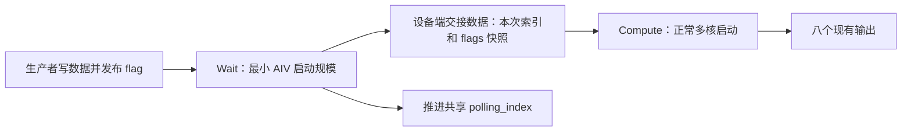

# FFN Worker Batching：单核轮询与多核计算拆分设计

## 1. 文档状态与结论

| 项目 | 内容 |
| --- | --- |
| 状态 | 设计提案，尚未实现拆分、编译或上板验证 |
| 分析基线 | 2026-09-21 当前工作区源码，包含已有未提交修改，不等同于某个已发布版本 |
| 主要范围 | `need_schedule=1`，arch35 同步/异步接收，以及非 arch35 同步接收 |
| 目标 | 等待数据时只运行一个轮询任务；就绪后启动多核完成 batching |
| 对外语义 | 保持现有输出、同步/异步选择规则和生产消费协议 |
| 非目标 | 本次不实现多消费者、不改变空数据时的阻塞语义、不新增非 arch35 异步接收 |

**推荐方案是拆成“少核 Wait kernel → 多核 Compute kernel”，等待阶段不启动计算核。**

不能仅在现有 kernel 中让非 0 核 `return`：后续屏障仍期待这些参与者，prepare/sort/gather 仍把工作分配给它们，且当前执行模型没有让已退出任务在函数中间重新加入的机制。删除屏障也不能补回缺失的工作和数据依赖。

“只有逻辑核 0 轮询”“只申请一个 AIV 的资源”“其他算子确实能同时使用其余核”是三个不同的验收目标。后两项与 kernel 类型、任务比例、运行时调度模式及平台并发能力有关，不能仅凭一个 `if (coreId != 0) return` 或 `SetBlockDim(1)` 宣称达成。

## 2. 当前实现与证据

以下链接指向当前源码；以函数名定位为准，源码后续修改可能改变行号。

### 2.1 arch35 的实际时序

涉及文件：

- [入口和阶段调度](../op_kernel/ffn_worker_batching_apt.cpp)：`FfnWorkerBatchingA5`、`RunPrepare`、`RunSortPipeline`。
- [轮询和 prepare](../op_kernel/arch35/ffn_wb_a5_prepare.h)：`FfnWbA5RecvWait::Process`、`LoadSelectedMicroBatch`、`FfnWbPrepareArch35`。
- [上下文解析与核编号](../op_kernel/arch35/ffn_wb_a5_context.h)：`ScheduleContextParse`、`GetFlatAivIdx`、`GetFlatAivNum`。

```text
所有参与的 AIV：ScheduleContextParse，读取自己的核私有 ctx
所有参与的 AIV：SyncAll #1，确认所有核已读取入口 polling_index
逻辑 AIV 0：轮询 flags → 确定本次选择 → 发布快照/推进 polling_index
其他 AIV：waiter.Process 返回 → pipe.Reset → 在 SyncAll #2 等待
所有参与的 AIV：通过 SyncAll #2
异步模式：每个核读取 selectedMb，更新自己的 ctx.curMicroBatchID
所有参与的 AIV：按行分工 prepare → SyncAll #3
所有参与的 AIV：段排序 → 同步 → 多轮归并及同步 → 拆包及同步 → 输出/gather
```

同步模式固定检查入口 micro batch，等 A 个 session 的 flag 全部就绪。异步模式扫描 micro batch，发现至少一个 session 就绪即结束扫描，保存该次 DMA 观察到的 flags，后续只消费这份集合。异步也会在完全无数据时持续等待。

`ctx.asyncRecv = isRecv && tilingData->syncFlag`：当前代码的 `syncFlag=true` 表示异步接收，不能按变量英文名称反推语义。

快照不是所有 flag 在同一物理时刻的原子读取；它是这次跨步 DMA 的观察结果。拆分必须保留这个定义。

### 2.2 非 arch35 的实际时序

涉及文件：

- [入口](../op_kernel/ffn_worker_batching.cpp)：`FfnWorkerBatchingRecvProcess` 和 `FfnWorkerBatchingRecvSpecProcess`。
- [扫描](../op_kernel/ffn_wb_scan_token_info.h)：`KernelScanTokenInfo::Init/Process`。
- [上下文解析](../op_kernel/ffn_wb_get_schedule_context.h)：`ScheduleContextInfoCompute<true>`。

两个接收入口都执行：

```cpp
scanTokenInfo.Init(...);
scanTokenInfo.Process();
SyncAll();
ffnPipe.Reset();
```

`Process()` 中非 0 核直接返回，核 0 在 `while (true)` 中等待 `readyNum == A`，然后推进游标。这里没有异步扫描和部分 session 快照消费分支。入口虽然包含 `RECV_GATHER` 分支，当前普通 host tiling 的 `need_schedule=1` 选择的是 `RECV`；修改时仍需覆盖已有特殊入口，不能将其误称为当前默认路径。

额外区别：`KernelScanTokenInfo::Init()` 还由核 0 清理排序计数、group-list 临时区，并执行相关 cache 操作。拆分时不能把它当成只有轮询功能的初始化函数。

### 2.3 当前启动边界

- [arch35 tiling](../op_host/ffn_worker_batching_tiling_arch35.cpp)：`PostTiling()` 为本次 kernel 设置一个 `blockDim`，并设置 schedule mode。
- [非 arch35 tiling](../op_host/ffn_worker_batching_tiling.cpp)：小规模接收已存在降低启动核数的逻辑，但整个 kernel 使用同一启动配置。
- [V1 ACLNN](../op_host/op_api/aclnn_ffn_worker_batching.cpp) 与 [V2 ACLNN](../op_host/op_api/aclnn_ffn_worker_batching_v2.cpp)：均转发到自动生成的 `aclnnInnerFfnWorkerBatching` 执行器，当前不是两阶段编排。
- [GE 转换](../torch_extension/graph_convert_ffn_worker_batching.py)：直接构造 `FfnWorkerBatching` 图节点，不经过 eager 的 V2 wrapper。

因此，增加两个 tiling key 并不会自动产生两次启动；必须同时增加真正的执行编排。

## 3. “释放其余核”的准确含义

| 做法 | 是否仍有参与任务等待 | 是否能恢复多核计算 | 判断 |
| --- | --- | --- | --- |
| 当前 `SyncAll()` | 有 | 可以，屏障放行后继续 | 保证依赖，不是主动归还核资源的接口 |
| 其他核改成轮询 GM 标志 | 有 | 可以 | 只是换了等待方式，还会增加访问流量 |
| `pipe.Reset()` | kernel 任务仍存在 | 可以 | 回收本核流水线缓冲，不等于释放调度资源 |
| 非 0 核退出整个 kernel | 非 0 任务结束 | 不能在本次调用中原地恢复 | 破坏现有屏障和工作划分 |
| 整个 kernel 从一开始只启动少核 | 等待占用少 | 后续也只有这些核 | 可作为单核串行方案，但必须适配整个计算路径 |
| 少核 Wait 结束后另启多核 Compute | Wait 阶段只存在少量任务 | 可以，由新 kernel 启动 | 推荐 |

这里“核 0”是本次 launch 的逻辑任务编号，不是要求固定绑定某个物理 AIV。Compute 的逻辑核 0 不必是 Wait 使用的同一物理核，二者只通过 GM 和执行依赖交接。

关于屏障底层是否忙等、功耗如何、某个产品是否支持特定抢占策略，当前源码不足以证明。可确认的是：代码没有显式的任务挂起/恢复和资源归还协议，不能把屏障当成可保证其他任务并发运行的手段。

## 4. 直接修改现有 kernel 会遇到的具体问题

### 4.1 屏障参与者消失

arch35 不仅在 Wait 后有屏障，ContextParse 后、prepare 后、段排序后、每轮归并后、拆包后也都有屏障。如果部分任务退出而剩余任务继续执行原来的全核屏障，会违反其参与要求，存在卡死风险，不能依赖未验证的“退出任务自动退出屏障集合”行为。

非 arch35 的排序和有效专家处理也有内部 `SyncAll()`。仅删除入口的一个屏障不能解决内部屏障问题。

### 4.2 删除屏障会读到未完成的数据

如果让其他核不等待、直接进入后续计算，会出现：

1. 在生产者发布 flag 前读取尚未就绪的 descriptor。
2. 异步读取旧的或只写了一部分的 `readyWs`。
3. 有些核消费迟到 session，有些核不消费，导致输出和清理集合不一致。
4. sort 读取未写完的 flatIds，或归并读取未完成的段计数和 proposal。

屏障代表真实的数据依赖，不是可随意去掉的性能负担。

### 4.3 核 0 不会自动接管其他核的工作

arch35 prepare 用实际 AIV 数计算每核 session 区间；段排序、归并、拆包按 `vecId/vecNum` 分配工作；gather 也依赖运行时核数。只保留核 0 时，代码仍可能按原启动规模计算分工，其他区间将无人处理。

非 arch35 同时使用 `contextInfo.coreNum`、排序 tiling 的 `needCoreNum/perCoreSessionNum` 和实际核编号。部分路径由最后一个核清 flag，group-list/gather 也有专门的核分组。即使核 0 算出部分结果，清理和输出仍可能缺失。

### 4.4 在同一个 kernel 中不能靠修改变量增加实际任务

把 `ctx.coreNum` 从 1 改为 N，只改变软件里的分工参数，不会创建 N 个新执行任务。反过来，保留 N 核 launch、只把 `ctx.coreNum` 改为 1，也不能保证屏障、硬件核编号和实际资源申请都变成单核。

当前工程没有供这一流程使用的设备端子 kernel 启动或挂起恢复机制。设计不得假设存在某个未确认的 `release_core()/wake_core()` 接口。

### 4.5 游标的含义会在拆分边界上改变

当前各核在轮询前保存入口 `polling_index`，核 0 成功后把共享游标推进。拆分后 Compute 才开始解析上下文，如果原样调用解析函数，就会把“下一次扫描起点”当成“本次消费索引”。

例如本次选中 2，Wait 写回 3，Compute 直接读取 3，就会读错 descriptor 和 token_data，输出错误的 micro_batch_ids。M=1 时这个问题被掩盖，必须测试 M>1 和回绕。

arch35 异步已有 selectedMb 头块，但同步路径没有保存它，也未为 `wsReady` 分配有效载荷。不能只把同步路径改成也读 `wsReady`，否则可能读取越界或旧 workspace 数据。

### 4.6 核私有上下文不会跨 kernel 自动传递

Wait 的栈对象、UB、TPipe、局部 selectedMb 都在其任务结束后失效。Compute 的每一个核都要显式恢复本次索引，不能只在 Compute 的核 0 上赋值。

A/M/BS/K/HS、二级缓冲地址等元数据若在两个 kernel 之间变化，也会导致选择规则与实际寻址不一致。必须定义这些字段的稳定窗口，或采用完整且有生命周期保证的上下文快照。

### 4.7 workspace 不是天然的跨算子通信对象

单次 kernel 的用户 workspace 与系统同步 workspace 有各自布局。把 Wait 写入它自己的临时 workspace，再让 Compute 读取另一个执行器的 workspace，并不构成交接。

若拆成两个注册算子，交接数据必须是显式中间 tensor，或者由组合执行器管理并保证两阶段使用同一地址的持久中间区。图内两个节点各自的隐式 workspace 不能当作共享 tensor 使用。

交接区不能与排序 ping-pong、计数区或系统同步空间重叠。必须在 Compute 完成前保持有效，不能在 Wait 返回后复用。

### 4.8 异步必须沿用同一次选择快照

Wait 选中的 session 集合必须保持不变，Compute 不得重新读取实时 flag 来决定集合。后到达的 flag 留给后续调用。

未选中行仍必须填 sentinel，保持原 session 下标和 gather 索引解码一致；不能仅跳过写入，让上一次 flatIds 残留参与排序。未选中 descriptor 的 ids、flag、layer_id 都不能被清除。

### 4.9 flag 清零与 token 数据生命周期

arch35 当前是在 prepare 复制 ids 后清理 descriptor，但 gather 还会读取原 token_data。代码明确依赖“生产者不会在本次消费窗口覆盖数据”的契约。

拆分后 Wait 只选择，不得提前清 flag 或 ids。若把清零移到 Wait，生产者可能更早复用槽位，Compute 尚未读入就被覆盖。

若真实生产协议是“flag=0 即可立即覆盖 token_data”，原来的 prepare 提前清 flag 也需要重新审查；这属于握手协议问题。必要时另行设计 gather 完成后的 ACK 阶段，并证明所有 token_data 读取完成后再允许复用，不能声称拆分天然解决覆盖问题。

### 4.10 非 arch35 初始化副作用容易遗漏

移除 `scanTokenInfo.Init()` 会连带移除 `rsvdCnt` 和 group-list 临时区清零。排序可能把旧计数当作初值，出现累加错误。原有 cache clean/invalidate 和完成依赖也不能随初始化一起丢失。

此外，非 arch35 当前入口未见与 arch35 相同的“解析完成后、推进游标前”显式跨核屏障。仅凭所查源码不能断言已发生错误，但也不能把“所有核必然先读完旧游标”视为已证明的保证。新的交接协议应消除这种时序依赖。

### 4.11 Host API 与图模式必须一起覆盖

当前 public API 只是一次内部执行器转发，不能在 GetWorkspaceSize 时等待设备 flag，也不能在执行阶段临时修改已封装 executor 的 blockDim 来替代两阶段启动。

只修改 ACLNN wrapper 会漏掉直接走 GE 节点的路径。图优化器还可能看不到通过二级指针发生的副作用，因此必须给 Wait→Compute 明确的数据依赖，并按照支持的图机制表达 schedule_context 的状态更新和同一上下文调用之间的顺序。

### 4.12 退出不等于一定提高并发

即使 Wait 只执行一个逻辑任务，运行时是否允许其他 kernel 同时驻留、是否有资源分区、schedule mode 是否限制并发、等待 stream 是否阻塞生产者，都需要实测。

如果生产者被排在同一 stream 的 Wait 后面，则 Wait 等生产者、生产者等 Wait 结束，必然形成执行依赖环。若生产者在其他 stream，但调度资源或策略使其无法执行，同样可能失去进展。拆分减少需求量，但不自动证明整个系统不存在依赖环。

## 5. 候选方案与选择

| 方案 | 等待占用 | 后续计算 | 改造范围 | 适用性 |
| --- | --- | --- | --- | --- |
| 保持现状 | 当前启动的参与任务 | 原多核路径 | 无 | 数据通常已就绪、启动开销敏感 |
| 整个算子单核 | 少核 | 串行，需要完整适配 | kernel/tiling | 小数据原型，可作为对照，不等于动态恢复多核 |
| Wait + Compute | 少核 | 原多核算法 | kernel、tiling、API、图 | 本文推荐 |
| 短轮询/一次探测 + 重试 | 单次占用更短 | 就绪后多核 | 新状态接口、调度循环 | 需要完全避免无限驻留时另行设计 |
| CPU/AICPU/通信调度侧通知后启动 Compute | 可不占 AIV 等待 | 多核 | 生产协议与调度系统 | 上游已有可靠通知能力时评估 |
| 保留 N 核并用其他等待指令 | 不能据此保证释放 | 原多核 | 硬件特定 | 没有经验证的让出能力前不作为资源释放方案 |

主方案不改变“无数据时持续等待”的接口语义，也不添加新的公开状态输出。轮询超时、取消和返回空结果均是独立的语义变更，不能静默引入。

## 6. 推荐架构



执行顺序：

```text
consumer stream：Wait_i → Compute_i → Wait_(i+1) → Compute_(i+1)
producer stream：按原协议独立产生数据，不能依赖其对应的 Wait 先结束
其他工作 stream：可运行无数据依赖的任务；实际并发收益由目标平台验证
```

同一 schedule_context 的消费者按上述顺序串行，首版不允许跨 stream 并发消费同一上下文，不允许 Wait_(i+1) 越过 Compute_i。不同上下文可并发，但各自拥有独立的交接区和计算 workspace。

### 6.1 Wait 的职责

1. 解析设备上下文及本次入口游标，检查必要的不变量。
2. 同步：等待当前 micro batch 的全部 A 个 flag。
3. 异步：按现有顺序扫描 M 个 micro batch，直到观察到至少一个就绪 session。
4. 异步复制用于判定成功的那份 flags，不重新采样。
5. 无论同步还是异步，都保存 selectedMb。
6. 完成交接数据写出，再按协议推进共享 polling_index，并等待这些写出完成后结束。
7. 不处理 flatIds、排序、gather，不清理 descriptor，不执行 Compute 的全核屏障。

### 6.2 Compute 的职责

1. 创建自己的 TPipe 和核私有上下文。
2. 解析稳定元数据；从交接区读取 selectedMb，覆盖当前调用索引。
3. 异步只消费 Wait 的 flags 快照；同步消费全部 A 行。
4. 按 Compute 的实际启动规模处理 prepare、sort、merge、extract、group-list、gather。
5. 保留这些计算阶段内部的数据依赖和全核屏障。
6. 只按原协议清理本次消费的 descriptor；不再次轮询，不再次推进游标。

## 7. 交接数据与所有权

### 7.1 首版最小布局

为尽量复用 arch35 的访问公式，采用与现有 readyWs 一致的基础布局：

| 偏移 | 大小 | 内容 | 使用场景 |
| --- | --- | --- | --- |
| 0 | 32 B | 前 8 B 为 `uint64_t selectedMb`，剩余保留 | 所有拆分 RECV |
| 32 + session × 32 | 每 session 32 B | 前 4 B 为 `int32_t selectedFlag`，剩余填充 | 仅异步 RECV |

同步交接载荷至少为 32 B；异步按静态容量 A_cap 分配 `(A_cap+1)*32 B`，实际只读写 A 个 session 槽，要求 `A<=A_cap`。真实 A 来自设备上下文，不能在 host 分配阶段等待或读回它。

NORM 不使用此交接数据。首版不增加无用途的状态机字段；如以后增加取消、重试或流水化，再引入有正式布局定义的 version/status/generation，不挤占现有字段或临时用裸偏移拼接。

若继续作为同一组合执行器的 workspace 子区，host 统一计算偏移，明确字节/word 单位并检查溢出；若作为两个内部算子的中间 tensor，建议用固定容量字节 tensor 表示，起点和长度满足搬运对齐要求。

### 7.2 元数据稳定契约

从 Wait 开始到对应 Compute 完成，A/M/BS/K/HS 及 tokenInfoBuf/tokenDataBuf 地址保持稳定，底层缓冲不得释放或重定位。flags 和各槽数据仍按生产消费协议变化。

若调用方无法提供此稳定性，则扩展交接区保存 Compute 所需元数据，所有核从快照恢复；但保存一个指针并不能延长所指缓冲生命周期，所有权仍须由调用方保证。不能只快照 selectedMb 就声称支持任意上下文并发修改。

### 7.3 发布顺序与可见性

Wait 内部完成 flags 和 selectedMb 的 GM 写入，并完成游标写回后，才结束任务。Compute 通过同一 stream 的执行顺序在 Wait 完成后运行。跨 stream 仅在存在运行时支持的显式完成依赖时允许。

同一 stream 的顺序解决“谁先执行”，还必须使用平台支持的搬运完成与 cache 一致性规则，使交接数据在 kernel 边界正确可见。尤其 arch35 构建含有 `-cce-aicore-dcci-before-kernel-end=false`，不能假设编译器会代为补齐所有跨 kernel 发布需求，也不能无依据地给每个 DMA 都添加 DCCI。实现时需按实际使用的 GM 访问路径核实要求，并做重复运行测试。

逻辑上发布完交接再推进游标，不代表两者构成原子事务。首版靠“单消费者 + 严格顺序 + 无自动重试”保证使用边界。

### 7.4 生命周期与错误处理

- 交接区在 Wait 启动前分配，Compute 完成前不得重用或释放。
- 每次 Wait 成功都完整覆盖本次会使用的头块和 flags，不依赖上次 workspace 内容。
- Wait 故障时不能让 Compute 正常读取旧快照；依赖运行时错误传播和编排的失败处理。
- Wait 已推进游标、Compute 失败时，不能直接重跑完整 Wait→Compute 并声称等价重试；Compute 可能已部分清理描述符。
- 失败后需终止该消费链并由调用方恢复上下文/槽位，或另行设计可证明的恢复协议。返回空输出掩盖故障不属于此方案。

## 8. arch35 逐项修改设计

### 8.1 拆分上下文解析与选择恢复

将“解析稳定元数据”和“读取入口游标”明确区分。Wait 使用入口游标；Compute 使用交接 selectedMb。可复用解析公共部分，但 Compute 不得把共享 polling_index 用于本次数据地址计算。

把 `LoadSelectedMicroBatch` 从“仅异步可调用”推广为“所有拆分 RECV 可调用”。它仍需由每个 Compute 核执行，并保留搬入完成后才读取标量的依赖。

### 8.2 提取 Wait 入口

复用 `FfnWbA5RecvWait` 的扫描与 ReduceSum 判定，修改为同步、异步均写 selectedMb。保留异步 flags 快照的原始 DMA 结果，不用 ReduceSum 的工作缓冲替代 flags。

Wait 单独配置最小可用启动规模。优先使用目标工具链支持的纯 AIV kernel 形式，核实 blockDim、task ratio、实际 AIV 数的关系。当前 `GetFlatAivNum()` 使用 `GetBlockNum()*GetTaskRation()`，因此 `blockDim=1` 未必严格等于一个 AIV 任务。

若受框架约束只能获得最小任务组，则只让逻辑 AIV 0 轮询，其余任务立即退出，Wait 内不使用需要它们参与的屏障；此时只能承诺“最小任务组”，实际资源占用必须测量，不能写成已实现物理单核。

### 8.3 提取 Compute 入口

将 `RunPrepare` 分成接收选择阶段与 `PrepareFromSelection`：

- 拆分模式下去掉 Compute 中的 waiter 调用。
- 去掉原先用于“所有核读旧游标后再推进”的前置屏障；Compute 不再推进游标。
- 去掉原先等待 waiter 发布的屏障，由 Wait→Compute kernel 依赖承担。
- 在每个核读取 selectedMb 后执行 `prep.ProcessRecv`。
- 保留 prepare 后的 `SyncAll` 及所有排序/归并阶段屏障。
- 后续 `RunSortPipeline`、`RunEmitAndGather` 继续复用，不能因为 Wait 单核而改变其计算分工。

概念伪代码如下，其中函数名表示待实现职责，不是现有可直接调用的 runtime API：

```cpp
WaitKernel(context, selection, waitTiling) {
    if (!IsPollingTask()) return;
    auto ctx = ParseContextForWait(context, waitTiling);
    auto chosen = WaitAndSelect(ctx);       // 异步 flags 保留在受控缓冲中
    PublishSelection(selection, chosen);   // 同步也发布 selectedMb
    AdvancePollingIndex(context, chosen);
    CompleteAllRequiredWrites();
}

ComputeKernel(context, selection, outputs, workspace, computeTiling) {
    auto ctx = ParseStableContext(context, computeTiling);
    ctx.curMicroBatchID = LoadSelectionIndex(selection); // 每个核都执行
    PrepareFromSelection(ctx, selection, workspace);
    SyncAll();
    auto total = RunSortPipeline(...);      // 保留内部屏障
    RunEmitAndGather(..., total);
}
```

### 8.4 独立 tiling 与 workspace

Wait/Compute 必须有独立启动参数，不能复用同一个 blockDim 字段作为两个阶段的实际启动配置。

- Wait tiling：扫描相关容量、模式、交接容量、所需 UB；当前 flags+work+poll 的 UB 需求约为 `2*A_cap*32+32` 字节，仍需按实际生命周期核实上下文缓冲是否复用。
- Compute tiling：保留原 prepare/sort/merge/gather 的参数和实际计算核数。
- 同步拆分也分配 32 B 交接头块；异步保留 flags 区。
- host/kernel 使用配套结构定义、对齐和 `sizeof`，不得手工猜测 bool 后 padding。
- 计算 workspace 和每次 kernel 所需的系统 workspace 由支持的执行器规则管理；不得把一个 `sysWorkspaceSize` 随意解释为两个独立任务都可共用的地址。

首版保留现有整体计算核数策略。根据异步实际就绪数动态决定 Compute 启动规模需要额外设备端调度或 host 读回，不属于本方案。

## 9. 非 arch35 适配设计

非 arch35 只迁移其已有“等待全部 session”语义。

1. 从 `KernelScanTokenInfo::Init` 提取独立的计算 workspace 初始化函数。
2. Wait 只绑定轮询所需数据、等待 A 个 flag，并新增 selectedMb 交接头块写出，再推进游标。
3. Compute 各核解析上下文后统一从交接头块恢复索引。
4. Compute 核 0 初始化 `rsvdCnt`、group-list 临时区，保留原 cache/完成操作；随后所有 Compute 核 `SyncAll` 再进入排序。
5. `FfnWorkerBatchingRecvProcess` 和 `FfnWorkerBatchingRecvSpecProcess` 均绕过原轮询，复用上述初始化和选择恢复。
6. 保留 `TilingScanSort`、单核/多核/BsK 特殊排序分支、最后核清 flag、group-list 核分组及 gather 分工。
7. 所有 `coreNum` 等于 Compute 的有效配置，不能从 Wait 的 1 核配置继承。
8. 不直接套用 arch35 的核编号/task ratio 规则；分别按目标架构、kernel 类型验证。

尤其不能只把原 `scanTokenInfo.Process()` 删掉并顺手删除 `Init()`，否则既失去正确索引，又失去排序临时状态初始化。

## 10. Host、ACLNN、GE 的落地路径

### 10.1 原型阶段：显式两次启动

先用独立示例或测试入口显式调用 Wait 与 Compute，验证交接、正确性和资源收益。两次提交使用同一 consumer stream，中间不进行 host stream synchronize 或 D2H ready 轮询。

该原型用于验证设计，不代表现有公开 ACLNN/GE 已支持拆分。

### 10.2 产品化：两个内部算子与组合执行

建议内部拆分为 `FfnWorkerBatchingWait` 和 `FfnWorkerBatchingCompute`（暂定名）：

| 内部阶段 | 输入 | 输出/副作用 | 启动规模 |
| --- | --- | --- | --- |
| Wait | schedule_context、选择模式和静态容量属性 | selection 中间 tensor；推进 context 游标 | 最小 AIV 规模 |
| Compute | schedule_context、selection、原计算属性 | 原八个输出；清理选中 descriptor | 原多核策略 |

公开 V1/V2 的签名、输出顺序保持兼容。GetWorkspaceSize 构建包含两个内部任务的组合执行计划，执行阶段只提交该计划。中间 selection 的分配、释放及依赖归执行器管理。

当前文件尚无这种组合实现；必须根据项目实际提供的 L0/L2 执行器构建能力实现，不能手工拼接 opaque `aclOpExecutor`。若当前自动生成链路不支持直接组合，采用手写的规范组合算子层或明确的内部两个调用接口，完成与框架集成后再替换现有路径。

构建还需注册两阶段算子、shape/type 推导、tiling、kernel 产物和平台配置。仅增加 `.h` 和分支不足以让运行时识别新入口。

### 10.3 GE / TorchAir

GE 必须通过受支持的图展开或算子分解机制，将逻辑算子展开为 Wait→Compute，或由其内部实现正式支持多任务执行。可在自有转换器中先支持两个内部节点，通用 GE 直调路径仍需对应的分解支持。

selection 作为显式数据边连接两个节点，防止计算被提前执行。对 schedule_context 的原地状态更新和连续调用顺序，还需使用框架支持的副作用/引用语义或控制依赖，避免图优化错误消除、重排或并行化 Wait。

图捕获/重放时，每次执行都重新在设备上轮询并写 selection，不能把捕获时的 selectedMb 固化为常量。中间区生命周期和地址稳定性必须满足相应图执行器要求。

### 10.4 首版启用策略

原型通过后先为 arch35 接收路径增加内部可控的拆分选择，保留原融合实现作为回退和性能对照。再接入非 arch35 与图模式。不能在只完成 eager 原型时宣称所有调用方式都完成资源释放。

NORM 继续使用现有直接计算路径。是否默认启用拆分，应由等待时长和系统吞吐测试决定，不在 GetWorkspaceSize 阶段通过读取设备 ready 状态猜测。

## 11. 性能模型与调度验证

设实际等待时间为 W，原参与 AIV 任务数为 N，Wait 实际占用任务数为 n，原计算时间为 C，新增启动/交接成本为 L，计算阶段额外装载成本为 D。

粗略估计：

```text
原延迟 ≈ W + C
拆分延迟 ≈ W + C + L + D
等待阶段减少的任务驻留量 ≈ (N - n) × W
```

这里是任务驻留量模型，不是硬件利用率或其他算子吞吐保证。若 W≈0，拆分往往增加本算子延迟；若 W 很长且其他任务能够并发使用空余资源，系统吞吐可能明显改善。

推荐测量：

- 本算子端到端 p50/p95/p99，Wait 时长、Compute 时长和阶段间隔。
- 实际启动任务数、AIV 活动轨迹，以及无关工作能否在 Wait 尚未结束时完成。
- 并行 AIV 算子吞吐；仅用 AIC/Cube 工作重叠不足以证明 AIV 资源得到释放。
- 完全无数据、短等待、长等待、数据预先就绪四种状态。
- 不同 schedule mode/资源配置下的行为，以受支持配置为准。
- 同一上下文串行、不同上下文并行两种部署。

长期无数据测试需预设由独立且可运行的生产者在有界时间内释放等待，或使用平台支持的测试中止方式，避免测试永远挂起。不能让释放 flag 的工作排在被测 Wait 后面的同一 stream。

## 12. 正确性与资源验收矩阵

| 类别 | 用例 | 必须证明的结果 |
| --- | --- | --- |
| 同步 | A 个 session 分批就绪 | 最后一个就绪前不进入 Compute |
| 同步索引 | M>1、非零入口索引、M-1 回绕 | 读本次 selectedMb，游标只推进一次 |
| 异步扫描 | 当前项为空、后续项就绪 | 跳过空项，所有输出索引对应选中项 |
| 异步集合 | session 0/3/7 就绪，中间 session 未就绪 | 只消费选中集合，不清未选中描述符 |
| 异步迟到 | Wait 选择之后再发布另一个 session | 本轮不追加，后续调用可消费 |
| 无数据 | 暂时所有 flag=0 | Wait 持续等待，Compute 尚未执行 |
| 全 mask | descriptor 就绪但所有 ids 无效 | 消费握手，actual_token_num=0，空输出计数正确 |
| 分工边界 | A 小于/大于核数、BS*K 非对齐、大行分块、多段多轮归并 | 无缺行、重复、旧 workspace 数据 |
| 多层 | 异步不同 layer 同号 expert | 保持 arch35 当前层编码和输出分组语义 |
| 数据类型 | 各平台已支持的 token 类型及 scale | 与当前正确实现逐项一致，平台不支持的类型不强行新增 |
| 重复运行 | workspace 预填脏数据，多次复用，交替选中集合 | 每次交接完整，计数和 flag 无残留 |
| 非 arch35 | 单核排序、多核排序、特殊 BsK、已有特殊入口 | 初始化、最后核清理、group-list/gather 全部正确 |
| 元数据 | 实际 A 不超过静态容量，二级地址生命周期 | 明确校验和稳定契约，非法输入不导致越界 |
| 并发 | 不同 context、独立 workspace 的两个消费链 | 无交接区相互覆盖 |
| 图模式 | 捕获后多次重放，生产数据每次变化 | 每次重新选择，不复用旧 selectedMb |
| 故障 | Wait 失败、Compute 部分失败 | 不静默消费旧快照，不擅自重复推进游标 |
| 资源 | 延长 Wait，同时执行无关 AIV 工作 | 无关工作在 Wait 结束前可取得进展，并记录实际启动规模 |
| 对照 | 同一平台、输入及生产节奏比较融合/拆分 | 同时报告本算子延迟和系统吞吐，不仅报告轮询核数 |

异步的并发到达用例不能简单要求两个顺序运行的实现选择到完全相同集合，因为它们采样时刻不同。使用受控发布时序、记录选择结果，验证输出与各自快照一致；确定性输入才适合逐元素对照。

需要重点加入 M>1 的测试，避免 M=1 掩盖游标交接错误；需要重复 workspace 测试，避免全零新内存掩盖初始化遗漏。

## 13. 文件级修改清单

| 文件/模块 | 计划改动 |
| --- | --- |
| `op_kernel/arch35/ffn_wb_a5_prepare.h` | waiter 同步也发布索引；提取 prepare-from-selection；选择恢复支持所有拆分 RECV |
| `op_kernel/arch35/ffn_wb_a5_context.h` | 区分入口游标解析与消费索引恢复，保持每核上下文一致 |
| `op_kernel/ffn_worker_batching_apt.cpp` | 提取 Wait/Compute 入口或可复用函数；按阶段保留正确屏障 |
| `op_kernel/arch35/ffn_worker_batching_arch35_tiling_def.h` | 定义两阶段配置及交接布局，配套更新 host |
| `op_host/ffn_worker_batching_tiling_arch35.cpp` | 独立 Wait/Compute 启动规模、同步交接头块容量、独立 UB 校验 |
| `op_kernel/ffn_wb_scan_token_info.h` | 非 arch35 扫描与 workspace 初始化解耦，新增选中索引发布 |
| `op_kernel/ffn_wb_get_schedule_context.h` | Compute 从交接恢复索引 |
| `op_kernel/ffn_worker_batching.cpp` | 两条接收入口适配 Compute；保留排序及清理分工 |
| `op_host/ffn_worker_batching_tiling.cpp` 和 tiling 定义 | 非 arch35 两阶段配置，保留小规模计算核数策略 |
| `op_host/op_api/*` | 从单算子转发扩展到受支持的组合执行，不改公开 V1/V2 ABI |
| 新内部算子的 OpDef、推导、注册和构建配置 | 注册独立任务及 selection 数据依赖 |
| `op_graph/*`、`torch_extension/graph_convert_ffn_worker_batching.py` | GE 展开/分解、状态副作用与重放支持 |
| `examples/`、`tests/ut/`、`tests/st/` | 原型、tiling/布局验证、正确性、并发与性能验收 |

此表是职责映射，不要求把两个注册算子的所有新文件强行放进原算子目录；实际目录按仓库构建约定组织。

## 14. 实施顺序与决策门槛

1. **验证启动与并发能力。** 最小 Wait 原型验证实际任务数、task ratio、纯 AIV 支持、跨 kernel GM 可见性和无关 AIV 工作进展。若资源仍被整体串行化，先解决调度配置或评估通知式方案，不继续宣称拆分能释放资源。
2. **实现 arch35 同步拆分。** 先解决 selectedMb 交接、双启动和计算参数独立，使用 M>1 和回绕用例验收。
3. **迁移 arch35 异步。** 复用快照语义，验证迟到 session、多层、全 mask 和 workspace 重用。
4. **适配非 arch35。** 分离初始化副作用，覆盖各排序/清理分支。
5. **接入组合 ACLNN 与 GE。** 保持 ABI，验证 capture/replay 和上下文副作用顺序。
6. **测量并选择默认策略。** 以实际吞吐收益和延迟代价决定哪些平台/场景启用，保留可回退实现。

每一步的结果都应区分“代码逻辑验证通过”“目标平台实测通过”和“框架集成完成”。当前本文只完成源码分析和设计，尚无资源释放比例或性能收益的实测结论。

## 15. 修订记录

| 日期 | 作者 | 版本 | 内容 |
| --- | --- | --- | --- |
| 2026-09-21 | Codex | 0.1 | 基于当前工作区分析核退出、屏障、工作分配、游标快照及调度约束；提出 Wait/Compute 拆分与验证方案 |
