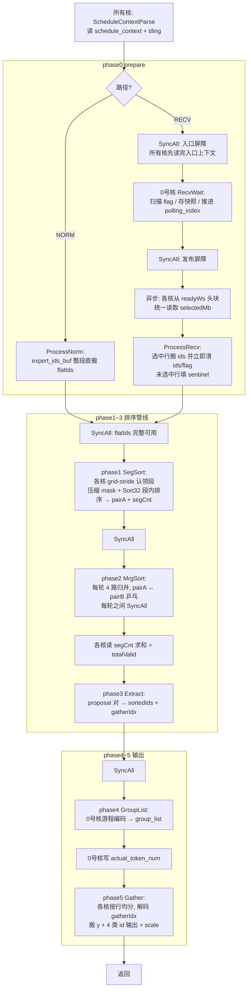

# FfnWorkerBatching arch35（Ascend950 / DAV_3510）架构与实现详解

> 本文是 arch35（A5）分支的实现总览：整体流水线、每个 kernel 模板的职责与逐段注解、host tiling 的全部切分公式与 workspace 布局。
> 接口参数与约束见 [README](../README.md)；异步接收（sync_flag）协议细节见 [sync_flag 设计](arch35_sync_flag_design.md)；低精度类型（token_dtype=3/4/5）见 [低精度设计](arch35_low_precision_design.md)。
> 源码引用以"文件 + 函数名"为定位点，避免行号随注释更新失效。

---

## 目录

1. [算子定位](#1-算子定位)
2. [执行路径：NORM / RECV / sync_flag](#2-执行路径norm--recv--sync_flag)
3. [外部契约：schedule_context 与数据布局](#3-外部契约schedule_context-与数据布局)
4. [整体流水线](#4-整体流水线)
5. [workspace 布局](#5-workspace-布局)
6. [kernel 模板逐个详解](#6-kernel-模板逐个详解)
7. [tiling 详解](#7-tiling-详解)
8. [关键设计决策 FAQ](#8-关键设计决策-faq)
9. [与 A2 实现的对照](#9-与-a2-实现的对照)
10. [测试与文档索引](#10-测试与文档索引)

---

## 1. 算子定位

`FfnWorkerBatching` 用于 Attention 与 FFN 分离部署（PD 分离 / worker 化）场景：Attention 侧把 token 按专家路由写入 FFN worker 的预分配数据区（`token_info_buf` 描述符 + `token_data_buf` 数据），本算子在 FFN worker 上完成**token 按专家重排**：

1. 对本次接收范围内的 expert_id 排序，剔除 mask 大值；URMA 增量写场景中，未发送位置保留初始化或上次消费清理留下的 sentinel；
2. 按排序结果生成 gather 索引，从 `token_data` 中抽取每个 token 的 hidden states（及 scale），同时产出 `session_id` / `micro_batch_id` / `token_id` / `expert_offset` 四类索引输出；
3. 从有序 expert_id 序列统计每个专家的 token 数，产出 `group_list`（每行 `[expert_id, tokenNum]`）。

本算子是**非计算类**算子：整数索引排序 + 原样字节搬运，精度口径为二进制一致。

### 符号表（全文通用）

| 符号 | 含义 | 来源 / 上界 |
| --- | --- | --- |
| A | attention session 数 | `common.session_num`，≤ 1024 |
| M | micro batch 槽数 | `common.micro_batch_num`，≤ 64 |
| BS | micro batch size | `common.micro_batch_size` |
| K | 每个 token 的专家槽数（topK+1，含共享专家） | `common.selected_expert_num`，≤ 64 |
| H | 逻辑 hidden size | 属性 `max_out_shape[3]` |
| HS | 源 token 行字节步长（含 scale 与行尾 padding） | `common.attn_to_ffn_token_size` |
| Y | 输出 token 容量 = A×BS×K | 属性推导 |
| F | 一个描述符的 int32 word 数 = 2 + BS×K | 契约结构 |
| bskAlign | BS×K 按 32B 对齐后的 int32 个数 | tiling 推导 |
| flatElements | 扁平 expert_id 序列长度 | RECV: A×bskAlign；NORM: Y |
| expertStart | 1000000，expert_id ≥ 此值视为被 mask | tiling 常量 |
| MASK_SENTINEL | 2147483647（INT32_MAX），补位/未选中行的填充值 | kernel 常量 |
| totalValid | 排序剔除 mask 后的有效 token 数（= actual_token_num） | kernel 运行时得出 |

### 涉及文件

| 文件 | 角色 |
| --- | --- |
| `op_kernel/ffn_worker_batching_apt.cpp` | arch35 kernel 入口与相位编排（纯 A5 实现，不复用 A2 头） |
| `op_kernel/arch35/ffn_wb_a5_context.h` | schedule_context 契约解析 + 公共工具 |
| `op_kernel/arch35/ffn_wb_a5_prepare.h` | phase0：RECV 等待/快照 + expert_id 归一到扁平缓冲 |
| `op_kernel/arch35/ffn_wb_a5_sort.h` | phase1~3：段内排序、段间归并、拆包 |
| `op_kernel/arch35/ffn_wb_a5_group_list.h` | phase4：游程编码生成 group_list |
| `op_kernel/arch35/ffn_wb_a5_gather.h` | phase5：按 gather_idx 取行搬运 |
| `op_kernel/arch35/ffn_worker_batching_arch35_tiling_def.h` | host/kernel 共用 TilingData ABI |
| `op_host/ffn_worker_batching_tiling_arch35.cpp` | arch35 host tiling（注册优先级 1000，`IsRegbaseSocVersion` 守卫） |

构建侧由 `--soc=ascend950` 选择 `ffn_worker_batching_apt.cpp` 作为 kernel 入口编译（A2/A3 走 `ffn_worker_batching.cpp`，两份入口符号名相同、按 SoC 互斥编译）。tiling 侧同理：arch35 模板以 1000 优先级注册，仅 RegBase（Ascend950/DAV_3510）SoC 命中。

---

## 2. 执行路径：NORM / RECV / sync_flag

TilingKey 只有两个，由属性 `need_schedule` 决定；`token_dtype` 与 `sync_flag` 都是"正交"参数，不增加 key 组合：

| need_schedule | sync_flag | TilingKey | 行为 |
| --- | --- | --- | --- |
| 0 | 0/1（忽略） | 100（NORM） | 不读 flag、不推进 polling_index。expert_id 取自 FfnArea 输出区的 `expert_ids_buf`（上游调度算子已整理好扁平布局）。session/micro_batch id 查表 `session_ids_buf` / `micro_batch_ids_buf` |
| 1 | 0（默认） | 101（RECV） | 同步接收：只轮询入口 `polling_index` 指向的一个 micro batch，等 A 个 session 的 flag **全部**为 1 才开始。expert_id 藏在 `token_info_buf` 的 `FfnDataDesc` 里 |
| 1 | 1 | 101（RECV） | 异步接收：循环扫描 micro batch，**首次发现至少一个 ready session** 即处理该轮 DMA 观察到的集合（快照），不为其它 session 等待。选中描述符在读入后立即清理（与同步一致；生产者已确认不会用新数据覆盖本次正在消费的数据） |

`ctx.asyncRecv = isRecv && (tilingData->syncFlag == 1)` 在 kernel 侧派生（`ffn_wb_a5_context.h` 的 `ScheduleContextParse`），保证 NORM 即使误传 sync_flag=1 也不进入轮询逻辑。

异步模式的动机：上游 `attention_to_ffn_v2` 在异步分支会跳过没有给它发 token 的 FFN，因此"等 A 个 flag 全 ready"可能永远等不齐。详见 [sync_flag 设计 §1](arch35_sync_flag_design.md)。

---

## 3. 外部契约：schedule_context 与数据布局

`schedule_context` 是唯一输入张量（INT8 一维，1024 字节），权威定义在 `common/include/op_kernel/attention_ffn_schedule.h`（`aicpu::ScheduleContext`，带 `static_assert(sizeof==1024)`）。其中存放的是**设备地址（二级指针）**，kernel 需二次解引用。测试模式下（偏移 640 处的 magic == 0x54455354），各 buffer 字段存的是相对 schedule_context 起始的偏移量，用 `scBase + offset` 还原真实地址（见 `ffn_wb_a5_context.h` 的 `TEST_MAGIC` 处理）。

arch35 的原则：**所有字段偏移用 `__builtin_offsetof(aicpu::ScheduleContext, field)` 从权威结构体推出，不手写魔法数**（A2 侧 `valLocal[528]` 式手写偏移是待淘汰写法）。

### 3.1 FfnArea 输入区（RECV 消费）

```text
token_info_buf: [A, M, F] 个 int32，每个 (a, m) 位置是一个 FfnDataDesc：

FfnDataDesc(session=a, micro_batch=m):
    int32 flag            // 0=未发布 1=已发布（只承诺"描述符可读"，不承诺有有效 token）
    int32 layer_id        // 本算子不改写
    int32 expert_ids[BS*K]

即 descOffset(a,m) = a*M*F + m*F（int32 word），ids 再 +2。

token_data_buf: [A, M, BS, K, HS] 字节，token(a,m,bs,k) 起点偏移
    = a*(M*BS*K*HS) + m*(BS*K*HS) + bs*(K*HS) + k*HS
polling_index: 下一次扫描的 micro batch 起点（本次调用结束时会推进到选中项的下一项）
```

### 3.2 FfnArea 输出区（NORM 消费）

`session_ids_buf[A]` / `micro_batch_ids_buf[A]` / `expert_ids_buf[A,BS,K]` / `out_num`——由上游调度算子整理好的"扁平"布局。

### 3.3 输出张量

| 输出 | shape | 说明 |
| --- | --- | --- |
| y | [Y, H] | 重排后 token 行，按 expert_id 升序连续存放；dtype 由 token_dtype 决定（0/1/2/3/4/5） |
| group_list | [expert_num, 2] | 每行 `[expert_id, tokenNum]`（int64），未使用专家填 `[0,0]` |
| session_ids | [Y] | 每 token 的 attention session id |
| micro_batch_ids | [Y] | 每 token 的 micro batch id |
| token_ids | [Y] | 每 token 在 micro batch 内的位置（bsIdx） |
| expert_offsets | [Y] | 每 token 在 topK 选择中的槽位（kIdx） |
| dynamic_scale | [Y] 或 [Y, ceil(H/32)] | dtype=2 为 FP32 每行一个；dtype=3/4/5 为 E8M0 每 32 元素一个 |
| actual_token_num | [1] | 有效 token 总数（= totalValid）；其后输出不保证有效 |

---

## 4. 整体流水线



### 4.1 同步屏障一览

| 屏障 | 建立的依赖 | 缺失时的后果 |
| --- | --- | --- |
| Waiter 前 SyncAll（RECV） | 所有核读完入口上下文 → 0 号核才推进共享 polling_index | 起步晚的核读到已加一的游标，micro_batch 取错（实测 A=512/M=4 复现过） |
| Waiter 后 SyncAll（RECV） | 0 号核发布快照/selectedMb → 各核读取 | 部分核读到未发布的快照 |
| prepare 后 SyncAll | 各核写完 flatIds → 排序 | 排序看到未写完的行 |
| phase1 后 SyncAll | 各段排序结果 + segCnt 落盘 → 归并 | 归并读到不完整的段 |
| 每轮归并间 SyncAll | 本轮输出（另一块 ws）可读 → 下一轮 | 归并读到未完成的组 |
| phase3 后 SyncAll | sortedIds/gatherIdx 完整 → group_list/gather | 输出缺行 |

注意 `TPipe::Reset()` 只回收**本核** UB 资源，不能替代跨核 `SyncAll()`；各条 `SetWaitFlag<HardEvent::X_Y>` 建立的是**核内跨流水线**（MTE2/MTE3/Vector/Scalar）的数据依赖。

> 释放时序说明：描述符清理（选中行 ids 失效 + flag 清零）随 phase0 的读入一并完成，与同步路径同构。前提是已确认的生产者契约——异步生产者也不会用新数据覆盖本次正在消费的数据（槽位复用与本次处理窗口不重叠），因此无需 gather 后的跨核同步与延迟释放相位。

### 4.2 各相位的并行策略

| 相位 | 并行主体 | 切分方式 |
| --- | --- | --- |
| RecvWait | 仅 0 号向量核 | 其余核在发布屏障等待 |
| prepare（读入 + 清理） | 按 block（`GetBlockIdx`） | session 行均分 `perCore = ceil(A/coreNum)`，各区互不重叠，无需核间同步 |
| SegSort / MrgSort / Extract | 按**向量核编号** `vecId = blockIdx*subNum + subBlockIdx` | grid-stride 认领段/组/块 |
| GroupList | 仅 0 号向量核 | 游程编码是串行语义（相邻比较跨块），单核流式 |
| actual_token_num | 仅 0 号向量核 | — |
| Gather | 按 block | 有效行均分 `perCoreRows = ceil(totalValid/coreNum)`，超出 `needCoreNum` 的核直接返回 |

**为什么用 vecId 而不是 GetBlockIdx**：A5 上一个 block 可挂多个 AIV 子核（`GetTaskRation()`），同 block 的子核 `GetBlockIdx()` 相同。只用 blockIdx 认领会同一段算两遍、另一段没人算（`ffn_wb_a5_sort.h` 各类的 `Init` 均按 `blockIdx*subNum + subBlockIdx` 编号）。

---

## 5. workspace 布局

host tiling 的 `LayoutWorkspace` 与 `GetWorkspaceSize` 出自**同一次累加**（同一组成员变量），保证偏移与总量永不错位。偏移单位一律为 int32 word，kernel 侧 `userWS + wsXxx * sizeof(int32_t)` 换算成字节地址：

```text
userWS (int32 word 偏移):
[0        .. 128)            MAX_RESERVE_WK_NUM=128 预留头（沿用仓库惯例）
wsFlatIds : flatElements     归一后的扁平 expert_id
wsPairA   : segNum*sortLenPerSeg (float)   段内排序结果 / 归并乒乓区 A
wsPairB   : segNum*sortLenPerSeg (float)   归并乒乓区 B
wsSegCnt  : segNum*8         每段有效元素数（每段独占一个 32B 槽）
wsSortedIds : Y              有序 expert_id（phase3 输出）
wsGatherIdx : Y              gather 索引 = 扁平序列原始下标（phase3 输出）
── 按 8 word（32B）对齐 ──
wsReady   : (A+1)*8          仅异步 RECV 分配：readyWs 快照
                              [0]     32B 头块，低 8B = uint64 selectedMb
                              [1..A]  每块 32B，低 4B = 该 session 的 int32 flag
```

proposal 对（pair）是排序中间表示：`[fp32 key, uint32 idx]` 交错排列，每元素 8B（`SORT_PAIR_BYTES`）。key 是**取负后的 expert_id**，idx 是扁平序列原始下标（归并结束后即 gather_idx）。

---

## 6. kernel 模板逐个详解

### 6.1 ffn_wb_a5_context.h —— 契约解析与公共工具

**职责**：A5 自有基础层，不桥接 A2 头。提供常量推导原则、工具函数、`ScheduleContextInfo` 结构、`ScheduleContextParse<isRecv>` 解析入口。

**关键常量**（全部"不写裸常量"，可推导的都推导）：

| 常量 | 值 | 推导来源 |
| --- | --- | --- |
| `FFN_WB_CTX_OFFSET(field)` | offsetof | 权威结构体 `aicpu::ScheduleContext` |
| `SCHEDULE_CONTEXT_BYTES` | 1024 | `sizeof(aicpu::ScheduleContext)`（结构体自带 static_assert） |
| `SORT_PAIR_BYTES` | 8 | `sizeof(float) + sizeof(uint32_t)` |
| `SORT_FILL_VALUE` | -FLT_MAX | `__FLT_MAX__` 取反；降序补尾的最小填充 |
| `ONE_REPEAT_SORT_NUM` | 32 | A5 Sort32 指令单次排序元素数（SDK `singleSortElementCountArch3510`，内部实现头不能直接 include，按同值定义） |
| `MRG_LIST_NUM` | 4 | MrgSortSrcList 4 入参 + validBit 4 有效位 |
| `TEST_MAGIC` / `TEST_MAGIC_OFFSET` | 0x54455354 / 640 | 640 = ffn 区末尾（128×3 + 256），落在 reserve6 内 |
| `BLOCK_BYTES` | 32 | `AscendC::ONE_BLK_SIZE` 别名 |

**工具函数**：

- `SetWaitFlag<HardEvent::X_Y>(evt)`：`SetFlag` + `WaitFlag` 一步到位，建立"Y 流水线等 X 流水线完成"的核内依赖。全文同步点统一走它，语义一目了然，例如 `SetWaitFlag<HardEvent::MTE2_V>` = "向量指令前等 MTE2 搬入完成"。
- `Ceil/CeilDiv/Align/Min/Max`：自解释。`Align(n, bytes)` 返回按 32B 对齐后的**元素个数**。
- `GetSortLen<T>(count)`：count 个 proposal 对折算成 T 类型元素个数（float 时 = count*2）。

**`ScheduleContextParse<isRecv>`** 流程：

1. 整段 1024B `DataCopy` 进 UB，`MTE2_S` 等待后标量读取；
2. 从 common 区取 A/M/BS/K/HS；从 tiling 取 H/Y/tokenDtype/expertNum/coreNum/ubSize；
3. 派生 `ctx.asyncRecv = isRecv && syncFlag==1`（属性值与路径共同决定，NORM 不进轮询）；
4. 判定 TEST_MAGIC：是则 buffer 字段按"相对偏移"加 scBase 还原（测试协议），否则为绝对设备地址；
5. `isRecv=true`：取 `tokenInfoBuf`、`polling_index`（断言 < M），并算 `BsKPaddingCount = align32(BS*K) - BS*K`；`isRecv=false`：取 `sessionIdsBuf/microBatchIdsBuf/expertIdsBuf/outNum`。

产出的 `ScheduleContextInfo` 是后续所有相位共享的运行时上下文（含 `validGatherIdxLength`，由 phase2 末尾回填）。

### 6.2 ffn_wb_a5_prepare.h —— phase0：等待与 expert_id 归一

**职责**：把两条路径形态各异的 expert_id **归一到同一个扁平缓冲 flatIds**；RECV 路径另含 flag 轮询、快照发布与槽位清理（读入后立即执行，同步/异步同构）。两个类：`FfnWbA5RecvWait`（等待/选批）与 `FfnWbPrepareArch35`（归一/清理），以及辅助函数 `LoadSelectedMicroBatch`（各核读取已发布索引）。

#### 6.2.1 FfnWbA5RecvWait：选择本次消费的 micro batch

只有 0 号向量核执行，其余核在调用方的发布 `SyncAll` 处等待。

**Init**：算出 `descWords_ = sizeof(FfnDataDesc)/4 + BS*K = F`；`tokenInfoGm_` 长度 `A*M*F`；`readyGm_` 指向 readyWs；开三个 UB 缓冲——flag 队列（A 个 32B 块）、float 工作 区（ReduceSum 用）、polling 回写块。

**Process 逐步注解**：

```text
selectedMb = ctx.curMicroBatchID            // 局部游标，来自入口 polling_index
loop:
  ① 跨步 DMA 读 A 个 flag:
       DataCopyPad, blockCount=A, blockLen=4B,
       srcStride=(M*F-1)*4B                  // stride 不含本次已复制的 1 个 int32
       每块 pad 成 32B（补零）               // flag(a,m) 位于 a*M*F + m*F
  ② Cast int32→float 到 work 区, ReduceSum   // 与待发布的 flags 分开, 不自我覆盖
  ③ readyNum = work.GetValue(0)              // 协议 flag 只取 0/1, 补零不干扰求和
  ④ ready = async ? readyNum > 0 : readyNum >= A
  ⑤ 若 ready && async:
       把 padded flags 整段 DataCopyPad 到 readyWs[(1)..(A)] 块   // 快照
       // 关键: 不重新读 token_info 的实时 flag。判定后到达的 session
       // 必须留给下次调用, 否则不同核会纳入不同集合
  ⑥ 若 ready: break
  ⑦ 若 async: selectedMb = (selectedMb+1) % M
       // 必须跳过空项: 异步上游不保证每个 micro batch 都被置位,
       // 在空项上死等会饿死已有数据的项; 扫满一圈会绕回, 迟到数据下次可见
发布:
  ⑧ [仅 async] selectedMb 写 readyWs 头块低 8B     // "本次消费哪一项"
  ⑨ (selectedMb+1)%M 写 schedule_context.polling_index // "下次从哪项开始"
```

两个索引的含义严格区分：**头块 selectedMb 是本次消费项**（各核必须读它，不能回读已推进的 polling_index）；**polling_index 是下次扫描起点**。

同步模式不写头块（不需要快照）、不跳项（一直查入口项）、`ready` 判据是 `>= A`。

**LoadSelectedMicroBatch(readyWs, ctx, pipe)**：位于同一个 prepare 头文件中，由 `RunPrepare` 在发布 `SyncAll()` 之后、仅异步 RECV 分支内调用。各核申请一个 32B UB 块，从 readyWs 头部搬入 8B selectedMb，等待 `MTE2_S` 后赋给本核 `ctx.curMicroBatchID`，再执行 `pipe.Reset()`。ctx 是核私有对象，因此每个参与核都必须调用；此函数不负责跨核发布，也不删除或释放 GM 中仍供 `IsSelected` 使用的 ready 快照。

#### 6.2.2 FfnWbPrepareArch35：归一 / 即时清理

**Init 关键推导**：

- `rowSpan_ = totalLen / A`：每个 session 行在 flatIds 中的跨度。RECV 的 totalLen = A×bskAlign，故 rowSpan = bskAlign（**含补位**）；NORM 的 totalLen = Y，故 rowSpan = BS×K（无补位）。
- `rowsPerLoop_`：异步固定 1（就绪行可以不连续，1 是**选择粒度**，不是核数/容量）；同步/NORM 用 host 下发的 `preparePerLoopRows`（UB 反推）。
- 核间切分按 `GetBlockIdx()`：`perCore = ceil(A/coreNum)`，各核写互不重叠的 flatIds 区间、握手的行也按行分离，**无需跨核同步**。
- UB：`que_`（一轮 `rowsPerLoop*rowSpan` 个 int32）+ `clrBuf_`（每行一个 32B 块的 flag 清零区）；异步额外分配一个 32B `readyBuf_`，用于逐行读取快照 flag。

**ProcessNorm(expertIdsBuf)**（NORM）：`expert_ids_buf` 本就扁平，整段 `GM→UB→GM` 直搬（循环 `rowsPerLoop_*rowSpan` 一轮）。数据量 Y 个 int32，各核分段搬。

**ProcessRecv(tokenInfoBuf)**，两种有效组合：

| 组合 | 读原始 ids | 写 flatIds | 清原始 ids/flag |
| --- | --- | --- | --- |
| 同步 | 全部行 | 全部行 | 全部行（读入后就地清） |
| 异步 | 仅选中行 | 选中行写 ids；未选中行整行填 MASK_SENTINEL | 仅选中行（读入后就地清，与同步同构） |

选中判定 `IsSelected(row)`：从 **readyWs 快照**（不是实时 flag）读 `(row+1)*32B` 块低 4B 是否为 1；`MTE2_S` 确保 DMA 完成后标量才能分支。读入与清理在同一次遍历中完成，天然作用于同一集合。

选中行的读入 DMA（同步/异步共用）：

```text
inParams: blockCount=rows, blockLen=BS*K*4B, srcStride=(M*F-BS*K)*4B
          // 每块跳过 flag/layer_id 两个 word 与其余 M-1 个 micro batch
inPad:    右侧补 BsKPaddingCount 个 MASK_SENTINEL
          // 使每行在 UB 中占满 rowSpan_ 个 int32（32B 对齐）,
          // 补位值 >= expertStart, 排序阶段自然被剔除
写出:     flatIds[r0*rowSpan .. ] 连续整段                  // 行与行在 flatIds 中连续
```

读入完成后**立即就地清原描述符**（握手回写，同步/异步同构）：`buf` 覆写 MASK_SENTINEL 后按 `clrIds`（同 inParams 形态）写回 ids 区；`clr`（全 0）按 `clrFlag`（blockLen=4B, srcStride=0, dstStride=(M*F-1)*4B）写回各 flag。回写值处处相同，故按连续块读出即可。两次回写共用 MTE3，按先 ids 后 flag 的顺序发射，沿用同步路径；在已确认的不覆盖契约下，无需在两次回写之间增加异步专用等待。末尾的 MTE3_MTE2 保留，用于确保搬出完成后再复用 UB。

清理时序的依据：**已确认异步生产者也不会用新数据覆盖本次正在消费的数据**（槽位复用与本次处理窗口不重叠），因此清理无需延迟到 gather 之后。若该契约不成立（生产者仅以 flag=0 作为复用门槛），则必须保持"gather 全核完成 → 清 ids → 等回写 → 清 flag"的延迟释放时序。未选中行不属于本次消费，ids/flag/layer_id 一概不动；`layer_id` 与 `token_data` 任何路径都不清理。

#### 6.2.3 专题：为什么要把 expert_id 搬到 flat（flatIds）

这是 phase0 存在的意义，四层原因：

**① 布局归一——下游只想面对一种布局。**
两条路径的 expert_id 源布局完全不同：

| | 源 | 形态 |
| --- | --- | --- |
| RECV | `token_info_buf` 内的 FfnDataDesc | 每 BS×K 个 id 前面挡着 flag+layer_id 两个 word（`+NUM_TWO` 偏移）；session 之间跨度 `M*F`；还有 `curMicroBatchID` 批偏移。**只有选中批的数据可读** |
| NORM | `expert_ids_buf` | 天然扁平连续，长度 Y |

若不归一，排序阶段就要为两种 stride、两种头部偏移、两种"有效行集合"各写一套寻址。归一到 flatIds 后，phase1 的 `SortOneSegBody` 只做一件事：`DataCopyPad(inLocal, flatIdsGm_[begin], {len 个连续 int32})`——连续、无头部、无批概念。

**② 补位统一行跨度（32B 对齐 + sentinel 剔除）。**
RECV 每行 BS×K 个 int32 未必是 32B 的整数倍，直接散搬无法满足 DMA/向量指令对齐。`DataCopyPad` 把每行右侧补到 `rowSpan_`，**补位值 = MASK_SENTINEL（INT32_MAX）≥ expertStart(1000000)**，排序的压缩判据 `key > -expertStart` 会把它们连同被 mask 的 token 一起剔到序列末尾之外。异步未选中行整行填 sentinel 但**保持原 session 行下标不变**——这样 gather 解码 `(a, bs, k)` 时无需一张"压缩 session 映射表"。

**③ 解耦消费与槽位释放——消费者持有私有副本。**
ids 一旦复制进 flatIds（workspace），消费者就拥有了本次调用的私有 ids 数据（token_data 仍由 gather 从原 GM 读取）；随后即可对原描述符槽位执行清理（ids 失效 + flag 清零）完成归还——同步与异步路径在读入后立即执行，时序同构（异步的依据见 6.2.2 的契约说明）。这层复制只解除后续排序对原 ids 的依赖；它不会复制 token_data，也不表示生产者可以在 gather 完成前覆盖 token 槽。槽位复用仍遵循上述已确认的处理窗口约定。

**④ 多核无锁分段。**
各核按 session 行分段写 flatIds 的互不重叠区间，握手回写也按行分离——phase0 全程不需要任何核间同步（屏障只存在于 phase 边界）。

### 6.3 ffn_wb_a5_sort.h —— phase1~3：排序管线

三个类：`FfnWbA5SegSort`（段内排序）→ `FfnWbA5MrgSort`（段间归并）→ `FfnWbA5Extract`（拆包）。全部使用 A5 的 proposal 排序指令族：**Sort32**（单次排 32 对）、**MrgSort**（4 路归并）、**Extract**（拆对）。

#### 6.3.1 FfnWbA5SegSort：段内排序

**切分参数**（`A5SortSegParam`，全部 host 下发）：`segNum / perSegElements / totalElements / expertStart / sortLenPerSeg`。

**Init**：
- `vecId_ = blockIdx*subNum + subBlockIdx`（真实向量核编号），grid-stride 认领段；
- UB 四块：`inQue_`（输入段：`alignSeg*2` 个 int32，前半放 id、后半放下标，按 `ONE_REPEAT_COMPARE_NUM=64` 粒度对齐——CompareScalar 按该粒度处理，多出的部分可能被读写，缓冲必须留足）、`concatBuf_/tmpBuf_/sortedBuf_`（Concat/Sort 要求三块互不重叠）、`maskBuf_`（比较掩码）。

**`SortOneSegBody(inLocal, seg, begin, len)` 逐步注解**：

```text
① DataCopyPad 读入本段 len 个 id（连续, 得益于 flatIds）
② ArithProgression 生成原下标: idx[i] = begin+i     // 排序 payload, 段内全局编号,
                                                   // 归并后即是 gather_idx
③ Cast id→fp32 (就地, keys 视图)
④ PrepareKeys:
     Reg 级循环: keys *= -1                          // 取负!
     CompareScalar(mask, keys, -expertStart, GT)     // 有效 = key > -expertStart
                                                    //   即 原 id < expertStart
⑤ GatherMask 压缩: keys/idx 用同一 mask 压到各自前部   // 返回值 rsvd = validCnt
⑥ 尾部补齐到 Sort32 粒度:
     tailNum = validCnt % 32
     从【对齐起点】validCnt-tailNum 发起带 64 位掩码的 Duplicate 填 SORT_FILL_VALUE
     // 陷阱: 直接从 keys[validCnt] 开始会触发 "VEC access UB not aligned"
     // 硬件异常——向量指令要求 32B 对齐起点, 故退到本 repeat 开头用位掩码只写尾部
⑦ Concat(keys, idx → concatLocal)                    // 交织成 proposal 对
   Sort<float,true>(sortedLocal, concatLocal, idxU32, tmpLocal, alignCnt/32)
     // true = 降序。key 已取负, 降序 == expert_id 升序
⑧ DataCopyPad 落盘 pairGm_[seg*sortLenPerSeg]        // 本段排序结果
```

**为什么取负**：Sort/MrgSort 指令按 key 降序排，而业务要 expert_id 升序；取负后两者等价。副产物：mask 判据也统一成"key > -expertStart"一次比较，不需要第二套掩码。

**为什么 fp32 key**：比较指令只吃浮点；expert_id < 2^24，fp32 精确表示，无舍入。

`ProcessOneSeg` 收尾把 `validCnt` 写入 `cntGm_` 的本段 32B 槽（跨核可见的交换一律走 UB + DataCopyPad，**不做 GM 标量写**），并等 `MTE3_MTE2/MTE3_V` 后才 FreeTensor——下一段要用 MTE2 重新载入、向量指令重写同一批缓冲。

#### 6.3.2 FfnWbA5MrgSort：段间归并

**切分参数**（`A5MergeParam`）：`segNum / sortLenPerSeg / oneLoopMaxElements / rounds`（= ceil(log4(segNum))）。

**结构**：两块等大工作区 `wsGm_[0]=pairA`、`wsGm_[1]=pairB` 乒乓；每轮 4 路合一：

```text
第 r 轮: 一组覆盖 groupStride = 4^(r+1) 个段, 组内相邻路间隔 listStride = 4^r
组 g 的第 i 路 = 以段 baseSeg+i*listStride 为首、跨度 listStride 的连续段序列
每轮结束 srcIdx 翻转 (读写异区), 轮间由调用方 SyncAll
```

各核 grid-stride 认领组。`TotalValid()` = 各段有效数之和（从 cntGm_ 整段读回 UB 后标量累加）——**归并不改变元素个数，只改变顺序**，所以 totalValid 由 segCnt 直接求和得出。

**`MergeStream` 流式归并主循环**（一组之内）：

```text
while (还有剩余元素):
  FillLists: 从每条活路各取 min(oneLoopMax, remain) 个对进 UB 输入区
             (耗尽的路跳过, 记 liveMap 把"活路序号"映射回"原路号")
  仅剩一路 → 直接 DataCopy, 不必归并
  否则 MrgSort(out, srcList[4], counts, sortedNums, validBit=(1<<liveNum)-1, 1)
      // sortedNums[j] = 本轮从第 j 路实际消耗的元素数
  按 sortedNums 推进各路 offset/remain, produced += Σ consumed
  DataCopyPad 把 produced 个对写入【另一块】工作区, outOffset 前进
```

**UB 预算陷阱**（host 侧对应处理）：输入 4 路 + 输出同宽，若不先扣掉同 TPipe 上其它缓冲（segCnt 读回区 + 各缓冲对齐余量），两块相加恰好等于可用 UB，分配越界后输出压到输入上——表现为归并结果头部被覆盖。host 的 `mergeOther = segNum*32 + 6*32` 就是为这个扣的。

#### 6.3.3 FfnWbA5Extract：拆包收尾

**输入**：最终一路 proposal 对（`finalWs==0 ? pairA : pairB`）；**输出**：`sortedIds`（有序 expert_id, int32）与 `gatherIdx`（原始扁平下标, int32）。

**`ProcessOneChunk`**：

```text
① 读入 len 个对
② Extract(keys, idxU32, pairLocal, alignLen/32)   // 拆对
③ Muls(keys, -1) 还原取负, Cast → int32           // 恢复成正的 expert_id
④ DataCopyPad 写 sortedIds[begin] 与 gatherIdx[begin]   // 只写有效 len 个
```

**缓冲按对齐长度分配的陷阱**：Extract 按 Sort32 粒度**成批**工作，落盘量是对齐后的 `alignLen`；若三块 UB 按有效长度分配，会溢出到相邻缓冲（实测曾把索引缓冲开头冲成 0）。故 `Init` 一律 `Ceil(perLoop, 32)*32` 分配，GM 写出仍按有效 len。

### 6.4 ffn_wb_a5_group_list.h —— phase4：游程编码

**职责**：从**有序** expert_id 序列直接压出 `[expert_id, tokenNum]` 稠密行，输出 `group_list[expertNum, 2]`（int64）。**仅 0 号向量核**执行（游程是串行语义——相邻比较跨越分块边界）；其余核不占 UB 直接进入下一相位。

**核心思想**：序列已按 expert_id 升序，于是：

- "与前一个不同" ⇒ 某专家游程的**首元素**（maskS）
- "与后一个不同" ⇒ 其**末元素**（maskE）

两张掩码各做一次 `GatherMask` 压缩，得到**等长**的首下标列（outStart）与末下标列（outEnd），逐元素 `cnt = end - start + 1`；outId 列同时压出游程的 expert_id。**全程向量**：不按 expert_id 散射写、不做 GM 直方图、不需要跨核原子累加。

**为什么不用 SIMT 散射计数**（文件头注释记录的实测教训）：SIMT 访问 `__local_mem__` 被限制在 UB 低 8KB（与线程数无关），按 expert_id 写 `slot[cur]` 在专家数超 2048 时越界；越界写**静默生效**，踩坏同 UB 其它数据（曾表现为编译器溢出到栈上的 totalValid 被清零，gather 整段被跳过而硬件无异常）。

**为什么不做 GM 标量写**（另一条实测教训）：历史缺陷正是"逐行 SetValue + 末尾一次 SINGLE_CACHE_LINE 刷回"，结果只有首条 cache line（4 行）落盘。现在行在 UB 拼好后按块 `DataCopyPad` 整段搬出。

**分块与跨界**：
- `chunkElements_` 由运行时 UB 反推：`(ub - 行拼装区 - 13 块对齐余量) / 42B每元素 / 64 * 64`（42 = 10 道 int32 + 2 个掩码 bit），再按实际长度收窄（保持 64 粒度）；
- 十条分道：cur/prev/next/idx/diff/diffF/outStart/outEnd/outId/cnt + maskS/maskE，见 `A5RunLanes`；
- 块边界哨兵：块首 `prev[0] = SENTINEL_ID(-1)`（**块首一律记为游程起点**，跨块的前半段由 `pendingCnt` 承接）；全局末元素 `next[len-1] = SENTINEL_ID`（必是终点）；
- 首元素单独起头（`pendingId/pendingCnt`），此后每块 prev 可整块从 `ids[begin-1]` 读入，**免去 4 字节偏移的非对齐视图**；
- 块内若 `startNum > runs`（块尾停在游程中间），残长转下一块的 pending。

**行拼装与落盘**：`AppendRow` 把 `[expertId, tokenNum]` 标量写进 rowBuf，攒满 `glRowsPerLoop` 行（或收尾）时 `FlushRows` 整段 `DataCopyPad` 到 `groupListGm_`；**每次搬出后 `ClearRows` 复位**（否则下一块未填满的行会带出上一块残留）；末尾未用专家整块补 `[0,0]` 到 expertNum 行。`AppendRow` 越界（游程数 > expertNum）按异常输入直接丢弃，不再写。

**已知微妙点**：块内比较用 `Sub + Cast + CompareScalar(NE 0)`——比较指令只吃浮点，差值幅度 ≤ 专家数上界，转换精确。

### 6.5 ffn_wb_a5_gather.h —— phase5：按索引取行

**职责**：按 `gatherIdx`（有序、有效）从 token_data 取每个 token 的 H 字节行 + scale，并填四类 id 输出。模板参数 `isScanFlag` 实际含义是 isRecv（NORM 查表、RECV 用 aIdx/curMicroBatchID）。

**形态**（同仓 moe_v3_gather_out.h 的 arch35 同构惯用法）：**行数据是大块搬运，交给 MTE；源地址由数据决定，索引必须落到标量才能喂给搬运指令**。于是采用"整块向量化算下标 + 逐 token 标量发搬运"的两级结构。

**常量**：`PER_LOOP_ROWS=128`（每轮处理的有效 token 行数）、`BUFFER_NUM=2`（双缓冲）、`VAR_NUM=5`（四类 id + int8 动态 scale 暂存）、`BLOCK_SIZE=32`。

**Init 关键推导**：

- `tokenRowBytes_`：dtype 0/1 → `H*2`；dtype 5（FP4）→ `H/2`（两元素一字节）；其余（2/3/4）→ `H`。
- `scaleRowBytes_`：dtype ≥ 3 → `ceil(H/32)`（E8M0，每 32 逻辑元素一个）；否则 0（dtype=2 的 FP32 scale 走专用路径）。
- **UB 逐项扣除**（文件内 ⚠️ 注释）：`ubAvailable = ubSize - (2*128*4*5 [outQueALL 四道+暂存] + 2*128*4 [expertIdxQue] + align(A,8)*4*2 [session 表] + 128*32*2 [token 队列按 32B/行] + 128*(4*7+4*3) [索引换算分道])`，固定开销合计 `19456 + 8*align(A,8)` 字节。**少扣一项 → maxBlockSize_ 偏大 → inQueueX_ 越界 → 分配失败 → 输出垃圾**；新增缓冲必须同步加进该式。
- `maxBlockSize_ = (ubAvailable/2 [双缓冲] - [int8 另需 32B scale])` 再向下取整到 32B —— 单次搬运的 token 行分块上限；
- `hBlocks_ = ceil(tokenRowBytes/maxBlockSize)`，`lastHBlockSize_` 为末块；超长 H 行自动分块。
- 行均分：`perCoreRows = ceil(validGatherIdxLength/coreNum)`（arch35 入口传 `usedCoreNum=0`，即全部核参与）；`needCoreNum = ceil(valid/perCoreRows)`；超出核直接 return；末轮 `lastLoopRows_` 收尾。

**`DecomposeIndices`：下标换算整块向量化。**
把逐 token 的两次整数除法 `a=idx/bsk`, `bs=rem/K`, `k=rem%K` 整块算完（7 条 fp32 分道 + 3 条 int32 结果道）。硬件无整数向量除法，除法用倒数乘法，但 `1/n` 与乘积各一次舍入使**恰好整除处 floor 掉一档**（实测 BS*K=189 时 a 偏 -1、bs 偏 +BS、k 因两处偏移抵消不变）。修正纯算术、不用比较掩码：

```text
hi = clamp(rem - n + 1, 0, 1)   // rem >= n 时为 1
lo = clamp(-rem, 0, 1)          // rem <  0  时为 1
corr = hi - lo                  // ∈ {-1, 0, 1}
quot += corr; rem -= corr*n;    // 商与余数一起拉回正确值
```

gatherIdx < Y ≤ 2^22，fp32 精确表示 2^24 内整数，全程无精度损失。RECV 的 `bskProduct = BS*K + BsKPaddingCount`（**含补位**），与 flatIds 行跨度一致，保证解码出的 (a, bs, k) 与扁平下标一一对应；补位元素已被排序剔除，不会出现在 gatherIdx 里。

**`EmitTokens`：逐 token 发射。**

```text
for token in 本轮 128 行:
    a, bs, k = 从三路 int32 分道 GetValue     // 向量化结果的标量消费
    session/microbatch:
        NORM: 查表 sessionIdsLocal_[a] / microBatchIdsLocal_[a]   // CopyInIds 预取的 A 长表
        RECV: session = a; microbatch = curMicroBatchID           // 快照选中的批
    填 outAllLocal 四道: session_ids / micro_batch_ids / token_ids(=bs) / expert_offsets(=k)
    rowOffset = session*(M*BS*K*HS) + microbatch*(BS*K*HS) + bs*(K*HS) + k*HS
    for hBlock in 0..hBlocks_:
        GM→UB→GM 搬 maxBlockSize(或末块) 字节 → y[(全局行)*tokenRowBytes + hStart]
        // dtype=2: 末块额外搬行尾 4B FP32 scale, 暂存到 32B 间隔的暂存道
    CopyMxScale: dtype≥3 时把 ceil(H/32) 字节 E8M0 scale 从行尾搬到输出行
```

**`CopyAllLocalOut`**：本轮四道 id 整段写出；dtype=2 时用 `ArithProgression(0, 32B)` + `Gather` 把 32B 间隔暂存的 scale **密集化**后写出为 FP32 `dynamic_scale`。

**队列纪律**：`inQueueX_` 是 `TQueBind<VECIN,VECOUT,2>`，Alloc→DataCopyPad→EnQue / DeQue→DataCopyPad→FreeTensor 形成 MTE2→MTE3 依赖，天然双缓冲；`CopyMxScale` 复用同一 token 队列，超 UB 的 scale 行同样按 maxBlockSize 分块。

### 6.6 ffn_worker_batching_apt.cpp —— 入口编排

**入口** `ffn_worker_batching`（`__global__`）：AIC 核直接返回（纯 AIV 算子）；`REGISTER_TILING_DEFAULT` + `GET_TILING_DATA_WITH_STRUCT` 读取平铺 TilingData；按 TilingKey 100/101 分派 `FfnWorkerBatchingA5<isRecv>`。

**`FfnWorkerBatchingA5<isRecv>`** 主体：

```text
ScheduleContextParse<isRecv>              // 各核独立解析
workspace 六段 + readyWs 换算成字节地址    // host 下发 word 偏移 × 4
RunPrepare<isRecv>                        // phase0（含 RECV 的三重屏障/快照/统一 selectedMb;
                                          //      选中描述符随读入即时清理）
RunSortPipeline                           // phase1~3, 返回 totalValid
RunEmitAndGather<isRecv>                  // phase4 group_list → actual_token_num → phase5 gather
```

**RunPrepare 的屏障纪律**（顺序不可换；第 1～4 步仅 RECV 执行，NORM 直接执行第 5 步的 `ProcessNorm`，随后进入第 6 步）：

1. `SyncAll()`（入口屏障）：所有核先读完入口上下文，0 号核才允许推进共享 polling_index——否则起步晚的核读到加一后的值，micro_batch 取错；
2. `FfnWbA5RecvWait::Process`：扫描 + 快照 + 推进；
3. `SyncAll()`（发布屏障）：`pipe.Reset()` 只回收本核 UB，**不能**替代它；
4. 异步：各核调用 `LoadSelectedMicroBatch(readyWs, ctx, pipe)`，从 readyWs 头块读 selectedMb 覆盖 `ctx.curMicroBatchID`（后续描述符寻址、gather 的 micro_batch_ids 输出全用它，**不**回读已指向下一项的 polling_index）；
5. `FfnWbPrepareArch35::ProcessRecv`（读入 + 即时清理）或 `ProcessNorm`；
6. `SyncAll()`：flatIds 完整可用。

**WriteActualTokenNum**：0 号核把 totalValid 经 UB 整段 `DataCopyPad` 写出（同样不做 GM 标量写）。

**RunEmitAndGather 顺序**：group_list → actual_token_num → gather（totalValid=0 时跳过 gather；group_list 仍要补满 `[0,0]` 行，actual_token_num 写 0——全 mask 描述符的消费与清理已在 phase0 完成）。

**为什么清理不必拖到 gather 之后**：描述符清理（ids 失效 + flag 清零）在 phase0 随读入执行，即时完成。其前提是已确认的生产者契约——异步生产者也不会用新数据覆盖本次正在消费的数据，槽位复用与本次处理窗口不重叠；即便生产者观察到 flag=0，也不会在本次调用结束前写入新一代数据。因此不存在"清理后 token_data 仍被读取却被覆盖"的窗口，也就无需 gather 后的跨核同步。

---

## 7. tiling 详解

### 7.1 FfnWorkerBatchingArch35TilingData 逐字段注解

host 经 `context_->GetTilingData<FfnWorkerBatchingArch35TilingData>()` 直写，kernel 经 `GET_TILING_DATA_WITH_STRUCT` 读取。**原则：kernel 不自算任何切分与地址**。

```cpp
struct FfnWorkerBatchingArch35TilingData {
    // ---- 形状与平台 ----
    int64_t Y;            // A*BS*K。sortedIds/gatherIdx 两段的长度; gather 行均分的总量
    int64_t H;            // hidden size (max_out_shape[3])。gather 换算 tokenRowBytes
    int64_t tokenDtype;   // 0:FP16 1:BF16 2:int8动态量化 3:E5M2 4:E4M3 5:E2M1(FP4)
    int64_t expertNum;    // group_list 行数; glRowsPerLoop 的封顶
    int64_t coreNum;      // = BlockDim。kernel 各相位的核间切分基准
    int64_t ubSize;       // GetCoreMemSize(UB), 已扣 32K 系统预留。kernel 侧 UB 反推的输入

    // ---- phase0 (prepare) ----
    int64_t flatElements;       // 扁平序列长度: RECV=A*align32(BS*K)int32, NORM=Y
                                // RECV 补位与 gather 解码的 bskProduct 口径一致
    int64_t preparePerLoopRows; // 单轮驻留 UB 的 session 行数(UB 反推, 不设固定上限)
    int64_t expertStart;        // 1000000; >= 此值的 expert_id 视为被 mask(上游置大值)

    // ---- phase1 段内排序 ----
    int64_t sortSegNum;         // 段数(可 > 核数, grid-stride 认领)
    int64_t sortPerSegElements; // 每段元素数(末段可不足)
    int64_t sortLenPerSeg;      // 每段 proposal 对区 float 数 = align32(perSeg)*2

    // ---- phase2 段间归并 ----
    int64_t mergeRounds;          // = ceil(log4(sortSegNum)), 每轮 4 路合一
    int64_t mergeOneLoopElements; // 单路单次载入 UB 的最大元素数

    // ---- phase3 拆包 ----
    int64_t extractPerLoopElements; // 单次拆包元素数(Sort32 粒度整数倍)

    // ---- phase4 group_list ----
    int64_t glRowsPerLoop;       // 写出时每块拼多少行(每行 16B)

    // ---- workspace 段偏移(int32 word, 相对 userWorkspace) ----
    int64_t wsFlatIds;    // flatElements 个 int32
    int64_t wsPairA;      // segNum*sortLenPerSeg 个 float
    int64_t wsPairB;      // 同上(乒乓)
    int64_t wsSegCnt;     // segNum 个 32B 槽(每段一个 int32)
    int64_t wsSortedIds;  // Y 个 int32
    int64_t wsGatherIdx;  // Y 个 int32
    int64_t syncFlag;     // 0: wait all; 1: consume ready(仅 RECV 解释; 不增加 tiling key)
    int64_t wsReady;      // (A+1)*8 word 快照段, 仅异步分配; 头块 selectedMb + A 个 flag 块
};
```

### 7.2 host tiling 流程（ffn_worker_batching_tiling_arch35.cpp）

继承 `TilingBaseClass`，模板注册 `REGISTER_OPS_TILING_TEMPLATE(FfnWorkerBatching, …, 1000)`，`IsCapable() = IsRegbaseSocVersion`（仅 Ascend950/DAV_3510 命中）。

执行序：`GetPlatformInfo → GetShapeAttrsInfo → DoOpTiling → DoLibApiTiling → GetWorkspaceSize → PostTiling`。

**GetPlatformInfo**：
- `aivNum = GetCoreNumAiv()`；
- **先 `ReserveLocalMemory(RESERVED_SIZE_32K)` 再 `GetCoreMemSize(UB)`**——本算子用到 SIMT（asc_vf_call）与 VF 计算，需声明系统预留；声明后返回的 ubSize 即真实可用值，后续所有预算直接用它、**勿重复扣减**；
- `sysWorkspaceSize = GetLibApiWorkSpaceSize()`。

**GetShapeAttrsInfo / 属性校验**：
- 输入必须是 1 维 INT8；
- `expert_num ∈ (0, 8192]`；
- `max_out_shape=[A,BS,K,H]` 四元组：`A ≤ 1024`、`K ≤ 64`、`BS/H > 0`；`Y = A*BS*K`；
- `token_dtype ∈ [0,5]`，dtype=5 要求 H 为偶数（FP4 每字节两元素，保证行与多核输出起点字节对齐）；
- `need_schedule ∈ [0,1]`；`sync_flag ∈ [0,1]`（缺省 0，兼容旧图同步语义；need_schedule=0 也校验域，拒绝非法值被静默接受）；`layer_num ∈ [0, expert_num]`。

**DoOpTiling 核数选择**：

```text
coreByWork = ceil(Y / 32)          // 排序按 Sort32 粒度推进, 一核至少分到一个完整粒度
coreNum = max(1, min(aivNum, coreByWork))
```

不设固定核数阈值——"工作量能否喂饱一个核"决定用核数，否则多出的核只在 SyncAll 上空耗。

**GetTilingKey**：`need_schedule==0 ? 100 : 101`（token_dtype / syncFlag 正交，不组合 key）。

**PostTiling**：`SetBlockDim(coreNum)`；`SetScheduleMode(BATCH_MODE=1)`；workspace 总量 = `userWorkspaceWords*4 + sysWorkspaceSize`。

### 7.3 各切分公式推导

#### SplitPrepare（phase0）

RECV 每轮 `rows` 个 session 行在 UB 同时驻留：本轮 id 区 `rows*bskAlign*4B` + 握手清零区 `rows*32B`（每行一个 32B 块写 flag）。异步另需一个 32B 块读快照单行 flag（只为异步扣除，保持同步/NORM 的批量预算）：

```text
prepBytesPerRow = bskAlign*4 + 32
prepRows = (ub - [async ? 32 : 0]) / prepBytesPerRow   // 再 clamp 到 [1, A]
```

#### SplitSortAndMerge（phase1~3，共用同一份 UB 预算）

**段内排序**——每元素 UB 驻留字节：

```text
SORT_UB_BYTES_PER_ELEM = id(4) + 原下标(4)                    // 输入区
                       + proposal 对 8B × 3 块                // concat 结果/临时/排序结果,
                                                               // 三块互不重叠是 Concat/Sort 的硬要求
                       + 比较掩码(4)
                       = 36 B/元素
segCap = max(32, ub / 36 / 32 * 32)      // 向下取整到 Sort32 粒度
sortSegNum 先取 coreNum 均分; 单段超 segCap 时改为 segCap 定段、
             sortSegNum = ceil(flatElements / segCap)   // 段数可多于核数
sortLenPerSeg = align32(perSeg) * 2                  // 每段对区 float 数
```

**段间归并**——单次驻留 4 路输入 + 同宽输出（每元素 8B）：

```text
mergeOther = segNum*32 + 6*32          // segCnt 读回区 + 各缓冲块对齐余量
                                          // 不扣这项: 输入+输出恰好占满 UB, 分配越界后
                                          // 输出压到输入上(归并结果头部被覆盖, 实测)
mergeOneLoop = max(32, (ub - mergeOther) / 64 / 32 * 32)   // 64 = 4 路×2 区×8B
```

**拆包**——每元素 16B（对 8B + id/idx 各 4B）：

```text
extractLoop = ub / 16 / 32 * 32,  封顶 Y,  下限 32
```

#### SplitGroupList（phase4）

```text
行拼装区取 UB 的 1/16, 每行 16B([expert_id,tokenNum] 两 int64),
按 2 行对齐(块起点落 32B 边界), 封顶 expertNum:
glRowsPerLoop = clamp(ub / 16 / 16 / 2 * 2, 2, expertNum)
```

kernel 侧再按"十道 int32 + 2 bit 掩码 = 42B/元素"反推游程分块（见 6.4），两处独立、互不假设。

### 7.4 workspace 布局推导（LayoutWorkspace）

见 [§5](#5-workspace-布局)。要点：

- 起点固定留 `MAX_RESERVE_WK_NUM=128` word 头；
- 段顺序：flatIds → pairA → pairB → segCnt → sortedIds → gatherIdx →（对齐 8 word）→ ready；
- `wsReady` 只在 `need_schedule==1 && sync_flag==1` 时计入总量 `(A+1)*32B`；默认路径只记录段起点，其 kernel 不访问该段；
- **偏移与总量出自同一次累加**（`GetWorkspaceSize` 直接用 `userWorkspaceWords_`），布局绝不写两遍。

---

## 8. 关键设计决策 FAQ

**Q1：为什么 phase0 要把 expert_id 搬到 flat？**
见 [§6.2.3](#623-专题为什么要把-expert_id-搬到-flatflatids)。一句话：布局归一（两种源布局 → 一种连续序列）、补位统一行跨度（32B 对齐 + sentinel 自动剔除）、解耦消费与槽位释放（私有副本 vs 握手协议）、多核无锁分段。

**Q2：为什么排序用"取负 + proposal 对"而不是直接排 int32？**
A5 的排序硬件是 proposal 指令族（Sort32/MrgSort/Extract），按 fp32 key **降序**排、payload 随 key 走。取负让"降序"等价于 expert_id 升序，且 mask 判据统一成 `key > -expertStart` 一次比较。proposal 对（8B = fp32 key + uint32 idx）让"排序后还原原始下标"零成本——idx 归并结束即是 gather_idx。

**Q3：为什么 group_list 用游程编码而不是直方图/散射计数？**
序列已有序，"与前/后不同"两次向量比较 + GatherMask 压缩即可得到首末下标，全程向量、单核流式、无跨核原子。替代方案的实测教训都写在文件头：SIMT 散射受 UB 低 8KB 限制（专家数 > 2048 越界且静默踩内存）；GM 逐行 SetValue + cache line 刷回只有首 4 行落盘。

**Q4：为什么异步 RECV 需要 readyWs 快照？**
若各核自行读实时 flag，生产者在两次读取之间置位会让不同核纳入不同集合——读入范围与清理范围不一致。0 号核把"停止等待的那轮 DMA 观察结果"整段存入私有 workspace，prepare 的读入与清理只认这份冻结集合。快照不承诺 A 个 flag 的原子瞬时读取，迟到的数据留给下次调用。

**Q5：异步路径为什么可以在读入后立即清 ids/flag（不延迟到 gather 之后）？**
依据已确认的生产者契约：异步生产者也不会用新数据覆盖本次正在消费的数据（槽位复用与本次处理窗口不重叠），flag=0 不会在本次调用结束前引来新一代写入。因此对原描述符 ids 的读取在读入 DMA 完成时即告结束；gather 对 token_data 的读取仍会在后续发生，随后的清理（ids 失效 → flag 清零，MTE3 按先 ids 后 flag 的顺序发射）与同步路径完全同构。注意两点不变量：① ids 的 MASK_SENTINEL 失效仍不可省——它把"生产者本轮未写"翻译为 mask（见 Q11），与覆盖时序无关；② 未选中行一概不动。若未来契约弱化为"仅以 flag=0 为复用门槛"，则必须恢复延迟释放：gather 全核 `SyncAll` → 清 ids → 等回写 → 清 flag。

**Q6：为什么段内排序的补尾 Duplicate 要从对齐起点发起？**
向量指令要求 UB 地址 32B 对齐，从 `keys[validCnt]` 直接开始会触发 "VEC access UB not aligned" 硬件异常。退到本 repeat 开头（`validCnt - tailNum`），用 64 位掩码只写尾部 `tailNum` 个元素。

**Q7：为什么 Extract 的三块缓冲按对齐长度分配？**
Extract 按 Sort32 粒度成批拆包，写入量是对齐后的 `alignLen`；按有效长度分配会溢出冲掉相邻缓冲（实测索引缓冲开头被清 0）。GM 写出仍按有效 len。

**Q8：为什么所有跨核/落盘数据都走 UB + DataCopyPad，不做 GM 标量写？**
GM 标量写有可见性与 cache line 刷回的坑（Q3 的历史缺陷）；整段 DMA 的完成语义明确，配合 `SetWaitFlag` 即可建立依赖。连 8 字节的 actual_token_num、4 字节的 polling_index 都走 UB 搬运。

**Q9：为什么用核数不写死？**
`coreNum = max(1, min(aivNum, ceil(Y/32)))`：排序按 Sort32 粒度推进，一核至少分到一个完整粒度；Y 小时多出的核只在 SyncAll 空耗。UB 容量、块大小同理全部运行时取值（`ReserveLocalMemory` 后的 `GetCoreMemSize(UB)`），不写 arch 常量。

**Q10：RECV 的 bskProduct 为什么含补位？**
flatIds 每行跨度是 `align32(BS*K)`（RECV），gather_idx 是扁平序列下标，解码 `a=idx/bskProduct` 必须用同一口径才能正确还原 (a, bs, k)。补位元素是 MASK_SENTINEL，已被排序剔除，不会出现在 gather_idx 中——所以解码结果永远落在有效域内。

**Q11：清理时为什么要把 ids 失效成 MASK_SENTINEL，只清 flag 不行吗？**
不行，这与覆盖时序无关，是生产者的**写入粒度**决定的。生产者（`attention_to_ffn_v2` 的 URMA 路径）不是整行重写 expert_ids，而是**按 token 增量写**：只给它本轮实际发送的 token 各写一个 int32（真正的 expert id），被 mask/未发送的 token 槽位不写；发布时只整块重写头（flag + layer_id）。生产者侧从不写任何 ≥1000000 的 mask 大值——README 所说"被 mask 的 token 由上游置为大值"，在 URMA 路径上这个"大值"正是消费端自己上次清理时写入的 MASK_SENTINEL。若只清 flag：下一代读该行时，未重写的槽还留着上一代的**有效** expert_id，会被当成真实 token 复活（幽灵 token），y/group_list/actual_token_num 全错且静默。清 ids 的作用就是把"生产者本轮未写"显式翻译成可过滤的 mask 值（MASK_SENTINEL ≥ expertStart，排序阶段剔除）。

---

## 9. 与 A2 实现的对照

| 维度 | A2/A3（ffn_worker_batching.cpp） | arch35（ffn_worker_batching_apt.cpp） |
| --- | --- | --- |
| kernel 复用 | 单入口多模板（scan/one_core/multi_core/bsk 变体） | 纯 A5 重写，不 include 任何 A2 头 |
| 排序 | 自研 merge sort 组合（mrgsort/mrgsort_out 等） | A5 proposal 指令族：Sort32 + MrgSort + Extract |
| 切分来源 | kernel 内 TilingSort/TilingScanSort 自算部分切分 | **全部** host tiling 下发，kernel 零布局常量 |
| 上下文偏移 | 手写偏移（valLocal[528] 式） | `__builtin_offsetof(aicpu::ScheduleContext, …)` |
| workspace 布局 | OFFSET_SORTED_EXPERT_IDS 等常量序列 | host LayoutWorkspace 下发段偏移 |
| group_list | 专用核（GROUP_LISTING_*_AIV_NUM）+ 多核直方图 | 0 号核向量游程编码，其余核直接进 gather |
| gather 与 group_list | 核划分互斥（一部分核 gather、其余 group listing） | 串行相位：先 group_list（0 核）后 gather（全部核） |
| TilingKey | 100/101/102（含 RECV_GATHER 特化） | 100/101（sync_flag/token_dtype 正交） |
| 核编号 | GetBlockIdx | `blockIdx*GetTaskRation()+subBlockIdx`（A5 子核） |
| token_dtype | 0~2 | 0~5（FP8/FP4 + E8M0 scale） |
| 异步接收 | 无 | sync_flag=1：快照 + 读入后即时清理（与同步同构） |

---

## 10. 测试与文档索引

| 资产 | 位置 |
| --- | --- |
| Host tiling UT | `tests/ut/op_host/test_ffn_worker_batching_tiling.cpp`（默认值/非法值/key/偏移/容量覆盖） |
| infershape UT | `tests/ut/op_host/test_ffn_worker_batching_infershape.cpp` |
| kernel ST 用例 | `tests/st/arch35/test_ffn_worker_batching_arch35.csv` |
| ACLNN ST 用例 | `tests/st/arch35/test_aclnn_ffn_worker_batching_arch35.csv` |
| golden | `tests/assets/golden.py`（含异步 ready 矩阵构造） |
| 真实地址状态测试 | `tests/st/arch35/verify_sync_flag_state.py`（等待/跳空/回绕/槽复用/全 mask/同步对照/增量写 ids/其它项 ready 保留，9 场景） |
| sync_flag 设计 | [arch35_sync_flag_design.md](arch35_sync_flag_design.md) |
| 低精度设计 | [arch35_low_precision_design.md](arch35_low_precision_design.md) |
| 低精度验证 | [arch35_low_precision_validation.md](arch35_low_precision_validation.md) |
| sync_flag 验证 | [arch35_sync_flag_validation.md](arch35_sync_flag_validation.md) |
| ACLNN 接口 | [aclnnFfnWorkerBatching.md](aclnnFfnWorkerBatching.md) |

构建提示：ACLNN 验证需要含预编译 kernel 的算子包（`build.sh --pkg --soc=ascend950 --ops=ffn_worker_batching`；仅 `--jit` 包不满足 ACLNN 二进制匹配路径）。

## 11. Torch 图模式输出表示

设备端低精度载荷布局不变。Torch wrapper 默认返回原生 dtype；六种 token_dtype 均可使用固定形状
`torch.compile(backend="npugraph_ex", fullgraph=True, dynamic=False)` 推理图，MX 需开启 `mx_output_uint8=True`。
C++ 先用原生 FP4/E8M0 描述符下发 ACLNN，再通过 dtype view 返回 uint8 存储视图；
FP4 y 仍为 `[Y,H/2]`，MX scale 仍为 `[Y,ceil(H/32)]`，FP8 y 保持原生类型。
Meta 按该选项返回相同元数据。该选项不进入 tiling，不改变设备内核或同步协议。

`Tensor(a!) schedule_context` 声明可变输入，图函数化维持更新依赖并回写；
二级指针缓冲仍由调用方持有、同步并保持地址有效。
验证分为 ctypes ACLNN 状态（9 场景）、Torch eager/Meta（98 项）和完整图/replay（46 项）。
具体分工与命令见 [三个 verify 命令指南](arch35_verify_guide.md)，当前支持边界见 [图模式报告](arch35_torch_graph_validation.md)。
