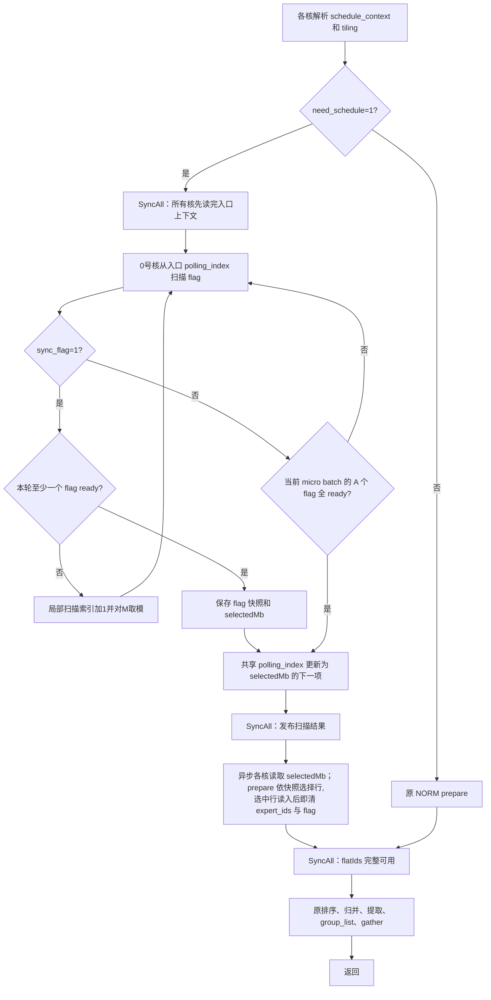

# arch35 syncFlag 需求、流程与核心代码解读

## 1. 背景与设计目标

本次为 Ascend950 / DAV_3510（arch35）的 FfnWorkerBatching 增加 `sync_flag` 属性。上游是 `attention_to_ffn_v2`，接收侧通过 `schedule_context` 中的设备地址访问 token 数据和就绪描述符。

原有 `need_schedule=1` 路径只检查 `polling_index` 对应的一个 micro batch，必须等 A 个 session 的 flag 全部为 1，才开始 batching。这要求每个 session 最终都给当前 FFN 发布 flag。

上游 [AttentionToFfnUrma::SetFlagToFFN](../../../mc2/attention_to_ffn_v2/op_kernel/attention_to_ffn_urma.h) 在 `syncFlag=1` 对应的模板分支中，会跳过发送状态为 0 的 FFN。因此，没有给某个 FFN 发送 token 的 session 可以不向它置 flag。如果接收侧仍等 A 个 flag，就可能一直等不到全部数据。上游模板名 `isSync` 容易引起误解；这里依据实际分支行为及 README，采用 **0=同步、1=异步** 的定义。

目标是：没有就绪描述符时继续等待；发现就绪描述符后处理这次扫描观察到的集合，不为其它 session 等待。不增加攒批时间窗口，也不要求达到最小 token 数。

## 2. 属性契约与边界

新增可选 INT 属性 `sync_flag`，ACLNN 参数名为 `syncFlag`，合法值为 0/1，默认 0。

| need_schedule | sync_flag | 执行行为 |
| --- | --- | --- |
| 0 | 0/1 | 原 NORM batching 路径，不读 flag，不推进 polling_index |
| 1 | 0（默认） | 原同步 RECV：只等入口 polling_index 对应 micro batch 的 A 个 flag 全就绪 |
| 1 | 1 | 异步 RECV：循环扫描 micro batch，首次发现至少一个 ready session 就处理该轮观察结果 |

属性追加在 `layer_num` 后，索引为 5，原有属性索引保持不变。公共算子声明需要更新，以生成图属性和 ACLNN 接口；新增调度逻辑只在 arch35 的 tiling/kernel 中实现，旧架构 kernel/tiling 不变。自动生成的 ACLNN C 接口在 `layerNum` 后增加 `syncFlag`，调用方须使用新头文件重新编译，不保证旧二进制 ABI 兼容。

关键约束：

- 同一次异步调用只消费一个 micro batch 中选中的 session，不跨 micro batch 合批。输出容量仍为 `Y=A*BS*K`。
- `flag=1` 表示描述符已发布，不表示一定有有效 token。已发布但 expert_ids 全被 mask 的描述符仍要完成消费，允许 `actual_token_num=0`。
- 未选中 session 不参与输出，其原始 flag、layer_id、expert_ids 和 token_data 均不被本次消费改写。选中 session 的 token_data 和 layer_id 也保持不变。
- 同一个 schedule_context 的消费者调用必须串行。生产者必须先完成 token/ids 写入，再发布 flag，并遵守槽位复用协议。
- 本次不增加设备内超时、退出信号、按 layer 筛选或跨 micro batch 合批。若始终没有 ready 描述符，异步扫描会持续等待。

## 3. 术语与内存协议

### 3.1 形状及描述符寻址

| 符号/字段 | 含义 |
| --- | --- |
| A | attention session 数 |
| M | 每个 session 的 micro batch 槽数 |
| BS | micro batch size |
| K | 每个 token 的专家槽数，与上下文 selected_expert_num 对应 |
| H | 逻辑 hidden size |
| F | 一个描述符的 int32 word 数，当前为 `2+BS*K` |
| polling_index | 下一次扫描起点，保存在 schedule_context 中 |
| selectedMb | 本次扫描最终选中的 micro batch |
| flatIds | 排序前的扁平 expert_id workspace |

描述符定义取自公共 `attention_ffn_schedule.h`，逻辑布局为：

```text
FfnDataDesc(session=a, micro_batch=m)
    int32 flag                 // 0：未发布；1：已发布
    int32 layer_id             // 本算子不改写
    int32 expert_ids[BS*K]
```

token_info 按 `[A, M, F]` 排列，所以该描述符起点的 int32 偏移为：

```text
descOffset(a, m) = a*M*F + m*F
flagOffset      = descOffset
idsOffset       = descOffset + 2
```

轮询固定 m 时，每次跨步读取 A 个 flag。相邻源 flag 相隔 `M*F` 个 int32；`DataCopyExtParams.srcStride` 不包含本次已复制的一个 int32，因此设为 `(M*F-1)*sizeof(int32_t)`。

### 3.2 为什么需要独立快照

若仅将等待条件从 `readyNum>=A` 改成 `readyNum>0`，随后仍读取并清理所有 session，就会把未发布或尚在写入的数据纳入输出。若各核自行读取实时 flag，又可能因生产者在两次读取之间置位而得到不同集合，导致读入和释放范围不一致。

因此 0 号核将**停止等待的那轮 DMA 观察结果**写入私有 workspace；prepare 的读入与清理均使用这份结果。这里的快照是一次跨步 DMA 观察到的集合，不保证 A 个 flag 是在同一物理时刻原子读取的。未被本次观察到的到达数据留待后续调用。

### 3.3 readyWs 布局

Host 的 `wsReady` 以 int32 word 为单位，相对 userWorkspace。kernel 乘 `sizeof(int32_t)` 得到字节地址。

```text
readyWs + 0              32B 头块：低 8B 存 uint64 selectedMb
readyWs + 32             32B：低 4B 存 session 0 的 int32 flag
readyWs + 64             32B：低 4B 存 session 1 的 int32 flag
...
readyWs + (A+1)*32       段末尾
```

flag 的块内尾部由 `DataCopyPad` 补零，因此 padded 数组的求和仍等于 ready session 数。沿用 padded 布局直接发布快照，避免再做一次压缩和索引转换。头块只写入并读取 selectedMb 对应的有效 8B，其余头块字节没有业务含义。

快照载荷大小为 `(A+1)*32B`。A=1024 时为 32800B；起点对齐另可能产生最多 28B 空隙。只有 `need_schedule=1 && sync_flag=1` 分配快照载荷，NORM 和同步 RECV 不访问该载荷。workspace 内容只用于本次调用，不承担跨调用的已消费状态记录。

## 4. 完整执行流程



图中“从入口扫描”仅指初始设置。异步空轮沿用更新后的局部扫描索引，不重新把它置回入口值；同步空轮则一直检查入口项。

### 4.1 读取上下文与扫描准备

`FfnWorkerBatchingA5` 调用 `ScheduleContextParse<isRecv>`。每个核各自获得上下文中的 A/M/BS/K、buffer 地址和入口 polling_index，并计算：

```cpp
ctx.asyncRecv = isRecv && tilingData->syncFlag == 1;
```

之后的第一个 `SyncAll()` 保证所有核都已读取入口上下文。否则 0 号核若提前推进共享 polling_index，起步较晚的核可能读到下一项，形成跨核索引不一致。

### 4.2 等待并选中一次扫描结果

`FfnWbA5RecvWait::Process` 只有 0 号向量核执行扫描，其它核在调用方的发布屏障等待。

```text
m = 入口 polling_index
重复：
    flags = 读取各 session 的 (session, m).flag，并补零对齐
    readyNum = sum(flags)             // 协议 flag 只取 0/1
    同步且 readyNum >= A：结束等待
    异步且 readyNum > 0：保存 flags 和 m，结束等待
    异步且没有 ready：m = (m+1) % M
    同步且尚未全 ready：继续检查同一个 m
共享 polling_index = (m+1) % M
```

必须跳过空 micro batch：异步上游不保证每一项都会被置位，在一个空项上一直等，会阻塞其它已经有数据的项。扫描绕回原项后可发现迟到的数据，无需为某个 micro batch 维护跨调用的“A 个 session 已处理计数”。

### 4.3 发布快照，统一各核当前索引

异步路径先把 flags 写到 readyWs 的 A 个块，再把 selectedMb 写到头块，最后推进共享 polling_index。各次需要复用 UB 的写入均等待 MTE3 完成；调用方随后执行 `SyncAll()`。

通过发布屏障后，各核调用 prepare 头文件中的 `LoadSelectedMicroBatch(readyWs, ctx, pipe)`，从 readyWs 头块读取 selectedMb，覆盖自己的 `ctx.curMicroBatchID`。函数内部等待 `MTE2_S` 后读取标量，并通过 `pipe.Reset()` 回收临时 UB；发布屏障仍由 `RunPrepare` 负责。这里区分两个索引：

| 位置 | 含义 | 谁使用 |
| --- | --- | --- |
| readyWs 头块 / 各核 ctx.curMicroBatchID | 本次消费的 micro batch | prepare 寻址（读入与清理）、gather 数据及 micro_batch_ids 输出 |
| schedule_context.ffn.polling_index | 下次调用的扫描起点 | 下次消费者调用 |

因此不能在 prepare 中重新从共享 polling_index 取“当前 micro batch”。它已经是下一次调用的起点。

### 4.4 依快照构造 flatIds

`FfnWbPrepareArch35::Init` 按 session 行把工作分给各核。同步/NORM 沿用 host 给出的每轮行数；异步每轮处理一个 session，因为就绪行可以不连续，这个 1 表示选择粒度，不是硬件核数或容量。

RECV 中每个 session 的 flatIds 行跨度为 `align(BS*K, 8)` 个 int32，尾部补齐到 32B。异步分两种情况：

- **选中行**：读取该 session、selectedMb 对应的 expert_ids，补齐部分填 `MASK_SENTINEL`，复制到原 session 的 flatIds 行位置；随后与同步路径一致，就地清原描述符的 ids/flag（见 4.6）。
- **未选中行**：不读取其原始 expert_ids，只在 workspace 对应行填 `MASK_SENTINEL`；ids/flag/layer_id 一概不动。

`MASK_SENTINEL=2147483647`，大于现有排序过滤阈值 `expertStart=1000000`，所以未选中行不会进入有效 token 输出。保留原 session 行位置意味着 gather 仍可从原下标解码 session、token 和专家槽，不需要增加压缩 session 表。

### 4.5 复用原排序及输出流程

prepare 完成后，经 `SyncAll()` 进入原有流程：段内排序 → 多轮归并 → 提取有效 expert_id 和 gather_idx → group_list → gather。

本次没有改变排序、group_list、六种 token_dtype 的搬运和 scale 布局。selectedMb 通过 ctx 传给 gather，确保输出 micro_batch_ids 和 token 源地址指向本次实际选择的项。`actual_token_num` 取过滤后的有效 token 数，输出张量仍按原协议只使用有效前缀。

### 4.6 释放时序：读入后立即清理（与同步同构）

描述符的清理不单独设相位：`ProcessRecv` 在读入选中行、写出 flatIds 之后，**立即**对原描述符执行与同步路径完全相同的清理，不再等待 gather。

该时序的前提是已确认的生产者契约：**异步生产者也不会用新数据覆盖本次正在消费的数据**——同一 (session, micro_batch) 槽位的复用与本次消费调用的处理窗口不重叠，即便生产者观察到 flag=0，也不会在本次调用结束前写入新一代数据。因此不存在"flag 已清、token 槽被复用、而本算子 gather 仍在读旧 token"的窗口，清理无需延迟，也不需要 gather 后的跨核 `SyncAll`。

清理仍按快照执行。同步与异步共用 MTE3 的先 ids 后 flag 回写顺序；在已确认的不覆盖契约下，无需在两者之间插入异步专用完成等待。末尾 MTE3_MTE2 仍保留，确保搬出完成后才复用 UB：

```text
未选中 session：完全跳过（ids/flag/layer_id 一概不动）
选中 session：
    expert_ids 全写 MASK_SENTINEL
    flag 写 0
    等待 flag 搬出完成后复用 UB
```

两点不变量与释放时序无关，任何情况下不可省略：

- **ids 必须失效成 MASK_SENTINEL**：生产者按 token 增量写 ids（只写本轮实际发送的 token，被 mask 的槽位不写），消费端的整行失效是把"生产者本轮未写"翻译成可过滤 mask 值的唯一手段；只清 flag 会让上一代的有效 expert_id 复活成幽灵 token（详见架构文档 arch35_architecture.md 的 Q11）。
- **layer_id 和 token_data 不清理**：前者由生产者随 flag 每轮整块重写，后者只按 gather_idx 读取。

即使 `actual_token_num=0`，已发布的全 mask 描述符也在 prepare 中完成读入与清理，消费握手闭环不变。

> 时序修订说明：本节最初实现为"gather 全核完成后延迟释放"（当时按保守假设：生产者仅以 flag=0 作为复用门槛）。后续与生产者侧确认上述契约成立，已将清理提前到 prepare 阶段并移除独立的释放相位。对外可见的槽位终态不变（选中行 ids=MASK_SENTINEL、flag=0；未选中行原样保留），原有状态断言的期望值不需要改变；修订实现已于 2026-09-10 重新构建并通过全量验证，见第 8.4 节。

## 5. 核心代码导航与解读

源码链接以文件为单位，函数名作为稳定定位点，避免补充注释后行号失效。

| 文件与定位点 | 主要职责 | 阅读重点 |
| --- | --- | --- |
| [ffn_worker_batching_def.cpp](../op_host/ffn_worker_batching_def.cpp)：属性注册 | 声明 sync_flag 默认值 | 公共注册不代表旧架构启用异步调度 |
| [ffn_worker_batching_tiling_arch35.cpp](../op_host/ffn_worker_batching_tiling_arch35.cpp)：ParseOptionalAttrs | 读取属性索引 5，拒绝 -1/2 等非法值 | 未提供属性时保留 0；NORM 也校验合法域 |
| 同文件：DoOpTiling / GetTilingKey | 下发 syncFlag，选择 NORM/RECV | key 仍为 100/101，syncFlag 与 tokenDtype 不增加 key 组合 |
| 同文件：SplitPrepare / LayoutWorkspace | 预算 UB 和 readyWs | 异步读取单行快照额外用一个 UB 块；workspace 偏移以 word 计 |
| [ffn_worker_batching_arch35_tiling_def.h](../op_kernel/arch35/ffn_worker_batching_arch35_tiling_def.h) | Host/kernel 共用 ABI | syncFlag 是策略值，wsReady 是空间偏移 |
| [ffn_wb_a5_context.h](../op_kernel/arch35/ffn_wb_a5_context.h)：ScheduleContextParse | 解释上下文并派生 asyncRecv | `isRecv && syncFlag==1` 保证 NORM 不进入异步逻辑 |
| [ffn_wb_a5_prepare.h](../op_kernel/arch35/ffn_wb_a5_prepare.h)：FfnWbA5RecvWait::Process | 扫描、保存快照、推进 cursor | Cast/ReduceSum 使用 work，不覆盖待发布的 flags |
| 同文件：FfnWbPrepareArch35::IsSelected | 查询冻结的选择集合 | 读取 `(row+1)*32B` 处低 4B，不读取实时 token_info.flag |
| 同文件：ProcessRecv | 读入并即时清理 | 选中行读入+清理、未选中行 sentinel 的分支与契约依据（见 4.6） |
| [ffn_worker_batching_apt.cpp](../op_kernel/ffn_worker_batching_apt.cpp)：RunPrepare | 组织上下文、发布屏障和 prepare | 入口屏障、发布屏障、统一读取 selectedMb |
| [ffn_wb_a5_prepare.h](../op_kernel/arch35/ffn_wb_a5_prepare.h)：LoadSelectedMicroBatch | 从 readyWs 头块更新调用核的 curMicroBatchID | 发布屏障之后由所有核调用，MTE2_S 后取值，内部回收临时 UB |
| [ffn_worker_batching_apt.cpp](../op_kernel/ffn_worker_batching_apt.cpp)：FfnWorkerBatchingA5 | 组织整个流水 | 清理在 phase0 随读入完成，流水线末尾无释放相位 |

### 5.1 等待条件是入口，快照才约束本次消费集合

```cpp
const bool ready = ctx_->asyncRecv ? readyNum > 0
                                  : static_cast<uint32_t>(readyNum) >= ctx_->A;
```

这一行只负责决定何时结束等待，不能单独保证部分接收正确。它必须与保存 flags、IsSelected 过滤、未选中 flatIds 填 sentinel、选中行即时清理配套，才能避免误读和误清。

### 5.2 IsSelected 的地址含义

```cpp
DataCopyPad(flag, readyGm_[(row + 1) * (ONE_BLK_SIZE / sizeof(int32_t))], cp, pad);
SetWaitFlag<HardEvent::MTE2_S>(HardEvent::MTE2_S);
return flag.GetValue(0) == 1;
```

`readyGm_` 的元素类型为 int32，因此块大小需要先换算成 word 数。`row+1` 跳过头块。MTE2_S 保证搬入完成后，标量分支才读取该 flag。读入与清理在同一函数的同一次遍历中完成，天然作用于同一集合。

### 5.3 ProcessRecv 的两个有效组合

| 调用组合 | 读原始 ids | 写 flatIds | 清原始 ids/flag |
| --- | --- | --- | --- |
| 同步 | 全部行 | 全部行 | 全部行，读入后就地清 |
| 异步 | 仅选中行 | 选中行写 ids，其余写 sentinel | 仅选中行，读入后就地清（与同步同构） |

异步即时清理的前提是 4.6 节的生产者契约，不是单独暴露给用户的属性。

## 6. 同步关系与正确性依据

| 同步位置 | 依赖关系 | 缺失时可能出现的问题 |
| --- | --- | --- |
| Waiter 前 SyncAll | 所有核读完入口上下文 → 0 号核推进 cursor | 不同核读取到本次/下次两个索引 |
| flag 队列 EnQue/DeQue 及 V_S | flag DMA → 向量求和 → 标量 ready 判定 | 使用未完成的 DMA 或求和结果 |
| 快照写入完成后再释放 UB | MTE3 读取 flags → flags 缓冲复用 | 快照数据被下一轮覆盖 |
| Waiter 后 SyncAll | 0 号核发布快照 → 各核读取快照 | 部分核读取未发布的 selectedMb/flags |
| flatIds 搬出后的 MTE3_V | 私有 ids 副本搬出完成 → buf 覆写 sentinel | 排序输入在搬出途中被清理值覆盖 |
| 描述符回写后的 MTE3_MTE2 | ids/flag 搬出完成 → 下一轮复用 buf/clr | 复用 UB 破坏本轮尚未完成的回写 |
| prepare 后 SyncAll | 各核生成 flatIds 并完成清理 → 排序 | 排序看到未写完的行 |

`TPipe::Reset()` 负责阶段间本核资源复用，不能替代跨核的 `SyncAll()`。等待指令用于建立具体的数据依赖，不是通过固定延时猜测其它核已经完成。清理不设独立同步点：其安全性由 4.6 节的生产者契约承担（槽位复用与本次处理窗口不重叠），而非靠屏障挡住生产者。

## 7. A=4、M=3 的执行示例

假设入口 polling_index=0，每行给出该 micro batch 下四个 session 的 flag：

| micro batch | flag 向量 | 扫描结果 |
| --- | --- | --- |
| 0 | [0,0,0,0] | 跳过 |
| 1 | [0,1,0,1] | 选中，停止扫描 |
| 2 | [1,0,0,0] | 本次不扫描、不消费，保留给后续调用 |

本次 `selectedMb=1`，快照选择 session 1 和 3，共享 polling_index 更新为 2。各核把 micro batch 1 中这两个 session 的 ids 搬入 flatIds 并随即清理其 ids/flag，对 session 0 和 2 对应的 workspace 行填 sentinel。

若快照形成后 session 0 的 micro batch 1 才发布 flag，它不属于本次集合。本次只消费并清理 `(session=1, mb=1)` 和 `(session=3, mb=1)`；迟到的 `(0,1)` 和已就绪的 `(0,2)` 都保留。

下次调用从 micro batch 2 开始，可先处理 `(0,2)`；后续扫描绕回 micro batch 1 时再处理迟到的 `(0,1)`。这里的轮询顺序没有等待 A 个 session 到齐的限制，但并不承诺某一项的固定墙钟时间上限。

## 8. 测试设计与验收证据

### 8.1 静态 kernel / ACLNN ST

[golden.py](../tests/assets/golden.py) 单独生成 ready 矩阵。未就绪行的设备输入保留正常 expert_ids，只在 CPU golden 的副本中屏蔽这些行。如果 kernel 错误地读取全部行，会产生额外 token，无法通过比较。

新增 38 条用例由以下部分组成：六种 dtype × 六类场景（部分 ready、末尾 ready、全部 ready、ready 全 mask、M=3 跳过空项、NORM 下 syncFlag=1），再加 A=1024 的部分 ready FP16 与末尾 ready FP4 两条边界用例。kernel 和 ACLNN 各增加同样的 38 条。

静态 ST 至少预置一个 ready 描述符，不用于证明无数据时的持续等待。正常输出按独立 golden 比较有效 token、索引和 scale；时序和原始描述符副作用交给下面的真实地址测试。

### 8.2 Host UT

[Host tiling UT](../tests/ut/op_host/test_ffn_worker_batching_tiling.cpp) 检查默认值、0/1 下发、非法值拒绝、key 100/101 不变、wsReady 对齐、workspace 不重叠及容量覆盖。need_schedule=0 的合法属性也被覆盖。

### 8.3 动态等待与握手测试

[verify_sync_flag_state.py](../tests/st/arch35/verify_sync_flag_state.py) 用 aclrtMalloc 分配真实设备缓冲，把真实指针放入 schedule_context，不启用内嵌偏移测试模式。九个场景复用同一设备上下文，检查跨调用状态：

| 场景 | 验证内容 |
| --- | --- |
| empty_wait_then_one_ready | 初始无 flag；启动后延迟 200ms，确认 stream 未完成，再发布一个 flag，期望返回 |
| skip_empty_mb_and_preserve_others | 跳过空项，只消费选中描述符，其余数据保持 |
| cursor_wrap_and_partial_ready | cursor 对 M 回绕，处理部分 session |
| reuse_consumed_slot | 被消费过的槽写入新一代数据后可以再次处理 |
| ready_with_no_valid_tokens | ready 全 mask 返回 0，并完成清理 |
| sync_waits_for_all | 同步对照：已有一个 ready 仍需等待其它三个发布 |
| incremental_reuse_preserves_other_ready | 已消费槽仅增量写两个 ids/token，期望输出恰好两个 token，同时保留另一 micro batch 的 ready 描述符 |
| consume_preserved_other_ready | 下一次调用消费此前保留的 ready 描述符，期望输出一个 token |
| reuse_without_id_writes | 已消费槽只发布 flag、不写 ids，验证清理留下的 sentinel 使有效 token 数为 0 |

每次调用比较输出 token、四类索引、group_list、actual_token_num，以及完整描述符表、polling_index、token_data。完整描述符比较还用于发现误清未选中行或误改 layer_id。200ms 是测试观察窗口，不是算子内部超时。

### 8.4 当前修订验证结果

2026-09-10 基于提交 `231489eb5b` 及当前工作区（含即时清理修订、`LoadSelectedMicroBatch` 函数提取）完成重新构建和验证：Host UT **33/33**、kernel ST **106/106**（新构建包的预编译二进制上板执行，越界检查全部通过）、ACLNN ST **105/105**、真实地址状态测试 **9/9**，无失败或跳过。详见 [验证报告](arch35_sync_flag_validation.md)、[逐用例结果](arch35_sync_flag_results.csv)、[状态测试结果](arch35_sync_flag_state_results.json) 和 [产物哈希](arch35_sync_flag_artifacts.json)。

本轮确认 prepare 即时清理与同步路径共用实现，移除独立释放相位及 gather 后额外 `SyncAll`，保留 UB 复用所需同步。属性、TilingData、workspace 布局、tiling key 均不变。新增三个状态场景验证增量复用输出恰好两个 token、保留项下一轮输出一个 token，以及只发布 flag 时输出零 token；全部使用同一个最终安装包。

验证边界为单算子功能和协议检查，未执行 attention_to_ffn_v2 多机 URMA 端到端联调，未设性能提升验收目标。

当前实现将 selectedMb 的读取封装为 `LoadSelectedMicroBatch(readyWs, ctx, pipe)`，由 `RunPrepare` 在原异步分支、发布屏障之后调用。函数内保留原 DMA、`MTE2_S`、ctx 赋值及 `pipe.Reset()` 顺序，不修改快照布局和同步协议；此次封装调整已重新构建，并在独立安装包上通过全部 33 条 Host UT、106 条 Kernel ST、105 条 ACLNN ST 和 9 条状态测试，结果记录于验证报告。

## Torch 接口与最新图模式方案

Torch 扩展支持六种 token_dtype 的 eager、Meta/FakeTensor 及固定形状 npugraph_ex 推理图。
MX 图模式使用 `mx_output_uint8=True`：E8M0 scale 和 FP4 打包输出以 uint8 返回，FP8 token 保持原生类型；
默认 False 保留原生 eager dtype。该参数仅控制 Torch 输出表示，ACLNN 仍使用原生类型描述符，
设备端存储布局、scale 分组、sync_flag 和描述符清理协议不变。
最新图测试 46/46、eager/Meta 回归 98/98 通过；这些是 Torch 层验证，不替换本报告的底层阶段记录。
详见 [图模式报告](arch35_torch_graph_validation.md) 与 [三个 verify 命令指南](arch35_verify_guide.md)。
