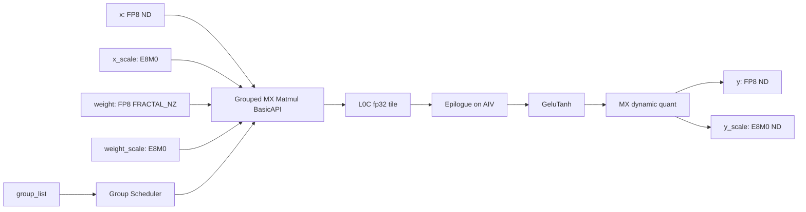

# GroupedMatmulActivationQuant Kernel/Tiling SRS

## 1. 迭代信息

| 项目 | 内容 |
| --- | --- |
| 迭代名称 | GroupedMatmulActivationQuant kernel/tiling 实现 |
| 算子类型 | GMM + Activation + MX FP8 dynamic quant 融合算子 |
| 覆盖范围 | Host def、InferShape、Tiling、AscendC Kernel、CSV tiling UT |
| 不覆盖范围 | aclnn/op_api、PTA wrapper、端到端精度 STC、性能 benchmark |
| 目标芯片 | Ascend950 / `__NPU_ARCH__ == 3510` |
| 迭代版本 | v0.1 |
| 更新时间 | 2026-06-08 |

## 2. 需求背景

当前模型图中存在如下计算链路：

```text
GroupedMatmul(MX FP8 input, MX FP8 weight NZ)
    -> dequant to fp32 accumulator
    -> GeluTanh activation
    -> dynamic MX FP8 quant
    -> y, y_scale
```

若将 GMM、Activation、Dynamic MX Quant 拆成多个算子，会产生额外 GM 读写、调度开销和中间张量生命周期。`GroupedMatmulActivationQuant` 的目标是将上述链路融合到一个 AscendC kernel 中：

- GMM 主体复用 grouped matmul 低阶 BasicAPI 能力。
- weight 使用 FP8 `FRACTAL_NZ` 存储。
- 输入、权重和输出只支持 FP8 `FLOAT8_E4M3FN` / `FLOAT8_E5M2` 场景。
- scale 使用 MX `FLOAT8_E8M0`，scale 形状按 `ceil(K / 64)` 和 `ceil(N / 64)` 分块。
- 当前 activation 仅支持 `GMM_ACT_TYPE_GELU_TANH = 2`。
- quant 逻辑参考 `dynamic_mx_quant_tail_axis_fp8.h` 的 tail axis FP8 MX quant 思路，并在 epilogue 中完成。

## 3. 方案简述

### 3.1 总体数据流



### 3.2 模块划分

| 模块 | 职责 |
| --- | --- |
| Host def | 定义输入、输出、属性顺序和 dtype/format 组合；注册 Ascend950 AICore 配置 |
| InferShape | 根据 `x` 和 `weight_scale` 推导 `y` / `y_scale` shape；根据 `quant_dtype` 推导 `y` dtype |
| Tiling | 校验 dtype、shape、attr；调用 GMM BasicAPI tiling；生成 `GMMActivationQuantTilingDataParams` |
| Kernel Dispatch | 根据 tiling key 选择 `weight` 是否转置，对应 `layout::Nz` / `layout::Zn` |
| GMM Kernel | 按 group 遍历，使用 low-level MX matmul BasicAPI 完成矩阵乘 |
| Epilogue | 对每个 matmul tile 做 GeluTanh + MX dynamic quant + GM 写回 |
| UT | 使用 CSV 驱动 tiling 白盒用例，覆盖合法和非法参数 |

## 4. 输入输出规格

### 4.1 Host 字段顺序

def 文件需按以下顺序声明。该顺序同时决定 tiling/infershape 中 attr index 和 input index：

| 字段分组 | 字段名 | index | 当前实现要求 |
| --- | --- | ---: | --- |
| REQUIRED_INPUT | `x` | 0 | FP8 ND，形状 `[M, K]` |
| REQUIRED_INPUT | `group_list` | 1 | INT64 ND，形状 `[E]` |
| OPTIONAL_INPUT | `x_scale` | 2 | MX 场景实际必传，E8M0 ND，形状 `[M, ceil(K/64), 2]` |
| DYNAMIC_INPUT | `weight` | 3 | FP8 FRACTAL_NZ，动态 tensor list，当前仅使用第 0 个 |
| DYNAMIC_INPUT | `weight_scale` | 4 | E8M0 ND，动态 tensor list，当前仅使用第 0 个 |
| DYNAMIC_INPUT | `bias` | 5 | 已预留，当前 kernel 不使用 |
| OUTPUT | `y` | 0 | FP8 ND，形状 `[M, N]` |
| OUTPUT | `y_scale` | 1 | E8M0 ND，形状 `[M, ceil(N/64), 2]` |
| REQUIRED_ATTR | `activation_type` | 0 | 当前仅支持 `2`，即 GELU_TANH |
| OPTIONAL_ATTR | `dequant_dtype` | 1 | 当前仅支持 `ge::DT_FLOAT` |
| OPTIONAL_ATTR | `transpose_weight` | 2 | `false` 或 `true` |
| OPTIONAL_ATTR | `group_list_type` | 3 | `0` 累加 offsets；`1` 每组 token count |
| OPTIONAL_ATTR | `tuning_config` | 4 | 当前保留，默认 `{0}` |
| OPTIONAL_ATTR | `quant_dtype` | 5 | `FLOAT8_E4M3FN` 或 `FLOAT8_E5M2` |
| OPTIONAL_ATTR | `round_mode` | 6 | 当前仅支持 `"rint"` |
| OPTIONAL_ATTR | `scale_alg` | 7 | `0` OCP；`1` cuBLAS |
| OPTIONAL_ATTR | `dst_type_max` | 8 | 当前仅支持 `0.0` |

### 4.2 dtype 与 format

| 张量 | dtype | format | 说明 |
| --- | --- | --- | --- |
| `x` | `FLOAT8_E4M3FN` / `FLOAT8_E5M2` | `ND` | GMM A 矩阵 |
| `x_scale` | `FLOAT8_E8M0` | `ND` | MX per-token scale |
| `group_list` | `INT64` | `ND` | group 边界或长度 |
| `weight` | `FLOAT8_E4M3FN` / `FLOAT8_E5M2` | `FRACTAL_NZ` | GMM B 矩阵，dynamic input 第 0 个 tensor |
| `weight_scale` | `FLOAT8_E8M0` | `ND` | MX per-group weight scale |
| `bias` | `FLOAT` | `ND` | 接口预留，当前不参与计算 |
| `y` | `FLOAT8_E4M3FN` / `FLOAT8_E5M2` | `ND` | `y.dtype == quant_dtype` |
| `y_scale` | `FLOAT8_E8M0` | `ND` | 输出 MX scale |

### 4.3 shape 约束

设：

- `M` 为所有 group token 总数。
- `E` 为 group 数。
- `K` 为输入 hidden size。
- `N` 为输出 hidden size。
- `KBlocks = ceil(K / 64)`。
- `NBlocks = ceil(N / 64)`。

| 张量 | 非转置 weight | 转置 weight |
| --- | --- | --- |
| `x` | `[M, K]` | `[M, K]` |
| `x_scale` | `[M, KBlocks, 2]` | `[M, KBlocks, 2]` |
| `weight.origin` | `[E, K, N]` | `[E, N, K]` |
| `weight.storage` | `[E, ceil(N/32), ceil(K/16), 16, 32]` | `[E, ceil(K/32), ceil(N/16), 16, 32]` |
| `weight_scale` | `[E, KBlocks, N, 2]` | `[E, N, KBlocks, 2]` |
| `y` | `[M, N]` | `[M, N]` |
| `y_scale` | `[M, NBlocks, 2]` | `[M, NBlocks, 2]` |

必须满足：

- `x_scale.rank == 3`。
- `weight_scale.rank == 4`。
- `weight.storage.rank == 5`。
- `weight.storage[3] == 16`。
- `weight.storage[4] == 32`。
- `x_scale[M] == x[M]`。
- `x_scale[KBlock] == ceil(K / 64)`。
- `x_scale[pair] == 2`。
- `weight_scale[group] == E`。
- `weight_scale[N] == N`，转置时 N 维在 index 1，非转置时在 index 2。
- `weight_scale[KBlock] == ceil(K / 64)`，转置时 KBlock 维在 index 2，非转置时在 index 1。
- `weight_scale[pair] == 2`。

### 4.4 dtype/format/场景矩阵

| x dtype | weight dtype | y dtype | quant_dtype | weight format | transpose_weight | 是否支持 |
| --- | --- | --- | --- | --- | --- | --- |
| E4M3 | E4M3 | E4M3 | E4M3 | FRACTAL_NZ | false | 支持 |
| E4M3 | E5M2 | E4M3 | E4M3 | FRACTAL_NZ | false | 支持 |
| E5M2 | E4M3 | E5M2 | E5M2 | FRACTAL_NZ | false | 支持 |
| E5M2 | E5M2 | E5M2 | E5M2 | FRACTAL_NZ | false | 支持 |
| E4M3/E5M2 | E4M3/E5M2 | E4M3/E5M2 | 同 y | FRACTAL_NZ | true | 支持 |
| FP16/BF16/FP32 | 任意 | 任意 | 任意 | 任意 | 任意 | 不支持 |
| FP8 | FP8 | FP8 | 与 y 不一致 | FRACTAL_NZ | 任意 | 不支持 |
| FP8 | FP8 | FP8 | E4M3/E5M2 | ND weight | 任意 | 不支持 |

## 5. 交付标准

| 交付范围 | 当前迭代 |
| --- | --- |
| 交付通路 | Ascend950 AICore kernel，`opFile.value = grouped_matmul_activation_quant_apt` |
| 动态/静态要求 | 支持动态 shape；tiling 使用 `DynamicCompileStaticFlag(true)`、`DynamicShapeSupportFlag(true)` |
| 精度交付标准 | 与参考链路 `GMM(fp32 accum) -> GeluTanh -> Dynamic MX Quant` 对齐；具体容差待 STC 定义 |
| 性能交付标准 | 目标是减少中间 GM 读写；本 SRS 不给性能阈值，性能 benchmark 待补 |
| UT 交付 | CSV tiling UT 覆盖 dtype、shape、attr、core ratio、tiling key |
| 设计材料 | 本 SRS；代码路径见第 7 章 |
| 维测材料 | 暂无；依赖 tiling 日志和 UT 失败信息定位 |

## 6. 具体方案描述

### 6.1 Tiling 设计

#### 6.1.1 Tiling 数据结构

```cpp
BEGIN_TILING_DATA_DEF(GMMActivationQuantParams)
    uint32_t groupNum;
    uint8_t groupListType;
    uint8_t activationType;
    uint8_t quantDtype;
    uint8_t roundMode;
    uint8_t dequantDtype;
    uint8_t scaleAlg;
    uint32_t rowLen;      // 预留
    uint32_t ubAvail;     // 预留
    float dstTypeMax;
END_TILING_DATA_DEF;

BEGIN_TILING_DATA_DEF(GMMActivationQuantTilingDataParams)
    GMMActivationQuantParams gmmActivationQuantParams;
    QuantBasicApiMMTiling mmTilingData;
END_TILING_DATA_DEF;
```

`mmTilingData` 由 `GroupedQmmBasicApiTiling` 计算，kernel 侧转换成 `KernelGmmActivationMixOnlineDynamic::GMMTiling`。

#### 6.1.2 Tiling 主流程

```text
TilingPrepareForGroupedMatmulActivationQuant:
    platform = PlatformAscendC(context.platform)
    compileInfo.aicNum = platform.GetCoreNumAic()
    compileInfo.aivNum = platform.GetCoreNumAiv()
    compileInfo.socVersion = platform.GetSocVersion()
    compileInfo.npuArch = platform.GetCurNpuArch()
    compileInfo.ubSize = platform.GetCoreMemSize(UB)
    compileInfo.l1Size = platform.GetCoreMemSize(L1)
    compileInfo.l0ASize = platform.GetCoreMemSize(L0_A)
    compileInfo.l0BSize = platform.GetCoreMemSize(L0_B)
    compileInfo.l0CSize = platform.GetCoreMemSize(L0_C)
    compileInfo.l2Size = platform.GetCoreMemSize(L2)

GroupedMatmulActivationQuantTilingFunc:
    if context == nullptr:
        return GRAPH_FAILED
    registerList = {0}
    return TilingRegistry.DoTilingImpl(context, registerList)
```

#### 6.1.3 Attr 解析伪代码

```text
AnalyzeAttrs:
    attrs = context.GetAttrs()
    require attrs != nullptr

    transB = attr[transpose_weight] if exists else false
    transA = false

    groupListType = attr[group_list_type] if exists else default
    require groupListType in {0, 1}

    activationType = attr[activation_type]
    dequantDtype = attr[dequant_dtype]
    quantDtype = attr[quant_dtype]
    roundMode = attr[round_mode]
    scaleAlg = attr[scale_alg]
    dstTypeMax = attr[dst_type_max]

    require all required quant attrs are non-null
    require activationType == 2  // GELU_TANH
    require dequantDtype == FLOAT
    require quantDtype in {FLOAT8_E4M3FN, FLOAT8_E5M2}
    require roundMode == "rint"
    require scaleAlg in {0, 1}
    require abs(dstTypeMax - 0.0) <= 1e-6

    roundMode_ = ROUND_MODE_RINT
    scaleAlg_ = scaleAlg
    activationType_ = activationType
    dstTypeMax_ = dstTypeMax
    quantDtype_ = quantDtype
    groupType = SPLIT_M
```

#### 6.1.4 dtype 解析伪代码

```text
AnalyzeDtype:
    xDesc = inputDesc[0]
    wDesc = dynamicInputDesc[weight][0]
    xScaleDesc = inputDesc[2]
    wScaleDesc = dynamicInputDesc[weight_scale][0]
    yDesc = outputDesc[0]
    yScaleDesc = outputDesc[1]
    require all desc are non-null

    aDtype = xDesc.dtype
    bDtype = wDesc.dtype
    perTokenScaleDtype = xScaleDesc.dtype
    scaleDtype = wScaleDesc.dtype
    outDataDtype = yDesc.dtype
    outScaleDtype = yScaleDesc.dtype
    bFormat = PrimaryFormat(wDesc.storageFormat)

CheckDtype:
    require IsFp8(aDtype)
    require IsFp8(bDtype)
    require perTokenScaleDtype == FLOAT8_E8M0
    require scaleDtype == FLOAT8_E8M0
    require IsFp8(outDataDtype)
    require outDataDtype == quantDtype_
    require outScaleDtype == FLOAT8_E8M0
```

#### 6.1.5 输入 shape 解析伪代码

```text
AnalyzeInputs:
    xShape = inputShape[x]
    weightShape = dynamicInputShape[weight][0]
    xScaleShape = inputShape[x_scale]
    weightScaleShape = dynamicInputShape[weight_scale][0]
    require all shape are non-null

    SetGroupNum(group_list_index)
    SetMKN(xShape.origin, weightShape.origin)

    aQuantMode = MX_PERGROUP_MODE
    bQuantMode = MX_PERGROUP_MODE
    isSingleX = true
    isSingleW = true
    isSingleY = true

    CheckMxScaleShape(xScaleShape.origin, weightScaleShape.origin)
    CheckWeightNzShape(weightShape.storage)
    CheckCoreNum()
```

#### 6.1.6 MX scale shape 校验伪代码

```text
CheckMxScaleShape(xScaleShape, wScaleShape):
    require rank(xScaleShape) == 3
    require rank(wScaleShape) == 4

    expectedKBlocks = ceil(kSize / 64)

    if transB:
        wScaleN = wScaleShape[1]
        wScaleK = wScaleShape[2]
    else:
        wScaleK = wScaleShape[1]
        wScaleN = wScaleShape[2]

    require xScaleShape[0] == mSize
    require xScaleShape[1] == expectedKBlocks
    require xScaleShape[2] == 2

    require wScaleShape[0] == groupNum
    require wScaleN == nSize
    require wScaleK == expectedKBlocks
    require wScaleShape[3] == 2
```

#### 6.1.7 weight NZ shape 校验伪代码

```text
CheckWeightNzShape(weightStorageShape):
    require bFormat == FRACTAL_NZ
    require rank(weightStorageShape) == 5
    require weightStorageShape[3] == 16
    require weightStorageShape[4] == 32
```

#### 6.1.8 BasicAPI tiling 伪代码

```text
DoLibApiTiling:
    GroupedQmmTiling.CalBasicBlock()

    baseM = min(basicTiling.baseM, 128)
    basicTiling.baseM = CeilAlign(baseM, CUBE_BLOCK)

    require GroupedQmmBasicApiTiling.CalL1Tiling() == GRAPH_SUCCESS

    mmTilingData.m = mSize
    mmTilingData.n = nSize
    mmTilingData.k = kSize
    mmTilingData.baseM = basicTiling.baseM
    mmTilingData.baseN = basicTiling.baseN
    mmTilingData.baseK = basicTiling.baseK
    mmTilingData.kAL1 = stepKa * baseK
    mmTilingData.kBL1 = stepKb * baseK
    mmTilingData.scaleKAL1 =
        min(max(scaleFactorA * stepKa, scaleFactorB * stepKb) * baseK, kSize)
    mmTilingData.scaleKBL1 = mmTilingData.scaleKAL1
    mmTilingData.isBias = 0
    mmTilingData.dbL0C = basicTiling.dbL0c
```

#### 6.1.9 Op tiling data 写入伪代码

```text
DoOpTiling:
    gmmParams.groupNum = groupNum
    gmmParams.groupListType = groupListType
    gmmParams.activationType = activationType_
    gmmParams.quantDtype =
        outDataDtype == FLOAT8_E5M2 ? 35 : 36
    gmmParams.roundMode = ROUND_MODE_RINT
    gmmParams.dequantDtype = FLOAT
    gmmParams.scaleAlg = scaleAlg_
    gmmParams.dstTypeMax = dstTypeMax_
```

#### 6.1.10 tiling key

当前只生成两个有效 kernel 模板组合：

| tiling key 逻辑 | `QUANT_B_TRANS` | `QUANT_A_TRANS` | A layout | B layout | 是否支持 |
| --- | ---: | ---: | --- | --- | --- |
| no-trans weight | 0 | 0 | RowMajor | Nz | 支持 |
| trans weight | 1 | 0 | RowMajor | Zn | 支持 |
| trans x | 0/1 | 1 | - | - | 不支持 |

伪代码：

```text
GetTilingKey:
    return GET_TPL_TILING_KEY(transB, transA)

Kernel dispatch:
    if transB == 0 and transA == 0:
        call GmmActivationMxQuant<RowMajor, Nz>()
    else if transB == 1 and transA == 0:
        call GmmActivationMxQuant<RowMajor, Zn>()
```

### 6.2 Kernel 设计

#### 6.2.1 Kernel 参数入口

```cpp
__global__ __aicore__ void grouped_matmul_activation_quant(
    GM_ADDR x,
    GM_ADDR groupList,
    GM_ADDR xScale,
    GM_ADDR weight,
    GM_ADDR weightScale,
    GM_ADDR bias,
    GM_ADDR y,
    GM_ADDR yScale,
    GM_ADDR workspace,
    GM_ADDR tiling);
```

说明：

- 参数顺序与 def 文件输入输出顺序一致。
- `bias` 为预留输入，当前 `(void)bias`，不进入 matmul 或 epilogue。
- kernel 会临时将 float overflow mode 控制位清 0，结束时恢复。

#### 6.2.2 Kernel 参数装配

```text
GmmActivationMxQuant:
    read gmmActivationQuantParams from tiling
    read mmTilingData from tiling

    BlockEpilogue =
        BlockEpilogueActivationQuant<L0TileShape, CType, float, E8M0, E8M0, true>

    BlockMmad =
        BlockMmadMx<MatmulWithScale, AType, LayoutA, BType, LayoutB, float>

    QGmmKernel =
        KernelGmmActivationMixOnlineDynamic<MatmulShape, BlockMmad, BlockEpilogue, Scheduler>

    gmmParams = {
        groupNum,
        m, n, k,
        baseM, baseN, baseK,
        kAL1, kBL1,
        scaleKAL1, scaleKBL1,
        isBias = 0,
        dbL0C,
        groupType = SPLIT_M,
        groupListType
    }

    params.mmadParams = {
        x, weight, weightScale, xScale, y, nullptr, groupList
    }

    params.epilogueParams = {
        y, yScale,
        x2Scale = nullptr,
        x1Scale = nullptr,
        bias = nullptr,
        baseM, baseN,
        roundMode,
        scaleAlg,
        dstTypeMax,
        activationType
    }

    QGmmKernel(params)
```

#### 6.2.3 分组调度流程

```mermaid
flowchart TD
    Start[Kernel operator()] --> Init[InitParamsAndTensor]
    Init --> AICInit{AIC?}
    AICInit -->|yes| InitMmad[Init BlockMmad with m,n,k/baseM/baseN/baseK/L1]
    AICInit -->|no| InitEpi
    InitMmad --> InitEpi[Init Epilogue]
    InitEpi --> Scheduler[Create tail-split scheduler]
    Scheduler --> LoopGroup[for groupIdx in groupNum]
    LoopGroup --> UpdateGroup[UpdateOffset + GetSplitValue]
    UpdateGroup --> Skip{M_i == 0?}
    Skip -->|yes| LoopGroup
    Skip -->|no| UpdateMmad[Update matmul problem shape]
    UpdateMmad --> L2[Set L2 cache hint]
    L2 --> TileLoop[ProcessSingleGroup tile loop]
    TileLoop --> LoopGroup
    LoopGroup --> End[Wait final vector if needed]
```

#### 6.2.4 group_list 语义

```text
GetSplitValueFromGroupList(groupIdx, groupListType):
    if groupListType == 0:
        // group_list 保存每组累加结束 offset
        offset = group_list[groupIdx]
        splitValue = offset - preOffset
        preOffset = offset
    else:
        // group_list 保存每组 token 数
        splitValue = group_list[groupIdx]
    return splitValue
```

#### 6.2.5 group 间 GM offset 更新

```text
UpdateOffset(groupIdx):
    if groupIdx == 0:
        return

    previousM = problemShape.m
    n = problemShape.n
    k = problemShape.k

    aOffset += previousM * k

    if B format is NZ:
        if transB:
            nAlign = align_up(n, BLOCK_CUBE)
            kAlign = align_up(k, c0Size)
        else:
            nAlign = align_up(n, c0Size)
            kAlign = align_up(k, BLOCK_CUBE)
        bOffset = nAlign * kAlign * groupIdx
    else:
        bOffset += n * k

    scaleK = ceil(k / 64) * 2
    xScaleOffset += previousM * scaleK
    wScaleOffset += n * scaleK
    yOffset += previousM * n
    yScaleOffset += previousM * ceil(n / 64) * 2
```

#### 6.2.6 tile 内 AIC/AIV 协同

```text
ProcessSingleGroup:
    bs.UpdateNextProblem({m_i, n, k, 0})
    epilogue.UpdateNextProblem({m_i, n, k, 0})
    UpdateGlobalBuffer(baseOffset)

    coord = Coordinate(m_i, n, k, baseM, baseN, baseK)

    while bs.GetTileIdx(tileIdx):
        singleShape = bs.GetBlockShape(tileIdx)
        if singleShape.m <= 0 or singleShape.n <= 0:
            return

        quantOffset = coord.GetQuantOffset(MX_PERGROUP_MODE, tileIdx, singleShape, c0Size)
        blockOffset.a = quantOffset.a
        blockOffset.b = quantOffset.b
        blockOffset.xScale = quantOffset.x1Scale
        blockOffset.wScale = quantOffset.x2Scale
        blockOffset.y = quantOffset.c
        blockOffset.yScale =
            mOffset * ceil(n / 64) * 2 + ceil(nOffset / 64) * 2

        if AIC:
            if previous tile exists:
                WaitForVector()
            mmSingleShape = {singleM, singleN, k}
            BlockMmad(aGlobal[aOffset], bGlobal[bOffset],
                      xScaleGlobal[xScaleOffset],
                      wScaleGlobal[wScaleOffset],
                      l0cOutUbFirst,
                      mmSingleShape)
            NotifyVector()

        if AIV:
            epilogueShape = {singleM, singleN, 0, 0}
            epilogueOffset = {yOffset, yScaleOffset, wScaleOffset, xScaleOffset, biasOffset}
            WaitForCube()
            Epilogue(epilogueShape, epilogueOffset)
            NotifyCube()
```

#### 6.2.7 Epilogue UB 规划

Epilogue 在 AIV 侧运行。UB 区域按固定偏移划分：

| UB tensor | 类型 | 大小/上限 | 用途 |
| --- | --- | --- | --- |
| `l0cOutUbFirst_` | `DataTypeIn` | `MAX_SINGLE_MN` | matmul 输出 tile，来源于 L0C -> UB |
| `quantOutput_` | `int8_t` | `MAX_SINGLE_MN` | FP8 量化后 y |
| `quantScaleOutput_` | `int8_t` | `MAX_SINGLE_MN / 32` | 临时 scale |
| `activationRes_` | `bfloat16_t` | `MAX_SINGLE_MN` | GeluTanh 后 BF16 中间结果 |
| `maxExp_` | `uint16_t` | `MAX_SINGLE_MN / 32` | 每 32 元素规约 max exponent |
| `halfScale_` | `uint16_t` | `MAX_SINGLE_MN / 32` | 反量化/量化用 half scale |
| `quantScaleBlockOutput_` | `int8_t` | `baseM / taskRatio * 32` | GM 写回前 scale layout |

#### 6.2.8 Epilogue 主流程伪代码

```text
BlockEpilogueActivationQuant::operator()(blockShape, blockCoord):
    singleM = blockShape.m
    singleN = blockShape.n
    scaleBlockN = ceil(singleN / 64) * 2

    halfSingleM = ceil(singleM / taskRatio)
    if subBlockIdx == 1:
        singleMInVec = singleM - halfSingleM
    else:
        singleMInVec = halfSingleM

    if singleMInVec == 0:
        return

    vlForHalfNumber = VECTOR_REG_WIDTH / sizeof(bfloat16_t)
    elementAfterReduce = VECTOR_REG_WIDTH / 32

    VFDoActivationForMX(singleMInVec)

    yOffset = blockCoord.y + subBlockIdx * halfSingleM * fullN
    yScaleOffset = blockCoord.yScale + subBlockIdx * halfSingleM * fullScaleN

    TransMxScaleLayout(singleMInVec, scaleBlockN)

    CopyOutputFromUb2Gm(singleMInVec, yOffset, quantOutput)
    CopyScaleFromUb2Gm(singleMInVec, yScaleOffset, quantScaleBlockOutput)
```

#### 6.2.9 GeluTanh 计算伪代码

当前实现使用 sigmoid 形式的 GeluTanh 近似：

```text
GeluTanh(x) = x / (1 + exp(-1.595769121 * (x + 0.044715 * x^3)))
```

代码中的等价计算：

```text
inputSqr = x * x
inputCub = inputSqr * x
inputCub = inputCub + x * (1 / 0.044715)
inputCub = inputCub * (-1.595769121 * 0.044715)
denominator = exp(inputCub) + 1
actOut = x / denominator
activationRes = cast_bf16_rint(actOut)
```

逐 tile 伪代码：

```text
VFDoActivationAndQuantForMX(src, mSize, nSize):
    sizePerRepeat = VECTOR_REG_WIDTH / sizeof(DataTypeIn)
    repeatsPerRow = ceil(nSize / sizePerRepeat)
    nSrcAligned = align_up(nSize, 32 / sizeof(DataTypeIn))
    nDstAligned = align_up(nSize, 32)

    for mIdx in [0, mSize):
        mask = UpdateMask(nSize)
        for vfBlockIdx in [0, repeatsPerRow):
            offset = mIdx * nSrcAligned + vfBlockIdx * sizePerRepeat
            input = load_fp32(src + offset)
            act = GeluTanh(input)
            store_bf16(activationRes + mIdx * nDstAligned + vfBlockIdx * sizePerRepeat, act)

    DynamicMxQuant(activationRes, nDstAligned)
```

#### 6.2.10 MX dynamic quant 伪代码

量化主流程：

```text
DynamicMxQuant(activationRes, nDstAligned):
    totalData = mSize * nDstAligned
    totalScale = totalData / 32

    loopDataNum = ceil(totalData / (vlForHalfNumber * 2))
    loopScaleNum = ceil(totalScale / vlForHalfNumber)
    loopScaleCublasNum = ceil(totalScale / (vlForHalfNumber / 2))

    if scaleAlg == OCP:
        maxExp = ComputeMaxExp(activationRes)
        halfScale, mxScale = ComputeScale(maxExp)
    else:
        maxExp = ComputeMaxExpCuBLAS(activationRes)
        halfScale, mxScale = ComputeScaleCuBLAS(maxExp)

    yLocal = ComputeDataForQuantTargetFp8(activationRes, halfScale)
```

OCP scale 分支：

```text
ComputeMaxExp:
    for each vector chunk:
        load bf16 interleaved data
        exp0 = data0 & BF16_EXP_MASK
        exp1 = data1 & BF16_EXP_MASK
        maxExp = max(exp0, exp1)
        reduce max within data block
        store maxExp

ComputeScale:
    for each maxExp chunk:
        invalidMask = maxExp <= fp8MaxExp
        maxExp = select(fp8MaxExp, maxExp, invalidMask)
        sharedExp = maxExp - fp8MaxExp
        mxScale = sharedExp >> 7
        mxScale = select(mxScale, fp8NaN, infOrNanMask)

        halfScale = BF16_EXP_BIAS - sharedExp
        halfScale = select(halfScale, NaN, infOrNanMask)
        halfScale = select(halfScale, 0, sharedExp != 0)
        halfScale = select(SPECIAL_EXP_THRESHOLD, halfScale, specialMask)
        store mxScale and halfScale
```

cuBLAS scale 分支：

```text
ComputeMaxExpCuBLAS:
    for each vector chunk:
        load bf16 interleaved data
        absData = data & ABS_MASK_FOR_16BIT
        maxAbs = reduce_max(absData)
        store maxAbs

ComputeScaleCuBLAS:
    for each maxAbs chunk:
        max32 = cast_bf16_to_float(maxAbs)
        finiteMask = max32 < FP32_EXP_MASK
        nonZeroMask = max32 != 0

        scaledMax = max32 * dtypeMax
        exp32 = extract_exp(scaledMax)
        man32 = extract_mantissa(scaledMax)

        roundUp =
            (0 < exp32 < 254 and man32 > 0) or
            (exp32 == 0 and man32 > 0.5)

        extractExp = select(exp32 + 1, exp32, roundUp)
        extractExp = select(extractExp, fp8NaN, finiteMask)
        extractExp = select(extractExp, 0, nonZeroMask)

        mxScale = pack_low_u16(extractExp)
        halfScale = FP32_EXP_BIAS_CUBLAS - (extractExp << 7)
        halfScale = select(halfScale, NaN, finiteMask)
        halfScale = select(halfScale, 0, nonZeroMask)
        store mxScale and halfScale
```

FP8 输出 cast：

```text
ComputeDataForQuantTargetFp8:
    for each vector chunk:
        data = load_bf16_interleaved(activationRes)
        scale = load_half_scale_e2b(halfScale)
        scaled = data * scale

        fp32_zero, fp32_one = cast_bf16_to_fp32_with_reg_layout(scaled)
        fp8_zero, fp8_one = cast_fp32_to_fp8_sat_rint(fp32_zero, fp32_one)
        packedFp8 = pack/add lanes according to MicroAPI layout
        store int8 bytes to quantOutput
```

Scale layout 转换：

```text
TransMxScaleLayout:
    for mIdx in [0, mSize):
        src = quantScaleOutput + mIdx * scaleBlockN
        dst = quantScaleBlockOutput + mIdx * 32
        copy scaleBlockN bytes from src to dst
```

GM 写回：

```text
CopyOutputFromUb2Gm:
    blockCount = singleMInVec
    blockLen = singleN * sizeof(int8)
    dstStride = (fullN - singleN) * sizeof(int8)
    DataCopyPad(yGM + yOffset, quantOutput, params)

CopyScaleFromUb2Gm:
    blockScaleN = ceil(singleN / 64) * 2
    blockCount = singleMInVec
    blockLen = blockScaleN * sizeof(int8)
    dstStride = (fullScaleN - blockScaleN) * sizeof(int8)
    DataCopyPad(yScaleGM + yScaleOffset, quantScaleBlockOutput, params)
```

## 7. 软件设计和接口定义

### 7.1 文件级修改清单

| 文件 | 设计职责 |
| --- | --- |
| `op_host/grouped_matmul_activation_quant_def.cpp` | 定义 `GroupedMatmulActivationQuant` schema；按指定顺序声明输入/输出/属性 |
| `op_host/grouped_matmul_activation_quant_infershape.cpp` | 推导 `y` 和 `y_scale` shape/dtype；跟随 attr index 顺序 |
| `op_host/op_tiling/arch35/grouped_matmul_activation_quant_tiling.{h,cpp}` | 校验参数；生成 GMM BasicAPI tiling 和融合参数 tiling |
| `op_kernel/arch35/grouped_matmul_activation_quant_apt.cpp` | kernel 入口；根据 tiling key dispatch layout |
| `op_kernel/arch35/grouped_matmul_activation_quant_mxquant.h` | 组装 BlockMmad、BlockEpilogue、Kernel 参数 |
| `common/cgmct/kernel/kernel_gmm_activation_mxquant.h` | 分组 GMM kernel 主调度 |
| `common/cgmct/epilogue/block_epilogue_activation_mx_quant.h` | GeluTanh + MX dynamic quant epilogue |
| `tests/ut/op_host/test_grouped_matmul_activation_quant_tiling.*` | CSV tiling UT |

### 7.2 详细修改伪代码

#### 7.2.1 def schema

```text
DefineOp GroupedMatmulActivationQuant:
    Input("x").Required().Dtype(FP8_E4M3/E5M2).Format(ND)
    Input("group_list").Required().Dtype(INT64).Format(ND)
    Input("x_scale").Optional().Dtype(FLOAT8_E8M0).Format(ND)
    Input("weight").Dynamic().Dtype(FP8_E4M3/E5M2).Format(FRACTAL_NZ)
    Input("weight_scale").Dynamic().Dtype(FLOAT8_E8M0).Format(ND)
    Input("bias").Dynamic().Dtype(FLOAT).Format(ND)
    Output("y").Required().Dtype(FP8_E4M3/E5M2).Format(ND)
    Output("y_scale").Required().Dtype(FLOAT8_E8M0).Format(ND)

    Attr("activation_type").Required().Int()
    Attr("dequant_dtype").Optional().Int(FLOAT)
    Attr("transpose_weight").Optional().Bool(false)
    Attr("group_list_type").Optional().Int(0)
    Attr("tuning_config").Optional().ListInt({0})
    Attr("quant_dtype").Optional().Int(FLOAT8_E4M3FN)
    Attr("round_mode").Optional().String("rint")
    Attr("scale_alg").Optional().Int(0)
    Attr("dst_type_max").Optional().Float(0.0)

    AICore("ascend950")
        DynamicCompileStaticFlag(true)
        DynamicFormatFlag(true)
        DynamicRankSupportFlag(true)
        DynamicShapeSupportFlag(true)
        NeedCheckSupportFlag(false)
        PrecisionReduceFlag(true)
        opFile = "grouped_matmul_activation_quant_apt"
```

#### 7.2.2 InferShape

```text
InferShape:
    xShape = input[0].shape
    weightScaleShape = dynamicInput[4][0].shape
    transposeWeight = attr[2]

    M = xShape[0]
    if transposeWeight:
        N = weightScaleShape[1]
    else:
        N = weightScaleShape[2]

    y.shape = [M, N]
    if N == -1:
        yScale.shape = [M, -1, 2]
    else:
        yScale.shape = [M, ceil(N / 64), 2]

InferDataType:
    quantDtype = attr[5]
    y.dtype = quantDtype
    yScale.dtype = FLOAT8_E8M0
```

#### 7.2.3 Tiling

```text
Tiling constants:
    X_INDEX = 0
    GROUP_LIST_INDEX = 1
    X_SCALE_INDEX = 2
    WEIGHT_INDEX = 3
    WEIGHT_SCALE_INDEX = 4

    ATTR_ACTIVATION_TYPE = 0
    ATTR_DEQUANT_DTYPE = 1
    ATTR_TRANSPOSE_WEIGHT = 2
    ATTR_GROUP_LIST_TYPE = 3
    ATTR_QUANT_DTYPE = 5
    ATTR_ROUND_MODE = 6
    ATTR_SCALE_ALG = 7
    ATTR_DST_TYPE_MAX = 8

Tiling flow:
    Reset -> GetShapeAttrsInfo -> AnalyzeAttrs -> AnalyzeDtype -> AnalyzeInputs
    -> DoOpTiling -> DoLibApiTiling -> GetWorkspaceSize -> PostTiling
```

#### 7.2.4 Kernel dispatch

```text
KernelEntry:
    save overflowMode
    set overflowMode = 0

    switch (QUANT_B_TRANS, QUANT_A_TRANS):
        (0, 0):
            GmmActivationMxQuant<RowMajor, Nz>(x, weight, weightScale, xScale, groupList, y, yScale)
        (1, 0):
            GmmActivationMxQuant<RowMajor, Zn>(x, weight, weightScale, xScale, groupList, y, yScale)
        otherwise:
            no-op by template selection; not registered

    restore overflowMode
```

#### 7.2.5 Epilogue activation + quant

```text
EpilogueTile:
    input: L0C fp32 tile in UB
    for each row fragment assigned to subBlock:
        act = GeluTanh(l0c)
        actBf16 = cast_bf16(act)

    if scaleAlg == 0:
        scale = OCP_MX_Scale(actBf16)
    else:
        scale = cuBLAS_MX_Scale(actBf16)

    yFp8 = cast_fp8_sat_rint(actBf16 * inverseScale)
    write yFp8 and yScale to GM
```

## 8. 外部依赖

| 依赖项 | 依赖内容 | 影响 |
| --- | --- | --- |
| CANN/AscendC | `kernel_operator.h`、MicroAPI、tiling registry、template argument API | 高 |
| Ascend950 | 需要 AIC/AIV 1:2 核比例；`__NPU_ARCH__ == 3510` epilogue 编译分支 | 高 |
| GMM BasicAPI | `GroupedQmmBasicApiTiling`、`BlockMmadMx`、`GroupedMatmulAswtWithTailSplitScheduler` | 高 |
| MX quant 约定 | `FLOAT8_E8M0` scale、`ceil(K/64)`、`ceil(N/64)`、pair dim = 2 | 高 |
| Dynamic MX Quant 参考实现 | tail-axis FP8 dynamic quant 的 max exponent、scale、cast 思路 | 中 |
| UT 框架 | `TilingContextPara`、CSV parse util、`ExecuteTiling` | 中 |

## 9. 待确认事项

1. `x_scale` 在 def 中为 optional，但当前 MX kernel/tiling 实际要求必传；是否需要在接口文档中显式声明“optional but required for MX path”。
2. `bias` 当前按 schema 预留为 dynamic input，但 kernel 不使用；后续是否需要支持 matmul bias 或 activation 前/后 bias。
3. `activation_type` 当前只支持 GELU_TANH=2；后续若增加 ReLU/Silu/FastGelu，需要扩展 epilogue 分支和 STC。
4. `rowLen`、`ubAvail` tiling 字段当前预留未写入；是否保留或清理。
5. 性能交付阈值和精度容差需要 STC/benchmark 补齐。
6. 当前本地环境缺少 CMake，UT 需在 CI 或标准开发环境中执行确认。

## 附录 A. UT/STC 对齐建议

| 覆盖点 | 用例建议 | 当前 CSV 状态 |
| --- | --- | --- |
| no-trans E4M3 | 合法，tiling key 0 | 已覆盖 |
| trans E5M2 + cuBLAS scale | 合法，tiling key 1 | 已覆盖 |
| group_list_type = 1 | 合法 count 模式 | 已覆盖 |
| activation_type 非 2 | 非法 | 已覆盖 |
| group_list_type 非 0/1 | 非法 | 已覆盖 |
| round_mode 非 rint | 非法 | 已覆盖 |
| scale_alg 非 0/1 | 非法 | 已覆盖 |
| dst_type_max 非 0 | 非法 | 已覆盖 |
| quant_dtype 非 FP8 | 非法 | 已覆盖 |
| y dtype 与 quant_dtype 不一致 | 非法 | 已覆盖 |
| weight NZ tail dim 非 16/32 | 非法 | 已覆盖 |
| x_scale shape 错误 | 非法 | 已覆盖 |
| AIC/AIV 非 1:2 | 非法 | 已覆盖 |
| bias 非空 | 当前不支持，建议新增非法或忽略策略用例 | 待补 |

