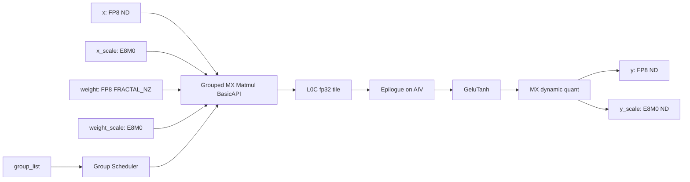
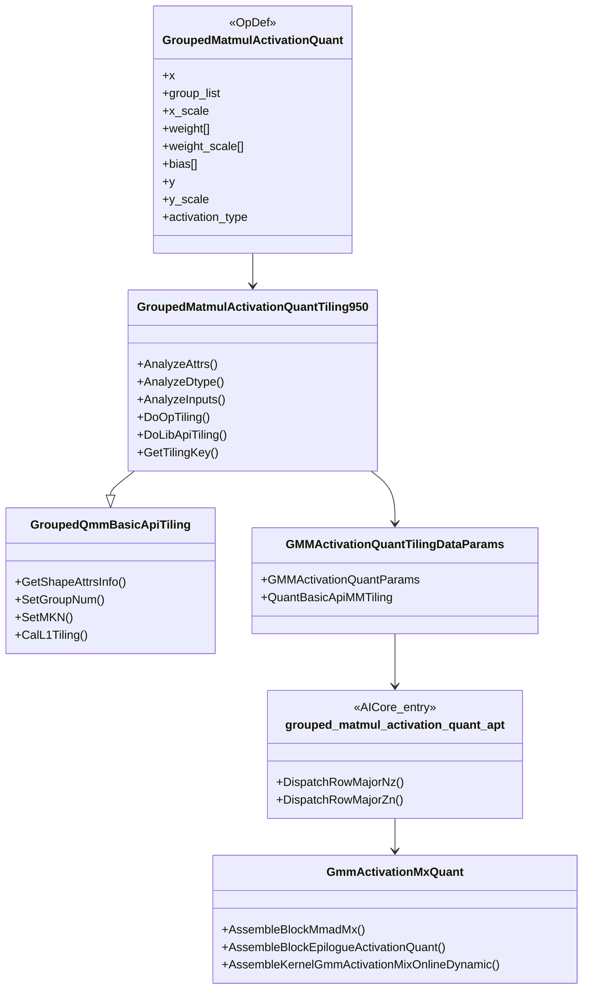
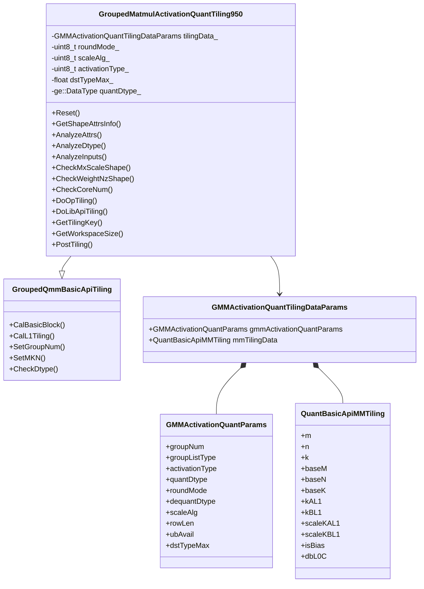
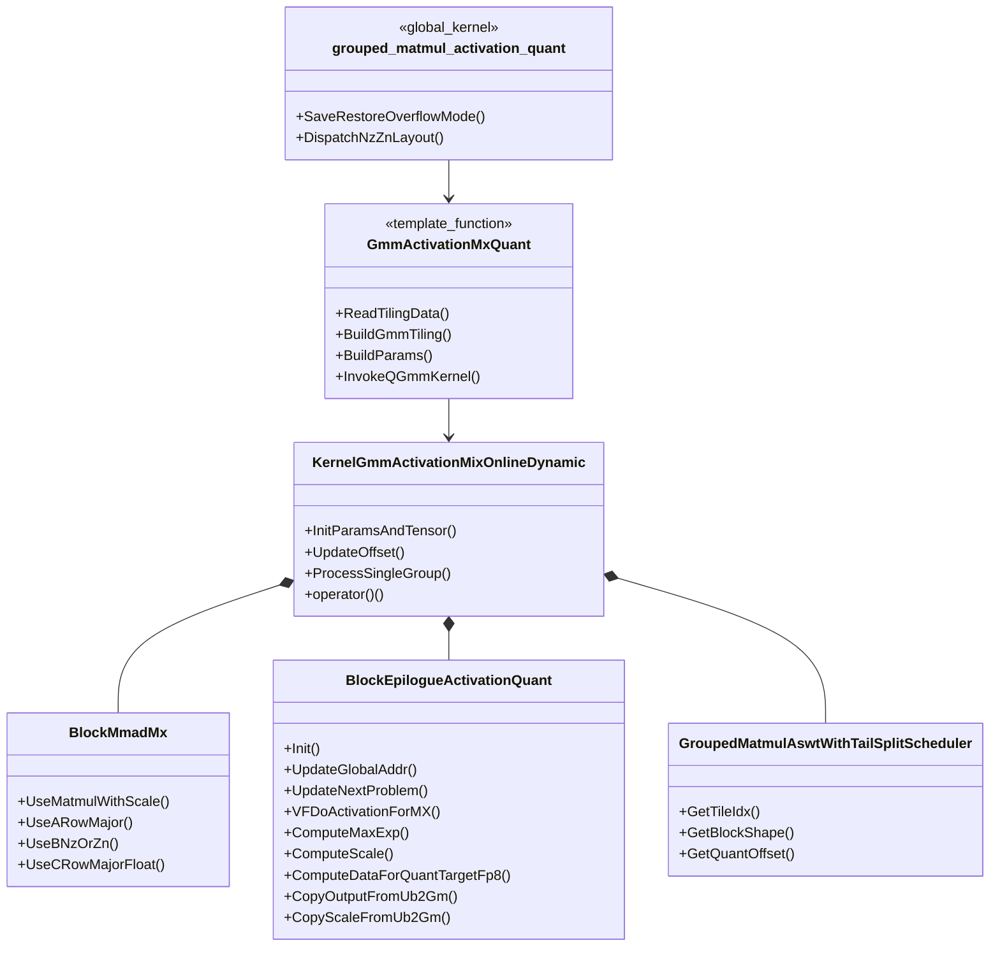
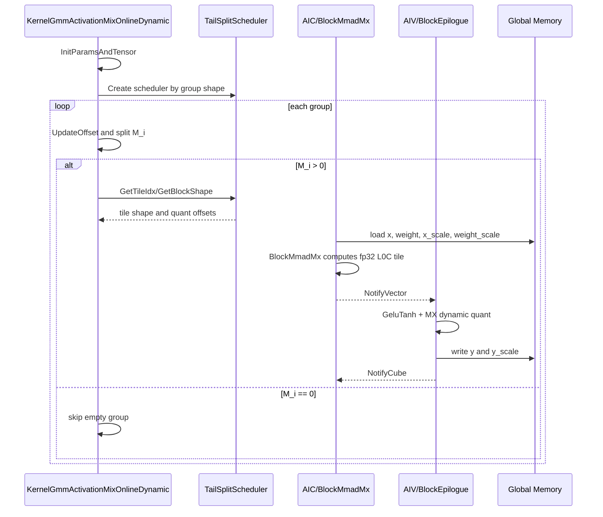
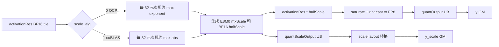

# GroupedMatmulActivationQuant Kernel/Tiling SRS

## 1. 迭代信息

| 项目 | 内容 |
| --- | --- |
| 迭代名称 | GroupedMatmulActivationQuant kernel/tiling 实现 |
| 算子类型 | GMM + Activation + MX FP8 dynamic quant 融合算子 |
| 覆盖范围 | Host def、InferShape、Tiling、AscendC Kernel、CSV tiling UT |
| 不覆盖范围 | aclnn/op_api、PTA wrapper、端到端精度 STC、性能 benchmark |
| 目标芯片 | Ascend950 / `__NPU_ARCH__ == 3510` |
| 迭代版本 | v0.1 |
| 更新时间 | 2026-06-08 |

## 2. 需求背景

当前模型图中存在如下计算链路：

`GroupedMatmul(MX FP8 input, MX FP8 weight NZ)` -> `fp32 accumulator` -> `GeluTanh activation` -> `dynamic MX FP8 quant` -> `y/y_scale`

若将 GMM、Activation、Dynamic MX Quant 拆成多个算子，会产生额外 GM 读写、调度开销和中间张量生命周期。`GroupedMatmulActivationQuant` 的目标是将上述链路融合到一个 AscendC kernel 中：

- GMM 主体复用 grouped matmul 低阶 BasicAPI 能力。
- weight 使用 FP8 `FRACTAL_NZ` 存储。
- 输入、权重和输出只支持 FP8 `FLOAT8_E4M3FN` / `FLOAT8_E5M2` 场景。
- scale 使用 MX `FLOAT8_E8M0`，scale 形状按 `ceil(K / 64)` 和 `ceil(N / 64)` 分块。
- 当前 activation 仅支持 `GMM_ACT_TYPE_GELU_TANH = 2`。
- quant 逻辑参考 `dynamic_mx_quant_tail_axis_fp8.h` 的 tail axis FP8 MX quant 思路，并在 epilogue 中完成。

### 2.1 设计结论摘要

本轮设计可以概括为三件事：第一，把 GMM、GeluTanh 和 MX dynamic quant 合并成一个 Ascend950 AICore kernel；第二，GMM 主体不重造矩阵乘逻辑，而是复用已有 grouped QMM BasicAPI 和 MX scale 能力；第三，把 activation 和 quant 放到 epilogue，在 L0C 结果出 tile 后直接完成 BF16 activation、FP8 cast、`y/y_scale` 写回。

因此本算子的核心收益来自“少落一次中间张量”。融合前，中间 activation 输入和 quant 输入需要经过 GM；融合后，matmul 的 fp32 tile 在 AIV epilogue 中就地完成后处理，只输出最终 FP8 `y` 和 E8M0 `y_scale`。当前交付的主要风险不在接口覆盖面，而在数值一致性和边界用例：GeluTanh 近似、OCP/cuBLAS scale 选择、NZ weight layout、dynamic input 语义都需要通过后续 STC 继续闭环。

## 3. 方案简述

### 3.1 总体数据流



### 3.2 模块划分

| 模块 | 职责 |
| --- | --- |
| Host def | 定义输入、输出、属性顺序和 dtype/format 组合；注册 Ascend950 AICore 配置 |
| InferShape | 根据 `x` 和 `weight_scale` 推导 `y` / `y_scale` shape；根据 `quant_dtype` 推导 `y` dtype |
| Tiling | 校验 dtype、shape、attr；调用 GMM BasicAPI tiling；生成 `GMMActivationQuantTilingDataParams` |
| Kernel Dispatch | 根据 tiling key 选择 `weight` 是否转置，对应 `layout::Nz` / `layout::Zn` |
| GMM Kernel | 按 group 遍历，使用 low-level MX matmul BasicAPI 完成矩阵乘 |
| Epilogue | 对每个 matmul tile 做 GeluTanh + MX dynamic quant + GM 写回 |
| UT | 使用 CSV 驱动 tiling 白盒用例，覆盖合法和非法参数 |

### 3.3 当前实现边界

这篇 SRS 描述的是本轮 kernel/tiling 交付，不包含 aclnn/op_api 通路。为避免接口字段和实际数值路径混淆，当前实现边界如下：

- `activation_type` 是必选属性，但当前只允许 `GELU_TANH = 2`。tiling 会在 host 侧拦截其他值，kernel/epilogue 暂不做多 activation 分支。
- `x_scale` 在 def 中保持 optional，以便和 schema 演进兼容；当前 MX FP8 路径在 tiling 中会读取 `x_scale` desc/shape，因此本轮实际要求调用方传入有效 `x_scale`。
- `bias` 是 dynamic input 预留字段，kernel 入口接收该地址但当前通过 `(void)bias` 丢弃，不参与 GMM、Activation 或 Quant 数值计算。
- `weight`、`weight_scale`、`bias` 都是 dynamic input；当前 GMM 路径只消费 `weight[0]` 和 `weight_scale[0]`，多 weight list 不是本轮交付目标。
- `round_mode`、`scale_alg`、`dst_type_max` 仅按 MX FP8 当前可用组合收敛：`round_mode = "rint"`，`scale_alg in {0, 1}`，`dst_type_max = 0.0`。

### 3.4 类关系总览



## 4. 输入输出规格

### 4.1 Host 字段顺序

def 文件需按以下顺序声明。该顺序同时决定 tiling/infershape 中 attr index 和 input index：

| 字段分组 | 字段名 | index | 当前实现要求 |
| --- | --- | ---: | --- |
| REQUIRED_INPUT | `x` | 0 | FP8 ND，形状 `[M, K]` |
| REQUIRED_INPUT | `group_list` | 1 | INT64 ND，形状 `[E]` |
| OPTIONAL_INPUT | `x_scale` | 2 | schema 为 optional；当前 MX FP8 kernel/tiling 实际必传，E8M0 ND，形状 `[M, ceil(K/64), 2]` |
| DYNAMIC_INPUT | `weight` | 3 | FP8 FRACTAL_NZ，动态 tensor list；当前仅消费第 0 个 tensor |
| DYNAMIC_INPUT | `weight_scale` | 4 | E8M0 ND，动态 tensor list；当前仅消费第 0 个 tensor |
| DYNAMIC_INPUT | `bias` | 5 | 预留 dynamic input；当前 kernel 接收但不消费 |
| OUTPUT | `y` | 0 | FP8 ND，形状 `[M, N]` |
| OUTPUT | `y_scale` | 1 | E8M0 ND，形状 `[M, ceil(N/64), 2]` |
| REQUIRED_ATTR | `activation_type` | 0 | 当前仅支持 `2`，即 GELU_TANH |
| OPTIONAL_ATTR | `dequant_dtype` | 1 | 当前仅支持 `ge::DT_FLOAT` |
| OPTIONAL_ATTR | `transpose_weight` | 2 | `false` 或 `true` |
| OPTIONAL_ATTR | `group_list_type` | 3 | `0` 累加 offsets；`1` 每组 token count |
| OPTIONAL_ATTR | `tuning_config` | 4 | 当前保留，默认 `{0}` |
| OPTIONAL_ATTR | `quant_dtype` | 5 | `FLOAT8_E4M3FN` 或 `FLOAT8_E5M2` |
| OPTIONAL_ATTR | `round_mode` | 6 | 当前仅支持 `"rint"` |
| OPTIONAL_ATTR | `scale_alg` | 7 | `0` OCP；`1` cuBLAS |
| OPTIONAL_ATTR | `dst_type_max` | 8 | 当前仅支持 `0.0` |

### 4.2 dtype 与 format

| 张量 | dtype | format | 说明 |
| --- | --- | --- | --- |
| `x` | `FLOAT8_E4M3FN` / `FLOAT8_E5M2` | `ND` | GMM A 矩阵 |
| `x_scale` | `FLOAT8_E8M0` | `ND` | MX per-token scale |
| `group_list` | `INT64` | `ND` | group 边界或长度 |
| `weight` | `FLOAT8_E4M3FN` / `FLOAT8_E5M2` | `FRACTAL_NZ` | GMM B 矩阵，dynamic input 第 0 个 tensor |
| `weight_scale` | `FLOAT8_E8M0` | `ND` | MX per-group weight scale |
| `bias` | `FLOAT` | `ND` | 接口预留；当前非空也不参与计算，后续策略待定 |
| `y` | `FLOAT8_E4M3FN` / `FLOAT8_E5M2` | `ND` | `y.dtype == quant_dtype` |
| `y_scale` | `FLOAT8_E8M0` | `ND` | 输出 MX scale |

### 4.3 shape 约束

设：

- `M` 为所有 group token 总数。
- `E` 为 group 数。
- `K` 为输入 hidden size。
- `N` 为输出 hidden size。
- `KBlocks = ceil(K / 64)`。
- `NBlocks = ceil(N / 64)`。

| 张量 | 非转置 weight | 转置 weight |
| --- | --- | --- |
| `x` | `[M, K]` | `[M, K]` |
| `x_scale` | `[M, KBlocks, 2]` | `[M, KBlocks, 2]` |
| `weight.origin` | `[E, K, N]` | `[E, N, K]` |
| `weight.storage` | `[E, ceil(N/32), ceil(K/16), 16, 32]` | `[E, ceil(K/32), ceil(N/16), 16, 32]` |
| `weight_scale` | `[E, KBlocks, N, 2]` | `[E, N, KBlocks, 2]` |
| `y` | `[M, N]` | `[M, N]` |
| `y_scale` | `[M, NBlocks, 2]` | `[M, NBlocks, 2]` |

必须满足：

- `x_scale.rank == 3`。
- `weight_scale.rank == 4`。
- `weight.storage.rank == 5`。
- `weight.storage[3] == 16`。
- `weight.storage[4] == 32`。
- `x_scale[M] == x[M]`。
- `x_scale[KBlock] == ceil(K / 64)`。
- `x_scale[pair] == 2`。
- `weight_scale[group] == E`。
- `weight_scale[N] == N`，转置时 N 维在 index 1，非转置时在 index 2。
- `weight_scale[KBlock] == ceil(K / 64)`，转置时 KBlock 维在 index 2，非转置时在 index 1。
- `weight_scale[pair] == 2`。

说明：

- `weight.storage` 表中的 leading dims 是 FP8 NZ layout 下的期望存储展开形式；当前 tiling 侧强校验 `rank == 5` 和尾两维 `16/32`，`M/K/N/E` 关系由 origin shape、BasicAPI tiling 和 kernel offset 共同约束。
- `x_scale` 和 `weight_scale` 的 scale 块维按 64 个原始 K/N 元素生成两个 E8M0 scale 字节，对应 MX FP8 的 pair dim = 2。
- `group_list` 的内容合法性依赖运行时数据，本轮 tiling 只校验 shape 和 `group_list_type`，不读取 GM 数据。

### 4.4 dtype/format/场景矩阵

| x dtype | weight dtype | y dtype | quant_dtype | weight format | transpose_weight | 是否支持 |
| --- | --- | --- | --- | --- | --- | --- |
| E4M3 | E4M3 | E4M3 | E4M3 | FRACTAL_NZ | false | 支持 |
| E4M3 | E5M2 | E4M3 | E4M3 | FRACTAL_NZ | false | 支持 |
| E5M2 | E4M3 | E5M2 | E5M2 | FRACTAL_NZ | false | 支持 |
| E5M2 | E5M2 | E5M2 | E5M2 | FRACTAL_NZ | false | 支持 |
| E4M3/E5M2 | E4M3/E5M2 | E4M3/E5M2 | 同 y | FRACTAL_NZ | true | 支持 |
| FP16/BF16/FP32 | 任意 | 任意 | 任意 | 任意 | 任意 | 不支持 |
| FP8 | FP8 | FP8 | 与 y 不一致 | FRACTAL_NZ | 任意 | 不支持 |
| FP8 | FP8 | FP8 | E4M3/E5M2 | ND weight | 任意 | 不支持 |

## 5. 交付标准

| 交付范围 | 当前迭代 |
| --- | --- |
| 交付通路 | Ascend950 AICore kernel，`opFile.value = grouped_matmul_activation_quant_apt` |
| 动态/静态要求 | 支持动态 shape；tiling 使用 `DynamicCompileStaticFlag(true)`、`DynamicShapeSupportFlag(true)` |
| 精度交付标准 | 与参考链路 `GMM(fp32 accum) -> GeluTanh -> Dynamic MX Quant` 对齐；具体容差待 STC 定义 |
| 性能交付标准 | 目标是减少中间 GM 读写；本 SRS 不给性能阈值，性能 benchmark 待补 |
| UT 交付 | CSV tiling UT 覆盖 dtype、shape、attr、core ratio、tiling key |
| 设计材料 | 本 SRS；代码路径见第 7 章 |
| 维测材料 | 暂无；依赖 tiling 日志和 UT 失败信息定位 |

### 5.1 交付结论

- 本轮交付的是 kernel/tiling 能力，不交付 aclnn/op_api、PTA wrapper 和端到端 benchmark。
- 支持面刻意收窄到 Ascend950、MX FP8、NZ weight、`activation_type=GELU_TANH`，这样可以先把主链路打通并降低融合 epilogue 的不确定性。
- Tiling UT 已覆盖主要 host 侧准入条件；数值精度、scale byte 一致性和性能收益需要 STC/benchmark 继续验证。

## 6. 具体方案描述

### 6.1 Tiling 设计

#### 6.1.1 Tiling 数据结构

```cpp
BEGIN_TILING_DATA_DEF(GMMActivationQuantParams)
    uint32_t groupNum;
    uint8_t groupListType;
    uint8_t activationType;
    uint8_t quantDtype;
    uint8_t roundMode;
    uint8_t dequantDtype;
    uint8_t scaleAlg;
    uint32_t rowLen;      // 预留
    uint32_t ubAvail;     // 预留
    float dstTypeMax;
END_TILING_DATA_DEF;

BEGIN_TILING_DATA_DEF(GMMActivationQuantTilingDataParams)
    GMMActivationQuantParams gmmActivationQuantParams;
    QuantBasicApiMMTiling mmTilingData;
END_TILING_DATA_DEF;
```

`mmTilingData` 由 `GroupedQmmBasicApiTiling` 计算，kernel 侧转换成 `KernelGmmActivationMixOnlineDynamic::GMMTiling`。

#### 6.1.2 Tiling 主流程

Tiling 只保留阶段级描述，不展开逐函数实现细节。整体流程如下：

| 阶段 | 主要动作 | 产物/约束 |
| --- | --- | --- |
| 编译信息准备 | 从 `PlatformAscendC` 读取 AIC/AIV、UB/L1/L0/L2、SoC、NPU arch | `GMMCompileInfo` |
| schema 解析 | 读取输入、输出、dynamic input 第 0 个 tensor 和 attr | 与第 4.1 节顺序保持一致 |
| attr 校验 | 收敛 activation、quant、transpose、group_list 相关属性 | 只允许 GELU_TANH、MX FP8 当前组合 |
| dtype/format 校验 | 校验 FP8 输入输出、E8M0 scale、NZ weight | 不支持 FP16/BF16/FP32 或 ND weight |
| shape 校验 | 校验 `x_scale`、`weight_scale`、`weight.storage` 关键维度 | scale block 按 64 元素，pair dim 为 2 |
| BasicAPI tiling | 复用 `GroupedQmmBasicApiTiling` 计算 matmul tile | 生成 `QuantBasicApiMMTiling` |
| tiling data 写入 | 写入 group、activation、quant、matmul 切分信息 | `GMMActivationQuantTilingDataParams` |
| workspace/post | 设置系统 workspace，保存 tiling data | kernel dispatch 使用 tiling key |

#### 6.1.3 Tiling 校验要点

| 检查域 | 当前规则 |
| --- | --- |
| activation | `activation_type == 2`，即 GELU_TANH |
| dequant | `dequant_dtype == ge::DT_FLOAT` |
| quant | `quant_dtype` 只支持 `FLOAT8_E4M3FN` / `FLOAT8_E5M2`，且必须等于 `y.dtype` |
| round | `round_mode == "rint"` |
| scale algorithm | `scale_alg == 0` 表示 OCP，`scale_alg == 1` 表示 cuBLAS |
| dst max | `dst_type_max == 0.0` |
| x/weight/y dtype | 均为 FP8 E4M3/E5M2 组合 |
| scale dtype | `x_scale`、`weight_scale`、`y_scale` 均为 `FLOAT8_E8M0` |
| weight format | 只支持 `FRACTAL_NZ`，storage rank 为 5，尾维为 `16/32` |
| scale shape | `x_scale=[M, ceil(K/64), 2]`；`weight_scale` 按转置状态匹配 `[E, KBlocks, N, 2]` 或 `[E, N, KBlocks, 2]` |
| core ratio | AIC:AIV 必须为 1:2 |

`tuning_config` 当前随 schema 保留，tiling 实现没有读取该字段；若后续需要指定 block shape 或策略开关，应在本流程中显式解析并写入 tiling data。

#### 6.1.4 BasicAPI tiling 与 tiling data

矩阵乘切分复用 `GroupedQmmBasicApiTiling`。本算子只在其输出基础上限制 `baseM` 上界、写入 MX scale 相关 K 方向切分，并把融合 epilogue 需要的属性写入 `GMMActivationQuantParams`。

| tiling data | 字段 | 来源 |
| --- | --- | --- |
| `GMMActivationQuantParams` | `groupNum/groupListType` | `group_list` shape 和 `group_list_type` |
| `GMMActivationQuantParams` | `activationType` | `activation_type`，当前固定 GELU_TANH |
| `GMMActivationQuantParams` | `quantDtype` | `y.dtype` 对应 GE dtype enum |
| `GMMActivationQuantParams` | `roundMode/scaleAlg/dstTypeMax` | 对应 quant attr |
| `QuantBasicApiMMTiling` | `m/n/k/baseM/baseN/baseK` | BasicAPI tiling 结果 |
| `QuantBasicApiMMTiling` | `kAL1/kBL1/scaleKAL1/scaleKBL1` | BasicAPI L1 tiling 和 MX scale K 方向切分 |
| `QuantBasicApiMMTiling` | `isBias/dbL0C` | 当前 `isBias=0`，`dbL0C` 来自 BasicAPI |

#### 6.1.5 tiling key

当前只生成两个有效 kernel 模板组合：

| tiling key 逻辑 | `QUANT_B_TRANS` | `QUANT_A_TRANS` | A layout | B layout | 是否支持 |
| --- | ---: | ---: | --- | --- | --- |
| no-trans weight | 0 | 0 | RowMajor | Nz | 支持 |
| trans weight | 1 | 0 | RowMajor | Zn | 支持 |
| trans x | 0/1 | 1 | - | - | 不支持 |

tiling key 仅由 `transpose_weight` 和固定的 `transA=false` 共同决定，kernel dispatch 按表中的 layout 选择模板。

#### 6.1.6 Tiling 类图



#### 6.1.7 Tiling 小结

Tiling 的职责可以归纳为“收口、复用、传参”：

- 收口：把本轮只支持的输入组合在 host 侧提前拦截，包括 FP8 dtype、E8M0 scale、NZ weight、`activation_type=2`、`round_mode="rint"`、`scale_alg in {0,1}` 和 AIC/AIV 1:2。
- 复用：矩阵乘切分仍然交给 `GroupedQmmBasicApiTiling`，本算子只在其结果上限制 `baseM`、补齐 MX scale K 方向 tiling，并生成融合参数。
- 传参：tiling data 分成 `GMMActivationQuantParams` 和 `QuantBasicApiMMTiling` 两部分，前者描述融合 epilogue 的 activation/quant 行为，后者描述 BasicAPI matmul tile。

从评审角度看，Tiling 的关键不是追求最多场景，而是保证每个进入 kernel 的 case 都满足 epilogue 的假设：`y` dtype 与 `quant_dtype` 一致，scale layout 可按 `ceil(K/64)`、`ceil(N/64)` 解释，weight storage 至少满足 FP8 NZ 的尾维规则。

### 6.2 Kernel 设计

#### 6.2.1 Kernel 参数入口

```cpp
__global__ __aicore__ void grouped_matmul_activation_quant(
    GM_ADDR x,
    GM_ADDR groupList,
    GM_ADDR xScale,
    GM_ADDR weight,
    GM_ADDR weightScale,
    GM_ADDR bias,
    GM_ADDR y,
    GM_ADDR yScale,
    GM_ADDR workspace,
    GM_ADDR tiling);
```

说明：

- 参数顺序与 def 文件输入输出顺序一致。
- `bias` 为预留输入，当前 `(void)bias`，不进入 matmul 或 epilogue。
- kernel 会临时将 float overflow mode 控制位清 0，结束时恢复。

#### 6.2.2 Kernel 参数装配

`GmmActivationMxQuant` 是 kernel dispatch 后的模板组装层，核心职责如下：

| 装配项 | 内容 |
| --- | --- |
| tiling 读取 | 读取 `GMMActivationQuantParams` 和 `QuantBasicApiMMTiling` |
| MMAD block | 组装 `BlockMmadMx`，A layout 固定 RowMajor，B layout 由 tiling key 决定为 Nz 或 Zn |
| Epilogue block | 组装 `BlockEpilogueActivationQuant`，输出 dtype 为 FP8，scale dtype 为 E8M0 |
| Scheduler | 使用 `GroupedMatmulAswtWithTailSplitScheduler` 做 group/tile 调度 |
| GMM 参数 | 传入 `groupNum`、`m/n/k`、`baseM/baseN/baseK`、L1 切分、`groupListType` 等 |
| MMAD 地址 | 传入 `x`、`weight`、`weightScale`、`xScale`、`y`、`groupList` |
| Epilogue 地址和属性 | 传入 `y`、`yScale`、`baseM/baseN`、`roundMode`、`scaleAlg`、`dstTypeMax`、`activationType` |

当前 `bias` 不进入参数装配，`isBias` 固定为 0。

#### 6.2.3 Kernel 类图



#### 6.2.4 分组调度流程

```mermaid
flowchart TD
    Start[Kernel operator()] --> Init[InitParamsAndTensor]
    Init --> AICInit{AIC?}
    AICInit -->|yes| InitMmad[Init BlockMmad with m,n,k/baseM/baseN/baseK/L1]
    AICInit -->|no| InitEpi
    InitMmad --> InitEpi[Init Epilogue]
    InitEpi --> Scheduler[Create tail-split scheduler]
    Scheduler --> LoopGroup[for groupIdx in groupNum]
    LoopGroup --> UpdateGroup[UpdateOffset + GetSplitValue]
    UpdateGroup --> Skip{M_i == 0?}
    Skip -->|yes| LoopGroup
    Skip -->|no| UpdateMmad[Update matmul problem shape]
    UpdateMmad --> L2[Set L2 cache hint]
    L2 --> TileLoop[ProcessSingleGroup tile loop]
    TileLoop --> LoopGroup
    LoopGroup --> End[Wait final vector if needed]
```



#### 6.2.5 group_list 语义

| `group_list_type` | 语义 | 每组 M 值计算方式 |
| ---: | --- | --- |
| 0 | `group_list` 保存每组累加结束 offset | 当前 offset 减上一组 offset |
| 1 | `group_list` 保存每组 token 数 | 直接读取当前 group 的 count |

`M_i == 0` 的 group 会被调度层跳过，不进入 MMAD 和 epilogue。

#### 6.2.6 group 间 GM offset 更新

group 间 offset 更新遵循“按上一组 M 推进 A/Y，按 group index 推进 NZ weight”的原则：

| 地址 | 更新依据 |
| --- | --- |
| `x/aOffset` | 上一组 `M_i * K` |
| `weight/bOffset` | NZ storage 按 group 独立存放，转置和非转置使用不同的 N/K 对齐方式 |
| `xScaleOffset` | 上一组 `M_i * ceil(K/64) * 2` |
| `wScaleOffset` | 每组 `N * ceil(K/64) * 2` |
| `yOffset` | 上一组 `M_i * N` |
| `yScaleOffset` | 上一组 `M_i * ceil(N/64) * 2` |

#### 6.2.7 tile 内 AIC/AIV 协同

| 角色 | 主要职责 |
| --- | --- |
| Scheduler | 为当前 group 生成 tile index、tile shape 和 MX scale offset |
| AIC | 等待上一轮 AIV 消费完成后，调用 `BlockMmadMx` 计算 fp32 L0C tile |
| AIV | 等待 AIC 产出后，执行 GeluTanh + MX dynamic quant，并写回 `y/y_scale` |
| 同步 | AIC/AIV 通过 `NotifyVector` 和 `NotifyCube` 保持流水顺序 |

#### 6.2.8 Epilogue UB 规划

Epilogue 在 AIV 侧运行。UB 区域按固定偏移划分：

| UB tensor | 类型 | 大小/上限 | 用途 |
| --- | --- | --- | --- |
| `l0cOutUbFirst_` | `DataTypeIn` | `MAX_SINGLE_MN` | matmul 输出 tile，来源于 L0C -> UB |
| `quantOutput_` | `int8_t` | `MAX_SINGLE_MN` | FP8 量化后 y |
| `quantScaleOutput_` | `int8_t` | `MAX_SINGLE_MN / 32` | 临时 scale |
| `activationRes_` | `bfloat16_t` | `MAX_SINGLE_MN` | GeluTanh 后 BF16 中间结果 |
| `maxExp_` | `uint16_t` | `MAX_SINGLE_MN / 32` | 每 32 元素规约 max exponent |
| `halfScale_` | `uint16_t` | `MAX_SINGLE_MN / 32` | 反量化/量化用 half scale |
| `quantScaleBlockOutput_` | `int8_t` | `baseM / taskRatio * 32` | GM 写回前 scale layout |

#### 6.2.9 Epilogue 主流程

Epilogue 在 AIV 侧完成当前 tile 的后处理，流程按阶段概括如下：

| 阶段 | 说明 |
| --- | --- |
| tile 拆分 | 按 subBlock 切分 `singleM`，避免两条 vector 子块重复处理同一行 |
| activation | 从 L0C 输出 UB 读取 fp32 tile，执行 GeluTanh，并将结果保存为 BF16 中间值 |
| scale 生成 | 根据 `scale_alg` 选择 OCP 或 cuBLAS 分支，生成 E8M0 `mxScale` 和用于 FP8 cast 的 `halfScale` |
| FP8 cast | 对 BF16 activation 结果乘 `halfScale`，执行 sat + rint cast 到目标 FP8 |
| scale layout | 将紧凑 scale 重排成 GM 写回需要的布局 |
| GM 写回 | 写回 `y` 和 `y_scale`，stride 由完整 `N` 和 `ceil(N/64)*2` 决定 |

#### 6.2.10 GeluTanh 计算

当前实现使用 sigmoid 形式的 GeluTanh 近似：

`GeluTanh(x) = x / (1 + exp(-1.595769121 * (x + 0.044715 * x^3)))`

实现中会用等价代数变形组织常数乘法，最终结果先按 rint 转成 BF16，作为后续 MX quant 的输入。`activation_type` 当前只允许 GELU_TANH，因此 epilogue 内不需要额外 activation 分支。

#### 6.2.11 MX dynamic quant

量化主流程：



| 分支/阶段 | 设计说明 |
| --- | --- |
| OCP scale | 对每 32 个 BF16 元素规约 exponent，按目标 FP8 exponent 范围生成共享 scale |
| cuBLAS scale | 对每 32 个 BF16 元素规约绝对值，再结合目标 FP8 dtype max 反推出共享 scale |
| 特殊值 | INF/NaN、zero 和小 exponent 区间按照参考 dynamic MX quant 路径处理 |
| FP8 cast | activation 结果乘 `halfScale` 后执行 sat + rint cast 到 `FLOAT8_E4M3FN` 或 `FLOAT8_E5M2` |
| scale 写回 | E8M0 scale 先在 UB 中按紧凑布局生成，再转换成 `y_scale` 的 GM layout |
| 输出 stride | `y` stride 按完整 `N`，`y_scale` stride 按完整 `ceil(N/64)*2` |

#### 6.2.12 Kernel 小结

Kernel 侧的设计主线是“BasicAPI 负责算 matmul，epilogue 负责融合后处理”。AIC 侧只关心按 group 和 tile 取数、调用 `BlockMmadMx` 产出 fp32 L0C；AIV 侧等待 cube 完成后，把当前 tile 做 GeluTanh、MX scale 规约、FP8 cast 和 GM 写回。两侧通过 `NotifyVector/NotifyCube` 保持生产消费顺序。

融合点主要在 epilogue，而不是在 GMM 主循环里硬塞 activation/quant 分支。这样做的好处是 GMM 调度仍然沿用已有 tail-split scheduler 和 BasicAPI layout 体系，新增复杂度集中在 `BlockEpilogueActivationQuant`；代价是 epilogue 必须严格依赖 tiling 给出的 `baseM/baseN`、`scaleAlg`、`roundMode`、`activationType` 等参数，host 侧校验必须足够保守。

本轮 kernel 的实现结论如下：

- `transpose_weight=false` 使用 `RowMajor/Nz`，`transpose_weight=true` 使用 `RowMajor/Zn`，`x` 不支持转置。
- `bias` 不进入 matmul 和 epilogue，当前所有数值结果等价于无 bias 链路。
- GeluTanh 使用 sigmoid 形式近似，activation 后先转 BF16，再进入 MX dynamic quant。
- OCP 和 cuBLAS scale 分支共用后续 FP8 cast/writeback 流程，只在 scale 生成方式上不同。

## 7. 软件设计和接口定义

### 7.1 文件级修改清单

| 文件 | 设计职责 |
| --- | --- |
| `op_host/grouped_matmul_activation_quant_def.cpp` | 定义 `GroupedMatmulActivationQuant` schema；按指定顺序声明输入/输出/属性 |
| `op_host/grouped_matmul_activation_quant_infershape.cpp` | 推导 `y` 和 `y_scale` shape/dtype；跟随 attr index 顺序 |
| `op_host/op_tiling/arch35/grouped_matmul_activation_quant_tiling.{h,cpp}` | 校验参数；生成 GMM BasicAPI tiling 和融合参数 tiling |
| `op_kernel/arch35/grouped_matmul_activation_quant_apt.cpp` | kernel 入口；根据 tiling key dispatch layout |
| `op_kernel/arch35/grouped_matmul_activation_quant_mxquant.h` | 组装 BlockMmad、BlockEpilogue、Kernel 参数 |
| `common/cgmct/kernel/kernel_gmm_activation_mxquant.h` | 分组 GMM kernel 主调度 |
| `common/cgmct/epilogue/block_epilogue_activation_mx_quant.h` | GeluTanh + MX dynamic quant epilogue |
| `tests/ut/op_host/test_grouped_matmul_activation_quant_tiling.*` | CSV tiling UT |

### 7.2 修改要点

| 模块 | 修改要点 |
| --- | --- |
| def schema | 按第 4.1 节顺序声明字段；`activation_type` 为必选属性；保留 `x_scale` optional 和 `bias` dynamic 的接口形态 |
| InferShape | `y=[M,N]`；`y_scale=[M,ceil(N/64),2]`；`N` 根据 `transpose_weight` 从 `weight_scale` 对应维度推导 |
| Tiling | index 常量与 def 顺序一致；完成 attr/dtype/shape/core ratio 校验；写入 `GMMActivationQuantTilingDataParams` |
| Kernel dispatch | 根据 tiling key 选择 `RowMajor/Nz` 或 `RowMajor/Zn`，并在入口保存/恢复 float overflow mode |
| GMM 调度 | 使用 low-level BasicAPI 和 tail-split scheduler 处理 group/tile |
| Epilogue | 对 L0C fp32 tile 执行 GeluTanh、MX scale 生成、FP8 cast 和 `y/y_scale` 写回 |

### 7.3 软件设计小结

代码分层上，本轮没有把所有逻辑塞进一个 kernel 文件，而是按“接口定义、shape/dtype 推导、tiling、kernel dispatch、GMM 调度、epilogue”拆开。这个拆法的好处是每一层的职责比较单一：def 负责 schema，infershape 负责输出推导，tiling 负责准入和参数生成，kernel dispatch 负责模板选择，公共 GMM kernel 负责 group/tile 调度，epilogue 负责 activation + quant。

后续如果扩展 activation 类型，主要改动点应集中在 `activation_type` attr 校验、tiling data 传参和 `BlockEpilogueActivationQuant` 的 activation 分支；如果扩展 quant dtype 或 scale 算法，则主要影响 dtype/attr 准入、scale 生成逻辑和 STC golden。这个分层能让新增能力的影响范围比较清楚，不需要重新拆 GMM 主体。

## 8. UT 设计

### 8.1 UT 目标与边界

本轮 UT 以 tiling 白盒校验为主，目标是确认 host 侧 schema 顺序、dtype/format/shape/attr 准入、tiling key 和核心 compileInfo 约束符合设计。UT 不执行 AICore kernel，因此不覆盖 GeluTanh 数值精度、MX quant bit 级一致性和性能指标；这些内容需要后续 STC 或端到端精度测试补齐。

| 范围 | 覆盖方式 |
| --- | --- |
| def 顺序对齐 | CSV scalar 字段和 tensor 字段按 def 顺序构造 `TilingContextPara` |
| attr 准入 | 合法/非法 `activation_type`、`group_list_type`、`quant_dtype`、`round_mode`、`scale_alg`、`dst_type_max` |
| dtype/format 准入 | FP8 x/weight/y，E8M0 scale，NZ weight |
| shape 准入 | `x_scale`、`weight_scale`、`weight.storage` rank/tail dim |
| tiling key | no-trans 期望 key 0；trans weight 期望 key 1 |
| compileInfo | Ascend950，AIC/AIV 1:2 核比例 |
| kernel 数值 | 不在本 UT 覆盖范围内 |

### 8.2 UT 文件结构

| 文件 | 职责 |
| --- | --- |
| `tests/ut/op_host/test_grouped_matmul_activation_quant_tiling.cpp` | 读取 CSV、构造 `TilingContextPara`、执行 tiling、检查返回状态和 tiling key |
| `tests/ut/op_host/test_grouped_matmul_activation_quant_tiling.csv` | 表驱动用例数据，覆盖合法/非法场景 |
| `gmm_csv_ge_parse_utils.h` | 解析 dtype、format、shape、bool、字符串并生成安全参数名 |
| `tiling_case_executor.h` | 封装 `ExecuteTiling` / `ExecuteTestCase` |

UT 章节不画类图或流程图，仅说明 CSV 字段、执行逻辑和覆盖点。

### 8.3 CSV 字段设计

CSV 采用“固定 scalar 字段 + 固定 tensor 字段”的方式，避免 C++ 侧为每类 case 写重复样板。

- scalar 字段数：`18`。
- 输入 tensor 数：`6`，顺序为 `x`、`group_list`、`x_scale`、`weight`、`weight_scale`、`bias`。
- 输出 tensor 数：`2`，顺序为 `y`、`y_scale`。
- 每个 tensor 固定 4 个字段：`origin`、`storage`、`dtype`、`format`。
- 总列数：`18 + (6 + 2) * 4 = 50`。

scalar 字段顺序如下：

| 顺序 | 字段 | 用途 |
| ---: | --- | --- |
| 1 | `socVersion` | 只加载 `Ascend950` 用例 |
| 2 | `caseName` | 原始用例名，便于解析失败定位 |
| 3 | `enable` | 用例开关 |
| 4 | `prefix` | gtest 参数名来源 |
| 5 | `expectSuccess` | true 走成功 tiling；false 期望 `GRAPH_FAILED` |
| 6 | `expectTilingKey` | 成功 case 校验 tiling key |
| 7 | `aicNum` | compileInfo AIC 数 |
| 8 | `aivNum` | compileInfo AIV 数 |
| 9 | `ubSize` | compileInfo UB 大小 |
| 10 | `activationType` | 对应 def attr index 0 |
| 11 | `dequantDtype` | 对应 def attr index 1 |
| 12 | `transposeWeight` | 对应 def attr index 2 |
| 13 | `groupListType` | 对应 def attr index 3 |
| 14 | `tuningConfig` | 对应 def attr index 4，当前默认 `0` |
| 15 | `quantDtype` | 对应 def attr index 5 |
| 16 | `roundMode` | 对应 def attr index 6 |
| 17 | `scaleAlg` | 对应 def attr index 7 |
| 18 | `dstTypeMax` | 对应 def attr index 8 |

tensor 字段顺序如下：

| 顺序 | tensor | 字段组 | 说明 |
| ---: | --- | --- | --- |
| 1 | `x` | `x_origin/x_storage/x_dtype/x_format` | REQUIRED_INPUT 0 |
| 2 | `group_list` | `grouplist_origin/grouplist_storage/grouplist_dtype/grouplist_format` | REQUIRED_INPUT 1 |
| 3 | `x_scale` | `xscale_origin/xscale_storage/xscale_dtype/xscale_format` | OPTIONAL_INPUT 2，当前 MX path 需要有效 desc |
| 4 | `weight` | `weight_origin/weight_storage/weight_dtype/weight_format` | DYNAMIC_INPUT 3，第 0 个 tensor |
| 5 | `weight_scale` | `wscale_origin/wscale_storage/wscale_dtype/wscale_format` | DYNAMIC_INPUT 4，第 0 个 tensor |
| 6 | `bias` | `bias_origin/bias_storage/bias_dtype/bias_format` | DYNAMIC_INPUT 5，当前允许 `NONE/UNDEFINED` 表示不传有效 bias |
| 7 | `y` | `y_origin/y_storage/y_dtype/y_format` | OUTPUT 0 |
| 8 | `y_scale` | `yscale_origin/yscale_storage/yscale_dtype/yscale_format` | OUTPUT 1 |

### 8.4 UT 执行逻辑

| 步骤 | 说明 |
| --- | --- |
| 加载用例 | 只加载 `socVersion=Ascend950` 且 `enable=true` 的 CSV 行 |
| 构造上下文 | 按 CSV 字段构造 6 个输入 tensor、2 个输出 tensor、9 个 attr 和 `GMMCompileInfo` |
| 执行失败用例 | `expectSuccess=false` 时，期望 tiling 返回 `GRAPH_FAILED` |
| 执行成功用例 | `expectSuccess=true` 时，执行 tiling 并检查 `tilingKey` |
| 定位失败 | 使用 `prefix/caseName` 标识失败用例，CSV 解析异常输出行号 |

### 8.5 当前 CSV 用例覆盖

| case | 类型 | 关键输入 | 期望 |
| --- | --- | --- | --- |
| `valid_no_trans_e4m3` | 合法 | E4M3，`transposeWeight=false`，OCP scale | tiling 成功，key 0 |
| `valid_trans_e5m2_cublas` | 合法 | E5M2，`transposeWeight=true`，cuBLAS scale | tiling 成功，key 1 |
| `valid_grouplist_count` | 合法 | `group_list_type=1`，多 group count 模式 | tiling 成功，key 0 |
| `invalid_activation_type` | 非法 attr | `activation_type != 2` | `GRAPH_FAILED` |
| `invalid_group_list_type` | 非法 attr | `group_list_type` 不在 `{0,1}` | `GRAPH_FAILED` |
| `invalid_round_mode` | 非法 attr | `round_mode != "rint"` | `GRAPH_FAILED` |
| `invalid_scale_alg` | 非法 attr | `scale_alg` 不在 `{0,1}` | `GRAPH_FAILED` |
| `invalid_dst_type_max` | 非法 attr | `dst_type_max != 0.0` | `GRAPH_FAILED` |
| `invalid_quant_dtype` | 非法 attr | `quant_dtype` 不是 FP8 | `GRAPH_FAILED` |
| `invalid_y_dtype_mismatch` | 非法 dtype | `y.dtype != quant_dtype` | `GRAPH_FAILED` |
| `invalid_weight_nz_tail` | 非法 storage | NZ tail dim 不是 `16/32` | `GRAPH_FAILED` |
| `invalid_xscale_shape` | 非法 shape | `x_scale[1] != ceil(K/64)` | `GRAPH_FAILED` |
| `invalid_core_ratio` | 非法 compileInfo | AIC/AIV 不是 1:2 | `GRAPH_FAILED` |

### 8.6 建议补充用例

| 覆盖点 | 建议用例 | 目的 |
| --- | --- | --- |
| `x_scale` 缺失 | `x_scale` 使用 `NONE/UNDEFINED` 或空 shape | 明确 optional schema 在 MX path 下的失败行为 |
| `weight_scale` 转置维错误 | trans 场景交换 N/KBlock 维 | 覆盖 `transpose_weight=true` 下的 scale shape 校验 |
| `y_scale` dtype 错误 | `y_scale.dtype != FLOAT8_E8M0` | 补齐输出 scale dtype 负例 |
| weight format 错误 | `weight.format=ND` | 覆盖只支持 NZ weight 的负例 |
| bias 策略 | 非空 bias dynamic tensor | 明确当前“忽略”还是后续“非法”的产品策略 |
| group 数边界 | `group_list` shape 过大或空 group | 补充 group 调度边界 |
| mixed FP8 | `x`/`weight` 使用不同 FP8 dtype | 覆盖 dtype 组合矩阵 |

### 8.7 UT 小结

当前 CSV UT 可以证明两类事情：一是 schema 顺序和 attr/input index 与实现一致，二是 host tiling 对不支持的输入组合会提前失败。它不能证明 kernel 数值正确，也不能证明 epilogue 中 OCP/cuBLAS scale byte 与参考实现逐 bit 一致。

因此 UT 和 STC 的分工应保持清楚：UT 负责“能不能进 kernel”，STC 负责“进 kernel 后算得对不对”。后续补测优先级建议是先补 `x_scale` 缺失、`weight_scale` 转置维错误、`y_scale` dtype 错误和 weight ND format 负例，再补 mixed FP8 数值链路和非空 bias 策略用例。

## 9. 外部依赖

| 依赖项 | 依赖内容 | 影响 |
| --- | --- | --- |
| CANN/AscendC | `kernel_operator.h`、MicroAPI、tiling registry、template argument API | 高 |
| Ascend950 | 需要 AIC/AIV 1:2 核比例；`__NPU_ARCH__ == 3510` epilogue 编译分支 | 高 |
| GMM BasicAPI | `GroupedQmmBasicApiTiling`、`BlockMmadMx`、`GroupedMatmulAswtWithTailSplitScheduler` | 高 |
| MX quant 约定 | `FLOAT8_E8M0` scale、`ceil(K/64)`、`ceil(N/64)`、pair dim = 2 | 高 |
| Dynamic MX Quant 参考实现 | tail-axis FP8 dynamic quant 的 max exponent、scale、cast 思路 | 中 |
| UT 框架 | `TilingContextPara`、CSV parse util、`ExecuteTiling` | 中 |

## 10. 待确认事项

1. `x_scale` 在 def 中为 optional，但当前 MX kernel/tiling 实际要求必传；是否需要在接口文档中显式声明“optional but required for MX path”。
2. `bias` 当前按 schema 预留为 dynamic input，但 kernel 不使用；后续是否需要支持 matmul bias 或 activation 前/后 bias。
3. `activation_type` 当前只支持 GELU_TANH=2；后续若增加 ReLU/Silu/FastGelu，需要扩展 epilogue 分支和 STC。
4. `rowLen`、`ubAvail` tiling 字段当前预留未写入；是否保留或清理。
5. 性能交付阈值和精度容差需要 STC/benchmark 补齐。
6. 当前本地环境缺少 CMake，UT 需在 CI 或标准开发环境中执行确认。

## 11. 总结

`GroupedMatmulActivationQuant` 的本轮设计是一条收敛后的融合路径：输入和 weight 限定在 MX FP8 场景，weight 使用 `FRACTAL_NZ`，GMM 使用低阶 BasicAPI，activation 固定为 GeluTanh，quant 固定为 MX dynamic FP8 输出。这个范围看起来窄，但适合第一轮交付，因为它把主要工程风险集中在 epilogue 融合和 scale layout 上，而不是同时展开多 dtype、多 activation、多接口通路。

整体链路可以按下面四句话理解：

- Host schema 明确字段顺序，保留 `x_scale` optional 和 `bias` dynamic 的接口形态，但当前 MX path 对 `x_scale` 实际必传、对 `bias` 实际忽略。
- Tiling 负责把不满足 MX FP8/NZ/GeluTanh 的 case 拦在 kernel 外，并复用 `GroupedQmmBasicApiTiling` 生成 matmul tile 参数。
- Kernel 负责按 group 调度 BasicAPI matmul，把 L0C fp32 tile 交给 AIV epilogue。
- Epilogue 负责 GeluTanh、OCP/cuBLAS MX scale、FP8 sat+rint cast、`y/y_scale` 写回。

当前 SRS 的评审重点建议放在三处：

- 接口和实现是否一致：尤其是 `activation_type` 必选、`x_scale` optional 但实际必传、`bias` 预留不消费、dynamic input 只消费第 0 个 tensor。
- shape 和 layout 是否闭合：尤其是 `weight.storage` NZ 尾维、`x_scale/weight_scale/y_scale` 的 block 维和 pair dim。
- 测试闭环是否足够：tiling UT 已覆盖主要准入；STC 仍需补 GeluTanh 数值、OCP/cuBLAS scale byte、mixed FP8、trans weight 和边界 group。

如果后续继续演进，建议按“先数值闭环，再扩展能力”的顺序推进。先把当前 GeluTanh + MX FP8 链路和参考实现对齐，再考虑新增 activation 类型、bias 支持、更多 dynamic weight list、以及对外 aclnn/op_api 通路。

## 附录 A. UT/STC 交叉检查清单

| 检查域 | 设计约束 | 当前 CSV UT | 后续 STC/精度建议 |
| --- | --- | --- | --- |
| schema 顺序 | 输入、输出、attr 按第 4.1 节顺序声明和解析 | 通过 50 列 CSV 固定顺序覆盖 | aclnn/op_api 若后续补交付，需要同步接口文档 |
| activation | 仅 `activation_type=2` | 正例和非法 attr 已覆盖 | 端到端校验 GeluTanh 公式近似误差 |
| FP8 dtype | `x/weight/y/quant_dtype` 仅 E4M3/E5M2 | E4M3、E5M2、非法 quant、y mismatch 已覆盖 | 增加 mixed FP8 数值 case |
| scale dtype | `x_scale/weight_scale/y_scale` 为 E8M0 | 正例覆盖，`y_scale` dtype 负例待补 | STC 对齐 dynamic MX quant scale byte |
| weight format | 仅 FP8 `FRACTAL_NZ` | NZ tail dim 负例已覆盖 | 增加 ND format 负例 |
| transpose | `x` 不转置，`weight` 支持转置/非转置 | key 0/key 1 已覆盖 | STC 分别跑 no-trans/trans 数值 |
| group_list | 支持 offset 模式和 count 模式 | `group_list_type=0/1` 已覆盖 | 增加空 group、极端 group 数 |
| MX shape | `x_scale`、`weight_scale` rank 和块维匹配 | `x_scale` shape 负例已覆盖 | 增加 trans 下 `weight_scale` 维度负例 |
| core ratio | AIC:AIV 必须为 1:2 | 非法 core ratio 已覆盖 | CI 环境确认真实 Ascend950 compileInfo |
| bias | 当前 kernel 忽略 `bias` | 当前 CSV 使用 `NONE/UNDEFINED` | 非空 bias 的产品策略需确认后补测 |
| quant 数值 | OCP/cuBLAS 两条 scale 分支 | tiling 仅覆盖 `scale_alg` 准入 | STC 比对参考链路输出 `y/y_scale` |
| 性能 | 本轮只给融合方向，不给阈值 | 不适用 | benchmark 定义 GM 读写收益和性能阈值 |
