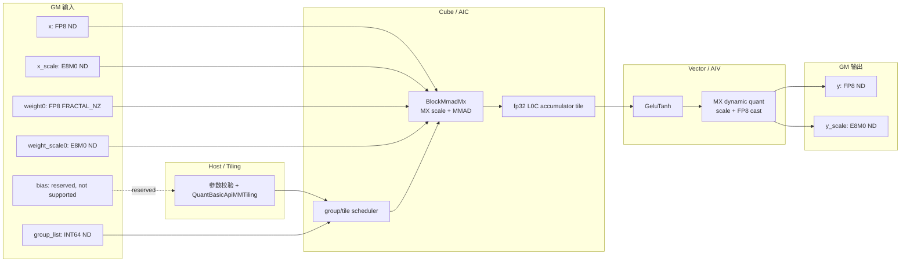
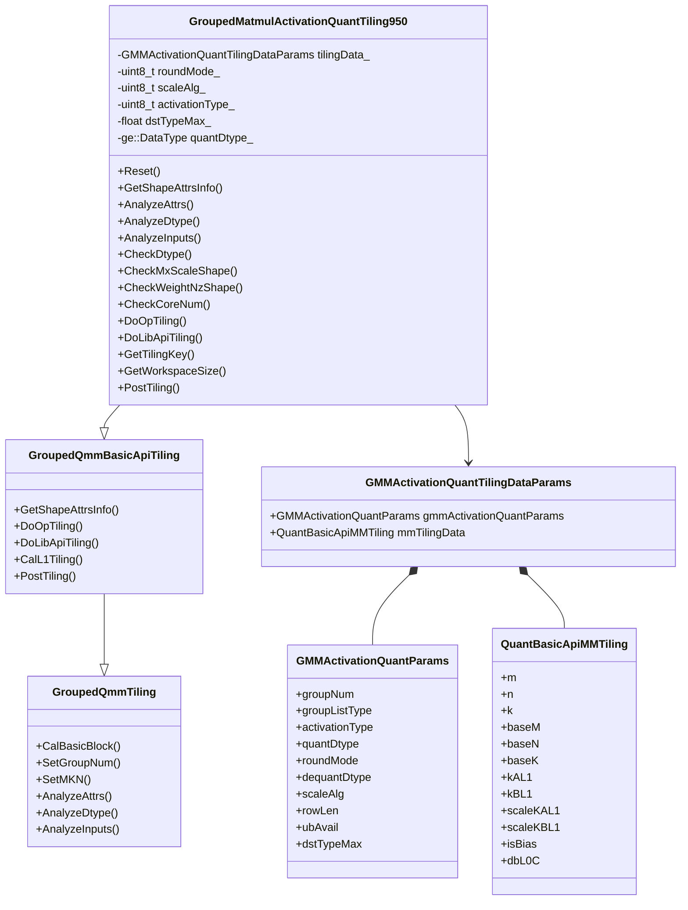
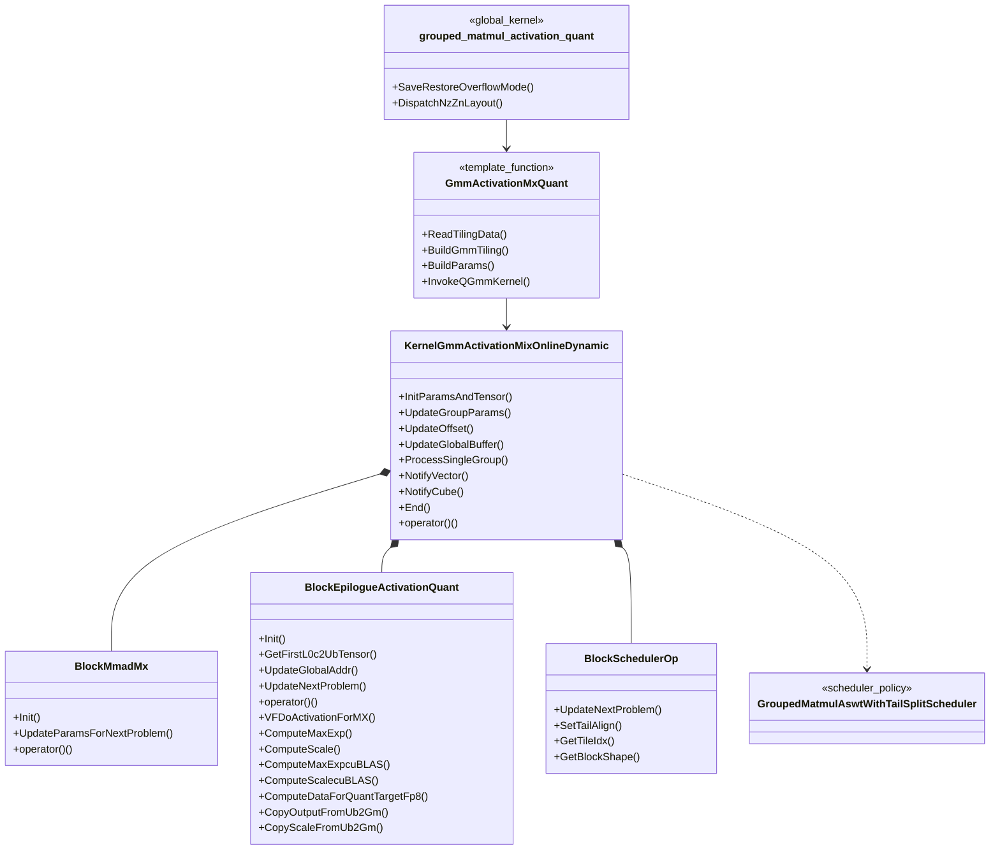
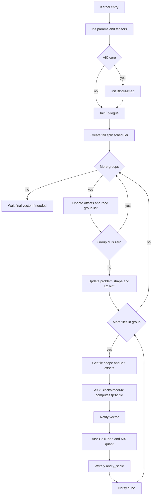
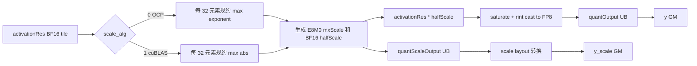

# GroupedMatmulActivationQuant Kernel/Tiling SRS

## 1. 需求背景

当前大多数热门模型图中存在如下计算链路：

`GroupedMatmul(MX FP8 input, MX FP8 weight NZ)` -> `fp32 accumulator` -> `GeluTanh activation` -> `dynamic MX FP8 quant` -> `y/y_scale`

若将 GMM、Activation、Dynamic MX Quant 拆成多个算子，会产生额外 GM 读写、调度开销和中间张量生命周期。`GroupedMatmulActivationQuant` 的目标是将上述链路融合到一个 AscendC kernel 中，减少中间结果和多算子调度成本，并将GMM切低阶api和weight nz来进一步提升性能。

## 2. 输入输出规格

### 2.1 def文件（算子原型参数）介绍

因为是新算子，所以介绍下算子原型，原型中的参数顺序决定了 tiling/infershape 中 attr index 和 input index的顺序：

| 字段分组 | 字段名 | index | 当前实现要求 |
| --- | --- | ---: | --- |
| REQUIRED_INPUT | `x` | 0 | FP8 ND，形状 `[M, K]` |
| REQUIRED_INPUT | `group_list` | 1 | INT64 ND，形状 `[E]` |
| OPTIONAL_INPUT | `x_scale` | 2 | 当前 MX FP8 kernel/tiling 实际必传，E8M0 ND，形状 `[M, ceil(K/64), 2]` |
| DYNAMIC_INPUT | `weight` | 3 | FP8 FRACTAL_NZ，动态 tensor list |
| DYNAMIC_INPUT | `weight_scale` | 4 | E8M0 ND，动态 tensor list |
| DYNAMIC_INPUT | `bias` | 5 | 预留输入，当前融合算子暂不支持 bias，不参与 tiling/kernel 计算 |
| OUTPUT | `y` | 0 | FP8 ND，形状 `[M, N]` |
| OUTPUT | `y_scale` | 1 | E8M0 ND，形状 `[M, ceil(N/64), 2]` |
| REQUIRED_ATTR | `activation_type` | 0 | string, 当前仅支持 `"gelu_tanh"` |
| OPTIONAL_ATTR | `dequant_dtype` | 1 | 默认且当前只支持0，即当前仅支持 `ge::DT_FLOAT` |
| OPTIONAL_ATTR | `transpose_weight` | 2 | `false` 或 `true` |
| OPTIONAL_ATTR | `group_list_type` | 3 | `0` 累加 offsets；`1` 每组 token count |
| OPTIONAL_ATTR | `tuning_config` | 4 | 预留属性，默认 `{0}` |
| OPTIONAL_ATTR | `quant_dtype` | 5 | `FLOAT8_E4M3FN` 或 `FLOAT8_E5M2`，默认`FLOAT8_E4M3FN` |
| OPTIONAL_ATTR | `round_mode` | 6 | fp8仅支持 `"rint"` |
| OPTIONAL_ATTR | `scale_alg` | 7 | `0` OCP；`1` cuBLAS |
| OPTIONAL_ATTR | `dst_type_max` | 8 | 预留属性，默认 `0.0`，FP8 场景不使用 |

### 2.2 输入规格

| 输入项 | 说明 |
| --- | --- |
| 量化场景 | MX FP8，GMM 输入、weight 和输出均为 FP8，scale 均为 MX `FLOAT8_E8M0`。 |
| dtype | `x`：`FLOAT8_E4M3FN` / `FLOAT8_E5M2`；`weight`：`FLOAT8_E4M3FN` / `FLOAT8_E5M2`；`x_scale` / `weight_scale`：`FLOAT8_E8M0`；`group_list`：`INT64`；`bias` 为预留输入，当前不参与计算。 |
| shape | `x` 为 `[M, K]`；`group_list` 为 `[E]`；`x_scale` 为 `[M, ceil(K / 64), 2]`；`weight` 逻辑 shape 和 `weight_scale` shape 由 `transpose_weight` 决定，详见 2.3。 |
| format | `x`、`x_scale`、`group_list`、`weight_scale` 均为 `ND`；`weight` 仅支持 `FRACTAL_NZ`；`bias` 为预留输入，当前不校验 format。 |
| activation | `activation_type` 为必选 string 属性，当前仅支持 `"gelu_tanh"`；tiling data 内部映射为 kernel 使用的 GELU_TANH 枚举值 `2`。 |
| quant 属性 | `quant_dtype` 仅支持 `FLOAT8_E4M3FN` / `FLOAT8_E5M2`，且必须与 `y.dtype` 一致；`round_mode` 仅支持 `"rint"`；`scale_alg` 支持 `0` OCP 和 `1` cuBLAS；`dst_type_max` 为预留属性，默认 `0.0`，FP8 场景不使用。 |
| 分组语义 | `group_list_type=0` 表示累加 offsets；`group_list_type=1` 表示每组 token count |

### 2.3 转置与 shape 组合

设 `M` 为所有 group token 总数，`E` 为 group 数，`K` 为输入 hidden size，`N` 为输出 hidden size，`KBlocks = ceil(K / 64)`，`NBlocks = ceil(N / 64)`。

MX FP8 weight NZ 场景下，`transpose_weight` 支持如下组合：

| `transpose_weight` | `transpose_x` | 说明 |
| --- | --- | --- |
| false | false | `weight.origin` 为 `[E, K, N]`，`weight_scale` 为 `[E, KBlocks, N, 2]`。 |
| true | false | `weight.origin` 为 `[E, N, K]`，`weight_scale` 为 `[E, N, KBlocks, 2]`。 |

具体 shape 约束如下：

| 张量 | `transpose_weight=false` | `transpose_weight=true` |
| --- | --- | --- |
| `x` | `[M, K]` | `[M, K]` |
| `x_scale` | `[M, KBlocks, 2]` | `[M, KBlocks, 2]` |
| `weight.origin` | `[E, K, N]` | `[E, N, K]` |
| `weight.storage` | `[E, ceil(N/32), ceil(K/16), 16, 32]` | `[E, ceil(K/32), ceil(N/16), 16, 32]` |
| `weight_scale` | `[E, KBlocks, N, 2]` | `[E, N, KBlocks, 2]` |
| `y` | `[M, N]` | `[M, N]` |
| `y_scale` | `[M, NBlocks, 2]` | `[M, NBlocks, 2]` |

其中 `x_scale.rank == 3`、`weight_scale.rank == 4`、`weight.storage.rank == 5`，且 `weight.storage` 尾两维固定为 `16` 和 `32`。

### 2.4 输出规格

| 输出项 | 说明 |
| --- | --- |
| shape | `y` 为 `[M, N]`；`y_scale` 为 `[M, ceil(N / 64), 2]`。 |
| dtype | `y` 为 `FLOAT8_E4M3FN` / `FLOAT8_E5M2`，且 `y.dtype == quant_dtype`；`y_scale` 为 `FLOAT8_E8M0`。 |
| format | `y` 和 `y_scale` 均为 `ND`。 |
| 计算语义 | kernel 内部完成 `GroupedMatmul(fp32 accum) -> GeluTanh -> MX dynamic quant`，最终输出量化后的 `y` 和对应的 `y_scale`。 |

## 3. 交付标准

| 条目 | 说明 |
| --- | --- |
| format / dtype | `x`/`weight`/`y`：`FLOAT8_E4M3FN` / `FLOAT8_E5M2`；`x_scale`/`weight_scale`/`y_scale`：`FLOAT8_E8M0`；`weight` 只支持 `FRACTAL_NZ`，其余张量只支持 `ND`。 |
| 交付通路 | aclnn，torch单算子 |
| 动静要求 | 动态、静态合一 |
| 精度交付标准 | output和scale ulp_error大于1的比例小于千分之一 |
| 性能交付标准 | 客户网络用例性能优于gelu_tanh+quant小算子30% |

## 4. 具体方案描述

- GMM 主体复用 grouped matmul 低阶 BasicAPI 能力。
- activation部分采用高度近似公式计算。
- quant 逻辑参考 `dynamic_mx_quant_tail_axis_fp8.h` 的 tail axis FP8 MX quant 思路，并在 epilogue 中完成。

算子整体数据流如下：



数据流中的执行侧划分如下：

| 阶段 | 执行侧 | 说明 |
| --- | --- | --- |
| 参数校验与 tiling | Host | 校验 dtype/format/shape/core ratio，生成 `GMMActivationQuantParams` 和 `QuantBasicApiMMTiling` |
| group/tile 调度 | Cube / Vector 共同使用 | AIC/AIV 读取同一份 `group_list` 和 tiling，按 group 与 tile 保持同步 |
| GMM 主体 | Cube / AIC | `BlockMmadMx` 完成 FP8 MX scale 加载和 MMAD，输出 fp32 L0C tile；当前固定 no-bias 路径 |
| GeluTanh + quant | Vector / AIV | 从 L0C 取 fp32 tile，在 UB 内完成 GeluTanh、MX scale 生成和 FP8 cast |
| 写回 | Vector / AIV | 写回 `y` 和 `y_scale` |

### 4.1 Tiling 设计

#### 4.1.1 Tiling 数据结构

```cpp
BEGIN_TILING_DATA_DEF(GMMActivationQuantParams)
    uint32_t groupNum;
    uint8_t groupListType;
    uint8_t activationType;
    uint8_t quantDtype;
    uint8_t roundMode;
    uint8_t dequantDtype;
    uint8_t scaleAlg;
    uint32_t rowLen;      // pertoken预留
    uint32_t ubAvail;     // pertoken预留
    float dstTypeMax;
END_TILING_DATA_DEF;

BEGIN_TILING_DATA_DEF(GMMActivationQuantTilingDataParams)
    GMMActivationQuantParams gmmActivationQuantParams;
    QuantBasicApiMMTiling mmTilingData;
END_TILING_DATA_DEF;
```

`mmTilingData` 由 `GroupedQmmBasicApiTiling` 计算，kernel 侧转换成 `KernelGmmActivationMixOnlineDynamic::GMMTiling`。

#### 4.1.2 Tiling 主流程

Tiling 只保留阶段级描述，不展开逐函数实现细节。整体流程如下：

| 阶段 | 主要动作 | 产物/约束 |
| --- | --- | --- |
| 编译信息准备 | 从 `PlatformAscendC` 读取 AIC/AIV、UB/L1/L0/L2、SoC、NPU arch | `GMMCompileInfo` |
| schema 解析 | 读取输入、输出、dynamic input 第 0 个 tensor 和 attr | 与第 2.1 节顺序保持一致 |
| attr 校验 | 收敛 activation、quant、transpose、group_list 相关属性 | 只允许 `"gelu_tanh"`、MX FP8 当前组合 |
| dtype/format 校验 | 校验 FP8 输入输出、E8M0 scale、NZ weight | 不支持 FP16/BF16/FP32 或 ND weight |
| shape 校验 | 校验 `x_scale`、`weight_scale`、`weight.storage` 关键维度 | scale block 按 64 元素，pair dim 为 2 |
| BasicAPI tiling | 复用 GMM 公共切分和低阶 BasicAPI tiling | 生成 `QuantBasicApiMMTiling` |
| tiling data 写入 | 写入 group、activation、quant、matmul 切分信息 | `GMMActivationQuantTilingDataParams` |
| workspace/post | 设置系统 workspace，保存 tiling data | kernel dispatch 使用 tiling key |

主流程伪代码如下，重点描述本算子覆盖基类后的处理顺序：

```text
TilingPrepareForGroupedMatmulActivationQuant(context):
    platform = PlatformAscendC(context.platformInfo)
    compileInfo.aicNum = platform.GetCoreNumAic()
    compileInfo.aivNum = platform.GetCoreNumAiv()
    compileInfo.ub/l1/l0/l2 = platform.GetCoreMemSize(...)
    compileInfo.socVersion/npuArch = platform.GetSocVersion/GetCurNpuArch()

GroupedMatmulActivationQuantTilingFunc(context):
    return TilingRegistry.DoTilingImpl(context, registerList={0})

GroupedMatmulActivationQuantTiling950.GetShapeAttrsInfo():
    inputParams.Reset()
    return GroupedQmmBasicApiTiling.GetShapeAttrsInfo()

GroupedMatmulActivationQuantTiling950.AnalyzeAttrs():
    transA = false
    transB = attr(transpose_weight)
    groupListType = attr(group_list_type)
    check groupListType in {0, 1}
    read activation/quant/dequant/round/scale_alg/dst_type_max
    check activation_type == "gelu_tanh"
    keep dst_type_max as reserved attr and use default 0 in FP8 path
    set groupType = SPLIT_M

GroupedMatmulActivationQuantTiling950.AnalyzeDtype():
    read x, weight, x_scale, weight_scale, y, y_scale desc
    check x/weight/y are FP8 E4M3 or E5M2
    check x_scale/weight_scale/y_scale are E8M0
    check y.dtype == quant_dtype
    record weight storage format

GroupedMatmulActivationQuantTiling950.AnalyzeInputs():
    SetGroupNum(group_list)
    SetMKN(x.originShape, weight.originShape)
    check x_scale and weight_scale MX shape
    check weight storage is FRACTAL_NZ 5D with tail dims 16/32
    check AIC:AIV core ratio is 1:2

GroupedMatmulActivationQuantTiling950.DoLibApiTiling():
    CalBasicBlock()
    baseM = ceil_align(min(baseM, MAX_BASE_M), CUBE_BLOCK)
    CalL1Tiling()
    write QuantBasicApiMMTiling fields

GroupedMatmulActivationQuantTiling950.DoOpTiling():
    write group/activation/quant attrs into GMMActivationQuantParams
```

#### 4.1.3 Tiling 校验要点

| 检查域 | 当前规则 |
| --- | --- |
| activation | `activation_type == "gelu_tanh"`；tiling data 写入内部 GELU_TANH 枚举值 `2` |
| dequant | `dequant_dtype == ge::DT_FLOAT` |
| quant | `quant_dtype` 只支持 `FLOAT8_E4M3FN` / `FLOAT8_E5M2`，且必须等于 `y.dtype` |
| round | `round_mode == "rint"` |
| scale algorithm | `scale_alg == 0` 表示 OCP，`scale_alg == 1` 表示 cuBLAS |
| dst max | `dst_type_max` 为预留属性，默认 `0.0`，FP8 场景不参与校验和计算 |
| x/weight/y dtype | 均为 FP8 E4M3/E5M2 组合 |
| scale dtype | `x_scale`、`weight_scale`、`y_scale` 均为 `FLOAT8_E8M0` |
| weight format | 只支持 `FRACTAL_NZ`，storage rank 为 5，尾维为 `16/32` |
| scale shape | `x_scale=[M, ceil(K/64), 2]`；`weight_scale` 按转置状态匹配 `[E, KBlocks, N, 2]` 或 `[E, N, KBlocks, 2]` |
| core ratio | AIC:AIV 必须为 1:2 |

`tuning_config` 当前随 schema 保留，tiling 实现没有读取该字段；若后续需要指定 block shape 或策略开关，应在本流程中显式解析并写入 tiling data。

#### 4.1.4 BasicAPI tiling 与 tiling data

矩阵乘切分参考 GMM 现有低阶 API 路径实现。公共的 `CalBasicBlock`、`InitCommonL1TilingFields`、`CalcLeftL1Size`、`CalStepKs` 等能力来自 `gmm/grouped_matmul/op_host/op_tiling/arch35/grouped_quant_matmul_tiling.cpp`；低阶 BasicAPI 的紧凑 tiling 写法参考 `gmm/grouped_matmul/op_host/op_tiling/arch35/grouped_quant_basic_api_matmul_tiling.cpp`。本算子只在其输出基础上限制 `baseM` 上界、写入 MX scale 相关 K 方向切分，并把融合 epilogue 需要的属性写入 `GMMActivationQuantParams`。

| tiling data | 字段 | 来源 |
| --- | --- | --- |
| `GMMActivationQuantParams` | `groupNum/groupListType` | `group_list` shape 和 `group_list_type` |
| `GMMActivationQuantParams` | `activationType` | `activation_type="gelu_tanh"` 映射后的内部 GELU_TANH 枚举值 `2` |
| `GMMActivationQuantParams` | `quantDtype` | `y.dtype` 对应 GE dtype enum |
| `GMMActivationQuantParams` | `roundMode/scaleAlg/dstTypeMax` | `roundMode/scaleAlg` 对应 quant attr；`dstTypeMax` 当前按预留默认值写入 |
| `QuantBasicApiMMTiling` | `m/n/k/baseM/baseN/baseK` | BasicAPI tiling 结果 |
| `QuantBasicApiMMTiling` | `kAL1/kBL1/scaleKAL1/scaleKBL1` | BasicAPI L1 tiling 和 MX scale K 方向切分 |
| `QuantBasicApiMMTiling` | `isBias/dbL0C` | 当前暂不支持 bias，`isBias` 固定写 0；`dbL0C` 来自 BasicAPI |

高阶 API 常用的 `TCubeTiling` 不能不经适配直接作为低阶 `BlockMmadMx` 的 tiling 输入。低阶 kernel 需要的是 `BlockMmadMx::Init(problemShape, l0TileShape, L1Params, isBias, dbL0C)`，其中 `L1Params` 明确包含 `kAL1/kBL1/scaleKL1/l1BufNum`。`GroupedMatmulSwigluQuantV2` 的 MXFP4 weight NZ 场景采用的是兼容写法：host 侧仍保存 `TCubeTiling`，kernel 侧通过 `BlockMmadMxToUbAdapter` 从 `TCubeTiling` 的 `base/step/mxTypePara/isBias/dbL0C` 推导低阶 `L1Params` 后再调用 `BlockMmadMx`。

本算子没有使用上述适配层，而是直接在 tiling data 中保存低阶 BasicAPI 所需字段：`baseM/baseN/baseK`、`kAL1/kBL1`、`scaleKAL1/scaleKBL1`、`isBias` 和 `dbL0C`。其中 `isBias` 当前固定为 0。因此当前代码不需要切换为 `TCubeTiling`。

#### 4.1.5 tiling key

当前只生成两个有效 kernel 模板组合：

| tiling key 逻辑 | `QUANT_B_TRANS` | `QUANT_A_TRANS` | A layout | B layout | 是否支持 |
| --- | ---: | ---: | --- | --- | --- |
| no-trans weight | 0 | 0 | RowMajor | Nz | 支持 |
| trans weight | 1 | 0 | RowMajor | Zn | 支持 |

tiling key 仅由 `transpose_weight` 和固定的 `transA=false` 共同决定，kernel dispatch 按表中的 layout 选择模板。

#### 4.1.6 Tiling 类图



### 4.2 Kernel 设计

#### 4.2.1 Kernel 参数入口

```cpp
__global__ __aicore__ void grouped_matmul_activation_quant(
    GM_ADDR x,
    GM_ADDR groupList,
    GM_ADDR xScale,
    GM_ADDR weight,
    GM_ADDR weightScale,
    GM_ADDR bias,
    GM_ADDR y,
    GM_ADDR yScale,
    GM_ADDR workspace,
    GM_ADDR tiling);
```

说明：

- 参数顺序与 def 文件输入输出顺序一致。
- `bias` 为接口预留输入，当前融合算子暂不支持 bias；kernel 入口保留该参数但不传入 MMAD 计算。
- kernel 会临时将 float overflow mode 控制位清 0，结束时恢复。

#### 4.2.2 外层Kernel 参数介绍

`GmmActivationMxQuant` 是 kernel dispatch 后的模板组装层，核心职责如下：

| 装配项 | 内容 |
| --- | --- |
| tiling 读取 | 读取 `GMMActivationQuantParams` 和 `QuantBasicApiMMTiling` |
| MMAD block | 组装 `BlockMmadMx`，A layout 固定 RowMajor，B layout 由 tiling key 决定为 Nz 或 Zn |
| Epilogue block | 组装 `BlockEpilogueActivationQuant`，输出 dtype 为 FP8，scale dtype 为 E8M0 |
| Scheduler | 使用 `GroupedMatmulAswtWithTailSplitScheduler` 做 group/tile 调度 |
| GMM 参数 | 传入 `groupNum`、`m/n/k`、`baseM/baseN/baseK`、L1 切分、`groupListType` 等 |
| MMAD 地址 | 传入 `x`、`weight`、`weightScale`、`xScale`、`y`、`groupList`；`biasGmAddr` 当前传入 `nullptr` |
| Epilogue 地址和属性 | 传入 `y`、`yScale`、`baseM/baseN`、`roundMode`、`scaleAlg`、预留 `dstTypeMax`、内部枚举 `activationType` |

当前暂不支持 bias，tiling 中 `isBias` 固定写为 0，使 BasicAPI 按 no-bias 路径执行。

kernel 装配伪代码如下：

```text
grouped_matmul_activation_quant<QUANT_B_TRANS, QUANT_A_TRANS>(...):
    save float overflow mode
    set float overflow mode to 0

    if QUANT_B_TRANS == 0 and QUANT_A_TRANS == 0:
        GmmActivationMxQuant<RowMajor, Nz>(...)
    else if QUANT_B_TRANS == 1 and QUANT_A_TRANS == 0:
        GmmActivationMxQuant<RowMajor, Zn>(...)

    restore float overflow mode

GmmActivationMxQuant<LayoutA, LayoutB>(...):
    read GMMActivationQuantParams from tiling
    read QuantBasicApiMMTiling from tiling

    define BlockMmadMx<MatmulWithScale, LayoutA, LayoutB, C=float>
    define BlockEpilogueActivationQuant<out=FP8, in=float, scale=E8M0>
    define QGmmKernel =
        KernelGmmActivationMixOnlineDynamic<BlockMmadMx, BlockEpilogue, TailSplitScheduler>

    build GMMTiling from mmTilingData and group attrs
    build Params:
        problemShape = default placeholder
        mmadParams = x, weight, weightScale, xScale, y, nullptr, groupList
        epilogueParams = y, yScale, baseM, baseN, roundMode, scaleAlg, reserved dstTypeMax, activationType enum
        gmmParams = GMMTiling

    QGmmKernel op
    op(params)
```

#### 4.2.3 Kernel 类图



#### 4.2.4 分组调度流程

分组调度按 group 外层循环、tile 内层循环组织。AIC 负责 MMAD，AIV 负责 epilogue，二者通过 notify/wait 保持流水顺序。



运行时主循环伪代码如下：

```text
KernelGmmActivationMixOnlineDynamic.operator()(params):
    InitParamsAndTensor(params)

    if AIC:
        init BlockMmadMx with m/n/k, baseM/baseN/baseK, L1 tiling and dbL0C

    epilogue.Init(params.epilogueParams)
    scheduler = BlockSchedulerOp(baseM, baseN, baseK)
    if weight format is NZ:
        scheduler.SetTailAlign(mAlign=1, nAlign=c0 or BLOCK_CUBE)

    l0cOutUb = epilogue.GetFirstL0c2UbTensor()

    for groupIdx in [0, groupNum):
        UpdateOffset(groupIdx)
        curM = read group_list by groupListType
        if curM == 0:
            continue

        problemShape = (curM, N, K)
        if AIC:
            BlockMmadMx.UpdateParamsForNextProblem(problemShape)
        SetL2CacheDisableIfNeeded(curM, baseM)

        scheduler.UpdateNextProblem(problemShape)
        epilogue.UpdateNextProblem(problemShape)
        UpdateGlobalBuffer(params)

        while scheduler.GetTileIdx(tileIdx):
            singleShape = scheduler.GetBlockShape(tileIdx)
            quantOffset = coord.GetQuantOffset(tileIdx, singleShape)

            if AIC:
                if previous vector task exists:
                    WaitForVector()
                BlockMmadMx(a, b, x_scale, weight_scale, l0cOutUb, singleShape)
                NotifyVector()

            if AIV:
                WaitForCube()
                epilogue(singleShape, outputOffset + scaleOffset)
                NotifyCube()

    End()
```

#### 4.2.5 group_list 语义

| `group_list_type` | 语义 | 每组 M 值计算方式 |
| ---: | --- | --- |
| 0 | `group_list` 保存每组累加结束 offset | 当前 offset 减上一组 offset |
| 1 | `group_list` 保存每组 token 数 | 直接读取当前 group 的 count |

`M_i == 0` 的 group 会被调度层跳过，不进入 MMAD 和 epilogue。

#### 4.2.6 group 间 GM offset 更新

group 间 offset 更新遵循“按上一组 M 推进 A/Y，按 group index 推进 NZ weight”的原则：

| 地址 | 更新依据 |
| --- | --- |
| `x/aOffset` | 上一组 `M_i * K` |
| `weight/bOffset` | NZ storage 按 group 独立存放，转置和非转置使用不同的 N/K 对齐方式 |
| `xScaleOffset` | 上一组 `M_i * ceil(K/64) * 2` |
| `wScaleOffset` | 每组 `N * ceil(K/64) * 2` |
| `yOffset` | 上一组 `M_i * N` |
| `yScaleOffset` | 上一组 `M_i * ceil(N/64) * 2` |

#### 4.2.7 tile 内 AIC/AIV 协同

| 角色 | 主要职责 |
| --- | --- |
| Scheduler | 为当前 group 生成 tile index、tile shape 和 MX scale offset |
| AIC | 等待上一轮 AIV 消费完成后，调用 `BlockMmadMx` 计算 fp32 L0C tile |
| AIV | 等待 AIC 产出后，执行 GeluTanh + MX dynamic quant，并写回 `y/y_scale` |
| 同步 | AIC/AIV 通过 `NotifyVector` 和 `NotifyCube` 保持流水顺序 |

#### 4.2.8 Epilogue UB 规划

Epilogue 在 AIV 侧运行。UB 区域按固定偏移划分：

| UB tensor | 类型 | 大小/上限 | 用途 |
| --- | --- | --- | --- |
| `l0cOutUbFirst_` | `DataTypeIn` | `MAX_SINGLE_MN` | matmul 输出 tile，来源于 L0C -> UB |
| `quantOutput_` | `int8_t` | `MAX_SINGLE_MN` | FP8 量化后 y |
| `quantScaleOutput_` | `int8_t` | `MAX_SINGLE_MN / 32` | 临时 scale |
| `activationRes_` | `bfloat16_t` | `MAX_SINGLE_MN` | GeluTanh 后 BF16 中间结果 |
| `maxExp_` | `uint16_t` | `MAX_SINGLE_MN / 32` | 每 32 元素规约 max exponent |
| `halfScale_` | `uint16_t` | `MAX_SINGLE_MN / 32` | 反量化/量化用 half scale |
| `quantScaleBlockOutput_` | `int8_t` | `baseM / taskRatio * 32` | GM 写回前 scale layout |

#### 4.2.9 Epilogue 主流程

Epilogue 在 AIV 侧完成当前 tile 的后处理，流程按阶段概括如下：

| 阶段 | 说明 |
| --- | --- |
| tile 拆分 | 按 subBlock 切分 `singleM`，避免两条 vector 子块重复处理同一行 |
| activation | 从 L0C 输出 UB 读取 fp32 tile，执行 GeluTanh，并将结果保存为 BF16 中间值 |
| scale 生成 | 根据 `scale_alg` 选择 OCP 或 cuBLAS 分支，生成 E8M0 `mxScale` 和用于 FP8 cast 的 `halfScale` |
| FP8 cast | 对 BF16 activation 结果乘 `halfScale`，执行 sat + rint cast 到目标 FP8 |
| scale layout | 将紧凑 scale 重排成 GM 写回需要的布局 |
| GM 写回 | 写回 `y` 和 `y_scale`，stride 由完整 `N` 和 `ceil(N/64)*2` 决定 |

#### 4.2.10 GeluTanh 计算

当前实现使用 sigmoid 形式的 GeluTanh 近似：

`GeluTanh(x) = x / (1 + exp(-1.595769121 * (x + 0.044715 * x^3)))`

实现中会用等价代数变形组织常数乘法，最终结果先按 rint 转成 BF16，作为后续 MX quant 的输入。`activation_type` 当前只允许 `"gelu_tanh"`，tiling 侧会映射成内部 GELU_TANH 枚举值，因此 epilogue 内不需要额外 activation 分支。

#### 4.2.11 MX dynamic quant

量化主流程：



| 分支/阶段 | 设计说明 |
| --- | --- |
| OCP scale | 对每 32 个 BF16 元素规约 exponent，按目标 FP8 exponent 范围生成共享 scale |
| cuBLAS scale | 对每 32 个 BF16 元素规约绝对值，再结合目标 FP8 dtype max 反推出共享 scale |
| 特殊值 | INF/NaN、zero 和小 exponent 区间按照参考 dynamic MX quant 路径处理 |
| FP8 cast | activation 结果乘 `halfScale` 后执行 sat + rint cast 到 `FLOAT8_E4M3FN` 或 `FLOAT8_E5M2` |
| scale 写回 | E8M0 scale 先在 UB 中按紧凑布局生成，再转换成 `y_scale` 的 GM layout |
| 输出 stride | `y` stride 按完整 `N`，`y_scale` stride 按完整 `ceil(N/64)*2` |

## 5. 软件设计和接口定义

### 5.1 文件级修改清单

| 文件 | 设计职责 |
| --- | --- |
| `op_host/grouped_matmul_activation_quant_def.cpp` | 定义 `GroupedMatmulActivationQuant` schema；按指定顺序声明输入/输出/属性 |
| `op_host/grouped_matmul_activation_quant_infershape.cpp` | 推导 `y` 和 `y_scale` shape/dtype；跟随 attr index 顺序 |
| `op_host/op_tiling/arch35/grouped_matmul_activation_quant_tiling.{h,cpp}` | 校验参数；生成 GMM BasicAPI tiling 和融合参数 tiling |
| `op_kernel/arch35/grouped_matmul_activation_quant_apt.cpp` | kernel 入口；根据 tiling key dispatch layout |
| `op_kernel/arch35/grouped_matmul_activation_quant_mxquant.h` | 组装 BlockMmad、BlockEpilogue、Kernel 参数 |
| `common/cgmct/kernel/kernel_gmm_activation_mxquant.h` | 分组 GMM kernel 主调度 |
| `common/cgmct/epilogue/block_epilogue_activation_mx_quant.h` | GeluTanh + MX dynamic quant epilogue |
| `tests/ut/op_host/test_grouped_matmul_activation_quant_tiling.*` | CSV tiling UT |

### 5.2 修改要点

| 模块 | 修改要点 |
| --- | --- |
| def schema | 按第 2.1 节顺序声明字段；`activation_type` 为必选 string 属性；保留 `x_scale` optional 和 `bias` dynamic 的接口形态 |
| InferShape | `y=[M,N]`；`y_scale=[M,ceil(N/64),2]`；`N` 根据 `transpose_weight` 从 `weight_scale` 对应维度推导 |
| Tiling | index 常量与 def 顺序一致；完成 attr/dtype/shape/core ratio 校验；写入 `GMMActivationQuantTilingDataParams` |
| Kernel dispatch | 根据 tiling key 选择 `RowMajor/Nz` 或 `RowMajor/Zn`，并在入口保存/恢复 float overflow mode |
| GMM 调度 | 使用 low-level BasicAPI 和 tail-split scheduler 处理 group/tile |
| Epilogue | 对 L0C fp32 tile 执行 GeluTanh、MX scale 生成、FP8 cast 和 `y/y_scale` 写回 |

## 6. UT 设计

### 6.1 UT 目标与边界

本轮 UT 以 tiling 白盒校验为主，目标是确认 host 侧 schema 顺序、dtype/format/shape/attr 准入、tiling key 和核心 compileInfo 约束符合设计。UT 不执行 AICore kernel，因此不覆盖 GeluTanh 数值精度、MX quant bit 级一致性和性能指标；这些内容需要后续 STC 或端到端精度测试补齐。

| 范围 | 覆盖方式 |
| --- | --- |
| def 顺序对齐 | CSV scalar 字段和 tensor 字段按 def 顺序构造 `TilingContextPara` |
| attr 准入 | 合法/非法 `activation_type`、`group_list_type`、`quant_dtype`、`round_mode`、`scale_alg`；`dst_type_max` 作为预留属性覆盖默认值和非默认值透传场景 |
| dtype/format 准入 | FP8 x/weight/y，E8M0 scale，NZ weight |
| shape 准入 | `x_scale`、`weight_scale`、`weight.storage` rank/tail dim |
| tiling key | no-trans 期望 key 0；trans weight 期望 key 1 |
| compileInfo | Ascend950，AIC/AIV 必须满足 1:2 核比例 |
| kernel 数值 | 不在本 UT 覆盖范围内 |

### 6.2 UT 文件结构

| 文件 | 职责 |
| --- | --- |
| `tests/ut/op_host/test_grouped_matmul_activation_quant_tiling.cpp` | 读取 CSV、构造 `TilingContextPara`、执行 tiling、检查返回状态和 tiling key |
| `tests/ut/op_host/test_grouped_matmul_activation_quant_tiling.csv` | 表驱动用例数据，覆盖合法/非法场景 |
| `gmm_csv_ge_parse_utils.h` | 解析 dtype、format、shape、bool、字符串并生成安全参数名 |
| `tiling_case_executor.h` | 封装 `ExecuteTiling` / `ExecuteTestCase` |

UT 章节不画类图或流程图，仅说明 CSV 字段、执行逻辑和覆盖点。

### 6.3 CSV 字段设计

CSV 采用“固定 scalar 字段 + 固定 tensor 字段”的方式，避免 C++ 侧为每类 case 写重复样板。

- scalar 字段数：`18`。
- 输入 tensor 数：`6`，顺序为 `x`、`group_list`、`x_scale`、`weight`、`weight_scale`、`bias`；其中 `bias` 为接口预留输入，当前 tiling/kernel 不消费。
- 输出 tensor 数：`2`，顺序为 `y`、`y_scale`。
- 每个 tensor 固定 4 个字段：`origin`、`storage`、`dtype`、`format`。
- 总列数：`18 + (6 + 2) * 4 = 50`。

scalar 字段顺序如下：

| 顺序 | 字段 | 用途 |
| ---: | --- | --- |
| 1 | `socVersion` | 只加载 `Ascend950` 用例 |
| 2 | `caseName` | 原始用例名，便于解析失败定位 |
| 3 | `enable` | 用例开关 |
| 4 | `prefix` | gtest 参数名来源 |
| 5 | `expectSuccess` | true 走成功 tiling；false 期望 `GRAPH_FAILED` |
| 6 | `expectTilingKey` | 成功 case 校验 tiling key |
| 7 | `aicNum` | compileInfo AIC 数 |
| 8 | `aivNum` | compileInfo AIV 数 |
| 9 | `ubSize` | compileInfo UB 大小 |
| 10 | `activationType` | 对应 def attr index 0，字符串合法值为 `gelu_tanh` |
| 11 | `dequantDtype` | 对应 def attr index 1 |
| 12 | `transposeWeight` | 对应 def attr index 2 |
| 13 | `groupListType` | 对应 def attr index 3 |
| 14 | `tuningConfig` | 对应 def attr index 4，当前默认 `0` |
| 15 | `quantDtype` | 对应 def attr index 5 |
| 16 | `roundMode` | 对应 def attr index 6 |
| 17 | `scaleAlg` | 对应 def attr index 7 |
| 18 | `dstTypeMax` | 对应 def attr index 8，预留属性，默认值为 `0.0` |

tensor 字段顺序如下：

| 顺序 | tensor | 字段组 | 说明 |
| ---: | --- | --- | --- |
| 1 | `x` | `x_origin/x_storage/x_dtype/x_format` | REQUIRED_INPUT 0 |
| 2 | `group_list` | `grouplist_origin/grouplist_storage/grouplist_dtype/grouplist_format` | REQUIRED_INPUT 1 |
| 3 | `x_scale` | `xscale_origin/xscale_storage/xscale_dtype/xscale_format` | OPTIONAL_INPUT 2，当前 MX path 需要有效 desc |
| 4 | `weight` | `weight_origin/weight_storage/weight_dtype/weight_format` | DYNAMIC_INPUT 3，第 0 个 tensor |
| 5 | `weight_scale` | `wscale_origin/wscale_storage/wscale_dtype/wscale_format` | DYNAMIC_INPUT 4，第 0 个 tensor |
| 6 | `bias` | `bias_origin/bias_storage/bias_dtype/bias_format` | DYNAMIC_INPUT 5，预留字段；当前用例可保留 desc，但 tiling/kernel 不校验、不参与计算 |
| 7 | `y` | `y_origin/y_storage/y_dtype/y_format` | OUTPUT 0 |
| 8 | `y_scale` | `yscale_origin/yscale_storage/yscale_dtype/yscale_format` | OUTPUT 1 |

### 6.4 UT 执行逻辑

| 步骤 | 说明 |
| --- | --- |
| 加载用例 | 只加载 `socVersion=Ascend950` 且 `enable=true` 的 CSV 行 |
| 构造上下文 | 按 CSV 字段构造 6 个输入 tensor、2 个输出 tensor、9 个 attr 和 `GMMCompileInfo` |
| 执行失败用例 | `expectSuccess=false` 时，期望 tiling 返回 `错误日志` |
| 执行成功用例 | `expectSuccess=true` 时，执行 tiling 并检查 `tilingKey` |
| 定位失败 | 使用 `prefix/caseName` 标识失败用例，CSV 解析异常输出行号 |

### 6.5 当前 CSV 用例覆盖

| case | 类型 | 关键输入 |
| --- | --- | --- |
| `valid_no_trans_e4m3` | 合法 | E4M3，`transposeWeight=false`，OCP scale |
| `valid_trans_e5m2_cublas` | 合法 | E5M2，`transposeWeight=true`，cuBLAS scale |
| `valid_grouplist_count` | 合法 | `group_list_type=1`，多 group count 模式 |
| `invalid_activation_type` | 非法 attr | `activation_type != "gelu_tanh"` |
| `invalid_group_list_type` | 非法 attr | `group_list_type` 不在 `{0,1}` |
| `invalid_round_mode` | 非法 attr | `round_mode != "rint"` |
| `invalid_scale_alg` | 非法 attr | `scale_alg` 不在 `{0,1}` |
| `valid_dst_type_max_reserved` | 预留 attr | `dst_type_max != 0.0`，FP8 场景不使用 |
| `invalid_quant_dtype` | 非法 attr | `quant_dtype` 不是 FP8 |
| `invalid_y_dtype_mismatch` | 非法 dtype | `y.dtype != quant_dtype` |
| `invalid_weight_nz_tail` | 非法 storage | NZ tail dim 不是 `16/32` |
| `invalid_xscale_shape` | 非法 shape | `x_scale[1] != ceil(K/64)` |
| `invalid_core_ratio` | 非法 compileInfo | AIC/AIV 不是 1:2 |

## 7. 外部依赖

| 依赖项 | 依赖内容 | 影响 |
| --- | --- | --- |
| 少龙侧通路代码 | 依赖少龙那边的通路代码完成上层接入、调用链路和集成验证 | 高 |
