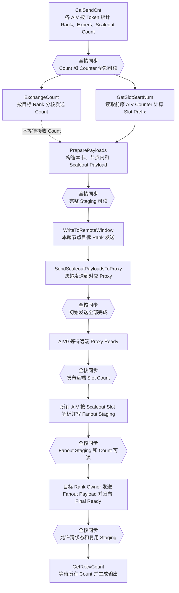
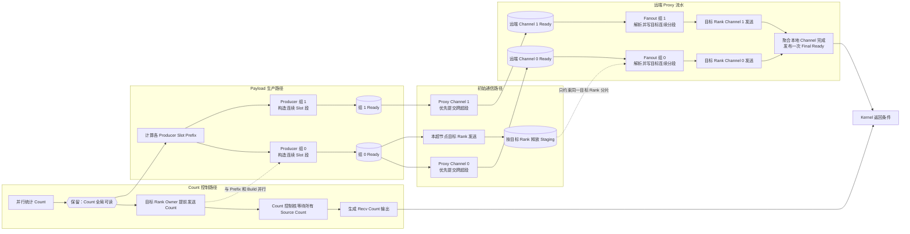
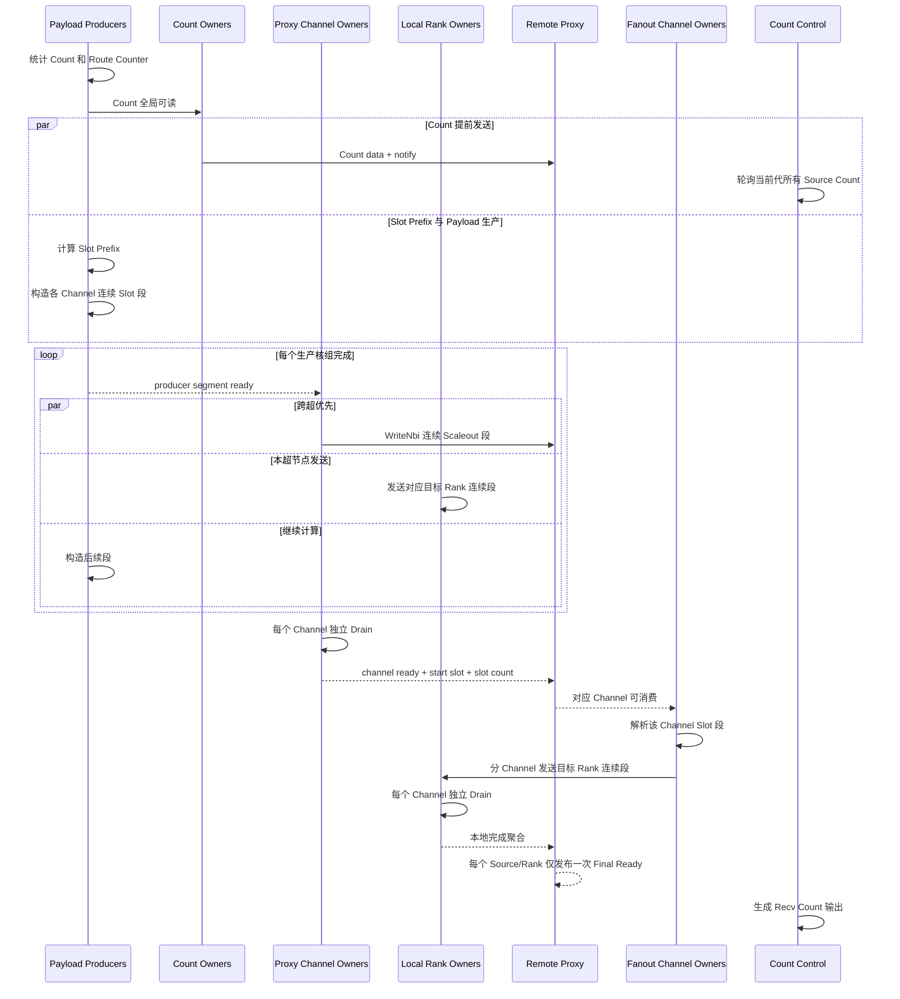

# MoeEpDispatch Hybrid 多 Channel 与流水优化分析

## 1. 文档目的

本文基于当前 `hybrid-stage1-stable` 分支，以及 `pr_9047` 分支从
`4961de34e439369555a1c10329b579e1008acae2` 开始的多 Channel 实现，分析以下问题：

1. 引入多 Channel 后能否减少 `SyncAll`；
2. 能否更早发起跨超节点通信；
3. “先发 Proxy、再做本超节点发送、再等 Proxy、再 Fanout、最后 GetRecvCount”是否可行；
4. 怎样组织分核、状态和内存，才能尽量用计算及本超节点通信掩盖跨超通信；
5. 如何在不破坏 Direct、Epilogue 和 Combine 的前提下分阶段实施。

本文只提出设计，不修改现有 Kernel。

涉及的主要代码：

- `mc2/moe_ep_dispatch/op_kernel/moe_ep_dispatch_hybrid.h`
- `mc2/moe_ep_dispatch/op_kernel/moe_ep_dispatch_base.h`
- `mc2/moe_ep_dispatch/op_host/op_tiling/moe_ep_dispatch_tiling.cpp`
- `mc2/common/op_kernel/mc2_moe_context.h`
- `torch_extension/cann_ops_transformer/ops/csrc/elastic_buffer.cpp`

## 2. 核心结论

### 2.1 多 Channel 可以减少 SyncAll，但不会自动减少

多 Channel 解决的是：

> 同一个目标 Rank 的通信可以由多个 AIV 通过互不共享的 Channel 并行提交。

`SyncAll` 解决的是：

> 一个阶段的消费者需要确认其他核产生的数据已经全部可见。

因此，仅将一个 HCOMM Handle 扩展成多个 Handle，不会使现有屏障失去作用。只有同时完成以下改造，才能删除对应的 `SyncAll`：

1. 每个 Channel 有唯一的 AIV Owner；
2. 每个 Channel 发送一个互不重叠的连续 Slot 区间；
3. 生产核只发布自己负责区间的完成状态；
4. 通信核只等待自己 Channel 对应的生产核组；
5. Proxy 只等待对应 Channel 的远端完成状态；
6. Fanout 完成按 Channel 或目标 Rank 聚合，不再依赖全体 AIV 汇合。

### 2.2 用户提出的顺序可行，但不能写成五个串行阶段

下面的简单顺序在功能上可行：

```text
发送 Proxy
    -> 本超节点发送
    -> 等待 Proxy
    -> Fanout
    -> GetRecvCount
```

但当前 `SendScaleoutPayloadToProxy` 在发送完整 Payload 后立即 `Drain`，随后发送 Ready 再次
`Drain`。如果只把它调到 `WriteToRemoteWindow` 前面，执行仍然是：

```text
完整跨超发送并等待完成
    -> 完整本超节点发送并等待完成
```

这只是交换两个串行阶段，不能掩盖通信。

正确解释应当是：

```text
优先提交 Proxy Payload
    || 本超节点不同责任核同时发送
    || 其他生产核继续构造后续 Payload

每个 Proxy Channel 完成后
    -> 该 Channel 对应的远端 Fanout 立即开始
```

### 2.3 最终推荐只保留 Count 阶段的全局汇合

当前 Hybrid 的全核同步次数近似为：

```text
4 + 3 * remoteSourceCount
```

其中 4 个固定同步包括：

1. 共享 Count Workspace 清零后；
2. 所有核 Count 和 Route Counter 生成后；
3. 所有 Payload 构造后；
4. 初始本超节点发送和 Proxy 发送后。

每个远端 Source 的 Fanout 还包含 3 次同步。

推荐方案的第一目标是保留前两个 Count 相关同步，将其余同步替换为 Channel/目标 Rank
局部完成状态：

```text
2 个固定 SyncAll
    + 0 个按远端 Source 增长的 SyncAll
```

进一步优化 Count 生产和 Prefix 后，可以继续缩小前两个同步，但不建议与多 Channel 第一版同时实施。

## 3. 当前代码的真实依赖

### 3.1 当前主流程



当前实现已经具有一个正确优化：

> `ExchangeCount` 后没有全核同步，各核可以在其他核仍发送 Count 时进入 Payload 构造。

### 3.2 “搬本卡”的准确含义

当前 `PreparePayloads` 已经把目标为当前 Rank 的 Payload 直接写入最终接收 Window。
`WriteToRemoteWindow` 对当前 Rank 主要发布 Ready，并不再次搬运完整 Payload。

因此，后续所说的“各卡搬本卡”应区分：

- 当前 Rank：Payload Build 时直接落最终 Window；
- 同 Server 其他 Rank：从 `scaleupSendWin` 经 HCOMM 发送；
- 远端 Server：先写 `scaleoutSendWin`，再发送到对应 Proxy。

### 3.3 Fanout 前的 SyncAll 为什么现在不能直接删除

`scaleupSendWin` 当前有两个生命周期：

1. 初始阶段作为同 Server 目标 Rank 的发送源；
2. Fanout 阶段作为同 Server 目标 Rank 的 Staging。

如果某个核仍在从目标 Rank A 的 `scaleupSendWin` 分片发送，而 Fanout 核已经开始向同一分片写入，
就会覆盖尚未发送的数据。

所以当前 Fanout 前的 `SyncAll` 保护的是实际地址复用，不只是 HCOMM 完成。要删除它，必须改成：

```text
目标 Rank A 的初始发送完成
    -> 只释放 Rank A 的 Staging 分片
    -> Fanout 才能写 Rank A 分片
```

不需要等待 Rank B、Rank C 等无关分片。

## 4. 参考多 Channel 实现的可复用原则

`4961de34e...` 及后续提交提供了以下可复用原则：

1. 每个远端 Peer 创建多个 Channel；
2. 一个参与通信的 AIV 独占一个 Channel；
3. 同一 `(Peer, Channel)` 不能被多个 AIV 并发使用；
4. 核数超过 Channel 数时，多余核不允许通过取模复用 Channel；
5. 每个实际使用的 Channel 必须由它的 Owner 独立完成 Commit/Drain；
6. 每个 Channel 处理互不重叠的数据分片。

参考实现按 Rank 给 AIV 分组，适合远端 Fetch。Moe Hybrid 还需要处理“先生产 Payload，再按目标
Server/Rank 发送”的交接，因此不能只复制它的核号计算。

## 5. 推荐的分核和 Channel 所有权

### 5.1 两层职责

建议把 AIV 职责分成两层：

- Payload Producer：按连续 Token 范围生成 Count、Slot、Payload 和 Route；
- Channel Owner：负责一个或多个确定的 `(目标 Peer, Channel Index)`，执行 HCOMM 提交和 Drain。

Channel Owner 也参加 Payload 生产，不预留长期空闲的专职通信核。它完成自己的生产区间后，开始消费
本 Channel 核组中已经 Ready 的生产区间。

### 5.2 连续生产核组映射为连续 Slot 区间

假设启用 `activeChannelCount` 个 Channel，将生产 AIV 按核号切成连续组：

```text
Channel 0 <- Producer [0, producerBoundary1)
Channel 1 <- Producer [producerBoundary1, producerBoundary2)
...
```

现有 Slot Prefix 本来就是按 AIV 顺序计算。对于任一目标 Rank 或目标 Server，一个连续 AIV 组产生的
Slot 并集也是连续区间。因此每个 Channel 可以发送：

```text
[channelStartSlot, channelEndSlot)
```

这样具有三个优点：

1. 不需要重新整理 Scaleout Payload；
2. 每个 Channel 只发送一段连续地址；
3. Proxy 收到一个 Channel 完成状态后，可以立即处理该连续区间。

### 5.3 Channel 数选择

不建议直接按 AIV 数创建 Channel。建议：

```text
activeChannelCount =
    min(channelCountPerPeer,
        assignedProducerGroupCount,
        payloadSlotCount,
        configuredChannelLimit)
```

初始可验证 `1、2、4、8` 个 Channel。小 Payload 自动使用一个 Channel。

Host 创建数量还必须满足：

```text
(worldSize - 1) * channelCountPerPeer <= HCCL_MAX_RANK_SIZE
```

当目标 Peer 数大于可用 AIV 数时，一个 Channel Owner 可以串行负责多个 Peer，但每个
`(Peer, Channel)` 的 Owner 在整个 Kernel 中必须保持不变。

### 5.4 保持 Direct、Epilogue 和 Combine 的句柄兼容

不建议采用下面的 Peer 主序布局：

```text
peerIndex * channelCountPerPeer + channelIndex
```

因为 Direct 和 Combine 当前会按旧索引读取 Channel 0。

推荐采用 Channel 平面布局：

```text
handleIndex =
    channelIndex * remotePeerCount + remotePeerIndex
```

布局如下：

```text
Channel 0: [peer0, peer1, peer2, ...]  <- 与原布局完全一致
Channel 1: [peer0, peer1, peer2, ...]
Channel 2: [peer0, peer1, peer2, ...]
```

`channelCountPerPeer` 追加到 `MoeCommContext` 末尾。Direct、Epilogue 和 Combine 继续读取第一平面，
只有 Hybrid 使用带 `channelIndex` 的新接口。

## 6. 推荐的最佳流水

### 6.1 总体流水图

下面是以通信掩盖计算为目标的最终形态。图中的“局部完成”均不是 `SyncAll`。



### 6.2 时序图



### 6.3 为什么这是更好的通信掩盖

当前耗时近似为：

```text
PayloadBuild
    + LocalSend
    + ScaleoutSend
    + FanoutBuild
    + FanoutSend
    + GetRecvCountWait
```

目标流水接近：

```text
Count/Prefix 固定前置
    + max(
        后续 PayloadBuild,
        ScaleoutSend,
        LocalSend,
        FanoutBuild + FanoutSend,
        GetRecvCountWait
      )
```

实际无法完全达到 `max`，因为会有 GM 带宽竞争、Channel Drain、状态轮询和尾段不均衡，但优化方向正确。

## 7. 用户提出顺序的最终判断

### 7.1 可以做的低风险版本

第一步可以只调换初始发送优先级：

```text
SendScaleoutPayloadsToProxy
    -> WriteToRemoteWindow
    -> 保留现有 SyncAll
    -> Fanout
    -> GetRecvCount
```

它能让跨超通信更早开始，但由于 Proxy 函数内部立即 Drain，收益有限。

### 7.2 推荐的正式版本

正式版本不应写成固定串行顺序，而应是：

```text
每个 Channel 的 Payload 段 Ready
    -> 优先提交 Proxy NBI

与此同时：
    -> 其他 Channel 继续提交
    -> 本超节点 Owner 发送本地目标
    -> 生产核构造后续段

某个远端 Channel Ready
    -> 对应 Proxy Fanout 立即启动
```

### 7.3 GetRecvCount 放在哪里

`GetRecvCount` 只依赖 `ExchangeCount`，不依赖 Payload、Proxy 和 Fanout。

因此：

- 放在 Fanout 后面是简单且正确的实现；
- 但它不是最佳流水位置；
- 当后半段不再包含全体 AIV 的 `SyncAll` 后，可以由一个固定 Count 控制核提前轮询；
- Count 控制核只在所有 Source Count 到齐后生成输出，主数据路径继续执行；
- Kernel 返回时同时等待 Final Ready 发布和 Count 输出完成。

在仍有全核 `SyncAll` 的版本中，不能让某个 AIV 独自进入 `GetRecvCount`，否则该核不参加后续
`SyncAll` 会造成死锁。因此该优化必须最后实施。

## 8. SyncAll 优化表

| 当前同步 | 当前作用 | 第一版处理 | 最终处理 |
|---|---|---|---|
| Count Workspace 清零后 | 防止其他核在清零完成前 AtomicAdd | 保留 | Count 私有化后再评估 |
| `CalSendCnt` 后 | Count Exchange、Prefix 和 Scaleout 汇总读取全核 Counter | 保留 | 可改目标 Ready + 分组 Prefix |
| `PreparePayloads` 后 | 通信核读取所有生产核写入的完整 Staging | 多 Channel 第一版可先保留 | 用 Producer/Channel Ready 删除 |
| 初始发送后、Fanout 前 | 防止 Fanout 覆盖仍在发送的 `scaleupSendWin` | 改为目标 Rank Release 后删除 | 删除 |
| Proxy Ready 后 | AIV0 向所有 Fanout 核广播 Slot Count | 改为各 Channel Owner 自己轮询 | 删除 |
| Fanout Staging 后 | Rank Owner 读取所有 Fanout 核的 Staging 和 Count | 改为 Channel 完成聚合 | 删除 |
| Fanout Send 后 | 清状态及复用 Staging | 改为 Source/Rank 局部完成 | 删除 |

注意：

- `SyncAll` 删除后，生产核本地的 MTE3 发布同步仍必须保留；
- `TPipe::Reset()` 前的本地流水排空不能因为跨核同步删除而省略；
- `Drain` 后发布 Ready 的顺序必须严格保持；
- 同一 Channel 的提交、Drain 和完成发布必须由同一 AIV 执行。

## 9. Window、Workspace 和状态协议

### 9.1 Payload Window 不需要改变

多 Channel 仍写当前区域：

- `scaleoutSendWin`：本卡到远端 Proxy 的发送源；
- `scaleoutRecvData`：Proxy 接收跨超 Payload；
- `scaleupSendWin`：同 Server 目标 Rank 的发送 Staging；
- `scaleupFinalRecvData`：最终 Dispatch 接收数据。

每个 Channel 只增加不同的 Slot 起点和长度，不改变 Slot 格式。

### 9.2 复用现有 Scaleout Receive Status

当前 `scaleoutRecvStatus` 按下面的大小分配：

```text
superNodeCount * numMaxTokensPerRank * 512B
```

但当前每个 Source Server 只使用开头一个 512B 项。多 Channel 可以直接使用每个 Source 区域的前
`channelCountPerPeer` 个项：

```text
Source Server status region

+----------------------+----------------------+----------------------+------
| Channel 0 status     | Channel 1 status     | Channel 2 status     |
| 512B                 | 512B                 | 512B                 |
+----------------------+----------------------+----------------------+------
```

每项只需要：

```text
ready
generation
startSlot
slotCount
```

因此不需要扩大 Window。

### 9.3 建议增加的小型 Workspace 控制区

建议新增或复用以下本地控制信息：

```text
producerReady[最多 72 AIV]
channelLocalDone[目标 Peer 数 * Channel 数]
fanoutChannelDone[本 Server Rank 数 * Channel 数]
channelNotifySource[目标 Peer 数 * Channel 数]
```

这些信息应按 32B 对齐，生产核使用 MTE3/DataCopy 发布，消费者使用绕过 DCache 的读取或明确的
MTE2 读取。不要使用多个核对同一普通 `GlobalTensor::SetValue` 地址做共享更新。

### 9.4 Final Ready 保持单份

Epilogue 当前按 Source Rank 轮询一份 Final Ready。为了避免修改 Epilogue：

1. 每个 Fanout Channel 完成自己的 Payload 和 Drain；
2. 在 Proxy 本卡写独立 `fanoutChannelDone`；
3. 固定聚合 Owner 等待当前 Source/目标 Rank 的全部有效 Channel；
4. 聚合 Owner 只发布一次现有 Final Ready。

这样多 Channel 对 Epilogue 不可见。

### 9.5 跨轮状态

更强的异步流水会放大“上一轮 Ready 被下一轮误读”的风险。只使用 `ready=0/1` 并依赖清零，容易在快慢
Rank 情况下产生 ABA 问题。

推荐在现有 Count Notify 的空闲字段中携带 `generation`：

1. Count 最先发送本轮 Generation；
2. Scaleout Channel Ready 携带同一 Generation；
3. Proxy 只消费与当前 Source Count Generation 相等的 Channel；
4. 清零只负责回收空间，不再承担区分新旧轮次的正确性责任。

这比重新引入完整 ACK 协议简单，也比增加大量 Start/Release 状态可靠。

## 10. 分阶段实施方案

### 阶段 0：固化基线

- 保持现有单 Channel 行为；
- 记录每个固定同步和 Fanout 同步的 AIV 到达时间；
- 固化 Direct、Hybrid 单 Channel、cache、non-cache 的精度和性能基线。

预期：无功能变化。

### 阶段 1：Context 支持多 Channel

- `MoeCommContext` 末尾增加 `channelCountPerPeer`；
- Channel 0 保持旧 Handle 索引；
- 额外 Channel 使用 Channel 平面布局；
- Direct、Epilogue、Combine 继续使用 Channel 0；
- Hybrid 增加带 `channelIndex` 的 `GetCommHandle`。

预期：强制 `channelCountPerPeer=1` 时与当前代码逐字节一致。

### 阶段 2：完整 Payload 后的多 Channel 并行

- 暂时保留 `PreparePayloads` 后的 `SyncAll`；
- Scaleout Slot 按连续区间分给多个 Channel；
- 每个 Channel 独立 WriteNbi 和 Drain；
- 所有 Channel 完成后再发布原有单份 Proxy Ready。

预期：先验证多 Channel 建链、所有权、地址和 Drain 正确性；减少单通信核长尾，但尚未掩盖 Payload Build。

### 阶段 3：Proxy 与本超节点发送并行

- Proxy Channel Owner 和本超节点 Rank Owner 使用不同责任核；
- Scaleout 通信优先提交；
- 本超节点目标 Rank 同时发送；
- 用目标 Rank Release 替代初始发送后的全核同步；
- Fanout 只能写已经 Release 的 Rank Staging 分片。

预期：`LocalSend + ScaleoutSend` 接近两者最大值，而不是两者之和。

### 阶段 4：Producer Segment Ready

- 连续 Producer 核组对应一个 Channel；
- Producer 完成自己的 Slot 段后发布 Ready；
- Channel Owner 按 Producer 顺序消费，可合并相邻 Ready 段；
- 删除 `PreparePayloads` 后的全核同步；
- 每个 Channel 保持有限的在途 NBI，避免 CQE 耗尽。

预期：Payload 构造与 Scaleout/Scaleup 发送重叠。

### 阶段 5：Per-Channel Proxy Fanout

- 每个 Scaleout Channel 使用独立远端 Status；
- Proxy Channel Owner 只等待自己的 Status；
- Channel Ready 后立即处理对应 Slot 区间；
- Fanout 输出按目标 Rank、Channel 形成连续分段；
- Channel Drain 后本地聚合并发布一次 Final Ready；
- 删除每个远端 Source 的三次全核同步。

预期：跨超发送与第二级 Fanout 形成真正流水，Server 数增加时同步次数不再线性增加。

### 阶段 6：GetRecvCount 并行

- 仅在后半段不再使用全核 `SyncAll` 后实施；
- 固定一个 Count 控制核提前轮询；
- Count 输出和主 Payload 路径并行；
- Kernel 末尾只做完成条件汇合，不做全核阶段屏障。

预期：Count 到达等待通常被 Payload 与通信路径掩盖。

### 阶段 7：Count 和 Prefix 优化

- 根据实测决定是否将 Count Ready 改成按目标 Rank 发布；
- Prefix 可采用分组扫描，避免完整全核等待；
- 不与多 Channel 第一版同时改，降低正确性风险。

## 11. 验证方案

### 11.1 三组对照

```text
Baseline：当前单 Channel
Candidate-1：新代码强制一个 Channel
Candidate-N：新代码启用多个 Channel
```

必须先证明 `Candidate-1` 与 Baseline 等价，再评估 `Candidate-N`。

### 11.2 必测维度

- 真实 64 AIV 和 72 AIV；
- 2、4、8、16 Rank 及部署最大 Rank；
- 每 Server 1、2、4、8 Rank；
- Channel 数 1、2、4、8；
- Slot 数为 0、1、少于 Channel、等于 Channel、大于 Channel、接近 Nmax；
- cache、non-cache、continue、performance；
- FP16、BF16、FP8 及 Scales；
- 全本地、全远端、单热点 Server、单热点 Rank、严重倾斜；
- 多轮交替和 Rank 快慢差异。

### 11.3 临时检查项

- 每个 `(Peer, Channel)` 的 Owner AIV；
- Channel Slot 起点、数量和字节数；
- 所有 Channel 区间的并集无空洞、无重叠；
- 每个 Producer Ready 的发布时刻；
- 每个 Channel 的提交、Drain 和 Ready 时刻；
- Proxy 消费的 Generation；
- Fanout Channel 完成数；
- Final Ready 是否晚于最后一个有效 Channel Drain。

### 11.4 性能判断

重点观察：

- Payload Build 是否与 Scaleout Submit 重叠；
- Proxy 和本超节点发送是否同时进行；
- Proxy 第一个 Channel Ready 到 Fanout 启动的间隔；
- 最慢 Channel 和平均 Channel 的负载差；
- `SyncAll` 数量是否从 `4 + 3 * remoteSourceCount` 降到固定数量；
- P50、P95、P99，而不是只看平均值。

## 12. 风险和边界

1. 同一个 Channel 被多个 AIV 使用会导致性能异常、卡死或 CQE 状态错误；
2. Ready 早于 Payload Drain 会产生随机精度错误；
3. Fanout 提前复用 `scaleupSendWin` 会覆盖初始本超节点发送源；
4. Channel 数过多会增加建链资源、固定开销和 Drain 次数；
5. 小 Payload 使用多 Channel 可能比单 Channel 更慢；
6. 没有 Generation 的异步状态容易在 continue 模式读到上一轮 Ready；
7. Producer 分段不连续会导致 NBI 数量和状态复杂度迅速增加；
8. Count 控制核若仍需参加后续 `SyncAll`，提前进入 `GetRecvCount` 会直接死锁；
9. Handle 排布若改变 Channel 0 的旧索引，会影响 Direct 和 Combine；
10. 多 Channel 只能增加提交并行度，不能保证物理链路带宽按 Channel 数线性增长。

## 13. 最终建议

推荐采用下面的主线：

```text
保留 Count 的必要全局依赖
    -> Channel 0 兼容旧路径
    -> 完整 Payload 多 Channel
    -> Proxy 与本超节点发送并行
    -> Producer Segment Ready
    -> Per-Channel Proxy Fanout
    -> GetRecvCount 控制路径并行
```

最关键的设计不是“创建更多 Channel”，而是：

> 让一个连续 Producer 核组、一个连续 Slot 区间、一个 HCOMM Channel 和一个固定 Owner AIV
> 在整个 Scaleout 和 Fanout 流程中保持同一责任关系。

只有建立这一关系，才能安全删除大部分 `SyncAll`，并让跨超发送、本超节点发送、Payload 构造和
Proxy Fanout 真正重叠。
