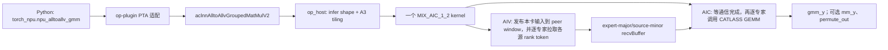
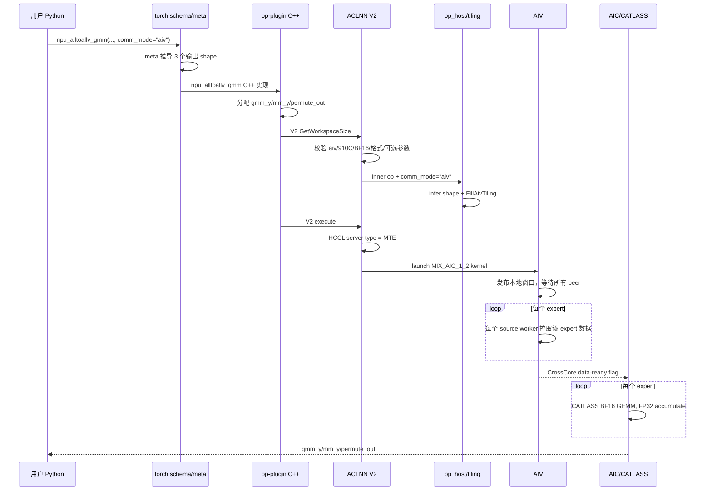

# AlltoAllvGroupedMatMul V2（AIV + CATLASS）从零到源码

> 面向第一次接触 MC2、Ascend C、HCCL peer window 和 CATLASS 的读者。本文讲解的是当前分支已经落地并通过测试的 V2 实现，不是泛化设计稿。
>
> 当前 V2 的边界非常明确：**Ascend 910C、BF16、ND 物理连续存储、`comm_mode="aiv"`、EP=2/4/8、按 expert 粒度循环搬运、不做 chunk 策略**。V1 仍然保留，调用 PTA 时不传 `comm_mode` 会继续走 V1。

本文对照了用户提供的 [A2AV GMM 内存语义文档](https://gitcode.com/NPU_MC2_EP/MC2_doc/blob/main/ops/alltoallvgroupedmatmul/a2avgmm%E5%86%85%E5%AD%98%E8%AF%AD%E4%B9%89%E6%96%87%E6%A1%A3.md)、Ascend 知识图谱检索到的正式 AlltoAllv/MC2 资料，以及当前分支的最终源代码和提交历史。若文档概念描述与代码细节出现差异，本文以本分支实际实现及测试行为为准。

## 1. 先用一句话理解这个算子

在 MoE（Mixture of Experts，混合专家）模型里，每张卡先把属于其他卡上专家的 token 发出去；每张卡收到属于自己本地专家的 token 后，把同一专家的 token 聚在一起，再分别乘以该专家的权重。

`AlltoAllvGroupedMatMul` 把下面两个阶段融合在一个 kernel 中：

1. **All-to-All-V 通信**：每个源 rank 给每个目标 rank 的每个专家发送数量不同的 token；
2. **Grouped MatMul 计算**：目标 rank 对自己的每个本地专家分别做一次矩阵乘。

V2 的两个关键变化是：

- 通信不再在 device kernel 中调用原来的高阶 `HcclA2avOp/AlltoAllV`，而是通过 HCCL 提供的 peer window 地址，由 AIV 使用 MTE 手动搬运；
- 计算不再调用原来的 MatMul 高级 API，而是直接实例化 CATLASS `BasicMatmul`，由 AIC 执行 BF16 输入、FP32 累加的 GEMM。



## 2. 新手必须先知道的名词

| 名词 | 通俗解释 | 本算子中的用途 |
|---|---|---|
| rank | 分布式通信中的一张卡/一个进程编号 | `0..ep_world_size-1` |
| EP | Expert Parallel，专家并行 | 不同 rank 持有不同专家 |
| local expert | 当前 rank 上的专家 | `expert_per_rank = gmm_weight.shape[0]` |
| token | 送给专家处理的一行向量 | `gmm_x` 的一行，宽度为 K/H |
| All-to-All-V | 每对 rank 之间发送数量可以不同的全互联通信 | 按 `send_counts/recv_counts` 重排 token |
| AIV | Vector Core | 本实现用它做 MTE 搬运和通信同步 |
| AIC | Cube Core | 本实现用它运行 CATLASS 矩阵乘 |
| GM | Global Memory，显存 | 输入、输出、workspace 和 peer window 都在 GM |
| UB | Unified Buffer，核上小容量高速存储 | peer GM → UB → local GM 的中转 |
| MTE2/MTE3 | GM→UB / UB→GM 的搬运通路 | 手写通信的实际数据移动单元 |
| peer window | HCCL 为各 rank 建好的可被其他 rank 访问的通信窗口 | 每张卡将输入发布到本地窗口，别的卡从远端窗口读取 |
| tiling | host 根据 shape/属性计算出的 kernel 配置 | tile 大小、核数、counts、workspace 偏移等 |
| CATLASS | 面向 Ascend 的模板化矩阵乘库 | 替代 MatMul 高级 API |
| MIX kernel | 同一次 kernel launch 同时包含 AIC/AIV 任务 | AIV 通信、AIC 计算通过跨核 flag 衔接 |

## 3. 接口、输入输出和严格支持范围

Python 调用形式：

```python
gmm_y, mm_y, permute_out = torch_npu.npu_alltoallv_gmm(
    gmm_x=gmm_x,
    gmm_weight=gmm_weight,
    hcom=hcom,
    ep_world_size=world_size,
    send_counts=send_counts,
    recv_counts=recv_counts,
    mm_x=mm_x,                    # 可选
    mm_weight=mm_weight,          # 可选，必须与 mm_x 同时给出
    trans_gmm_weight=False,
    trans_mm_weight=False,
    permute_out_flag=True,
    comm_mode="aiv",             # 给出该参数才路由到 V2
)
```

### 3.1 主 GMM 输入输出

设：

- `R = ep_world_size`；
- `E = local_expert_num`；
- `K = hidden size`；
- `N = expert output size`；
- `M_send = sum(send_counts)`，必须等于当前 rank 的输入 token 数；
- `M_recv = sum(recv_counts)`，是当前 rank 最终收到的 token 数。

| 参数 | shape | 说明 |
|---|---|---|
| `gmm_x` | `[M_send, K]` | 已按“目标 rank 优先、目标专家次之”排好的本卡发送数据 |
| `gmm_weight` | 非转置 `[E,K,N]`；转置 `[E,N,K]` | 当前 rank 的 E 个本地专家权重 |
| `send_counts` | 长度 `R*E` | 本 rank 给每个目标 rank/专家发送多少 token |
| `recv_counts` | 长度 `R*E` | 当前 rank 从每个源 rank/本地专家接收多少 token |
| `gmm_y` | `[M_recv,N]` | 先按本地专家，再按源 rank 排列的专家输出 |
| `permute_out` | `[M_recv,K]`，可选 | 通信重排后的 GMM 输入，即 CATLASS 的 A 矩阵集合 |

### 3.2 可选共享专家 MM

`mm_x/mm_weight/mm_y` 是一条与通信 GMM 独立的本地矩阵乘支路。三者必须全有或全无：

- `mm_x`: `[M2,K2]`
- `mm_weight`: 非转置 `[K2,N2]`；转置 `[N2,K2]`
- `mm_y`: `[M2,N2]`

### 3.3 V2 当前硬约束

- `comm_mode` 必须精确等于 `"aiv"`；`"ai_cpu"`、`"ccu"` 和空字符串都会被 V2 API 拒绝；
- 仅 BF16；输出也为 BF16，矩阵乘内部用 FP32 累加；
- A3/Ascend 910C（架构枚举 `DAV_2201`）；
- `R` 仅支持 2、4、8；
- 主输入二维、主权重三维；可选 MM 输入/权重二维；
- counts 长度必须是 `R*E` 且不超过 128，所有元素非负；
- `sum(send_counts) == gmm_x.shape[0]`；
- `sum(recv_counts) == gmm_y.shape[0]`；
- 本版不实现 chunk 策略，外层循环粒度就是一个 expert。

## 4. 最容易错的内存语义

这是理解算子的核心。用三维逻辑数组表示 counts：

```text
counts[source_rank][destination_rank][expert_on_destination]
```

但单个 rank 传入 API 的只是展平的一维数组。

### 4.1 `send_counts`：destination-major / expert-minor

对源 rank `s`：

```text
send_counts_s[d * E + e] = counts[s][d][e]
```

因此本 rank 的 `gmm_x` 也必须按同一顺序排列：

```text
[发给 dst0/expert0 的 token]
[发给 dst0/expert1 的 token]
...
[发给 dst1/expert0 的 token]
...
```

### 4.2 `recv_counts`：source-major / expert-minor

对目标 rank `d`：

```text
recv_counts_d[s * E + e] = counts[s][d][e]
```

它回答的是“我从源 rank `s` 收到多少个属于本地 expert `e` 的 token”。

### 4.3 `recvBuffer/permute_out/gmm_y`：expert-major / source-minor

最终计算需要同一专家的数据连续，所以目标缓冲区不是简单照着 `recv_counts` 展平顺序存，而是：

```text
[expert0 from source0]
[expert0 from source1]
...
[expert1 from source0]
[expert1 from source1]
...
```

这就是为什么代码同时需要：

- 在远端源窗口中计算 `sourceTokenOffset`：目标 rank 优先、专家次之；
- 在本地接收区中计算 `destinationTokenOffset`：专家优先、源 rank 次之。

### 4.4 一个完整小例子

假设 `R=2, E=2`，源 rank0 的：

```text
send_counts_rank0 = [2, 1, 3, 0]
                     └dst0┘ └dst1┘
```

表示 rank0 的 `gmm_x` 为：

```text
x0,x1 -> dst0 expert0
x2    -> dst0 expert1
x3,x4,x5 -> dst1 expert0
没有 token -> dst1 expert1
```

若 rank1 的 `send_counts_rank1 = [1,2,0,3]`，则目标 rank0 的：

```text
recv_counts_rank0 = [2,1, 1,2]
                     src0  src1
```

rank0 的 `recvBuffer` 必须是：

```text
expert0: [rank0 的 x0,x1] + [rank1 发来的 1 个 token]
expert1: [rank0 的 x2]    + [rank1 发来的 2 个 token]
```

于是 expert0 的 GEMM `M=3`，expert1 的 GEMM `M=3`。两个专家各自使用不同的 `gmm_weight[expert]`。

## 5. 从 Python 到 kernel 的完整调用链



关键路由规则：**`comm_mode` 是 `None` 时 op-plugin 调 V1；只要提供了值就调 V2，而 V2 再严格要求其为 `aiv`。** 所以不是“同一个 ACLNN V1 自动猜 AIV”，而是 PTA 显式选择两个不同 ACLNN 符号。

## 6. `op_host`：算子定义与 shape 推导逐函数讲解

### 6.1 `allto_allv_grouped_mat_mul_def.cpp`

`AlltoAllvGroupedMatMul::AlltoAllvGroupedMatMul` 构造函数完成框架注册：

- 声明 6 个输入、3 个输出；
- 注册 `group/ep_world_size/send_counts/recv_counts` 等属性；
- 添加 `comm_mode`，默认值仍为 `ai_cpu`，用于保持旧 V1 行为；
- 让输入自动连续化；
- 为 `ascend910_93` 和 `ascend950` 注册 AICore 配置；
- `MC2().HcclGroup({"group"})` 告诉框架这是使用 HCCL group 的 MC2 算子。

注意：公共 op def 仍列有 FP16，因为 V1 共用该 op；**V2 的 BF16-only 约束在 ACLNN V2 与 AIV tiling 两层再次收紧**。

### 6.2 `allto_allv_grouped_mat_mul_infershape.cpp`

| 函数 | 做什么 | 新手注意点 |
|---|---|---|
| `CheckDims` | 检查 `gmm_x` 是 2D、`gmm_weight` 是 3D，并按转置标志核对 K | 只检查矩阵乘的逻辑维度，不负责 counts |
| `CheckDimsOptional` | 检查可选共享 MM 的两个 2D 张量和 K | 只在可选张量存在时调用 |
| `InferGMMOutputShape` | 累加 `recv_counts` 得到 `M_recv`，输出 `[M_recv,N1]` | `gmm_y` 行数由接收量决定，不由本卡输入量决定 |
| `InferMMOutputShape` | 若共享 MM 存在，输出 `[BS,N2]`；否则输出为 0 维空形态 | optional output 用空 shape 表示不存在 |
| `InferPermuteOutputShape` | 标志开启时输出 `[M_recv,H]` | 它保存通信后、GMM 前的输入 |
| `InferShapeAlltoAllvGroupedMatMul` | 获取所有 shape/attrs，串起上述函数 | 是 shape 推导总入口 |
| `InferDataTypeAlltoAllvGroupedMatMul` | 让三个输出 dtype 跟随 `gmm_x` | V2 入口随后会要求其为 BF16 |

## 7. A3 tiling：host 如何把动态输入变成 kernel 配置

文件：`op_host/op_tiling/arch22/allto_allv_grouped_mat_mul_tiling_a3.cpp`。

### 7.1 小辅助函数

| 函数 | 作用 |
|---|---|
| `IsShapePresentAiv` | optional 张量的 shape 非空且维数非 0 才算真正存在 |
| `IsPositiveInt32` | 确保维度大于 0 且能装入 32 位，避免 device 侧索引溢出 |
| `AlignWorkspace` | 把 workspace 偏移向上对齐到 512 字节 |
| `SetCocTiling` | 按 M/K/N 选择四种 CATLASS tile 之一，并计算一次 UB 搬运元素数 `ubMoveNum` |
| `IsAivMode` | 读取第 7 号属性 `comm_mode`，判断是否为 `aiv` |

`SetCocTiling` 当前只会选：

```text
(m0,k0,n0) =
  (128,64,128)
  (128,32,128)
  (64, 64,128)
  (64, 32, 64)
```

这些组合必须与 device 侧 `IsSupportedTile/RunConfiguredBfloat16Gemm` 完全一致，否则 tiling 能产生配置、kernel 却找不到对应模板实例。

### 7.2 `FillAivTiling`：V2 host 侧最重要的函数

它按下面顺序工作：

1. 取得 input/output storage shape、attrs、HCCL group 信息；
2. 要求 `ep_world_size` 为 2/4/8，并要求实际 HCCL rank size 与属性一致；
3. 要求所有 V2 张量 BF16、ND，检查 2D/3D 维数；
4. 推导 `E/K/N/M_send/M_recv`，检查转置后的 K 匹配；
5. 要求 counts 长度为 `R*E` 且 `<=128`，每项非负；
6. 检查 send 总和等于输入行数、recv 总和等于输出行数；
7. 对每个本地 expert 汇总所有 source 的接收量，得到该专家的 M；
8. 检查共享 MM 三个张量全有或全无，并推导其 M/K/N；
9. 检查 `permute_out_flag` 与实际 optional output 是否一致；
10. 读取平台 AIC/AIV 核数和 UB 大小；
11. 填充 `gmmInfo/mmInfo/gmmCocTiling/mmCocTiling/sendCounts/recvCounts`；
12. 规划 user workspace，各区间 512 字节对齐，并额外预留 16 MiB system workspace；
13. 生成 AIV 专用 tiling key，设置 block dim；
14. 调 HCCL tiling 初始化 peer-window 资源，通信算法选择 AlltoAll + MTE。

最后一步容易误解：这里仍使用 HCCL host 侧能力来创建通信上下文和窗口，但 **device kernel 没有调用原来的高阶 AlltoAllV 接口**。HCCL 提供“路和地址”，AIV 自己完成“怎么搬”。

### 7.3 A3 类方法

| 方法 | AIV 模式行为 |
|---|---|
| `AlltoAllvGmmTilingA3::GetEpWorldSizeOptional` | 旧框架兼容接口 |
| `NeedToCheckCounts` | 返回 true，表示必须检查 counts |
| `AlltoAllvGmmTilingFuncA3::AlltoAllvGmmOpTilingFunc` | 保留传统函数式 tiling 路径 |
| `AlltoAllvGmmTilingStructA3::DoOpTiling` | 若为 AIV，直接调用 `FillAivTiling`；否则走 V1 base |
| `GetShapeAttrsInfo` | AIV 已在 `FillAivTiling` 一次完成，直接成功；V1 委托 base |
| `DoLibApiTiling` | AIV 不调用 MatMul 高阶 tiling，直接成功 |
| `GetWorkspaceSize` | AIV workspace 已填好，直接成功 |
| `PostTiling` | AIV 已完成最终写入，直接成功 |

## 8. tiling 数据结构逐字段理解

文件：`op_kernel/allto_allv_grouped_mat_mul_tiling.h`。

### 8.1 `AlltoAllvGmmInfo`

| 字段 | 意义 |
|---|---|
| `M/K/N` | 本次 GEMM 的总体/最大逻辑维度；真正每专家 M 从 recv counts 动态计算 |
| `rankSize` | EP rank 数 |
| `expertPerRank` | 本地专家数 E |
| `maxOutputSize` | `M_recv`，用于接收区边界检查 |
| `transB` | 权重是否转置 |
| `hasSharedExpert` | 是否有共享 MM 支路 |
| `hasPermuteOut` | 接收缓冲是否直接使用 `permute_out` |
| `aivCoreNum/aicCoreNum` | 平台可用核数 |
| `ubSize` | UB 容量 |

### 8.2 `AlltoAllvGmmCoCTiling`

- `m0/k0/n0`：CATLASS basic tile；
- `ubMoveNum`：单次 GM↔UB 搬运的 BF16 元素数；
- `swizzleCount`：预留的 swizzle 配置。

### 8.3 `AlltoAllvGmmAivTilingData`

这是 host 写、device 读的总包，含：

- HCCL 初始化/通信配置；
- 主 GMM 与共享 MM 的 info/CATLASS tiling；
- 固定上限 128 的 `sendCounts/recvCounts`；
- `recvTokenOffset/countMetaOffset/expertMetaOffset/expertReadyOffset` 等 workspace 偏移；
- `userWorkspaceSize/countNum`。

固定数组避免 kernel 再从 host tensor 异步读取 counts，也让每次 expert 元数据可在核上即时计算。

## 9. AIV 通信基础库：`allto_allv_grouped_mat_mul_aiv_comm.h`

这个文件分两层：上半部是 host/device 都能编译的纯算术与布局函数，便于 CPU UT；下半部只在真正 Ascend device 编译时启用，负责 peer window、UB 搬运和 flag。

### 9.1 三个结构体

#### `ExpertMeta`

- `recvTokenBase`：某个 expert 在本地 expert-major 接收区的起始 token；
- `tokenCount`：该 expert 从所有 source 收到的 token 总数。

#### `ExpertSourceMeta`

这是“所有专家一次性展开”辅助路径的记录：目标偏移、源偏移、数量、源 rank。当前最终 kernel 为满足“按 expert 粒度”要求，主要使用 `BuildExpertMetaForIndex` 每次只建一个专家的信息；该结构和 `BuildExpertMetadata` 仍保留为可测试的通用布局工具。

#### `A2avWindowLayout`

描述每张卡 HCCL window 的区域：

```text
window begin
┌──────────────────────────────────────┐
│ input payload: 本 rank gmm_x (BF16)  │
├────────────────── 空洞/预留 ──────────┤
│ send counts (int64, 512B aligned)     │  <- countsOffset
├──────────────────────────────────────┤
│ 16 MiB control region                │  <- controlOffset
│ epoch / publish slots / release slots│
└──────────────────────────────────────┘
window end
```

把控制区固定放在窗口尾部，能使不同输入大小仍共享稳定的 flag 地址；payload 与 counts 则从前后两边生长，并在构建布局时检查是否重叠。

### 9.2 安全算术函数

| 函数 | 目的 | 为什么不能直接写普通表达式 |
|---|---|---|
| `SafeAddU64` | 无符号 64 位加法并检测溢出 | workspace/窗口偏移一旦回绕会访问任意 GM 地址 |
| `SafeMulU64` | 乘法并检测溢出 | token×hidden×dtype bytes 可能扩大很多 |
| `MulU32ToU64` | 把两个 u32 拆成 16 位部分相乘再组合 | 避开 device 编译/指令路径中不稳定或代价高的宽乘实现 |
| `AlignUpU64` | 安全向上对齐 | `value + alignment - 1` 本身也可能溢出 |
| `AlignDownU64` | 向下对齐 | 用于从窗口尾部向前放置控制区 |
| `ExpertReadyBytes` | 计算每 expert ready flag 区大小并按 32B 槽对齐 | 每个 flag 独占槽，减少覆盖/可见性问题 |
| `ExpertReadyOffset` | 求第 e 个 expert flag 的地址偏移 | 集中定义布局，避免调用处重复算错 |

### 9.3 纯布局函数

#### `BuildExpertMetadata`

输入本 rank 的 `recvCounts`，构造所有 `(expert, source)` 片段：

1. 外层先按 expert 走；
2. 内层按 source 走；
3. 目标偏移连续累加，形成 expert-major/source-minor；
4. 每个片段数量从 `recvCounts[source*E+expert]` 读取；
5. 检查负数、容量和整数溢出。

它适合 UT 直接证明内存语义，但当前 AIV 主循环没有提前创建 `E*R` 元数据表。

#### `GetPeerSourceTokenOffset`（host/device 数组版本）

在某个源 rank 的 `send_counts` 中，求它发给 `(destination, expert)` 的 token 起点：

```text
target_index = destination * E + expert
offset = sum(peer_send_counts[0:target_index])
count  = peer_send_counts[target_index]
```

#### `BuildWindowLayout`

这是可在 CPU UT 中调用的窗口规划版本：计算 BF16 payload、int64 counts、ready flags、固定控制区，全部做对齐与容量检查。device 主路径有对应的 `BuildDeviceWindowLayout`，原因是 device 上的可用类型/编译限制更严格。

### 9.4 `PeerWindowContext`

#### `Init`

这是“手写通信”拿到地址的入口：

1. `GetHcclContext<HCCL_GROUP_ID_0>()` 取得 HCCL device 资源；
2. 转成 `HcclOpResParam*`；
3. 读取 `localUsrRankId/rankSize/winSize`；
4. 本 rank window 使用 `localWindowsIn`；
5. 远端 rank 经 `remoteRes[rank].nextDevicePtr` 找到 `HcclRankRelationResV2`，再取 `windowsIn`；
6. 将最多 8 个窗口基址缓存到 `windows_[]`。

这一步没有发起 AlltoAllV；它只是拿到“本卡可以读写的各 rank 通信窗口地址”。

#### `RankId/RankSize/WindowBytes/Window`

四个只读 getter，分别返回本地 rank、通信域大小、单个窗口容量、指定 rank 的窗口基址。把裸 HCCL 结构访问封装起来，使上层通信逻辑不依赖字段细节。

### 9.5 真正的数据搬运

#### `CopyPeerGmToLocalGm<T>`

它以 `ubMoveNum` 为块做：

```text
远端 peer GM --DataCopyPad/MTE2--> UB
UB --DataCopyPad/MTE3--> 本地 GM
```

每块之间使用 `MTE2_MTE3` 和 `MTE3_MTE2` 硬事件保证同一个 UB buffer 不会在上一次写回未完成时被下一次读覆盖。`count==0` 合法并直接返回。

#### `CopyLocalGmToWindow<T>`

语义名称不同，实现复用上一函数：源是本地普通 GM，目标是本地 HCCL window。这样“发布输入”和“从 peer 拉取”遵循同一套分块与事件规则。

### 9.6 flag 与多 rank 同步

| 函数 | 作用 |
|---|---|
| `GetFlagAddress` | `window + controlOffset + flagOffset`，得到某个 int32 flag 地址 |
| `StoreFlag` | 标量写 UB，再 MTE3 写入 GM；用 S↔MTE3 事件保证可见性 |
| `LoadFlag` | MTE2 将 GM flag 读入 UB，再由标量核取值 |
| `WaitFlagValue` | 轮询直到等于指定 epoch |
| `NextInvocationEpoch` | 本 rank 的 epoch 加一；未初始化、非正或到 `INT_MAX` 时回到 1 |
| `PublishPeerPhase` | 每个源 rank 向每个目标 rank 的对应槽写本轮 epoch |
| `WaitPeerPhase` | 本 rank 等待所有源 rank 的槽都等于本轮 epoch |
| `PublishExpertReady` | 在 user workspace 写某 expert ready epoch（保留辅助函数） |
| `WaitExpertReady` | 等待某 expert ready（保留辅助函数） |

为什么必须用 epoch，而不能永远写 `1`？第二次调用算子时，上次的 `1` 还留在窗口里；若仍等待 `1`，就可能把陈旧数据误认为本轮已发布。单调变化的 epoch 把每次 invocation 区分开。

当前最终时序使用两次全 peer barrier：

- publish barrier：所有 rank 的输入 payload 和 send counts 已写完；
- release barrier：所有 rank 已从 peer window 读完，本轮窗口才可安全复用。

## 10. 按 expert 粒度的 AIV 主逻辑：`allto_allv_grouped_mat_mul_aiv_mode.h`

### 10.1 可测试的四个纯函数

#### `BuildExpertMetaForIndex`

只为一个 `expertIdx` 计算元数据，这正是本版“以专家为粒度循环”的核心：

```text
recvTokenBase = 所有更早 expert 的全部 source token 数之和
tokenCount    = 当前 expert 从全部 source 收到的 token 数之和
```

它不生成 `E*R` 大表，不依赖 chunk。所有加法都有负数/溢出/容量检查。

#### `GetDestinationSourceTokenOffset`

先调用 `BuildExpertMetaForIndex` 得到当前 expert 的起点，再加上当前 expert 中更早 source 的数量：

```text
dst_offset(e,s) = expert_base(e)
                + sum(recv_counts[src*E+e], src < s)
```

因此接收区自然形成 expert-major/source-minor。

#### `PartitionElements`

把总元素数尽量均匀地分给 `workerNum` 个 AIV worker：

```text
quotient = total / workers
remainder = total % workers
前 remainder 个 worker 多拿 1 个
```

用于并行把本 rank 整个 `gmm_x` 发布进本地窗口。它分的是 BF16 **元素**，不是 token。

#### `IsSourceWorker`

判断当前 AIV task 是否负责某个 source rank：

- 只允许 `subBlockIdx==0`；
- `blockIdx = taskIdx/taskRatio`；
- `blockIdx==sourceRank` 才搬该源数据。

于是最多前 R 个逻辑 block 各负责一个 source，避免多个 AIV 重复搬同一片数据。

### 10.2 device 辅助函数

| 函数 | 说明 |
|---|---|
| `LoadInvocationEpoch` | 从本地窗口控制区读取 task0 刚生成的 epoch |
| `SignalAicDataReady` | AIV 通过 CATLASS cross-core flag 告诉配对 AIC：接收数据已完整 |
| `GetPeerSourceTokenOffset`（GlobalTensor 版） | 逐项从远端 window counts 区读值，求源偏移和数量 |
| `BuildDeviceWindowLayout` | 用 device-safe 算术把 payload、counts 和 16 MiB 控制区放进 window |
| `GetCopyQueueBytes` | UB 搬运 buffer 至少容纳 `ubMoveNum` 个 BF16，也至少容纳 128 个 int64 counts |

`GetCopyQueueBytes` 名字沿用了早期 queue 方案，最终对象其实是单个 `TBuf`，不是双缓冲 `TQue`。

### 10.3 `CopyInitialWindowPayload`

这个函数让每张卡先“把自己的货摆上货架”：

1. 累加本 rank `sendCounts` 得到输入 token 数；
2. 乘 K 得到 BF16 元素总数；
3. `PartitionElements` 把元素均分给 AIV cores；
4. 每个 worker 将自己那一段 `gmm_x` 搬到本地 peer window 开头；
5. 仅 `taskIdx==0 && subBlockIdx==0` 负责把 tiling 中的 `sendCounts` 写入 window 的 counts 区；
6. counts 每批 4 个 int64，正好 32 字节，通过标量写 UB + MTE3 发布。

为什么不直接从 `tilingGM` 构造 `GlobalTensor<int64_t>` 再搬？最终修复表明混合 kernel 下把 tiling 内嵌字段当普通 GM 源再走 queue 会造成不稳定；现在先用标量 `SetValue` 写入小 UB buffer，再明确 MTE3 写 window，数据所有权和流水依赖更清晰。

### 10.4 `CopyExpertFromSource`

对固定 `(expertIdx, sourceRank)`，完成一次完整的远端片段拉取：

1. 用本地 `recvCounts` 求 `destinationTokenOffset`；
2. 将远端窗口 `countsOffset` 包装为 `GlobalTensor<int64_t>`；
3. 用远端 send counts 求 `sourceTokenOffset/sourceTokenCount`；
4. 交叉验证 `sourceTokenCount == local recvCounts[source*E+expert]`；
5. token 偏移乘 K，变成 BF16 元素偏移；
6. 从 `context.Window(sourceRank)` 搬到本地 `recvBuffer`。

第 4 步非常重要：send/recv 两边若配置不一致，不能默默按一边的长度搬，否则轻则结果错，重则越界。

### 10.5 `ProcessAiv`

这是 AIV 的总时序：

1. 计算 `taskIdx/subBlockIdx/taskRatio/blockIdx`；
2. task0 为本次调用生成新 epoch；
3. 片上 `SyncAll`，所有 AIV 读取同一 epoch；
4. 所有 AIV 并行执行 `CopyInitialWindowPayload`；
5. `SyncAll` 后，每个源 rank 向所有目标窗口发布 publish flag；
6. task0 等所有 peer 的 publish flag，本 rank 内再同步；
7. 外层 `for expertIdx in [0,E)`；
8. 每个 expert 内，前 R 个 source worker 各拉一个源 rank 的该专家片段；
9. 每个 expert 末尾 `SyncAll`，保证复用 UB/进入下一专家前本专家搬完；
10. 全部 expert 搬完后 `SignalAicDataReady`；
11. 发布 release flag，并等待所有 peer 都完成读取。

这一版的粒度是：

```text
expert0: source0/source1/... 并行搬 -> SyncAll
expert1: source0/source1/... 并行搬 -> SyncAll
...
```

没有把多个 expert 合为 chunk，也没有按 `expert_num` 一次性预展开搬运计划。

### 10.6 `ProcessAic`

AIC 侧更短：

1. 设置 load padding、atomic 和 fixpipe 的矩阵乘环境；
2. `CrossCoreWaitFlag` 等 AIV 的完整数据就绪；
3. 按 expert 循环；
4. 每次 `BuildExpertMetaForIndex` 得到该 expert 的 M 和 A/C 起点；
5. 调 `RunExpertGemm`；零 token 专家会安全跳过；
6. 所有本地 expert 完成后，如有共享 MM，再调 `RunSharedExpertGemm`。

注意最终实现是“通信全部完成后再开始专家计算”，不是 expert-by-expert 通算重叠。它牺牲部分重叠机会，换来首先保证 peer-window 数据路径的确定性。未来若重新做细粒度流水，必须证明每个 expert flag 的跨 AIV/AIC 可见性、workspace 生命周期和窗口 release 时序。

### 10.7 `Run`

`Run` 是 AIV mode kernel 内部总入口：

- 若请求 `permute_out`，直接把它作为 `recvBuffer`；这样通信结果既供 CATLASS 输入又返回用户，避免再复制一份；
- 否则 `recvBuffer = userWorkspace + recvTokenOffset`；
- `ASCEND_IS_AIV` 分支中初始化 `PeerWindowContext`、窗口布局、`TPipe`、flag/copy buffer，然后运行 `ProcessAiv`；
- `ASCEND_IS_AIC` 分支中运行 `ProcessAic`。

同一份源代码由编译器为 AIV/AIC 两种 task 生成对应路径；不属于当前核类型的分支不会执行。

## 11. CATLASS 计算：`allto_allv_grouped_mat_mul_catlass.h`

### 11.1 `GemmLaunchSpec`

它把“业务上的某个 expert”翻译成纯 GEMM 描述：

- `offsetA/offsetB/offsetC`：以元素为单位的 A/B/C 起点；
- `m/k/n`：矩阵维度；
- `lda/ldb/ldc`：leading dimension；
- `transposeB`：B 是否按转置解释；
- `hasWork`：M 为 0 时 false。

### 11.2 host/device 可测函数

#### `IsSupportedTile`

白名单检查 tiling 给出的 `(m0,k0,n0)` 是否有对应编译期模板实例。CATLASS tile 是模板参数，不能把任意运行时整数直接塞进模板。

#### `BuildExpertGemmSpec`

对 expert `e`：

```text
A = recvBuffer + recvTokenBase * K
B = gmmWeight + e * K * N
C = gmmY      + recvTokenBase * N
M = expert.tokenCount, K = info.K, N = info.N
```

若 `M==0`，返回有效 spec 但 `hasWork=false`，避免调用零尺寸 CATLASS。

#### `BuildSharedGemmSpec`

共享 MM 没有 expert offset，A/B/C 都从 0 开始；其余维度与转置处理同理。

### 11.3 `__CCE_KT_TEST__` 包装

KT/CPU kernel UT 无法真实模拟 Cube 指令和 peer windows，所以测试版 `RunExpertGemm/RunSharedExpertGemm` 只构建 spec 并检查 tile；`CompileCheckCatlassWrappers` 负责让模板签名在测试编译中可见。这不是数值测试的替代品，真实数值由多卡 PTA/EP 测试覆盖。

### 11.4 `RunBfloat16Gemm<...>`

真正 device 版本在编译期绑定：

- 架构：Atlas A2 系列实现（服务 910C）；
- A/B/C：BF16；
- accumulator：FP32；
- A/C：RowMajor；
- B：未转置 RowMajor，转置时 ColumnMajor 解释；
- dispatch：`MmadAtlasA2Pingpong<false>`；
- L1 tile K=256；
- 实体：`BlockMmad` + `BasicMatmul`。

函数构造 `GemmCoord`、stride、tensor coord 和参数，调用 CATLASS matmul。`static_assert` 保证累加类型没有被意外改成 BF16。

### 11.5 `RunConfiguredBfloat16Gemm`

运行时检查 tiling 值，再分派到四个已经编译好的 `RunBfloat16Gemm<TRANSPOSE_B,TILE_M,TILE_K,TILE_N>`。没有匹配就返回 false，避免使用未实例化配置。

### 11.6 真实 `RunExpertGemm/RunSharedExpertGemm`

二者先构建 `GemmLaunchSpec`；无工作量直接成功；否则把“元素 offset”乘 BF16 字节数形成实际 GM 地址，再进入 configured GEMM。`CompileCheckCatlassWrappers` 的不可达调用用于强制不同转置模板在编译期得到检查。

## 12. kernel 入口：`allto_allv_grouped_mat_mul.cpp`

模板参数包含：主 GMM B 是否转置、共享 MM B 是否转置、通信模式 tiling key。

`allto_allv_grouped_mat_mul(...)` 的执行逻辑：

1. `KERNEL_TASK_TYPE_DEFAULT(KERNEL_TYPE_MIX_AIC_1_2)` 声明混合任务；
2. 检查 system/user workspace；
3. 当通信 key 是 AIV：
   - 编译期再确认主输入/权重/输出为 BF16；
   - 从 `tilingGM` 读取 `AlltoAllvGmmAivTilingData`；
   - 调 AIV mode `Run`；
4. 其他 key 完全保留 V1 路径：创建 `TPipe`、读取老 tiling、实例化 `HcclA2avOp + QuantGroupedMatmul + A2avGmmScheduler`。

因此“V2 独立 AIV kernel 路径”不是删除 V1，而是在同一 op kernel 入口由 tiling key 做编译期分支，AIV 路径不再落入 V1 scheduler。

## 13. ACLNN V2 API 逐函数讲解

文件：`op_api/aclnn_allto_allv_grouped_mat_mul_v2.cpp`。

### 13.1 `CheckAndHandleCommMode`

- 指针不能为空；
- 必须 `strcmp(...,"aiv")==0`；
- 当前 NPU arch 必须 `DAV_2201`。

它确保 V2 的名字不会被拿去执行 V1 的 `ai_cpu/ccu` 模式。

### 13.2 `CheckBf16NdTensor`

检查 BF16 和存储格式。一般张量只接受 ND。唯独 `gmmWeight` 可设置 `allowPtaNcl=true`，此时还接受：

```text
storageFormat == NCL && view rank == 3
```

原因不是 V2 支持真正的 NCL 私有布局，而是 torch_npu 在创建 rank-3 base-format ACL tensor 时会把逻辑 base format 描述成 NCL；其物理数据仍是连续 ND。限制到“三维主权重”避免把 FRACTAL_NZ 等私有格式误放进来。

### 13.3 `CheckNullStatus`

- `gmmX/gmmWeight/gmmY` 必须存在；
- V2 counts 只接受属性数组，`sendCountsTensorOptional/recvCountsTensorOptional` 必须为空；
- group 非空；
- `mmX/mmWeight/mmY` 三者全有或全无；
- `permuteOutFlag` 必须与 `permuteOutOptional` 是否存在严格一致。

### 13.4 `CheckParams`

串起空指针检查、group 最大长度检查，以及每一个实际存在张量的 BF16/格式检查。

### 13.5 `CheckSendAndRecv`

确保两个 `aclIntArray` 非空且长度不为 0。更深入的长度、数值、总和与 shape 匹配由 tiling 再验证，形成 API 快速校验 + host 完整校验两道防线。

### 13.6 `aclnnAlltoAllvGroupedMatMulV2GetWorkspaceSize`

ACLNN 两阶段接口的第一阶段：

1. 参数检查；
2. counts 检查；
3. comm mode/架构检查；
4. 将 `commMode` 继续传给共享 inner op；
5. inner op 执行 infer/tiling，返回 workspace 大小和 executor。

### 13.7 `aclnnAlltoAllvGroupedMatMulV2`

第二阶段执行：若弱符号 `NnopbaseSetHcclServerType` 存在，把 executor 的 HCCL server type 设为 MTE，然后调用共享 inner execute。在这里选择 MTE 是为了让 peer-window/AIV 通信资源按本实现的方式准备。

## 14. op-plugin：为什么原来的 Python 接口不能自动调用 V2

### 14.1 schema

`npu_alltoallv_gmm` 的 YAML schema 新增：

```text
str? comm_mode=None
```

`None` 很重要：它表示用户没有选择新接口，此时保持 V1；`"aiv"` 表示显式选择 V2。

### 14.2 Python meta：`npu_alltoallv_gmm_meta`

图/假张量模式不能真正发通信，因此 meta 只推导输出：

- `a = sum(recv_counts)`；
- `gmm_y = [a,n1]`；
- 可选 `mm_y = [bs,n2]`；
- 可选 `permute_out = [a,h1]`。

### 14.3 C++：`op_api::npu_alltoallv_gmm`

这是 PTA 真正的路由函数：

1. 累加 `recv_counts`；
2. 用 `OpPreparation::apply_tensor_without_format` 分配三个输出；
3. 把空 optional tensor 变成默认 `at::Tensor()` 以匹配 ACLNN 调用约定；
4. 若 `comm_mode.has_value()`：
   - 检查运行环境中存在 `aclnnAlltoAllvGroupedMatMulV2`；
   - 把 `c10::string_view` 拷贝到 `std::string`；
   - 调 V2；
5. 否则调原 `aclnnAlltoAllvGroupedMatMul` V1；
6. 返回 `(gmm_y, mm_y, permute_out)`。

所以问题的准确答案是：**旧的已安装 torch_npu/op-plugin wheel 中，这个 PTA schema 没有 `comm_mode`，C++ 也只调用 V1；源码层可能已经存在部分 V2 ACLNN 文件，但 Python 入口没有通往它的路。此次“扩展”不是另造一个用户 API，而是修改 op-plugin 的 schema/meta/C++ dispatch，让同一个 `torch_npu.npu_alltoallv_gmm` 能显式选 V2。**

## 15. 测试为什么要分层

一个多卡融合算子不能靠单一测试证明正确：

| 层级 | 能发现什么 | 不能证明什么 |
|---|---|---|
| CPU/KT kernel UT | offset、zero token、转置 spec、expert 顺序 | 真实 MTE/HCCL/Cube 数值 |
| ACLNN op_api UT | 空指针、dtype、format、comm mode、optional 契约 | 多卡通信结果 |
| op-plugin PTA 测试 | Python schema → V2 ACLNN → 真 kernel 的端到端路由 | 大量 EP/shape 泛化 |
| mc2_test | 独立 C++ ACLNN 驱动、大量 counts 分布、文件 golden | PTA Python 适配 |
| ep_test | EP2/4/8、transpose、optional 输出、CPU golden、多进程框架 | 低层 API 的全部异常分支 |

## 16. ops-transformer 内建 UT

### 16.1 kernel 逻辑 UT

文件：`tests/ut/op_kernel/test_allto_allv_grouped_mat_mul.cpp`。

| 用例 | 验证点 |
|---|---|
| `BuildsExpertSequenceOneAtATime` | 每次只构建一个 expert meta；各 expert base/数量连续正确 |
| `PreservesExpertMajorSourceMinorOffsets` | 目标接收区确实 expert-major/source-minor |
| `BuildsTransposedTailExpertGemm` | 最后一个 expert、转置 B 时 A/B/C offset、M/K/N/stride 正确 |
| `SkipsZeroTokenExpertCompute` | 零 token 专家 `hasWork=false`，不会启动非法零尺寸 GEMM |
| `BuildsOptionalSharedExpertGemm` | 共享 MM spec 和 tile 检查正确 |

### 16.2 ACLNN op_api UT

V2 相关 15 个用例覆盖：

- 正常 BF16、`comm_mode=aiv`；
- PTA 三维 base-format 权重的 NCL 描述可接受；
- `ai_cpu/ccu/empty` comm mode 拒绝；
- FP16 拒绝；
- FRACTAL_NZ 拒绝；
- group 空/超长；
- send/recv 数组空；
- optional MM 不成套；
- permute flag 与 output 指针不匹配等。

最终整套 op_api UT 是 30/30 通过，其中 V1 与 V2 共存，能防止新路径破坏旧接口。

## 17. op-plugin PTA 端到端测试逐函数

文件：`op-plugin/test/test_custom_ops/test_alltoallv_gmm_aiv.py`。

### `_get_free_port`

让操作系统分配一个空闲 localhost TCP 端口，避免多进程 HCCL 初始化时使用写死端口发生冲突。

### `_make_inputs`

固定随机种子，构造 2 rank、2 本地专家的 BF16 输入；counts 使用三维 `[source,destination,expert]` 全 1，另外构造共享 MM 输入和权重。

### `_reference_for_rank`

纯 CPU 标杆，按目标 rank 和 expert：

1. 遍历 source；
2. 用该 source 的 send counts 前缀和切 `gmm_x[source]`；
3. 拼成当前 expert 输入；
4. FP32 做 matmul；
5. 返回主 GMM、共享 MM、通信后 permute 三个结果。

### `_run_aiv_rank`

每个子进程：设置 NPU、初始化 HCCL process group、取得真实 HCCL comm name、生成相同全局输入、切出本 rank 的 send/recv counts、把本 rank 张量放到 NPU、调用 `comm_mode="aiv"`、同步并与 CPU golden 比较，最后销毁 group。

主 GMM 与 MM 使用 `rtol=atol=0.01`，原因是 BF16 输出与设备 GEMM 的浮点累加/舍入允许小误差；`permute_out` 只发生搬运，要求完全相等。

### `_run_invalid_comm_mode_rank`

建立真实 HCCL 环境但传 `ai_cpu` 给 V2 路由，必须抛 `RuntimeError`。它防止未来有人让 V2 静默回退。

### 三个测试方法

- `test_schema_exposes_comm_mode`：直接读 dispatcher schema，证明当前 wheel 真正安装了新参数；
- `test_bf16_aiv_eager_two_rank`：2 NPU 数值端到端；
- `test_invalid_comm_mode_is_rejected`：2 NPU 错误路径。

本次重新编译安装 op-plugin 后，该文件结果为 **3/3 PASS**。

## 18. mc2_test 工程

路径：`/home/sangzhenguo/code/mc2_test`。它偏向“独立 ACLNN 二进制 + 磁盘输入输出 + 多种分布”的算子测试，而不是直接测试 PTA。

### 18.1 Python V2 case 类逐函数

文件：`op_class/aclnnAlltoAllvGroupedMatMulV2.py`。

#### `_is_bf16`

统一识别 case 中不同写法的 BF16 dtype。

#### `__init__`

调用 V1 基类复用数据生成/比较框架，再收紧 V2：

- 只许 BF16/AIV；
- 指定 V2 C++ 二进制；
- 使用 single-process ACLNN 模式；
- 应用 V2 counts 分布；
- 建立 golden freshness 状态。

#### `_distribute_evenly`

把 token 总数均匀分给指定下标集合，余数从 `offset` 指定位置轮转分配。它是许多极端 counts 模式的基础。

#### `_counts_for_source`

按当前源 rank 生成长度 `R*E` 的 send counts，支持：

- uniform/balance；
- skewed；
- 某 source 全零；
- 某本地 expert 全零；
- 90% token 偏置；
- all-to-one；
- uneven；
- single-token / one-token-per-rank；
- alternating peers；
- only source0；
- six source ranks zero 等。

这些模式专门攻击前缀和、零长度、极不均衡和 EP8 稀疏通信边界。

#### `_apply_distribution`

为所有 source 生成 counts，校验每个源的总和等于其输入 token 数，再把本 rank 的 send counts 与从所有 source 抽出的 recv counts写回 case，并重算输出 shape。

#### `_validate_golden_freshness`

比较当前逻辑输入指纹与 golden 旁记录的指纹。若输入/case 已变化但旧 golden 文件仍存在，立即报错，避免“程序看似比较通过，实际比较的是另一组输入”。

#### `_input_fingerprint`

读取输入目录中的关键文件内容与元信息，生成稳定哈希。

#### `_logical_input_fingerprint`

对当前 case 的 shape、counts、转置、dtype、分布等逻辑信息生成哈希；即使文件尚未落盘也能判断配置是否变化。

#### `_write_input_fingerprint`

把生成 golden 时的指纹写到对应目录，供后续 compare 检查。

#### `get_cpu/get_hccl_mm`

调用基类生成 CPU/HCCL-MM golden，随后写入本轮输入指纹。

#### `process_aclnn`

调用 V2 独立 ACLNN 二进制，保存输出并携带指纹信息。

#### `compare`

比较前先验证 golden freshness，然后复用基类数值比较。

### 18.2 C++ V2 驱动逐函数

#### `GetOption`

解析命令行参数：rank、设备、group、输入输出路径、转置/optional 开关等。

#### `launchOneThread`

1. 从文件读取/创建设备 tensor；
2. 用 counts 推导当前 rank 的输入/输出 token shape；
3. 调 `aclnnAlltoAllvGroupedMatMulV2GetWorkspaceSize`；
4. 分配 workspace；
5. 调 `aclnnAlltoAllvGroupedMatMulV2`；
6. stream synchronize，必要时循环计时；
7. 把三个输出保存到磁盘；
8. 释放 executor/tensor/device 内存。

#### `main`

初始化 ACL、设备和 HCCL communicator，为每个 rank 启动测试线程，等待执行结束后清理资源。它证明“没有 torch_npu PTA”时 ACLNN V2 自身也可用。

### 18.3 为什么要有输入指纹

mc2_test 的输入与 golden 都是磁盘文件。开发过程中只改了 counts 分布或随机输入，却忘了重生 golden，旧文件仍能被框架读到；shape 偶尔相同，比较甚至可能产生误导。指纹把“测试数据版本”变成显式契约，是这次测试工程适配中的关键防呆措施。

## 19. ep_test 工程逐层讲解

路径：`/home/sangzhenguo/code/ep_test`。本次新增的是一条独立 `a2avgmm_v2` pipeline，不与 dispatch/combine 的数据类强耦合。

### 19.1 数据类

文件：`core/data/a2avgmm_v2.py`。

#### 四个 dataclass

- `A2aGmmV2Input`：单 rank PTA 所需的输入、counts、group、转置和 mode；
- `A2aGmmV2Output`：实际三个输出；
- `A2aGmmV2Golden`：CPU 标杆三个输出；
- `A2aGmmV2Attach`：producer 向 validator 传递每 rank golden 的附件。

#### `A2aGmmV2DataGeneration.__post_init__`

复制参数、校验、建立固定 seed 的 generator、生成全局三维 counts，再分别展成每 source 的 send counts 与每 destination 的 recv counts，最后生成输入和 golden。

#### `_validate_param`

在 CPU 数据阶段就拒绝非 BF16、非 AIV、非正 world/expert，以及负 token 数。早失败比跑到多进程设备阶段才报错更容易定位。

#### `_make_counts`

生成 `[source,destination,expert]`：

- `balance`：商平均分，余数加给前几个 segment；
- `random`：每个 token 随机选择 `R*E` 个 segment 之一，再 bincount；
- `random_nonempty`：随机分布后修复空 destination；
- `expert_skew`：约 90% token 集中到每个 destination 的热点 expert；
- `zero_expert`：每个 destination 至少一个本地 expert 的计数恒为 0；
- `zero_peer_edge`：每个 source 至少有一条 destination 边计数全 0；
- `uneven_prime`：用质数 token 形成不可整除的非均匀尾块。

每个 source 的总数始终等于 `tokens_per_rank`，同时保证每个 destination 至少
接收一个 token，避免把“整张目标卡无输入”这一当前接口不支持的场景混入正常
泛化用例。

#### `_randn`

先用 CPU generator 生成 FP32 正态分布，再转 BF16，保证所有进程使用一致输入。

#### `_make_inputs`

为每个 rank 创建主输入/本地专家权重；依据两个 transpose 标志选择物理 shape；若启用共享 MM，再成套创建 `mm_x/mm_weight`，否则全部设为 `None`。

#### `_make_golden`

这是内存语义的可执行定义：对每个 destination、每个 expert、每个 source，用 send counts 前缀和切片源输入，按 source 拼接成 expert 输入；FP32 matmul 后转 BF16；拼接所有 expert 得到 `gmm_y`；expert 输入拼接即 `permute_out`；共享 MM 独立计算。

### 19.2 model 与 operation

文件：`core/models/a2avgmm_v2.py`。

#### `A2aGmmV2Model.forward`

把 dataclass 字段原样转给 `torch_npu.npu_alltoallv_gmm`，显式传 `comm_mode`。`ep_rank_id` 不需要传给算子，因为 HCCL group 已包含当前 rank，因此删除以避免未使用警告。

#### `A2aGmmV2Operation.forward`

创建 model，并交给基类 `forward_op`。基类负责把 dataclass 字段拆成参数、按 `graph_type` 选择 eager/graph、运行并封装输出。

#### `golden`

把 producer 保存的 attach 转成每 rank `A2aGmmV2Golden`。

#### `_compare`

- None 必须两边都 None；
- shape/dtype 必须相同；
- `permute_out` 精确相等；
- GEMM 输出使用 `rtol=atol=0.01`；
- 失败打印最大绝对误差。

#### `validate`

逐 rank 比较三个输出并返回 bool 列表，供框架汇总 `acc_pass`。

### 19.3 case 读取

文件：`core/utils/a2avgmm_v2_cases.py`。

#### `A2AVGMM_V2_COLUMNS`

定义 YAML/XLSX 必备列与预期类型，是 case 文件的 schema。

#### `normalize_a2avgmm_v2_case`

把字符串 `bf16` 转为 `torch.bfloat16`，把数值/布尔列规范化；只接受 AIV、BF16、eager (`graph_type=0`) 和上述七类 counts 分布，并检查共享 MM 维度。

#### `A2aGmmV2CaseReader.read_param`

- YAML 用 `yaml.safe_load`；Excel 用 pandas；
- 检查缺列；
- 支持 index 切片；
- 加入 `id/node/start_rank/end_rank/rank_num_per_server`；
- 返回 runner 可消费的参数列表。

### 19.4 launcher 注册

`core/launch/a2avgmm_v2.py` 的 `op_class` 字典把 input/output/golden/attach/operation/generation/reader 七类拼起来。通用 `launch_runner/Runner` 据此创建 producer、每 rank executor 和 validator 进程。

### 19.5 CPU UT

`test/test_a2avgmm_v2_cpu.py`：

- `_base_param` 提供可覆写的最小合法 case；
- `test_send_recv_layout_and_cpu_golden` 验证 send/recv 镜像关系和 expert/source 拼接；
- `test_transposed_weights_and_optional_outputs` 验证转置与无 optional 输出；
- `test_case_constraints_are_aiv_bf16_only` 验证 case reader 拒绝 FP16/AI_CPU。

与 `test/test_worker_output_paths.py` 合并执行的当前结果为 **9/9 PASS**。
除数据语义外，worker UT 还验证了不同 case 的输出文件名包含 `case_id`，防止
EP8 并发时后一个 case 覆盖前一个 case 的结果。

### 19.6 NPU cases

| case | 主要覆盖 |
|---|---|
| EP2 smoke | 基础 BF16 AIV，通常含共享 MM 与 permute |
| EP4 smoke | 主权重转置、关闭部分 optional 输出 |
| EP8 smoke | 两个权重转置、共享 MM、permute、更多 peer |
| EP2 urgent（12 例） | 四条 CATLASS tile、31/63/65/129 等边界、七类 counts、countNum=128、转置和 optional 输出 |
| EP2 repeat（2 例） | 同一 communicator 中每例连续调用 20 次，验证 epoch/window 复用 |
| EP4 urgent（2 例） | 多 peer、零边、专家倾斜、非对齐 |
| EP8 urgent（2 例） | 零专家、质数非均匀 counts、双转置、非对齐 |

实际测试中 urgent/repeat 合计 **18/18 PASS**，原始 EP2/EP4/EP8 smoke
另为 **3/3 PASS**；所有 rank 的精度汇总均为 `acc_pass=true`。

## 20. 重点 Bug：症状、根因、修复和防回归

### Bug 1：已安装的 PTA schema 没有 `comm_mode`

**症状**：Python 调 `torch_npu.npu_alltoallv_gmm(..., comm_mode="aiv")` 报未知关键字，或 schema 打印仍是旧签名。

**根因**：算子仓中的 ACLNN V2 文件与 torch_npu/op-plugin 的用户入口是两个层次。旧 wheel 的 YAML schema 和 C++ dispatch 只认识 V1；“底层有 V2 符号”不代表 Python 自动能到达。

**修复**：修改 op-plugin schema、meta 和 C++，有 `comm_mode` 时调 V2，无值走 V1；重新编译安装 wheel。

**回归测试**：`test_schema_exposes_comm_mode` 和 2-rank eager 数值测试。

### Bug 2：`string_view.data()` 的 C 字符串契约

**症状**：comm mode 有时比较异常、越界读取或在宏延迟执行时内容失效，问题可能随编译优化/调用栈变化而波动。

**根因**：`c10::string_view` 只保证“指针 + 长度”，`data()` 不保证以 `\0` 结尾；而 ACLNN 接口接收 `const char*` 并使用 C 字符串语义。executor/macro 还可能让指针使用跨过当前表达式。

**修复**：

```cpp
const std::string comm_mode_value(comm_mode.value());
const char* comm_mode_real = comm_mode_value.c_str();
```

让字符串在整个 `EXEC_NPU_CMD` 调用期间拥有稳定生命周期和 NUL 结尾。

### Bug 3：PTA 的三维普通权重被 ACL 描述为 NCL

**症状**：Python 侧查看格式像 ND，V2 API 却报 `gmmWeight only supports ND format`；手动 format cast 也不能根治。

**根因**：op-plugin/common 转 ACL tensor 时，rank-3 base-format 会使用 NCL 这一描述；其物理存储仍是连续基础格式。V2 早期用 `storageFormat == ND` 的字面条件，把合法 PTA 权重挡住了。

**修复**：仅对 `gmmWeight` 接受 `FORMAT_NCL && view rank==3`；其他张量仍只接受 ND，FRACTAL_NZ 等私有格式仍拒绝。

**为什么不能粗暴接受所有 NCL**：真正布局不一致会让 CATLASS 按连续 K/N 解释错误地址。

**回归测试**：合法 PTA NCL 描述通过、FRACTAL_NZ 失败、FP16 失败。

### Bug 4：混合 AIC/AIV 中错误使用 `TQue` 数据路径

**症状**：多卡运行不稳定，可能卡住、读到未完成数据或结果异常；单纯 host UT 无法复现。

**根因**：早期 `CopyPeerGmToLocalGm` 用双深度 `TQue<VECIN,2>` 做 GM→UB→GM，但这里只是一段串行 MTE relay，并没有标准 producer/consumer vector pipeline；队列的 EnQue/DeQue 生命周期和 MIX kernel 的 MTE 依赖不够直接。此外 AIC/AIV 共用入口处提前创建 `TPipe`/buffer，让不需要 peer context 的 AIC 也卷入 AIV 资源初始化。

**修复**：改为单个 `TBuf<VECCALC>`，每块显式使用 `MTE2_MTE3` 与 `MTE3_MTE2` 事件；把 `TPipe` 和 peer context 只放进 `ASCEND_IS_AIV` 分支；V1 自己局部创建 pipe。

**经验**：TQue 适合明确流水级之间的生产消费，不应仅因为“需要 UB”就使用；最小 relay 使用 TBuf + 明确硬事件更可控。

### Bug 5：直接把 tiling 内 `sendCounts` 当 GM tensor 搬到窗口

**症状**：peer 读到的 counts 不稳定，继而源 token offset/length 错误，可能表现为精度错或等待异常。

**根因**：早期通过 `tilingGM` 计算嵌套字段地址，再把它包装成 `GlobalTensor<int64_t>` 送入同一 copy queue。混合编译和 `GET_TILING_DATA_WITH_STRUCT` 的本地 tiling 表示使这种“再次把字段当普通 GM”路径不可靠。

**修复**：task0 直接从 `tiling.sendCounts[]` 标量取值，每批 4 个写入 32B UB buffer，再用明确的 S→MTE3 事件写入 window。

### Bug 6：AIC 过早开始和细粒度 ready 时序不稳定

**症状**：AIC 可能在某 expert 的跨 rank 数据完全可见前启动 CATLASS；可选共享 MM 的先后顺序也可能与通信覆盖资源冲突。

**根因**：早期设计在 epoch 就绪后让 AIC 进入循环，并通过 user workspace 的 per-expert ready flag 尝试通算重叠。它同时涉及 AIV 内同步、GM flag 可见性、AIV→AIC cross-core 事件以及 peer window 发布/释放，验证成本很高；初版信号还在初始 payload 前过早发出。

**修复**：AIV 先完成所有 expert 拉取，再发一次 `SignalAicDataReady`；AIC 整体等待后逐 expert 计算；共享 MM 放在主 GMM 后。保留 expert-ready helper 但当前主时序不使用。

**取舍**：本版先保证功能确定性，未追求通算重叠；后续性能优化必须另立设计与压力测试。

### Bug 7：重复调用时陈旧 flag 被误认成当前轮

**症状**：第一次正确，第二次或循环压测偶发读取旧 payload。

**根因**：若 ready flag 恒写 1，上一轮残留值在本轮真正写数据前就满足 wait 条件。

**修复**：每次调用 `NextInvocationEpoch` 递增 epoch，publish/release 槽都等待当前 epoch；到 `INT_MAX` 回绕到 1。

### Bug 8：ep_test eager 仍被无条件 `torchair` 导入阻断

**症状**：`graph_type=0` 明明只跑 eager，启动仍报 `ModuleNotFoundError: torchair`。

**根因**：通用 model 编译函数在模块加载阶段无条件导入 graph 依赖，执行分支虽不用，import 已先失败。

**修复**：把 `torchair` 导入移动到真正的 graph 分支；eager 路径不再要求额外包。

### Bug 9：测试配置中的 conda 路径来自另一台环境

**症状**：多进程启动脚本找不到 Python/conda，算子甚至还没开始运行。

**根因**：配置沿用了 `/root/miniconda3`，实际环境位于其他已安装路径；基础设施错误容易被误判成算子失败。

**修复**：先在目标机审计可用 conda 与 `szg_py311`，更新 EP2/4/8 配置和 README，运行前 source CANN 9.2 环境。

### Bug 10：Excel 生成工具依赖失败

**症状**：原计划生成 xlsx case 时，工具因本机原生图形依赖（如 skia-canvas）不可用而失败。

**根因**：case 数据本身与 Excel 渲染/原生依赖耦合，不利于远端无桌面测试环境。

**修复**：case reader 同时支持 YAML/XLSX；本轮使用可审查、无二进制依赖的 YAML 执行，保留 Excel 兼容入口。

### Bug 11：op_api UT 日志调用了 stub 不提供的格式转换

**症状**：真实 CANN 编译环境可能支持的 `ToString(format)`，在轻量 UT stub 中编译失败。

**根因**：错误日志引入了测试桩没有覆盖的非必要辅助 API。

**修复**：日志直接输出 `static_cast<int32_t>(storageFormat)`；既保留诊断信息，又不扩大 UT stub。

### Bug 12：零 token 与极端 counts 边界

**风险**：某 expert 或某 source 计数为 0 时，`torch.cat`、GEMM M=0、前缀和以及 worker 分配都可能出现特例。

**修复**：

- copy 函数 `count==0` 直接成功；
- `BuildExpertGemmSpec` 产生 `hasWork=false`；
- offset 仍按所有前序 counts 正常累计；
- mc2_test 提供 local-expert-zero/source-zero/all-to-one/EP8 多源为零等分布；
- kernel UT 专门验证 zero-token expert。

### Bug 13：直接运行 `python core` 时加载了系统旧 OPP

**症状**：PTA schema 已经有 `comm_mode`，但调用 `comm_mode="aiv"` 仍报
`Currently, commMode only support 'ai_cpu'`。

**根因**：ep_test 顶层调度器能读取配置中的 `custom_opp_env`，但直接运行
`python core` 不会自动 source 该脚本。此时动态链接器找到的是 CANN 9.2
系统 OPP 中保留的旧 V2，而不是本次编译的新 AIV V2。

**修复**：启动 Python 前显式 source
`build_out/a2avgmm_v2_clean_install/vendors/custom_transformer/bin/set_env.bash`；
性能对比则反过来用两个干净子 shell，分别加载系统 OPP 和自定义 OPP，禁止
两条路径在同一 Python 进程中切换。

### Bug 14：EP8 多 case 的 worker 输出文件互相覆盖

**症状**：两个 case 的设备执行都成功，但 validator 加载时前一个 case 的输出
缺失或内容变成后一个 case，表现为非确定性的精度失败。

**根因**：原输出名只有 rank 和 worker PID。同一 worker 进程连续执行多个 case
时 PID 不变，case 2 会在 validator 读取 case 1 前覆盖同一路径。

**修复**：输出文件名加入稳定的 `case_id`。先增加能复现覆盖的红灯 UT，再修改
worker 路径生成逻辑；修复后 worker/数据 UT 合计 9/9 通过，EP8 紧急集 2/2
通过。

## 21. 如何编译和运行测试

以下命令在服务器上执行。先加载 CANN 9.2 和 conda：

```bash
source /home/sangzhenguo/envs/0813/cann/set_env.sh
conda activate szg_py311
```

### 21.1 ops-transformer

使用仓库已有 build/UT 命令编译算子与 op_api 测试。检查目标不是只看命令退出码，还要确认：

- AIV kernel 被编译进 910C 对应 binary；
- op_api V2 UT 全部执行；
- kernel KT UT 执行；
- wheel/部署目录中的算子包确实更新。

本次最终记录：op_api 总计 **30/30 PASS**。

### 21.2 op-plugin

在 `/home/sangzhenguo/code/op-plugin` 重新构建 wheel 并安装到 `szg_py311` 后，先检查 schema：

```bash
python - <<'PY'
import torch
import torch_npu
print(torch.ops.npu.npu_alltoallv_gmm.default._schema)
PY
```

输出中必须出现 `str? comm_mode=None`。然后运行：

```bash
python -m unittest test.test_custom_ops.test_alltoallv_gmm_aiv -v
```

本次最终记录：**3/3 PASS**。

### 21.3 ep_test CPU

```bash
cd /home/sangzhenguo/code/ep_test
pytest -q test/test_a2avgmm_v2_cpu.py test/test_worker_output_paths.py
```

当前记录：**9/9 PASS**。

### 21.4 ep_test EP2/EP4/EP8

按工程 README 使用 `core/launch/a2avgmm_v2.py` 注册的 runner 和对应 config/case 文件启动。测试前确认：

- 至少有对应数量的空闲 NPU；
- config 的设备映射与本机一致；
- 所有 rank 使用同一个 HCCL group；
- `comm_mode=aiv`、dtype=bf16、graph_type=0；
- 当前 Python import 到的是刚安装的新 torch_npu wheel。

本次最终记录：EP2、EP4、EP8 **所有 rank PASS，`acc_pass=true`**。

## 22. 失败时按症状定位

| 症状 | 优先检查 |
|---|---|
| Python 不接受 `comm_mode` | schema 与安装 wheel 版本；不要只看源码 |
| 报只支持 ND，但 Python 看着是 ND | 是否是 rank-3 PTA NCL 描述；V2 API 是否含兼容修复 |
| 报只支持 AIV/910C | 参数是否精确为 `aiv`；设备是否 910C |
| HCCL 初始化卡住 | rank/world/端口/device 映射；是否有进程提前退出 |
| publish wait 卡住 | 是否所有 rank 都进入同一轮；epoch、window 地址、counts 发布是否正确 |
| gmm_y 错但 permute_out 对 | 通信大概率正确，查 expert meta、weight offset、transpose、CATLASS tile |
| permute_out 错 | 查 send/recv 展平顺序、peer source offset、destination offset、MTE event |
| mm_y 错但 gmm_y 对 | 查共享 MM shape/transpose/optional 三件套 |
| 第二轮才错 | 查 epoch/release barrier 和窗口复用 |
| 只有零 token case 错 | 查 hasWork、空 copy、cat 空输入与前缀和 |
| CPU UT 过、NPU 挂 | CPU UT 不模拟 peer GM/MTE/cross-core/Cube，必须看真实端到端日志 |

## 23. 阅读源码的推荐顺序

第一次阅读不要从 500 行 kernel 正中间开始。按以下顺序：

1. 本文第 4 节，用纸画清 send/recv/recvBuffer 三种顺序；
2. `tests/ut/op_kernel/test_allto_allv_grouped_mat_mul.cpp`，看小数字期望；
3. `BuildExpertMetaForIndex` 和 `GetDestinationSourceTokenOffset`；
4. `BuildExpertGemmSpec`；
5. `CopyExpertFromSource`；
6. `ProcessAiv` 与 `ProcessAic`；
7. `FillAivTiling`；
8. ACLNN V2 检查；
9. op-plugin 路由；
10. ep_test `_make_golden`，用它反向验证自己的理解。

## 24. 当前设计的正确边界与后续可做项

当前实现已经有意不做：

- FP16/FP32/量化；
- A2/A5 或非 910C 架构；
- CCU/AI_CPU V2；
- chunk 策略；
- expert 级通信计算重叠；
- `ep_world_size` 之外的任意 rank 数；
- 超过 128 个 count 项。

后续若优化，建议顺序是：

1. 先用 profiler 确认通信、barrier、CATLASS 哪段主导；
2. 若做 expert 级通算重叠，重新设计 per-expert flag 的存储域、生产者/消费者和 release 条件；
3. 若做 chunk，明确 chunk 内 expert 是否连续、counts 元数据如何压缩、零 token 如何跳过；
4. 扩 dtype/arch 前先增加 tiling 白名单与编译期 CATLASS 实例；
5. 每项扩展都同时加 kernel UT、API negative UT、PTA 多卡和 EP2/4/8 极端分布。

## 25. 文件索引

### ops-transformer

```text
/home/sangzhenguo/code/ops-transformer/mc2/allto_allv_grouped_mat_mul/
├── op_kernel/
│   ├── allto_allv_grouped_mat_mul.cpp
│   ├── allto_allv_grouped_mat_mul_tiling.h
│   ├── allto_allv_grouped_mat_mul_aiv_comm.h
│   ├── allto_allv_grouped_mat_mul_aiv_mode.h
│   └── allto_allv_grouped_mat_mul_catlass.h
├── op_host/
│   ├── allto_allv_grouped_mat_mul_def.cpp
│   ├── allto_allv_grouped_mat_mul_infershape.cpp
│   └── op_tiling/arch22/allto_allv_grouped_mat_mul_tiling_a3.cpp
├── op_api/
│   ├── aclnn_allto_allv_grouped_mat_mul_v2.h
│   └── aclnn_allto_allv_grouped_mat_mul_v2.cpp
└── tests/ut/
```

### op-plugin

```text
/home/sangzhenguo/code/op-plugin/
├── op_plugin/config/op_plugin_functions.yaml
├── op_plugin/python/meta/_meta_registrations.py
├── op_plugin/ops/opapi/AllToAllvGmmNpuOpApi.cpp
└── test/test_custom_ops/test_alltoallv_gmm_aiv.py
```

### 测试工程

```text
/home/sangzhenguo/code/mc2_test/
├── op_class/aclnnAlltoAllvGroupedMatMulV2.py
└── aclnn...V2 C++ driver / case data

/home/sangzhenguo/code/ep_test/
├── core/data/a2avgmm_v2.py
├── core/models/a2avgmm_v2.py
├── core/utils/a2avgmm_v2_cases.py
├── core/launch/a2avgmm_v2.py
├── cases/a2avgmm_v2/
└── test/test_a2avgmm_v2_cpu.py
```

## 26. 最终心智模型

把整个 V2 想成一个仓库系统：

- `send_counts` 是每个源仓库的出货单；
- 每张卡先把自己的全部货物和出货单放进公开的 peer window；
- publish epoch 表示“本轮货已摆完”；
- 目标卡上前 R 个 AIV worker 各负责一个源仓库；
- 外层按 expert 走，每轮把各源仓库属于该 expert 的货拉到本地连续货架；
- `recv_counts` 是目标仓库的收货单，并用来交叉验货；
- 全部货到齐后，AIV 给 AIC 发 data-ready；
- AIC 对每个专家货架调用一次 CATLASS；
- release epoch 表示“大家都取完了，这轮窗口可以复用”；
- PTA 的 `comm_mode="aiv"` 是从 Python 选择这套新流水的开关。

只要始终抓住三件事——**源窗口是 destination-major，目标接收区是 expert-major，计算是一 expert 一 GEMM**——绝大多数 offset、shape 和测试代码都会自然对应起来。

## 27. 2026-08-19 紧急泛化测试记录

### 27.1 覆盖范围与结果

| 测试集 | case 数 | 关键覆盖 | 结果 |
|---|---:|---|---:|
| EP2 urgent | 12 | 四条 CATLASS tile、K/N 非对齐、七类 counts、countNum=128、转置、MM/permute optional 输出 | 12/12 PASS |
| EP2 repeat | 2 | 同一 HCCL communicator 内每例连续调用 20 次，验证 epoch 与 peer window 复用 | 2/2 PASS |
| EP4 urgent | 2 | 多 peer 零边、专家倾斜、非对齐 | 2/2 PASS |
| EP8 urgent | 2 | 零专家、质数非均匀 counts、双转置、非对齐 | 2/2 PASS |
| 原始 smoke | 3 | EP2/EP4/EP8 基础端到端路径 | 3/3 PASS |
| CPU/worker UT | 9 | counts/golden、非法参数、case 输出路径隔离 | 9/9 PASS |

最紧急的新增泛化集为 **18/18 PASS**，原始 smoke 另为 **3/3 PASS**。
其中 `m=31/63/65/129`、`n=127/129/130` 等点用于压住 tile 选择和尾块，
`expert_skew/zero_expert/zero_peer_edge/uneven_prime` 用于压住通信 offset、
零长度和不均衡分工；EP2 repeat 的 40 次累计调用用于排查陈旧 epoch flag。

### 27.2 复现命令

先统一加载环境：

```bash
source /home/sangzhenguo/envs/0813/cann/set_env.sh
source /home/rcz/miniconda/etc/profile.d/conda.sh
conda activate szg_py311
source /home/sangzhenguo/code/ops-transformer/build_out/a2avgmm_v2_clean_install/vendors/custom_transformer/bin/set_env.bash
cd /home/sangzhenguo/code/ep_test
```

CPU 与 worker UT：

```bash
pytest -q test/test_a2avgmm_v2_cpu.py test/test_worker_output_paths.py
```

EP2 urgent 与 communicator 连续复用：

```bash
ASCEND_RT_VISIBLE_DEVICES=8,9 \
EP_TEST_CONFIG_PATH=cases/a2avgmm_v2/config_ep2.yaml \
python core -f cases/a2avgmm_v2/cases_ep2_urgent.yaml \
  -m 192.168.13.163 -o a2avgmm_v2 \
  -c cases/a2avgmm_v2/config_ep2.yaml

ASCEND_RT_VISIBLE_DEVICES=8,9 \
EP_TEST_CONFIG_PATH=cases/a2avgmm_v2/config_ep2_repeat.yaml \
python core -f cases/a2avgmm_v2/cases_ep2_repeat.yaml \
  -m 192.168.13.163 -o a2avgmm_v2 \
  -c cases/a2avgmm_v2/config_ep2_repeat.yaml
```

EP4 与 EP8 urgent：

```bash
ASCEND_RT_VISIBLE_DEVICES=8,9,10,11 \
EP_TEST_CONFIG_PATH=cases/a2avgmm_v2/config_ep4.yaml \
python core -f cases/a2avgmm_v2/cases_ep4_urgent.yaml \
  -m 192.168.13.163 -o a2avgmm_v2 \
  -c cases/a2avgmm_v2/config_ep4.yaml

ASCEND_RT_VISIBLE_DEVICES=8,9,10,11,12,13,14,15 \
EP_TEST_CONFIG_PATH=cases/a2avgmm_v2/config_ep8.yaml \
python core -f cases/a2avgmm_v2/cases_ep8_urgent.yaml \
  -m 192.168.13.163 -o a2avgmm_v2 \
  -c cases/a2avgmm_v2/config_ep8.yaml
```

并行运行不同 EP 测试时，必须为 config 设置不同的 HCCL `port` 和
`temp_dir`；否则测试基础设施会互相干扰，不能把这类失败归因于算子。

## 28. 当前 AIV V2 与之前 V2 的性能对比

### 28.1 对比对象与公平性

- **当前算子**：`/home/sangzhenguo/code/ops-transformer` 编译安装的独立 V2
  AIV kernel，手写 AIV 通信、CATLASS 计算，PTA 参数
  `comm_mode="aiv"`；
- **之前算子**：源码仍保留在
  `/home/sangzhenguo/code/trans2/ops-transformer/mc2/allto_allv_grouped_mat_mul`
  附近工程，实际测试调用同一台服务器 CANN 9.2 系统 OPP 中保留的等价旧 V2，
  使用 HCCL/AI_CPU 通信和高级 MatMul，PTA 参数 `comm_mode="ai_cpu"`；
- 两边使用同一台 A3 服务器、同一组 NPU 8--15、同一 CANN 9.2、同一
  `szg_py311` 与同一版 op-plugin PTA、同一 case/counts/shape；差别只在加载的
  OPP 和 `comm_mode`；
- 旧系统 OPP 在本平台实测拒绝 `epWorldSize=2`，报
  `Parameter epWorldSize ... incorrect value 2`，所以公平性能矩阵统一为 EP8。
  新版 EP2/EP4 的正确性由第 27 节的泛化测试覆盖。

### 28.2 测量方法

使用 `torch_npu.profiler`，固定 `wait=0, warmup=5, active=5, repeat=1`。
每个 rank 读取最新
`ASCEND_PROFILER_OUTPUT/op_statistic.csv`，把所有行的 `Total Time(us)`
相加后除以 5，得到该 rank 的单次完整融合算子 NPU 时间；再取 8 个 rank 的
最大值作为分布式关键路径耗时。加速比定义为：

```text
加速比 = 之前算子耗时 / 当前算子耗时
```

因此加速比大于 1 表示当前 AIV V2 更快。trace 默认保存在
`/tmp/a2avgmm_v2_profiler_trace/{previous,current}/case_xxx/rank_xxx/`；
可提交的汇总报告位于
`/home/sangzhenguo/code/ep_test/cases/a2avgmm_v2/a2avgmm_v2_torch_npu_profiler_report.md`。

### 28.3 实测结果

| Case | Shape | DType | 当前算子(us) | 之前算子(us) | 加速比 |
|---|---|---:|---:|---:|---:|
| ep8_comm_small_balanced | EP8, E=2, M/rank=64, K=64, N=128 | BF16 | 1969.269 | 2103.490 | 1.068x |
| ep8_small_balanced | EP8, E=2, M/rank=256, K=256, N=256 | BF16 | 246.607 | 1758.053 | 7.129x |
| ep8_unaligned_skew | EP8, E=2, M/rank=257, K=272, N=260 | BF16 | 581.789 | 1752.465 | 3.012x |
| ep8_zero_expert | EP8, E=2, M/rank=511, K=512, N=512 | BF16 | 1686.610 | 1621.579 | 0.961x |
| ep8_medium_random | EP8, E=2, M/rank=1024, K=512, N=512 | BF16 | 453.267 | 1594.992 | 3.519x |
| ep8_wide_n_balanced | EP8, E=2, M/rank=512, K=512, N=2048 | BF16 | 276.495 | 1834.431 | 6.635x |
| ep8_medium_shared_mm | EP8, E=2, M/rank=1024, K=1024, N=1024, MM=(128x1024x1024) | BF16 | 731.253 | 1768.145 | 2.418x |
| ep8_large_balanced | EP8, E=2, M/rank=2048, K=1024, N=1024 | BF16 | 396.520 | 2297.318 | 5.794x |

汇总：

- 当前算子在 **7/8** 个 case 胜出；
- 逐 case 加速比算术平均为 **3.817x**；
- 先分别汇总两边 8 个 case 耗时、再相除得到的总体加速比为 **2.323x**；
- 最佳点是 `ep8_small_balanced`，达到 **7.129x**；
- 唯一回退点是 `ep8_zero_expert`，加速比 **0.961x**，即当前版慢约
  **4.0%**；
- 极小消息 `M/rank=64,K=64,N=128` 仅提升 **1.068x**，说明固定的 AIV
  同步/轮询开销会压缩小消息收益；
- 中大矩阵与宽 N 场景达到 2.418x--6.635x，表明手写通信和 CATLASS 路径
  显著降低了旧 AI_CPU/HCCL + 高级 MatMul 的调度成本。

本结果是固定 5 次 active 的 profiler 快照，适合判断当前实现的相对趋势和定位
退化场景；若用于最终性能准入，建议在机器空闲时重复 3--5 轮，报告 median、
P90 和跨轮方差，并把 `zero_expert` 作为下一轮性能优化的最高优先级。

### 28.4 完整复现命令

两个模式必须从干净子 shell 启动。仅在当前 shell 中 `unset
ASCEND_CUSTOM_OPP_PATH` 不够，因为 `LD_LIBRARY_PATH` 里可能仍残留自定义 OPP
路径。

之前算子：

```bash
cd /home/sangzhenguo/code/ep_test
env -u ASCEND_CUSTOM_OPP_PATH -u ASCEND_OPP_PATH -u LD_LIBRARY_PATH -u PYTHONPATH \
bash --noprofile --norc -c '
  source /home/sangzhenguo/envs/0813/cann/set_env.sh &&
  source /home/rcz/miniconda/etc/profile.d/conda.sh && conda activate szg_py311 &&
  cd /home/sangzhenguo/code/ep_test &&
  ASCEND_RT_VISIBLE_DEVICES=8,9,10,11,12,13,14,15 \
  ASCEND_SLOG_PRINT_TO_STDOUT=0 ASCEND_GLOBAL_LOG_LEVEL=3 \
  python cases/a2avgmm_v2/benchmark_a2avgmm_v2_torch_npu_profiler.py \
    --mode previous --world-size 8 --port 59911'
```

当前算子：

```bash
cd /home/sangzhenguo/code/ep_test
env -u ASCEND_CUSTOM_OPP_PATH -u ASCEND_OPP_PATH -u LD_LIBRARY_PATH -u PYTHONPATH \
bash --noprofile --norc -c '
  source /home/sangzhenguo/envs/0813/cann/set_env.sh &&
  source /home/rcz/miniconda/etc/profile.d/conda.sh && conda activate szg_py311 &&
  source /home/sangzhenguo/code/ops-transformer/build_out/a2avgmm_v2_clean_install/vendors/custom_transformer/bin/set_env.bash &&
  cd /home/sangzhenguo/code/ep_test &&
  ASCEND_RT_VISIBLE_DEVICES=8,9,10,11,12,13,14,15 \
  ASCEND_SLOG_PRINT_TO_STDOUT=0 ASCEND_GLOBAL_LOG_LEVEL=3 \
  python cases/a2avgmm_v2/benchmark_a2avgmm_v2_torch_npu_profiler.py \
    --mode current --world-size 8 --port 59913'
```

解析现有 trace 并重建 Markdown 报告：

```bash
cd /home/sangzhenguo/code/ep_test
python cases/a2avgmm_v2/benchmark_a2avgmm_v2_torch_npu_profiler.py --report-only
```

## 29. 2026-08-21 P0 泛化与统一精度报告

### 29.1 为什么还要补这一批

第 27 节优先覆盖了 CATLASS tile、常见零边和 EP2 communicator 重复调用，
但仍有四类高风险边界没有被成体系压住：

1. 极小 token 与质数非对齐尾块；
2. 比普通 `expert_skew` 更极端的跨 rank 热点和 source 稀疏关系；
3. EP4/EP8 下的 `countNum=128` 拓扑与较大的共享 MM；
4. 同一 EP8 communicator 内改变 counts 分布后的 epoch/window 交替复用。

因此本轮新增 12 个 P0 case，并把原有 21 个 case 全部重新执行，使所有结果都
包含统一的逐 rank、逐输出 MERE、MARE、MaxAbsErr、MeanAbsErr 和 CosSim。

### 29.2 新增 case

| EP | 新增数 | 关键 case 与覆盖 | 结果 |
|---:|---:|---|---:|
| 2 | 2 | `M/rank=1,E=1`；`M=3,K=17,N=19` 质数尾块与转置 GMM | 2/2 PASS |
| 4 | 3 | 全局专家热点；destination 仅由单 source 供数；`E=32,countNum=128` | 3/3 PASS |
| 8 | 7 | 多数 source 为零；`E=16,countNum=128`；TF+`mm_bs=128`；四段交替 epoch | 7/7 PASS |

EP8 的四段交替序列依次为 balance → zero-expert → expert-skew → balance，
每段在同一 communicator 中连续调用 5 次，共 20 次，用于检查 counts 改变后
publish/release epoch 与 peer window 不会残留上一轮状态。

### 29.3 全量结果与精度标准

合并 smoke、urgent、repeat、P0 后共有 **33 个不重名 BF16/AIV case**，
覆盖 EP2、EP4、EP8，结果为 **33/33 PASS**。计入 loop 后，每个 rank 累计
执行 87 次算子调用。

- BF16 浮点输出门限：`MERE < 2^-7`，`MARE < 10 * 2^-7`；
- `permute_out`：逐元素完全相等；
- 最差 case 级 MERE：`5.759920e-6`，来自
  `a2avgmm_v2_ep4_transpose_no_mm`；
- 最差 case 级 MARE：`1.701369e-2`，来自同一 case，低于
  `7.8125e-2` 的 MARE 门限；
- 最大绝对误差：`6.25e-2`，来自 `ep2_tile_m_gt64_k_lt64`；
- 失败摘要：无。

报告聚合器还会严格验证每个 case 恰好具有
`world_size × {gmm_y, mm_y, permute_out}` 个唯一明细；缺失、重复、未知输出或
非布尔结果都会判为失败，避免“只有一条 PASS 明细却把整例报 PASS”。NaN/Inf
会记录为 `finite=false` 且把数值指标序列化为 `null`，旧 CSV 中无法被
`ast.literal_eval` 解析的裸 `nan/inf` 也会转成显式失败明细，因此精度异常不会
反过来阻断失败报告生成。对应 CPU/worker/profiler/precision 回归为
**41 tests + 10 subtests PASS**，33 个 case 的报告共核对 414 条明细。

完整报告：

```text
/home/sangzhenguo/code/ep_test/cases/a2avgmm_v2/a2avgmm_v2_precision_report.md
/home/sangzhenguo/code/ep_test/cases/a2avgmm_v2/a2avgmm_v2_precision_report.json
```

### 29.4 P0 复现命令

加载第 27.2 节环境后执行：

```bash
ASCEND_RT_VISIBLE_DEVICES=8,9 \
EP_TEST_CONFIG_PATH=cases/a2avgmm_v2/config_ep2.yaml \
python core -f cases/a2avgmm_v2/cases_ep2_p0.yaml \
  -m 192.168.13.163 -o a2avgmm_v2 \
  -c cases/a2avgmm_v2/config_ep2.yaml

ASCEND_RT_VISIBLE_DEVICES=8,9,10,11 \
EP_TEST_CONFIG_PATH=cases/a2avgmm_v2/config_ep4.yaml \
python core -f cases/a2avgmm_v2/cases_ep4_p0.yaml \
  -m 192.168.13.163 -o a2avgmm_v2 \
  -c cases/a2avgmm_v2/config_ep4.yaml

ASCEND_RT_VISIBLE_DEVICES=8,9,10,11,12,13,14,15 \
EP_TEST_CONFIG_PATH=cases/a2avgmm_v2/config_ep8_p0_repeat.yaml \
python core -f cases/a2avgmm_v2/cases_ep8_p0.yaml \
  -m 192.168.13.163 -o a2avgmm_v2 \
  -c cases/a2avgmm_v2/config_ep8_p0_repeat.yaml

python cases/a2avgmm_v2/run_a2avgmm_v2_precision_report.py
```

### 29.5 仍未覆盖与边界说明

下一批最值得补的是实际模型大 K/N（例如 K=7168、N=4096）、更大 token 和
专家规模、跨服务器 EP，以及与旧 V1 的同输入回归。以下项目不是遗漏的有效
正向 case，而是当前实现明确不支持或本次设计主动排除：FP16/FP32、
`comm_mode != "aiv"`、chunk 策略，以及会让整个 destination 输出为空的非法
正向数据。它们应分别进入负向校验或后续能力扩展，而不应混入本轮 33-case
通过率。
