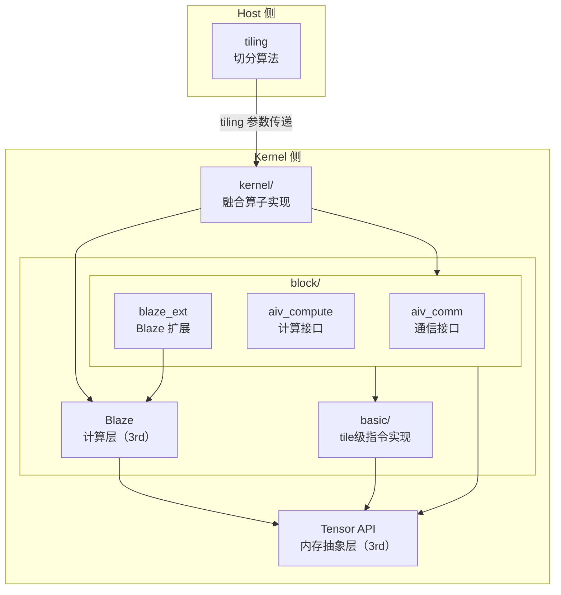
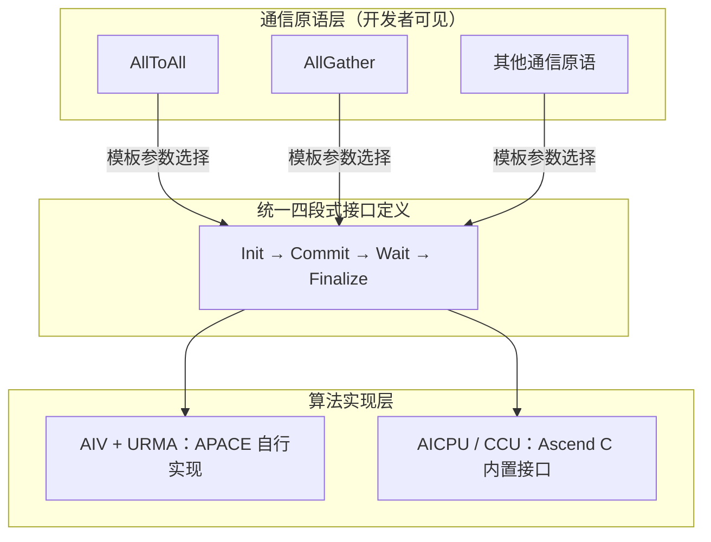
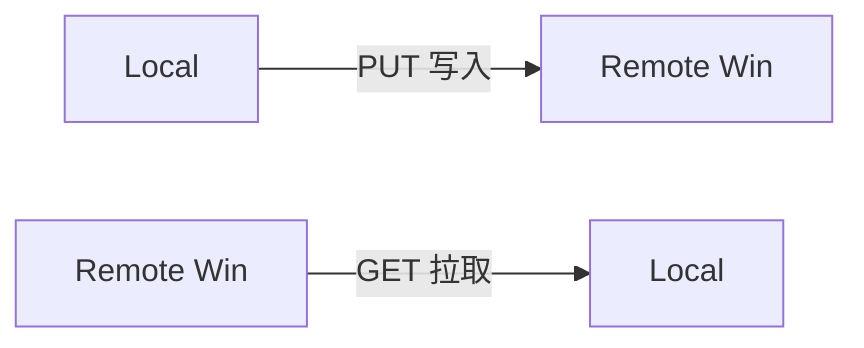
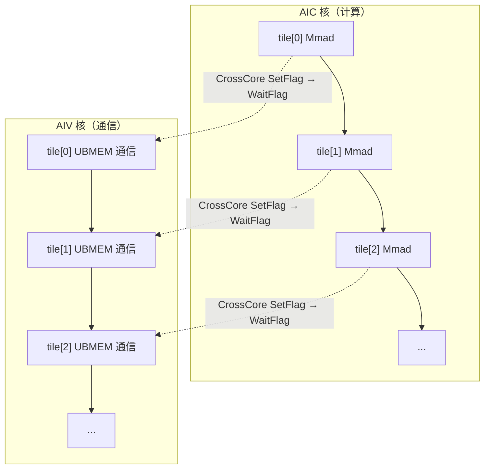
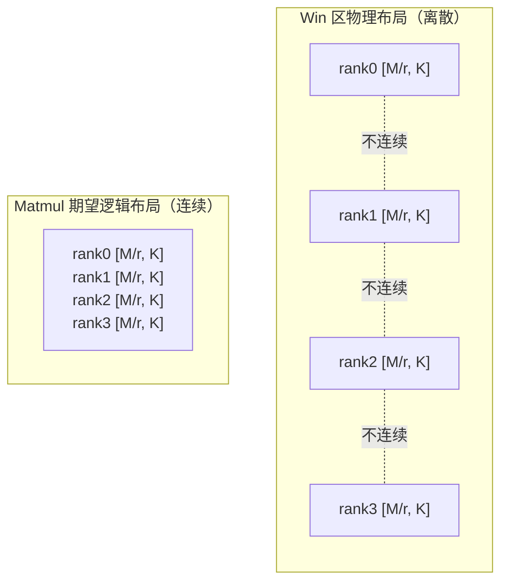
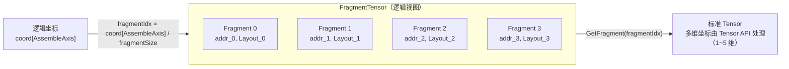
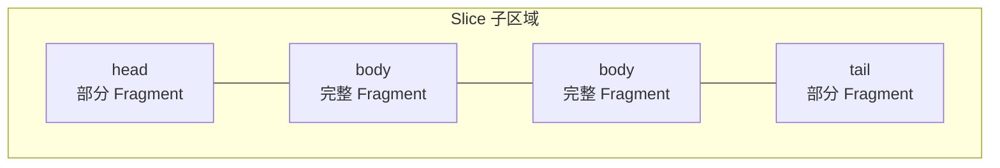
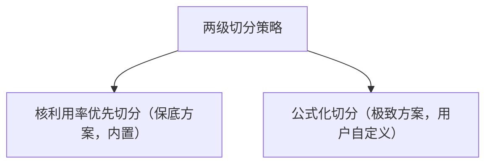
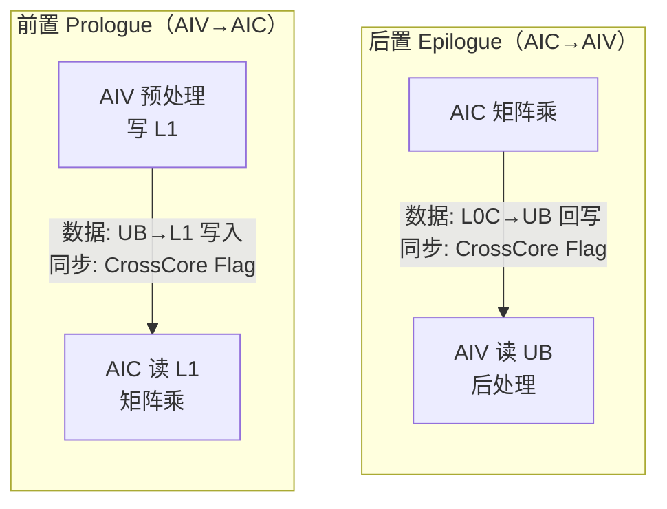
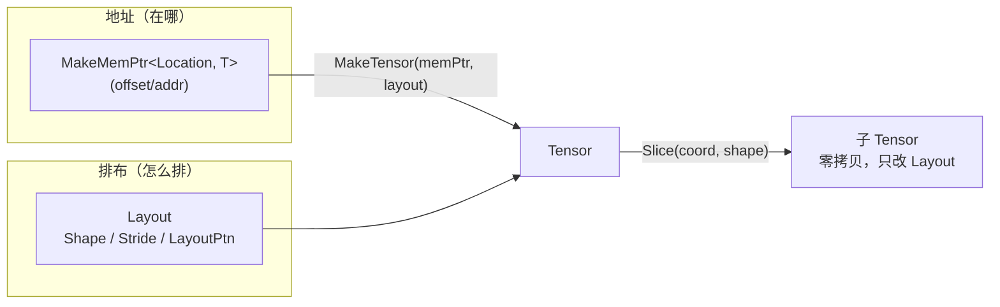

# APACE 架构底座设计文档

## 1. 文档概述

本文档面向内部开发人员，用于技术串讲、评审与汇报。文档以 **6 个关键技术**为主线，系统阐述 **APACE (Ascend PArallel Communication-compute Engine)** 架构底座的设计与核心技术方案。

**六大关键技术**：

| 序号 | 关键技术 | 核心价值 |
|:---|:---|:---|
| **技术一** | 多通信引擎 + 协议的统一抽象 | 统一抽象多类通信引擎与通信协议，四段式 API 屏蔽硬件差异 |
| **技术二** | 离散化内存重映射，降低编程难度 | FragmentTensor 虚拟重排，零搬运解决通信后内存离散问题 |
| **技术三** | 通信和计算独立调度，消减计算耗时膨胀 | 通信与计算运行时独立调度，全局调度消除核闲置导致的计算耗时膨胀 |
| **技术四** | 灵活切分策略，寻求最优泛化性能 | 利用率优先保底 + 公式化极致，适配不同机型与场景 |
| **技术五** | 模块实现与分核逻辑解耦，提升可复用能力 | 屏蔽硬件资源调度，SPMD 为主、复杂分核支持类 MPMD |
| **技术六** | 内存编程基座：数据分离、常量折叠与 UB 管理 | Tensor 封装 + Layout 解耦地址与排布，kernel 统一规划 UB 分区 |

---

## 2. 项目背景与定位

### 2.1 项目定位

APACE 是 MC2 通算融合算子的架构底座，服务于两类目标：

**1. 内置 MC2 算子开发**
- 提供算子编程规范，统一开发标准
- 提供可复用的模块化代码（通信、计算、切分、内存抽象），避免重复造轮子
- 提供可参考的常用方案模板，加速算子开发

**2. 生态用户自定义算子开发**
- 支持客户基于模块化接口自定义算子开发，实现快速创新
- 降低通算融合算子的开发门槛，无需从零实现通信与计算的协同编排

### 2.2 与 MC2 算子的关系

```
MC2/<op>/op_host    ──┐
                      └──▶ apace/tiling       (tiling 接口)
MC2/<op>/op_kernel  ──┐
                      ├──▶ apace/block        (通信、计算接口，组合构建)
                      └──▶ apace/kernel       (融合算子实现，可直接调用或参考)
```

- 算子的 `op_host/op_tiling` 层可使用 `apace/tiling` 中的智能切分算法确定 tiling 参数
- 算子的 `op_kernel` 层可基于 `apace/block` 接口组合构建融合 kernel，也可参考 `apace/kernel` 实现

---

## 3. 系统架构

### 3.1 目录结构

```
apace/
├── kernel/               # 融合算子实现
├── block/
│   ├── blaze_ext/        #   Blaze 扩展
│   ├── aiv_comm/         #   AIV 通信接口
│   └── aiv_compute/      #   AIV 计算接口
├── basic/                # tile级指令实现
├── tiling/               # tiling 算法（Host 侧）
├── utils/                # 通用工具与常量
├── docs/                 # 设计说明
└── README.md
```

### 3.2 模块依赖关系



- **Host 侧**：`tiling` 提前计算切分参数，结果传递给 kernel 层
- **Kernel 侧**：`kernel` 融合算子实现，调用 `block`（通信、计算、Blaze 扩展）与 `Blaze` 单核实现
- **block 依赖 basic**：`basic` 提供 tile 级指令实现，供 `block` 调用
- **共同依赖 Tensor API**：APACE（`block`、`basic`）和 Blaze 均依赖 Tensor API（内存抽象层），为并列关系而非串行
- **blaze_ext 复用 Blaze**：BlockScheduler、Tile 原语来自 Blaze

### 3.3 核心模块概览

| 模块 | 目录 | 核心能力 | 稳定性 | 关联技术 |
|:---|:---|:---|:---|:---|
| **融合算子实现** | `kernel/` | AllToAll+Matmul 等融合算子完整流程 | 📝 不稳定 | 全部 |
| **通信接口** | `block/aiv_comm/` | 多引擎统一抽象，AllToAll/AllGather/Barrier 原语 | ✅ 稳定 | 技术一 |
| **计算接口** | `block/aiv_compute/` | 量化、SwiGLU、MoE Dispatch/Combine | ✅ 稳定 | - |
| **Blaze 扩展** | `block/blaze_ext/` | FragmentTensor 集成 BlockMmadFrag | ✅ 稳定 | 技术二 |
| **FragmentTensor** | `basic/fragment_tensor/` | 离散内存虚拟重排 | ✅ 稳定 | 技术二 |
| **切分算法** | `tiling/` | FusionTiling 两级切分，性能建模 | ✅ 稳定 | 技术四 |
| **通用工具** | `utils/` | 通用常量和数据结构 | ✅ 稳定 | - |

---

## 4. 关键技术一：多通信引擎 + 协议的统一抽象

### 4.1 问题背景与设计目标

昇腾 NPU 平台支持多种通信引擎和通信协议。引擎决定通信执行载体（在哪种处理单元上发起通信），协议决定数据传输路径（数据走哪条物理通路）。引擎与协议组合形成不同的通信通道，各组合的 API 风格、适用场景、性能特征差异显著。APACE 覆盖了**最主流的引擎 + 协议组合**，满足通算融合算子的核心通信需求。

**通信引擎**：

| 引擎 | 支持的协议 | 说明 |
|:---|:---|:---|
| **AIV** | URMA、UBMEM | 计算核直接驱动通信，极低时延 |
| **AICPU** | URMA | CPU 辅助通信，支持复杂语义和拓扑算法 |
| **CCU** | URMA | 专用集合通信引擎，高带宽、低时延，资源有限 |

**核心挑战**：标准集合通信语义下，现有通信能力仅覆盖 CCU 与 AICPU，缺少 AIV + URMA / UBMEM 组合，且调用方式不统一、无统一编程范式，导致理解、维护、扩展成本递增——开发者需逐一掌握各组合 API，每增组合即散落编码，新增或替换组合时已有算子全量排查改写。

**设计目标**：
1. **一次开发，引擎 + 协议编译期选择** —— 开发者面向统一通信原语编程，通过模板参数在编译期选定引擎与协议组合
2. **新增引擎 / 协议，已有算子零改动** —— 通过适配层隔离硬件细节，扩展点收敛到单一接口实现
3. **两种通信范式覆盖不同场景** —— 四段式 API 面向一维连续内存的大数据量集合通信；tile 级细粒度融合通信面向二维以上数据块的小 batchsize 细粒度融合场景

### 4.2 统一抽象与四段式 API

为达成上述目标，APACE 设计了**三层抽象 + 编译期选择**机制：



**选择机制**：开发者通过模板参数（如 `CollectiveOp`、`CommMode`）在**编译期**选定具体的引擎 + 协议实现，由编译器完成静态分发。运行期不存在引擎/协议判断分支，零额外开销。

**可扩展性**：新增引擎或协议时，只需在算法实现层（L3）新增一个适配实现并满足四段式 API 契约，上层通信原语（L1）与已有通算融合算子代码均无需修改。扩展点从"散落各算子"收敛为"新增一个适配文件"。

APACE 对标准集合通信语义提供**四段式 API**：`Init → Commit → Wait → Finalize`。


**为什么是四段式（而非单一 `call()`）**：

四段式并非 API 形式的简单拆分，而是服务于通算融合的核心诉求——**通信与计算重叠**：

1. **Commit 非阻塞**：提交后立即返回，不等待数据真正到达对端，为计算侧留出执行窗口，实现"计算掩盖通信"
2. **Commit / Wait 可循环**：大数据量切分为多个 tile，Commit 与 Wait 按 tile 循环调用，构建"通信一块 / 计算一块"的流水线
3. **Init / Finalize 与通信分离**：资源分配与释放独立于通信任务，同一上下文可复用于多次 Commit/Wait 循环，避免重复初始化开销

**各阶段职责边界**：

| 阶段 | 职责 | 阻塞性 | 可循环 | 资源操作 |
|:---|:---|:---|:---|:---|
| **Init** | 上下文初始化、预计算常量、参与方握手 | 阻塞 | 否 | 分配 |
| **Commit** | 提交本次通信任务（一个 tile） | 非阻塞 | 是 | — |
| **Wait** | 等待通信完成、执行依赖检查 | 阻塞 | 是 | — |
| **Finalize** | 收尾同步、释放上下文资源 | 阻塞 | 否 | 释放 |

**设计要点**：
- **引擎 + 协议透明**：开发者只需指定通信原语和模式，通过模板参数在编译期选定引擎与协议组合
- **延迟执行**：Commit 非阻塞执行，是通算重叠的前提

#### 4.2.1 通信模式与同步

AIV 引擎支持**单边通信**，即直接操作远程内存，无需对端 CPU/核参与，减少内存拷贝。同一通信原语提供两种数据流向，适配不同融合算子数据流：



模式选型需从以下两个角度综合权衡，二者是互补因素而非互斥条件。

**角度一：与计算的亲和性**

依据融合算子"通算顺序"选择数据流向，核心目标是**减少 AIC 核计算等待通信的时间**，最大化通算重叠：

| 融合场景 | 亲和模式 | 原因 |
|:---|:---|:---|
| **先计算后通信** | PUT | AIC 计算完成后，AIV 立即将结果推送到对端 Win 区，AIC 可继续计算下一 tile，无需等待对端来拉取 |
| **先通信后计算** | GET | AIV 主动拉取所需数据，AIC 仅需等待当前 tile 到达即可开始计算，按 tile 粒度构建流水线，减少 AIC 空闲等待 |

**角度二：Win 区作为算子输入输出的能力**

单边通信的数据落点在 Win 区。Win 区能否直接作为算子的输入或输出，决定了是否需要额外的一次拷贝：

| 模式 | 数据落点 | 无拷贝条件 | 否则 |
|:---|:---|:---|:---|
| **PUT** | 对端 Win 区 | 对端可将 Win 区数据直接作为算子输入 | 对端需将数据从 Win 区拷贝至输入缓冲 |
| **GET** | 本地（从对端 Win 区拉取） | 对端算子输出可直接写入 Win 区供拉取 | 对端需将输出拷贝至 Win 区 |

**同步差异**：

| 特性 | PUT 模式 | GET 模式 |
|:---|:---|:---|
| **Init 同步** | barrier_all | 无 |
| **Commit 同步** | 无 | barrier_all |
| **Wait 同步** | barrier_all | 无 |
| **Finalize 同步** | 无 | barrier_all |

同步差异源于：PUT 需在 Init 时通知对端"即将写入"（barrier_all），并在 Wait 时确认对端已收（barrier_all），Commit 无同步直接提交；GET 是本地主动拉取，Commit 前需 barrier_all 等待对端写入完成，但 Init/Finalize 同步更轻。

**Barrier 同步**

Barrier 是统一通信原语集中的**同步原语**，实现通信域内全卡同步。

常规 Barrier 隐含要求**本卡内全部核参与**同步。本方案支持**部分核参与**——可灵活指定参与 Barrier 的核集合，适配通算融合中不整除分核、仅部分核承载通信等场景，调度更灵活。

### 4.3 Tile 级细粒度融合通信

除四段式 API 外，还提供 **tile 级细粒度融合通信**能力，基于 UBMEM 协议，支持对二维以上数据块的通信。该能力**不提供四段式范式**，而是嵌入计算流程中，实现通信与计算的细粒度融合。

**核心机制**：同一 block 内的 AIC 与 AIV 协同——AIC 完成基本块的计算后，同 block 的 AIV 利用 UBMEM 协议直接发起通信，通过 CrossCore Flag 做 tile 级同步，无需独立通信阶段。



**典型场景**：MatmulReduceScatter——每个 AIC 完成一个基本块的 Mmad 计算后，同 block AIV 即可将结果通过 UBMEM 推送到对端，AIC 继续计算下一个基本块，形成"算一块、发一块"的细粒度流水线。

**适用场景**：小 batchsize 场景下，数据量不足以充分填充四段式 API 的通信流水线，tile 级细粒度融合可减少通信启动开销，实现更紧密的通算重叠。

**与四段式 API 的对比**：

| 维度 | 四段式 API | Tile 级细粒度融合通信 |
|:---|:---|:---|
| 范式 | Init→Commit→Wait→Finalize | 嵌入计算流程，无独立通信阶段 |
| 协议 | URMA | UBMEM |
| 内存布局 | contiguous，一维连续展开 | 二维以上数据块 |
| 适用场景 | 大数据量集合通信 | 小 batchsize 细粒度融合 |

### 4.4 向技术二的衔接

四段式 API 解决了"通信能力如何统一复用"的问题，但一次完整集合通信被切分后，Win 区数据物理地址离散，难以作为连续矩阵被计算框架直接消费。第 5 章阐述 FragmentTensor 如何通过虚拟重排降低离散内存的编程难度。

---

## 5. 关键技术二：离散化内存重映射，降低编程难度

### 5.1 问题背景与设计目标

一次完整集合通信被切分后，Win 区会包含**多个 rank 的数据块**，物理地址不连续，但逻辑上需要作为统一矩阵访问。该问题不仅出现在 AllToAll，AllGather、ReduceScatter 等集合通信原语切分后同样存在。



**核心挑战**：离散多 rank 数据需手动计算偏移、易出错，无法直接接入 Blaze 等期望连续内存的计算框架，当前靠拆分多次计算、效率低。

**设计目标**：提供离散内存的统一抽象层，通过虚拟重排（非物理搬运）实现零开销连续访问，降低编程难度，支持集成计算框架。

### 5.2 FragmentTensor 虚拟重排

APACE 设计了 **FragmentTensor** 离散内存的统一抽象层：

**核心思想**：不做物理搬运，通过虚拟重排让离散内存"看起来"连续。FragmentTensor 是多个独立 Tensor 沿一个轴拼接聚合，每个 Tensor 有独立的内存地址和 Layout。



**核心设计**：
- **多 Tensor 聚合**：FragmentTensor 由多个独立 Tensor 沿 **AssembleAxis** 拼接而成，每个 Tensor 有独立的内存地址和 Layout
- **聚合轴任意**：AssembleAxis 可以是任意轴（如 M 轴或 K 轴），适配不同通信场景
- **编译期推导**：AssembleAxis 和 FragmentCount 编译期计算，零运行态开销
- **零搬运 Slice**：只更新坐标，无数据拷贝，O(1) 开销

**坐标映射**：给定 AssembledShape 上的逻辑坐标，FragmentTensor 通过 `fragmentIdx = coord[AssembleAxis] / fragmentSize` 定位对应的 Fragment，再通过 `GetFragment(fragmentIdx)` 返回标准 Tensor。Fragment 内的多维坐标访问由 Tensor API 提供（支持 1~5 维），不在 FragmentTensor 设计范围内。

调用方只需面向 AssembledShape 编程，无需感知底层数据离散性。

### 5.3 Slice 切片与 ForEachFragment 遍历

**Slice 能力**：FragmentTensor 支持切片，通过 `Slice(coord, shape)` 返回子区域 FragmentTensor。切片只更新坐标，无数据拷贝（O(1) 开销），支持嵌套切片。


Slice 的起始位置不一定落在 Fragment 边界上，因此子区域可能产生大小不等的头尾块（head/body/tail）：



通过动态推导定位起始 Fragment：
- `fragmentIdx = coord[AssembleAxis] / fragmentSize`（定位起始 Fragment）
- `fragmentCoord = coord[AssembleAxis] % fragmentSize`（Fragment 内起始偏移，用于确定 head/body/tail 边界）

**ForEachFragment 遍历**：遍历子区域包含的所有 Fragment，每个 Fragment 都是独立 Tensor，累积偏移计算。头尾块大小由 Slice 起止位置决定，中间 body 块大小等于 fragmentSize。

### 5.4 Blaze 扩展集成

BlockMmad 扩展支持 FragmentTensor 输入：在 `CopyAInL1` 中通过 `ForEachFragment` 遍历 Fragment，`GetFragment` 获取标准 Tensor，再 `Slice + Copy` 分块拷贝到 L1，适配空间限制。

```cpp
// BlockMmad 中 CopyAInL1 的 FragmentTensor 集成
gmA.ForEachFragment(kStart, kLength, [&](const auto& info) {
    auto fragment = gmA.GetFragment(info.fragmentIdx);  // 获取标准 Tensor
    auto fragBlock = fragment.Slice(
        MakeCoord(0, 0), MakeShape(curM, info.usableSize));  // Fragment 内切片
    auto l1Block = tensorAL1.Slice(
        MakeCoord(0, info.offsetInSubRegion), MakeShape(curM, info.usableSize));
    Copy(copyGM2L1, l1Block, fragBlock);  // 分块拷贝到 L1
});
```

### 5.5 向技术三的衔接

FragmentTensor 解决了离散内存的统一访问问题，降低了开发者处理通信后数据的编程难度。但通算融合中，通信与计算的运行时调度仍需开发者手写 AIV/AIC 交叉逻辑，不同融合算子各自编排，导致计算耗时膨胀。独立调度解决通信与计算的运行时调度问题，详见第 6 章。

---

## 6. 关键技术三：通信和计算独立调度，消减计算耗时膨胀

### 6.1 问题背景与设计目标

通算融合中，原设计按通信轮次驱动计算——外层 for 循环遍历通信轮次，内层对每轮通信结果做 Matmul 分核循环：

```
for (轮次 = 0; 轮次 < 通信轮次总数; 轮次++) {
    通信(轮次);           // 获取本轮数据
    Matmul分核(本轮数据);  // problemShape 局限在本轮
}
```

以 4 轮通信、每轮 M=256、10 个基本块（N=2560、基本块 256×256）、8 个 AIC 核为例。通信快于计算，每轮计算 8 核满载后剩余 2 块，6 核闲置。

> 注：尾块核用不满的情况下，Matmul 提供"再均衡"策略，一定程度上弥补性能影响，但仍存在 MAC 利用率不高的情况。为简化描述，下文仍保持"核空闲"的表述。

```
         块1  块2  块3  块4  块5  块6  块7  块8  块9  块10
      ┌─────┬─────┬─────┬─────┬─────┬─────┬─────┬─────┬─────┬─────┐
M轮1  │S1▓▓ │S1▓▓ │S1▓▓ │S1▓▓ │S1▓▓ │S1▓▓ │S1▓▓ │S1▓▓ │S2░░ │S2░░ │
      ├─────┼─────┼─────┼─────┼─────┼─────┼─────┼─────┼─────┼─────┤
M轮2  │S3▓▓ │S3▓▓ │S3▓▓ │S3▓▓ │S3▓▓ │S3▓▓ │S3▓▓ │S3▓▓ │S4░░ │S4░░ │
      ├─────┼─────┼─────┼─────┼─────┼─────┼─────┼─────┼─────┼─────┤
M轮3  │S5▓▓ │S5▓▓ │S5▓▓ │S5▓▓ │S5▓▓ │S5▓▓ │S5▓▓ │S5▓▓ │S6░░ │S6░░ │
      ├─────┼─────┼─────┼─────┼─────┼─────┼─────┼─────┼─────┼─────┤
M轮4  │S7▓▓ │S7▓▓ │S7▓▓ │S7▓▓ │S7▓▓ │S7▓▓ │S7▓▓ │S7▓▓ │S8░░ │S8░░ │
      └─────┴─────┴─────┴─────┴─────┴─────┴─────┴─────┴─────┴─────┘
```

C 矩阵按 M 轴切分为 4 块（对应 4 轮通信）。每块内 10 个基本块，8 核满载处理 8 块后，尾块仅剩 2 个基本块，2 核工作、6 核闲置。`▓▓` 表示 8 核满载，`░░` 表示 6 核闲置。

**核心挑战**：计算效率不高——每轮通信得到的数据 shape 可能无法用满 AIC 核，Matmul 的 problemShape 被局限在本轮通信数据范围内，无法跨轮次全局优化分核。

**设计目标**：将通信与计算解耦为独立实体，通过全局调度消除核闲置，消减计算耗时膨胀。

### 6.2 核心机制：生产者-消费者解耦

将通信与计算解耦为两个独立实体，通过生产者-消费者模式协作：

- **通信（生产者）**：独立执行，按轮次逐 tile 发起通信，数据准备完成后通知计算侧
- **计算（消费者）**：独立按照**全局最优流水调度**执行 Matmul 分核，不受通信轮次边界约束；若前置通信未就绪则阻塞等待

全局调度通过 S 形走位跨轮次拼接计算块，始终保持 8 核满载：

```
         块1  块2  块3  块4  块5  块6  块7  块8  块9  块10
      ┌─────┬─────┬─────┬─────┬─────┬─────┬─────┬─────┬─────┬─────┐
M轮1  │S1▓▓ │S1▓▓ │S1▓▓ │S1▓▓ │S1▓▓ │S1▓▓ │S1▓▓ │S1▓▓ │S2▓▓ │S2▓▓ │ →
      ├─────┼─────┼─────┼─────┼─────┼─────┼─────┼─────┼─────┼─────┤
M轮2  │S3▓▓ │S3▓▓ │S3▓▓ │S3▓▓ │S2▓▓ │S2▓▓ │S2▓▓ │S2▓▓ │S2▓▓ │S2▓▓ │ ←
      ├─────┼─────┼─────┼─────┼─────┼─────┼─────┼─────┼─────┼─────┤
M轮3  │S3▓▓ │S3▓▓ │S3▓▓ │S3▓▓ │S4▓▓ │S4▓▓ │S4▓▓ │S4▓▓ │S4▓▓ │S4▓▓ │ →
      ├─────┼─────┼─────┼─────┼─────┼─────┼─────┼─────┼─────┼─────┤
M轮4  │S5▓▓ │S5▓▓ │S5▓▓ │S5▓▓ │S5▓▓ │S5▓▓ │S5▓▓ │S5▓▓ │S4▓▓ │S4▓▓ │ ←
      └─────┴─────┴─────┴─────┴─────┴─────┴─────┴─────┴─────┴─────┘
```

S1~S5 为 5 个调度步，每步 8 核满载，共 40 块，零闲置。箭头表示 S 形走位方向：S1（轮1 块1~8，→）→ S2（轮1 块9~10 + 轮2 块10~5，←）→ S3（轮2 块4~1 + 轮3 块1~4，→）→ S4（轮3 块5~10 + 轮4 块10~9，←）→ S5（轮4 块8~1，←）。

**性能对比**：两种设计中通信与计算均有重叠——首个通信块就绪后计算即启动。差异在于计算调度：旧设计按轮次计算，每轮尾块仅 2 核工作、6 核闲置；新设计全局调度，8 核持续满载。

```
旧设计（总时间9）:
  通信: [C1] [C2] [C3] [C4]
  计算:      [满][闲] [满][闲] [满][闲] [满][闲]
         ←──4──→←─────────8─────────→
         重叠3单位，每轮尾块6核闲置，计算耗时8单位

新设计（总时间6）:
  通信: [C1] [C2] [C3] [C4]
  计算:      [M1] [M2] [M3] [M4] [M5]
         ←──4──→←──5──→
         重叠3单位，全局调度8核持续满载，计算耗时仅5单位
```

> 总计算量相同（40 块）。两种设计通信与计算均重叠。旧设计每轮计算尾块 6 核闲置，4 轮计算耗时 8 单位，总时间 9 单位；新设计全局调度 8 核持续满载，计算耗时仅 5 单位，总时间 6 单位。由于通信快于计算，计算侧的 6 个核处理完轮次 1 尾块后直接接轮次 2 数据——轮次 2 通信已就绪，无需等待。

**消减计算耗时膨胀**：全局调度消除每轮尾块的核闲置，8 核持续满载，计算耗时从 8 单位压缩至 5 单位，消除因调度局限导致的计算耗时膨胀。

**同步方式**：生产者与消费者之间的数据就绪同步提供两种模式，按场景选用：

| 同步方式 | 机制 | 特点 | 适用场景 |
|:---|:---|:---|:---|
| **软同步** | GM 内存读写 Flag | 可实现分组核同步，更灵活 | 部分核参与、跨 block 协同等灵活场景 |
| **硬同步** | CV 之间同步能力（CrossCore） | 性能更好，一般做全核同步 | 同 block 内 CV 协同、性能优先场景 |

### 6.3 向技术四的衔接

独立调度提供了通算重叠的框架，但重叠效果取决于通信与计算的时间匹配。两级切分策略寻求最优泛化性能，详见第 7 章。

---

## 7. 关键技术四：灵活切分策略，寻求最优泛化性能

### 7.1 问题背景与设计目标

独立调度提供了通算重叠的框架，但重叠效果取决于通信与计算的时间匹配——切分粒度太粗则通信掩盖不足，太细则单次通信/计算效率下降。切分质量直接决定通算重叠效果。

**核心挑战**：
- 如何在通信掩盖率与单次效率之间找到最优平衡，适配不同机型与场景？

**设计目标**：提供两级切分策略，从保底到极致，开发者按需选用。

### 7.2 两级切分总览



### 7.3 核利用率优先切分（保底方案，内置）

**核心思想**：通算并行切分采用**均分策略**——M 轴按单一 `baseM` 均匀切分，N 轴按单一 `baseN` 均匀切分，所有计算块大小一致。算法的本质是在均分约束下，寻求**主轮核利用率最大化**：全局总 tile 数 $T$ 分发到 $C$ 个核后，分为若干**主轮**（全部核满载）和至多一个**尾轮**（部分核闲置）。算法寻找可行切分轮次，获取切分最大、满足L2 hit最大的分型走位且满足核利用率大于设定阈值的tileCnt。该方案内置保底性能，开箱即用，无需额外配置。

**问题分析**：设全局总 tile 数为 $T$、AIC 核数为 $C$，将 $T$ 分解为：

$$
T = k \times C + r, \quad k = \lfloor T/C \rfloor,\ 0 \leq r < C
$$

- **主轮**：前 $k$ 轮，每轮 $C$ 个核全部满载，贡献 $k \times C$ 个 tile
- **尾轮**：若 $r > 0$，额外 1 轮仅 $r$ 个核工作，$C - r$ 个核闲置

核利用率为：

$$
U = \frac{T}{(k + \mathbb{1}_{r>0}) \times C}
$$

当 $r = 0$（$T$ 被 $C$ 整除）时无尾轮，$U = 100\%$；当 $r > 0$ 时尾轮产生 $C - r$ 个核的闲置浪费，$U$ 下降。算法通过调整 `baseM`、`baseN` 改变 $T$，使 $r$ 尽可能小或为零，最大化主轮占比。

**选型策略**：在硬件约束范围内，计算各组合下的 `totalTiles` 与核利用率 $U$。筛选 $U \geq$ 阈值（默认 80%）的候选方案，按以下优先级选取最优：

1. **通信轮次最多（通算掩盖充分）**
2. **利用率最高**（同轮次下 $U$ 越高越鲁棒）
3. **基本块越大越好**（同利用率下 `baseM、baseN` 越大，单 tile 计算效率越高）

### 7.4 公式化切分（极致方案，用户自定义）

基于通信能力与 Matmul 计算能力的性能建模，通过 Bound 判定与长短块配平，寻求通算掩盖的极致性能。用户需对目标机型做性能标定，以 JSON 配置注入拟合系数，框架据此自动计算最优切分参数。

> **与核利用率优先切分的关系**：核利用率优先切分在 M 轴采用均匀块大小，公式化切分将其推广为**长块 + 短块**的非均匀混合切分，通过性能模型精确配平通算时间。

#### 7.4.1 性能建模

公式化切分依赖两类性能模型：

| 模型 | 数据来源 | 建模方式 |
|:---|:---|:---|
| **通信耗时模型** | 用户标定 | 分段函数（恒定/抛物线/线性），最小二乘拟合 |
| **Matmul 计算耗时模型** | 框架内置 | Cube 利用率幂律模型 + 计算梯度 |

**通信耗时模型**：以数据量 $S$（MB）为自变量，分段拟合：

$$
T_{comm}(S) = \begin{cases} t_{min} & S \leq S_1 \\ a \cdot S^2 + b \cdot S + c & S_1 < S \leq S_2 \\ g \cdot S + o & S > S_2 \end{cases}
$$

小数据区时延主导、大数据区带宽主导，中等数据区为抛物线过渡。当 $S_1 = S_2 = 0$ 时退化为纯线性模型。

**Matmul 计算耗时模型**：Cube 利用率基于矩阵维度的幂律模型（考虑 L2 hit 率），计算耗时 $T_{mm} = \frac{M \cdot N \cdot K}{computesPerCycle \cdot freq \cdot coreNum \cdot U_{cube}}$

**JSON 配置示例**：

```json
{
  "platform": "Atlas A5",
  "topology": { "rankSize": 8, "protocol": "CCU+URMA+FULLMESH" },
  "commPerf": {
    "type": "allgather",
    "sizeBoundary1_MB": 0.0, "sizeBoundary2_MB": 0.0,
    "timeBoundary1_us": 8.59, "timeBoundary2_us": 8.59,
    "linearGradient": 5.842, "linearOffset": 8.591,
    "parabolicParam1": 0.0, "parabolicParam2": 0.0, "parabolicParam3": 0.0
  }
}
```

#### 7.4.2 长短块配平

**配平流程**：

1. **估算通算失衡比** $ratio = \max(T_{comm}^{total}, T_{mm}^{total}) / \min(T_{comm}^{total}, T_{mm}^{total})$，$ratio < 2.0$ 视为基本均衡
2. **计算长块长度**：令长块通信耗时等于前块计算耗时 $T_{comm}(M_{long}) = T_{front}$，通过通信模型反函数求解 $M_{long}$，对齐到 $mAlignLen$
3. **计算短块长度**：取 $minTileLen$（默认 $baseM$）；若基本均衡且半对齐块耗时均超 40 μs，则对齐粒度减半以鼓励更细切分
4. **分配块数**：$n_{long} = \lfloor (M_{local} - 0.75 \cdot M_{short}) / M_{long} \rfloor$（0.75 为短块折扣系数），残差由短块吸收；长短块相等时合并为均匀切分，总块数超 $maxTileCnt$ 时退化为均匀切分

**输出参数**：

| 参数 | 含义 |
|:---|:---|
| `longTileLen` | 长块 M 轴尺寸（通信耗时 ≈ 前块计算耗时） |
| `numLongTile` | 长块数量 |
| `shortTileLen` | 短块 M 轴尺寸（吸收残差，= 0 表示无短块） |
| `numShortTile` | 短块数量（0 或 1） |
| `shortTileAtBack` | 短块是否在尾部 |

#### 7.4.3 标定工作流


- 提供标定脚本，用户在目标机型上采集通信耗时，脚本自动完成分段拟合并生成 JSON 配置
- Matmul 计算耗时模型由框架内置，无需用户标定
- 用户无需理解配平算法细节，只需提供准确的通信性能标定数据

### 7.5 预留参数

`FusionTilingData` 中的 `pipelineDepth`（流水线深度）与 `enableOverlap`（是否启用重叠）为**预留参数**，当前实现尚未消费，供后续深度流水线优化使用。

### 7.6 小结

两级切分策略从核利用率优先保底到公式化极致，覆盖不同性能需求场景。核利用率优先切分开箱即用，保证基本通算重叠效果；公式化切分通过性能建模与长短块配平，适配具体机型达到极致性能。预留参数为后续深度流水线优化保留扩展空间。

以上技术一~四聚焦通算融合的性能优化。此外，APACE 的代码架构设计——模块分核解耦与内存管理——支撑上述性能优化能力的可复用、可扩展实现，详见第 8、9 章。

---

## 8. 关键技术五：模块实现与分核逻辑解耦，提升可复用能力

### 8.1 问题背景与设计目标

昇腾 NPU 采用 **AIV（Vector 核）+ AIC（Cube 核）双计算核架构，AIV 兼作通信驱动**。传统开发模式下，算法逻辑直接依赖硬件 `GetBlockIdx()`，核分配策略与业务代码强耦合：换一种多核切分方案、改一个 `blockDim`，所有算子都要排查改写；模块无法在不同算子场景中复用。

**核心挑战**：模块如何做到**高内聚、低耦合、可复用**——与 `blockIdx` 绑定硬件核号解耦，切换分核方案时模块零改动、跨算子场景可复用？

**设计目标**：`block/` 目录下每个模块的**实现与分核逻辑解耦**，不感知具体硬件资源调度。模块内部零 `blockIdx` 依赖。

### 8.2 CV 协同模式

CV 协同模式基于 **Blaze 架构扩展**：同一个 block 内，AIC 侧 BlockMmad 做矩阵乘，AIV 侧做前置（Prologue）或后置（Epilogue）处理，两者通过 CrossCore Flag 协同。一般 Prologue 和 Epilogue 不同时使用，按数据流方向二选一。



CV 协同模式由数据驱动 block 执行，模块内部不感知 `blockIdx`，每个 block 处理各自的数据分片，多 block 并行由调用方按数据分配自然实现。

### 8.3 单核独立模式

单核独立模式面向可独立执行的任务，每个计算核独立运行。按任务复杂度分两种子模式：简单任务各核处理相同逻辑不同数据（SPMD），复杂任务各核处理不同任务（MPMD）。

#### 8.3.1 简单任务：数据 tile 驱动

**设计要点**：将数据切分为 tile 传入模块，模块在**任意 AIV 核**上执行。

**模块特征**：接口签名只含数据参数（地址、尺寸），不含 `blockIdx`。任意核拿到 tile 即可处理，多核并行由调用方按 tile 分配自然实现。

**接口签名**（`block/aiv_compute/swiglu/swiglu.h`）：
```cpp
template<typename DataTypeIn>
__aicore__ inline void Swiglu(
    __ubuf__ bfloat16_t* outputAddr,
    __ubuf__ DataTypeIn* firstSrc,
    __ubuf__ DataTypeIn* secondSrc,
    uint16_t mSize, uint16_t nSize);
```
`aiv_compute/` 下 quant、swiglu 等模块均**零引用** `jobIndex`/`blockIdx`，纯数据驱动。

#### 8.3.2 复杂任务：job 抽象

**设计要点**：当任务**无法按数据切分**时（如集合通信需按 rank 分配对端，每个核负责不同的 targetRank），引入 `jobIndex`/`totalJobs` 逻辑编号——任务切分为若干 job，每个 AIV 认领一个 jobIndex 执行。

**接口签名**（`block/aiv_comm/collective_comm_base.h`）：
```cpp
uint64_t Init(const CommContext* ctx, GM_ADDR localAddr,
              const CommTilingData& tilingData,
              uint32_t totalJobs,   // 总参与核数
              uint32_t jobIndex);   // 当前核逻辑编号（0 ~ totalJobs-1）
```

**自动分核**：模块内部根据 `jobIndex` 自动计算本核负责的 targetRank 范围，业务代码无需手写分配逻辑：
```cpp
// collective_comm_base.h —— jobIndex → targetRank 自动映射
uint32_t targetRankPerCore = (rankSize + totalJobs - 1) / totalJobs;
uint32_t targetRankStart = jobIndex * targetRankPerCore;
// 尾核自动处理剩余 rank
```

> **单核独立模式核心价值**：算法只描述"一个核做什么"（处理哪些 targetRank、参与哪轮 Barrier），`jobIndex` 是逻辑编号而非硬件编号。模块可适配任意核分配策略。

`blockIdx` 到 `jobIndex` 的映射**仅在 kernel 入口发生一次**，模块内部零感知。调用方根据算子场景需求选择映射方式，模块代码无需修改：

```cpp
// kernel 入口：映射收敛点（all_to_all_matmul_kernel.h）
uint32_t blockIdx = GetBlockIdx();
if ((blockIdx >= 4) && (blockIdx < 8)) {
    uint32_t totalJobs = 4;           // ← 仅核4~7参与
    uint32_t jobIndex = blockIdx - 4; // ← 模块只接收 jobIndex
    allToAll_.Init(ctx, aGM, tilingData, totalJobs, jobIndex);
}
```

### 8.4 向技术六的衔接

核心是 `block` 模块的**实现与分核逻辑解耦**，通过两种编程模式覆盖不同任务特征：

- **CV 协同模式**：AIV+AIC 紧耦合任务，CrossCore Flag 保证 CV 数据依赖，Blaze 动态调度处理计算侧尾块与 double buffer
- **单核独立模式**：简单任务数据 tile 驱动（零核依赖），复杂任务 job 抽象（jobIndex 自动分核），`blockIdx → jobIndex` 映射收敛在入口一处

两种模式共同达成"高内聚、低耦合、可复用"：模块实现与分核逻辑解耦，核分配策略与业务逻辑分离，换算子场景只改入口映射，模块零改动。

分核解耦解决了模块可复用性问题，但 block 模块赖以工作的内存编程基座——数据分离、常量折叠与 UB 管理——仍需明确。第 9 章阐述如何通过 Tensor 封装与 Layout 能力简化数据切分与地址计算，以及 kernel 如何统一规划 UB 分区。

---

## 9. 关键技术六：内存编程基座：数据分离、常量折叠与 UB 管理

### 9.1 问题背景与设计目标

block 模块在 GM、UB、L1、L0 等多级存储上做数据切分与地址计算，**内存编程是 block 模块实现的基础**，但当前缺乏统一的内存管理设计，存在两个突出问题：

**痛点一：地址与排布耦合，手动偏移易错**

Ascend C 早期编程模式中，数据地址与排布信息耦合在一起，开发者需手动计算每个数据块的物理偏移。当数据切分粒度变化（如 tiling 参数调整）时，所有相关地址需重新计算，容易出错且难以维护。

**痛点二：UB 分区缺乏统一管理，跨模块复用需人工协调**

每个 AIV 核内有固定大小的 UB（统一缓冲区，地址从 `0x0` 开始连续），是各 block 模块共享的稀缺资源（约 248KB 可用）。block 模块要求独立可复用，模块内部无法感知其他模块的 UB 占用，因此各自从 offset 0 起算、独立划分自己的 UB 区域。当前无统一分配器协调：有的模块用编译期 `constexpr` 硬编码偏移表，有的在 `Init()` 内手动累加 offset，有的接收 Host 下发的 `ubSize` 后手动划分。

这导致同一核上多个模块共存时区域重叠，需开发者人工调整起始地址避免冲突，易出错、易浪费。

**设计目标**：
1. **内存与数据分离** —— 通过 Tensor 封装 + Layout 能力，将地址计算与数据排布解耦，简化数据切分与地址计算
2. **地址计算常量化** —— 编译期 constexpr 折叠 + Host Tiling 预计算，消除 Kernel 侧运行期地址计算
3. **kernel 编译期静态规划 UB 分区** —— kernel 用 constexpr 静态分配各 block 模块的 UB 区域，static_assert 编译期检查越界，裸 offset 传递给 block 使用

### 9.2 Tensor API：内存与数据分离

**核心思想：地址与排布解耦**

Tensor API 将数据访问拆解为两个正交维度，再组合为 Tensor 对象：



- **`MakeMemPtr<Location, T>(offset)`**：只管"在哪、起始地址"，`Location` 标识存储层级（`GM`/`UB`/`L1`/`L0A`/`L0B`/`L0C` 等），`offset` 是该层级内的裸偏移
- **Layout（`Shape`/`Stride`/`LayoutPtn`）**：只管"数据怎么排布"，与地址无关
- **`MakeTensor(memPtr, layout)`**：组合两者为 Tensor 对象
- **`Slice(coord, shape)`**：零拷贝切片，只更新 Layout 坐标，不改地址 → 简化数据切分

**地址累加与布局推导独立演进**：kernel 分配 offset、block 维护 Layout，两者互不干扰。以 `group_matmul_1.h` 为例：

```cpp
// kernel 层：裸 offset 累加分配 UB（UB offset 的分配方式详见 §9.4）
int64_t ubOffset = 0;
auto l0cOutUbFirst = Te::MakeTensor(
    Te::MakeMemPtr<Te::Location::UB, ElementC>(ubOffset), layoutC);          // 地址 + 排布组合
ubOffset += MAX_SINGLE_MN_ALIGN32_NUM_256 * sizeof(ElementC);                 // 地址累加
auto l0cOutUbSecond = Te::MakeTensor(
    Te::MakeMemPtr<Te::Location::UB, ElementC>(ubOffset), layoutC);           // 同一 Layout，不同 offset

// GM 侧同理：地址来自全局指针，排布由 Layout 描述
auto gmA = Te::MakeTensor(
    Te::MakeMemPtr<Te::Location::GM>(reinterpret_cast<__gm__ ElementA*>(addr)), layoutA);
```

地址（`offset`/`addr`）与排布（`layoutC`/`layoutA`）完全分离：改变切分粒度只需调整 Layout，无需重算地址；改变地址只需更新 offset，Layout 不变。

**与 FragmentTensor 的关系**：FragmentTensor（第 5 章技术二）消费 Tensor API，在离散 GM 内存上构建虚拟连续视图，Fragment 内的多维坐标访问由 Tensor API 提供。本章补 Tensor API 本身的设计，第 5 章补其上层消费。

### 9.3 常量化折叠：编译期推导与 Host 预计算

APACE 大量使用**常量化折叠**（constant folding）手段处理内存布局与偏移计算：能在编译期确定的用 `constexpr` 折叠为常量，不能在编译期确定的由 Host 在 Tiling 阶段提前算好下发，Kernel 侧不做运行期地址计算。

**编译期折叠**：静态参数（通信原语 `CollectiveOp`、模式 `CommMode`、维度 `Dims`、数据类型等）作为模板参数，编译期确定并推导内存布局/偏移。典型手段：
- `static constexpr` 定义偏移表与尺寸上限，`static_assert` 编译期校验不越界：
```cpp
static constexpr uint64_t UB_MAX_USABLE_SIZE = 248 * 1024;           // 256KB − 8KB 系统预留
static constexpr uint64_t WEIGHT_4BIT_OFFSETS[4] = {0, 16*1024, 32*1024, 48*1024};
static_assert(WEIGHT_4BIT_OFFSETS[3] + 16*1024 <= UB_MAX_USABLE_SIZE, "UB overflow");
```
- `constexpr` 累加推导各子 buffer 偏移：
```cpp
constexpr uint32_t gluResOffset = 0;
constexpr uint32_t quantOutputOffset = gluResOffset + MAX_SINGLE_MN * sizeof(bfloat16_t);
constexpr uint32_t quantScaleOffset = quantOutputOffset + MAX_SINGLE_MN * sizeof(int8_t);
```
Kernel 侧零运行期开销。

**Host 预计算**：动态参数（M/K/N/rankSize、`ubSize` 等）在 Host 侧 Tiling 阶段提前计算，经 `TilingData` 下发到 Kernel，Kernel 仅读取不计算：
```cpp
// TilingData 中定义（Host 侧填充）
struct AllGatherTilingData {
    uint64_t ubSize;    // Host 根据机型 UB 容量预计算后下发
    uint64_t xSize;
    // ...
};
// Kernel 侧：直接读取，不做地址计算
uint64_t availableUb = tilingData->ubSize - UB_RESERVE;
```

常量化折叠使内存地址计算从 Kernel 运行期消除——offset 要么是编译期常量，要么是 Host 下发值，Kernel 侧只需读取和累加。这与 §9.2 Tensor API 的地址/排布分离互补：Tensor API 提供 offset 与 layout 组合的抽象，常量化折叠确定 offset 的取值来源，共同为 §9.4 UB 管理的裸 offset 分配提供基础。

### 9.4 UB 内存管理

**设计原则：kernel 编译期静态规划分区，block 申明需求量**

每个 AIV 核的 UB 地址从 `0x0` 开始连续，各 block 模块共享。APACE 的 UB 管理方式如下：

**1. kernel 编译期静态分配**

kernel 用 `constexpr` 在编译期静态规划各 block 模块的 UB 区域，所有 offset 均为编译期常量。以 DispatchBuffInit 为例（精简），各 buffer 的 offset 链式推导：每个 offset 引用前一个 `offset + size`，运行态参数取编译期上限值（由 Host Tiling 保证不超限）：

```cpp
constexpr uint32_t AlignUp(uint32_t v, uint32_t a) { return (v + a - 1) / a * a; }
constexpr uint32_t UB_MAX_USABLE_SIZE = 248 * 1024;

// 各 buffer 尺寸（编译期常量；运行态参数取上限值，由 Host Tiling 保证不超限）
constexpr uint32_t EXPERT_TOKEN_CNT_SIZE = 32;
constexpr uint32_t CUMSUM_INFO_SIZE = AlignUp(MAX_WORLD_SIZE * MAX_EXPERT_PER_RANK * sizeof(int32_t), 32);
constexpr uint32_t GATHER_MASK_SIZE = AlignUp(MAX_MASK_SLOT_SIZE * MAX_WORLD_SIZE, 32);
constexpr uint32_t DISPATCH_BUFFER_NUM = 6;
constexpr uint32_t COPY_TMP_BUFFER_SIZE = 8 * 1024;

// 编译期链式分配：每个 offset 引用前一个 offset + size
constexpr uint32_t expertTokenCntOffset = 0;
constexpr uint32_t cumsumInfoOffset = AlignUp(expertTokenCntOffset + EXPERT_TOKEN_CNT_SIZE, 32);
constexpr uint32_t gatherMaskOffset = AlignUp(cumsumInfoOffset + CUMSUM_INFO_SIZE, 32);
constexpr uint32_t dispatchBufOffset = AlignUp(gatherMaskOffset + GATHER_MASK_SIZE, 32);
constexpr uint32_t ubTotalUsed = AlignUp(dispatchBufOffset + DISPATCH_BUFFER_NUM * COPY_TMP_BUFFER_SIZE, 32);

// 编译期越界检查
static_assert(ubTotalUsed <= UB_MAX_USABLE_SIZE, "UB allocation overflow");
```

- **阶段续接与复用**：多个阶段的 buffer 可链式续接（后序 offset 从 `ubTotalUsed` 继续）；若两阶段无流水线重叠，后序阶段可从 offset 0 复用前序空间——复用判断由流水线结构编译期决定

**2. block 模块暴露需求量（GetRequiredUbSize 契约）**

block 模块提供 `GetRequiredUbSize()` 供 kernel 查询其 UB 需求量：
- **固定布局模块**（如 epilogue 的 8 个子 buffer 大小固定）：用 `static constexpr` 编译期确定（见 §9.3 常量化折叠），kernel 可直接用于编译期静态分配
- **动态布局模块**（如 prologue 的 UB 划分依赖 tiling 参数）：需求量由 Host Tiling 预计算，kernel 侧取编译期上限值保证安全

kernel 汇总各模块需求量后，在编译期完成静态分配（见第 1 点）。

**3. 裸 offset 传递，block 内部自分**

kernel 将编译期静态分配得到的裸 `uint64_t ubOffset`（编译期常量）传给 block 模块的 `Init()`，block 内部用 `offset + subSize` 裸累加自分内部子 buffer：

```cpp
// block 模块内部：收裸 offset，累加自分
void Init(uint64_t ubOffset, ...) {
    uint32_t gluResOffset = ubOffset;
    uint32_t quantOutputOffset = gluResOffset + MAX_SINGLE_MN * sizeof(bfloat16_t);
    uint32_t quantScaleOffset = quantOutputOffset + MAX_SINGLE_MN * sizeof(int8_t);
    // ... 每个 sub buffer = prevOffset + prevSize
}
```

block 模块不依赖任何 Manager 对象，只认裸 offset，最小耦合。

**4. 与 Tensor API 结合**

block 拿到编译期 offset 后，通过 Tensor API 组合地址与排布，创建 UB Tensor 并初始化 block 模块：

```cpp
// 用编译期常量 + Tensor API 创建 UB Tensor
auto expertTokenCntTensor = Te::MakeTensor(
    Te::MakeMemPtr<Te::Location::UB, int32_t>(expertTokenCntOffset), layoutCnt);
auto cumsumInfoTensor = Te::MakeTensor(
    Te::MakeMemPtr<Te::Location::UB, int32_t>(cumsumInfoOffset), layoutCumsum);
// ...
prologue_.Init(dispatchBufOffset, ...);    // block 收 constexpr offset，内部自分 + MakeMemPtr<UB>
```

地址（offset）由 kernel 编译期静态分配，排布（layout）由 block 自治，两者解耦。

### 9.5 小结

本章从三个层面构建 APACE 的内存编程基座：Tensor API 通过地址与排布分离简化数据切分与地址计算；常量化折叠将地址计算前移至编译期与 Host 侧，消除 Kernel 运行期开销；UB 管理通过 kernel 编译期静态规划、block 申明需求、裸 offset 传递实现 UB 空间的高效利用与跨阶段复用，编译期 static_assert 保证不越界。三者协同——Tensor API 提供 offset 与 layout 组合抽象，常量化折叠确定 offset 取值来源，UB 管理在此基础上实现 kernel 驱动的编译期静态分区分配。FragmentTensor（第 5 章技术二）在 Tensor API 之上构建离散内存的虚拟重排，是内存数据分离设计的上层应用。模块分核解耦（第 8 章技术五）与本章内存管理共同构成 APACE 的代码架构基座，支撑技术一~四的性能优化能力可复用、可扩展。

---

## 10. 关键文件索引

| 功能 | 文件路径 | 关联技术 |
|:---|:---|:---|
| 通信接口 API | `block/aiv_comm/collective_comm_udma_api.h` | 技术一 |
| 通信上下文定义 | `block/aiv_comm/collective_comm_base.h` | 技术一 |
| AllToAll PUT 实现 | `block/aiv_comm/all_to_all/all_to_all_udma_put.h` | 技术一 |
| AllGather GET 实现 | `block/aiv_comm/all_gather/all_gather_udma_get.h` | 技术一 |
| Barrier 同步 | `block/aiv_comm/barrier/barrier_ubmem.h` | 技术一/五 |
| 跨核同步配置 | `utils/cross_core_sync_config.h` | 技术五 |
| 计算接口（数据tile驱动） | `block/aiv_compute/` | 技术五 |
| 切分算法 API | `tiling/fusion_tiling.h` | 技术四 |
| 通信切分 | `tiling/comm_tiling.h` | 技术四 |
| Matmul 切分 | `tiling/matmul_tiling.h` | 技术四 |
| 性能建模 | `tiling/performance_model.h` | 技术四 |
| FragmentTensor | `basic/fragment_tensor/` | 技术二 |
| Blaze 扩展 | `block/blaze_ext/` | 技术二 |
| AllToAll+Matmul 参考 | `kernel/all_to_all_matmul/all_to_all_matmul_kernel.h` | 全部 |
| 通用常量 | `utils/constant.h` | - |

---

**文档版本**：v1.0  
**更新时间**：2026-07-10