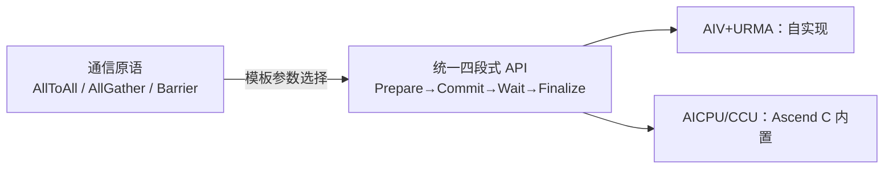
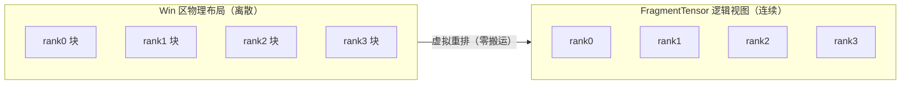

# MC2 算子系列（一）：通算融合算子架构底座技术解析

> **MC2 算子系列** 面向大模型分布式训练和推理中的通算融合场景，系统介绍集合通信与 MatMul 融合算子的技术原理、架构底座与开发实践。本篇为系列开篇，带你认识 MC2 算子，并解析其背后的统一架构底座。

## 一、认识 MC2 算子

随着大模型参数规模突破千亿乃至万亿，单设备无法满足训练和推理的算力与显存需求，分布式训练和推理成为必选方案。分布式场景下，多卡协同完成模型计算，卡间通过集合通信（AllReduce、AllGather、AllToAll、ReduceScatter 等）交换中间数据，通信与 MatMul 计算交替密集出现。

### 1.1 通算融合原理

然而，通信开销已与计算开销量级相当，甚至更高。传统做法是通信与计算串行执行——无论是"先通信、再计算"还是"先计算、再通信"，通信时计算单元闲置，计算时通信链路空闲：

```
通信: [========AllToAll========]
计算:                          [========Matmul========]
      ↑ 计算闲置 ↑              ↑ 链路闲置 ↑
```

端到端时间 = 通信时间 + 计算时间，硬件资源利用率被腰斩。**MC2 算子**的核心思想是让通信和计算并行执行、流水掩盖——把数据切分成 tile，通信一块、计算一块，通信与计算交替推进形成流水线，用计算掩盖通信，形成融合算子：

```
通信: [==tile1==][==tile2==][==tile3==]
计算:            [===M1===][===M2===][===M3===]
                 ←─────── 重叠 ───────→
```

MC2 算子把端到端时间从"通信 + 计算"压缩为"max(通信, 计算) + 未能被流水掩盖的头块或尾块"，用计算掩盖通信，压缩大模型分布式训练和推理的端到端时延。

### 1.2 应用场景

MC2 算子广泛出现在大模型分布式训练和推理的各类并行策略中，通信与 MatMul 交替密集出现：

- **张量并行（TP）**：AllGather / ReduceScatter 与 Matmul 交替，AllGather 聚合切分数据后做 Matmul，结果经 ReduceScatter 规约切分
- **序列并行（SP）**：AllToAll 沿序列维度重分布数据，通信与 Matmul 紧邻
- **专家并行（EP）**：MoE 场景通过 Dispatch 按专家路由分发 token，各专家做 FFN 计算（GroupedMatmul1 + 激活 + GroupedMatmul2），再通过 Combine 聚合返回

对应的 MC2 算子组合多样，主流包括 AllGather+Matmul、ReduceScatter+Matmul、AllToAll+Matmul、MoE 通信（Dispatch/Combine）等，并衍生出与 RMSNorm、量化、SwiGLU 等的进一步融合变体。

### 1.3 实现挑战

MC2 算子本身开发门槛高：通信与计算的协同编排复杂、多硬件形态适配困难、性能优化依赖深度经验……这些共性能力散落各算子自实现，重复造轮子、维护成本递增。**需要一套统一的架构底座，把通算融合的共性能力收敛复用。**

MC2 算子间存在公共技术，因此构建了统一的架构底座，当前归档在 `mc2/common/op_kernel/apace/` 目录，可被各 MC2 算子调用。

## 二、通信多引擎协议组合

MC2 通算融合的前提是高效通信——多个 rank 间需要通过集合通信交换数据，才能与本地计算重叠执行。昇腾 NPU 提供了多种通信引擎（AIV 计算核直驱、AICPU 辅助、CCU 专用引擎）与通信协议（URMA 跨节点、UBMEM 片内），不同组合的 API 风格、适用场景、性能特征差异显著，直接选用困难且组合爆炸。因此，架构底座首要解决的问题是：**对多引擎多协议的通信能力进行统一抽象，让上层算子无需感知底层差异。**

昇腾 NPU 的通信能力由**通信引擎**与**通信协议**两个维度组合决定：引擎决定通信执行载体（在哪种处理单元上发起通信），协议决定数据传输路径（数据走哪条物理通路）。

**通信引擎**：

| 引擎 | 支持协议 | 特点 | 使用场景 |
|:--|:--|:--|:--|
| **AIV** | URMA、UBMEM | 计算核直接驱动通信，极低时延 | 通算融合主力引擎，通信与计算同核协同，时延敏感场景 |
| **AICPU** | URMA | CPU 辅助通信，支持复杂语义和拓扑算法 | 复杂通信语义、特殊拓扑算法场景 |
| **CCU** | URMA | 专用集合通信引擎，高带宽、低时延，资源有限 | 大数据量集合通信（资源受限需调度） |

**通信协议**：

| 协议 | 特点 | 使用场景 |
|:--|:--|:--|
| **URMA** | 跨节点数据传输 | 多卡跨节点集合通信 |
| **UBMEM** | 片内数据传输 | 单节点片内通信、tile 级细粒度融合 |

不同引擎与协议的组合，API 风格、性能特征差异显著——这正是需要统一抽象的原因。

**对应手段**：**三层抽象 + 编译期选择** + **统一四段式 API**。



开发者面向统一通信原语编程，通过模板参数（如 `CollectiveOp`、`CommMode`）在**编译期**静态选定引擎+协议，运行期零分支、零开销。新增引擎只需新增一个适配实现，已有算子零改动。

**四段式 API** 是通算重叠的关键，`Commit` 非阻塞——提交后立即返回，计算侧立即开工：

| 阶段 | 职责 | 阻塞性 |
|:--|:--|:--|
| **Prepare** | 下发通信任务、资源分配 | 阻塞 |
| **Commit** | 提交一个 tile 的通信任务 | **非阻塞** |
| **Wait** | 等待完成、依赖检查 | 阻塞 |
| **Finalize** | 收尾同步、释放资源 | 阻塞 |

**通信任务下发机制**：四段式 API 背后是 AI Core 客户端与 AI CPU 服务端的协作架构。AI Core 侧不直接执行通信任务，而是通过 Prepare 接口将通信任务信息发送给 AI CPU 服务端，由服务端完成实际的集合通信；Commit 通知服务端执行，Wait 阻塞等待服务端完成通知，Finalize 通知服务端退出并等待最后一个通信任务结束。

```
AI Core（客户端）                    AI CPU（服务端）
    │                                    │
    ├── Prepare(下发任务信息) ──────────→│ 任务展开与下发
    │                                    │
    ├── Commit(通知执行) ───────────────→│ 执行通信任务
    │                                    │
    ←── Wait(等待完成) ──────────────────┤ 完成通知
    │                                    │
    ├── Finalize(退出) ─────────────────→│ 退出
```

这一机制适用于 AICPU / CCU 引擎（Ascend C 内置 HCCL 接口）；AIV 引擎则由架构底座自实现，计算核直驱通信、无需服务端中转，时延更低。两种路径都统一收敛在四段式 API 之下，Commit 的非阻塞特性使任务下发后 AI Core 可继续执行计算，通信与计算在不同处理单元上真正并行。

`Commit/Wait` 按 tile 循环，构建通信一块、计算一块的流水线。同一原语还提供 **PUT（写入对端）** 和 **GET（拉取本地）** 两种数据流向，按算子"通算顺序"选型：先计算后通信用 PUT（算完即推），先通信后计算用 GET（按需拉取，逐 tile 流水）。

**性能收益**：
- 编译期静态选择，运行期零分支、零开销
- 新增引擎/协议，已有算子零改动，扩展成本收敛到单一适配实现
- Commit 非阻塞实现"计算掩盖通信"，按 tile 流水线紧密重叠

> *实测性能数据待补充：不同引擎/协议组合下的通信时延、通算重叠率对比*

## 三、切分流水并行技术

通信能力就绪后，通算融合的下一个核心问题是：**数据如何切分，才能让通信与计算在流水线中最大程度重叠？** 流水线性能取决于切分质量——通信与计算的时间匹配决定重叠效果，切太粗掩盖不足，切太细单次效率下降。切分是通算融合最大的性能收益来源。

通算融合的性能收益受两个因素制约：

- **通算时间差异**：计算与通信执行时间相近时，流水掩盖充分、收益大；差异悬殊时，可掩盖时间少，收益接近串行。
- **切分膨胀**：数据切分后，小数据块的 Matmul/通信效率下降、切块增多带来调度开销、并行执行引发 L2Cache/内存带宽冲突，导致执行时间膨胀。膨胀严重时甚至出现性能劣化而非收益。

```
未膨胀:    切分前 MM=200us → 切两块各 100us → 收益 100us
一般膨胀:  切分前 MM=200us → 切两块各 150us → 收益 50us
严重膨胀:  切分前 MM=200us → 切两块各 200us → 劣化 50us
```

**对应手段**：**两级切分**——启发式保底 + 公式化极致。

- **启发式切分（保底，内置）**：M/N 轴均分，所有计算块等大。在硬件约束内枚举 `baseM/baseN`，筛选核利用率 ≥ 80% 的方案，按"通信轮次最多→利用率最高→基本块越大越好"优先级选取。开箱即用，无需额外配置。
- **公式化切分（极致，用户自定义）**：基于通信耗时模型（分段拟合）与 Matmul 计算耗时模型（幂律 + L2 hit），通过 **长短块配平**精确配平通算时间。核心流程：
  1. **判定 bound 场景**：分别实测计算与通信耗时，时间长者为瓶颈侧。计算耗时 > 通信耗时为**计算 bound**（计算连续，通信尾块短，长短块排列 AAAB）；反之为**通信 bound**（通信连续，计算头块短，排列 BAAA）。

  ```
  计算 bound（AAAB，通信尾块短）:
  计算: [长块][长块][长块][短块]
  通信:        [通信][通信][通信][短块]

  通信 bound（BAAA，计算头块短）:
  通信: [短块][长块][长块][长块]
  计算: [短块][计算][计算][计算]
  ```

  2. **性能建模**：将 M 轴按不同长度切分，分别拟合通信耗时 `t = CostComm(m)` 与计算耗时 `t = CostMM(m)`。
  3. **长短块配平**：短块吸收瓶颈侧残差，令短块的瓶颈侧耗时等于长块的非瓶颈侧耗时（如通信 bound 下，短块通信时间 = 长块计算时间），并乘以膨胀系数（经验值 1.15）补偿并行执行的带宽抢占。
  4. **对齐调整**：长块长度按 128 对齐保证计算亲和，残差由短块吸收。

  用户用 JSON 注入机型标定系数，框架自动算出最优切分。

启发式保底覆盖通用场景，公式化切分适配具体机型榨取极致性能。

**性能收益**：
- 启发式切分：保证核利用率 ≥ 80%，开箱即用覆盖通用场景
- 公式化切分：通过长短块配平精确匹配通算时间，适配具体机型榨取极致性能

> *实测性能数据待补充：启发式切分 vs 公式化切分在不同机型/shape 下的端到端时延对比*

## 四、离散化内存映射

**特点**：集合通信切分后，Win 区会包含多个 rank 的数据块，**物理地址不连续**，但逻辑上需作为统一矩阵被计算框架消费。

**对应手段**：**FragmentTensor 虚拟重排**——多个独立 Tensor 沿一个轴虚拟聚合，**不做物理搬运**，让离散内存"看起来连续"。



给定逻辑坐标，通过 `fragmentIdx = coord[AssembleAxis] / fragmentSize` 定位 Fragment，再 `GetFragment` 返回标准 Tensor。`Slice` 切片只更新坐标、无数据拷贝（O(1) 开销）。调用方面向连续视图编程，无需感知底层离散性，可直接接入 Blaze 等计算框架。

**性能收益**：
- 零物理搬运，省去通信后数据整理的拷贝开销
- Slice O(1) 零拷贝，仅更新坐标
- 消除手动算偏移或拆多次计算的额外 Matmul 调用开销

> *实测性能数据待补充：FragmentTensor vs 手动偏移/拆多次计算的端到端时延对比*

#### 实践案例：AllGatherQuantMatmul 中的 FragmentTensor

以 `all_gather_mx_matmul_udma_impl.h` + `qmm_mx_kernel_ag_prefill.h` 为例，展示 FragmentTensor 在通算融合算子中的完整使用流程。

**问题场景**：每个 rank 通过 AllGather 将自身量化数据（data + scale）广播到所有 rank 的 Win 区。通信完成后，Win 区中 R 个 rank 的数据块物理地址不连续——data 段和 scale 段分别连续存放、中间隔开：

```
Win buffer 物理布局：
┌──────────────────────────────────────────────────┐
│ rank0 M行data │ rank1 M行data │ ... │ rankR-1 M行data │  ← data 段
│ rank0 M行scale│ rank1 M行scale│ ... │ rankR-1 M行scale│  ← scale 段 (offset = dataRegionBytes)
└──────────────────────────────────────────────────┘
```

AIC 侧需要将 R 个 rank 的离散数据视为逻辑连续矩阵 `[R*M, K]` 送给 Matmul。手动算偏移不仅代码复杂，还需拆成多次 Matmul 调用分别处理每个 rank。

**步骤一：构建 FragmentTensor——把离散地址"拼起来"**

计算按 HEAD / MAIN / TAIL 三段组织，每段独立构建 FragmentTensor。以 MAIN 段为例（每轮通信后来自 R-1 个远端 rank 的数据）：

```cpp
// qmm_mx_kernel_ag_prefill.h BuildMainFragment()
GM_ADDR addrListA[MAX_FRAG];       // 每个远端 rank 的 data 起始地址
GM_ADDR addrListScale[MAX_FRAG];   // 每个远端 rank 的 scale 起始地址
GM_ADDR addrListC[MAX_FRAG];       // 每个 rank 的 C 输出地址

uint32_t fragIdx = 0;
for (uint32_t r = 0; r < rankSize; ++r) {
    if (r == rankId) continue;     // 跳过自身（自身数据在 HEAD 段）
    addrListA[fragIdx] = winDataRankBase_[r] + curRoundDataOff_;
    addrListScale[fragIdx] = winScaleRankBase_[r] + curRoundScaleOff_;
    addrListC[fragIdx] = cFragAddrs_[r] + curRoundCOff_;
    fragIdx++;
}

// FragmentParam: assembleAxis=0, fragmentSize=tileM, fragmentCnt=rankSize-1
// → 逻辑视图 shape = [(rankSize-1)*tileM, K]
curMainA_ = MakeFragmentTensor<2, MAX_FRAG, MakeLayoutA, AType>(
    MakeFragParam(tileM, tileM, rankSize - 1, k), addrListA);
curMainScaleA_ = MakeFragmentTensor<2, MAX_FRAG, MakeLayoutScaleA, fp8_e8m0_t>(
    MakeFragParam(tileM, tileM, rankSize - 1, scaleKLen), addrListScale);
curMainC_ = MakeFragmentTensor<2, MAX_FRAG, MakeLayoutC, CType>(
    MakeFragParam(tileM, tileM, rankSize - 1, n), addrListC);
```

TAIL 段包含自身 + 所有远端 rank（`fragmentCnt = rankSize`），且自身数据直接从原始输入取而非 Win 区：

```cpp
// qmm_mx_kernel_ag_prefill.h BuildTailFragment()
for (uint32_t r = 0; r < rankSize; ++r) {
    if (r == rankId) {
        addrListA[r] = params.aGM + tailDataOff;          // 自身：原始输入
        addrListScale[r] = params.aScaleGM + tailScaleOff;
    } else {
        addrListA[r] = winDataRankBase_[r] + tailDataOff; // 远端：Win 区
        addrListScale[r] = winScaleRankBase_[r] + tailScaleOff;
    }
    addrListC[r] = cFragAddrs_[r] + tailCOff;
}
// paddedTailM 为对齐后行数，tailM 为真实行数
tailFragA_ = MakeFragmentTensor<2, MAX_FRAG, MakeLayoutA, AType>(
    MakeFragParam(paddedTailM, tailM, rankSize, k), addrListA);
```

**步骤二：Slice 零拷贝——像连续内存一样切片**

构建完成后，计算侧完全不需要感知底层离散性，直接用逻辑坐标切片：

```cpp
// qmm_mx_kernel_ag_prefill.h Process()
auto coordA = Te::MakeCoord(ctx.regionMPos, 0L);  // 逻辑坐标
auto shapeA = Te::MakeShape(curMtile, Ki);          // 切片大小

auto blockA = ctx.fragA->Slice(coordA, shapeA);          // O(1) 零拷贝
auto blockScaleA = ctx.fragScaleA->Slice(coordA, shapeScaleA);
auto blockC = ctx.fragC->Slice(coordC, shapeC);

// 直接传入 MMAD，Matmul 无需知道数据来自多个离散地址
mmadFrag(blockA, gmBlockB, blockScaleA, gmBlockScaleB, gmBlockBias,
         cFragAddrs_, ..., blockC);
```

`Slice` 实现仅更新内部 `sliceCoord_` / `sliceShape_`，无任何数据搬运：

```cpp
// fragment_tensor.h Slice()
FragmentTensor result(*this);  // 浅拷贝
SliceImpl(result.sliceCoord_, result.sliceShape_, coord, shape, ...);
return result;  // 仅更新坐标，O(1)
```

**步骤三：FragmentSliceCopy——自动拆分多 fragment 拷贝**

GM→L1 搬运时，`FragmentSliceCopy` 自动计算逻辑 slice 涉及哪些 fragment，逐 fragment 执行 DataCopy。调用方无需关心 slice 跨越了几个 rank 的数据：

```cpp
// qmm_mx_block_mmad_fragment.h CopyAInL1()
FragmentSliceCopy(copyGM2L1, tensorAL1, blockA);       // blockA 是 FragmentTensor 的 slice

// qmm_mx_block_mmad_fragment.h CopyScalesInL1()
FragmentSliceCopy(CopyScaleGM2L1, tensorScaleAL1, blockScaleA);
```

内部实现逻辑：

```cpp
// fragment_tensor.h FragmentSliceCopy()
auto composition = src.ComputeFragmentComposition(
    src.GetSliceCoord(assembleAxis), src.GetSliceShape(assembleAxis));

for (uint32_t fi = 0; fi < composition.totalFragmentCnt; ++fi) {
    auto info = src.GetFragmentInfo(fi, composition);
    auto fragment = src.GetFragment(info.fragmentIdx);       // 第 i 个 fragment 的 GM tensor
    auto gmTensor = fragment.Slice(info.fragCoord, info.copyShape);
    auto l1Tensor = dest.Slice(info.localCoord, info.copyShape);
    AscendC::Te::Copy(engine, l1Tensor, gmTensor);          // 逐 fragment DataCopy
}
```

**步骤四：FragmentSliceScatter——L0C 结果写回离散 C 地址**

Matmul 完成后，L0C 结果需写回多个 rank 对应的离散 C 输出地址。`FragmentSliceScatter` 自动按 fragment 拆分发，并用 `realFragmentSize` 裁剪尾块 padding 行（padding 行不拷贝）：

```cpp
// qmm_mx_block_mmad_fragment.h ScatterL0C2GM()
FragmentSliceScatter(copyL0C2GM.with(FixpipeParams(3)), gmC, tensorL0C);
```

**步骤五：通信轮次切换——UpdateAddrList 低开销更新**

通信按轮次推进，每轮的 Win 区偏移不同。切换轮次时只需 `UpdateAddrList` 更新地址列表，Layout / FragmentParam 保持不变，无需重建 FragmentTensor：

```cpp
// qmm_mx_kernel_ag_prefill.h UpdateMainRoundAddrs()
curRoundDataOff_ += delta * tileMDataStride_;
curRoundScaleOff_ += delta * tileMScaleStride_;
curRoundCOff_ += delta * tileMCStride_;

// 重新计算各 fragment 地址后，仅更新地址列表
curMainA_.UpdateAddrList(addrListA);
curMainScaleA_.UpdateAddrList(addrListScale);
curMainC_.UpdateAddrList(addrListC);
```

**完整数据流**：

```
AllGather通信(AIV)                   Matmul计算(AIC)
    │                                     │
    │ Commit(tileM行/rank)                │
    │ Wait(数据就绪)                       │
    │  ↓                                  │
    │ Win区:                              │ CrossCoreWaitFlag(dependId)
    │ ┌─────┬─────┬─────┬─────┐          │
    │ │ r0  │ r1  │ r2  │ r3  │  data    │  FragmentTensor 虚拟聚合
    │ └─────┴─────┴─────┴─────┘   ──→    │  Slice(coord, shape) 零拷贝
    │ ┌─────┬─────┬─────┬─────┐          │  FragmentSliceCopy → L1
    │ │ r0  │ r1  │ r2  │ r3  │  scale   │  MMAD(A, B, ScaleA, ScaleB) → L0C
    │ └─────┴─────┴─────┴─────┘          │  FragmentSliceScatter → GM(C)
    │                                     │
    │ 物理离散       虚拟连续视图           │  计算侧无需感知离散性
```

**性能对比**：

| 对比项 | 手动偏移/拆多次Matmul | FragmentTensor |
|:--|:--|:--|
| 数据整理 | 通信后额外搬运对齐 | 零物理搬运 |
| Slice 开销 | 手动算 offset | O(1) 零拷贝，仅更新坐标 |
| Matmul 调用 | 每个 rank 单独调用 | 统一逻辑视图，一次调度 |
| 轮次切换 | 重建全部参数 | UpdateAddrList 仅更新地址 |
| C 写回 | 逐 rank 写回 | FragmentSliceScatter 自动分发 |

## 五、通信和计算独立调度

**特点**：按通信轮次驱动计算时，每轮通信数据的 shape 可能无法用满计算核，Matmul 的 problemShape 被局限在本轮，**尾块核闲置**。

**对应手段**：把通信与计算解耦为**生产者-消费者** + **S 形走位全局调度**。

以 4 轮通信、每轮 M=256、10 个基本块、8 个 AIC 核为例。按轮次计算时，每轮 8 核满载后剩 2 块，**6 核闲置**：

```
旧设计（按轮次计算，每轮尾块6核闲置）:
       块1  块2  块3  块4  块5  块6  块7  块8  块9  块10
轮1  [满][满][满][满][满][满][满][满][闲][闲]
轮2  [满][满][满][满][满][满][满][满][闲][闲]
轮3  [满][满][满][满][满][满][满][满][闲][闲]
轮4  [满][满][满][满][满][满][满][满][闲][闲]
```

架构底座把通信与计算解耦：通信独立按 tile 发起，计算按**全局最优流水调度**执行，不受轮次边界约束。通过 **S 形走位**跨轮次拼接计算块，始终保持 8 核满载：

```
新设计（全局S形调度，8核持续满载，零闲置）:
       块1  块2  块3  块4  块5  块6  块7  块8  块9  块10
轮1  [S1 ][S1 ][S1 ][S1 ][S1 ][S1 ][S1 ][S1 ][S2 ][S2 ]→
轮2  [S3 ][S3 ][S3 ][S3 ][S2 ][S2 ][S2 ][S2 ][S2 ][S2 ]←
轮3  [S3 ][S3 ][S3 ][S3 ][S4 ][S4 ][S4 ][S4 ][S4 ][S4 ]→
轮4  [S5 ][S5 ][S5 ][S5 ][S5 ][S5 ][S5 ][S5 ][S4 ][S4 ]←
```

生产者-消费者间的数据就绪同步支持**软同步**（GM Flag，灵活分组）与**硬同步**（CrossCore，高性能全核）两种，按场景选用。

**性能收益**：
- S1~S5 五个调度步，每步 8 核满载，共 40 块零闲置
- 计算耗时从 8 单位压缩到 5 单位，消除因调度局限导致的计算耗时膨胀

```
旧设计: 通信[C1][C2][C3][C4]  计算[满][闲][满][闲][满][闲][满][闲] → 总时间 9
新设计: 通信[C1][C2][C3][C4]  计算[M1][M2][M3][M4][M5]           → 总时间 6
```

> *上述为示例推演数据，实测性能数据待补充：不同 shape/轮次下的通算重叠率与计算耗时对比*

#### 实践案例：AllGatherQuantMatmul 中的通信计算独立调度

以 `all_gather_mx_matmul_udma_impl.h` + `qmm_mx_kernel_ag_prefill.h` 为例，展示通信与计算如何解耦为生产者-消费者模型，以及 AIC 侧如何通过全局调度 + 按需同步实现核持续满载。

**问题场景**：以 rankSize=4、tileCnt=3、tileM=256、tailM=128 的 AllGather+Matmul 为例。AllGather 通信分 3 轮（tileCnt=3 + tailCnt），每轮通信完成后 Win 区新增 (rankSize-1)×tileM = 768 行远端数据。如果 AIC 按轮次驱动计算——每轮等 AIV 通信完成再计算——则 AIC 每轮只能看到 768 行，假设 baseM=128 则每轮 6 个基本块，8 核中 2 核闲置，4 轮累计闲置 8 核×4 轮 = 32 核次。

**机制一：AIV/AIC 分离——生产者-消费者模型**

kernel 入口 `Process()` 将通信和计算分派到不同处理单元独立执行：

```cpp
// all_gather_mx_matmul_udma_impl.h:196-204
__aicore__ inline void Process()
{
  if ASCEND_IS_AIV {
    AllGatherProcess();   // AIV：生产者，按 round 执行通信
  }
  if ASCEND_IS_AIC {
    MatmulProcess();      // AIC：消费者，全局调度计算
  }
}
```

AIV（生产者）按轮次推进通信，每完成一轮通过 `CrossCoreSetFlag` 通知 AIC 数据就绪：

```cpp
// all_gather_mx_matmul_udma_impl.h:242-258
__aicore__ inline void AllGatherProcess()
{
  // 预触发 dependId=0：自身数据始终就绪，AIC 可直接消费
  CrossCoreSetFlag<0x2, PIPE_MTE3>(0);

  for (uint32_t round = 0; round < commTurn_; ++round) {
    all_gather_scale_.Commit();
    all_gather_data_.Commit();
    all_gather_data_.template Wait<BARRIER_DEVICE>();
    AscendC::SyncAll<true>();
    // round 0 对应 dependId=1，AIC 侧按 dependId 等待对应的远端 round 数据
    CrossCoreSetFlag<0x2, PIPE_MTE3>(round + 1);
  }
  all_gather_scale_.Finalize();
  all_gather_data_.Finalize();
}
```

关键设计：AIV 的 `Commit` 是非阻塞的——提交后 AIV 可继续发起下一轮通信，不等待 AIC 消费。通信与计算真正并行。

**机制二：AIC 全局调度——BlockScheduler 跨轮次分块**

AIC 侧的核心设计是**不受通信轮次边界约束**，将所有轮次的数据视为一个全局连续的 M 轴统一调度：

```cpp
// qmm_mx_kernel_ag_prefill.h:272-303
// 总 logical M = head + main 段 + tail，跨所有通信轮次
const int64_t headMainRows = static_cast<int64_t>(fp.headRows);        // 自身数据
const int64_t mainRoundRows = (fp.rankSize - 1) * fp.tileM;            // 每轮远端数据
const int64_t mainSectionRows = fp.tileCnt * mainRoundRows;             // 所有轮远端数据
const int64_t totalLogicalM = headMainRows + mainSectionRows + tailRows;

// BlockScheduler 面向全局 totalLogicalM 统一分块
ProblemShape problemShape{totalLogicalM, Ni, Ki, 1};
BlockScheduler sch(problemShape, schParams);
```

以上述参数为例：
- headMainRows = 3 × 256 = 768（自身 3 个 tile）
- mainRoundRows = (4-1) × 256 = 768（每轮远端 3 个 rank × 256）
- mainSectionRows = 3 × 768 = 2304（3 轮通信的远端数据）
- tailRows = 4 × 128 = 512（尾块，所有 rank）
- totalLogicalM = 768 + 2304 + 512 = 3584

AIC 面对 3584 行全局调度，BlockScheduler 按 baseM=128 分块得到 28 个基本块，8 核持续满载（28 / 8 = 3.5 轮，4 轮调度完成，仅最后一轮有 4 核闲置而非每轮 2 核闲置）。关键收益：**AIC 的取 tile 节奏完全由 BlockScheduler 驱动，不受"哪轮通信已完成"约束**。

**机制三：ResolveTileCtx——逻辑坐标到通信依赖的映射**

调度器只看逻辑 M 坐标，不知道通信轮次。`ResolveTileCtx` 负责将 mPos 映射到对应的通信轮次（dependId）和 FragmentTensor，是"解耦"的核心桥梁：

```cpp
// qmm_mx_kernel_ag_prefill.h:559-594
TileCtx ResolveTileCtx(int64_t mPos, ...) const
{
  TileCtx ctx{};
  if (mPos < headMainRows) {
    // HEAD：自身数据，dependId=0（AIV 预触发，无等待）
    ctx.dependId = 0;
    ctx.region = HEAD;
    ctx.regionMPos = mPos;
    ctx.fragA = &headFragA_;
  } else if (mPos < headMainRows + mainSectionRows) {
    // MAIN：远端数据，dependId = roundIdx + 1（对应 AIV 第 roundIdx 轮通信）
    int64_t relPos = mPos - headMainRows;
    ctx.roundIdx = relPos / mainRoundRows;
    ctx.dependId = ctx.roundIdx + 1;
    ctx.region = MAIN;
    ctx.regionMPos = relPos % mainRoundRows;
    ctx.fragA = &curMainA_;
  } else {
    // TAIL：尾块数据，dependId = commTurn（最后一轮通信）
    ctx.dependId = commTurn;
    ctx.region = TAIL;
    ctx.regionMPos = mPos - headMainRows - mainSectionRows;
    ctx.fragA = &tailFragA_;
  }
  return ctx;
}
```

以上述参数为例，mPos 到通信依赖的映射：

```
mPos 范围         | region | dependId | 含义
0 ~ 767           | HEAD   | 0        | 自身数据（AIV 预触发 Flag 0，无等待）
768 ~ 1535        | MAIN   | 1        | 通信 round 0 的远端数据
1536 ~ 2303       | MAIN   | 2        | 通信 round 1 的远端数据
2304 ~ 3071       | MAIN   | 3        | 通信 round 2 的远端数据
3072 ~ 3583       | TAIL   | 3        | 尾块（通信最后一轮）
```

**机制四：按需同步——CrossCore Flag + waitedMask 去重**

AIC 在调度循环中，只在 mPos 跨入新的通信轮次时才等待对应 Flag，已等待过的轮次通过 `waitedMask` 位掩码跳过，避免重复等待：

```cpp
// qmm_mx_kernel_ag_prefill.h:342-394
while (sch.GetTileIdx(blockIdx)) {
  sch.GetTileCoord(blockIdx, mPos, nPos);

  // 将逻辑 mPos 映射到通信依赖
  auto ctx = ResolveTileCtx(mPos, headMainRows, mainRoundRows, mainSectionRows,
                            fp.rankSize, fp.commTurn);

  // 按位记录已等待过的 dependId，避免重复 wait
  if ((waitedMask & (1U << ctx.dependId)) == 0U) {
    CrossCoreWaitFlag<0x2, PIPE_MTE2>(ctx.dependId);
    waitedMask |= (1U << ctx.dependId);
  }

  // MAIN/TAIL 的 FragmentTensor 延迟到首次命中时构建/更新
  if (ctx.region == MAIN) {
    if (curMainRoundIdx_ == 0xFFFFFFFF) {
      BuildMainFragment(params, ctx.roundIdx);
    } else if (curMainRoundIdx_ != ctx.roundIdx) {
      UpdateMainRoundAddrs(params, ctx.roundIdx);
    }
  } else if (ctx.region == TAIL && !tailBuilt_) {
    BuildTailFragment(params);
    tailBuilt_ = true;
  }

  // Slice + MMAD 计算
  auto blockA = ctx.fragA->Slice(coordA, shapeA);
  mmadFrag(blockA, gmBlockB, blockScaleA, gmBlockScaleB, gmBlockBias, ..., blockC);
}
```

同步时序图（以 rankSize=4、tileCnt=3 为例）：

```
时间轴 →

AIV (生产者):
  SetFlag(0)  Commit/Wait round0  SetFlag(1)  Commit/Wait round1  SetFlag(2)  Commit/Wait round2  SetFlag(3)  Finalize
     │              │                 │               │                 │               │              │
     ▼              ▼                 ▼               ▼                 ▼               ▼              ▼
AIC (消费者):
  [HEAD mPos=0~767,dependId=0]  [MAIN mPos=768~1535,dependId=1]  [MAIN mPos=1536~2303,dependId=2]  [MAIN+TAIL ...]
  无需等待│← WaitFlag(1) →│    │← WaitFlag(2) →│                │← WaitFlag(3) →│
         │  8核满载计算   │    │  8核满载计算   │                │  8核满载计算   │
```

**数值推演**：

以 rankSize=4、tileCnt=3、tileM=256、baseM=128、8 个 AIC 核为例：

旧设计（按轮次驱动）：
- 每轮 768 行 / 128 = 6 个基本块，8 核中 2 核闲置
- 4 轮累计：4 × 6 = 24 块有效计算，4 × 2 = 8 核次闲置
- 调度步数 = 4 轮 × 1 步/轮 = 4 步（但每步仅 6/8 = 75% 利用率）

新设计（全局调度）：
- 3584 行 / 128 = 28 个基本块，8 核持续满载
- 28 / 8 = 3.5 → 4 步调度完成，仅最后一步 4 核闲置
- 有效计算 28 块，闲置 4 核次（vs 旧设计 8 核次），核利用率从 75% 提升到 87.5%

```
旧设计（按轮次）:           新设计（全局调度）:
轮0: [■][■][■][■][■][■][□][□]  S1: [■][■][■][■][■][■][■][■]
轮1: [■][■][■][■][■][■][□][□]  S2: [■][■][■][■][■][■][■][■]
轮2: [■][■][■][■][■][■][□][□]  S3: [■][■][■][■][■][■][■][■]
轮3: [■][■][■][■][■][■][□][□]  S4: [■][■][■][■][□][□][□][□]
                               ↑ 仅尾步部分闲置

核利用率: 24/32 = 75%         核利用率: 28/32 = 87.5%
```

**性能对比**：

| 对比项 | 按轮次驱动计算 | 全局独立调度 |
|:--|:--|:--|
| problemShape | 局限于当前轮次的 M 行 | 跨所有轮次的全局 M 行 |
| 核利用率 | 尾块闲置（每轮 M 不够整除核数） | 持续满载（全局 M 跨轮次拼接） |
| 通信等待 | 每轮阻塞等通信完成 | 按需等待（CrossCoreWaitFlag + waitedMask 去重） |
| 数据依赖 | 隐式（轮次顺序保证） | 显式（dependId + CrossCore Flag 硬同步） |
| FragmentTensor 构建 | 每轮重建 | 首次命中构建，轮次切换仅 UpdateAddrList |

## 六、Tensor 化分层编程架构

**特点**：block 模块在 GM/UB/L1/L0 多级存储上做数据切分，面临两大编程挑战：一是地址与排布耦合、UB 无统一管理易冲突；二是算法逻辑直接依赖硬件 `GetBlockIdx()`，换分核方案就要全量算子改写。

**对应手段**：**Tensor 化内存编程** + **分层分核解耦**，共同支撑可复用、可扩展的模块实现。

**1. Tensor 化内存编程**

- **Tensor API**：`MakeMemPtr`（地址）与 `Layout`（排布）正交分离，`Slice` 零拷贝只改 Layout。地址与排布独立演进，改切分粒度无需重算地址。
- **常量化折叠**：静态参数 `constexpr` 编译期折叠，动态参数 Host Tiling 预计算下发，Kernel 侧零运行期地址计算。
- **UB 管理**：kernel 编译期 `constexpr` 静态规划各模块 UB 分区，链式推导 offset，`static_assert` 编译期检查越界；block 模块通过 `GetRequiredUbSize` 申明需求量，收裸 offset 内部自分。

三者协同——Tensor API 提供抽象、常量化折叠确定取值来源、UB 管理实现编译期静态分区。

**2. 分层分核解耦**

`block/` 模块**实现与分核逻辑解耦**，内部零 `blockIdx` 依赖，靠两种模式覆盖不同任务：

- **CV 协同模式**：同 block 内 AIC 算 Matmul、AIV 做前/后处理，CrossCore Flag 协同，数据驱动
- **单核独立模式**：简单任务数据 tile 驱动（SPMD，零核依赖）；复杂任务用 `jobIndex` 逻辑编号（MPMD，模块自动算 targetRank 范围）

`blockIdx → jobIndex` 的映射**只在 kernel 入口发生一次**，模块内部零感知。

**性能收益**：
- 地址计算零运行期开销：静态参数编译期折叠，动态参数 Host 预计算下发
- UB 编译期静态分区，`static_assert` 保证不越界，消除跨模块区域重叠风险
- Slice 零拷贝，改切分粒度无需重算地址
- 换算子场景只改入口映射，模块零改动，跨算子复用
- 扩展新分核方案时无需排查改写已有模块，降低维护成本

> *实测性能数据待补充：Tensor 化分层编程带来的 Kernel 侧地址计算开销、UB 利用率与模块复用收益*

## 七、总结与系列预告

MC2 通算融合算子把集合通信与 MatMul 计算重叠执行，是压缩大模型分布式训练端到端时延的关键。架构底座把通信抽象、内存管理、切分策略、调度编排等共性能力从各算子中收敛复用，让算子开发退化为"组合底座接口"。

上述技术点各有侧重：通信多引擎协议组合让引擎/协议可编译期切换，为通算融合提供统一通信底座；切分流水并行技术通过启发式保底 + 公式化极致，是最大的性能收益来源；离散化内存映射用 FragmentTensor 虚拟重排消除离散内存的编程负担；通信和计算独立调度通过 S 形走位把计算耗时从 8 单位压到 5 单位；Tensor 化分层编程架构让内存安全可规划、模块可复用。

架构底座的价值在于**复用与开放**：内置算子开箱即用，生态用户基于模块化接口自定义创新，无需从零编排通信与计算的协同——通算融合不是把通信和计算简单拼在一起，而是让它们高效协同重叠执行，架构底座提供的正是这套协同机制。

### 系列预告

本篇作为 MC2 算子系列开篇，建立了对通算融合算子与架构底座的全局认知。后续篇章将从不同角度深入展开：

- **（二）集合通信与矩阵乘的融合算子性能优化实践**
- **（三）MoE 专家并行结构下的通算融合性能优化实践**
- **（四）CANNBOT 实现通算融合算子的辅助编程实践**

---

*本文基于架构底座设计文档整理，各技术点实测性能数据待后续补充。*
