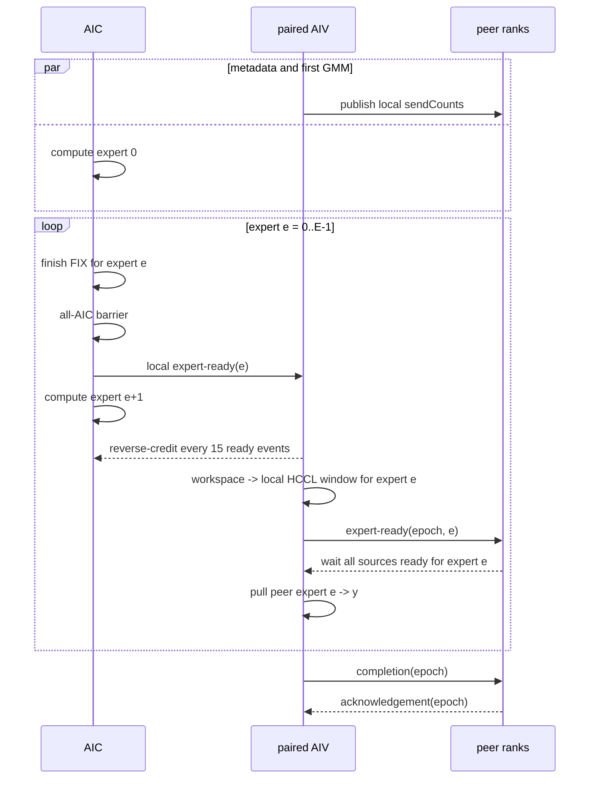

# GroupedMatMulAlltoAllv 专家粒度 CV 并行设计

## 1. 文档信息

- 适用算子：`GroupedMatMulAlltoAllvV2`
- 适用通路：`commMode="aiv"` 的 AIV 直驱 MTE 通路
- 适用架构：当前该通路覆盖的 Ascend 910B / Ascend 910_93
- 设计状态：方案设计，尚未实现
- 目标分支：`feature/gmma2av-expert-cv-overlap`

## 2. 背景与现状

当前主路按照“整段计算、整段通信”串行执行：

```text
AIC: [expert 0 GMM][expert 1 GMM] ... [expert E-1 GMM] | shared MM(optional)
AIV:                                                        [publish all][pull all]
```

`GmmA2avMteScheduler::ProcessAic` 先调用
`computeOp.Process(0, expertNum)` 完成所有本地专家的 GMM，随后执行 AIC 间
FIX 同步并通知配对 AIV。AIV 收到通知后，才将完整 GMM 输出发布到本卡
HCCL window，并从所有源 rank 拉取结果。

当前实现具备以下性质：

1. 主路 GMM 和主路 AlltoAllv 没有重叠。
2. 主路通信可与共享专家 MM 重叠。
3. GMM 输出完整保存在 `userWorkspace`，各专家的数据区互不重叠。
4. 每个源 rank 的 GMM 输出按 `[expert][destination rank][token][N1]`
   排列；最终 `y` 按 `[source rank][expert][token][N1]` 排列。
5. 通信前，每个 rank 将完整 `sendCounts[W][E]` 发布到自己的持久化
   HCCL window。接收侧读取源 rank 的表，以计算源数据偏移。
6. HCCL window 跨算子调用保留，当前使用 invocation epoch 避免连续 case
   误消费上一轮的同步值。

其中：

- `W = epWorldSize`；
- `E = expertPerRank`；
- `S_r[d,e]` 表示源 rank `r` 的专家 `e` 发往目标 rank `d` 的 token 数；
- `M_{r,e} = sum_d S_r[d,e]`；
- `A_r = sum_e M_{r,e} = gmmX.shape[0]`。

## 3. 设计目标

将主路改为专家粒度的 Cube/Vector 流水：专家 `e` 的 GMM 结果完成并可见后，
AIV 即可发布并通信专家 `e`，同时 AIC 继续计算专家 `e+1`。

目标时序如下：

```text
AIC: [GMM e0] [GMM e1] [GMM e2] ... [GMM e(E-1)] [shared MM(optional)]
               |         |                       |
               v         v                       v
AIV: [metadata][comm e0] [comm e1] [comm e2] ... [comm e(E-1)]
```

预期稳态耗时从：

```text
Tbulk = sum(Tgmm[e]) + sum(Tcomm[e])
```

降低为近似：

```text
Toverlap = max(Tmetadata, Tgmm[0])
         + sum(max(Tgmm[e + 1], Tcomm[e]))
         + Tcomm[E - 1]
```

实际收益还受跨 rank 专家负载差异、逐专家同步开销和尾部专家影响。

### 3.1 非目标

第一版不处理以下事项：

1. 不改变 AlltoAllv 的 peer-pull 通信方向。
2. 不将完整 GMM 输出 workspace 改造成 ring buffer。
3. 不引入专家内 chunk 流水；流水最小粒度固定为一个专家。
4. 不改变 `sendCounts`/`recvCounts` 的语义和数据排列。
5. 不扩展到 `ai_cpu`、`aic` 等非 AIV-MTE 通路。
6. 不裁减现有 cumsum workspace；第一版将其复用为远端专家源偏移缓存。

## 4. 总体方案

采用“计数表提前发布 + 本地专家 ready/reverse-credit + 跨 rank 专家 ready +
调用结束 completion/ack”的分层协议。



### 4.1 为什么保留完整 workspace

专家 `e` 与 `e+1` 在 workspace 中占用不重叠区间：

```text
expertBase[e] = sum(i < e, M_i)
expertBytes[e] = M_e * N1 * sizeof(T)
```

因此 AIV 读取专家 `e` 时，AIC 可以安全写专家 `e+1`，不需要第一版就引入
ring buffer 的覆盖保护。保留现有 workspace 也使 bulk 模式和 overlap 模式
可以共用内存布局并方便 A/B 对比。

### 4.2 rank 一致性与分工

所有 rank 运行同一套专家循环，不设置全局 root rank，也不按 rank 选择不同协议。
运行时 `rank_` 只用于：

- 选择本地 HCCL window；
- 计算本 rank 在 `sendCounts/recvCounts` 中的行或列；
- 分配 ready slot 的 source 维；
- 计算输入、输出偏移和 peer worker 分工。

单卡内部可以由 primary AIV 负责 epoch/count 控制写入，其余 AIV 通过本地 barrier
取得一致状态；这只是核内职责划分，不改变不同 rank 的协议序列。

### 4.3 与 A2AvGmm 参考实现的边界

PR 10729 的 A2AvGmm 是先由 AIV 拉取专家输入，再通知 AIC 计算，形成
`comm(e + 1) || GMM(e)`；本算子则必须先完成本地 GMM，才能发布其输出，形成
`GMM(e + 1) || comm(e)`，依赖方向相反。因此只复用以下成熟思路：

- 持久化 HCCL window 使用 epoch 区分连续 invocation；
- source 将阶段值写入各目标 window 中按 source rank 独占的 slot，目标只轮询
  本地 window；
- publish/release 两阶段保证源 window 被复用前，所有 peer 已完成读取；
- 空专家仍参与完整同步序列；
- 本地多次通知必须处理 CrossCore flag 的有限 set-count。

PR 的 header 保留了位于 user workspace 的 expert-ready 地址和 helper，但实际
执行路径没有调用这些 helper；生效的本卡 AIV→AIC 专家通知直接使用
`CrossCoreSetFlag/WaitFlag(sequence / 15)`。它不是跨 rank 专家 ready。本文由于
最大 `E` 更大，改用固定 ready/reverse ID 周期性回收计数，不能直接复用其专家
循环、数据地址或按 `sequence / 15` 增长本地 flag ID 的方式。

## 5. 元数据发布协议

### 5.1 发布内容

每个 rank 在进入专家通信循环前，将本卡完整的
`sendCounts[W][E]` 发布到本卡 HCCL window。该表在一次调用内只读且不会变化。

逻辑上的全局通信矩阵为：

```text
globalCounts[source][destination][expert]
    = sendCounts_on_source[destination][expert]
```

不要求在本地 workspace 中物化完整的 `[W][W][E]` 表。接收端继续沿用当前
方式，按源 rank 将一个 `[W][E]` 表读入 UB 后使用。

### 5.2 与首个 GMM 并行

AIV 初始化通信上下文并发布 count table 时，不依赖 GMM 结果，因此可以与
AIC 的专家 0 GMM 并行。第一版不额外增加 metadata 跨 rank barrier，而将
count table 的可见性合并进专家 0 的远端 ready 协议。第一次读取某个源 rank
的 count table 前，必须完成：

1. 本地 count table 的 MTE3 写完成等待；
2. 本卡全部参与 AIV 的本地同步；
3. 源 rank 专家 0 payload 的 MTE3 写完成等待；
4. 源 rank 将专家 0 ready 写入目标 window；
5. 目标 rank 观察到该源 rank 的本轮 expert-ready epoch。

count table 和专家 0 payload 写入源 rank 自己的 window，而 expert-ready 写入
各目标 rank 的 window，二者不是同一个目标地址空间。因此不能以“同一 window
内 flag 写在数据之后”作为可见性证明。实现必须建立如下 release/acquire 关系：

```text
source: wait local count/payload MTE3 completion
        -> system-scope publish/release
        -> store ready to every destination window
target: observe ready
        -> system-scope acquire
        -> read source window count/payload
```

需要优先复用已由 A2/A3 HCCL window 路径验证过的 fence/同步原语；若现有原语
不能保证跨 window 的顺序与可见性，则必须增加显式 publish fence/handshake，
不得只依赖 MTE3 指令的源码顺序。空专家 0 也必须发布 ready，因而不会破坏
count table 的可见性保证。

## 6. AIC 专家计算与本地通知

### 6.1 保持跨专家分核连续性

当前 Catlass 路径通过 `startCoreIdx` 在专家之间轮转首个 AIC，避免小 M 专家
总由 core 0 执行。实现专家回调时必须保留以下状态在一次完整专家循环内持续：

- `groupOffsetA/B/C`；
- `startCoreIdx`；
- `Arch::Resource`；
- `BlockMmad`；
- `BlockScheduler`。

不建议由调度器简单循环调用 `computeOp.Process(e, 1)`，因为这会重复扫描前序
专家偏移、重建 Catlass 资源，并可能使 `startCoreIdx` 每个专家重新归零。

建议将当前专家循环改造成 AIC-only 的 callback 形式：

```cpp
computeOp.ProcessExperts(0U, expertNum,
    [&](uint32_t expertIdx) {
        ExpertPipelineSync::NotifyExpertReady(expertIdx);
    });
```

callback 只能持有轻量同步状态，不得引用或实例化 AIV 通信对象，以继续满足
AIC/AIV 编译栈隔离要求。

### 6.2 每专家结果可见性

对每个专家，包括 `M_e == 0` 的专家，所有 AIC 必须执行完全一致的控制流：

1. 各 AIC 完成本核负责的专家 Tile；
2. `BlockMmad::SynchronizeBlock()`，排空该专家的异步 L1/L0/FIX 流水；
3. 复用固定 AIC barrier flag，执行 all-AIC FIX barrier；
4. 每个 AIC 通知其配对 AIV：专家 `e` 已就绪；
5. AIC 进入专家 `e+1` 的计算。

空专家没有数据搬运，但不得跳过 barrier 和 ready 通知，否则不同 AIC 或 rank
会进入不同专家轮次并死锁。

### 6.3 ready/reverse-credit 背压

CrossCore flag 允许的未消费 set 次数有限。不能让计算较快的 AIC 无限制领先
AIV，也不能仅依赖专家数小于某个常量。

arch22 的本地 flag ID 只有 0~15；简单照搬其他算子的
`flagId = readySequence / 15` 方案，在本算子 `W * E <= 1024`、`W=2` 时
`E` 可达到 512，会产生大于 15 的 flag ID 并发生低 4 bit 别名，因此不可用。

设计直接采用 Catlass 已验证的
`CrossCoreFlagWithReverse<MAX_REVERSE_DEPTH>`，其中
`MAX_REVERSE_DEPTH = 15`。它只使用一个 ready flag ID 和一个 reverse flag ID：

```text
AIC:
    compute(e)
    set ready
    每累计15次set：等待reverse，并将本地计数归零

AIV:
    wait ready
    每累计15次wait：设置reverse，并将本地计数归零
    communicate(e)
```

这样 AIC 可以在 AIV 通信专家 `e` 时继续计算后续专家，但最多积累 15 次未确认
通知；达到阈值时必须等待 AIV 的反向确认，避免连续大量小专家导致 CrossCore
set-count 溢出。不足 15 次的尾段不需要额外 reverse；AIV 必须在 kernel 退出前
消费所有 ready。该机制不是按专家序号扩展 flag ID，而是在同一对合法 flag ID
上由 reverse 周期性回收计数，因此可覆盖 `E > 15` 的长链。实现前仍需用
`E=16、32、128、512` 实机用例验证跨多轮 reverse 的平台语义和无死锁性。

ready、reverse、AIC barrier 使用固定且互不冲突的本地 flag ID；AIV 本地 barrier
继续使用另一组 ID。不得将远端同步 slot 编号直接映射为 CrossCore flag ID。
实现时应集中定义 flag namespace，并对所有 ID 增加 `[0, 15]` 的编译期断言。

## 7. AIV 专家通信协议

### 7.1 发布本地专家结果

AIV 收到专家 `e` 的本地 ready 后：

1. 根据本卡 `sendCounts` 计算专家起始行和 `M_e`；
2. 由所有 primary AIV 按行均分，将
   `workspace[expertBase[e]:expertBase[e]+M_e]` 搬到本卡 HCCL window 的同偏移；
3. 等待本核 MTE2/MTE3 ping-pong 搬运完成；
4. 执行本卡 all-AIV barrier；
5. 向每个目标 rank 发布专家 `e` 的远端 ready flag。

### 7.2 拉取远端专家结果

目标 rank 对专家 `e` 等待所有源 rank 的远端 ready 后，再读取/使用之前已发布
的 count table，并拉取对应数据：

```text
sourceOffset(s,d,e) =
    sum(e' < e, d', S_s[d',e'])
  + sum(d' < d, S_s[d',e])

destinationOffset(d,s,e) =
    sum(s' < s, e', R_d[s',e'])
  + sum(e' < e, R_d[s,e'])
```

其中必须满足：

```text
S_s[d,e] == R_d[s,e]
```

primary AIV 按 `srcRank = logicalCoreIdx; srcRank < W; srcRank += workerNum`
分配源 rank，保持当前通信分核方式。写入 `y` 的各 `(source, expert)` 区间互不
重叠。

不能在每个专家上直接调用一次当前的 `PullPeerPayload(e, 1)`。该函数每次都会
重新读取源 rank 的完整 count table，并从专家 0 开始扫描偏移；循环 `E` 次会使
偏移计算退化为 `O(W^2 * E^2)`。第一版在 expert 0 ready 保证 count table 可见后，
按 worker 分工一次性完成：

1. 每个 worker 对其负责的源 rank 只加载一次 `[W][E]` count table；
2. 预计算所有 `sourceOffset(source, localRank, expert)`；
3. 将 token 行偏移以 `uint32_t` 写入现有 `cumsumBuffer[W * E]`；当前 A/BSK
   上限为 5,000,000，能够安全表示；
4. 每个 worker 保存或顺序更新其负责源 rank 的 `destinationOffset`，专家循环中
   仅做 O(1) 地址查询和增量更新。

这样单个目标 rank 的总预处理复杂度为 `O(W^2 * E)`（每个源 rank 为
`O(W * E)`），逐专家数据阶段不再重复扫描全部前序专家，且
不增加算子 workspace。

### 7.3 跨 rank 同步 slot

当前 bulk 模式使用 payload-ready、completion、ack 三类 slot。专家流水不能让
所有专家复用同一个 ready slot 和同一个 epoch，否则快 rank 可能覆盖慢 rank
尚未观察的值。

第一版为每个 `(source rank, expert)` 分配独立远端 ready slot，同时将跨调用
状态放在固定地址。不能将 completion/ack 放在由运行时 `W` 或 `E` 推导的可变
地址，否则连续 case 改变通信域规模或专家数后会从另一个旧 slot 读取 epoch。

建议按规格上限预留固定布局：

```text
epoch                    : 1 slot，固定地址
bulk payload ready       : MAX_RANK_SIZE slots，固定区域，供回退路径使用
expert payload ready     : MAX_COUNT_NUM slots
                           当前调用按 sourceRank * E + expertIdx 索引
completion               : MAX_RANK_SIZE slots，固定区域
acknowledgement          : MAX_RANK_SIZE slots，固定区域
```

每个 slot 独占一个 64-byte cache line。当前调用只访问有效的 `W` 和 `W * E`
部分，但各区域基址及总预留大小不随 case 改变：

```text
syncBytes =
    (1 + 3 * MAX_RANK_SIZE + MAX_COUNT_NUM) * 64
```

以新增固定上限 `MAX_RANK_SIZE=768`、当前 `MAX_COUNT_NUM=1024` 估算，该区域
约 208 KiB，
远小于当前预留的 20 MiB CCL tail safety region。host tiling 仍必须用实际常量
显式检查容量，不能只依赖规格推导。

`sourceRank * E + expertIdx` 的有效映射会随 case 的 `E` 改变，但它始终位于固定
expert-ready 区域内，且每次等待比较本轮 epoch，旧 case 的残留值不能被误用。
bulk-ready、completion、ack 的区域基址完全不依赖运行时 `W/E`。

独立专家 slot 允许快 rank 提前发布后续专家，而不会覆盖慢 rank 正在等待的前序
专家值；数据 payload 本身也按专家使用不重叠地址。

### 7.4 与 PR 10729 跨 rank slot 的参考关系

本节方案参考了 PR 10729（ref `209917a4f3`）中 A2AvGmm 的同步原则，但没有
直接复制其 slot 布局。该 PR 在
`mc2/allto_allv_grouped_mat_mul/op_kernel/allto_allv_grouped_mat_mul_aiv_comm.h`
中的 peer-window 控制布局为：

```text
epoch                         : 1 * 32 bytes
publish[sourceRank]           : W * 32 bytes
release[sourceRank]           : W * 32 bytes
peerControlBytes              = (1 + 2 * W) * 32
```

source rank `s` 将某个 phase 的 epoch 写到每个 destination window 的
`phaseBase + s * 32`；destination 只轮询本地 window 中所有 source slot。完整
输入和 count 发布后进入 publish phase，全部消费者完成拉取后进入 release phase，
防止下一次 invocation 提前覆盖源 window。peer control 大小不含 `E`，因此
连续 case 改变专家数时，跨 rank phase 地址不会漂移。

PR 的 publish/release 数组长度和贴尾 `controlOffset` 仍由运行时 `W` 及 512-byte
对齐结果计算；它只保证地址不随 `E` 改变。本文进一步按规格上限固定所有区域
基址，使其同时不随 `W/E` 改变，这一加强没有被 PR 直接验证。

需要明确区分：PR 的 header 虽保留了位于 user workspace 的 expert-ready helper，
但实际路径未调用；生效的专家 handoff 是本卡 CrossCore `sequence / 15` 通知。
其 peer window 没有 `(source, expert)` 远端 ready，也没有独立 acknowledgement
phase。因此本文的来源关系是：

- **直接参考**：epoch 精确等值等待、按 source rank 独占 phase slot、source
  写所有 destination 而 destination 只读本地 window、publish/release 所有权、
  peer control 地址不依赖 `E`；
- **继承当前 GMMA2Av**：64-byte slot、bulk payload-ready、completion/ack；
- **本文新增**：固定 `MAX_RANK_SIZE/MAX_COUNT_NUM` 的区域基址、跨 rank
  `expert-ready[source, expert]`、expert 0 ready 保护 count table，以及 epoch
  耗尽时禁止无清零直接回绕。

所以 PR 10729 能作为“跨 rank phase slot + 持久 window 生命周期”的依据，不能
作为“逐专家跨 rank ready 已经过实机验证”的依据；后者必须单独上板验证。

## 8. 连续调用与 epoch 防 ABA

HCCL window 不会在连续 case 之间自动清零。每次调用必须使用新的非零
invocation epoch，并将相同 epoch 写入本轮各专家 ready、completion 和
acknowledgement slot；count table 本身不承载 epoch，其可见性由 expert 0 ready
的 release/acquire 关系保护。

该方案与 PR 10729 一样，不额外执行跨 rank epoch 协商：每个 rank 从自己的
持久化状态独立推进到下一 epoch。因此前置条件是同一通信域内所有 rank 以相同
顺序、相同次数调用该算子；任一 rank 漏调、多调或在协议中单边退出，都会造成
epoch 不一致并使精确等值等待永久阻塞。host/runtime 必须保证调用序列一致，
device 侧进入协议后必须走完 drain/completion/ack。

建议流程：

1. 从本 rank 的持久化 acknowledgement slot 读取上一次已完成 epoch；
2. 计算下一非零 epoch；
3. primary AIV 将新 epoch 发布为本轮 epoch；
4. 所有本地 AIV 同步后读取相同 epoch；
5. 所有远端等待均比较“值等于本轮 epoch”，不能只判断非零；
6. 全部专家拉取完成后执行 completion barrier；
7. completion 完成后执行 acknowledgement barrier，并持久化本轮 epoch；
8. acknowledgement 完成前不得结束本轮或允许下一次调用覆盖 payload。

专家拥有独立 ready slot，因此一次调用内不复用 ready 值；invocation epoch
解决跨调用的 stale flag/ABA。epoch 接近上限时不能仅在 completion/ack 后直接
回绕到 1，因为专家 slot 中可能仍保留很早以前的值 1。第一版将 epoch 耗尽视为
需要重建通信域/window 的条件；若后续支持在线回绕，必须在全 rank quiescent
状态下协调清零整个同步区并额外确认清零完成，禁止任意单 rank 独立回绕。

## 9. 共享专家调度

共享专家 MM 不依赖主路通信结果。第一版保持其位于所有主路专家 GMM 之后：

```text
AIC: ... [GMM e(E-1)] [shared MM]
AIV: ... [comm e(E-2)] [comm e(E-1)]
```

这样共享专家仍可覆盖流水尾部通信，并避免共享 MM 抢占专家 0 的首包计算资源。
共享专家是否存在不得改变主路专家的 ready slot 编号，防止各 rank 可选输入状态
不一致时破坏协议；共享专家同步应使用独立本地状态。

## 10. Tiling 与 ABI 设计

### 10.1 TilingData

在 AIV-MTE 独立 tiling data 中增加运行时字段，不新增 tiling key，避免二进制
数量膨胀。当前 key 继续使用
`hasSharedMm | (transGmm << 1) | (transMm << 2) | (2 << 3)`，即 16～23；例如
带共享专家、两个 weight 均不转置时仍为 17。

第一版直接将现有 `reserved` 字段重命名/复用为：

```cpp
enum class ExpertPipelineMode : uint32_t {
    BULK = 0,
    EXPERT_OVERLAP = 1,
};

uint32_t expertPipelineMode;
```

如后续确需 `syncLayoutVersion`，再显式扩展 MTE tiling data ABI 和对应 binary/UT，
不占用新的 tiling key。同步区大小由 host/kernel 共用的固定布局常量推导，
不使用随 `E` 变化的 slot 总数。

### 10.2 使能条件

在 `HW-01`～`HW-09` 全部通过并允许正式使能后，第一版建议：

```text
commMode == "aiv"
and E >= 2
and fixedSyncBytes <= CCL_TAIL_SAFETY_BYTES
and 当前 dtype/SOC 已由 AIV-MTE 通路支持
```

`E == 1` 时没有稳态重叠空间，选择 bulk 模式。使能条件只能依赖通信域内一致的
属性/shape（例如 W、E、dtype、SOC），不能依据某张卡的非空专家数或本地
sendCounts 分布，否则不同 rank 可能选择不同协议并死锁。

### 10.3 实机 A/B 强制模式

公开算子接口不新增属性。为保证实机门禁能在同一个算子包中对同一 case 切换
路径，host tiling 增加仅供测试/调试的进程级开关
`GMMA2AV_EXPERT_PIPELINE_MODE`：

```text
unset / auto    使用当前发布默认值和全局一致的自动使能条件
bulk            强制 expertPipelineMode = BULK
overlap         满足安全支持条件时强制 EXPERT_OVERLAP，否则 tiling 明确报错
```

解析优先级为：非 AIV 路径隔离及 dtype/SOC/容量等安全检查最高，随后是测试强制
模式，最后才是自动性能策略。`bulk` 与 `overlap` 必须写入同一个现有 tiling 字段，
不能生成新的 tiling key 或另一套二进制。

该开关本身是各 rank 进程的本地状态，不提供协议协商。`ep_test`/模型测试 launcher
必须在调用算子前 all-gather 请求模式，确认通信域内所有 rank 完全一致；host
tiling 同时打印最终解析模式及 `W/E`。在实机硬门禁完成前，`auto` 的发布默认值
为 `BULK`；门禁全部通过后才可改为 10.2 节的自动选择。

### 10.4 回退

保留当前 bulk 实现作为回退和 A/B 基线：

- `expertPipelineMode == BULK`：现有“全部 GMM 后整体通信”；
- `expertPipelineMode == EXPERT_OVERLAP`：本文专家流水；
- 非 AIV tiling key：完全不进入本文代码。

### 10.5 数据类型扩展

第一版沿用当前 AIV-MTE 已支持的 BF16，不在该特性中同时扩 dtype。协议层的
count/offset/flag 分别固定为 `int32_t`、`uint32_t`、`int32_t`，与 payload 类型
解耦；payload 地址和搬运长度统一由模板类型 `T` 与 `sizeof(T)` 推导。后续增加
FP16 等类型时，只需补齐 Catlass 实例、host dtype 白名单、binary 配置和精度
用例，不应新增一套专家同步协议或 CCL 控制布局。

## 11. Workspace 与 CCL window

第一版算子 workspace 大小不变：

```text
libApiWorkspace
+ AlignUp(A * N1 * sizeof(T), 512)          // 完整 GMM 输出
+ AlignUp(W * E * sizeof(uint32_t), 512)    // 复用为 sourceOffset 缓存
```

专家流水仅改变不同区间的生产/消费时机，不改变 workspace 总大小。每个
`cumsumBuffer[source * E + expert]` 保存源 window 中该专家发往本 rank 数据的
token 行偏移，不能保存乘以 `N1` 后的元素/字节偏移。

CCL window 的 payload、count table 和尾部控制区总体布局不变；同步控制区改为
固定上限布局，并增加 host 容量校验。CCL window 不计入算子 workspace。

## 12. AIC/AIV 编译隔离要求

实现必须延续当前已修复的核类型隔离：

1. Catlass `ComputeOp`、`SharedComputeOp` 和相关资源只能在
   `if ASCEND_IS_AIC` 分支构造。
2. HCCL/MTE `CommOp`、`TPipe` 和通信 UB 只能在 `if ASCEND_IS_AIV`
   分支构造。
3. AIC callback 不能捕获 `CommOp` 或包含其对象的 scheduler 实例。
4. 公共状态只通过 tiling data、固定 flag 协议和 GM 地址表达。
5. 必须使用 sanitizer + `ccec_g` 编译回归，防止重新引入 AIC/AIV 对象隔离
   不彻底导致的编译爆栈。

## 13. 正确性与死锁约束

### 13.1 全 rank 一致控制流

所有 rank 必须以相同顺序经过：

```text
metadata -> expert 0 -> ... -> expert E-1 -> completion -> ack
```

即使某个本地/远端专家 token 数为 0，也必须发布和等待该专家的 ready。

### 13.2 错误处理

进入跨 rank 协议后，任何单 rank 的提前 `return` 都可能使其他 rank 永久等待。
可在 host 完成的 shape、count 长度、非负性和容量检查必须前移到 host。

对于只能在 device 发现的 `peerSendCount != localRecvCount` 等问题，建议：

1. 设置本地 error 状态；
2. 跳过不安全的数据 copy；
3. 仍完成当前专家及最终 completion/ack 协议；
4. 通过现有可用的 device error/DFX 机制报告。

第一版实现不得在某个专家的跨 rank barrier 中直接单边返回。

### 13.3 内存可见性

- AIC ready 前：每专家 `SynchronizeBlock` + all-AIC FIX barrier；
- AIV 远端 ready 前：本地 payload MTE3 完成 + all-AIV barrier；
- payload/count 位于源 window，ready 位于目标 window；二者之间必须建立经过
  A2/A3 实机验证的 system-scope release/acquire，不得假定跨 window 自然有序；
- 下一 invocation 覆盖本地 window 前：全 rank completion + ack。

## 14. 实现拆分建议

预计改动集中在：

- `op_kernel/arch22/grouped_mat_mul_allto_allv_mte_catlass.h`：保持单次 Catlass
  资源生命周期，增加每专家完成回调；
- `op_kernel/arch22/grouped_mat_mul_allto_allv_mte.h`：增加 count 提前发布、
  本地 ready/reverse、专家 publish/pull、固定远端同步布局和偏移缓存；
- `op_kernel/grouped_mat_mul_allto_allv_a3.cpp`：仅做 AIC/AIV 隔离后的模式分发，
  不在公共作用域构造另一核类型对象；
- `op_kernel/arch22/grouped_mat_mul_allto_allv_mte_tiling.h` 与
  `op_host/op_tiling/arch22/grouped_mat_mul_allto_allv_mte_tiling.cpp`：模式字段、
  固定控制区常量、容量检查和 workspace 语义；
- 对应 host/kernel UT 与 `ep_test` 用例。

建议按以下顺序提交，便于回归和二分：

1. **同步布局重构**：远端 slot 编号与本地 CrossCore flag 解耦，增加固定上限
   布局和 `fixedSyncBytes` 容量校验，保留独立 bulk-ready 区域且不改变 bulk 时序。
2. **元数据独立发布**：将 count table 发布从完整 payload 发布中拆出，保持
   bulk 数据路径不变。
3. **Catlass 每专家完成回调**：保留单次 Resource/BlockMmad 和跨专家
   `startCoreIdx`，在每专家完成后触发 AIC-only callback。
4. **本地 ready/reverse**：接入 `CrossCoreFlagWithReverse<15>`，先验证空专家、
   `E > 15` 长链和固定合法 flag ID。
5. **偏移预处理**：复用 cumsum workspace 缓存远端专家源偏移，避免逐专家
   `O(W^2 * E^2)` 重扫 count table。
6. **逐专家 payload publish/pull**：接入独立 expert ready slot、跨 window
   release/acquire 和最终 completion/ack。
7. **tiling 使能及 bulk 回退**：加入 `expertPipelineMode`，完成同一二进制 A/B。
8. **性能调优**：依据数据评估是否增加专家分组、流水深度或专家内 chunk，不能
   在正确性版本中同时引入。

## 15. 验证方案

### 15.1 静态与编译验证

1. `git diff --check`、clang-format 和相关 host/kernel UT。
2. 普通算子包编译：Ascend 910_93；如环境可用同时编译 Ascend 910B。
3. 使用 `--bisheng_flags=sanitizer --op_debug_config "ccec_g"` 编译，确认无
   编译爆栈及 AIC/AIV 交叉对象实例化。
4. MTE host UT 的 tiling buffer 容量改用
   `sizeof(GroupedMatMulAlltoAllvMteTilingData)`，不能继续写死为 8192；当前两个
   1024 元素 count 数组本身已经占满 8192 bytes。
5. 增加直接覆盖 `grouped_mat_mul_allto_allv_a3.cpp` AIV-MTE 实例化的 kernel UT；
   当前仅包含 legacy kernel 的 UT 不能作为本通路编译覆盖。

### 15.2 协议单元测试

覆盖：

- `E = 1、2、15、16、31、32、128、512` 及 `W * E = 1024` 规格边界；
- `M_e = 0、1、127、128、129` 和跨多个 Cube tile 的专家；
- 全空专家、首/中/尾空专家；
- 各 rank 非空专家集合不同、zero-peer、单源单目的、多源为零、单个热点专家与
  极端 rank 负载不均；
- `W > AIC core num`，验证一个 AIV worker 负责多个源 rank；
- `transGmmWeight` 开/关；
- 有/无共享专家，且 `transMmWeight` 开/关；
- remote slot 地址、边界与 64-byte 隔离；
- ready/reverse 每个方向使用固定合法 flag ID，未确认 ready 不超过 15；
- count/payload 与 ready 的地址、状态机和 release/acquire 调用顺序；实际跨
  window 可见性不能由 UT 证明，必须通过 15.5 节 `HW-02`；
- device 计数不一致时协议不发生单边提前退出。

### 15.3 多卡功能验证

1. `ep_test`：A3 的 2、4、8 卡均运行多轮；A2 环境可用时同样覆盖 2、4、8 卡。
2. 模型脚本：A3 16 卡运行。
3. 同一通信域连续运行至少 100 轮，交替大小 shape、零专家分布和不同 count
   表，验证持久化 window 不发生 ABA、脏表或偶发卡死。
4. 对比 bulk/overlap 两种模式的逐元素精度和输出排列。
5. 增加 watchdog，任何 barrier 卡死均作为失败，而不是无限等待。

### 15.4 性能验证

每个 case：

1. 充分 warm-up；
2. 每张卡采样 30 次，完整测试至少重复 3 轮；
3. 主指标记录 collective wall time，即每轮
   `max(end_rank) - min(start_rank)` 的 p50；同时按既有口径报告
   `sum(rank_mean) / W`；
4. 补充 p90/p99、标准差/CV、最大 rank 耗时和全 rank 吞吐；
5. 对比当前 bulk AIV、专家 overlap AIV 和对应 AIC/ai_cpu 通路；
6. 重点观察小 M、多专家 case，以及逐专家同步对单专家/大 M case 的回退。

性能 trace 应能观察到：

```text
comm(e) 与 GMM(e+1) 时间区间重叠
```

而不是仅看到共享专家 MM 与整体通信重叠。

同一个 MIX kernel 同时出现 `aicore_time` 和 `aiv_time` 不能单独证明专家级重叠；
应增加逐专家时间戳/事件，至少报告首包延迟、overlap ratio、AIC wait-reverse、
AIV wait-ready 及 last-GMM 后的通信 tail。

### 15.5 实机硬门禁

以下行为依赖真实 AIC/AIV、MTE、HCCL window 和多 rank 时序，静态检查、host UT
或 kernel stub 均不能替代。任一门禁未执行或未通过时，可以保留实验代码，但
`expertPipelineMode` 必须默认选择 `BULK`，不得默认使能 `EXPERT_OVERLAP`。

#### HW-01：每专家 AIC→AIV 可见性与 reverse 长链

- 平台：Ascend 910B 与 Ascend 910_93 分别执行；
- 用例：`E=14、15、16、29、30、31、128` 及当前 `W` 下可达到的最大 `E`
  （至少覆盖一次 `W * E = 1024`），组合首/中/尾全局空专家、共享专家开关；
- 调度：分别制造 AIC 快/AIV 慢和 AIC 慢/AIV 快的失衡；
- 观测：逐专家 GMM done、ready set/wait、reverse set/wait 计数；
- 通过（同步）：watchdog 下多轮无死锁、无 ready 丢失/串轮，未确认 ready
  不超过 15，每 15 次通知均能由 reverse 正常回收；
- 通过（路径一致性）：同一包、同一输入和随机种子下，overlap 与 bulk 的
  `y/mm_y` shape、dtype 相同，BF16 有效元素逐 bit 一致；任一 NaN/Inf 直接失败；
- 通过（双标杆）：overlap 和 bulk 分别使用 `ep_test` 现有
  `compute_double_benchmark_metrics`，以 NPU 小算子
  `GroupedMatMul→重排→AllToAllV` 为 normal golden、CPU FP64 为高精度 golden；
  最大相对误差比、平均相对误差比、RMSE 比和小值域错误数比分别不得超过
  `5.0、1.5、1.5、2.0`，所有 rank、所有存在的输出均必须通过。

该门禁用于验证真实平台的 CrossCore set-count/reverse 语义；flag ID 静态范围检查
不能替代它。第一版仅支持 BF16；未来新增 dtype 时，必须先在测试公共配置中定义
该 dtype 的阈值并单独执行本门禁，不能沿用未确认的 BF16 判据。

#### HW-02：跨 window release/acquire 可见性

- 平台：Ascend 910B 与 Ascend 910_93 分别执行；
- 场景：count/payload 写入 source window，而 ready 写入 destination window；
- 用例：每个 invocation/source/expert 使用可区分的数据 pattern，覆盖 expert 0
  为空、非对齐尾块、首尾 cache line、冷/热启动、高并发和延迟消费者；
- 通过：目标观察到 ready 后，读取到的 count 和 payload 必须全部属于本轮，不能
  出现旧表、旧 payload 或半写数据。

若失败，必须增加经过平台验证的 system-scope fence 或额外 handshake，并重新
通过本门禁；禁止仅依据 MTE3 源码顺序宣称可见。

#### HW-03：A2/A3 HCCL window 映射差异

- A2：覆盖 `HcclCombineOpParam` 的 `windowsIn[]` 与运行环境可触发的
  `multiFlag/data[]` 形式；
- A3：覆盖 `HcclOpResParam.localWindowsIn` 与 `remoteRes[].nextDevicePtr` 映射；
- 规模：至少执行 2/4/8 卡，并在资源允许时覆盖 `W > AIV workerNum` 和更大正式
  支持规模；
- 通过：本地/远端 window 地址、容量检查、payload/count 读写和所有同步 phase
  均正确。一个 SOC 通过不能替代另一个 SOC。

#### HW-04：跨 rank expert slot 隔离

- 让多个 source rank 以不同速度推进专家，覆盖 `E` 改变以及 bulk/overlap 交替；
- 检查 `(sourceRank, expertIdx)` 唯一映射、64-byte slot 隔离，以及 bulk-ready、
  expert-ready、completion、ack 区域互不串扰；
- 通过：快 rank 不能覆盖慢 rank 尚未观察的专家状态，任何等待都不能接受旧
  epoch，同一轮不得出现跨专家或跨 phase 误唤醒。

#### HW-05：空专家与全 rank 一致控制流

- 覆盖 expert 0 为空、首/中/尾连续空专家、某专家在整个通信域为空、各 rank
  非空专家集合不同、zero-peer 和热点专家；
- 2/4/8 卡分别多轮执行，资源允许时补充更大 `W`；
- 通过：expert 0 为空时 count table 仍然可见，所有 rank 均走完相同 ready、
  completion、ack 序列，watchdog 无超时且输出正确。

#### HW-06：持久通信域连续调用

- communicator/window 全程不销毁；同一个通信域内 `W` 固定，不把“改变 W”
  作为同域测试；
- 功能门禁至少连续 100 轮，另执行至少 1000 轮同步压力测试；
- 交替 `E`、shape、count pattern、共享专家开关及 bulk/overlap mode；
- 通过：无 ABA、脏 count、脏 expert slot、下一 invocation 提前覆盖 payload、
  偶发精度错误或挂死。

不同 `W` 必须使用各自通信域分别验证。

#### HW-07：device 错误排水

- 在受 watchdog 保护的专项用例中注入
  `peerSendCount != localRecvCount`，并让不同 rank 在不同专家发现错误；
- 通过：错误可观测，所有 rank 跳过不安全 copy 后仍排水到 completion/ack，
  不能单边 return 或永久等待。

#### HW-08：专家级重叠与性能证据

- 逐专家记录 GMM done、AIV ready wait、local publish done、peer-ready seen、
  pull done 和 reverse wait；
- trace 必须直接显示 `comm(e)` 与 `GMM(e+1)` 时间区间交叠，并排除共享 MM
  与 bulk 通信造成的假重叠；
- bulk/overlap 必须由同一算子包切换，每卡 30 次、至少 3 轮，按 15.4 节口径
  保存原始样本并比较。

#### HW-09：双 SOC 生成物加载与运行

在 15.1 节 sanitizer + `ccec_g` 双 SOC 编译通过后，分别安装对应算子包，并在
Ascend 910B、Ascend 910_93 上执行 bulk/overlap、共享专家开/关的 smoke 与精度
回归。编译门禁用于发现核类型实例化/栈问题，实机门禁用于确认生成物、HCCL
context 和真实核路径可加载运行，二者不能互相替代。

每项实机门禁必须保存：算子 commit、CANN 包版本、SOC、卡数、通信域、用例
参数、随机种子、命令、watchdog 结果；性能项还需保存 30 次原始数据和 trace。

## 16. 验收标准

1. AIV-MTE 全量精度用例通过，无新增偶发错误。
2. 同一通信域连续多 case、不同 shape/count 运行无卡死、无脏数据。
3. sanitizer + `ccec_g` 编译通过，无编译爆栈。
4. 空专家和 rank 间负载不均时，所有 rank 仍保持一致协议进度。
5. 性能 trace 证明主路专家 `e` 通信与专家 `e+1` GMM 实际重叠。
6. `E == 1` 或 overlap 不可用时可稳定回退到 bulk 模式。
7. 非 AIV-MTE 通路的行为、tiling ABI 和性能不受影响。
8. `HW-01`～`HW-09` 全部通过后，才允许将 `EXPERT_OVERLAP` 设为默认模式；
   否则默认保持 `BULK`。
