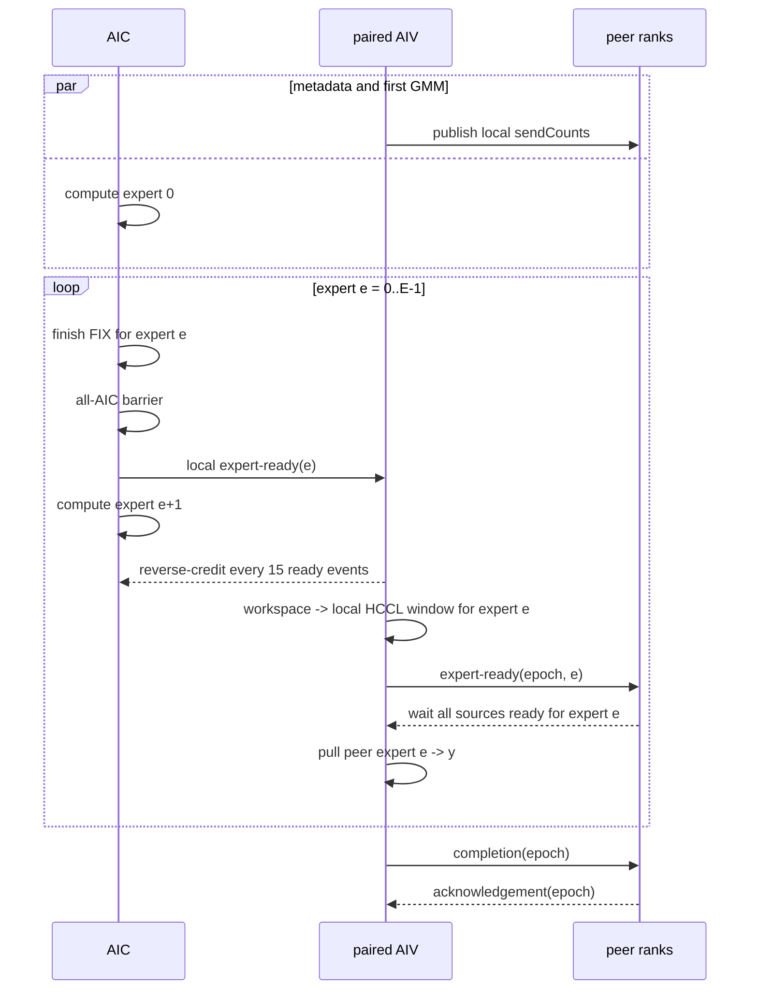

# GroupedMatMulAlltoAllv 专家粒度 CV 并行设计

## 1. 文档信息

- 适用算子：`GroupedMatMulAlltoAllvV2`
- 适用通路：`commMode="aiv"` 的 AIV 直驱 MTE 通路
- 适用架构：当前该通路覆盖的 Ascend 910B / Ascend 910_93
- 设计状态：实验实现已落地；发布默认仍为 `BULK`
- 跨 rank 审计状态：有条件通过；HW-02 与 HW-10 为实现/默认使能阻断项
- 目标分支：`feature/gmma2av-expert-cv-overlap`

### 1.1 当前实现边界

当前分支已实现固定同步布局、Catlass 每专家完成回调、本地 ready/reverse-credit、
count 提前发布、逐专家 peer-window publish/pull、owner-AIV 私有 UB source-offset 缓存以及
completion/ack 排水。`GMMA2AV_EXPERT_PIPELINE_MODE=overlap` 仅作为通信域内所有
rank 已协调一致的实机验证入口；unset/`auto`/`bulk` 均选择 `BULK`。

该实现没有替代第 8.1、8.2 节要求的 executor admission、window 一次性协调清零
和 epoch 耗尽重建。公开 CANN 头文件也尚未给出“跨不同 HCCL window”的正式
release/acquire 契约，因此 HW-02、HW-10 关闭前不得将 overlap 改为发布默认值。

## 2. 背景与现状

当前主路按照“整段计算、整段通信”串行执行：

```text
AIC: [expert 0 GMM][expert 1 GMM] ... [expert E-1 GMM] | shared MM(optional)
AIV:                                                        [publish all][pull all]
```

`GmmA2avMteScheduler::ProcessAic` 先调用
`computeOp.Process(0, expertNum)` 完成所有本地专家的 GMM，随后执行 AIC 间
FIX 同步并通知配对 AIV。AIV 收到通知后，才将完整 GMM 输出发布到本卡
HCCL window，并从所有源 rank 拉取结果。

当前实现具备以下性质：

1. 主路 GMM 和主路 AlltoAllv 没有重叠。
2. 主路通信可与共享专家 MM 重叠。
3. GMM 输出完整保存在 `userWorkspace`，各专家的数据区互不重叠。
4. 每个源 rank 的 GMM 输出按 `[expert][destination rank][token][N1]`
   排列；最终 `y` 按 `[source rank][expert][token][N1]` 排列。
5. 通信前，每个 rank 将完整 `sendCounts[W][E]` 发布到自己的持久化
   HCCL window。接收侧读取源 rank 的表，以计算源数据偏移。
6. HCCL window 跨算子调用保留，当前使用 invocation epoch 避免连续 case
   误消费上一轮的同步值。

其中：

- `W = epWorldSize`；
- `E = expertPerRank`；
- `S_r[d,e]` 表示源 rank `r` 的专家 `e` 发往目标 rank `d` 的 token 数；
- `M_{r,e} = sum_d S_r[d,e]`；
- `A_r = sum_e M_{r,e} = gmmX.shape[0]`。

## 3. 设计目标

将主路改为专家粒度的 Cube/Vector 流水：专家 `e` 的 GMM 结果完成并可见后，
AIV 即可发布并通信专家 `e`，同时 AIC 继续计算专家 `e+1`。

目标时序如下：

```text
AIC: [GMM e0] [GMM e1] [GMM e2] ... [GMM e(E-1)] [shared MM(optional)]
               |         |                       |
               v         v                       v
AIV: [metadata][comm e0] [comm e1] [comm e2] ... [comm e(E-1)]
```

预期稳态耗时从：

```text
Tbulk = sum(Tgmm[e]) + sum(Tcomm[e])
```

降低为近似：

```text
Toverlap = max(Tmetadata, Tgmm[0])
         + sum(max(Tgmm[e + 1], Tcomm[e]))
         + Tcomm[E - 1]
```

实际收益还受跨 rank 专家负载差异、逐专家同步开销和尾部专家影响。

### 3.1 非目标

第一版不处理以下事项：

1. 不改变 AlltoAllv 的 peer-pull 通信方向。
2. 不将完整 GMM 输出 workspace 改造成 ring buffer。
3. 不引入专家内 chunk 流水；流水最小粒度固定为一个专家。
4. 不改变 `sendCounts`/`recvCounts` 的语义和数据排列。
5. 不扩展到 `ai_cpu`、`aic` 等非 AIV-MTE 通路。
6. 不裁减现有 cumsum workspace，以避免同时改变既有 workspace 布局；专家流水
   不再读写该区域，远端专家源偏移保存在 owner AIV 的私有 UB。

## 4. 总体方案

采用“计数表提前发布 + 本地专家 ready/reverse-credit + 跨 rank 专家 ready +
调用结束 completion/ack”的分层协议。



### 4.1 为什么保留完整 workspace

专家 `e` 与 `e+1` 在 workspace 中占用不重叠区间：

```text
expertBase[e] = sum(i < e, M_i)
expertBytes[e] = M_e * N1 * sizeof(T)
```

因此 AIV 读取专家 `e` 时，AIC 可以安全写专家 `e+1`，不需要第一版就引入
ring buffer 的覆盖保护。保留现有 workspace 也使 bulk 模式和 overlap 模式
可以共用内存布局并方便 A/B 对比。

### 4.2 rank 一致性与分工

所有 rank 运行同一套专家循环，不设置全局 root rank，也不按 rank 选择不同协议。
运行时 `rank_` 只用于：

- 选择本地 HCCL window；
- 计算本 rank 在 `sendCounts/recvCounts` 中的行或列；
- 分配 ready slot 的 source 维；
- 计算输入、输出偏移和 peer worker 分工。

单卡内部可以由 primary AIV 负责 epoch/count 控制写入，其余 AIV 通过本地 barrier
取得一致状态；这只是核内职责划分，不改变不同 rank 的协议序列。

### 4.3 与 A2AvGmm 参考实现的边界

PR 10729 的 A2AvGmm 是先由 AIV 拉取专家输入，再通知 AIC 计算，形成
`comm(e + 1) || GMM(e)`；本算子则必须先完成本地 GMM，才能发布其输出，形成
`GMM(e + 1) || comm(e)`，依赖方向相反。因此只复用以下成熟思路：

- 持久化 HCCL window 使用 epoch 区分连续 invocation；
- source 将阶段值写入各目标 window 中按 source rank 独占的 slot，目标只轮询
  本地 window；
- publish/release 两阶段保证源 window 被复用前，所有 peer 已完成读取；
- 空专家仍参与完整同步序列；
- 本地多次通知必须处理 CrossCore flag 的有限 set-count。

PR 的 header 保留了位于 user workspace 的 expert-ready 地址和 helper，但实际
执行路径没有调用这些 helper；生效的本卡 AIV→AIC 专家通知直接使用
`CrossCoreSetFlag/WaitFlag(sequence / 15)`。它不是跨 rank 专家 ready。本文由于
最大 `E` 更大，改用固定 ready/reverse ID 周期性回收计数，不能直接复用其专家
循环、数据地址或按 `sequence / 15` 增长本地 flag ID 的方式。

## 5. 元数据发布协议

### 5.1 发布内容

每个 rank 在进入专家通信循环前，将本卡完整的
`sendCounts[W][E]` 发布到本卡 HCCL window。该表在一次调用内只读且不会变化。

逻辑上的全局通信矩阵为：

```text
globalCounts[source][destination][expert]
    = sendCounts_on_source[destination][expert]
```

不要求在本地 workspace 中物化完整的 `[W][W][E]` 表。接收端继续沿用当前
方式，按源 rank 将一个 `[W][E]` 表读入 UB 后使用。

### 5.2 与首个 GMM 并行

AIV 初始化通信上下文并发布 count table 时，不依赖 GMM 结果，因此可以与
AIC 的专家 0 GMM 并行。第一版不额外增加 metadata 跨 rank barrier，而将
count table 的可见性合并进专家 0 的远端 ready 协议。第一次读取某个源 rank
的 count table 前，必须完成：

1. 本地 count table 的 MTE3 写完成等待；
2. 本卡全部参与 AIV 的本地同步；
3. 源 rank 专家 0 payload 的 MTE3 写完成等待；
4. 源 rank 将专家 0 ready 写入目标 window；
5. 目标 rank 观察到该源 rank 的本轮 expert-ready epoch。

count table 和专家 0 payload 写入源 rank 自己的 window，而 expert-ready 写入
各目标 rank 的 window，二者不是同一个目标地址空间。因此不能以“同一 window
内 flag 写在数据之后”作为可见性证明。实现必须建立如下 release/acquire 关系：

```text
source: wait local count/payload MTE3 completion
        -> system-scope publish/release
        -> store ready to every destination window
target: observe ready
        -> system-scope acquire
        -> read source window count/payload
```

需要优先复用已由 A2/A3 HCCL window 路径验证过的 fence/同步原语；若现有原语
不能保证跨 window 的顺序与可见性，则必须增加显式 publish fence/handshake，
不得只依赖 MTE3 指令的源码顺序。空专家 0 也必须发布 ready，因而不会破坏
count table 的可见性保证。

## 6. AIC 专家计算与本地通知

### 6.1 保持跨专家分核连续性

当前 Catlass 路径通过 `startCoreIdx` 在专家之间轮转首个 AIC，避免小 M 专家
总由 core 0 执行。实现专家回调时必须保留以下状态在一次完整专家循环内持续：

- `groupOffsetA/B/C`；
- `startCoreIdx`；
- `Arch::Resource`；
- `BlockMmad`；
- `BlockScheduler`。

不建议由调度器简单循环调用 `computeOp.Process(e, 1)`，因为这会重复扫描前序
专家偏移、重建 Catlass 资源，并可能使 `startCoreIdx` 每个专家重新归零。

建议将当前专家循环改造成 AIC-only 的 callback 形式：

```cpp
computeOp.ProcessExperts(0U, expertNum,
    [&](uint32_t expertIdx) {
        ExpertPipelineSync::NotifyExpertReady(expertIdx);
    });
```

callback 只能持有轻量同步状态，不得引用或实例化 AIV 通信对象，以继续满足
AIC/AIV 编译栈隔离要求。

### 6.2 每专家结果可见性

对每个专家，包括 `M_e == 0` 的专家，所有 AIC 必须执行完全一致的控制流：

1. 各 AIC 完成本核负责的专家 Tile；
2. `BlockMmad::SynchronizeBlock()`，排空该专家的异步 L1/L0/FIX 流水；
3. 复用固定 AIC barrier flag，执行 all-AIC FIX barrier；
4. 每个 AIC 通知其配对 AIV：专家 `e` 已就绪；
5. AIC 进入专家 `e+1` 的计算。

空专家没有数据搬运，但不得跳过 barrier 和 ready 通知，否则不同 AIC 或 rank
会进入不同专家轮次并死锁。

每个 AIV 只直接等待配对 AIC，但 payload 行按 AIV worker 重新均分，消费某行的
AIV 不一定与计算该行 Tile 的 AIC 配对。因此所有 AIV 完成各自 paired wait 后，
还必须执行一次 all-AIV barrier，再允许任一 AIV 读取共享 GMM workspace。该
C→V hand-off 顺序与 mega_moe A3 一致，不能仅让各 AIV 独立等待自己的配对 AIC。

### 6.3 ready/reverse-credit 背压

CrossCore flag 允许的未消费 set 次数有限。不能让计算较快的 AIC 无限制领先
AIV，也不能仅依赖专家数小于某个常量。

arch22 的本地 flag ID 只有 0~15；简单照搬其他算子的
`flagId = readySequence / 15` 方案，在本算子 `W * E <= 1024`、`W=2` 时
`E` 可达到 512，会产生大于 15 的 flag ID 并发生低 4 bit 别名，因此不可用。

设计直接采用 mega_moe A3 已验证的 `CrossCoreFlagWithReverse<15U>`。深度必须
显式为 15，不能引用当前通用 CATLASS 中取值为 16 的同名默认常量。它只使用
一个 ready flag ID 和一个 reverse flag ID：

```text
AIC:
    compute(e)
    set ready
    每累计15次set：等待reverse，并将本地计数归零

AIV:
    wait ready
    每累计15次wait：设置reverse，并将本地计数归零
    communicate(e)
```

这样 AIC 可以在 AIV 通信专家 `e` 时继续计算后续专家，但最多积累 15 次未确认
通知；达到阈值时必须等待 AIV 的反向确认，避免连续大量小专家导致 CrossCore
set-count 溢出。不足 15 次的尾段不需要额外 reverse；AIV 必须在 kernel 退出前
消费所有 ready。该机制不是按专家序号扩展 flag ID，而是在同一对合法 flag ID
上由 reverse 周期性回收计数，因此可覆盖 `E > 15` 的长链。实现前仍需用
`E=16、32、128、512` 实机用例验证跨多轮 reverse 的平台语义和无死锁性。

ready、reverse、AIC barrier 使用固定且互不冲突的本地 flag ID；AIV 本地 barrier
继续使用另一组 ID。不得将远端同步 slot 编号直接映射为 CrossCore flag ID。
实现时应集中定义 flag namespace，并对所有 ID 增加 `[0, 15]` 的编译期断言。

## 7. AIV 专家通信协议

### 7.1 发布本地专家结果

AIV 收到专家 `e` 的本地 ready 后：

1. 根据本卡 `sendCounts` 计算专家起始行和 `M_e`；
2. 由所有 primary AIV 按行均分，将
   `workspace[expertBase[e]:expertBase[e]+M_e]` 搬到本卡 HCCL window 的同偏移；
3. 等待本核 MTE2/MTE3 ping-pong 搬运完成；
4. 执行本卡 all-AIV barrier；
5. 向每个目标 rank 发布专家 `e` 的远端 ready flag。

### 7.2 拉取远端专家结果

目标 rank 对专家 `e` 等待所有源 rank 的远端 ready 后，再读取/使用之前已发布
的 count table，并拉取对应数据：

```text
sourceOffset(s,d,e) =
    sum(e' < e, d', S_s[d',e'])
  + sum(d' < d, S_s[d',e])

destinationOffset(d,s,e) =
    sum(s' < s, e', R_d[s',e'])
  + sum(e' < e, R_d[s,e'])
```

其中必须满足：

```text
S_s[d,e] == R_d[s,e]
```

primary AIV 按 `srcRank = logicalCoreIdx; srcRank < W; srcRank += workerNum`
分配源 rank，保持当前通信分核方式。写入 `y` 的各 `(source, expert)` 区间互不
重叠。

不能在每个专家上直接调用一次当前的 `PullPeerPayload(e, 1)`。该函数每次都会
重新读取源 rank 的完整 count table，并从专家 0 开始扫描偏移；循环 `E` 次会使
偏移计算退化为 `O(W^2 * E^2)`。第一版在 expert 0 ready 保证 count table 可见后，
按 worker 分工一次性完成：

1. 每个 worker 对其负责的源 rank 只加载一次 `[W][E]` count table；
2. 预计算所有 `sourceOffset(source, localRank, expert)`；
3. 将 token 行偏移以 `uint32_t` 写入该物理 AIV 私有的
   `sourceOffsets[W * E]` UB 区域；当前 A/BSK 上限为 5,000,000，能够安全表示；
4. 每个 worker 保存或顺序更新其负责源 rank 的 `destinationOffset`，专家循环中
   仅做 O(1) 地址查询和增量更新。

这样单个目标 rank 的总预处理复杂度为 `O(W^2 * E)`（每个源 rank 为
`O(W * E)`），逐专家数据阶段不再重复扫描全部前序专家，且
不增加算子 workspace。`BuildPeerSourceOffsets` 与 `PullPeerExpert` 使用完全相同的
`srcRank = logicalCoreIdx + k * workerNum` 分工，因此某个 `(source, expert)` 的
offset 始终由同一个物理 AIV 生产和消费，不需要跨 AIV 共享。UB 固定布局为：

```text
[0, 64 KiB)    payload ping
[64, 68 KiB)   count/control scratch
[72, 76 KiB)   destinationOffsets[1024]
[80, 84 KiB)   sourceOffsets[1024]
[96, 160 KiB)  payload pong
```

各边界、32-byte 对齐和总 UB 容量均由 kernel `static_assert` 约束。

### 7.3 跨 rank 同步 slot

当前 bulk 模式使用 payload-ready、completion、ack 三类 slot。专家流水不能让
所有专家复用同一个 ready slot 和同一个 epoch，否则快 rank 可能覆盖慢 rank
尚未观察的值。

第一版为每个 `(source rank, expert)` 分配独立远端 ready slot，同时将跨调用
状态放在固定地址。不能将 completion/ack 放在由运行时 `W` 或 `E` 推导的可变
地址，否则连续 case 改变通信域规模或专家数后会从另一个旧 slot 读取 epoch。

建议按规格上限预留固定布局：

```text
epoch                    : 1 slot，固定地址
bulk payload ready       : MAX_RANK_SIZE slots，固定区域，供回退路径使用
expert payload ready     : MAX_COUNT_NUM slots
                           当前调用按 sourceRank * E + expertIdx 索引
completion               : MAX_RANK_SIZE slots，固定区域
acknowledgement          : MAX_RANK_SIZE slots，固定区域
```

每个 slot 独占一个 64-byte cache line。当前调用只访问有效的 `W` 和 `W * E`
部分，但各区域基址及总预留大小不随 case 改变：

```text
syncBytes =
    (1 + 3 * MAX_RANK_SIZE + MAX_COUNT_NUM) * 64
```

以新增固定上限 `MAX_RANK_SIZE=768`、当前 `MAX_COUNT_NUM=1024` 估算，该区域
约 208 KiB，
远小于当前预留的 20 MiB CCL tail safety region。host tiling 仍必须用实际常量
显式检查容量，不能只依赖规格推导。

地址计算必须由 host/kernel 共用同一份常量定义，等价伪代码如下：

```text
SLOT_BYTES       = 64
EPOCH_BASE       = 0
BULK_READY_BASE  = EPOCH_BASE      + 1 * SLOT_BYTES
EXPERT_READY_BASE= BULK_READY_BASE + MAX_RANK_SIZE * SLOT_BYTES
COMPLETION_BASE  = EXPERT_READY_BASE + MAX_COUNT_NUM * SLOT_BYTES
ACK_BASE         = COMPLETION_BASE + MAX_RANK_SIZE * SLOT_BYTES
FIXED_SYNC_BYTES = ACK_BASE        + MAX_RANK_SIZE * SLOT_BYTES

SyncBase(windowBytes) = windowBytes - SYNC_REGION_FROM_TAIL
Slot(windowRank, phaseBase, index) =
    Window(windowRank) + SyncBase(windowBytes) + phaseBase + index * SLOT_BYTES

Epoch(windowRank) = Slot(windowRank, EPOCH_BASE, 0)
BulkReady(destination, source) =
    Slot(destination, BULK_READY_BASE, source)
ExpertReady(destination, source, expert, E) =
    Slot(destination, EXPERT_READY_BASE, CheckedMulAdd(source, E, expert))
Completion(windowRank, consumerRank) =
    Slot(windowRank, COMPLETION_BASE, consumerRank)
Ack(windowRank, participantRank) =
    Slot(windowRank, ACK_BASE, participantRank)

assert 1 <= W <= MAX_RANK_SIZE
assert 1 <= E and W * E <= MAX_COUNT_NUM
assert windowBytes >= SYNC_REGION_FROM_TAIL
assert FIXED_SYNC_BYTES <= SYNC_REGION_FROM_TAIL
assert SyncBase(windowBytes) + FIXED_SYNC_BYTES <= windowBytes
assert Address(Window(r) + SyncBase(windowBytes)) % SLOT_BYTES == 0 for every r
assert every base/index multiplication and address addition uses checked uint64 arithmetic
assert payload/count region does not overlap [SyncBase, SyncBase + FIXED_SYNC_BYTES)
```

`Window(d)` 表示物理归属 rank `d`、但可被 peer MTE 访问的 window。slot 的唯一
写者和读者必须固定如下，不能让多个 AIV/rank 对同一个 slot 竞争写入：

| slot | 唯一逻辑写者 | 写入位置 | 轮询者 | 含义 |
|---|---|---|---|---|
| `Epoch(r)` | rank `r` 的 controller AIV | 本地 `Window(r)` | rank `r` 全部 AIV | 本 rank 当前 invocation |
| `BulkReady(d,s)` | source rank `s` | 每个 `Window(d)` | destination rank `d` | bulk payload 已发布 |
| `ExpertReady(d,s,e)` | source rank `s` | 每个 `Window(d)` | destination rank `d` | source `s` 的专家 `e` 已发布 |
| `Completion(s,d)` | consumer rank `d` | 每个 source `Window(s)` | source rank `s` | consumer `d` 已完成本轮全部 pull |
| `Ack(d,s)` | participant rank `s` | 每个 `Window(d)` | rank `d` | participant `s` 已观察全部 completion |

单卡内可以由多个 primary AIV 分担不同 destination/source，但上述“逻辑唯一写者”
不变：例如 `ExpertReady(d,s,e)` 只能由 rank `s` 中负责 destination `d` 的那个
worker 写一次。`completion/ack` 采用同一个“本 rank 写自身索引到所有 window、
只轮询本地 window”模板。

`sourceRank * E + expertIdx` 的有效映射会随 case 的 `E` 改变，但它始终位于固定
expert-ready 区域内，且每次等待比较本轮 epoch，旧 case 的残留值不能被误用。
bulk-ready、completion、ack 的区域基址完全不依赖运行时 `W/E`。

同一个物理 expert-ready slot 在相邻 invocation 改变 `E` 后可能代表不同的
`(source, expert)`。这只有在“epoch 不回绕、同一 rank 不并发执行两个 invocation、
本 rank 已观察上一轮 completion/ack”三个条件同时成立时才安全；第 8 节给出
跨轮覆盖的因果证明。不能仅以 slot 基址固定作为安全依据。

独立专家 slot 允许快 rank 提前发布后续专家，而不会覆盖慢 rank 正在等待的前序
专家值；数据 payload 本身也按专家使用不重叠地址。

### 7.4 与 PR 10729 跨 rank slot 的参考关系

本节方案参考了 PR 10729（ref `209917a4f3`）中 A2AvGmm 的同步原则，但没有
直接复制其 slot 布局。该 PR 在
`mc2/allto_allv_grouped_mat_mul/op_kernel/allto_allv_grouped_mat_mul_aiv_comm.h`
中的 peer-window 控制布局为：

```text
epoch                         : 1 * 32 bytes
publish[publisherRank]        : W * 32 bytes
release[consumerRank]         : W * 32 bytes
peerControlBytes              = (1 + 2 * W) * 32
```

publish phase 中，publisher rank `s` 将 epoch 写到每个 destination window 的
`publishBase + s * 32`；destination 只轮询本地 window 中所有 publisher slot。
release phase 中，consumer rank `d` 完成全部 peer pull 后，将 epoch 写到每个
source window 的 `releaseBase + d * 32`；source 轮询本地 window 的全部 consumer
slot，确认 payload 可以复用。两个 phase 的物理索引都是 writer 的 local rank，
但业务角色不能都称为 source。peer control 大小不含 `E`，因此连续 case 改变
专家数时，跨 rank phase 地址不会漂移。

PR 的 publish/release 数组长度和贴尾 `controlOffset` 仍由运行时 `W` 及 512-byte
对齐结果计算；它只保证地址不随 `E` 改变。本文进一步按规格上限固定所有区域
基址，使其同时不随 `W/E` 改变，这一加强没有被 PR 直接验证。

需要明确区分：PR 的 header 虽保留了位于 user workspace 的 expert-ready helper，
但实际路径未调用；生效的专家 handoff 是本卡 CrossCore `sequence / 15` 通知。
其 peer window 没有 `(source, expert)` 远端 ready，也没有独立 acknowledgement
phase。因此本文的来源关系是：

- **直接参考**：epoch 精确等值等待、按 writer rank 独占 phase slot、phase writer
  将自身索引写到所有目标 window 而目标只读本地 window、publish/release 所有权、
  peer control 地址不依赖 `E`；
- **继承当前 GMMA2Av**：64-byte slot、bulk payload-ready、completion/ack；
- **本文新增**：固定 `MAX_RANK_SIZE/MAX_COUNT_NUM` 的区域基址、跨 rank
  `expert-ready[source, expert]`、expert 0 ready 保护 count table，以及 epoch
  耗尽时禁止无清零直接回绕。

所以 PR 10729 只能作为“跨 rank phase slot 单写者 + 两阶段生命周期”的代码
结构参考，不能作为跨 window 内存序、轮询 freshness、首次零初始化或逐专家
ready 已被证明/实机验证的依据；这些能力必须分别验证。PR 的回绕条件也更强：
其每轮覆盖全部有效 publish/release slot，正常序列中 slot 上一值就是上一 epoch；
本文动态 `E` 和 bulk/overlap 分区会留下长期未触及的 slot，不能迁移该回绕方式。

## 8. 跨 rank 同步严格审计与伪代码

### 8.1 审计结论与成立前提

本节协议的控制流、slot 单写者和正常跨轮生命周期是可证明的，但审计结论为
**有条件通过**，不是“现有 MTE 指令已经无条件证明正确”。编码前必须满足以下
强前置条件：

1. 固定控制区必须由本协议版本独占，或由跨算子的统一 allocator 分配互不重叠
   namespace；任何会写相同地址的算子都纳入同一有序域。每个 rank 上同一
   communicator/window 同时最多执行一个 invocation，不同 stream 的本地调用
   必须串行；所有 rank 还必须具有相同的 invocation 全序。fast rank 在完成本地
   `ack(k)` 后可与仍处于 `ack(k)` 尾部的 slow rank 短暂跨轮重叠，第 8.7 节证明
   这种时序安全；禁止的是同一 rank 的两个 invocation 并发写相同 window。
2. 所有 rank 以相同顺序和次数调用算子，并具有相同协议签名：
   `(W, E, N1, payload dtype/size, countSourceMode, expertPipelineMode,
   syncLayoutVersion, window size/layout, invocation ordinal)`。`rank`、本地 `A`
   和各 rank 的 count 内容可以不同，但不能影响 phase 数、slot 地址或模式选择。
3. `1 <= W <= MAX_RANK_SIZE`、`1 <= E`、`W * E <= MAX_COUNT_NUM`，且 payload、
   count、控制区地址均通过 64-bit 溢出与 window 容量检查。
4. 控制区首次使用时确定性为全零，或已经执行一次全 rank 协调初始化；不能从
   任意旧值猜测首个 epoch。
5. bulk/overlap 共用同一套 `BeginEpoch -> completion -> ack` 生命周期；epoch
   单调递增且不回绕。
6. 一旦获得本轮 epoch 并进入跨 rank 协议，空专家、局部错误和零 token 都不能
   改变循环次数或导致单 rank 提前退出。
7. 第 8.3 节抽象的 system-scope release/acquire、cache-bypass flag 轮询以及
   本地 all-AIV barrier 语义能够在 A2/A3 上落到受支持且实机通过的原语。

第 2 条必须是生产 executor/runtime 的 collective-launch 契约，而不只是测试脚本
的约定。第一版不在热路径额外增加 descriptor all-gather；若框架不能保证协议
签名和 preflight 结果全 rank 一致，则必须先设计固定地址的 admission phase，
使所有 rank 一致进入或一致拒绝，不能让某个 rank 自行回退 bulk 或 return。

kernel 启动前的规范伪代码为。全局有序 token 必须先于 descriptor all-gather
取得，且本地独占 lease 必须持有到 kernel 已执行完 ack 和最终本卡同步；不能在
enqueue 后立即释放：

```text
CollectivePreflight(localContext):
    lease = ExecutorAcquireGloballyOrderedInvocationToken(
        groupId, windowAllocationId, syncNamespace)
    invocationOrdinal = lease.ordinal             // 所有 rank 对同一调用一致

    localStatus = ValidateLocally(
        rankId < W,
        count input representation is valid,
        sendCounts/recvCounts length == W * E,
        if count values are host-visible:
            every count >= 0,
            sum(sendCounts) == gmmX.dim(0),
            sum(recvCounts) == y.dim(0),
        else:
            tensor shape/dtype and collective value-validity contract hold,
        SOC/dtype/commMode supports selected mode,
        every token/element/byte offset fits uint64,
        payload/count/sync regions are in-window and disjoint)

    localDesc = {
        groupId, communicatorGeneration, syncNamespace, syncLayoutVersion,
        countSourceMode, expertPipelineMode, W, E, N1, payloadDtype,
        windowSize, windowLayout, invocationOrdinal
    }

    // 由控制面/executor 保证；不是在 device 热路径里临时猜测。
    allDesc, allStatus = ControlPlaneAllGather(localDesc, localStatus)
    if any status failed or invariant fields in allDesc differ:
        AllRanksRejectBeforeKernelLaunch()
        ReleaseLeaseCollectively()
        return

    EnsureSyncRegionInitializedOnce()
    LaunchMainKernelWhileHoldingLocalExclusiveLease()
    ReleaseLocalLeaseOnlyAfterAckAndFinalLocalRendezvousComplete()
```

上述 token/lease 的责任主体是算子调用层的 distributed executor/launcher，不是
单 rank host tiling 或 device kernel。动态 `ControlPlaneAllGather` 可以由 executor
在运行时执行；若编译图已能静态证明全 rank 描述符及调用全序一致，可等价消除
该通信，但仍要保留 group/window 级序号和本地 stream 排他。当前生产执行器若
两者都不能提供，这是 admission 的实现阻断项，不能只靠进程内 mutex 替代。
`invocationOrdinal` 只用于控制面建立全 rank 调用全序，不作为 device 参数；device
epoch 仍按下节从受控的持久状态推进，因此本方案不额外增加逐轮 `expectedEpoch`
tiling/runtime 字段。

各 rank 的 `A` 和 count **内容**不做一致值比较，因为它们本来就可以不同；测试
控制面可以额外 all-gather count，提前验证
`sendCounts_s[d,e] == recvCounts_d[s,e]`。生产路径若不做该额外检查，则由 device
在 expert 0 ready/acquire 后校验并按 8.6 节排水。

同一通信域并发、签名不一致、漏调/多调、window 初始化未知和 epoch 状态损坏
都不属于 device error-drain 能修复的范围；这些情况必须在进入协议前被拒绝，
或由 runtime 终止并重建整个通信域。

### 8.2 控制区初始化与 BeginEpoch

HCCL window 会跨 case 保留。不能将任意非法 epoch 在各 rank 独立“归一化”为 1，
否则不同 rank 可能选择不同 epoch，或者恰好命中旧 ready。首次使用只能采用以下
两种已定义契约之一：

- runtime 保证新建 window 的本算子专属控制区全部为 0；
- executor 在无 invocation 在途时，让每个 rank 清零自己的本地控制区，再使用
  **控制区之外**的 group barrier 确认所有 rank 清零完成。

第二种方式的伪代码如下。不能使用正在被清零的 completion/ack slot 自举初始化：

```text
InitializeSyncRegionOnce(group, communicatorGeneration, windowAllocationId, layoutVersion):
    require GroupHasNoInflightInvocation(group)
    parallel for each rank r:
        ClearLocalWindow(Window(r)[SyncBase : SyncBase + FIXED_SYNC_BYTES])
        WaitAllLocalClearMteComplete()
        SystemReleaseLocalWindowWrites()
    RuntimeGroupBarrierOutsideThisSyncRegion(group)
    MarkGroupLayoutInitialized(
        communicatorGeneration, windowAllocationId, layoutVersion)
```

初始化标记必须绑定 communicator generation、实际 window allocation ID 和布局
版本，不能只按 group 名缓存；新通信域即使复用相同 group 名，也必须重新证明其
物理控制区状态。第一版统一采用
`MAX_SYNC_EPOCH = 0x7ffffffe`；device epoch 达到该上限后必须重建/协调清零，
控制面的 `invocationOrdinal` 与 device epoch 独立，不直接映射为 epoch。

后续 invocation 由本 rank controller 读取 **完整本地 ack 向量**，而不是只读取
自己的 ack slot。正常 fast path 从“统一全零初始化 + 全 rank 相同调用全序”的
不变量归纳推进本地 epoch；禁止把任意非法值归一化：

```text
BeginEpoch(rank r):
    LocalAllAivBarrier(BEGIN_ENTRY)

    controller only:
        last = LoadAcquire(Epoch(r))
        ack[0 : W] = LoadAcquireAll(Ack(r, 0 : W))

        if last == 0:
            require every ack[p] == 0             // 已协调的首次使用
            next = 1
        else:
            require 1 <= last < MAX_SYNC_EPOCH
            require every ack[p] == last          // 上轮已在本 window 提交
            next = last + 1
            require next <= MAX_SYNC_EPOCH

        StoreRelease(Epoch(r), next)

    LocalAllAivBarrier(EPOCH_BROADCAST)
    epoch = LoadAcquire(Epoch(r))                  // 全部本地 AIV 得到同一值
    require 1 <= epoch <= MAX_SYNC_EPOCH
    return epoch
```

若 `last/ack[]` 不满足上述关系，说明控制区未初始化、上轮未完成或状态已损坏。
此时还没有共同 epoch，kernel 不能单 rank 修复、清零或进入 drain；runtime 必须
将 communicator 标记为 poisoned 并全 rank 重建。epoch 到达上限时同样重建；
如以后支持在线回绕，必须在全 rank quiescent 状态下协调清零整个控制区并使用
控制区外的 barrier 确认，禁止任意 rank 独立回绕。

伪代码中的 `require` 是 collective-launch 前置条件/状态不变量，不是允许 main
kernel 某个 rank 独自 `return` 的分支。若需要在运行时诊断 `last/ack[]` 损坏，
必须用一个只读本地状态、不会进入 peer wait 的 preflight kernel 将结果返回控制面，
再由控制面 all-gather 并同时确认所有 rank 的 `last` 相等后，一致拒绝 main
kernel；或者由 runtime 对整个 communicator 执行 collective abort。仅满足
“每个 rank 自己的 `Epoch/Ack[]` 内部一致”是必要条件，不能证明不同 rank 的
epoch 相同。不能在 main kernel 内检测后只停止一个 rank。

### 8.3 必须实现的抽象内存序原语

payload/count 写入 source `Window(s)`，而 ready 写入 destination `Window(d)`。
因此“ready 的 MTE3 在源码中排在 payload MTE3 后”不构成跨 window 可见性证明。
伪代码使用以下抽象原语，其契约强于普通的核内 event：

```text
ReleaseSourceWindowWrites(range):
    wait this worker's MTE writes to source window complete
    publish those writes at system scope

StoreRemoteFlagRelease(slotInDestinationWindow, epoch):
    release-store epoch and wait the remote flag store complete

WaitLocalFlagAcquire(slotInLocalWindow, epoch):
    repeat cache-bypass/fresh load until value == epoch
    acquire at system scope before any protected source-window read

CompletionOrderFenceForOwnPeerReads():
    wait this worker's peer reads and output writes complete
    order their completion before a later completion flag publish
```

所有 payload writer 必须先完成并 release 自己负责的 source-window 区间，再经过
具有 release/acquire 语义的本卡 all-AIV barrier；只有随后负责 flag 的 worker
才能发布远端 ready。观察 ready 和实际读取该 source 的 payload/count 必须由
同一个 worker 完成：

```text
owner(sourceRank) = sourceRank % rankWorkerCount
owner waits/acquires ExpertReady(local, sourceRank, expert)
owner pulls Window(sourceRank) payload
```

除非平台明确证明 acquire 可经本地 barrier 传递，否则不能让 AIV-A 观察 ready，
再由 AIV-B 读取源 window。普通 `MTE3_S`、源码顺序和普通 cacheable load 不能
直接充当这些抽象原语；具体映射是 HW-02 的阻断项。

当前 `grouped_mat_mul_allto_allv_mte.h` 的 `CrossRankSyncV1` 附近曾以“flag 与
payload/control 写入同一 destination window”解释顺序性；实际 payload/count
在 source window、ready 在 destination window，该解释不成立。实现本方案时
必须同步修正注释和原语，不能把这段注释当作已有正确性依据。

### 8.4 跨 rank phase 公共骨架

completion/ack 以及 bulk-ready 都使用“本 rank 写自身索引到所有 window，随后
只轮询本地 window”的公共骨架。必须在 publish 和 wait 之间有一次本卡全 AIV
barrier，确保本 rank 的所有 outbound slot 已发布，不能让每个 worker 写完自己
的部分后立即进入 wait：

```text
PublishAndWaitRankPhase(phaseBase, epoch):
    LocalAllAivBarrier(PHASE_ENTRY)

    primary workers in parallel:
        for destination d assigned to this worker:
            StoreRemoteFlagRelease(
                Slot(d, phaseBase, localRank), epoch)
        WaitThisWorkerRemoteFlagStoresComplete()

    LocalAllAivBarrier(ALL_OUTBOUND_PHASE_FLAGS_PUBLISHED)

    primary workers in parallel:
        for participant p assigned to this worker:
            WaitLocalFlagAcquire(
                Slot(localRank, phaseBase, p), epoch)

    LocalAllAivBarrier(ALL_INBOUND_PHASE_FLAGS_OBSERVED)
```

当 `phaseBase == BULK_READY_BASE` 时，调用者必须先让每个 payload/count producer
排空并 release 自己的 source-window 写，再执行一次 all-AIV release/acquire
barrier；公共 phase 骨架本身不能凭入口 barrier 补出此前缺失的 system release。
completion 的调用者同样必须先完成 8.5 节规定的逐 worker peer-read drain。

每专家 ready 使用相同结构，但在 publish 前多出 source payload 的 release：

```text
PublishAndWaitExpertReady(expert e, epoch):
    every payload writer:
        WaitOwnPayloadMteComplete(e)
        ReleaseSourceWindowWrites(local expert e range)

    LocalAllAivBarrier(ALL_LOCAL_EXPERT_DATA_RELEASED)

    primary workers in parallel:
        for destination d assigned to this worker:
            StoreRemoteFlagRelease(
                ExpertReady(d, localRank, e, E), epoch)
        WaitThisWorkerRemoteFlagStoresComplete()

    LocalAllAivBarrier(ALL_OUTBOUND_EXPERT_READY_PUBLISHED)

    primary workers in parallel:
        for source s assigned to this worker:
            WaitLocalFlagAcquire(
                ExpertReady(localRank, s, e, E), epoch)

    LocalAllAivBarrier(ALL_INBOUND_EXPERT_READY_OBSERVED)
```

先 publish 全部 destination、再等待全部 source，使每个 rank 在进入自旋前已经
完成所有对外进度，不产生“等待 peer 的同时 peer 还在等本 rank 发布”的环形依赖。
无任务的 AIV 仍必须参加每个本地 barrier；实现必须验证参与 barrier 的逻辑
worker 数与实际启动的 AIV 数一致。

上述 `PHASE_ENTRY`、`READY_SENT(e)` 等名称是状态机标签，不是 CrossCore flag ID；
实现应按固定合法 ID 顺序复用，不能把 `e` 或远端 phase index 直接映射到 0～15
的本地 flag namespace。

### 8.5 完整 AIV 专家流水伪代码

以下伪代码是实现跨卡部分的基准；实现可以优化数据 copy，但不能删减或重排
标出的同步 phase：

```text
RunExpertOverlap(localRank r):
    require CollectiveLaunchContractHolds()
    require ThisRankHasNoConcurrentInvocationOnThisWindow()
    epoch = BeginEpoch(r)
    errorBits = 0

    // count 每轮只写一次；expert 0 ready 同时保护 count 的可见性。
    controller:
        Copy(sendCounts[0 : W * E], CountTable(Window(r)))
        WaitOwnCountMteComplete()
        ReleaseSourceWindowWrites(local count-table range)
    LocalAllAivBarrier(COUNT_TABLE_RELEASED)

    // 可仅由本地 recvCounts 预计算 y 中每个 (source, expert) 的目标偏移。
    BuildDestinationOffsetsCheckedOrMarkInvalid(errorBits)
    LocalAllAivBarrier(LOCAL_OFFSETS_READY)

    for e in [0, E):                              // 空专家也执行全部 phase
        WaitPairedAicExpertReadyWithReverse(e)
        LocalAllAivBarrier(ALL_PAIRED_AIC_READY)

        all payload workers in parallel:
            CopyDisjointRows(
                userWorkspace[local expert e],
                Payload(Window(r))[local expert e])
            // M_e == 0 只跳过 copy，不跳过下面任一同步。

        PublishAndWaitExpertReady(e, epoch)

        if e == 0:
            // owner(s) 刚观察到 ready[s,0]，其 acquire 同时保护完整 count table。
            primary workers in parallel:
                for source s assigned to this worker:
                    LoadCountTableOnce(Window(s))
                    ValidateNonnegativeAndBounds(s)
                    ValidatePeerSendEqualsLocalRecv(s)
                    BuildAllExpertSourceOffsets(s)
                    if invalid or uint64 overflow:
                        MarkAllUnsafeOffsetsInvalid(s, errorBits)
            LocalAllAivBarrier(REMOTE_OFFSETS_READY)

        primary workers in parallel:
            for source s assigned to this same worker:
                // wait/acquire 与 pull 不能换 worker。
                if SourceOffset(s, e) is valid and recvCount[s, e] != 0:
                    PullPeerExpert(Window(s), s, e, y)
                else:
                    SkipUnsafeOrEmptyCopyOnly()
            WaitOwnPeerReadsAndOutputWritesComplete()

        LocalAllAivBarrier(EXPERT_E_CONSUMED)

    // 每个 peer-read worker 都先排空自己的读取/输出写入，不能只由 flag writer 等待。
    every peer-read worker:
        WaitOwnPeerReadsAndOutputWritesComplete()
        CompletionOrderFenceForOwnPeerReads()
    LocalAllAivBarrier(ALL_CONSUMERS_RELEASED)

    // 到此本 rank 的所有 consumer 才能发布 completion。
    PublishAndWaitRankPhase(COMPLETION_BASE, epoch)

    // ack 表示每个 participant 都已经观察到全部 completion。
    PublishAndWaitRankPhase(ACK_BASE, epoch)

    LocalAllAivBarrier(INVOCATION_COMMITTED)
    every offset/error owner:
        DrainAndReleaseOwnErrorStateStores()
    LocalAllAivBarrier(ERROR_STATE_RELEASED_TO_CONTROLLER)
    controller:
        AcquireAndAggregateErrorStatusWithoutTrap()
        StoreDeferredDeviceErrorWithoutTrap()
    LocalAllAivBarrier(ERROR_STATUS_RECORDED)
    FinalAicAivRendezvous()
    return normally
```

本 rank 自身的数据可以从 `userWorkspace` 直接 copy 到 `y`，但仍必须等待本地
`ExpertReady(r,r,e)` 并参加相同 phase；该优化不能改变控制流。expert 0 的
`M_e == 0` 也必须发布 ready，因为它还承担 count table 的 publish/acquire。

### 8.6 错误排水伪代码

第一版要求本 rank 的 send/recv count 非负性、本地输入/输出总行数以及本 rank
source payload 边界在进入 main kernel 前已作为 API 前置条件成立：array count
由 host preflight 检查；未来 tensor count 若无法读取其值，则必须由调用方保证，
或先通过独立 collective validation，不能让不同 rank 在 main kernel 中各自决定
是否继续。因此 source 发布正 epoch ready
即表示它已按自己的合法 count 表完整发布本专家。进入共同 epoch 后，接收侧读取
peer count 才能发现的 send/recv 不匹配、远端 offset/字节数溢出和远端 payload
越界等数据错误，按 source/expert 标记为 `INVALID_OFFSET`，不得直接 return：

```text
ValidateOrDrain(source s, expert e):
    if peerCount < 0
       or peerCount != recvCounts[s, e]
       or source/destination offset overflows uint64
       or source/destination byte range exceeds its buffer:
        errorBits |= corresponding_error
        SourceOffset(s, e) = INVALID_OFFSET

    // 无论是否出错，外层仍执行全部 E 次：
    // local AIC-ready -> local publish -> remote ready publish/wait
    // -> optional safe pull -> completion -> ack
```

错误 rank 只跳过不安全 copy，仍等待每个 source 的每个 expert-ready，并发布自己
的全部 ready/completion/ack。错误在 ack 后通过 DFX 上报。通信 context 无效、
协议签名不一致、控制区未初始化或 epoch/ack 损坏发生在共同 epoch 建立之前，
无法使用上述 drain，必须由 runtime 全 rank 中止/重建。

如果后续允许 device 在 ready 前发现“本 source 无法完成 payload 发布”且 host
不能提前排除，则单个正 epoch token 不足：目标看到 ready 后仍可能读取无效数据。
届时必须把 expert-ready 扩展为带状态的 phase token（例如 `+epoch=valid`、
`-epoch=drain-only`，轮询条件为 `abs(token)==epoch`），并将错误通过 completion/
ack 汇总到全 rank；在该扩展完成前，不得用正 ready 掩盖 source 发布失败。

伪代码中的 `errorBits` 是逻辑状态，不得直接实现成多个 AIV 无同步写同一标量。
第一版由每个 source 的唯一 owner 将其私有 UB
`sourceOffsets[source,e]` 写为 `INVALID_OFFSET`，只用于安全跳过本 owner 的 copy；
若需要在 ack 后汇总或保留详细错误码，则使用每 worker 独占的 DFX record，再由
controller/host 汇总。最终上报只能写入 non-trapping 状态，之后仍须完成本卡
all-AIV 和最终 AIC/AIV rendezvous；不能在 ack 后立即 `assert/trap`，否则本卡
尚未退出的 AIC/共享专家路径仍可能卡死。
`FinalAicAivRendezvous()` 对应当前调度器两侧都会到达的最终
`AscendC::SyncAll<false>()`，实现专家流水时不得遗漏。

### 8.7 死锁、生命周期与 exact-equality 证明

在 8.1 节前提成立时，协议满足以下不变量：

1. **单写者**：`ExpertReady(d,s,e)` 只由 source `s` 写；`Completion(s,d)` 只由
   consumer `d` 写；`Ack(d,s)` 只由 participant `s` 写。单个 slot 每 invocation
   只写一次，不需要先清零。
2. **无 publish/wait 环**：每个 expert、completion 和 ack 都先由本 rank 的所有
   worker 发布完 outbound slot，再开始等待 inbound slot；空专家也不分叉。
3. **数据可见**：source payload/count 完成 system release 后才发布 ready；
   destination 精确观察 ready 并 acquire 后才读 source window。
4. **payload 生命周期**：consumer `d` 只有在全部 peer read 完成后才发布
   `Completion(*,d)`；source `s` 观察全部 completion 后，才知道所有 consumer
   已停止读取 `Window(s)`；`s` 在本地观察全部 participant 的 ack 前，不允许下一
   invocation 覆盖它。
5. **跨轮 ready/payload 不被提前覆盖**：source `s` 要覆盖/发布 HCCL window
   payload 或远端 ready `k+1`，必须先在本地观察全部 `Ack(s,*,k)`。慢 consumer
   `d` 发布 `Ack(*,d,k)` 前已经完成本轮全部 ready wait/pull 并观察全部
   completion，因此 `s` 开始复用前，`d` 必已消费 ready/payload `k`。这里保护的
   是持久 HCCL window/slot，不是与其地址独立的普通 user workspace。
6. **completion/ack 不被提前覆盖**：rank `s` 要写 `Completion(*,s,k+1)`，必须
   先观察慢 rank `d` 的 ready `k+1`；而 `d` 只有已观察 `Ack(d,s,k)`、离开上一轮
   ack wait 后才会进入 `k+1` 并发布 ready，所以 `d` 已经观察过
   `Completion(d,s,k)`。同理，`s` 要写 `Ack(*,s,k+1)`，必须先观察 `d` 的
   completion `k+1`；`d` 能到达该点说明它早已观察 `Ack(d,s,k)`。因此
   completion/ack 都不会在目标仍等待 `k` 时被 `k+1` 覆盖。
7. **epoch 一致性**：若所有控制区从 0 开始、executor 保证全 rank 相同调用全序、
   每轮恰好执行一次 BeginEpoch 且上一轮 ack 完整，则可归纳得到每个 rank 的
   `last/next` 相同。本地 `Epoch/Ack[]` 自洽本身不能证明跨 rank 相等；漏调、
   多调、ordinal 分叉或独立恢复会破坏归纳并永久等待。

独立 expert slot 避免同一 invocation 内快专家覆盖慢专家；单调 epoch 和 terminal
ack 避免 invocation 间复用及改变 `E` 后的物理 slot 重解释。由于动态 `E`、
bulk/overlap 分区会留下长期未写 slot，不能照搬 PR 10729 的 epoch 直接回绕条件。

### 8.8 审计阻断项

以下三项在编码前仍未由当前源码证明，任一项未解决时只能保持默认 `BULK`：

1. 找到并明确记录 A2/A3 上满足 8.3 节契约的 system-scope release/acquire、
   remote-store completion 和 cache-bypass polling 原语，并通过 HW-02；
2. 明确 HCCL window 首次零状态或落地“一次性本地清零 + 控制区外全 rank barrier”
   的初始化方案，并绑定 communicator generation/window allocation ID；
3. 在实际 distributed executor/launcher 落地全 rank 一致的 invocation token、
   协议签名契约和同 rank window 排他，并持有本地 lease 到 ack/最终 rendezvous
   完成；若做不到，必须设计独立 admission phase。

因此本次审计确认的是“在上述契约成立时，状态机及跨轮生命周期闭合”，而不是
宣称当前 `MTE3_S`/本地 barrier 已经充分证明跨 window 内存序。

## 9. 共享专家调度

共享专家 MM 不依赖主路通信结果。第一版保持其位于所有主路专家 GMM 之后：

```text
AIC: ... [GMM e(E-1)] [shared MM]
AIV: ... [comm e(E-2)] [comm e(E-1)]
```

这样共享专家仍可覆盖流水尾部通信，并避免共享 MM 抢占专家 0 的首包计算资源。
共享专家是否存在不得改变主路专家的 ready slot 编号，防止各 rank 可选输入状态
不一致时破坏协议；共享专家同步应使用独立本地状态。

## 10. Tiling 与 ABI 设计

### 10.1 TilingData

在 AIV-MTE 独立 tiling data 中增加运行时字段，不新增 tiling key，避免二进制
数量膨胀。当前 key 继续使用
`hasSharedMm | (transGmm << 1) | (transMm << 2) | (2 << 3)`，即 16～23；例如
带共享专家、两个 weight 均不转置时仍为 17。

第一版直接将现有 `reserved` 字段重命名/复用为：

```cpp
enum class ExpertPipelineMode : uint32_t {
    BULK = 0,
    EXPERT_OVERLAP = 1,
};

uint32_t expertPipelineMode;
```

第一版定义 host/kernel 共用的编译期常量 `FIXED_SYNC_LAYOUT_VERSION`，并由
executor 将它纳入 8.1 节协议签名，不必为它单独增加 tiling key。若现有
executor 无法携带/校验该版本，再显式扩展 MTE tiling data ABI 和对应 binary/UT；
不能省略版本检查后仍允许不同算子包共享同一控制区。同步区大小由固定布局常量
推导，不使用随 `E` 变化的 slot 总数。

### 10.2 使能条件

在 `HW-01`～`HW-10` 全部通过并允许正式使能后，第一版建议：

```text
commMode == "aiv"
and E >= 2
and fixedSyncBytes <= CCL_TAIL_SAFETY_BYTES
and 当前 dtype/SOC 已由 AIV-MTE 通路支持
and 当前 countSourceMode 已满足 8.1/8.6 节 collective preflight 契约
```

`E == 1` 时没有稳态重叠空间，选择 bulk 模式。使能条件只能依赖通信域内一致的
属性/shape（例如 W、E、dtype、SOC），不能依据某张卡的非空专家数或本地
sendCounts 分布，否则不同 rank 可能选择不同协议并死锁。

### 10.3 实机 A/B 强制模式

公开算子接口不新增属性。为保证实机门禁能在同一个算子包中对同一 case 切换
路径，host tiling 增加仅供测试/调试的进程级开关
`GMMA2AV_EXPERT_PIPELINE_MODE`：

```text
unset / auto    使用当前发布默认值和全局一致的自动使能条件
bulk            强制 expertPipelineMode = BULK
overlap         满足安全支持条件时强制 EXPERT_OVERLAP，否则 tiling 明确报错
```

解析优先级为：非 AIV 路径隔离及 dtype/SOC/容量等安全检查最高，随后是测试强制
模式，最后才是自动性能策略。`bulk` 与 `overlap` 必须写入同一个现有 tiling 字段，
不能生成新的 tiling key 或另一套二进制。

该开关本身是各 rank 进程的本地状态，不提供协议协商。生产 executor/runtime
必须满足 8.1 节 collective-launch 契约；若暂时不能保证，`EXPERT_OVERLAP`
必须拒绝使能。`ep_test`/模型测试 launcher 还必须在调用算子前 all-gather 请求
模式和完整协议签名，确认通信域内所有 rank 完全一致；host tiling 同时打印最终
解析模式及 `W/E/layoutVersion/invocationOrdinal`。在实机硬门禁完成前，`auto`
的发布默认值为 `BULK`；门禁全部通过后才可改为 10.2 节的自动选择。

### 10.4 回退

保留当前 bulk 实现作为回退和 A/B 基线：

- `expertPipelineMode == BULK`：现有“全部 GMM 后整体通信”；
- `expertPipelineMode == EXPERT_OVERLAP`：本文专家流水；
- 非 AIV tiling key：完全不进入本文代码。

### 10.5 数据类型扩展

第一版沿用当前 AIV-MTE 已支持的 BF16，不在该特性中同时扩 dtype。协议层的
count/offset/flag 分别固定为 `int32_t`、`uint32_t`、`int32_t`，与 payload 类型
解耦；payload 地址和搬运长度统一由模板类型 `T` 与 `sizeof(T)` 推导。后续增加
FP16 等类型时，只需补齐 Catlass 实例、host dtype 白名单、binary 配置和精度
用例，不应新增一套专家同步协议或 CCL 控制布局。

## 11. Workspace 与 CCL window

第一版算子 workspace 大小不变：

```text
libApiWorkspace
+ AlignUp(A * N1 * sizeof(T), 512)          // 完整 GMM 输出
+ AlignUp(W * E * sizeof(uint32_t), 512)    // 既有 cumsum 区，当前保留但不再访问
```

专家流水仅改变不同区间的生产/消费时机，不改变 workspace 总大小。源 window
中该专家发往本 rank 数据的 token 行偏移保存在 owner AIV 私有 UB 的
`sourceOffsets[source * E + expert]`，不能保存乘以 `N1` 后的元素/字节偏移。
保留未使用的 cumsum 区是兼容性选择，后续可作为独立优化在 host/kernel ABI 与
workspace 回归齐备后裁减，不能和同步正确性修复混在同一变更中。

CCL window 的 payload、count table 和尾部控制区总体布局不变；同步控制区改为
固定上限布局，并增加 host 容量校验。CCL window 不计入算子 workspace。

## 12. AIC/AIV 编译隔离要求

实现必须延续当前已修复的核类型隔离：

1. Catlass `ComputeOp`、`SharedComputeOp` 和相关资源只能在
   `if ASCEND_IS_AIC` 分支构造。
2. HCCL/MTE `CommOp`、`TPipe` 和通信 UB 只能在 `if ASCEND_IS_AIV`
   分支构造。
3. AIC callback 不能捕获 `CommOp` 或包含其对象的 scheduler 实例。
4. 公共状态只通过 tiling data、固定 flag 协议和 GM 地址表达。
5. 必须使用 sanitizer + `ccec_g` 编译回归，防止重新引入 AIC/AIV 对象隔离
   不彻底导致的编译爆栈。

## 13. 正确性与死锁约束

### 13.1 全 rank 一致控制流

所有 rank 必须以相同顺序经过：

```text
metadata -> expert 0 -> ... -> expert E-1 -> completion -> ack
```

即使某个本地/远端专家 token 数为 0，也必须发布和等待该专家的 ready。

### 13.2 错误处理

进入跨 rank 协议后，任何单 rank 的提前 `return` 都可能使其他 rank 永久等待。
可在 host 完成的 shape、count 长度、非负性和容量检查必须前移到 host。

对于只能在 device 发现的 `peerSendCount != localRecvCount` 等问题，建议：

1. 设置本地 error 状态；
2. 跳过不安全的数据 copy；
3. 仍完成当前专家及最终 completion/ack 协议；
4. 通过现有可用的 device error/DFX 机制报告。

第一版实现不得在某个专家的跨 rank barrier 中直接单边返回。

### 13.3 内存可见性

- AIC ready 前：每专家 `SynchronizeBlock` + all-AIC FIX barrier；
- AIV 远端 ready 前：本地 payload MTE3 完成 + all-AIV barrier；
- payload/count 位于源 window，ready 位于目标 window；二者之间必须建立经过
  A2/A3 实机验证的 system-scope release/acquire，不得假定跨 window 自然有序；
- 下一 invocation 覆盖本地 window 前：全 rank completion + ack。

## 14. 实现拆分建议

预计改动集中在：

- `op_kernel/arch22/grouped_mat_mul_allto_allv_mte_catlass.h`：保持单次 Catlass
  资源生命周期，增加每专家完成回调；
- `op_kernel/arch22/grouped_mat_mul_allto_allv_mte.h`：增加 count 提前发布、
  本地 ready/reverse、专家 publish/pull、固定远端同步布局和偏移缓存；将通用
  `GetSyncSlot(flagIdx)` 拆成 typed accessor，并修正“payload/flag 同 window”的
  错误注释；
- `op_kernel/grouped_mat_mul_allto_allv_a3.cpp`：仅做 AIC/AIV 隔离后的模式分发，
  不在公共作用域构造另一核类型对象；
- `op_kernel/arch22/grouped_mat_mul_allto_allv_mte_tiling.h` 与
  `op_host/op_tiling/arch22/grouped_mat_mul_allto_allv_mte_tiling.cpp`：模式字段、
  固定控制区常量、容量检查和 workspace 语义；
- 对应 host/kernel UT 与 `ep_test` 用例。

建议按以下顺序提交，便于回归和二分：

1. **同步布局重构**：远端 slot 编号与本地 CrossCore flag 解耦，增加固定上限
   布局和 `fixedSyncBytes` 容量校验，保留独立 bulk-ready 区域且不改变 bulk 时序；
   bulk/overlap 统一从完整 ack 向量推进 epoch，并统一执行 terminal ack。
2. **元数据独立发布**：将 count table 发布从完整 payload 发布中拆出，保持
   bulk 数据路径不变。
3. **Catlass 每专家完成回调**：保留单次 Resource/BlockMmad 和跨专家
   `startCoreIdx`，在每专家完成后触发 AIC-only callback。
4. **本地 ready/reverse**：接入 `CrossCoreFlagWithReverse<15>`，先验证空专家、
   `E > 15` 长链和固定合法 flag ID。
5. **偏移预处理**：在每个 owner AIV 的私有 UB 中缓存其负责 source 的专家源偏移，
   避免共享 GM scratch 及逐专家 `O(W^2 * E^2)` 重扫 count table。
6. **逐专家 payload publish/pull**：接入独立 expert ready slot、跨 window
   release/acquire 和最终 completion/ack。
7. **tiling 使能及 bulk 回退**：加入 `expertPipelineMode`，完成同一二进制 A/B。
8. **性能调优**：依据数据评估是否增加专家分组、流水深度或专家内 chunk，不能
   在正确性版本中同时引入。

## 15. 验证方案

### 15.1 静态与编译验证

1. `git diff --check`、clang-format 和相关 host/kernel UT。
2. 普通算子包编译：Ascend 910_93；如环境可用同时编译 Ascend 910B。
3. 使用 `--bisheng_flags=sanitizer --op_debug_config "ccec_g"` 编译，确认无
   编译爆栈及 AIC/AIV 交叉对象实例化。
4. MTE host UT 的 tiling buffer 容量改用
   `sizeof(GroupedMatMulAlltoAllvMteTilingData)`，不能继续写死为 8192；当前两个
   1024 元素 count 数组本身已经占满 8192 bytes。
5. 增加直接覆盖 `grouped_mat_mul_allto_allv_a3.cpp` AIV-MTE 实例化的 kernel UT；
   当前仅包含 legacy kernel 的 UT 不能作为本通路编译覆盖。

### 15.2 协议单元测试

覆盖：

- `E = 1、2、15、16、31、32、128、512` 及 `W * E = 1024` 规格边界；
- `M_e = 0、1、127、128、129` 和跨多个 Cube tile 的专家；
- 全空专家、首/中/尾空专家；
- 各 rank 非空专家集合不同、zero-peer、单源单目的、多源为零、单个热点专家与
  极端 rank 负载不均；
- `W > AIC core num`，验证一个 AIV worker 负责多个源 rank；
- `transGmmWeight` 开/关；
- 有/无共享专家，且 `transMmWeight` 开/关；
- remote slot 地址、边界与 64-byte 隔离；
- `SyncBase` 下溢、64-byte 对齐、`source * E + expert` 和全部 byte offset 的
  checked-uint64 边界；
- slot 单写者，以及每个 phase 的 `publish all -> local barrier -> wait all ->
  local barrier` 顺序；
- 同一 source 的 ready wait/acquire/pull 始终由同一 worker 执行；
- ready/reverse 每个方向使用固定合法 flag ID，未确认 ready 不超过 15；
- count/payload 与 ready 的地址、状态机和 release/acquire 调用顺序；实际跨
  window 可见性不能由 UT 证明，必须通过 15.5 节 `HW-02`；
- device 计数不一致时每 worker 的 `INVALID_OFFSET`/DFX 状态可确定性归并，协议
  不发生单边提前退出或 trapping 上报。

### 15.3 多卡功能验证

1. `ep_test`：A3 的 2、4、8 卡均运行多轮；A2 环境可用时同样覆盖 2、4、8 卡。
2. 模型脚本：A3 16 卡运行。
3. 同一通信域连续运行至少 100 轮，交替大小 shape、零专家分布和不同 count
   表，验证持久化 window 不发生 ABA、脏表或偶发卡死。
4. 对比 bulk/overlap 两种模式的逐元素精度和输出排列。
5. 增加 watchdog，任何 barrier 卡死均作为失败，而不是无限等待。

### 15.4 性能验证

每个 case：

1. 充分 warm-up；
2. 每张卡采样 30 次，完整测试至少重复 3 轮；
3. 主指标记录 collective wall time，即每轮
   `max(end_rank) - min(start_rank)` 的 p50；同时按既有口径报告
   `sum(rank_mean) / W`；
4. 补充 p90/p99、标准差/CV、最大 rank 耗时和全 rank 吞吐；
5. 对比当前 bulk AIV、专家 overlap AIV 和对应 AIC/ai_cpu 通路；
6. 重点观察小 M、多专家 case，以及逐专家同步对单专家/大 M case 的回退。

性能 trace 应能观察到：

```text
comm(e) 与 GMM(e+1) 时间区间重叠
```

而不是仅看到共享专家 MM 与整体通信重叠。

同一个 MIX kernel 同时出现 `aicore_time` 和 `aiv_time` 不能单独证明专家级重叠；
应增加逐专家时间戳/事件，至少报告首包延迟、overlap ratio、AIC wait-reverse、
AIV wait-ready 及 last-GMM 后的通信 tail。

### 15.5 实机硬门禁

以下行为依赖真实 AIC/AIV、MTE、HCCL window 和多 rank 时序，静态检查、host UT
或 kernel stub 均不能替代。任一门禁未执行或未通过时，可以保留实验代码，但
`expertPipelineMode` 必须默认选择 `BULK`，不得默认使能 `EXPERT_OVERLAP`。

#### HW-01：每专家 AIC→AIV 可见性与 reverse 长链

- 平台：Ascend 910B 与 Ascend 910_93 分别执行；
- 用例：`E=14、15、16、29、30、31、128` 及当前 `W` 下可达到的最大 `E`
  （至少覆盖一次 `W * E = 1024`），组合首/中/尾全局空专家、共享专家开关；
- 调度：分别制造 AIC 快/AIV 慢和 AIC 慢/AIV 快的失衡；
- 观测：逐专家 GMM done、ready set/wait、reverse set/wait 计数；
- 通过（同步）：watchdog 下多轮无死锁、无 ready 丢失/串轮，未确认 ready
  不超过 15，每 15 次通知均能由 reverse 正常回收；
- 通过（路径一致性）：同一包、同一输入和随机种子下，overlap 与 bulk 的
  `y/mm_y` shape、dtype 相同，BF16 有效元素逐 bit 一致；任一 NaN/Inf 直接失败；
- 通过（双标杆）：overlap 和 bulk 分别使用 `ep_test` 现有
  `compute_double_benchmark_metrics`，以 NPU 小算子
  `GroupedMatMul→重排→AllToAllV` 为 normal golden、CPU FP64 为高精度 golden；
  最大相对误差比、平均相对误差比、RMSE 比和小值域错误数比分别不得超过
  `5.0、1.5、1.5、2.0`，所有 rank、所有存在的输出均必须通过。

该门禁用于验证真实平台的 CrossCore set-count/reverse 语义；flag ID 静态范围检查
不能替代它。第一版仅支持 BF16；未来新增 dtype 时，必须先在测试公共配置中定义
该 dtype 的阈值并单独执行本门禁，不能沿用未确认的 BF16 判据。

#### HW-02：跨 window release/acquire 可见性

- 平台：Ascend 910B 与 Ascend 910_93 分别执行；
- 场景：count/payload 写入 source window，而 ready 写入 destination window；
- 用例：每个 invocation/source/expert 使用可区分的数据 pattern，覆盖 expert 0
  为空、非对齐尾块、首尾 cache line、冷/热启动、高并发和延迟消费者；
- 通过：目标观察到 ready 后，读取到的 count 和 payload 必须全部属于本轮，不能
  出现旧表、旧 payload 或半写数据。

若失败，必须增加经过平台验证的 system-scope fence 或额外 handshake，并重新
通过本门禁；禁止仅依据 MTE3 源码顺序宣称可见。

#### HW-03：A2/A3 HCCL window 映射差异

- A2：覆盖 `HcclCombineOpParam` 的 `windowsIn[]` 与运行环境可触发的
  `multiFlag/data[]` 形式；
- A3：覆盖 `HcclOpResParam.localWindowsIn` 与 `remoteRes[].nextDevicePtr` 映射；
- 规模：至少执行 2/4/8 卡，并在资源允许时覆盖 `W > AIV workerNum` 和更大正式
  支持规模；
- 通过：本地/远端 window 地址、容量检查、payload/count 读写和所有同步 phase
  均正确。一个 SOC 通过不能替代另一个 SOC。

#### HW-04：跨 rank expert slot 隔离

- 让多个 source rank 以不同速度推进专家，覆盖 `E` 改变以及 bulk/overlap 交替；
- 检查 `(sourceRank, expertIdx)` 唯一映射、64-byte slot 隔离，以及 bulk-ready、
  expert-ready、completion、ack 区域互不串扰；
- 通过：快 rank 不能覆盖慢 rank 尚未观察的专家状态，任何等待都不能接受旧
  epoch，同一轮不得出现跨专家或跨 phase 误唤醒。

#### HW-05：空专家与全 rank 一致控制流

- 覆盖 expert 0 为空、首/中/尾连续空专家、某专家在整个通信域为空、各 rank
  非空专家集合不同、zero-peer 和热点专家；
- 2/4/8 卡分别多轮执行，资源允许时补充更大 `W`；
- 通过：expert 0 为空时 count table 仍然可见，所有 rank 均走完相同 ready、
  completion、ack 序列，watchdog 无超时且输出正确。

#### HW-06：持久通信域连续调用

- communicator/window 全程不销毁；同一个通信域内 `W` 固定，不把“改变 W”
  作为同域测试；
- 功能门禁至少连续 100 轮，另执行至少 1000 轮同步压力测试；
- 交替 `E`、shape、count pattern、共享专家开关及 bulk/overlap mode；
- 通过：无 ABA、脏 count、脏 expert slot、下一 invocation 提前覆盖 payload、
  偶发精度错误或挂死。

不同 `W` 必须使用各自通信域分别验证。

#### HW-07：device 错误排水

- 在受 watchdog 保护的专项用例中注入
  `peerSendCount != localRecvCount`，并让不同 rank 在不同专家发现错误；
- 通过：错误可观测，所有 rank 跳过不安全 copy 后仍排水到 completion/ack，
  不能单边 return 或永久等待。

#### HW-08：专家级重叠与性能证据

- 逐专家记录 GMM done、AIV ready wait、local publish done、peer-ready seen、
  pull done 和 reverse wait；
- trace 必须直接显示 `comm(e)` 与 `GMM(e+1)` 时间区间交叠，并排除共享 MM
  与 bulk 通信造成的假重叠；
- bulk/overlap 必须由同一算子包切换，每卡 30 次、至少 3 轮，按 15.4 节口径
  保存原始样本并比较。

#### HW-09：双 SOC 生成物加载与运行

在 15.1 节 sanitizer + `ccec_g` 双 SOC 编译通过后，分别安装对应算子包，并在
Ascend 910B、Ascend 910_93 上执行 bulk/overlap、共享专家开/关的 smoke 与精度
回归。编译门禁用于发现核类型实例化/栈问题，实机门禁用于确认生成物、HCCL
context 和真实核路径可加载运行，二者不能互相替代。

#### HW-10：首次初始化、collective admission 与同域串行化

- 分别验证 runtime 提供的 fresh-window 零状态，或“一次性本地清零 + 控制区外
  group barrier”方案；首轮读取的 epoch/ack 必须在所有 rank 确定性为 0；
- 在同一 communicator/window 上从两个 stream 并发提交，executor 必须拒绝或
  为所有 rank 建立相同 invocation 全序，并通过本地 exclusive lease 禁止同一
  rank 的两个 invocation 同时覆盖 payload/count/slot；lease 必须持有到 ack 和
  最终本卡 rendezvous 完成，不能在 kernel enqueue 后释放；
- 注入不同 rank 的 `E/mode/layoutVersion/invocationOrdinal` 不一致和单 rank
  preflight 失败，所有 rank 必须在 kernel 启动前一致拒绝，不能由某个 rank
  独自回退或进入 device wait；
- 注入 `Epoch(r)` 与本地 `Ack(r,0:W)` 不一致，单独的 preflight kernel/控制面
  必须在 main kernel 前一致拒绝，或 runtime 对整个通信域 collective abort 后
  全 rank 重建，不能让 main kernel 某个 rank 独立修补/return；
- 将 epoch 推进到上限边界，必须拒绝下一轮并协调重建/清零，不能回绕到 1；
- 以上项目在 A2/A3 均验证，并保存控制面日志、stream 依赖及首轮/跨轮 slot dump。

通过标准是：正常串行连续调用无额外错误；所有不满足 8.1/8.2 节前提的负向用例
在进入 main 跨 rank kernel 前一致失败，或按设计完成全通信域重建，不出现单 rank
自旋、误唤醒或 payload 被并发覆盖。

每项实机门禁必须保存：算子 commit、CANN 包版本、SOC、卡数、通信域、用例
参数、随机种子、命令、watchdog 结果；性能项还需保存 30 次原始数据和 trace。

### 15.6 2026-09-04 Ascend 910_93 调试与阶段性结果

本节只记录当前实验分支的阶段性 A3 功能证据，不等价于关闭 15.5 节全部硬门禁。
测试使用 `/root/workspace/Q2/GMMA2Av/env_0828` CANN 环境。最终恢复的 normal 包
SHA256 为 `b9fd18ec8a959bbf883df22b04f186f420a7fbd347bf237974f4ff4fb5823452`；
同源码的 sanitizer + `ccec_g` 包也编译通过，SHA256 为
`468fda67aba5e4dd4773fe00ce40729a4d205379b1fe488dbea352cd6331c2f1`。

原稳定失败为 EP4 `ep4_global_expert_skew_e4_aligned` 的 rank3：期望读取
source2/expert2/row16，实际结果等于 source2/expert0/row0。bulk 同输入通过；仅增加
AIC→AIV 后的本地 AIV barrier、或将 ready 临时改成 source-local remote polling，
错误均保持不变。将 `sourceOffset` 从共享 GM cumsum scratch 改为 owner AIV 私有
UB 后，该用例恢复正确；再恢复为与 mega_moe/combine A3 一致的 destination-local
ready，结果仍通过。因此当前 A/B 能确认故障位于共享 GM source-offset 中间路径，
但不能仅凭该现象断言 `WriteGmByPassDCache<uint32_t>` 发生 cache-line 覆盖。最终
方案直接消除了不必要的跨核 GM 状态及标量 GM 往返。

最终只读审查还发现，当前通用 CATLASS 的 `MAX_REVERSE_DEPTH` 为 16，而 A3
CrossCore flag 最多允许积累 15 次未消费 set。实现已改为显式
`CrossCoreFlagWithReverse<15U>`，避免 `E>=16` 且 AIC 领先 AIV 时发生 set-count
溢出或挂死，不再依赖不同 CATLASS 分支中同名常量的取值。

最终版本未加入 kernel `printf`。验证结果如下：

- overlap：在 depth=15 修正后的 normal 包上，EP2 的 5 个 `E>=2` 用例、EP4
  的 3 个 `E>=2` 用例、EP8 的 4 个用例均执行 3 轮并通过；每个连续 case 区间
  使用 `hccl_per_case=0`，复用 communicator；
- bulk：EP2 全 7 例、EP4 全 4 例、EP8 全 4 例均执行 2 轮并通过，覆盖 `E=1` 回退；
  depth=15 修正后又单独复测 EP2/EP4 的 3 个 `E=1` 用例，全部通过；
- 16 卡同一通信域依次运行 Kimi-K2.5、Qwen3.5-122B-A10B、
  Qwen3.5-397B-A17B；最终 normal 包对应的本地专家数分别为 24、16、32，覆盖
  reverse-credit 的 15 次边界，shape 与解析 golden 均通过，MERE/MARE/max-abs
  均为 0；
- `--ophost_test --ops=grouped_mat_mul_allto_allv` 共 68 个 host/tiling/infershape
  单元测试全部通过，其中 MTE arch22 tiling 相关测试 35 个；
- 编译通过，除既有 `SetSysWorkspace` deprecated warning 外无新增编译错误。

代表性日志位于：

```text
/root/workspace/Q2/GMMA2Av/ep_test/log/log_gmma2av_v2_4EP_0,1,2,3Rank_20260904_1105/offline_master_0.log
/root/workspace/Q2/GMMA2Av/ep_test/log/log_gmma2av_v2_2EP_0,1Rank_20260904_1131/offline_master_0.log
/root/workspace/Q2/GMMA2Av/ep_test/log/log_gmma2av_v2_4EP_0,1,2,3Rank_20260904_1132/offline_master_0.log
/root/workspace/Q2/GMMA2Av/ep_test/log/log_gmma2av_v2_8EP_0,1,2,3,4,5,6,7Rank_20260904_1134/offline_master_0.log
```

尚未覆盖 Ascend 910B、100/1000 轮持久域压力、双 stream admission、首次非零
window、epoch 上限/异常重建及性能 trace，故 `auto` 继续选择 `BULK`，HW-02、
HW-06、HW-08、HW-09、HW-10 仍不能据此关闭。

## 16. 验收标准

1. AIV-MTE 全量精度用例通过，无新增偶发错误。
2. 同一通信域连续多 case、不同 shape/count 运行无卡死、无脏数据。
3. sanitizer + `ccec_g` 编译通过，无编译爆栈。
4. 空专家和 rank 间负载不均时，所有 rank 仍保持一致协议进度。
5. 性能 trace 证明主路专家 `e` 通信与专家 `e+1` GMM 实际重叠。
6. `E == 1` 或 overlap 不可用时可稳定回退到 bulk 模式。
7. 非 AIV-MTE 通路的行为、tiling ABI 和性能不受影响。
8. `HW-01`～`HW-10` 全部通过后，才允许将 `EXPERT_OVERLAP` 设为默认模式；
   否则默认保持 `BULK`。
