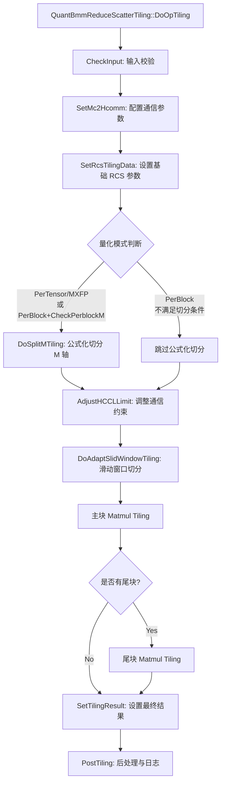

# MatmulReduceScatterV2 算子 Tiling 切分机制深度分析

## 目录
1. [概述](#概述)
2. [DoAdaptSlidWindowTiling 函数分析](#1-doadaptslidwindowtiling-函数分析)
3. [Tiling 切分流程](#2-tiling-切分流程)
4. [Tiling 结构体属性详解](#3-tiling-结构体属性详解)
5. [实际用例演示](#4-实际用例演示)
6. [DoAdaptSlidWindowTiling 的核心作用](#5-doadaptslidwindowtiling-的核心作用)

---

## 概述

`matmul_reduce_scatter_v2` 是一个融合算子，将矩阵乘法（Matmul）与通信操作（ReduceScatter）融合在一起，实现**计算-通信流水并行**。其 Tiling 切分机制是性能优化的核心，需要在多个维度上进行数据切分以满足硬件约束、通信约束和性能目标。

### 核心挑战

1. **通信约束**：单次通信数据量不超过 256MB，总通信次数不超过 16 次
2. **硬件约束**：UB/L1/L0C/L0A/L0B 内存大小限制
3. **性能优化**：计算-通信流水掩盖，最大化硬件利用率
4. **量化场景**：PerTensor/PerBlock/MXFP 三种量化模式的特殊处理

### Tiling 切分层次

```
全局 M 轴切分（通信维度）
    ├── 主块（Main Tile）：tileMValue_
    ├── 尾块（Tail Tile）：tailMValue_
    │
    └── 每个块的内部切分（Matmul 维度）
        ├── L1 切分：baseM, baseN, baseK
        ├── UB 切分：ubCalcM, ubCalcN
        └── 滑动窗口（Sliding Window）：mTailTile, nTailTile
```

---

## 1. DoAdaptSlidWindowTiling 函数分析

### 1.1 函数签名与位置

**文件位置**：
- `mc2/matmul_reduce_scatter_v2/op_host/op_tiling/arch35/quant_bmm_reduce_scatter_tiling.cpp` (Line 664-684)

**函数签名**：
```cpp
ge::graphStatus QuantBmmReduceScatterTiling::DoAdaptSlidWindowTiling()
```

### 1.2 核心算法逻辑

```cpp
ge::graphStatus QuantBmmReduceScatterTiling::DoAdaptSlidWindowTiling()
{
    // ========== 第一阶段：主块切分 ==========
    
    // 1.1 确定主块的 M 值
    // - 如果公式化切分后 tileMValue_ == 0，使用 rankM（通信后的 M 值）
    // - 否则使用公式化切分得到的 tileMValue_
    uint32_t tempMValue = tileMValue_ == 0 ? MutableRCSTilingDataA5().rankM : tileMValue_;
    
    // 1.2 根据量化模式调整 M 值
    // - PerTensor/MXFP 模式：需要乘以 rankDim（因为 M 已经被切分）
    // - PerBlock 模式：保持 tempMValue 不变
    args_.mValue = ((quantMode_ == mc2tiling::Mc2QuantMode::PERTENSOR_MODE) ||
                    (quantMode_ == mc2tiling::Mc2QuantMode::MXFP_MODE)) 
                    ? (tempMValue * args_.rankDim) 
                    : tempMValue;

    // 1.3 创建 Helper 对象进行主块切分
    QuantBmmReduceScatterHelper mmTile(*this, quantBmmMatmulReducescatterTilingData_->quantBmmV3TileTiling);
    
    // 1.4 执行主块 Matmul Tiling
    MC2_CHECK_LOG_RET(opName_, mmTile.DoTiling());
    
    // ========== 第二阶段：尾块切分（可选） ==========
    
    // 2.1 检查是否存在尾块
    if (MutableRCSTilingDataA5().tailCnt == 0) {
        return ge::GRAPH_SUCCESS;  // 无尾块，直接返回
    }

    // 2.2 确定尾块的 M 值
    args_.mValue = ((quantMode_ == mc2tiling::Mc2QuantMode::PERTENSOR_MODE) ||
                    (quantMode_ == mc2tiling::Mc2QuantMode::MXFP_MODE)) 
                    ? (tailMValue_ * args_.rankDim) 
                    : tailMValue_;

    // 2.3 创建尾块 Tiling Helper
    DequantBmm::Mc2QuantBatchMatmulV3TilingDataParams tailQuantBatchMatmulParams;
    QuantBmmReduceScatterHelper mmTail(*this, quantBmmMatmulReducescatterTilingData_->quantBmmV3TailTiling);
    
    // 2.4 执行尾块 Matmul Tiling
    MC2_CHECK_LOG_RET(opName_, mmTail.DoTiling());
    
    return ge::GRAPH_SUCCESS;
}
```

### 1.3 切分策略与约束条件

#### 1.3.1 主块切分策略

| 条件 | M 值来源 | 说明 |
|------|---------|------|
| `tileMValue_ == 0` | `rankM` | 未进行公式化切分，使用通信后的 M 值 |
| `tileMValue_ != 0` | `tileMValue_` | 已进行公式化切分，使用切分后的主块大小 |

#### 1.3.2 量化模式对 M 值的影响

| 量化模式 | M 值计算 | 原因 |
|---------|---------|------|
| **PerTensor** | `tempMValue * rankDim` | M 已被通信切分，需要恢复原始大小 |
| **MXFP** | `tempMValue * rankDim` | 同 PerTensor |
| **PerBlock** | `tempMValue` | M 未被通信切分，直接使用 |

#### 1.3.3 尾块切分条件

```cpp
if (MutableRCSTilingDataA5().tailCnt == 0) {
    return ge::GRAPH_SUCCESS;  // 无尾块
}
```

- `tailCnt > 0` 时才进行尾块切分
- 尾块大小 `tailMValue_` 通常小于主块大小 `tileMValue_`

### 1.4 返回值含义

| 返回值 | 含义 |
|--------|------|
| `ge::GRAPH_SUCCESS` | Tiling 切分成功，已生成完整的 Matmul Tiling 参数 |
| `ge::GRAPH_FAILED` | Tiling 失败（通过 `MC2_CHECK_LOG_RET` 检查） |

---

## 2. Tiling 切分流程

### 2.1 完整流程图



### 2.2 以 quant_bmm_reduce_scatter_tiling 为例的详细流程

#### 阶段 1：输入参数获取

**代码位置**：`QuantBmmReduceScatterTiling::DoOpTiling()`

```cpp
ge::graphStatus QuantBmmReduceScatterTiling::DoOpTiling()
{
    // 1. 校验 HCCL Size（通信约束）
    MC2_CHECK_LOG_RET(opName_, CheckHCCLSize());
    
    // 2. 校验输入（量化参数、scale、groupSize）
    MC2_CHECK_LOG_RET(opName_, CheckInput());
    
    // 3. 设置通信配置
    OP_TILING_CHECK(SetMc2Hcomm() != ge::GRAPH_SUCCESS,
        OP_LOGE(opName_, "Tiling SetHcommCfg failed."), return ge::GRAPH_FAILED);
    
    // 4. 设置 RCS Tiling Data（基础参数）
    SetRcsTilingData(MutableRCSTilingDataA5());
}
```

**获取的关键参数**：
- `args_.orgMValue`, `args_.orgNValue`, `args_.orgKValue`：原始矩阵形状
- `args_.rankDim`：通信域大小（卡数）
- `args_.geAType`, `args_.geBType`, `args_.geCType`：数据类型
- `quantMode_`：量化模式（PerTensor/PerBlock/MXFP）

#### 阶段 2：初始切分计算（公式化切分）

**触发条件**：
```cpp
if ((quantMode_ == mc2tiling::Mc2QuantMode::PERTENSOR_MODE) ||
    (quantMode_ == mc2tiling::Mc2QuantMode::MXFP_MODE) ||
    (quantMode_ == mc2tiling::Mc2QuantMode::PERBLOCK_MODE && CheckPerblockM())) {
        MC2_CHECK_LOG_RET(opName_, DoSplitMTiling(MutableRCSTilingDataA5()));
}
```

**CheckPerblockM 条件**：
```cpp
bool QuantBmmReduceScatterTiling::CheckPerblockM()
{
    return args_.orgMValue % (PERBLOCK_SIZE * args_.rankDim) == 0;
}
```
- PerBlock 量化要求 M 必须是 `128 * rankDim` 的整数倍

**DoSplitMTiling 逻辑**：
```cpp
ge::graphStatus MatmulReduceScatterTilingBase::DoSplitMTiling(Mc2Tiling::RCSTiling &rcsCfg)
{
    args_.mValue = args_.orgMValue / args_.rankDim; // M 被通信切分
    args_.rankTileNum = args_.rankDim;
    
    if (args_.enableSplitK) {
        // 只切 K 轴，不切 M 轴
        rcsCfg.tileCnt = 1;
        rcsCfg.tailCnt = 0;
        rcsCfg.tailM = 0;
    } else if (args_.commTurn != 0) {
        // 用户指定通信轮次
        uint64_t splite = ReduceScatterSpliteM(args_);
        auto tileCnt = args_.mValue / splite;
        auto tileTail = args_.mValue % splite;
        tileMValue_ = splite;
        tailMValue_ = tileTail;
        rcsCfg.tileCnt = tileCnt;
        rcsCfg.tailCnt = (tileTail != 0) ? 1 : 0;
        rcsCfg.tailM = tileTail;
        longTileLen_ = splite;
    } else {
        // 公式化切分：基于性能模型预测最优切分
        DoFormulaticTiling(rcsCfg);
    }
    return ge::GRAPH_SUCCESS;
}
```

**公式化切分流程**（`DoFormulaticTiling`）：
```cpp
void MatmulReduceScatterTilingBase::DoFormulaticTiling(Mc2Tiling::RCSTiling &rcsCfg)
{
    // 1. 获取切分结果
    CutResult mCutScatter = GetTilingResult();
    
    // 2. 根据尾块位置设置 tileCnt 和 tailCnt
    if (mCutScatter.shortTileAtBack || (mCutScatter.numShortTile == 0)) {
        rcsCfg.tileCnt = mCutScatter.numLongTile;  // 主块数量
        rcsCfg.tailM = mCutScatter.shortTileLen;   // 尾块大小
        if (mCutScatter.numShortTile > 0) {
            rcsCfg.tailCnt = mCutScatter.numShortTile;  // 尾块数量
        }
        tileMValue_ = mCutScatter.longTileLen;  // 主块大小
        tailMValue_ = mCutScatter.shortTileLen;
    } else {
        // 短块在前
        rcsCfg.tileCnt = mCutScatter.numShortTile;
        rcsCfg.tailM = mCutScatter.longTileLen;
        if (mCutScatter.numLongTile > 0) {
            rcsCfg.tailCnt = mCutScatter.numLongTile;
        }
        tileMValue_ = mCutScatter.shortTileLen;
        tailMValue_ = mCutScatter.longTileLen;
    }
    longTileLen_ = mCutScatter.longTileLen;
}
```

**公式化切分的核心算法**：
- **EstimateKernelTime**：预测 Matmul 和通信时间，计算 `ratioCalcComm`
- **SelectTilingMethod**：根据时间比例选择切分策略
  - `ShortAtEndCalcBoundBalancing`：计算 Bound 场景，短块在尾部
  - `ShortAtFrontCommBoundBalancing`：通信 Bound 场景，短块在前部
- **FitTileLengthDiscrete**：离散拟合，找到最优切分长度

#### 阶段 3：DoAdaptSlidWindowTiling 的调用时机

**调用位置**：
```cpp
MC2_CHECK_LOG_RET(opName_, AdjustHCCLLimit(MutableRCSTilingDataA5(), GetQuantMode()));
MC2_CHECK_LOG_RET(opName_, DoAdaptSlidWindowTiling());
```

**时机分析**：
1. 在 `AdjustHCCLLimit` 之后调用
2. `AdjustHCCLLimit` 确保切分结果满足通信约束（256MB）
3. 如果不满足，会重新调整 `tileMValue_` 和 `tailMValue_`

#### 阶段 4：最终 Tiling 参数的确定

**QuantBmmReduceScatterHelper::DoTiling() 流程**：

```cpp
// 1. 获取平台信息
GetPlatformInfo()

// 2. 获取形状和属性信息
GetShapeAttrsInfo()
    ├── SetBatch(): 设置 batch 维度
    ├── AnalyzeBatchInfo(): 分析 batch 结构
    ├── AnalyzeInputs(): 分析输入参数

// 3. 执行 Tiling 计算
DoOpTiling()
    ├── AnalyseSlidingWinInfo(): 分析滑动窗口信息
    │   ├── CalcBasicBlock(): 计算基本块大小
    │   │   ├── PerBlock: baseM=128/256, baseN=128/256, baseK=128
    │   │   └── PerTensor/MXFP: baseM/baseN <= 256, baseK <= 128
    │   ├── AdjustBasicBlock(): 调整基本块（小 shape 场景）
    │   ├── IsAFullLoad(): 判断是否全载 A 矩阵
    │   ├── CalcTailBasicBlock(): 计算尾块切分粒度
    │   └── CalcTailBasicBlockAfullLoad(): A 全载时的尾块切分
    │
    ├── SetBf16Compat(): 设置 BF16 兼容模式
    ├── CalL1Tiling(): L1 内存切分
    │   ├── CalUsedCoreNum(): 计算使用的核数
    │   ├── CalL1TilingDepthAfullload(): A 全载时的深度计算
    │   ├── CalL1TilingDepthANotfullload(): A 未全载时的深度计算
    │   ├── CalStepKs(): 计算 stepK（K 轴切分步长）
    │   └── CalScaleFactors(): 计算量化 scale 因子（MXFP 场景）
    │
    ├── CalcUbTiling(): UB 切分（Pertoken 场景）
    ├── SetTilingData(): 设置 Tiling 数据

// 4. 计算 LibApi Tiling
DoLibApiTiling()

// 5. Post Tiling
PostTiling()
```

#### 阶段 5：Tiling 结构体的生成

**最终生成的 Tiling 结构体**：

```cpp
struct QuantBatchMatmulV3ReduceScatterTilingData {
    // 通信相关
    Mc2InitTiling mc2InitTiling;       // 通信初始化参数
    Mc2CcTiling mc2CcTiling;           // CCU 通信参数
    
    // Reduce Scatter 参数
    RCSTiling param;                   // RCS 核心参数（tileCnt, tailM, tailCnt）
    
    // 数据类型和调试模式
    uint32_t dataType;                 // HCCL 数据类型
    uint32_t debugMode;                // 调测模式
    
    // Matmul Tiling（主块）
    DequantBmm::Mc2QuantBatchMatmulV3TilingDataParams quantBmmV3TileTiling;
    
    // Matmul Tiling（尾块）
    DequantBmm::Mc2QuantBatchMatmulV3TilingDataParams quantBmmV3TailTiling;
};
```

---

## 3. Tiling 结构体属性详解

### 3.1 RCSTiling（Reduce Scatter 核心 Tiling）

**定义位置**：`mc2/common/op_kernel/mc2_tiling_struct.h`

```cpp
struct RCSTiling {
    uint32_t rankDim;          // 通信域大小（卡数）
    uint32_t rankID;           // 当前卡的 ID
    uint32_t commtype;         // 通信类型（HCCL_CMD_REDUCE_SCATTER）
    uint32_t subtype;          // Reduce 类型（HCCL_REDUCE_SUM）
    
    // M 轴切分参数
    uint32_t tileCnt;          // 主块数量
    uint32_t tailM;            // 尾块的 M 值
    uint32_t tailCnt;          // 尾块数量
    
    // 原始矩阵形状
    uint32_t rankM;            // 原始 M 值（orgMValue）
    uint32_t rankN;            // 原始 N 值（orgNValue）
    uint32_t rankK;            // 原始 K 值（orgKValue）
    
    // 其他参数
    uint32_t isTransposeA;     // A 矩阵是否转置
    uint32_t isTransposeB;     // B 矩阵是否转置
    uint32_t aicCoreNum;       // AIC 核数
    uint64_t cToFloatLen;      // C 转 Float 的 workspace 大小
    uint32_t biasLen;          // Bias 长度
    uint64_t nd2NzWorkLen;     // ND2NZ 转换 workspace
    uint64_t gatherLen;        // Gather 长度
    uint32_t needUbBuffer;     // 是否需要 UB Buffer
    uint32_t commWorkSpaceSize;// 通信 workspace 大小
};
```

**关键属性详解**：

| 属性 | 含义 | 计算方式 |
|------|------|---------|
| `tileCnt` | 主块数量 | `args_.mValue / tileMValue_` |
| `tailM` | 尾块大小 | `args_.mValue % tileMValue_` |
| `tailCnt` | 尾块数量（通常为 0 或 1） | `(tailM != 0) ? 1 : 0` |
| `rankM` | 通信后的 M 值 | `orgMValue / rankDim` |

### 3.2 Mc2QuantBatchMatmulV3TilingDataParams（Matmul Tiling）

**定义位置**：`mc2/3rd/quant_batch_matmul_v3/op_kernel/arch35/quant_batch_matmul_v3_tiling_data.h`

```cpp
struct Mc2QuantBatchMatmulV3TilingDataParams {
    // Batch 维度参数
    Mc2QuantBatchMatmulV3DataParams params;  // Quant Matmul 参数
    
    // Cube Tiling（Matmul 核心）
    TCubeTiling matmulTiling;                // Cube Tiling 参数
    
    // L2 Cache 切分
    Mc2L2cacheTileParams tileL2cacheTiling;  // L2 Cache 切分
    
    // 滑动窗口参数
    Mc2SlidingWindowParams adaptiveSlidingWin;  // 尾块切分粒度
};
```

#### 3.2.1 TCubeTiling（Cube 核心 Tiling）

```cpp
struct TCubeTiling {
    uint32_t usedCoreNum;      // 使用的核数
    uint32_t singleCoreM;      // 单核 M 值
    uint32_t singleCoreN;      // 单核 N 值
    uint32_t singleCoreK;      // 单核 K 值
    
    uint32_t baseM;            // 基本 M 块大小
    uint32_t baseN;            // 基本 N 块大小
    uint32_t baseK;            // 基本 K 块大小
    
    uint32_t depthA1;          // A 矩阵 L1 深度
    uint32_t depthB1;          // B 矩阵 L1 深度
    
    uint32_t stepM;            // M 轴步长
    uint32_t stepN;            // N 轴步长
    uint32_t stepKa;           // K 轴步长（A 矩阵）
    uint32_t stepKb;           // K 轴步长（B 矩阵）
    
    uint32_t iterateOrder;     // 迭代顺序（0: MNK, 1: NMK）
    uint32_t dbL0A;            // L0A Double Buffer（1: off, 2: on）
    uint32_t dbL0B;            // L0B Double Buffer
    uint32_t dbL0C;            // L0C Double Buffer
    
    uint32_t isBias;           // 是否有 Bias
    uint32_t M;                // 总 M 值
    uint32_t N;                // 总 N 值
    uint32_t Ka;               // A 矩阵 K 值
    uint32_t Kb;               // B 矩阵 K 值
};
```

**关键属性详解**：

| 属性 | 含义 | 约束条件 |
|------|------|---------|
| `baseM` | M 方向基本块 | PerBlock: 128/256, PerTensor: <=256 |
| `baseN` | N 方向基本块 | PerBlock: 128/256, PerTensor: <=256 |
| `baseK` | K 方向基本块 | PerBlock: 128, PerTensor: <=128 |
| `depthA1` | A 矩阵 L1 深度 | 受 L1 内存约束 |
| `depthB1` | B 矩阵 L1 满度 | 受 L1 内存约束 |
| `stepKa` | K 轴切分步长（A） | `(depthA1 / 2)` 或 `ceilDiv(K, baseK)` |
| `stepKb` | K 轴切分步长（B） | `(depthB1 / 2)` 或 `ceilDiv(K, baseK)` |
| `dbL0C` | L0C Double Buffer | 1 或 2，受 L0C 内存约束 |

#### 3.2.2 Mc2QuantBatchMatmulV3DataParams

```cpp
struct Mc2QuantBatchMatmulV3DataParams {
    // Batch 参数
    uint32_t batchA;           // A 矩阵 Batch 数
    uint32_t batchB;           // B 矩阵 Batch 数
    uint32_t batchC;           // C 矩阵 Batch 数
    uint32_t batchA1-A4;       // A 矩阵 4D Batch 维度
    uint32_t batchB1-B4;       // B 矩阵 4D Batch 维度
    uint32_t batchC1-C4;       // C 矩阵 4D Batch 维度
    
    // Quant 参数
    uint32_t isPerTensor;      // 是否 PerTensor 量化
    uint32_t isPertoken;       // 是否 Pertoken 量化
    uint32_t isDoubleScale;    // 是否双 Scale
    uint32_t biasThreeDim;     // Bias 是否 3D
    
    // UB 切分参数
    uint32_t ubCalcM;          // UB 计算 M 值
    uint32_t ubCalcN;          // UB 计算 N 值
    uint32_t needUbBuffer;     // 是否需要 UB Buffer
    
    // Group Size（量化块大小）
    uint32_t groupSizeM;       // M 方向量化块大小
    uint32_t groupSizeN;       // N 方向量化块大小
    uint32_t groupSizeK;       // K 方向量化块大小
    
    // 其他
    uint32_t biasDtype;        // Bias 数据类型
    uint32_t ubSize;           // UB 大小
    uint32_t isMClash;         // M 方向是否有 Clash
    uint32_t isNClash;         // N 方向是否有 Clash
};
```

**关键属性详解**：

| 属性 | PerTensor | PerBlock | MXFP |
|------|-----------|----------|------|
| `groupSizeM` | N/A | 128 | 1 |
| `groupSizeN` | N/A | 128 | 1 |
| `groupSizeK` | N/A | 128 | 32 |
| `isPerTensor` | 1 | 0 | 1 |
| `isDoubleScale` | 1 | 1 | 1 |

#### 3.2.3 Mc2SlidingWindowParams（滑动窗口参数）

```cpp
struct Mc2SlidingWindowParams {
    uint32_t mTailTile;        // 尾块 M 方向切分粒度
    uint32_t nTailTile;        // 尾块 N 方向切分粒度
};
```

**含义**：
- `mTailTile`：尾窗口在 M 方向的切分份数
- `nTailTile`：尾窗口在 N 方向的切分份数
- 用于优化尾块的多核负载均衡

**示例**：
- `mTailTile=1, nTailTile=4`：尾块在 N 方向切分 4 份，分配给 4 个核

### 3.3 Mc2L2cacheTileParams（L2 Cache 切分）

```cpp
struct Mc2L2cacheTileParams {
    uint32_t mTileCntL2;       // L2 M 方向 Tile 数量
    uint32_t nTileCntL2;       // L2 N 方向 Tile 数量
    uint32_t mTileBlock;       // L2 M 方向 Tile 块大小
    uint32_t nTileBlock;       // L2 N 方向 Tile 块大小
    uint32_t calOrder;         // 计算顺序
    uint32_t isBasicTiling;    // 是否基础 Tiling
};
```

---

## 4. 实际用例演示

### 4.1 场景设定

**假设输入参数**：
- **矩阵形状**：M=8192, N=4096, K=2048
- **通信域**：rankDim=8（8 卡）
- **量化模式**：PerBlock 量化
- **数据类型**：x1/x2=FP8_E4M3, output=BF16
- **硬件平台**：Ascend 910B（AIV 核数=8）

**硬件参数**：
- L1 Size: 1MB
- L0C Size: 128KB
- UB Size: 64KB
- AIV Core Num: 8

### 4.2 Tiling 切分过程演示

#### Step 1：CheckPerblockM 判断

```cpp
CheckPerblockM():
    orgMValue = 8192
    PERBLOCK_SIZE = 128
    rankDim = 8
    return 8192 % (128 * 8) == 0  // True，可以进行公式化切分
```

#### Step 2：DoSplitMTiling（公式化切分）

```cpp
// 输入
args_.orgMValue = 8192
args_.rankDim = 8
args_.mValue = 8192 / 8 = 1024  // 通信后的 M 值

// GetTilingResult() - 基于性能模型预测
// 假设预测结果：
// - Matmul 时间: 10ms
// - 通信时间: 8ms
// - ratioCalcComm = 10/8 = 1.25
// - 判断为计算 Bound，短块在尾部

// 切分结果
CutResult:
    longTileLen = 512
    numLongTile = 2
    shortTileLen = 0
    numShortTile = 0
    shortTileAtBack = true

// 设置 Tiling 参数
tileMValue_ = 512
tailMValue_ = 0
rcsCfg.tileCnt = 2
rcsCfg.tailCnt = 0
rcsCfg.tailM = 0
longTileLen_ = 512
```

#### Step 3：AdjustHCCLLimit（通信约束检查）

```cpp
// 检查单块数据量是否超过 256MB
tileMValue_ = 512
args_.nValue = 4096
args_.geCType = DT_BF16 (2 bytes)

sizeOfSingleM = 512 * 4096 * 2 = 4MB  // < 256MB，满足约束

// 无需调整
```

#### Step 4：DoAdaptSlidWindowTiling（主块切分）

```cpp
// 主块切分
tempMValue = tileMValue_ = 512
quantMode_ = PERBLOCK_MODE

args_.mValue = tempMValue = 512  // PerBlock 不乘 rankDim

// QuantBmmReduceScatterHelper::DoTiling()
```

**CalcBasicBlock()**（PerBlock 场景）：
```cpp
inputParams_.mSize = 512
inputParams_.nSize = 4096
inputParams_.kSize = 2048

// PerBlock 基本块大小
if (mSize <= 128 || mSize % 128 != 0):
    baseM = 128
else:
    baseM = 256  // mSize=512, 可以切分为 2 个 256 的块

if (nSize % 128 == 0):
    baseN = 256  // nSize=4096, 可以切分为 16 个 256 的块
else:
    baseN = 128

baseK = 128

// 结果
adaptiveWin_.baseM = 256
adaptiveWin_.baseN = 256
adaptiveWin_.baseK = 128
```

**AnalyseSlidingWinInfo()**：
```cpp
// 计算基本块数量
mBlockCnt = ceilDiv(512, 256) = 2
nBlockCnt = ceilDiv(4096, 256) = 16
totalBlockCnt = 2 * 16 = 32

// 计算尾块
mTail = 512 - (2-1) * 256 = 256
nTail = 4096 - (16-1) * 256 = 256

// 计算窗口总数
aicNum = 8  // AIV 核数
totalWinCnt = ceilDiv(32, 8) = 4
tailWinBlockCnt = 32 % 8 = 0  // 无尾窗口

// IsAFullLoad() - PerBlock 场景强制 false
isAFullLoad_ = false

// 结果
adaptiveWin_:
    baseM = 256, baseN = 256, baseK = 128
    mBlockCnt = 2, nBlockCnt = 16, totalBlockCnt = 32
    mTail = 256, nTail = 256
    totalWinCnt = 4
    tailWinBlockCnt = 0
```

**CalL1Tiling()**：
```cpp
// 计算使用的核数
usedCoreNum = CalUsedCoreNum()
    totalWinCnt = 4 > 1
    tailWinBlockCnt = 0
    return aicNum = 8

// 基本块参数
basicTiling_.baseM = 256
basicTiling_.baseN = 256
basicTiling_.baseK = 128

// 单核参数
singleCoreM = min(512, 256) = 256
singleCoreN = min(4096, 256) = 256
singleCoreK = 2048

// L1 内存切分（PerBlock 场景，A 不全载）
// L1 Size = 1MB
// Bias Size = 256 * 4 (float32) = 1KB
// Scale Size = 256 * 4 (float32) = 1KB
// Left L1 Size = 1MB - 2KB ≈ 1MB

// 计算 depthA1, depthB1
depthA1 = ceilDiv(2048, 128) = 16  // K 轴切分
depthB1 = ceilDiv(2048, 128) = 16

// 计算 stepKa, stepKb（限制为 4）
stepKa = min(16 / 2, 4) = 4
stepKb = min(16 / 2, 4) = 4

// Double Buffer
dbL0c = 2  // 开启 L0C Double Buffer

// 结果
basicTiling_:
    usedCoreNum = 8
    baseM = 256, baseN = 256, baseK = 128
    singleCoreM = 256, singleCoreN = 256, singleCoreK = 2048
    depthA1 = 8, depthB1 = 8
    stepKa = 4, stepKb = 4
    dbL0c = 2
```

#### Step 5：生成最终 Tiling 参数

```cpp
// RCSTiling
rcsCfg:
    rankDim = 8
    rankM = 1024
    rankN = 4096
    rankK = 2048
    tileCnt = 2
    tailCnt = 0
    tailM = 0
    aicCoreNum = 8

// TCubeTiling（主块）
matmulTiling:
    usedCoreNum = 8
    M = 512
    N = 4096
    Ka = 2048
    Kb = 2048
    singleCoreM = 256
    singleCoreN = 256
    singleCoreK = 2048
    baseM = 256
    baseN = 256
    baseK = 128
    depthA1 = 8
    depthB1 = 8
    stepKa = 4
    stepKb = 4
    stepM = 1
    stepN = 1
    dbL0c = 2
    iterateOrder = 0  // MNK

// Mc2QuantBatchMatmulV3DataParams
params:
    batchA = 1
    batchB = 1
    batchC = 1
    isPerTensor = 0
    isDoubleScale = 1
    groupSizeM = 128
    groupSizeN = 128
    groupSizeK = 128

// Mc2SlidingWindowParams
adaptiveSlidingWin:
    mTailTile = 1
    nTailTile = 1
```

### 4.3 完整切分示意图

```
原始矩阵：[M=8192, N=4096, K=2048]
                     ↓
         通信切分（ReduceScatter, rankDim=8）
                     ↓
单卡矩阵：[M=1024, N=4096, K=2048]
                     ↓
         公式化切分（计算-通信流水并行）
                     ↓
主块 1：[M=512, N=4096, K=2048]
主块 2：[M=512, N=4096, K=2048]
                     ↓
         DoAdaptSlidWindowTiling（滑动窗口切分）
                     ↓
主块内部切分：
├── baseM=256, baseN=256, baseK=128
├── M 方向切分：2 个 baseM 块
├── N 方向切分：16 个 baseN 块
├── K 方向切分：stepKa=4, stepKb=4
│
├── 核 1：处理 baseM[0], baseN[0-7]
├── 核 2：处理 baseM[0], baseN[8-15]
├── 核 3：处理 baseM[1], baseN[0-7]
├── 核 4：处理 baseM[1], baseN[8-15]
└── 4 轮迭代（totalWinCnt=4）
```

### 4.4 PerTensor 场景对比

**相同输入，PerTensor 量化**：

```cpp
// DoSplitMTiling
args_.mValue = 1024
tileMValue_ = 512
tailMValue_ = 0

// DoAdaptSlidWindowTiling
tempMValue = 512
args_.mValue = 512 * 8 = 4096  // PerTensor 需要乘 rankDim

// CalcBasicBlock（PerTensor）
baseM = min(4096, 256) = 256
baseN = min(4096, 256) = 256
baseK = min(128, 2048) = 128

// AnalyseSlidingWinInfo
mBlockCnt = ceilDiv(4096, 256) = 16
nBlockCnt = ceilDiv(4096, 256) = 16
totalBlockCnt = 16 * 16 = 256
totalWinCnt = ceilDiv(256, 8) = 32

// 结果差异
- M 值：PerTensor=4096 vs PerBlock=512
- mBlockCnt：PerTensor=16 vs PerBlock=2
- totalWinCnt：PerTensor=32 vs PerBlock=4
- groupSizeM/N/K：PerTensor=N/A vs PerBlock=128
```

---

## 5. DoAdaptSlidWindowTiling 的核心作用

### 5.1 在整体 Tiling 流程中的角色

**位置**：公式化切分与 Matmul 内部切分之间的桥梁

```
全局 M 轴切分（通信维度）
    ├── DoSplitMTiling：确定 tileMValue_, tailMValue_
    │
    ├── AdjustHCCLLimit：确保满足通信约束
    │
    └── DoAdaptSlidWindowTiling：桥梁作用 ★★★
        │   ├── 接收：tileMValue_, tailMValue_
        │   ├── 输出：完整的 Matmul Tiling 参数
        │   └── 功能：将通信维度的切分映射到 Matmul 维度的切分
        │
    ├── SetTilingResult：整合通信和 Matmul Tiling
```

### 5.2 解决的核心问题

#### 5.2.1 通信维度与 Matmul 维度的映射

**问题**：
- 公式化切分只确定 M 轴的粗粒度切分（tileMValue_）
- Matmul 需要在 M/N/K 三个轴上进行细粒度切分
- 两者之间存在映射关系需要明确

**解决方案**：
```cpp
// 主块切分
args_.mValue = tempMValue  // tileMValue_ -> args_.mValue
QuantBmmReduceScatterHelper::DoTiling()  // args_.mValue -> baseM, mBlockCnt

// 尾块切分
args_.mValue = tailMValue_  // tailMValue_ -> args_.mValue
QuantBmmReduceScatterHelper::DoTiling()  // args_.mValue -> baseM, mBlockCnt
```

#### 5.2.2 量化模式的特殊处理

**问题**：
- PerTensor/MXFP 模式：M 已被通信切分，需要恢复原始大小
- PerBlock 模式：M 未被通信切分，直接使用

**解决方案**：
```cpp
args_.mValue = ((quantMode_ == PERTENSOR_MODE) ||
                (quantMode_ == MXFP_MODE))
                ? (tempMValue * args_.rankDim)
                : tempMValue;
```

#### 5.2.3 主块与尾块的独立切分

**问题**：
- 主块和尾块大小不同（tileMValue_ vs tailMValue_）
- 需要分别进行 Matmul Tiling

**解决方案**：
```cpp
// 主块切分
QuantBmmReduceScatterHelper mmTile(*this, quantBmmV3TileTiling);
mmTile.DoTiling();

// 尾块切分（如果存在）
if (tailCnt > 0) {
    args_.mValue = tailMValue_;
    QuantBmmReduceScatterHelper mmTail(*this, quantBmmV3TailTiling);
    mmTail.DoTiling();
}
```

### 5.3 优化的核心指标

#### 5.3.1 核内负载均衡

**优化目标**：最大化核利用率

**策略**：
- **滑动窗口切分**：将尾块细粒度切分到多个核
  - `mTailTile`：M 方向切分份数
  - `nTailTile`：N 方向切分份数
- **核数动态调整**：`CalUsedCoreNum()` 根据数据量动态调整核数

**示例**：
```
主块：mBlockCnt=2, nBlockCnt=16, totalBlockCnt=32
尾块：tailWinBlockCnt=8
    ├── mTailTile=1, nTailTile=2
    ├── 实际使用核数 = 8 * 1 * 2 = 16（限制为 aicNum=8）
```

#### 5.3.2 内存利用率优化

**优化目标**：最大化 L1/L0C/UB 利用率

**策略**：
- **A 全载判断**：`IsAFullLoad()` 判断是否可以将 A 矩阵全载到 L1
  - 条件：`mBlockCnt <= nBlockCnt && mBlockCnt ∈ {1, 2, 4}`
  - 优势：减少 A 矩阵的重复搬运
- **Double Buffer**：`dbL0c` 开启 L0C Double Buffer，提升流水效率
- **L1 深度优化**：`depthA1`, `depthB1` 最大化 L1 利用率

**示例**：
```
A 全载场景：
    singleCoreASize = 256 * 2048 * 1 byte = 512KB
    L1 Size = 1MB
    isAFullLoad = (512KB <= 512KB && mBlockCnt=2 <= nBlockCnt=16) = true

L1 深度：
    depthA1 = ceilDiv(2048, 128) = 16  // K 轴切分 16 份
    depthB1 = ceilDiv(2048, 128) = 16
```

#### 5.3.3 流水掩盖优化

**优化目标**：计算-通信流水掩盖

**策略**：
- 公式化切分已经优化了 M 轴切分以实现流水掩盖
- `DoAdaptSlidWindowTiling` 进一步优化核内流水：
  - `stepKa`, `stepKb`：K 轴切分步长，优化 Cube-Vector 流水
  - `iterateOrder`：迭代顺序（MNK vs NMK），优化数据搬运流水

### 5.4 何时需要调用

#### 5.4.1 调用时机分析

| 场景 | 是否调用 | 原因 |
|------|---------|------|
| PerTensor/MXFP + 公式化切分成功 | **Yes** | 需要进行 Matmul 内部切分 |
| PerBlock + CheckPerblockM=True | **Yes** | 需要进行 Matmul 内部切分 |
| PerBlock + CheckPerblockM=False | **Yes** | 跳过公式化切分，但仍需 Matmul 切分 |
| 未进行公式化切分（tileMValue_=0） | **Yes** | 使用 rankM 进行 Matmul 切分 |

**结论**：所有场景都会调用 `DoAdaptSlidWindowTiling`

#### 5.4.2 调用前提条件

1. `AdjustHCCLLimit` 已执行，确保通信约束满足
2. `SetRcsTilingData` 已执行，基础参数已设置
3. `args_.mValue` 可用（通过 `tileMValue_` 或 `rankM`）

---

## 附录：关键代码片段注释

### A. QuantBmmReduceScatterHelper::DoTiling 流程

```cpp
ge::graphStatus QuantBmmReduceScatterHelper::DoTiling()
{
    // 1. 获取平台信息（核数、内存大小）
    GetPlatformInfo();
    
    // 2. 获取输入形状和属性
    GetShapeAttrsInfo();
    
    // 3. 核心 Tiling 计算
    DoOpTiling();
    
    // 4. 计算 LibApi Tiling（填充 TCubeTiling）
    DoLibApiTiling();
    
    // 5. 后处理（设置核数、workspace）
    PostTiling();
    
    return ge::GRAPH_SUCCESS;
}
```

### B. CalcBasicBlock 逻辑（PerBlock 场景）

```cpp
bool Mc2AdaptiveSlidingWindowTiling::CalcBasicBlock()
{
    if (inputParams_.isPerBlock) {
        // PerBlock 基本块策略：
        // 1. 当 M 不满足 128 整数倍时，baseM=128
        // 2. 当 M 满足 128 整数倍时，baseM=256（优先）
        // 3. baseN 优先 256，但需满足 128 整数倍
        // 4. baseK 固定 128
        
        if (inputParams_.mSize <= PER_BLOCK_SIZE || 
            inputParams_.mSize % PER_BLOCK_SIZE != 0UL) {
            adaptiveWin_.baseM = PER_BLOCK_SIZE;  // 128
            if (inputParams_.nSize % PER_BLOCK_SIZE == 0UL) {
                adaptiveWin_.baseN = PER_BLOCK_BASE_SIZE_256;  // 256
            } else {
                adaptiveWin_.baseN = PER_BLOCK_SIZE;  // 128
            }
        } else {
            adaptiveWin_.baseM = PER_BLOCK_BASE_SIZE_256;  // 256
            adaptiveWin_.baseN = PER_BLOCK_SIZE;  // 128
        }
        adaptiveWin_.baseK = PER_BLOCK_SIZE;  // 128
        
        return true;
    }
    // ... PerTensor/MXFP 场景逻辑
}
```

### C. CalL1Tiling 逻辑

```cpp
void Mc2AdaptiveSlidingWindowTiling::CalL1Tiling()
{
    // 1. 计算使用的核数
    basicTiling_.usedCoreNum = CalUsedCoreNum();
    
    // 2. 设置基本块参数
    basicTiling_.baseM = adaptiveWin_.baseM;
    basicTiling_.baseN = adaptiveWin_.baseN;
    basicTiling_.baseK = adaptiveWin_.baseK;
    
    // 3. 设置单核参数
    basicTiling_.singleCoreM = min(inputParams_.mSize, basicTiling_.baseM);
    basicTiling_.singleCoreN = min(inputParams_.nSize, basicTiling_.baseN);
    basicTiling_.singleCoreK = inputParams_.kSize;
    
    // 4. Double Buffer 决策
    basicTiling_.dbL0c = 
        ((baseM * baseN * 4 * 2 <= l0cSize) && CheckBiasAndScale(baseN, 2))
        ? 2 : 1;
    
    // 5. 计算剩余 L1 内存
    uint64_t biasSize = hasBias ? baseN * biasDtypeSize : 0;
    uint64_t scaleSize = isPerChannel ? baseN * scaleDtypeSize : 0;
    uint64_t leftL1Size = totalL1Size - biasSize - scaleSize;
    
    // 6. L1 深度计算
    if (isAFullLoad_) {
        CalL1TilingDepthAfullload(leftL1Size);  // A 全载
    } else {
        CalL1TilingDepthANotfullload(leftL1Size);  // A 未全载
    }
}
```

---

## 总结

`DoAdaptSlidWindowTiling` 是 `matmul_reduce_scatter_v2` 算子 Tiling 切分的核心函数，起到桥梁作用：

1. **输入**：公式化切分得到的 `tileMValue_`, `tailMValue_`
2. **输出**：完整的 Matmul Tiling 参数（TCubeTiling, Mc2QuantBatchMatmulV3DataParams）
3. **功能**：
   - 将通信维度的粗粒度切分映射到 Matmul 维度的细粒度切分
   - 处理量化模式差异（PerTensor/MXFP vs PerBlock）
   - 主块与尾块的独立切分
   - 核内负载均衡优化（滑动窗口）
   - 内存利用率优化（L1/L0C/UB）

通过深入理解 `DoAdaptSlidWindowTiling`，可以掌握 `matmul_reduce_scatter_v2` 算子的 Tiling 切分机制，为性能优化和问题排查提供坚实基础。