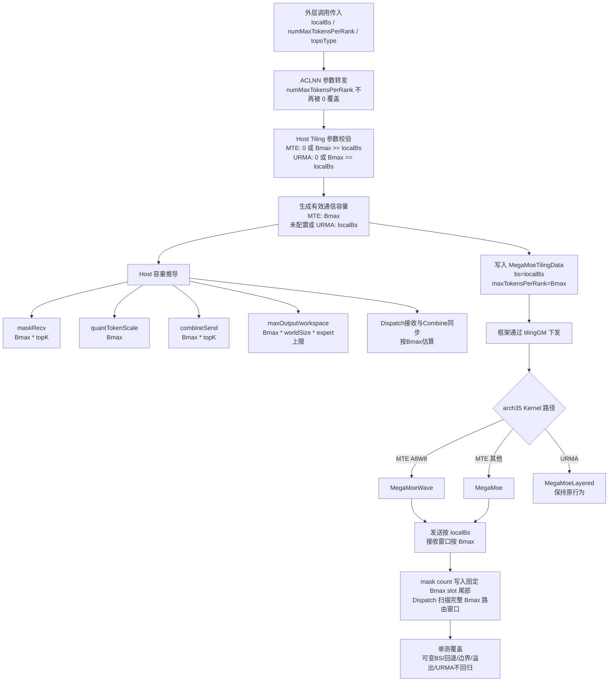

# MegaMoe arch35 MTE 可变 BS 改造说明



## 1. 文档目的与修改范围

本文说明 `mc2/mega_moe` 在 arch35 上支持 MTE 可变 BS 的设计、代码修改过程及修改原因，便于代码评审、方案汇报和后续维护。

本次改造遵循以下范围：

- 支持 arch35 的 MTE 通信路径在不同 Rank 使用不同的实际 BS。
- MTE 的通用 Kernel `MegaMoe` 和 Wave Kernel `MegaMoeWave` 同时支持可变 BS。
- URMA 的 `MegaMoeLayered` 不改造可变 BS，继续保持原有固定 BS 规则。
- arch22 不在本次修改范围内。
- 本地真实计算量仍由当前 Rank 的实际 BS 决定，不因 Bmax 增加而扩大。

涉及的主要文件：

| 文件 | 作用 |
|---|---|
| `op_api/aclnn_mega_moe.cpp` | 将外层 `numMaxTokensPerRank` 传给内部算子 |
| `op_host/op_tiling/arch35/mega_moe_tiling.cpp` | 参数校验、通信容量、调度和 workspace 相关 Tiling |
| `op_kernel/arch35/mega_moe_tiling.h` | Host 与 Kernel 共用的 TilingData |
| `op_kernel/arch35/mega_moe_base.h` | Peer memory 地址布局 |
| `op_kernel/arch35/mega_moe.h` | MTE 通用 Kernel |
| `op_kernel/arch35/mega_moe_wave.h` | MTE A8W8 Wave Kernel |
| `tests/ut/op_host/arch35/test_mega_moe_tiling.cpp` | Host Tiling 单元测试 |

## 2. 问题背景

### 2.1 固定 BS 时的原有假设

原实现大量使用当前 Rank 的 `bs` 同时表示：

1. 当前 Rank 实际拥有的 token 数量；
2. 跨 Rank 通信窗口需要容纳的最大 token 数量。

固定 BS 场景下，所有 Rank 的 BS 相同，例如：

```text
Rank0 bs = 128
Rank1 bs = 128
Rank2 bs = 128
Rank3 bs = 128
```

此时所有 Rank 使用 `bs` 计算 mask、量化 token、Combine 回传和接收 workspace，得到的 peer memory 大小和区域偏移完全一致。

### 2.2 可变 BS 时的问题

可变 BS 场景可能是：

```text
Rank0 bs = 64
Rank1 bs = 128
Rank2 bs = 192
Rank3 bs = 256
```

如果各 Rank 继续使用本地 `bs` 计算：

```text
[rankSync][maskRecv][quantTokenScale][combineSend]
```

那么不同 Rank 的每个区域大小都会不同，后续区域的相对地址也会不同。跨 Rank 通过相同 offset 访问 peer window 时，可能出现错位或越界。

此外，小 BS Rank 仍可能接收大 BS Rank 路由过来的大量 token。如果 Dispatch 接收批次、最大接收 workspace 或 Combine 同步 slot 继续按小 Rank 的本地 BS 计算，就会低估接收侧容量。

## 3. 核心设计

### 3.1 两个容量概念

改造后明确区分：

```text
localBs = tilingData->bs
        = 当前 Rank 的实际 token 数
        = x.shape[0]

Bmax = tilingData->maxTokensPerRank
     = 所有 Rank 统一使用的最大通信 token 容量
```

所有 Rank 必须满足：

```text
0 < localBs <= Bmax
```

并且同一次通信中的所有 Rank 必须传入相同的非零 Bmax。当前实现只在单 Rank Host Tiling 中检查 `localBs <= Bmax`，无法在该阶段验证其他 Rank 是否传入相同值，因此“所有 Rank 使用相同 Bmax”属于调用侧协议。

### 3.2 使用规则

| 场景 | 使用 localBs | 使用 Bmax |
|---|---:|---:|
| 本 Rank 输入量化 | 是 | 否 |
| 本 Rank topK mask 的真实有效长度 | 是 | 否 |
| 本 Rank实际发送 route 数 | 是 | 否 |
| 最终输出 `y` 的 token 数 | 是 | 否 |
| Shared Expert 本地输入 | 是 | 否 |
| Unpermute 本地输出 | 是 | 否 |
| MTE mask 通信槽位 | 否 | 是 |
| MTE 量化 token 通信窗口 | 否 | 是 |
| MTE Combine 回传窗口 | 否 | 是 |
| Dispatch 接收扫描范围 | 否 | 是 |
| 接收侧最坏 workspace | 否 | 是 |
| Combine 同步 slot 最坏容量 | 否 | 是 |

设计原则可以概括为：

> 本地真实数据量使用 localBs；跨 Rank 地址布局、接收范围和最坏情况容量使用 Bmax。

### 3.3 拓扑选择

arch35 中：

```cpp
TOPO_TYPE_MTE  = 0;
TOPO_TYPE_URMA = 1;
```

定义位置：`op_kernel/arch35/mega_moe_workspace_info.h:98-99`。

本次可变 BS 使用：

```text
topoType = 0
numMaxTokensPerRank = 所有 Rank 统一的 Bmax
```

URMA 继续要求 `numMaxTokensPerRank` 为 0 或等于本地 BS。

## 4. 配置从外层到 Kernel 的调用路线

```text
用户传入 numMaxTokensPerRank
    -> aclnnMegaMoeGetWorkspaceSize
    -> aclnnInnerMegaMoeGetWorkspaceSize
    -> 算子属性 num_max_tokens_per_rank
    -> TilingContext::GetAttrs()
    -> GetAttrPointer<int64_t>(属性下标8)
    -> CheckAttrParams
    -> SetAttrParams
    -> tilingData->maxTokensPerRank
    -> tilingGM
    -> GET_TILING_DATA_WITH_STRUCT
    -> MegaMoe/MegaMoeWave::Init
    -> recvRouteCapacity_ 和 PeermemInfo
```

关键注册和解析位置：

- 属性定义：`op_host/mega_moe_def.cpp:169`。
- 属性下标：`op_host/op_tiling/mega_moe.h:56`，`attrNumMaxTokensPerRankIndex = 8U`。
- Host 读取属性：`op_host/op_tiling/arch35/mega_moe_tiling.cpp:374`。
- Kernel 解析 TilingData：`op_kernel/arch35/mega_moe_apt.cpp:58`。

## 5. 详细修改说明

### 5.1 修复 ACLNN 外层参数转发

代码位置：`op_api/aclnn_mega_moe.cpp:104,185-192`。

修改前，`aclnnMegaMoeGetWorkspaceSize` 已经接收：

```cpp
int64_t numMaxTokensPerRank
```

但调用内部算子时固定传入：

```cpp
combineQuantMode, const_cast<char *>(commAlg), 0, ...
```

这会导致用户传入的 Bmax 被覆盖为 0，Host Tiling 只能走 `Bmax=localBs` 的兼容路径。

修改后：

```cpp
combineQuantMode, const_cast<char *>(commAlg), numMaxTokensPerRank, ...
```

修改原因：

> 打通 Bmax 从 ACLNN 外层接口到内部算子属性的传递链路，否则 Host 和 Kernel 的可变 BS 逻辑无法在真实 API 调用中生效。

### 5.2 在 TilingData 中增加独立 Bmax

代码位置：`op_kernel/arch35/mega_moe_tiling.h:166,203-205`。

修改前只有：

```cpp
uint32_t bs;
```

修改后：

```cpp
uint32_t bs;                // 当前 Rank 的实际 token 数
// 其余原有字段
uint32_t maxTokensPerRank;  // 所有 Rank 统一的通信容量 Bmax
```

新增字段放在结构体末尾，避免改变已有字段的二进制偏移。

修改原因：

> 固定 BS 时 `bs` 可以同时表示本地数据量和通信容量；可变 BS 后两者不再相等，必须使用两个独立字段。放在末尾可以尽量保持原有 Host/Kernel Tiling ABI 布局。

### 5.3 将可变 BS 规则限制在 MTE

代码位置：`op_host/op_tiling/arch35/mega_moe_tiling.cpp:294-313,374-397`。

首先拒绝空指针和负数：

```cpp
numMaxTokensPerRankPtr == nullptr || *numMaxTokensPerRankPtr < 0
```

负数如果直接转换成 `uint32_t`，会变成异常大的正整数，因此必须在转换前拒绝。

修改前的非零规则是：

```text
numMaxTokensPerRank 必须等于本地 bs
```

修改后：

```text
MTE ：numMaxTokensPerRank == 0 或 numMaxTokensPerRank >= localBs
URMA：numMaxTokensPerRank == 0 或 numMaxTokensPerRank == localBs
```

修改原因：

> MTE 需要允许所有 Rank 使用统一且可能大于本地 BS 的 Bmax；URMA Kernel 未进行可变 BS 改造，因此继续保持原有固定 BS 约束。

### 5.4 生成有效通信容量并检查溢出

代码位置：`op_host/op_tiling/arch35/mega_moe_tiling.cpp:396-410`。

```cpp
int64_t communicationTokenCapacity =
    topoType == TOPO_TYPE_MTE && numMaxTokensPerRank != 0 ? numMaxTokensPerRank : bs;
```

含义：

| 拓扑/属性 | 有效通信容量 |
|---|---:|
| MTE，Bmax 非零 | Bmax |
| MTE，Bmax 为 0 | localBs |
| URMA | localBs |

`communicationTokenCapacity` 是 Host 校验阶段的局部变量，可以理解为 `effectiveCommunicationBs`，不是第三种 BS。

随后检查：

```text
communicationTokenCapacity <= UINT32_MAX
communicationTokenCapacity * topK <= INT32_MAX
```

第二个条件使用等价的除法形式：

```cpp
communicationTokenCapacity <= INT32_MAX / topK
```

修改原因：

- `maxTokensPerRank` 在 TilingData 中是 `uint32_t`，必须避免转换截断。
- route 数和多个 Kernel batch/索引变量使用 `int32_t`，必须保证 `Bmax * topK` 可表示。
- 使用除法形式可以避免检查表达式中的乘法本身先发生溢出。

### 5.5 maskRecv 按统一 routeCapacity 计算

代码位置：`op_host/op_tiling/arch35/mega_moe_tiling.cpp:414-423`。

修改前以本地 `bs * topK` 计算 mask 范围；修改后：

```cpp
int64_t routeCapacity = communicationTokenCapacity * topK;
int64_t compareCount = Align(routeCapacity * sizeof(int32_t), ALIGN_256) / sizeof(int32_t);
int64_t maskAlignSize = Align(compareCount / 8, ALIGN_32);
int64_t maskSlotSize = maskAlignSize + ALIGN_32;
int64_t maskRecvSize = Align(expertPerRank * epWorldSize * maskSlotSize, ALIGN_512);
```

各变量含义：

- `routeCapacity`：一个源 Rank 的通信槽位最多覆盖多少条 route，即 `Bmax * topK`。
- `compareCount`：硬件 Compare 指令扫描的、按 256 字节对齐后的 `int32_t` route 元素数；它不是命中某个 expert 的实际数量。
- `maskAlignSize`：bit mask 的对齐字节数，一个 route 对应一个 bit。
- `maskSlotSize`：单个 `[localExpert][srcRank]` 的 `[mask | 32B count]` 槽位大小。
- `maskRecvSize`：所有本地 expert、所有源 Rank 的 mask 槽位总大小。

修改原因：

> 各 Rank 必须使用相同的 Bmax 计算 mask slot stride；否则可变 BS 会导致不同 Rank 的 mask 大小和后续通信区域 offset 不一致。

### 5.6 quantTokenScale 通信区按 Bmax 计算

代码位置：`op_host/op_tiling/arch35/mega_moe_tiling.cpp:424-434`。

修改前：

```text
quantTokenScaleSize = Align(localBs * tokenBytes, 512)
```

修改后：

```text
quantTokenScaleSize = Align(Bmax * tokenBytes, 512)
```

`tokenBytes` 包括量化 token data、scale，以及启用时的 topK weight。

修改原因：

> `quantTokenScale` 位于 peer memory 中。所有 Rank 必须按统一 Bmax 计算该区域大小，才能保证后续 `combineSend` 的起始地址一致。Kernel 实际量化仍只处理 localBs 个 token，扩大的是通信窗口而不是实际计算量。

### 5.7 combineSend 通信区按 routeCapacity 计算

代码位置：`op_host/op_tiling/arch35/mega_moe_tiling.cpp:435-445`。

修改后：

```cpp
combineSendSize = Align(routeCapacity * combineTokenBytes, ALIGN_512);
```

其中：

```text
routeCapacity = Bmax * topK
combineTokenBytes = 一条 Combine 结果记录的存储字节数
```

修改原因：

> 远端 expert 计算完成后，需要按源 Rank 的 route index 将结果写回 `combineSend[routeIndex]`。最大 route index 由 `Bmax * topK` 决定，因此 Combine 回传窗口也必须按统一 routeCapacity 预留。

### 5.8 CCL buffer 校验间接适配 Bmax

代码位置：`op_host/op_tiling/arch35/mega_moe_tiling.cpp:445-452`。

校验形式没有改变：

```cpp
leastCclBufferSize = PEERMEM_DATA_OFFSET + maskRecvSize + quantTokenScaleSize + combineSendSize;
cclBufferSize >= leastCclBufferSize;
```

但 `maskRecvSize`、`quantTokenScaleSize` 和 `combineSendSize` 已经按 Bmax 计算，因此 `leastCclBufferSize` 会自动反映可变 BS 所需的通信窗口。

修改原因：

> 即使 Host 和 Kernel 都按 Bmax 计算地址，如果用户实际分配的 CCL buffer 仍只满足 localBs，也会发生越界。原有校验通过新的最小容量公式间接保证实际通信内存足够。

### 5.9 最大接收容量按 Bmax 推导

代码位置：`op_host/op_tiling/arch35/mega_moe_tiling.cpp:454-477`。

```cpp
int64_t outputExpertCapacity = topoType == TOPO_TYPE_MTE ? moeExpertPerRank : expertPerRank;
int64_t maxOutputCapacity =
    communicationTokenCapacity * epWorldSize * std::min(topK, outputExpertCapacity);
```

`maxOutputCapacity` 表示本 Rank 所有本地 expert 最坏可能接收的 routed token 中间容量，不是最终输出 `y` 的行数。

公式含义：

```text
每个源 Rank 的最大 token 数
* 源 Rank 数量
* 单个 token 最多落到本 Rank 的 route 数
```

MTE 使用实际参与路由的 `moeExpertPerRank`；URMA 沿用原来的 `expertPerRank` 公式，避免改变 URMA 行为。

同时检查：

- 用户显式配置的 `maxRecvTokenNum` 是否超过 `UINT32_MAX`；
- `maxRecvTokenNum=0` 时自动计算的默认容量是否超过 `UINT32_MAX`；
- `maxRecvTokenNum` 是否在 `[0, maxOutputCapacity]` 内。

修改原因：

> 小 BS Rank 仍可能接收大 BS Rank 发来的 token，默认接收 workspace 不能继续按本地 BS 估算；同时最终字段 `maxOutputSize` 是 `uint32_t`，必须防止显式值或自动值转换截断。

### 5.10 将有效容量写入 TilingData

代码位置：`op_host/op_tiling/arch35/mega_moe_tiling.cpp:551-578`。

```cpp
tilingData->maxTokensPerRank =
    tilingData->topoType == TOPO_TYPE_MTE && *numMaxTokensPerRankPtr != 0 ?
        static_cast<uint32_t>(*numMaxTokensPerRankPtr) :
        tilingData->bs;
```

然后计算：

```cpp
maxOutputCapacity = maxTokensPerRank * epWorldSize * min(topK, outputExpertCapacity);
tilingData->maxOutputSize = maxRecvTokenNum != 0 ? maxRecvTokenNum : maxOutputCapacity;
```

修改原因：

> `CheckAttrParams` 中的 `communicationTokenCapacity` 只是校验阶段的局部变量；Kernel 能读取的是 `MegaMoeTilingData`。因此需要把相同规则得到的有效 Bmax 和最终接收容量写入 TilingData 并通过 tilingGM 下发。

### 5.11 MTE 调度负载按 Bmax 估算

代码位置：`op_host/op_tiling/arch35/mega_moe_tiling.cpp:70-85`。

修改前以本 Rank 的 `bs * topK` 估算每个 expert 的 token 数；修改后：

```cpp
schedulingTokenCapacity = topoType == MTE ? maxTokensPerRank : bs;
expectedTokens = CeilDiv(schedulingTokenCapacity * topK, expertPerRank);
```

修改原因：

> 小 BS Rank 的本地 expert 仍可能接收大 BS Rank 的大量路由。MTE 按 Bmax 保守估算 `expertsPerBatch`，避免低估接收侧 GMM 工作量；URMA 继续使用本地 BS。

### 5.12 Dispatch 接收 batch 按 Bmax 配置

代码位置：`op_host/op_tiling/arch35/mega_moe_tiling.cpp:635-708`。

修改前：

```cpp
sendTotalNum = bs * topK;
```

修改后：

```cpp
recvRouteCapacity = maxTokensPerRank * topK;
```

`alignedTotalRouteItems`、`routeItemsPerBatch`、`routeBatchCount` 以及 UB 扩 batch 后的重新计算全部以 `recvRouteCapacity` 为总任务量。

修改原因：

> Dispatch 接收端必须扫描任意源 Rank 的完整 Bmax mask 窗口。如果小 BS Rank 按自己的 `localBs * topK` 配置接收批次，就可能漏掉大 BS Rank 的后半部分路由。

发送侧 `CalcSendMaskBufferConfig` 仍使用 `localBs * topK`，因为 Sender 只能读取本 Rank 真实存在的 `topkIds`。

### 5.13 Combine 同步 slot 按 Bmax 预留

代码位置：`op_host/op_tiling/arch35/mega_moe_tiling.cpp:854-879`。

修改前：

```text
单 expert 最大 token 数 = localBs * epWorldSize
```

修改后：

```cpp
tokenCapacityPerRank = topoType == MTE ? maxTokensPerRank : bs;
maxTokenCountForOneExpert = tokenCapacityPerRank * epWorldSize;
```

同一个 token 的 topK expert id 不重复，因此一个 token 对某个确定 expert 最多命中一次，不需要在单 expert 公式中额外乘 topK。随后按 `COMBINE_TOKEN_GROUP_SIZE` 换算同步组数量。

修改原因：

> 小 BS Rank 的某个本地 expert 可能接收其他大 BS Rank 的 token；继续按本地 BS 分配 Combine 同步 slot 会低估最坏容量。URMA 仍按本地 BS 计算。

### 5.14 Host 日志同步显示 Bmax 布局

代码位置：`op_host/op_tiling/arch35/mega_moe_tiling.cpp:104-118,176-218`。

日志增加 `maxTokensPerRank`，并在打印 peer memory 大小时使用：

```cpp
windowTokenCapacity = topoType == MTE ? maxTokensPerRank : bs;
```

修改原因：

> 可变 BS 后仅打印 localBs 无法判断实际通信窗口容量；日志必须使用与 Kernel 相同的公式，否则调试输出与真实地址布局不一致。

### 5.15 Kernel PeermemInfo 按 Bmax 划分地址

代码位置：`op_kernel/arch35/mega_moe_base.h:55-90`。

mask 区域使用：

```cpp
maskTokenCapacity = topoType == MTE ? maxTokensPerRank : bs;
```

MTE 的量化 token 区域使用：

```cpp
maxTokensPerRank * tokenBytes
```

修改原因：

> Host 的 `leastCclBufferSize` 与 Kernel 的 `PeermemInfo` 必须采用完全一致的区域大小公式。MTE 使用统一 Bmax 后，所有 Rank 的 `maskRecvPtr`、`quantTokenScalePtr` 和 `combineSendPtr` 相对偏移保持一致；URMA 分支继续使用原布局。

### 5.16 Kernel 分离本地发送量和接收容量

通用 Kernel 位置：`op_kernel/arch35/mega_moe.h:184-185,283-284`。

Wave Kernel 位置：`op_kernel/arch35/mega_moe_wave.h:240-241,353-354`。

修改前只有一个 `sendTotalNum_ = bs * topK`，同时用于发送和接收相关计算。

修改后：

```cpp
sendTotalNum_ = localBs * topK;               // 本 Rank 真实发送 route 数
recvRouteCapacity_ = maxTokensPerRank * topK; // 接收端最大路由槽位容量
```

修改原因：

> 可变 BS 后“本 Rank 实际发送多少”和“接收端必须覆盖多大远端窗口”不再相等，必须拆成两个语义明确的变量。

### 5.17 Kernel mask 槽位按接收容量计算

通用 Kernel 位置：`op_kernel/arch35/mega_moe.h:335-342`。

Wave Kernel 位置：`op_kernel/arch35/mega_moe_wave.h:403-410`。

修改前 `compareCount_` 以 `sendTotalNum_` 计算；修改后以 `recvRouteCapacity_` 计算：

```cpp
compareCount_ = Align(recvRouteCapacity_ * sizeof(int32_t), ALIGN_256) / sizeof(int32_t);
maskAlignSize_ = Align(compareCount_ / 8, ALIGN_32);
maskSlotSize_ = maskAlignSize_ + ALIGN_32;
```

修改原因：

> Kernel 的 mask slot stride 必须与 Host 按 Bmax 计算的 `maskSlotSize` 一致，否则跨 Rank 读写的槽位地址会错位。

### 5.18 SendMask 保持 localBs，并将 count 写到固定地址

通用 Kernel 位置：`op_kernel/arch35/mega_moe.h:665-726`。

Wave Kernel 位置：`op_kernel/arch35/mega_moe_wave.h:815-875`。

发送端最后一个 batch 的有效长度继续使用：

```cpp
validLen = sendTotalNum_ - batchStart;
```

这保证 Sender 只处理真实的 `localBs * topK` 路由。

修改前，最后一个 batch 将 `[末段 mask | count]` 连续写出，count 紧跟本地实际 mask 末尾。可变 BS 后，不同 Rank 的 count 地址会随 localBs 改变。

修改后：

```cpp
slotOffset = maskWinOffset_ + slotIndex * maskSlotSize_;
mask 写入 slotOffset + batchStart / 8;
count 单独写入 slotOffset + maskAlignSize_;
```

统一槽位布局：

```text
[Bmax 对齐后的 mask 容量][固定 32B count 区]
```

修改原因：

> 接收端需要通过相同 stride 读取所有源 Rank 的 count，因此 count 不能再放在各 Rank 的实际 mask 尾部，必须固定放在统一 Bmax mask 容量之后。

小 BS Sender 只写本地有效 mask 前缀，后面的 Bmax 尾部不代表真实数据。接收端使用真实 count 限制最终收集的 route 数；真实 route 位于前缀，未使用尾部位于其后。

### 5.19 Dispatch Kernel 扫描完整 Bmax 路由窗口

通用 Kernel 位置：`op_kernel/arch35/mega_moe.h:1139-1146`。

Wave Kernel 位置：`op_kernel/arch35/mega_moe_wave.h:1308-1315`。

修改前最后一个接收 batch 使用：

```cpp
validRouteCount = sendTotalNum_ - batchRouteBegin;
```

修改后：

```cpp
validRouteCount = recvRouteCapacity_ - batchRouteBegin;
```

修改原因：

> Host 已经按 Bmax 生成 Dispatch 接收 batch；Kernel 的最后一个 batch 也必须按相同的 `recvRouteCapacity_` 收尾，才能完整扫描每个源 Rank 的统一 mask 窗口，并避免 Host/Kernel batch 范围不一致。

### 5.20 两条 MTE Kernel 同步改造，URMA 不修改

Kernel 选择位置：`op_kernel/arch35/mega_moe_apt.cpp:61-99`。

arch35 的选择关系为：

```text
MTE A8W8 -> MegaMoeWave
MTE 其他 -> MegaMoe
URMA     -> MegaMoeLayered
```

因此 `sendTotalNum_/recvRouteCapacity_`、mask slot、固定 count 地址和 Dispatch 接收扫描必须同时修改 `mega_moe.h` 与 `mega_moe_wave.h`。

`mega_moe_layered.h` 未进行行为修改。

修改原因：

> 只修改一条 MTE Kernel 会导致部分量化组合支持可变 BS、另一部分仍按固定 BS 运行；URMA 未纳入本次设计，保持原实现可以控制改动范围和回归风险。

## 6. Workspace 为什么没有把所有 bs 都替换为 Bmax

Workspace 的多个接收侧区域已经由 `maxOutputSize` 间接按 Bmax 扩大，例如 Dispatch 接收、Meta、GMM 和 Swiglu 中间结果。其余仍使用 `bs` 的位置主要属于：

- URMA 专属区域；
- Shared Expert 的本地输入和输出；
- 本 Rank Unpermute；
- 最终 `y` 对应的本地 token。

这些区域处理的是当前 Rank 真实数据，不应改成 Bmax。如果机械地把所有 `bs` 替换为 `maxTokensPerRank`，可能导致读取不存在的输入、扩大无意义的计算或改变 URMA 行为。

因此本次修改不是“把所有 bs 替换成 Bmax”，而是按数据语义逐点区分：

```text
本地真实数据路径 -> bs
跨 Rank 通信/接收最坏容量 -> maxTokensPerRank
```

## 7. 示例：localBs=128，Bmax=256

假设：

```text
localBs = 128
Bmax = 256
topK = 8
epWorldSize = 4
moeExpertPerRank = 4
```

得到：

```text
实际发送 route 数
= localBs * topK
= 128 * 8
= 1024

接收 route 槽位容量
= Bmax * topK
= 256 * 8
= 2048

默认最大接收中间容量
= Bmax * epWorldSize * min(topK, moeExpertPerRank)
= 256 * 4 * min(8, 4)
= 4096
```

含义：

- 本 Rank 只量化和发送 128 个 token、1024 条真实 route。
- 通信 mask 和 Combine 窗口为最多 2048 条 route 预留空间。
- 本 Rank 的接收侧 workspace 为最坏 4096 条 routed token 预留空间。
- 最终 `y.shape[0]` 仍然是 128，不会变成 256 或 4096。

## 8. 单元测试

测试文件：`tests/ut/op_host/arch35/test_mega_moe_tiling.cpp`。

主测试位置：第 53 行，配置 `localBs=128`、`Bmax=256`，验证：

```cpp
tilingData->bs == 128;
tilingData->maxTokensPerRank == 256;
tilingData->maxOutputSize == 4096;
```

覆盖场景：

| 场景 | 位置 | 预期 |
|---|---:|---|
| MTE `Bmax=256 > localBs=128` | 53-115 | 成功 |
| `Bmax=0` 回退到 localBs | 117-126 | 成功，最终 Bmax=128 |
| 显式 `Bmax=localBs` | 128-136 | 成功 |
| `Bmax<localBs` | 138-140 | 失败 |
| Bmax 为负数 | 142-144 | 失败 |
| CCL buffer 仍按旧 localBs 分配 | 146-148 | 失败 |
| URMA 使用不同 Bmax | 150-152 | 失败，验证 URMA 不放开 |
| Bmax 超过 `uint32_t` | 154-157 | 失败 |
| `Bmax*topK` 超过 `int32_t` | 159-162 | 失败 |

## 9. 验证情况

- `git diff --check` 已通过，未发现空白符或补丁格式错误。
- 仓库给出的 arch35 Host 单测命令为：

```bash
bash build.sh -u --ophost --ops=mega_moe --soc=ascend950
```

- 当前开发环境为 Windows PowerShell，未安装 `bash`，命令在启动前失败，因此尚未在本机完成真实编译和单测执行。需要在 Linux/CANN 构建环境中运行上述命令。

## 10. 对外介绍时可使用的总结

> 原 MegaMoe MTE 实现默认所有 Rank 的 BS 相同，因此本地计算量、通信窗口和接收容量都使用同一个 `bs`。可变 BS 后，各 Rank 的实际 token 数不同，如果继续按本地 BS 计算 peer memory，会导致 mask、量化 token 和 Combine 区域大小及地址偏移不一致；同时小 BS Rank 还可能低估来自大 BS Rank 的 Dispatch 接收量和 Combine 同步空间。
>
> 本次改造引入独立的 `maxTokensPerRank` 作为所有 Rank 统一的通信容量 Bmax。当前 Rank 的输入量化、真实 SendMask、Shared Expert 和 Unpermute 仍使用 localBs；mask 槽位、量化 token 通信窗口、Combine 回传窗口、Dispatch 接收扫描、接收 workspace 和 Combine 同步最坏容量改为使用 Bmax。Kernel 中进一步拆分 `sendTotalNum_=localBs*topK` 和 `recvRouteCapacity_=Bmax*topK`，并将每个 mask slot 的 count 固定放在统一 Bmax mask 区尾部，保证不同 BS Rank 使用一致的通信地址布局。
>
> 可变 BS 规则严格限定在 arch35 MTE；URMA 继续要求最大 token 属性为 0 或等于本地 BS，并使用原来的 Layered Kernel。最后补齐 ACLNN 属性转发以及可变 BS、兼容模式、非法容量、通信内存不足、溢出和 URMA 不回归测试，从外层接口到 Host Tiling 再到 Kernel 完成完整链路。

## 11. 最终检查清单

部署或调用可变 BS 前，需要确认：

1. `topoType=0`，明确选择 MTE。
2. 所有 Rank 传入相同的 `numMaxTokensPerRank`。
3. 每个 Rank 满足 `localBs <= numMaxTokensPerRank`。
4. `cclBufferSize` 按 Bmax 对应的最小通信窗口分配。
5. `maxRecvTokenNum=0` 时接受 Host 的最坏容量推导；非零时保证不超过理论上限。
6. 在 Linux/CANN 环境执行 arch35 Host 单测和必要的多 Rank 集成测试。

## 12. 逐步汇报讲稿

本章内容按照实际改造顺序组织，可以直接用于口头汇报。每一步均包含原有行为、存在的问题、修改方式和修改后的效果。

### 汇报步骤 1：说明改造背景

原来的 MegaMoe MTE 实现建立在所有 Rank 使用相同 BS 的前提上，因此代码中使用同一个 `bs` 同时表示当前 Rank 的实际 token 数和通信窗口的最大 token 容量。固定 BS 场景下，各 Rank 根据 `bs` 计算出的 mask、量化 token 和 Combine 通信区域大小相同，所以该设计可以正常工作。但是在可变 BS 场景下，不同 Rank 的本地 BS 不同，如果继续使用本地 BS 计算通信区域，各 Rank 会得到不同的 peer memory 地址布局；同时，小 BS Rank 还可能低估从大 BS Rank 接收的路由数量。因此，本次改造的核心是将“本地实际数据量”和“跨 Rank 最大通信容量”拆分。

### 汇报步骤 2：确定 localBs 和 Bmax 的职责

改造后，`tilingData->bs` 只表示当前 Rank 的实际 token 数，也就是 `x.shape[0]`；新增的 `tilingData->maxTokensPerRank` 表示所有 Rank 统一使用的最大通信容量 Bmax。本地输入量化、真实 SendMask、Shared Expert 和最终 Unpermute 仍按 localBs 工作；mask 槽位、量化 token 通信窗口、Combine 回传窗口、Dispatch 接收范围以及最坏接收 workspace 按 Bmax 预留。这样既不会读取本 Rank 不存在的数据，也能保证不同 Rank 使用一致的通信布局。

### 汇报步骤 3：打通 ACLNN 外层参数转发

外层接口 `aclnnMegaMoeGetWorkspaceSize` 原本已经接收 `numMaxTokensPerRank`，但在调用内部 MegaMoe 算子时传入的是固定值 0，因此用户配置的 Bmax 实际会丢失。修改后，将内部调用的固定 0 替换为外层接收到的 `numMaxTokensPerRank`。这一步打通了 Bmax 从用户接口、内部算子属性到 Host Tiling 的传递链路，是生产调用真正启用可变 BS 的前提。对应代码位于 `op_api/aclnn_mega_moe.cpp:104,185-192`。

### 汇报步骤 4：在 TilingData 中增加 Bmax 字段

原来的 `MegaMoeTilingData` 只有 `bs`，无法同时表达当前 Rank 的实际 BS 和所有 Rank 统一的最大通信 BS。修改后新增 `uint32_t maxTokensPerRank`，并保留 `bs` 表示 localBs。新增字段放在结构体末尾，而不是插入到 `bs` 后面，目的是避免改变已有字段的二进制偏移，降低 Host 和 Kernel Tiling ABI 发生错位的风险。对应代码位于 `op_kernel/arch35/mega_moe_tiling.h:166,203-205`。

### 汇报步骤 5：将可变 BS 规则严格限定到 MTE

原有校验要求非零 `numMaxTokensPerRank` 必须等于本地 BS，因此无法配置大于 localBs 的统一 Bmax。修改后，MTE 允许该属性为 0，或者满足 `numMaxTokensPerRank >= localBs`；URMA 仍然只允许 0 或等于本地 BS。这样 MTE 可以支持不同 Rank 使用不同 localBs，而 URMA 由于 Kernel 未做可变 BS 改造，继续保持原有固定 BS 行为。与此同时，代码在转换为无符号类型前拒绝负数，避免 `-1` 被转换成异常大的 `uint32_t`。对应代码位于 `op_host/op_tiling/arch35/mega_moe_tiling.cpp:294-313,374-395`。

### 汇报步骤 6：生成有效通信容量

`numMaxTokensPerRank` 是用户传入的原始属性，它允许为 0，而 0 表示未显式配置 Bmax，并不是通信容量真的为 0。因此 Host Tiling 新增 `communicationTokenCapacity` 作为当前拓扑真正使用的有效通信 BS：MTE 且属性非零时使用 Bmax，其余情况回退到本地 BS。后续所有跨 Rank 容量都从这个统一变量推导，避免 mask 使用 Bmax、quant 使用 localBs 等语义不一致的问题。对应代码位于 `op_host/op_tiling/arch35/mega_moe_tiling.cpp:396-397`。

### 汇报步骤 7：增加 Bmax 和 route 容量的溢出检查

有效通信容量最终会写入 `uint32_t maxTokensPerRank`，因此首先检查它不能超过 `UINT32_MAX`。一个 token 会产生 topK 条 route，所以 Kernel 的路由容量为 `Bmax * topK`；相关 batch、有效长度和索引变量使用 `int32_t`，因此还要求该乘积不能超过 `INT32_MAX`。代码使用 `Bmax <= INT32_MAX / topK` 的除法形式进行判断，避免乘法本身在检查前先发生溢出。对应代码位于 `op_host/op_tiling/arch35/mega_moe_tiling.cpp:398-410`。

### 汇报步骤 8：将 routeCapacity 改为 Bmax 语义

原实现直接以 `bs * topK` 作为通信 mask 能够覆盖的 route 数。修改后先计算 `routeCapacity = communicationTokenCapacity * topK`，明确它表示一个源 Rank 的最大路由槽位容量，而不是当前 Rank 的真实发送量。例如 localBs 为 128、Bmax 为 256、topK 为 8 时，真实发送量是 1024 条 route，但通信槽位需要覆盖 2048 条 route。对应代码位于 `op_host/op_tiling/arch35/mega_moe_tiling.cpp:414`。

### 汇报步骤 9：按照统一 routeCapacity 计算 compareCount 和 maskRecv

`compareCount` 表示硬件 Compare 指令需要扫描的、按 256 字节对齐后的 `int32_t` route 元素数，它不是实际命中某个 expert 的 token 数。原来它从本地 `bs * topK` 推导，可变 BS 后不同 Rank 会得到不同的 mask 大小和 slot stride。修改后，`compareCount`、`maskAlignSize`、`maskSlotSize` 和 `maskRecvSize` 全部从统一的 routeCapacity 推导，使每个 Rank 都按照相同 Bmax 为每个 `[localExpert][srcRank]` 分配 `[mask | count]` 槽位。对应代码位于 `op_host/op_tiling/arch35/mega_moe_tiling.cpp:414-423`。

### 汇报步骤 10：扩大 quantTokenScale 通信窗口

`quantTokenScale` 区域保存当前 Rank 量化后的 token data、scale 以及可选的 topK weight。原来该区域按照本地 `bs * tokenBytes` 计算，不同 BS Rank 会得到不同的区域结束位置，进而影响后续 Combine 区的起始 offset。修改后，MTE 按照 `Bmax * tokenBytes` 预留该通信区域，使所有 Rank 的 peer memory 布局一致。需要强调的是，Kernel 实际仍然只量化 localBs 个 token，扩大的是通信窗口，不是实际计算量。对应代码位于 `op_host/op_tiling/arch35/mega_moe_tiling.cpp:424-434` 和 `op_kernel/arch35/mega_moe_base.h:76-90`。

### 汇报步骤 11：扩大 combineSend 回传窗口

远端 expert 完成计算后，需要按照源 Rank 的 route index 将结果写回 `combineSend[routeIndex]`。原来 Combine 回传区按 `localBs * topK` 分配，可变 BS 后无法覆盖统一 Bmax 下的最大 route index。修改后，`combineSendSize` 使用 `routeCapacity * combineTokenBytes`，也就是按 `Bmax * topK` 条结果记录预留空间。这样不同 Rank 的 Combine 区起始地址和容量保持一致，并能覆盖最大的回传 route index。对应代码位于 `op_host/op_tiling/arch35/mega_moe_tiling.cpp:435-445`。

### 汇报步骤 12：让 CCL buffer 校验自动覆盖 Bmax 布局

`cclBufferSize >= leastCclBufferSize` 这一判断形式没有改变，但 `leastCclBufferSize` 中的 maskRecv、quantTokenScale 和 combineSend 已经全部改为按 Bmax 推导。因此，当用户仍按旧 localBs 分配通信内存时，Host Tiling 会检测到 CCL buffer 不足并拒绝下发。这样可以防止 Host 和 Kernel 虽然按 Bmax 计算了地址，但底层实际通信内存不足而发生越界。对应代码位于 `op_host/op_tiling/arch35/mega_moe_tiling.cpp:445-452`。

### 汇报步骤 13：按 Bmax 推导最大接收容量

`maxOutputCapacity` 表示当前 Rank 的所有本地 expert 在最坏路由分布下可能接收的 routed token 中间容量，不是最终输出 `y` 的行数。MTE 下将公式改为 `Bmax * epWorldSize * min(topK, moeExpertPerRank)`，其中 `min` 表示单个 token 最多有多少条 route 可以落到当前 Rank。URMA 为了保持原行为，继续使用 `expertPerRank`。随后分别检查用户显式 `maxRecvTokenNum` 和自动计算值是否能够安全写入 `uint32_t maxOutputSize`，并要求显式值不超过理论上限。对应代码位于 `op_host/op_tiling/arch35/mega_moe_tiling.cpp:454-477`。

### 汇报步骤 14：把有效 Bmax 和接收容量写入 TilingData

前面的 `communicationTokenCapacity` 和 `maxOutputCapacity` 都是校验函数中的局部变量，Kernel 无法直接读取。`SetAttrParams` 根据相同规则将有效 Bmax 写入 `tilingData->maxTokensPerRank`，并将用户显式的 `maxRecvTokenNum` 或自动推导结果写入 `tilingData->maxOutputSize`。框架随后通过 tilingGM 将这些字段下发给 Kernel，从而连接 Host 校验逻辑和设备侧执行逻辑。对应代码位于 `op_host/op_tiling/arch35/mega_moe_tiling.cpp:551-578`。

### 汇报步骤 15：按 Bmax 估算 MTE 的 expertsPerBatch

`CalcExpertsPerBatch` 用于估算每个 expert 的 token 负载并选择 GMM 的 expert batch 调度。原来按本 Rank 的 localBs 估算，小 BS Rank 可能低估从其他大 BS Rank 接收的工作量。修改后，MTE 使用 Bmax 保守估算，URMA 仍使用本地 BS。该修改只影响调度参数，不会制造额外 token 或扩大真实计算量。对应代码位于 `op_host/op_tiling/arch35/mega_moe_tiling.cpp:70-85`。

### 汇报步骤 16：Dispatch 接收 batch 改为按 Bmax 配置

原来的 `CalcDispatchBufferConfig` 使用 `bs * topK` 计算接收 batch 数，实际上混淆了本 Rank 的发送量和接收端需要覆盖的远端最大路由范围。可变 BS 后，小 BS Rank 如果仍按本地 BS 配置接收循环，就可能漏掉大 BS Rank mask 的后半部分。修改后，Dispatch 接收配置使用 `recvRouteCapacity = maxTokensPerRank * topK`，并据此计算对齐容量、每批 route 数和总 batch 数。发送侧配置仍按 localBs 工作，因为它只处理本 Rank 真实输入。对应代码位于 `op_host/op_tiling/arch35/mega_moe_tiling.cpp:635-708`。

### 汇报步骤 17：Combine 同步 slot 改为按 Bmax 预留

单个确定的 expert 对同一个源 token 最多命中一次，所以单 expert 从一个源 Rank 最多接收 Bmax 个 token，从所有 Rank 最多接收 `Bmax * epWorldSize` 个 token。原实现按本 Rank 的 `bs * epWorldSize` 估算，小 BS Rank 可能低估某个本地 expert 的最坏接收量。修改后，MTE 使用 Bmax 计算单 expert 最大 token 数并按 token group 换算同步 slot，URMA 保持本地 BS 公式。对应代码位于 `op_host/op_tiling/arch35/mega_moe_tiling.cpp:854-879`。

### 汇报步骤 18：同步修改 Host 调试日志

可变 BS 后，如果日志只打印 localBs，就无法判断通信窗口实际按照什么容量分配。修改后，Tiling 日志同时打印 `bs` 和 `maxTokensPerRank`，`PrintPeermemInfo` 也按照 MTE 使用 Bmax、URMA 使用 localBs 的规则计算通信区域。这样日志展示的 mask、quant 和 Combine 大小与 Kernel 的真实地址布局保持一致，便于问题定位。对应代码位于 `op_host/op_tiling/arch35/mega_moe_tiling.cpp:104-118,176-218`。

### 汇报步骤 19：Kernel PeermemInfo 使用统一 Bmax 地址布局

Host 只负责检查 CCL buffer 是否足够，Kernel 还需要根据相同公式真正划分 `maskRecvPtr`、`quantTokenScalePtr` 和 `combineSendPtr`。因此 `PeermemInfo` 中的 MTE mask 容量和量化 token 区域也改为使用 `maxTokensPerRank`，URMA 分支继续使用本地 BS。这样 Host 计算的最小通信内存与 Kernel 使用的各区域 offset 完全一致。对应代码位于 `op_kernel/arch35/mega_moe_base.h:55-90`。

### 汇报步骤 20：Kernel 分离真实发送量和最大接收容量

固定 BS 时，本 Rank 的 `bs * topK` 与远端窗口的最大 route 数相同，因此原实现只使用 `sendTotalNum_`。可变 BS 后，两者不再相等，所以新增 `recvRouteCapacity_`：`sendTotalNum_ = localBs * topK` 表示本 Rank 真实发送量，`recvRouteCapacity_ = Bmax * topK` 表示接收端必须覆盖的最大路由槽位。这个拆分分别应用在通用 MTE Kernel 和 Wave Kernel 中。对应代码位于 `op_kernel/arch35/mega_moe.h:184-185,283-284` 和 `op_kernel/arch35/mega_moe_wave.h:240-241,353-354`。

### 汇报步骤 21：Kernel mask slot 按接收容量计算

Kernel 原来使用 `sendTotalNum_` 计算 `compareCount_`、`maskAlignSize_` 和 `maskSlotSize_`。修改后改为使用 `recvRouteCapacity_`，确保设备侧 mask slot stride 与 Host 按 Bmax 计算的槽位大小一致。Sender 的 `validLen` 仍使用 `sendTotalNum_`，所以只读取并生成本 Rank 真实 route 的 mask 前缀。对应代码位于 `op_kernel/arch35/mega_moe.h:335-342,665-676` 和 `op_kernel/arch35/mega_moe_wave.h:403-410,815-826`。

### 汇报步骤 22：将 mask count 移动到固定 Bmax slot 尾部

每个 `[localExpert][srcRank]` mask slot 后面保存一个 count，表示该源 Rank 实际有多少条 route 命中当前 expert。原实现把 count 紧跟在本地实际 mask 尾部，可变 BS 后不同 Rank 的 count 地址会随 localBs 改变。修改后，mask 仍按本地有效前缀分 batch 写入，但 count 单独写到 `slotOffset + maskAlignSize_`，也就是统一 Bmax mask 容量后的固定位置。接收端因此可以使用相同 stride 读取所有源 Rank 的 count。对应代码位于 `op_kernel/arch35/mega_moe.h:714-726` 和 `op_kernel/arch35/mega_moe_wave.h:863-875`。

### 汇报步骤 23：Dispatch Kernel 按 Bmax 扫描接收窗口

Host 已经根据 Bmax 配置了 Dispatch 接收 batch，Kernel 的最后一个接收 batch 也必须按相同容量收尾。原来最后一批的 `validRouteCount` 由 `sendTotalNum_` 计算，修改后改为 `recvRouteCapacity_ - batchRouteBegin`。这样小 BS Rank 也会扫描每个源 Rank 的完整 Bmax mask 窗口，不会漏掉大 BS Rank 的后半部分路由。对应代码位于 `op_kernel/arch35/mega_moe.h:1139-1146` 和 `op_kernel/arch35/mega_moe_wave.h:1308-1315`。

### 汇报步骤 24：同时覆盖两条 MTE Kernel，保持 URMA 不变

arch35 的 MTE A8W8 路径使用 `MegaMoeWave`，其他 MTE 量化组合使用 `MegaMoe`，因此发送/接收容量拆分、mask slot、固定 count 地址和 Dispatch 扫描范围必须在两套 Kernel 中同步修改。URMA 使用独立的 `MegaMoeLayered`，本次没有改变其可变 BS 行为。这样可以保证所有 MTE 配置语义一致，同时控制 URMA 的回归范围。Kernel 选择代码位于 `op_kernel/arch35/mega_moe_apt.cpp:61-99`。

### 汇报步骤 25：保留本地 bs 的正确使用点

本次改造不是把所有 `bs` 机械替换成 Bmax。Shared Expert 的本地输入、当前 Rank 的量化循环、真实 SendMask、最终 Unpermute 和输出 `y` 都只处理当前 Rank 实际存在的 token，因此继续使用 localBs。接收侧 workspace 已经通过 `maxOutputSize` 间接按 Bmax 扩大，URMA 专属区域也保持原公式。这一审计可以避免为了统一容量而读取不存在的输入或扩大无意义的本地计算。

### 汇报步骤 26：补充单元测试和回归边界

Host Tiling 单测新增 `localBs=128、Bmax=256` 的成功场景，并验证 TilingData 中的 localBs、Bmax 和默认最大接收容量。测试同时覆盖 Bmax 为 0 的兼容模式、显式 Bmax 等于 localBs、Bmax 小于 localBs、负数、CCL buffer 不足、Bmax 超过 `uint32_t`、`Bmax * topK` 超过 `int32_t`，以及 URMA 使用不同 Bmax 时必须失败。这些用例分别验证主功能、向后兼容、内存安全、数值安全和 URMA 不回归。对应代码位于 `tests/ut/op_host/arch35/test_mega_moe_tiling.cpp:53-162`。

### 汇报步骤 27：说明最终效果与验证边界

改造完成后，不同 Rank 可以使用不同 localBs，但必须为同一次 MTE 通信传入相同 Bmax。每个 Rank 只计算和发送自己的真实 token，同时按照统一 Bmax 建立 peer memory 和接收侧最坏容量，从而兼顾计算正确性与跨 Rank 地址一致性。当前已通过 `git diff --check`，但本地 Windows PowerShell 环境缺少 `bash`，尚未运行 Linux/CANN 构建和真实多 Rank 测试；后续需要在目标环境执行 arch35 Host 单测及多 Rank 集成验证。
