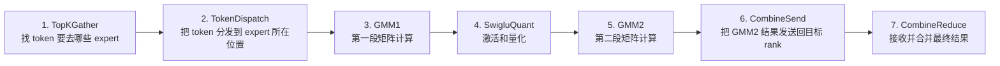
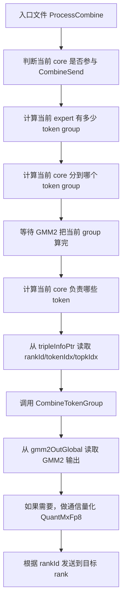
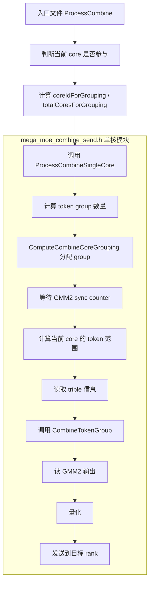
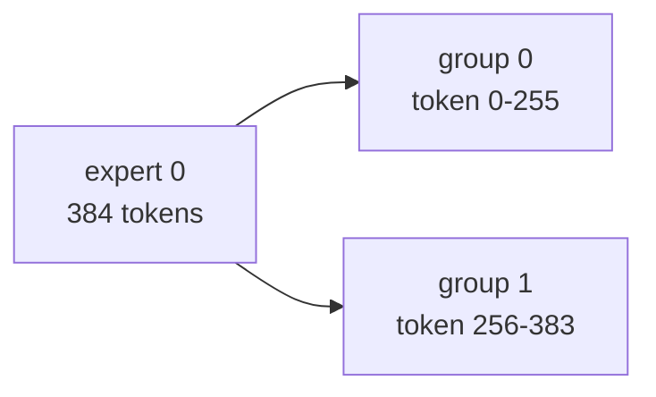
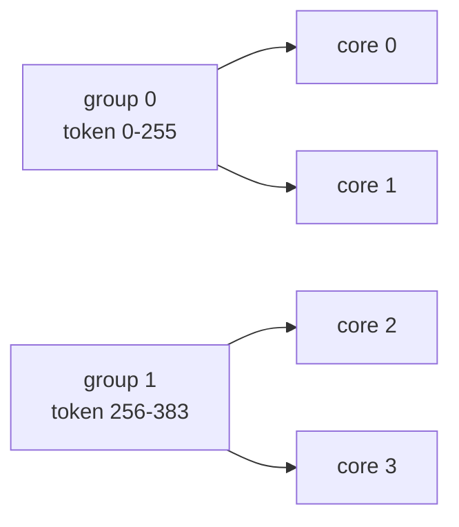
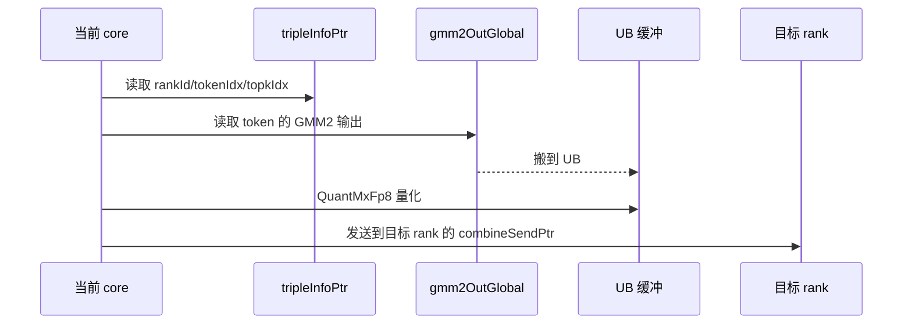
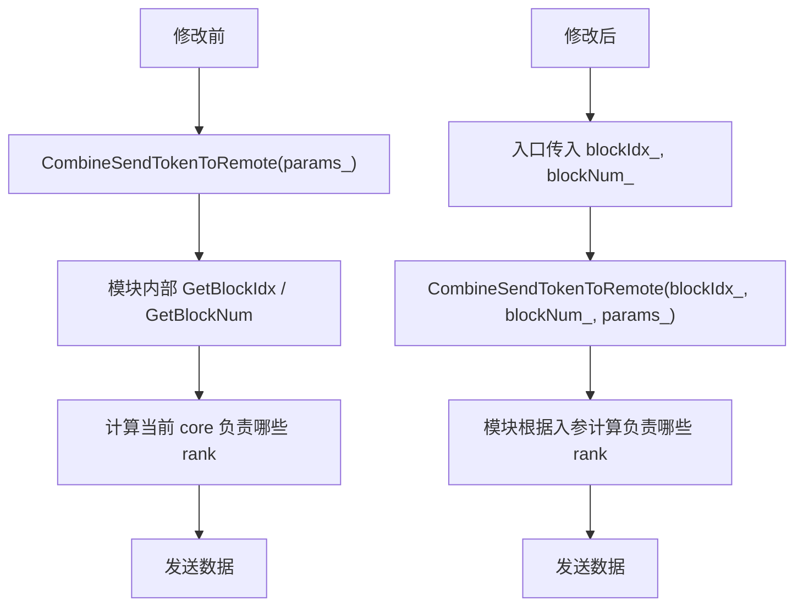
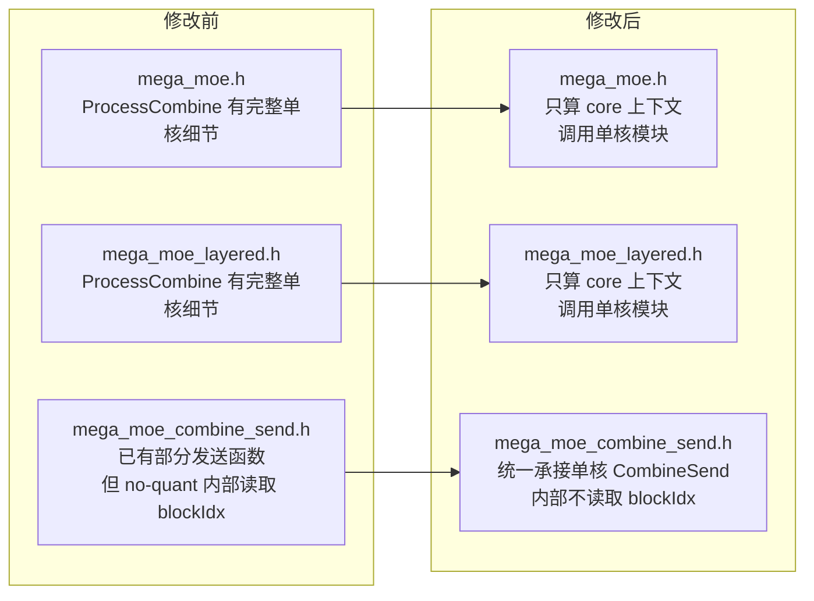

# CombineSend 流程小白版解读

## 先说结论

这次改动的核心不是改变 CombineSend 做什么，而是改变代码放在哪里、谁负责什么。

一句话总结：

> 修改前：`mega_moe.h` 和 `mega_moe_layered.h` 里各自写了一份 CombineSend 的细节逻辑，`mega_moe_combine_send.h` 里也有一部分 CombineSend 逻辑，职责比较混在一起。
>
> 修改后：`mega_moe.h` 和 `mega_moe_layered.h` 只负责“当前是哪个核、这个核能不能参与”，真正的单核 CombineSend 执行逻辑统一放到 `mega_moe_combine_send.h`。

可以把它理解成：

```text
修改前：
入口文件既当调度员，又亲自干活。

修改后：
入口文件只当调度员，mega_moe_combine_send.h 里的单核模块负责干活。
```

## 这份报告要解决的问题

如果你不熟悉这些词，这份报告会逐个解释：

- CombineSend 是什么？
- token 是什么？
- expert 是什么？
- rank 是什么？
- core 是什么？
- GMM2 输出是什么？
- triple 信息是什么？
- 修改前流程怎么跑？
- 修改后流程怎么跑？
- 为什么要把逻辑拆到 `mega_moe_combine_send.h`？

## 一些必须先懂的名词

### 1. token

可以先把 token 理解成“一条要处理的数据”。

比如输入有 384 条数据，就可以说当前 expert 有 384 个 token 要处理。

```text
token 0
token 1
token 2
...
token 383
```

### 2. expert

MoE 是 Mixture of Experts，里面有很多 expert。

可以把 expert 想象成很多个“专业处理员”。每个 token 会被分配给某些 expert 处理。

举个例子：

```text
token 10 交给 expert 0
token 11 交给 expert 3
token 12 交给 expert 0
```

当前代码里经常看到：

```cpp
expertIdx
```

它表示当前正在处理第几个 expert。

### 3. rank

rank 可以先理解成“当前集群里的某张卡/某个设备编号”。

比如有 8 张卡，就可能有：

```text
rank 0
rank 1
rank 2
...
rank 7
```

CombineSend 的目标之一，就是把当前卡算出来的数据发送到目标 rank。

### 4. core

core 是设备上的计算核。

这类算子会有很多 AIV core 并行干活。每个 core 只处理自己负责的一小段 token 或一部分 rank。

可以把它理解为：

```text
一堆工人一起处理任务。
每个工人只负责一段数据。
```

### 5. GMM1 / SwigluQuant / GMM2

这三个是 CombineSend 前面的计算阶段。

在本报告里不需要深入矩阵乘细节，只要知道：

```text
GMM2 的输出 = CombineSend 要拿来发送的数据
```

代码里 GMM2 输出地址通常叫：

```cpp
gmm2OutGlobal
```

### 6. CombineSend

CombineSend 是第 6 步。

它做的事是：

1. 找到当前 core 负责哪些 token。
2. 从 GMM2 输出里读取这些 token 的结果。
3. 如果需要通信量化，就先量化。
4. 根据 token 的目标 rank，把数据发送出去。

更直白地说：

```text
CombineSend = 把 GMM2 算好的 token 结果送回它应该去的 rank。
```

### 7. triple 信息

代码里经常看到 `tripleTensor` 或 `tripleInfoPtr`。

triple 就是一组三个关键字段：

```text
rankId, tokenIdx, topkIdx
```

含义是：

| 字段 | 小白解释 |
| --- | --- |
| `rankId` | 这个 token 的结果要发到哪张卡 |
| `tokenIdx` | 这是原始输入里的第几个 token |
| `topkIdx` | 这个 token 对应 topK 中的第几个 expert 结果 |

举个例子：

```text
rankId = 5
tokenIdx = 300
topkIdx = 1
```

意思是：

```text
token 300 的第 1 个 expert 结果，要发送到 rank 5。
```

## CombineSend 在总流程里的位置

整体流程是 7 步：



本次只改第 6 步 `CombineSend` 的代码组织方式。

## 修改前的 CombineSend 流程

修改前，`mega_moe.h` 和 `mega_moe_layered.h` 里的 `ProcessCombine` 直接做了很多事情。

逻辑图如下：



### 修改前每一步在干嘛

#### 第 1 步：判断当前 core 是否参与

有些路径不是所有 core 都能参与 CombineSend。

比如 A8W4 路径只让 `subBlockIdx_ == 1` 的 core 参与：

```cpp
if constexpr (ENABLE_A8W4) {
    if (subBlockIdx_ != 1) {
        return;
    }
    coreIdForGrouping = aivCoreIdx_ / 2;
    totalCoresForGrouping = blockAivNum_ / 2;
}
```

小白理解：

```text
如果当前工人不是指定类型，就不要干 CombineSend，直接退出。
```

#### 第 2 步：计算 token group 数量

token 太多时，不会一次全处理，而是按 `L1_TILE_M_256` 切成 group。

代码类似：

```cpp
uint32_t m_expert = Get<M_VALUE>(gmm2State.problemShape);
uint32_t tokenGroupsThisExpert = Ops::Base::CeilDiv(m_expert, L1_TILE_M_256);
```

小白理解：

```text
当前 expert 有多少 token？
每 256 个 token 切一组。
一共能切成几组？
```

#### 第 3 步：计算当前 core 负责哪个 group

修改前入口文件直接调用：

```cpp
MegaMoeImpl::ComputeCoreGrouping(
    coreIdForGrouping,
    tokenGroupsThisExpert,
    totalCoresForGrouping,
    myGroup,
    myIdxInGrp,
    myGrpSize);
```

小白理解：

```text
有很多工人，也有很多组 token。
这一步是在分配：当前工人负责哪一组、在组内排第几个、这一组一共有几个工人。
```

#### 第 4 步：等待 GMM2 算完

CombineSend 必须等 GMM2 把数据算出来后才能发送。

修改前入口文件里有等待逻辑：

```cpp
while (AscendC::ReadGmByPassDCache(myCounterAddr) != nTilesPerGroup)
{
    int64_t st = AscendC::GetSystemCycle();
    while (AscendC::GetSystemCycle() - st < 100) {
    };
}
```

小白理解：

```text
当前工人一直等。
等到 GMM2 告诉它：你负责的这组数据已经算完了。
然后才继续发数据。
```

#### 第 5 步：计算当前 core 负责哪些 token

假设当前 core 被分到了 group 1，group 1 有 128 个 token，组内有 2 个 core。

那么每个 core 可能处理 64 个 token。

代码类似：

```cpp
uint32_t tokenStart = myGroup * L1_TILE_M_256;
uint32_t tokenCount = (L1_TILE_M_256 < m_expert - tokenStart) ? L1_TILE_M_256 : m_expert - tokenStart;
uint32_t tokensPerCore = Ops::Base::CeilDiv(tokenCount, myGrpSize);
int32_t myTokenOffset = myIdxInGrp * tokensPerCore;
```

小白理解：

```text
这一组 token 里，我这个工人具体负责哪几个？
```

#### 第 6 步：读取 triple 信息

修改前入口文件直接从 `tripleInfoPtr` 搬数据：

```cpp
tripleGm.SetGlobalBuffer(reinterpret_cast<__gm__ int32_t*>(
    params_.workspaceInfo.tripleInfoPtr
    + (gmm2State.expertBeforeCnt + tokenStart + myTokenOffset) * TRIPLE_SIZE * sizeof(int32_t)));
AscendC::DataCopy(tripleTensor, tripleGm, myTokenCount * TRIPLE_SIZE);
```

小白理解：

```text
我要发送这些 token。
但每个 token 要发到哪个 rank？
要放到结果里的哪个位置？
这些信息在 triple 里，所以先读出来。
```

#### 第 7 步：调用 CombineTokenGroup 发送

修改前入口文件最后调用：

```cpp
MegaMoeCombineImpl::CombineTokenGroup<CombineQuantMode, bfloat16_t>(
    tokenStart + myTokenOffset,
    myTokenCount,
    k_,
    expertIdx,
    rankId_,
    gmmAddrInfo.gmm2OutGlobal,
    params_,
    tripleTensor,
    combineUbTensorSize_,
    offset,
    quantTokenSizeBytes);
```

小白理解：

```text
现在我已经知道：
1. 要处理哪些 token
2. GMM2 结果在哪里
3. 每个 token 要发到哪里

所以开始真正读取、量化、发送。
```

### 修改前的问题

修改前不是功能错误，而是代码职责不清晰：

```text
mega_moe.h          有一份完整 ProcessCombine 细节
mega_moe_layered.h  有一份类似的 ProcessCombine 细节
mega_moe_combine_send.h  也有 CombineSend 相关函数
```

问题是：

- 重复逻辑多。
- 入口文件太重。
- 单核 CombineSend 模块内部还会自己读 `GetBlockIdx()` / `GetBlockNum()`。
- 不符合“单核模块内部不能出现 blockIdx”的要求。

## 修改后的 CombineSend 流程

修改后，入口文件只负责调度，模块文件负责单核执行。

逻辑图如下：



### 修改后入口文件做什么

入口文件现在只做两件事：

1. 判断当前 core 是否参与。
2. 把必要参数传给单核模块。

代码变成：

```cpp
uint32_t coreIdForGrouping = aivCoreIdx_;
uint32_t totalCoresForGrouping = blockAivNum_;
if constexpr (ENABLE_A8W4) {
    if (subBlockIdx_ != 1) {
        return;
    }
    coreIdForGrouping = aivCoreIdx_ / 2;
    totalCoresForGrouping = blockAivNum_ / 2;
}

MegaMoeCombineImpl::ProcessCombineSingleCore<CombineQuantMode>(
    coreIdForGrouping,
    totalCoresForGrouping,
    aivCoreIdx_,
    blockAivNum_,
    expertIdx,
    rankId_,
    k_,
    gmm2State.expertBeforeCnt,
    Get<M_VALUE>(gmm2State.problemShape),
    gmmAddrInfo.gmm2OutGlobal,
    combineUbTensorSize_,
    params_);
```

小白理解：

```text
入口文件说：
我是第几个工人？
总共有几个工人？
当前处理哪个 expert？
GMM2 输出在哪里？

这些信息都告诉单核模块。
然后入口文件就不管细节了。
```

### 修改后模块文件做什么

新增的单核模块函数是：

```cpp
template <int32_t CombineQuantMode>
__aicore__ inline void ProcessCombineSingleCore(
    uint32_t coreIdForGrouping,
    uint32_t totalCoresForGrouping,
    uint32_t aivCoreIdx,
    uint32_t blockAivNum,
    uint32_t expertIdx,
    uint32_t rankId,
    uint32_t k,
    uint32_t expertBeforeCnt,
    uint32_t mExpert,
    GM_ADDR gmm2OutAddr,
    int64_t combineUbTensorSize,
    const Params& params)
```

它负责原来入口文件里的单核 CombineSend 细节：

```text
计算 group
等待 GMM2
计算 token 范围
读取 triple
调用 CombineTokenGroup
```

关键代码：

```cpp
uint32_t tokenGroupsThisExpert = Ops::Base::CeilDiv(mExpert, MegaMoeImpl::L1_TILE_M_256);

ComputeCombineCoreGrouping(coreIdForGrouping, tokenGroupsThisExpert, totalCoresForGrouping,
    myGroup, myIdxInGrp, myGrpSize);
```

小白理解：

```text
模块拿到入口传进来的工人编号后，自己算：
我应该处理哪组 token？
我在组里处理哪一段？
```

## 一个完整例子

假设：

```text
当前 expertIdx = 0
当前 expert 有 384 个 token
k = 1024
每个 token group 最多 256 个 token
参与 CombineSend 的逻辑 core 有 4 个
```

### 第一步：切 token group

384 个 token 按 256 切：

```text
group 0: token 0 ~ token 255，共 256 个
group 1: token 256 ~ token 383，共 128 个
```

图示：



### 第二步：分配 core

有 4 个 core，2 个 group。为了简单理解，可以看成：

```text
core 0、core 1 处理 group 0
core 2、core 3 处理 group 1
```

图示：



实际代码里由这个函数计算：

```cpp
ComputeCombineCoreGrouping(coreIdForGrouping, tokenGroupsThisExpert, totalCoresForGrouping,
    myGroup, myIdxInGrp, myGrpSize);
```

### 第三步：假设当前 core 处理 group 1

group 1 有 128 个 token：

```text
token 256 ~ token 383
```

如果 group 1 里有 2 个 core，则每个 core 处理 64 个 token：

```text
core 2: token 256 ~ token 319
core 3: token 320 ~ token 383
```

对应代码：

```cpp
uint32_t tokenStart = myGroup * MegaMoeImpl::L1_TILE_M_256;
uint32_t tokenCount = (MegaMoeImpl::L1_TILE_M_256 < mExpert - tokenStart) ?
    MegaMoeImpl::L1_TILE_M_256 : mExpert - tokenStart;
uint32_t tokensPerCore = Ops::Base::CeilDiv(tokenCount, myGrpSize);
int32_t myTokenOffset = myIdxInGrp * tokensPerCore;
```

如果：

```text
myGroup = 1
myGrpSize = 2
myIdxInGrp = 0
```

那么：

```text
tokenStart = 1 * 256 = 256
tokenCount = min(256, 384 - 256) = 128
tokensPerCore = CeilDiv(128, 2) = 64
myTokenOffset = 0 * 64 = 0
myTokenCount = 64
当前 core 处理 token 256 ~ token 319
```

### 第四步：读取 triple

假设当前 core 处理 token 300。

它的 triple 是：

```text
rankId = 5
tokenIdx = 300
topkIdx = 1
```

意思是：

```text
token 300 的第 1 个 topK expert 结果，要发送到 rank 5。
```

代码里读取字段：

```cpp
uint32_t toRankId = tripleTensor.GetValue(batchStart * TRIPLE_SIZE + RANK_ID);
uint32_t tokenIdx = tripleTensor.GetValue(batchStart * TRIPLE_SIZE + TOKEN_ID);
uint32_t topkIdx = tripleTensor.GetValue(batchStart * TRIPLE_SIZE + TOPK_INDEX);
```

### 第五步：读 GMM2 输出、量化、发送

图示：



关键代码：

```cpp
AscendC::DataCopyPad(ubBf16, gmm2OutGm[(tokenStart + i) * n], gm2UbParams, copyPadParams);

QuantMxFp8<QuantMode, T>(ubQuantData, ubBf16, floatTemp, n);

CombineQuantizedTokens<Fp8Type>(i, 1, n, nScale, groupIdx, rankId, tripleTensor,
    ubQuantDataFp8, params);
```

小白理解：

```text
1. 从 GMM2 结果里拿 token 300 的输出。
2. 放到 UB 临时缓冲。
3. 为了通信更省带宽，先量化。
4. 根据 triple 里的 rankId = 5，发到 rank 5。
```

## no-quant 路径也改了什么

上面主要讲 combine-quant 路径。

还有一种 no-quant 路径，也就是不做通信量化，直接发送 bf16 数据。

这条路径在 layered 入口里调用：

### 修改前

```cpp
MegaMoeCombineImpl::CombineSendTokenToRemote<bfloat16_t>(params_);
```

旧函数内部自己获取核号：

```cpp
uint32_t aivIdx = GetBlockIdx() / GetTaskRation();
uint32_t aivNum = GetBlockNum();
```

小白理解：

```text
模块自己问系统：我现在是第几个 core？总共有几个 core？
```

### 修改后

```cpp
MegaMoeCombineImpl::CombineSendTokenToRemote<bfloat16_t>(blockIdx_, blockNum_, params_);
```

新函数接口：

```cpp
__aicore__ inline void CombineSendTokenToRemote(uint32_t aivIdx, uint32_t aivNum, const Params& params)
```

小白理解：

```text
入口文件告诉模块：
你是第几个 core，总共有几个 core。

模块只负责干活，不再自己读取 blockIdx。
```

图示：



## 修改前后对比总图



## 最后再用一句话理解

修改前：

```text
两个入口文件都在亲自做 CombineSend 的很多细节。
模块文件里也有发送逻辑，但还会自己读取 blockIdx。
```

修改后：

```text
入口文件只告诉模块：当前是哪个 core、要处理哪个 expert、GMM2 输出在哪里。
mega_moe_combine_send.h 作为单核模块，负责真正的 CombineSend 执行。
```

这就是本次拆分的核心价值：

- 职责更清楚。
- 重复代码更少。
- 单核模块内部不再出现 `blockIdx`。
- 后续如果 CombineSend 逻辑要改，主要改 `mega_moe_combine_send.h`，不用在两个入口文件里重复改。
