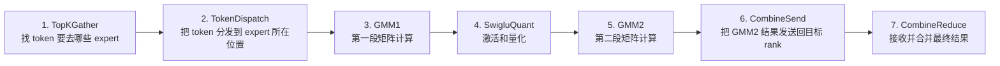
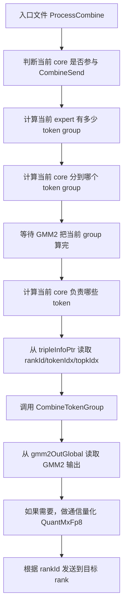
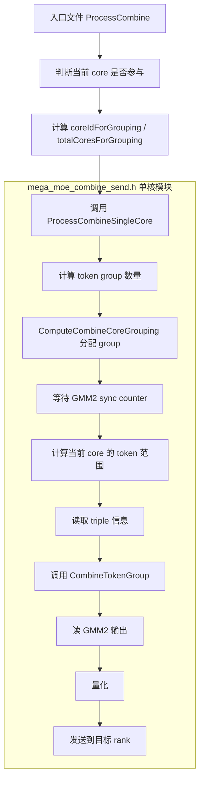
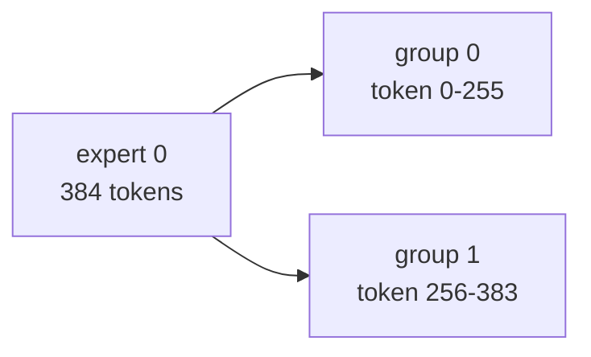
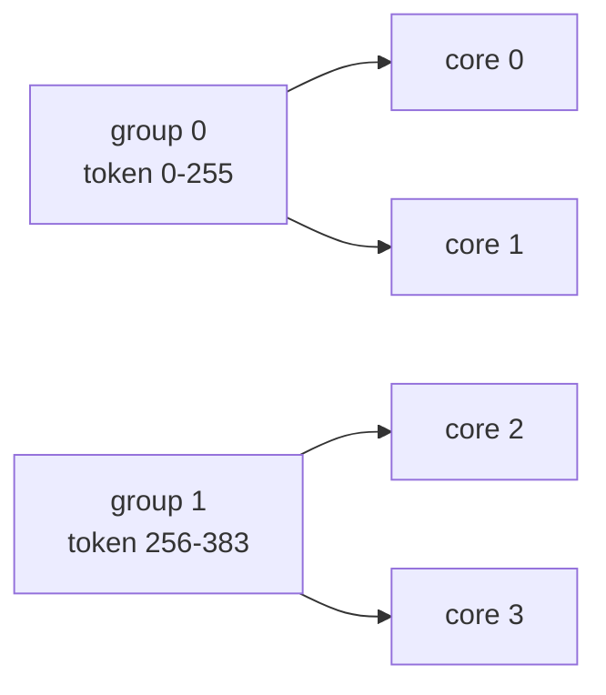
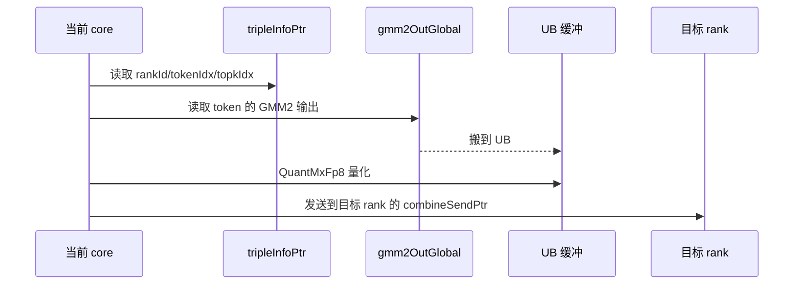
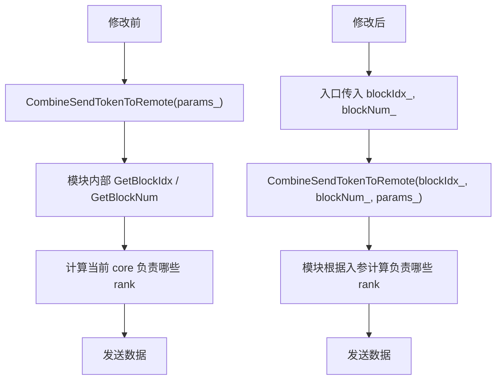
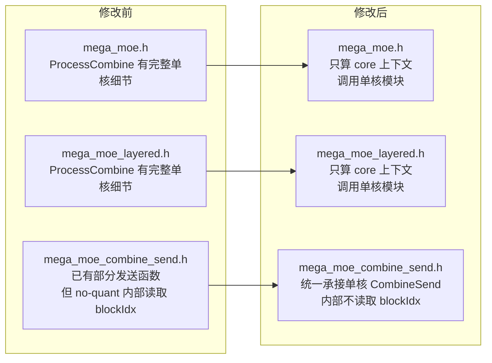

# CombineSend 流程小白版解读

## 先说结论

这次改动的核心不是改变 CombineSend 做什么，而是改变代码放在哪里、谁负责什么。

一句话总结：

> 修改前：`mega_moe.h` 和 `mega_moe_layered.h` 里各自写了一份 CombineSend 的细节逻辑，`mega_moe_combine_send.h` 里也有一部分 CombineSend 逻辑，职责比较混在一起。
>
> 修改后：`mega_moe.h` 和 `mega_moe_layered.h` 只负责“当前是哪个核、这个核能不能参与”，真正的单核 CombineSend 执行逻辑统一放到 `mega_moe_combine_send.h`。

可以把它理解成：

```text
修改前：
入口文件既当调度员，又亲自干活。

修改后：
入口文件只当调度员，mega_moe_combine_send.h 里的单核模块负责干活。
```

## 这份报告要解决的问题

如果你不熟悉这些词，这份报告会逐个解释：

- CombineSend 是什么？
- token 是什么？
- expert 是什么？
- rank 是什么？
- core 是什么？
- GMM2 输出是什么？
- triple 信息是什么？
- 修改前流程怎么跑？
- 修改后流程怎么跑？
- 为什么要把逻辑拆到 `mega_moe_combine_send.h`？

## 一些必须先懂的名词

### 1. token

可以先把 token 理解成“一条要处理的数据”。

比如输入有 384 条数据，就可以说当前 expert 有 384 个 token 要处理。

```text
token 0
token 1
token 2
...
token 383
```

### 2. expert

MoE 是 Mixture of Experts，里面有很多 expert。

可以把 expert 想象成很多个“专业处理员”。每个 token 会被分配给某些 expert 处理。

举个例子：

```text
token 10 交给 expert 0
token 11 交给 expert 3
token 12 交给 expert 0
```

当前代码里经常看到：

```cpp
expertIdx
```

它表示当前正在处理第几个 expert。

### 3. rank

rank 可以先理解成“当前集群里的某张卡/某个设备编号”。

比如有 8 张卡，就可能有：

```text
rank 0
rank 1
rank 2
...
rank 7
```

CombineSend 的目标之一，就是把当前卡算出来的数据发送到目标 rank。

### 4. core

core 是设备上的计算核。

这类算子会有很多 AIV core 并行干活。每个 core 只处理自己负责的一小段 token 或一部分 rank。

可以把它理解为：

```text
一堆工人一起处理任务。
每个工人只负责一段数据。
```

### 5. GMM1 / SwigluQuant / GMM2

这三个是 CombineSend 前面的计算阶段。

在本报告里不需要深入矩阵乘细节，只要知道：

```text
GMM2 的输出 = CombineSend 要拿来发送的数据
```

代码里 GMM2 输出地址通常叫：

```cpp
gmm2OutGlobal
```

### 6. CombineSend

CombineSend 是第 6 步。

它做的事是：

1. 找到当前 core 负责哪些 token。
2. 从 GMM2 输出里读取这些 token 的结果。
3. 如果需要通信量化，就先量化。
4. 根据 token 的目标 rank，把数据发送出去。

更直白地说：

```text
CombineSend = 把 GMM2 算好的 token 结果送回它应该去的 rank。
```

### 7. triple 信息

代码里经常看到 `tripleTensor` 或 `tripleInfoPtr`。

triple 就是一组三个关键字段：

```text
rankId, tokenIdx, topkIdx
```

含义是：

| 字段 | 小白解释 |
| --- | --- |
| `rankId` | 这个 token 的结果要发到哪张卡 |
| `tokenIdx` | 这是原始输入里的第几个 token |
| `topkIdx` | 这个 token 对应 topK 中的第几个 expert 结果 |

举个例子：

```text
rankId = 5
tokenIdx = 300
topkIdx = 1
```

意思是：

```text
token 300 的第 1 个 expert 结果，要发送到 rank 5。
```

## CombineSend 在总流程里的位置

整体流程是 7 步：



本次只改第 6 步 `CombineSend` 的代码组织方式。

## 修改前的 CombineSend 流程

修改前，`mega_moe.h` 和 `mega_moe_layered.h` 里的 `ProcessCombine` 直接做了很多事情。

逻辑图如下：



### 修改前每一步在干嘛

#### 第 1 步：判断当前 core 是否参与

有些路径不是所有 core 都能参与 CombineSend。

比如 A8W4 路径只让 `subBlockIdx_ == 1` 的 core 参与：

```cpp
if constexpr (ENABLE_A8W4) {
    if (subBlockIdx_ != 1) {
        return;
    }
    coreIdForGrouping = aivCoreIdx_ / 2;
    totalCoresForGrouping = blockAivNum_ / 2;
}
```

小白理解：

```text
如果当前工人不是指定类型，就不要干 CombineSend，直接退出。
```

#### 第 2 步：计算 token group 数量

token 太多时，不会一次全处理，而是按 `L1_TILE_M_256` 切成 group。

代码类似：

```cpp
uint32_t m_expert = Get<M_VALUE>(gmm2State.problemShape);
uint32_t tokenGroupsThisExpert = Ops::Base::CeilDiv(m_expert, L1_TILE_M_256);
```

小白理解：

```text
当前 expert 有多少 token？
每 256 个 token 切一组。
一共能切成几组？
```

#### 第 3 步：计算当前 core 负责哪个 group

修改前入口文件直接调用：

```cpp
MegaMoeImpl::ComputeCoreGrouping(
    coreIdForGrouping,
    tokenGroupsThisExpert,
    totalCoresForGrouping,
    myGroup,
    myIdxInGrp,
    myGrpSize);
```

小白理解：

```text
有很多工人，也有很多组 token。
这一步是在分配：当前工人负责哪一组、在组内排第几个、这一组一共有几个工人。
```

#### 第 4 步：等待 GMM2 算完

CombineSend 必须等 GMM2 把数据算出来后才能发送。

修改前入口文件里有等待逻辑：

```cpp
while (AscendC::ReadGmByPassDCache(myCounterAddr) != nTilesPerGroup)
{
    int64_t st = AscendC::GetSystemCycle();
    while (AscendC::GetSystemCycle() - st < 100) {
    };
}
```

小白理解：

```text
当前工人一直等。
等到 GMM2 告诉它：你负责的这组数据已经算完了。
然后才继续发数据。
```

#### 第 5 步：计算当前 core 负责哪些 token

假设当前 core 被分到了 group 1，group 1 有 128 个 token，组内有 2 个 core。

那么每个 core 可能处理 64 个 token。

代码类似：

```cpp
uint32_t tokenStart = myGroup * L1_TILE_M_256;
uint32_t tokenCount = (L1_TILE_M_256 < m_expert - tokenStart) ? L1_TILE_M_256 : m_expert - tokenStart;
uint32_t tokensPerCore = Ops::Base::CeilDiv(tokenCount, myGrpSize);
int32_t myTokenOffset = myIdxInGrp * tokensPerCore;
```

小白理解：

```text
这一组 token 里，我这个工人具体负责哪几个？
```

#### 第 6 步：读取 triple 信息

修改前入口文件直接从 `tripleInfoPtr` 搬数据：

```cpp
tripleGm.SetGlobalBuffer(reinterpret_cast<__gm__ int32_t*>(
    params_.workspaceInfo.tripleInfoPtr
    + (gmm2State.expertBeforeCnt + tokenStart + myTokenOffset) * TRIPLE_SIZE * sizeof(int32_t)));
AscendC::DataCopy(tripleTensor, tripleGm, myTokenCount * TRIPLE_SIZE);
```

小白理解：

```text
我要发送这些 token。
但每个 token 要发到哪个 rank？
要放到结果里的哪个位置？
这些信息在 triple 里，所以先读出来。
```

#### 第 7 步：调用 CombineTokenGroup 发送

修改前入口文件最后调用：

```cpp
MegaMoeCombineImpl::CombineTokenGroup<CombineQuantMode, bfloat16_t>(
    tokenStart + myTokenOffset,
    myTokenCount,
    k_,
    expertIdx,
    rankId_,
    gmmAddrInfo.gmm2OutGlobal,
    params_,
    tripleTensor,
    combineUbTensorSize_,
    offset,
    quantTokenSizeBytes);
```

小白理解：

```text
现在我已经知道：
1. 要处理哪些 token
2. GMM2 结果在哪里
3. 每个 token 要发到哪里

所以开始真正读取、量化、发送。
```

### 修改前的问题

修改前不是功能错误，而是代码职责不清晰：

```text
mega_moe.h          有一份完整 ProcessCombine 细节
mega_moe_layered.h  有一份类似的 ProcessCombine 细节
mega_moe_combine_send.h  也有 CombineSend 相关函数
```

问题是：

- 重复逻辑多。
- 入口文件太重。
- 单核 CombineSend 模块内部还会自己读 `GetBlockIdx()` / `GetBlockNum()`。
- 不符合“单核模块内部不能出现 blockIdx”的要求。

## 修改后的 CombineSend 流程

修改后，入口文件只负责调度，模块文件负责单核执行。

逻辑图如下：



### 修改后入口文件做什么

入口文件现在只做两件事：

1. 判断当前 core 是否参与。
2. 把必要参数传给单核模块。

代码变成：

```cpp
uint32_t coreIdForGrouping = aivCoreIdx_;
uint32_t totalCoresForGrouping = blockAivNum_;
if constexpr (ENABLE_A8W4) {
    if (subBlockIdx_ != 1) {
        return;
    }
    coreIdForGrouping = aivCoreIdx_ / 2;
    totalCoresForGrouping = blockAivNum_ / 2;
}

MegaMoeCombineImpl::ProcessCombineSingleCore<CombineQuantMode>(
    coreIdForGrouping,
    totalCoresForGrouping,
    aivCoreIdx_,
    blockAivNum_,
    expertIdx,
    rankId_,
    k_,
    gmm2State.expertBeforeCnt,
    Get<M_VALUE>(gmm2State.problemShape),
    gmmAddrInfo.gmm2OutGlobal,
    combineUbTensorSize_,
    params_);
```

小白理解：

```text
入口文件说：
我是第几个工人？
总共有几个工人？
当前处理哪个 expert？
GMM2 输出在哪里？

这些信息都告诉单核模块。
然后入口文件就不管细节了。
```

### 修改后模块文件做什么

新增的单核模块函数是：

```cpp
template <int32_t CombineQuantMode>
__aicore__ inline void ProcessCombineSingleCore(
    uint32_t coreIdForGrouping,
    uint32_t totalCoresForGrouping,
    uint32_t aivCoreIdx,
    uint32_t blockAivNum,
    uint32_t expertIdx,
    uint32_t rankId,
    uint32_t k,
    uint32_t expertBeforeCnt,
    uint32_t mExpert,
    GM_ADDR gmm2OutAddr,
    int64_t combineUbTensorSize,
    const Params& params)
```

它负责原来入口文件里的单核 CombineSend 细节：

```text
计算 group
等待 GMM2
计算 token 范围
读取 triple
调用 CombineTokenGroup
```

关键代码：

```cpp
uint32_t tokenGroupsThisExpert = Ops::Base::CeilDiv(mExpert, MegaMoeImpl::L1_TILE_M_256);

ComputeCombineCoreGrouping(coreIdForGrouping, tokenGroupsThisExpert, totalCoresForGrouping,
    myGroup, myIdxInGrp, myGrpSize);
```

小白理解：

```text
模块拿到入口传进来的工人编号后，自己算：
我应该处理哪组 token？
我在组里处理哪一段？
```

## 一个完整例子

假设：

```text
当前 expertIdx = 0
当前 expert 有 384 个 token
k = 1024
每个 token group 最多 256 个 token
参与 CombineSend 的逻辑 core 有 4 个
```

### 第一步：切 token group

384 个 token 按 256 切：

```text
group 0: token 0 ~ token 255，共 256 个
group 1: token 256 ~ token 383，共 128 个
```

图示：



### 第二步：分配 core

有 4 个 core，2 个 group。为了简单理解，可以看成：

```text
core 0、core 1 处理 group 0
core 2、core 3 处理 group 1
```

图示：



实际代码里由这个函数计算：

```cpp
ComputeCombineCoreGrouping(coreIdForGrouping, tokenGroupsThisExpert, totalCoresForGrouping,
    myGroup, myIdxInGrp, myGrpSize);
```

### 第三步：假设当前 core 处理 group 1

group 1 有 128 个 token：

```text
token 256 ~ token 383
```

如果 group 1 里有 2 个 core，则每个 core 处理 64 个 token：

```text
core 2: token 256 ~ token 319
core 3: token 320 ~ token 383
```

对应代码：

```cpp
uint32_t tokenStart = myGroup * MegaMoeImpl::L1_TILE_M_256;
uint32_t tokenCount = (MegaMoeImpl::L1_TILE_M_256 < mExpert - tokenStart) ?
    MegaMoeImpl::L1_TILE_M_256 : mExpert - tokenStart;
uint32_t tokensPerCore = Ops::Base::CeilDiv(tokenCount, myGrpSize);
int32_t myTokenOffset = myIdxInGrp * tokensPerCore;
```

如果：

```text
myGroup = 1
myGrpSize = 2
myIdxInGrp = 0
```

那么：

```text
tokenStart = 1 * 256 = 256
tokenCount = min(256, 384 - 256) = 128
tokensPerCore = CeilDiv(128, 2) = 64
myTokenOffset = 0 * 64 = 0
myTokenCount = 64
当前 core 处理 token 256 ~ token 319
```

### 第四步：读取 triple

假设当前 core 处理 token 300。

它的 triple 是：

```text
rankId = 5
tokenIdx = 300
topkIdx = 1
```

意思是：

```text
token 300 的第 1 个 topK expert 结果，要发送到 rank 5。
```

代码里读取字段：

```cpp
uint32_t toRankId = tripleTensor.GetValue(batchStart * TRIPLE_SIZE + RANK_ID);
uint32_t tokenIdx = tripleTensor.GetValue(batchStart * TRIPLE_SIZE + TOKEN_ID);
uint32_t topkIdx = tripleTensor.GetValue(batchStart * TRIPLE_SIZE + TOPK_INDEX);
```

### 第五步：读 GMM2 输出、量化、发送

图示：



关键代码：

```cpp
AscendC::DataCopyPad(ubBf16, gmm2OutGm[(tokenStart + i) * n], gm2UbParams, copyPadParams);

QuantMxFp8<QuantMode, T>(ubQuantData, ubBf16, floatTemp, n);

CombineQuantizedTokens<Fp8Type>(i, 1, n, nScale, groupIdx, rankId, tripleTensor,
    ubQuantDataFp8, params);
```

小白理解：

```text
1. 从 GMM2 结果里拿 token 300 的输出。
2. 放到 UB 临时缓冲。
3. 为了通信更省带宽，先量化。
4. 根据 triple 里的 rankId = 5，发到 rank 5。
```

## no-quant 路径也改了什么

上面主要讲 combine-quant 路径。

还有一种 no-quant 路径，也就是不做通信量化，直接发送 bf16 数据。

这条路径在 layered 入口里调用：

### 修改前

```cpp
MegaMoeCombineImpl::CombineSendTokenToRemote<bfloat16_t>(params_);
```

旧函数内部自己获取核号：

```cpp
uint32_t aivIdx = GetBlockIdx() / GetTaskRation();
uint32_t aivNum = GetBlockNum();
```

小白理解：

```text
模块自己问系统：我现在是第几个 core？总共有几个 core？
```

### 修改后

```cpp
MegaMoeCombineImpl::CombineSendTokenToRemote<bfloat16_t>(blockIdx_, blockNum_, params_);
```

新函数接口：

```cpp
__aicore__ inline void CombineSendTokenToRemote(uint32_t aivIdx, uint32_t aivNum, const Params& params)
```

小白理解：

```text
入口文件告诉模块：
你是第几个 core，总共有几个 core。

模块只负责干活，不再自己读取 blockIdx。
```

图示：



## 修改前后对比总图



## 最后再用一句话理解

修改前：

```text
两个入口文件都在亲自做 CombineSend 的很多细节。
模块文件里也有发送逻辑，但还会自己读取 blockIdx。
```

修改后：

```text
入口文件只告诉模块：当前是哪个 core、要处理哪个 expert、GMM2 输出在哪里。
mega_moe_combine_send.h 作为单核模块，负责真正的 CombineSend 执行。
```

这就是本次拆分的核心价值：

- 职责更清楚。
- 重复代码更少。
- 单核模块内部不再出现 `blockIdx`。
- 后续如果 CombineSend 逻辑要改，主要改 `mega_moe_combine_send.h`，不用在两个入口文件里重复改。
## commit 74ff1f3dd21e1c6f11a454863d9c54eb9dbbbb38 代码逐行解释

下面只解释这个 commit 里真正改动的代码行。该 commit 还新增了两份说明文档，但它们不是执行代码，这里不逐行展开。

### 一、`mega_moe.h` 中删除的代码

```cpp
-    uint32_t nTilesPerGroup = Ops::Base::CeilDiv(k_, L1_TILE_N);
```

删除含义：这行原来在入口函数里计算当前 token group 的 GMM2 输出会被切成多少个 N 方向 tile。`k_` 是 GMM2 输出长度，`L1_TILE_N` 是每个 tile 的 N 维宽度。

```cpp
-
```

删除含义：空行，只是分隔变量计算，没有业务含义。

```cpp
-    GlobalTensor<int32_t> gmm2CombineSyncCounter;
```

删除含义：这行原来在入口函数里声明一个 GM tensor，用来访问 GMM2 到 CombineSend 的同步计数器。

```cpp
-    gmm2CombineSyncCounter.SetGlobalBuffer((__gm__ int32_t*)params_.workspaceInfo.gmm2CombineSyncCounterPtr);
```

删除含义：这行原来把同步计数器绑定到 workspace 中的 `gmm2CombineSyncCounterPtr` 地址。

```cpp
-
```

删除含义：空行，无业务含义。

```cpp
-    uint32_t nScale = Ops::Base::CeilDiv(k_, uint32_t(MXFP_SCALE_GROUP_NUM));
```

删除含义：这行原来计算 combine quant 后每个 token 需要多少个 scale。`MXFP_SCALE_GROUP_NUM` 表示多少个元素共享一组 scale。

```cpp
-    uint32_t quantTokenSizeBytes = Ops::Base::CeilAlign(k_ + nScale, static_cast<uint32_t>(ALIGN_32));
```

删除含义：这行原来计算量化 token 加 scale 后的总大小，并按 32 字节对齐。

```cpp
-
```

删除含义：空行，无业务含义。

```cpp
-    uint32_t m_expert = Get<M_VALUE>(gmm2State.problemShape);
```

删除含义：这行原来从当前 expert 的 GMM2 problem shape 中取 M，也就是当前 expert 的 token 数。

```cpp
-    uint32_t tokenGroupsThisExpert = Ops::Base::CeilDiv(m_expert, L1_TILE_M_256);
```

删除含义：这行原来把当前 expert 的 token 按 `L1_TILE_M_256` 切成多个 token group。

```cpp
-
```

删除含义：空行，无业务含义。

```cpp
-
```

删除含义：空行，无业务含义。

```cpp
-    uint32_t myGroup, myIdxInGrp, myGrpSize;
```

删除含义：这行原来声明当前 core 的分组结果：所属 token group、组内编号、组内 core 数。

```cpp
-    MegaMoeImpl::ComputeCoreGrouping(coreIdForGrouping, tokenGroupsThisExpert, totalCoresForGrouping,
```

删除含义：这行原来调用分核函数，把参与 CombineSend 的 core 分配给 token group。

```cpp
-        myGroup, myIdxInGrp, myGrpSize);
```

删除含义：这行原来接收分核结果，写入 `myGroup`、`myIdxInGrp`、`myGrpSize`。

```cpp
-
```

删除含义：空行，无业务含义。

```cpp
-    if (myGroup >= tokenGroupsThisExpert) {
```

删除含义：这行原来判断当前 core 是否分到了有效 token group。

```cpp
-        return;
```

删除含义：如果当前 core 没有有效工作，原来直接退出。

```cpp
-    }
```

删除含义：结束无效 group 判断。

```cpp
-
```

删除含义：空行，无业务含义。

```cpp
-    __gm__ int32_t* myCounterAddr = (__gm__ int32_t*)gmm2CombineSyncCounter.GetPhyAddr()
```

删除含义：这行原来开始计算当前 core 对应的 GMM2 完成计数器地址。

```cpp
-        + expertIdx * blockAivNum_ * INT_CACHELINE
```

删除含义：这行原来按 expert 做偏移。每个 expert 有 `blockAivNum_` 个 counter slot，每个 slot 间隔 `INT_CACHELINE`。

```cpp
-        + aivCoreIdx_ * INT_CACHELINE;
```

删除含义：这行原来按当前 AIV core id 定位自己的 counter slot。

```cpp
-    while (AscendC::ReadGmByPassDCache(myCounterAddr) != nTilesPerGroup)
```

删除含义：这行原来轮询等待 GMM2 完成当前 token group 的所有 N tile。

```cpp
-    {
```

删除含义：等待循环体开始。

```cpp
-        int64_t st = AscendC::GetSystemCycle();
```

删除含义：记录当前 cycle，用于做一个短暂 delay，避免过密轮询。

```cpp
-        while (AscendC::GetSystemCycle() - st < 100) {
```

删除含义：内部等待约 100 个 cycle。

```cpp
-        };
```

删除含义：内部等待循环结束。

```cpp
-    }
```

删除含义：外层等待 GMM2 counter 的循环结束。

```cpp
-    uint32_t tokenStart = myGroup * L1_TILE_M_256;
```

删除含义：这行原来计算当前 token group 在 expert 内的 token 起点。

```cpp
-    uint32_t tokenCount = (L1_TILE_M_256 < m_expert - tokenStart) ? L1_TILE_M_256 : m_expert - tokenStart;
```

删除含义：这行原来计算当前 token group 的 token 数，最后一组可能不足 256。

```cpp
-    uint32_t tokensPerCore = Ops::Base::CeilDiv(tokenCount, myGrpSize);
```

删除含义：这行原来计算 group 内每个 core 最多处理多少 token。

```cpp
-    int32_t myTokenOffset = myIdxInGrp * tokensPerCore;
```

删除含义：这行原来计算当前 core 在 token group 内的起始 token 偏移。

```cpp
-    int32_t myTokenCount = 0;
```

删除含义：这行原来初始化当前 core 实际负责的 token 数。

```cpp
-    if (myTokenOffset < (int32_t)tokenCount) {
```

删除含义：这行原来判断当前 core 的起始偏移是否仍在 group token 范围内。

```cpp
-        myTokenCount = (tokensPerCore < tokenCount - myTokenOffset) ? tokensPerCore : tokenCount - myTokenOffset;
```

删除含义：这行原来计算当前 core 实际处理 token 数，避免越过 group 末尾。

```cpp
-    }
```

删除含义：结束 token 数计算条件。

```cpp
-    if (myTokenCount > 0) {
```

删除含义：这行原来只有当前 core 分到 token 时才进入真正 CombineSend 逻辑。

```cpp
-        AscendC::SetCtrlSpr<60, 60>(0);
```

删除含义：这行原来设置控制寄存器，保持 CombineSend/量化执行所需的控制状态。

```cpp
-        int64_t offset = 0;
```

删除含义：这行原来初始化 UB 内部偏移，从 0 开始分配临时 tensor。

```cpp
-        LocalTensor<int32_t> tripleTensor = LocalTensor<int32_t>(TPosition::VECIN, offset, myTokenCount * TRIPLE_SIZE);
```

删除含义：这行原来在 UB 中创建 triple tensor，用来存当前 core 负责 token 的路由信息。

```cpp
-        offset += myTokenCount * TRIPLE_SIZE * sizeof(int32_t);
```

删除含义：这行原来把 UB offset 后移，给后续 combine buffer 留位置。

```cpp
-        AscendC::GlobalTensor<int32_t> tripleGm;
```

删除含义：这行原来声明 GM tensor，用于读取 workspace 中的 triple 信息。

```cpp
-        tripleGm.SetGlobalBuffer(reinterpret_cast<__gm__ int32_t*>(params_.workspaceInfo.tripleInfoPtr
```

删除含义：这行原来开始绑定 triple GM 地址。

```cpp
-            + (gmm2State.expertBeforeCnt + tokenStart + myTokenOffset) * TRIPLE_SIZE * sizeof(int32_t)));
```

删除含义：这行原来把地址偏移到当前 expert、当前 token group、当前 core token 范围的 triple 起点。

```cpp
-        AscendC::DataCopy(tripleTensor, tripleGm, myTokenCount * TRIPLE_SIZE);
```

删除含义：这行原来把 triple 信息从 GM 搬到 UB。

```cpp
-        PipeBarrier<PIPE_MTE2>();
```

删除含义：这行原来等待 MTE2 搬运完成，保证后续读 UB triple 时数据已就绪。

```cpp
-        MegaMoeCombineImpl::CombineTokenGroup<CombineQuantMode, bfloat16_t>(
```

删除含义：这行原来直接调用 token group combine 逻辑。

```cpp
-            tokenStart + myTokenOffset, myTokenCount, k_, expertIdx, rankId_,
```

删除含义：这行原来传入当前 core 负责的 token 起点、token 数、输出长度、expert id、rank id。

```cpp
-            gmmAddrInfo.gmm2OutGlobal, params_, tripleTensor, combineUbTensorSize_,
```

删除含义：这行原来传入 GMM2 输出地址、总参数、triple UB tensor、combine UB 大小。

```cpp
-            offset, quantTokenSizeBytes);
```

删除含义：这行原来传入 UB offset 和量化后 token 大小。

```cpp
-    }
```

删除含义：结束 `myTokenCount > 0` 的执行块。

### 二、`mega_moe.h` 中增加的代码

```cpp
+    MegaMoeCombineImpl::ProcessCombineSingleCore<CombineQuantMode>(
```

增加含义：入口函数不再展开单核 CombineSend 细节，而是调用统一的单核 CombineSend 函数。

```cpp
+        coreIdForGrouping, totalCoresForGrouping, aivCoreIdx_, blockAivNum_,
```

增加含义：传入当前 core 的逻辑分组 id、参与分组的 core 总数、物理 AIV core id、AIV core 总数。

```cpp
+        expertIdx, rankId_, k_, gmm2State.expertBeforeCnt, Get<M_VALUE>(gmm2State.problemShape),
```

增加含义：传入当前 expert id、当前 rank id、GMM2 输出长度、当前 expert 前面的累计 token 数、当前 expert 的 token 数。

```cpp
+        gmmAddrInfo.gmm2OutGlobal, combineUbTensorSize_, params_);
```

增加含义：传入 GMM2 输出地址、CombineSend UB buffer 大小、全局参数包。

### 三、`mega_moe_combine_send.h` 中删除的代码

```cpp
-// CombineSendTokenToRemote: 编排器 — 分核、VECCALC 分配、调用三阶段子函数
```

删除含义：旧注释说明这个函数内部负责分核、分配 VECCALC buffer、调用三阶段发送流程。

```cpp
-__aicore__ inline void CombineSendTokenToRemote(const Params& params)
```

删除含义：旧函数接口只收 `params`，当前核号和总核数由函数内部自己读取。

```cpp
-    // 分核: 仅 subBlockIdx_==1 的核参与, 核数 = GetBlockNum() (每个 block 的核1)
```

删除含义：旧注释说明该函数内部假定只有 `subBlockIdx_ == 1` 的核参与，并把核数视为 `GetBlockNum()`。

```cpp
-    uint32_t aivIdx = GetBlockIdx() / GetTaskRation();
```

删除含义：旧代码在函数内部读取当前 block id，并换算成 AIV 逻辑 id。

```cpp
-    uint32_t aivNum = GetBlockNum();
```

删除含义：旧代码在函数内部读取总 block 数，作为参与发送的 AIV 数。

```cpp
-#endif  // MEGA_MOE_COMBINE_SEND_H
```

删除含义：旧文件末尾的 include guard 结束行。这个删除只和补文件末尾换行有关，业务逻辑不变。

### 四、`mega_moe_combine_send.h` 中增加的代码

```cpp
+// CombineSendTokenToRemote: single-core sender; multi-core scheduling is owned by the caller.
```

增加含义：新注释说明该函数现在只负责单核发送，多核调度由调用者传参负责。

```cpp
+__aicore__ inline void CombineSendTokenToRemote(uint32_t aivIdx, uint32_t aivNum, const Params& params)
```

增加含义：新接口显式接收当前 AIV id 和 AIV 总数，不再在函数内部读取 `GetBlockIdx()` / `GetBlockNum()`。

```cpp
+__aicore__ inline void ComputeCombineCoreGrouping(uint32_t coreId, uint32_t numGroups, uint32_t totalCores,
```

增加含义：新增 CombineSend 专用分核 helper，参数是当前 core id、token group 数、参与 core 总数。

```cpp
+    uint32_t& myGroup, uint32_t& myIdxInGrp, uint32_t& myGrpSize)
```

增加含义：这行是输出参数：当前 core 所属 group、组内编号、组内 core 数。

```cpp
+{
```

增加含义：函数体开始。

```cpp
+    uint32_t baseSize = totalCores / numGroups;
```

增加含义：计算每个 token group 至少分到多少个 core。

```cpp
+    uint32_t remainder = totalCores % numGroups;
```

增加含义：计算平均分配后还剩多少个 core。

```cpp
+    uint32_t boundary = remainder * (baseSize + 1);
```

增加含义：前 `remainder` 个 group 会多分一个 core；`boundary` 是这些大 group 覆盖的 core 数。

```cpp
+
```

增加含义：空行，用来分隔计算和判断，无业务含义。

```cpp
+    if (coreId < boundary) {
```

增加含义：判断当前 core 是否落在前面那些多分一个 core 的 group 范围里。

```cpp
+        myGroup = coreId / (baseSize + 1);
```

增加含义：在大 group 区间内，计算当前 core 属于第几个 group。

```cpp
+        myIdxInGrp = coreId % (baseSize + 1);
```

增加含义：在大 group 区间内，计算当前 core 在 group 内的编号。

```cpp
+        myGrpSize = baseSize + 1;
```

增加含义：在大 group 区间内，当前 group 的 core 数是 `baseSize + 1`。

```cpp
+    } else {
```

增加含义：当前 core 不在大 group 区间，进入普通 group 处理。

```cpp
+        uint32_t adjusted = coreId - boundary;
```

增加含义：减去大 group 区间占掉的 core 数，得到普通 group 区间内的相对 core id。

```cpp
+        myGroup = remainder + adjusted / baseSize;
```

增加含义：计算普通 group 区间内当前 core 所属 group，并加上前面大 group 的数量。

```cpp
+        myIdxInGrp = adjusted % baseSize;
```

增加含义：计算当前 core 在普通 group 内的编号。

```cpp
+        myGrpSize = baseSize;
```

增加含义：普通 group 的 core 数是 `baseSize`。

```cpp
+    }
```

增加含义：结束分组判断。

```cpp
+}
```

增加含义：结束 `ComputeCombineCoreGrouping` 函数。

```cpp
+
```

增加含义：空行，无业务含义。

```cpp
+template <int32_t CombineQuantMode>
```

增加含义：新增函数按 combine 量化模式做模板实例化。

```cpp
+__aicore__ inline void ProcessCombineSingleCore(uint32_t coreIdForGrouping, uint32_t totalCoresForGrouping,
```

增加含义：定义单核 CombineSend 主函数，第一行参数是当前 core 的逻辑分组 id 和参与分组的 core 总数。

```cpp
+    uint32_t aivCoreIdx, uint32_t blockAivNum, uint32_t expertIdx, uint32_t rankId,
```

增加含义：继续声明参数：物理 AIV core id、AIV 总数、当前 expert id、当前 rank id。

```cpp
+    uint32_t k, uint32_t expertBeforeCnt, uint32_t mExpert, GM_ADDR gmm2OutAddr,
```

增加含义：继续声明参数：GMM2 输出长度、当前 expert 前累计 token 数、当前 expert token 数、GMM2 输出地址。

```cpp
+    int64_t combineUbTensorSize, const Params& params)
```

增加含义：继续声明参数：CombineSend 可用 UB tensor 大小、全局参数包。

```cpp
+{
```

增加含义：函数体开始。

```cpp
+    uint32_t tokenGroupsThisExpert = Ops::Base::CeilDiv(mExpert, MegaMoeImpl::L1_TILE_M_256);
```

增加含义：把当前 expert 的 token 按 256 行切成 token group。

```cpp
+    if (tokenGroupsThisExpert == 0 || totalCoresForGrouping == 0) {
```

增加含义：检查没有 token group 或没有参与 core 的异常/空工作情况。

```cpp
+        return;
```

增加含义：无工作时直接退出。

```cpp
+    }
```

增加含义：结束空工作判断。

```cpp
+
```

增加含义：空行，无业务含义。

```cpp
+    uint32_t myGroup = 0;
```

增加含义：初始化当前 core 所属 token group。

```cpp
+    uint32_t myIdxInGrp = 0;
```

增加含义：初始化当前 core 在 group 内的编号。

```cpp
+    uint32_t myGrpSize = 0;
```

增加含义：初始化当前 group 内的 core 数。

```cpp
+    ComputeCombineCoreGrouping(coreIdForGrouping, tokenGroupsThisExpert, totalCoresForGrouping,
```

增加含义：调用新增分核 helper，把 core 分给 token group。

```cpp
+        myGroup, myIdxInGrp, myGrpSize);
```

增加含义：接收当前 core 的分组结果。

```cpp
+    if (myGroup >= tokenGroupsThisExpert || myGrpSize == 0) {
```

增加含义：如果当前 core 没分到有效 group，或者 group size 异常为 0，则退出。

```cpp
+        return;
```

增加含义：无有效工作时直接返回。

```cpp
+    }
```

增加含义：结束有效分组判断。

```cpp
+
```

增加含义：空行，无业务含义。

```cpp
+    uint32_t nTilesPerGroup = Ops::Base::CeilDiv(k, MegaMoeImpl::L1_TILE_N);
```

增加含义：计算 GMM2 输出在 N 维会被切成多少 tile，CombineSend 要等这些 tile 都完成。

```cpp
+    AscendC::GlobalTensor<int32_t> gmm2CombineSyncCounter;
```

增加含义：声明访问 GMM2 到 CombineSend 同步计数器的 GM tensor。

```cpp
+    gmm2CombineSyncCounter.SetGlobalBuffer((__gm__ int32_t*)params.workspaceInfo.gmm2CombineSyncCounterPtr);
```

增加含义：把同步计数器绑定到 workspace 中的 `gmm2CombineSyncCounterPtr`。

```cpp
+    __gm__ int32_t* myCounterAddr = (__gm__ int32_t*)gmm2CombineSyncCounter.GetPhyAddr()
```

增加含义：开始计算当前 core 对应的同步计数器地址。

```cpp
+        + expertIdx * blockAivNum * INT_CACHELINE
```

增加含义：按 expert id 做偏移，每个 expert 有 `blockAivNum` 个 cacheline slot。

```cpp
+        + aivCoreIdx * INT_CACHELINE;
```

增加含义：按当前物理 AIV core id 定位到自己的 slot。

```cpp
+    while (AscendC::ReadGmByPassDCache(myCounterAddr) != nTilesPerGroup) {
```

增加含义：轮询等待 GMM2 完成当前 token group 的所有 N tile。

```cpp
+        int64_t st = AscendC::GetSystemCycle();
```

增加含义：记录当前系统 cycle，用于短暂延迟。

```cpp
+        while (AscendC::GetSystemCycle() - st < 100) {
```

增加含义：等待约 100 cycle，避免空转轮询太密。

```cpp
+        };
```

增加含义：结束内部等待循环。

```cpp
+    }
```

增加含义：结束等待 GMM2 counter 的循环。

```cpp
+
```

增加含义：空行，无业务含义。

```cpp
+    uint32_t nScale = Ops::Base::CeilDiv(k, uint32_t(MXFP_SCALE_GROUP_NUM));
```

增加含义：计算 combine quant 后每个 token 需要的 scale 数。

```cpp
+    uint32_t quantTokenSizeBytes = Ops::Base::CeilAlign(k + nScale, static_cast<uint32_t>(ALIGN_32));
```

增加含义：计算量化 token 数据加 scale 后的总大小，并按 32 字节对齐。

```cpp
+    uint32_t tokenStart = myGroup * MegaMoeImpl::L1_TILE_M_256;
```

增加含义：计算当前 token group 在当前 expert 内的 token 起始位置。

```cpp
+    uint32_t tokenCount = (MegaMoeImpl::L1_TILE_M_256 < mExpert - tokenStart) ?
```

增加含义：开始计算当前 token group 的 token 数；如果剩余 token 超过 256，则取 256。

```cpp
+        MegaMoeImpl::L1_TILE_M_256 : mExpert - tokenStart;
```

增加含义：三目表达式后半段；最后一组不足 256 时取剩余 token 数。

```cpp
+    uint32_t tokensPerCore = Ops::Base::CeilDiv(tokenCount, myGrpSize);
```

增加含义：当前 token group 内，每个 core 最多处理多少 token。

```cpp
+    int32_t myTokenOffset = myIdxInGrp * tokensPerCore;
```

增加含义：当前 core 在 group 内负责 token 的起始偏移。

```cpp
+    int32_t myTokenCount = 0;
```

增加含义：初始化当前 core 实际处理的 token 数。

```cpp
+    if (myTokenOffset < static_cast<int32_t>(tokenCount)) {
```

增加含义：只有当前 core 的起始偏移还在 token group 范围内，才计算实际 token 数。

```cpp
+        myTokenCount = (tokensPerCore < tokenCount - myTokenOffset) ?
```

增加含义：开始计算实际 token 数；如果满额 `tokensPerCore` 不越界，就取 `tokensPerCore`。

```cpp
+            tokensPerCore : tokenCount - myTokenOffset;
```

增加含义：如果剩余 token 不足 `tokensPerCore`，就只处理剩余 token。

```cpp
+    }
```

增加含义：结束当前 core token 数计算。

```cpp
+    if (myTokenCount <= 0) {
```

增加含义：如果当前 core 没分到 token，就退出。

```cpp
+        return;
```

增加含义：无 token 工作时直接返回。

```cpp
+    }
```

增加含义：结束无 token 判断。

```cpp
+
```

增加含义：空行，无业务含义。

```cpp
+    AscendC::SetCtrlSpr<60, 60>(0);
```

增加含义：设置控制寄存器，保持后续 CombineSend/量化执行的控制状态。

```cpp
+    int64_t offset = 0;
```

增加含义：初始化 UB offset。

```cpp
+    LocalTensor<int32_t> tripleTensor = LocalTensor<int32_t>(TPosition::VECIN, offset, myTokenCount * TRIPLE_SIZE);
```

增加含义：在 UB 中创建 triple tensor，大小覆盖当前 core 负责的 token 数。

```cpp
+    offset += myTokenCount * TRIPLE_SIZE * sizeof(int32_t);
```

增加含义：移动 UB offset，跳过 triple tensor 占用空间。

```cpp
+    AscendC::GlobalTensor<int32_t> tripleGm;
```

增加含义：声明 GM tensor，用来从 workspace 读取 triple。

```cpp
+    tripleGm.SetGlobalBuffer(reinterpret_cast<__gm__ int32_t*>(params.workspaceInfo.tripleInfoPtr
```

增加含义：开始绑定 triple GM 地址。

```cpp
+        + (expertBeforeCnt + tokenStart + myTokenOffset) * TRIPLE_SIZE * sizeof(int32_t)));
```

增加含义：定位到当前 expert、当前 token group、当前 core token 范围的 triple 起点。

```cpp
+    AscendC::DataCopy(tripleTensor, tripleGm, myTokenCount * TRIPLE_SIZE);
```

增加含义：把当前 core 需要的 triple 从 GM 搬到 UB。

```cpp
+    PipeBarrier<PIPE_MTE2>();
```

增加含义：等待 MTE2 搬运完成，确保后续读取 triple 时数据已准备好。

```cpp
+    CombineTokenGroup<CombineQuantMode, bfloat16_t>(
```

增加含义：调用已有 token group combine 函数，处理当前 core 的 token 范围。

```cpp
+        tokenStart + myTokenOffset, myTokenCount, k, expertIdx, rankId,
```

增加含义：传入当前 core 的 token 起点、token 数、GMM2 输出长度、expert id、rank id。

```cpp
+        gmm2OutAddr, params, tripleTensor, combineUbTensorSize, offset, quantTokenSizeBytes);
```

增加含义：传入 GMM2 输出地址、总参数、triple UB tensor、combine UB 大小、UB offset、量化 token 大小。

```cpp
+}
```

增加含义：结束 `ProcessCombineSingleCore` 函数。

```cpp
+
```

增加含义：空行，用于分隔函数和 namespace 结束，无业务含义。

```cpp
+#endif  // MEGA_MOE_COMBINE_SEND_H
```

增加含义：include guard 结束行。相比旧版本主要是补上文件末尾换行，业务逻辑不变。

### 五、`mega_moe_layered.h` 中删除的代码

`mega_moe_layered.h` 的 `ProcessCombine` 删除块和 `mega_moe.h` 的删除块逻辑完全相同，只是类名从 `MegaMoe` 换成 `MegaMoeLayered`，所以逐行含义如下。

```cpp
-    uint32_t nTilesPerGroup = Ops::Base::CeilDiv(k_, L1_TILE_N);
```

删除含义：原来在 layered 入口里计算当前 token group 的 GMM2 N 维 tile 数。

```cpp
-
```

删除含义：空行，无业务含义。

```cpp
-    GlobalTensor<int32_t> gmm2CombineSyncCounter;
```

删除含义：原来在 layered 入口里声明 GMM2 到 CombineSend 的同步计数器 tensor。

```cpp
-    gmm2CombineSyncCounter.SetGlobalBuffer((__gm__ int32_t*)params_.workspaceInfo.gmm2CombineSyncCounterPtr);
```

删除含义：原来把同步计数器绑定到 workspace 地址。

```cpp
-
```

删除含义：空行，无业务含义。

```cpp
-    uint32_t nScale = Ops::Base::CeilDiv(k_, uint32_t(MXFP_SCALE_GROUP_NUM));
```

删除含义：原来计算 combine quant 的 scale 数。

```cpp
-    uint32_t quantTokenSizeBytes = Ops::Base::CeilAlign(k_ + nScale, static_cast<uint32_t>(ALIGN_32));
```

删除含义：原来计算量化 token 加 scale 后的对齐大小。

```cpp
-
```

删除含义：空行，无业务含义。

```cpp
-    uint32_t m_expert = Get<M_VALUE>(gmm2State.problemShape);
```

删除含义：原来取得当前 expert 的 token 数。

```cpp
-    uint32_t tokenGroupsThisExpert = Ops::Base::CeilDiv(m_expert, L1_TILE_M_256);
```

删除含义：原来计算当前 expert 有多少个 256-token group。

```cpp
-
```

删除含义：空行，无业务含义。

```cpp
-
```

删除含义：空行，无业务含义。

```cpp
-    uint32_t myGroup, myIdxInGrp, myGrpSize;
```

删除含义：原来声明当前 core 的 token group 分配结果。

```cpp
-    MegaMoeImpl::ComputeCoreGrouping(coreIdForGrouping, tokenGroupsThisExpert, totalCoresForGrouping,
```

删除含义：原来调用通用分核函数。

```cpp
-        myGroup, myIdxInGrp, myGrpSize);
```

删除含义：原来接收当前 core 所属 group、组内编号、组内 core 数。

```cpp
-
```

删除含义：空行，无业务含义。

```cpp
-    if (myGroup >= tokenGroupsThisExpert) {
```

删除含义：原来判断当前 core 是否没有有效 token group。

```cpp
-        return;
```

删除含义：没有有效 token group 时退出。

```cpp
-    }
```

删除含义：结束判断。

```cpp
-
```

删除含义：空行，无业务含义。

```cpp
-    __gm__ int32_t* myCounterAddr = (__gm__ int32_t*)gmm2CombineSyncCounter.GetPhyAddr()
```

删除含义：原来开始计算当前 core 的 GMM2 sync counter 地址。

```cpp
-        + expertIdx * blockAivNum_ * INT_CACHELINE
```

删除含义：原来按 expert 做 counter 段偏移。

```cpp
-        + aivCoreIdx_ * INT_CACHELINE;
```

删除含义：原来按物理 AIV core id 定位 counter slot。

```cpp
-    while (AscendC::ReadGmByPassDCache(myCounterAddr) != nTilesPerGroup)
```

删除含义：原来等待 GMM2 完成当前 token group 的全部 N tile。

```cpp
-    {
```

删除含义：等待循环体开始。

```cpp
-        int64_t st = AscendC::GetSystemCycle();
```

删除含义：记录 cycle，做轮询间隔。

```cpp
-        while (AscendC::GetSystemCycle() - st < 100) {
```

删除含义：等待约 100 cycle。

```cpp
-        };
```

删除含义：内部等待循环结束。

```cpp
-    }
```

删除含义：外层等待循环结束。

```cpp
-    uint32_t tokenStart = myGroup * L1_TILE_M_256;
```

删除含义：原来计算当前 token group 的起点。

```cpp
-    uint32_t tokenCount = (L1_TILE_M_256 < m_expert - tokenStart) ? L1_TILE_M_256 : m_expert - tokenStart;
```

删除含义：原来计算当前 token group 的 token 数。

```cpp
-    uint32_t tokensPerCore = Ops::Base::CeilDiv(tokenCount, myGrpSize);
```

删除含义：原来计算 group 内每个 core 最多处理多少 token。

```cpp
-    int32_t myTokenOffset = myIdxInGrp * tokensPerCore;
```

删除含义：原来计算当前 core 的 token 起始偏移。

```cpp
-    int32_t myTokenCount = 0;
```

删除含义：原来初始化当前 core 实际 token 数。

```cpp
-    if (myTokenOffset < (int32_t)tokenCount) {
```

删除含义：原来判断当前 core 的起点是否还在 group 范围内。

```cpp
-        myTokenCount = (tokensPerCore < tokenCount - myTokenOffset) ? tokensPerCore : tokenCount - myTokenOffset;
```

删除含义：原来计算当前 core 实际处理 token 数。

```cpp
-    }
```

删除含义：结束 token 数计算。

```cpp
-    if (myTokenCount > 0) {
```

删除含义：原来只有分到 token 的 core 才继续执行 CombineSend。

```cpp
-        AscendC::SetCtrlSpr<60, 60>(0);
```

删除含义：原来设置控制寄存器。

```cpp
-        int64_t offset = 0;
```

删除含义：原来初始化 UB offset。

```cpp
-        LocalTensor<int32_t> tripleTensor = LocalTensor<int32_t>(TPosition::VECIN, offset, myTokenCount * TRIPLE_SIZE);
```

删除含义：原来在 UB 中分配 triple tensor。

```cpp
-        offset += myTokenCount * TRIPLE_SIZE * sizeof(int32_t);
```

删除含义：原来移动 UB offset。

```cpp
-        AscendC::GlobalTensor<int32_t> tripleGm;
```

删除含义：原来声明 triple GM tensor。

```cpp
-        tripleGm.SetGlobalBuffer(reinterpret_cast<__gm__ int32_t*>(params_.workspaceInfo.tripleInfoPtr
```

删除含义：原来开始绑定 triple GM 地址。

```cpp
-            + (gmm2State.expertBeforeCnt + tokenStart + myTokenOffset) * TRIPLE_SIZE * sizeof(int32_t)));
```

删除含义：原来定位当前 core 的 triple 起点。

```cpp
-        AscendC::DataCopy(tripleTensor, tripleGm, myTokenCount * TRIPLE_SIZE);
```

删除含义：原来把 triple 从 GM 搬到 UB。

```cpp
-        PipeBarrier<PIPE_MTE2>();
```

删除含义：原来等待 triple 搬运完成。

```cpp
-        MegaMoeCombineImpl::CombineTokenGroup<CombineQuantMode, bfloat16_t>(
```

删除含义：原来直接调用 token group combine。

```cpp
-            tokenStart + myTokenOffset, myTokenCount, k_, expertIdx, rankId_,
```

删除含义：原来传入 token 范围、输出长度、expert id、rank id。

```cpp
-            gmmAddrInfo.gmm2OutGlobal, params_, tripleTensor, combineUbTensorSize_,
```

删除含义：原来传入 GMM2 输出地址、参数包、triple、UB 大小。

```cpp
-            offset, quantTokenSizeBytes);
```

删除含义：原来传入 UB offset 和量化 token 大小。

```cpp
-    }
```

删除含义：结束当前 core 有 token 时的执行块。

### 六、`mega_moe_layered.h` 中增加的代码

```cpp
+    MegaMoeCombineImpl::ProcessCombineSingleCore<CombineQuantMode>(
```

增加含义：layered 入口也改成调用统一单核 CombineSend 函数。

```cpp
+        coreIdForGrouping, totalCoresForGrouping, aivCoreIdx_, blockAivNum_,
```

增加含义：传入当前 core 的逻辑分组信息和物理 AIV 信息。

```cpp
+        expertIdx, rankId_, k_, gmm2State.expertBeforeCnt, Get<M_VALUE>(gmm2State.problemShape),
```

增加含义：传入 expert、rank、输出维度、expert 前累计 token 数、当前 expert token 数。

```cpp
+        gmmAddrInfo.gmm2OutGlobal, combineUbTensorSize_, params_);
```

增加含义：传入 GMM2 输出地址、combine UB 大小、全局参数。

```cpp
-            MegaMoeCombineImpl::CombineSendTokenToRemote<bfloat16_t>(params_);
```

删除含义：旧调用只传 `params_`，`CombineSendTokenToRemote` 内部自己读当前核号和核数。

```cpp
+            MegaMoeCombineImpl::CombineSendTokenToRemote<bfloat16_t>(blockIdx_, blockNum_, params_);
```

增加含义：新调用显式把当前 block id 和总 block 数传入，模块内部不再直接读取 `GetBlockIdx()` / `GetBlockNum()`。

### 七、整体变化再压缩成一句话

这些逐行改动合在一起，含义是：`mega_moe.h` 和 `mega_moe_layered.h` 不再各自保存一份 CombineSend 单核细节，而是把这些细节收敛到 `mega_moe_combine_send.h::ProcessCombineSingleCore`；同时 no-quant layered 的发送函数也改成由入口传入核号，模块内部不再自己读取 block 上下文。
