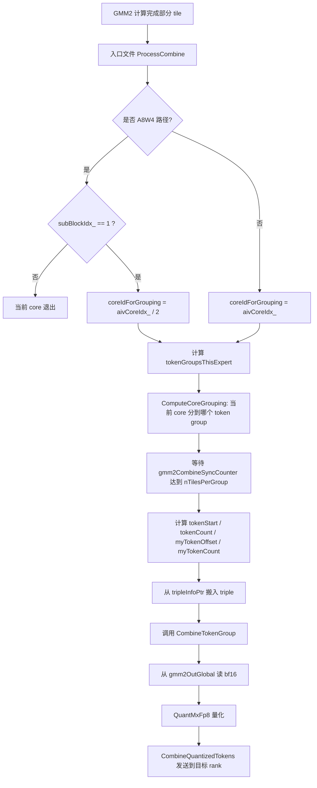
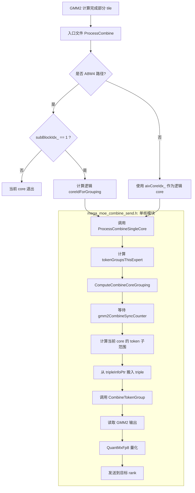
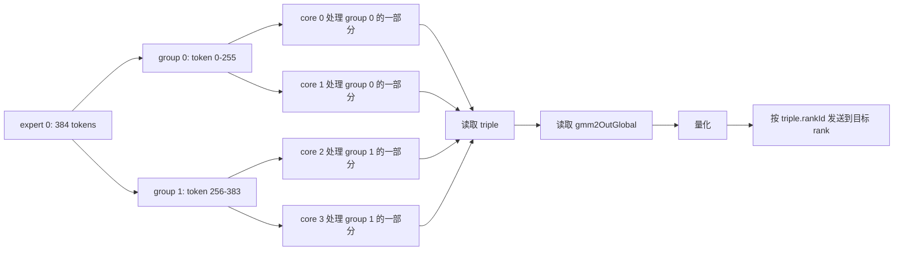
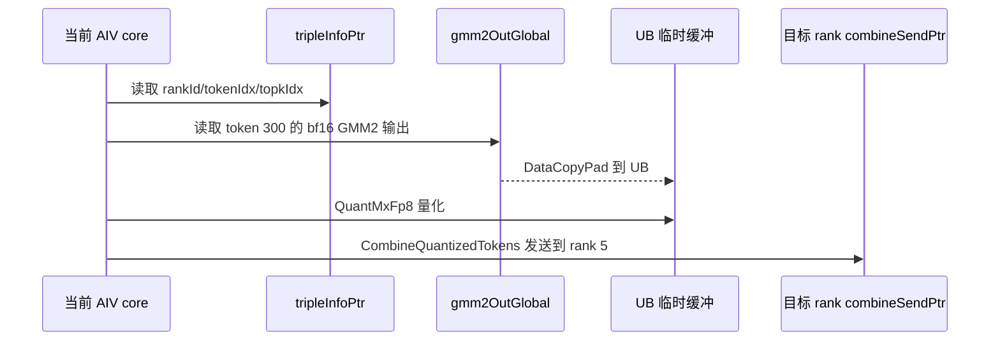
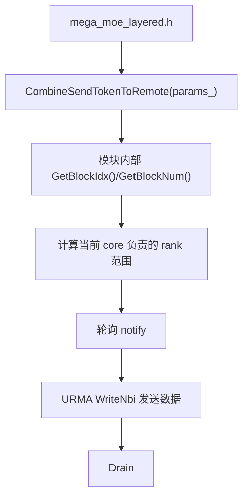
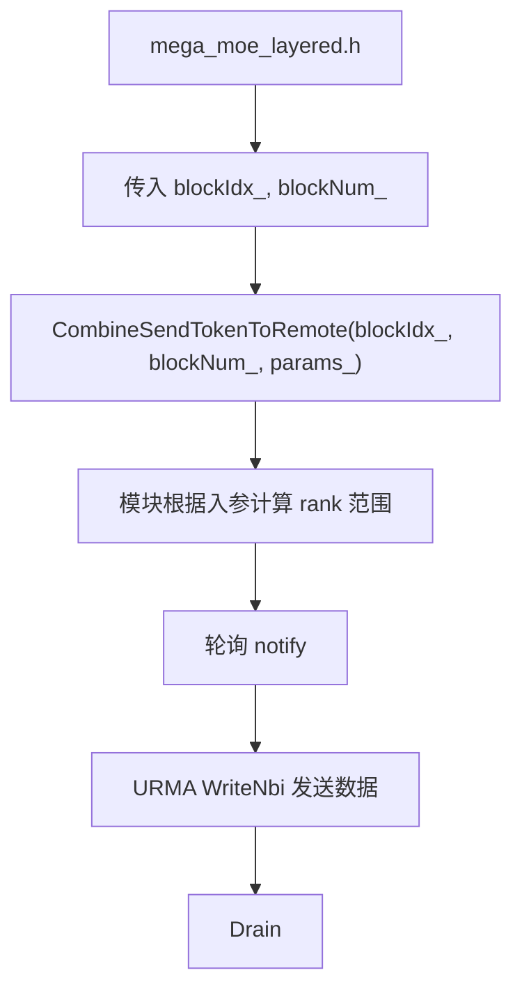

# CombineSend 单核模块拆分报告

## 背景

`mega_moe` 的主流程可拆成 7 个阶段：

1. TopKGather
2. TokenDispatch
3. GMM1
4. SwigluQuant
5. GMM2
6. CombineSend
7. CombineReduce

本次修改目标是将第 6 步 `CombineSend` 从入口文件中拆出来，收敛到 `mega_moe_combine_send.h` 中作为单核逻辑模块。`mega_moe.h` 和 `mega_moe_layered.h` 保持多核入口职责，只负责计算/传递当前核上下文，不在模块内部直接使用 `blockIdx`。

## 修改前

### 1. `mega_moe_combine_send.h`

修改前已经包含部分 CombineSend 相关函数，例如：

- `CombineTokens`
- `CombineTokensLayered`
- `CombineSendTokenToRemote`
- `QuantMxFp8`
- `DeQuantMxFp8`
- `CombineQuantizedTokens`
- `CombineTokenGroup`

但是 `CombineSendTokenToRemote` 内部仍直接获取核上下文：

```cpp
uint32_t aivIdx = GetBlockIdx() / GetTaskRation();
uint32_t aivNum = GetBlockNum();
```

这意味着该函数并不是纯单核模块，它同时包含了多核入口的调度信息获取逻辑。

### 2. `mega_moe.h`

`ProcessCombine` 中包含完整的 combine-quant 单核处理流程，包括：

- 计算 `nTilesPerGroup`
- 设置 `gmm2CombineSyncCounter`
- 计算 `quantTokenSizeBytes`
- 根据当前 core 计算 token group 分配
- 等待 GMM2 tile 完成计数
- 从 `tripleInfoPtr` 搬入 triple 信息
- 调用 `MegaMoeCombineImpl::CombineTokenGroup`

这部分逻辑和 `mega_moe_layered.h` 中的实现高度重复。

### 3. `mega_moe_layered.h`

`ProcessCombine` 中也包含一份和 `mega_moe.h` 基本一致的 combine-quant 单核处理流程。

此外，在 `COMBINE_NO_QUANT` 路径中调用：

```cpp
MegaMoeCombineImpl::CombineSendTokenToRemote<bfloat16_t>(params_);
```

由于旧接口内部自己调用 `GetBlockIdx()` / `GetBlockNum()`，入口没有显式传递多核上下文。

## 修改后

### 1. `CombineSendTokenToRemote` 改为单核接口

位置：`mega_moe_combine_send.h`

修改后接口为：

```cpp
template <typename ElementMMadOut2>
__aicore__ inline void CombineSendTokenToRemote(uint32_t aivIdx, uint32_t aivNum, const Params& params)
```

变化点：

- 删除模块内部的 `GetBlockIdx()`。
- 删除模块内部的 `GetBlockNum()`。
- `aivIdx` 和 `aivNum` 改由入口文件计算后传入。
- 模块只根据传入的单核上下文处理当前核负责的 rank 范围。

修改后 `mega_moe_combine_send.h` 内不再出现：

- `blockIdx`
- `GetBlockIdx`
- `GetBlockNum`
- `GetSubBlockIdx`

### 2. 新增 `ComputeCombineCoreGrouping`

位置：`mega_moe_combine_send.h`

新增函数：

```cpp
__aicore__ inline void ComputeCombineCoreGrouping(
    uint32_t coreId,
    uint32_t numGroups,
    uint32_t totalCores,
    uint32_t& myGroup,
    uint32_t& myIdxInGrp,
    uint32_t& myGrpSize)
```

作用：

- 将 `totalCores` 均匀分配到 `numGroups` 个 token group。
- 计算当前 core 所属的 group、group 内索引以及 group 大小。
- 供 CombineSend 单核模块内部使用，避免依赖 `mega_moe_impl.h` 中的调度实现，降低头文件耦合。

### 3. 新增 `ProcessCombineSingleCore`

位置：`mega_moe_combine_send.h`

新增函数：

```cpp
template <int32_t CombineQuantMode>
__aicore__ inline void ProcessCombineSingleCore(
    uint32_t coreIdForGrouping,
    uint32_t totalCoresForGrouping,
    uint32_t aivCoreIdx,
    uint32_t blockAivNum,
    uint32_t expertIdx,
    uint32_t rankId,
    uint32_t k,
    uint32_t expertBeforeCnt,
    uint32_t mExpert,
    GM_ADDR gmm2OutAddr,
    int64_t combineUbTensorSize,
    const Params& params)
```

该函数承接原来分散在 `mega_moe.h` 和 `mega_moe_layered.h` 中的 combine-quant 单核逻辑。

内部职责包括：

- 计算当前 expert 的 token group 数量。
- 根据入口传入的 core 信息计算当前核负责的 token group。
- 等待 GMM2 到 Combine 的同步计数达到 `nTilesPerGroup`。
- 计算当前核负责的 token 范围。
- 搬入 triple 信息。
- 调用 `CombineTokenGroup` 完成量化后发送。

### 4. `mega_moe.h` 入口变薄

位置：`mega_moe.h`

`ProcessCombine` 修改后只保留入口侧多核逻辑：

- 默认使用 `aivCoreIdx_` / `blockAivNum_`。
- A8W4 路径下只允许 `subBlockIdx_ == 1` 参与。
- A8W4 路径下将物理 AIV 核号转换为参与 Combine 的逻辑核号。
- 调用 `MegaMoeCombineImpl::ProcessCombineSingleCore`。

修改后入口文件不再直接处理：

- token group 分配细节
- sync counter 等待
- triple 搬入
- token group 内的 CombineSend 执行

### 5. `mega_moe_layered.h` 入口变薄

位置：`mega_moe_layered.h`

`ProcessCombine` 做了与 `mega_moe.h` 相同的收敛：

- 保留 layered 入口自己的多核上下文计算。
- 将单核 CombineSend 执行委托给 `ProcessCombineSingleCore`。

`COMBINE_NO_QUANT` 路径也改为显式传入核上下文：

```cpp
MegaMoeCombineImpl::CombineSendTokenToRemote<bfloat16_t>(blockIdx_, blockNum_, params_);
```

## 文件级变化统计

基于提交 `213dfe5f6 single core`：

| 文件 | 新增行 | 删除行 | 说明 |
| --- | ---: | ---: | --- |
| `mega_moe.h` | 4 | 52 | 删除重复单核 Combine 逻辑，改为调用模块函数 |
| `mega_moe_combine_send.h` | 84 | 6 | 新增单核模块封装函数，接口改为显式接收核上下文 |
| `mega_moe_layered.h` | 5 | 53 | 删除重复单核 Combine 逻辑，改为调用模块函数，并更新 no-quant 调用 |
| 合计 | 93 | 111 | 净减少 18 行 |

PR 中显示 `93 insertions(+), 111 deletions(-)` 是 Git diff 的真实统计。

## 关于“231 行”和 PR “93 行”的差异

“231 行”可以理解为生成/搬迁时涉及的代码体量或可见代码块体量，不等同于 PR 的新增行数。

这次修改不是纯新增，而是：

- 从 `mega_moe.h` 删除一份重复实现。
- 从 `mega_moe_layered.h` 删除一份重复实现。
- 在 `mega_moe_combine_send.h` 新增统一的单核实现。
- 调整已有接口参数。

因此 Git 最终统计的是：

```text
93 insertions(+), 111 deletions(-)
```

也就是说，部分代码是“从入口文件移动/收敛到模块文件”，不是全部作为新增代码进入 PR。

## 修改后的职责边界

### `mega_moe.h` / `mega_moe_layered.h`

职责：

- 多核入口。
- 判断当前 core 是否参与 Combine。
- 处理不同模板路径的核号映射。
- 将必要上下文传入单核模块。

不再负责：

- CombineSend 内部 token group 处理。
- GMM2 sync counter 等待细节。
- triple 搬入和 token 范围拆分。

### `mega_moe_combine_send.h`

职责：

- CombineSend 单核逻辑。
- no-quant 发送逻辑。
- combine-quant token group 处理。
- 根据入口传入的 core 上下文完成当前核负责的工作。

约束：

- 模块内部不直接使用 `blockIdx`。
- 模块内部不调用 `GetBlockIdx()`。
- 模块内部不调用 `GetBlockNum()`。
- 模块内部不调用 `GetSubBlockIdx()`。

## 行为保持点

本次修改保持以下行为不变：

- A8W4 路径仍只允许 `subBlockIdx_ == 1` 参与 combine-quant。
- A8W4 路径仍使用 `aivCoreIdx_ / 2` 作为逻辑参与核号。
- sync counter 地址计算仍基于：

```cpp
expertIdx * blockAivNum * INT_CACHELINE + aivCoreIdx * INT_CACHELINE
```

- triple 信息仍从 `params.workspaceInfo.tripleInfoPtr` 按 `expertBeforeCnt + tokenStart + myTokenOffset` 读取。
- 最终仍调用 `CombineTokenGroup<CombineQuantMode, bfloat16_t>` 执行量化后发送。
- layered no-quant 路径仍由 `subBlockIdx == 1` 的 AIV 执行，只是核号改为入口显式传入。

## 用例说明

下面用一个简化场景说明修改前后每一步做了什么。

### 场景假设

假设当前正在处理 `expertIdx = 0`，GMM2 已经把该 expert 的输出写到 `gmm2OutGlobal`。该 expert 一共有 `mExpert = 384` 个 token，隐藏维度 `k = 1024`，GMM2/Combine 按 `L1_TILE_M_256 = 256` 切 token group。

因此该 expert 会被拆成两个 token group：

| token group | token 范围 | token 数量 |
| --- | --- | ---: |
| group 0 | `[0, 255]` | 256 |
| group 1 | `[256, 383]` | 128 |

假设当前有 4 个参与 Combine 的 AIV core：

| 逻辑 core | 可能负责的 group |
| ---: | --- |
| core 0 | group 0 |
| core 1 | group 0 |
| core 2 | group 1 |
| core 3 | group 1 |

实际映射由 `ComputeCombineCoreGrouping` 根据 `tokenGroupsThisExpert` 和 `totalCoresForGrouping` 均匀分配。

### 修改前流程

修改前，`mega_moe.h` 和 `mega_moe_layered.h` 的 `ProcessCombine` 各自完整执行下面这些步骤。

1. 入口判断当前路径和参与 core

   - 普通路径：所有 AIV core 参与。
   - A8W4 路径：只有 `subBlockIdx_ == 1` 参与。
   - A8W4 路径下将 `aivCoreIdx_ / 2` 作为逻辑 core id。

2. 计算 expert 的 token group 数量

   ```cpp
   uint32_t m_expert = Get<M_VALUE>(gmm2State.problemShape);
   uint32_t tokenGroupsThisExpert = Ops::Base::CeilDiv(m_expert, L1_TILE_M_256);
   ```

   在示例中：

   ```text
   tokenGroupsThisExpert = CeilDiv(384, 256) = 2
   ```

3. 计算当前 core 负责哪个 token group

   修改前入口文件直接调用：

   ```cpp
   MegaMoeImpl::ComputeCoreGrouping(...)
   ```

   例如当前 core 被分到 `myGroup = 1`，说明它负责 token group 1。

4. 等待 GMM2 输出就绪

   当前 core 找到自己的同步计数地址：

   ```cpp
   expertIdx * blockAivNum_ * INT_CACHELINE + aivCoreIdx_ * INT_CACHELINE
   ```

   然后等待该计数达到 `nTilesPerGroup`。这表示当前 token group 的所有 N 向 tile 已经由 GMM2 计算完成。

5. 计算当前 core 负责的 token 子范围

   假设当前 core 负责 group 1，group 1 的 token 范围是 `[256, 383]`，共 128 个 token。

   如果该 group 内有 2 个 core，则每个 core 处理约 64 个 token：

   | group 内 core | token 范围 |
   | ---: | --- |
   | 0 | `[256, 319]` |
   | 1 | `[320, 383]` |

6. 搬入 triple 信息

   每个 token 对应一组 triple 信息：

   ```text
   rankId, tokenIdx, topkIdx
   ```

   入口文件从 `params_.workspaceInfo.tripleInfoPtr` 中搬入当前 core 负责 token 的 triple。

7. 调用 CombineTokenGroup

   修改前入口文件直接调用：

   ```cpp
   MegaMoeCombineImpl::CombineTokenGroup<CombineQuantMode, bfloat16_t>(...)
   ```

   在 `CombineTokenGroup` 内部：

   - 从 `gmm2OutGlobal` 读取 bf16 GMM2 输出。
   - 调用 `QuantMxFp8` 做通信量化。
   - 调用 `CombineQuantizedTokens` 把量化后的 token 数据发送到目标 rank 的 `combineSendPtr`。

### 修改后流程

修改后，入口文件只做多核上下文计算，单核 CombineSend 执行统一放到 `mega_moe_combine_send.h`。

1. 入口判断当前路径和参与 core

   `mega_moe.h` / `mega_moe_layered.h` 仍然保留这一步，因为这是多核入口的职责。

   ```cpp
   uint32_t coreIdForGrouping = aivCoreIdx_;
   uint32_t totalCoresForGrouping = blockAivNum_;
   if constexpr (ENABLE_A8W4) {
       if (subBlockIdx_ != 1) {
           return;
       }
       coreIdForGrouping = aivCoreIdx_ / 2;
       totalCoresForGrouping = blockAivNum_ / 2;
   }
   ```

2. 入口调用单核模块

   入口将所有必要上下文传给 `ProcessCombineSingleCore`：

   ```cpp
   MegaMoeCombineImpl::ProcessCombineSingleCore<CombineQuantMode>(
       coreIdForGrouping,
       totalCoresForGrouping,
       aivCoreIdx_,
       blockAivNum_,
       expertIdx,
       rankId_,
       k_,
       gmm2State.expertBeforeCnt,
       Get<M_VALUE>(gmm2State.problemShape),
       gmmAddrInfo.gmm2OutGlobal,
       combineUbTensorSize_,
       params_);
   ```

   这一步之后，入口文件不再关心 token group 如何拆、同步如何等、triple 如何搬。

3. 单核模块计算 token group 数量

   `ProcessCombineSingleCore` 内部根据传入的 `mExpert` 计算：

   ```cpp
   uint32_t tokenGroupsThisExpert = Ops::Base::CeilDiv(mExpert, MegaMoeImpl::L1_TILE_M_256);
   ```

   示例中仍然是 2 个 group。

4. 单核模块计算当前 core 分组

   模块内部调用：

   ```cpp
   ComputeCombineCoreGrouping(...)
   ```

   该函数只使用传入的 `coreIdForGrouping`、`tokenGroupsThisExpert`、`totalCoresForGrouping`，不读取 `blockIdx`。

5. 单核模块等待 GMM2 输出就绪

   `ProcessCombineSingleCore` 使用入口传入的 `aivCoreIdx` 和 `blockAivNum` 计算同步计数地址，并等待计数达到 `nTilesPerGroup`。

   这保持了修改前的同步语义。

6. 单核模块计算 token 子范围

   模块根据 `myGroup`、`myIdxInGrp`、`myGrpSize` 计算：

   - `tokenStart`
   - `tokenCount`
   - `myTokenOffset`
   - `myTokenCount`

   示例中，如果当前 core 是 group 1 内第 0 个 core，则处理 `[256, 319]`。

7. 单核模块搬入 triple 并执行发送

   `ProcessCombineSingleCore` 从 `params.workspaceInfo.tripleInfoPtr` 搬入当前 token 范围的 triple，然后调用：

   ```cpp
   CombineTokenGroup<CombineQuantMode, bfloat16_t>(...)
   ```

   后续的读 GMM2 输出、量化、发送流程与修改前一致。

### no-quant layered 路径示例

对于 `CombineQuantMode == COMBINE_NO_QUANT` 的 layered 路径，修改前：

```cpp
MegaMoeCombineImpl::CombineSendTokenToRemote<bfloat16_t>(params_);
```

函数内部自己获取：

```cpp
GetBlockIdx() / GetTaskRation();
GetBlockNum();
```

修改后：

```cpp
MegaMoeCombineImpl::CombineSendTokenToRemote<bfloat16_t>(blockIdx_, blockNum_, params_);
```

差异是：

- 入口负责告诉模块“当前是哪个 AIV core，总共有多少 AIV core”。
- 模块只根据传入的 `aivIdx` 和 `aivNum` 处理当前核负责的 rank 范围。
- 模块内部不再读取 `blockIdx`。

### 修改前后对照小结

| 步骤 | 修改前 | 修改后 |
| --- | --- | --- |
| 判断参与 core | 入口文件处理 | 入口文件处理 |
| A8W4 core 映射 | 入口文件处理 | 入口文件处理 |
| token group 数量计算 | 两个入口文件各有一份 | `ProcessCombineSingleCore` 统一处理 |
| core 到 group 映射 | 两个入口文件各有一份 | `ComputeCombineCoreGrouping` 统一处理 |
| 等待 GMM2 sync counter | 两个入口文件各有一份 | `ProcessCombineSingleCore` 统一处理 |
| triple 搬入 | 两个入口文件各有一份 | `ProcessCombineSingleCore` 统一处理 |
| 调用 `CombineTokenGroup` | 两个入口文件各有一份 | `ProcessCombineSingleCore` 统一处理 |
| 模块内部读取 `blockIdx` | no-quant send 路径存在 | 已移除 |

## CombineSend 逻辑图解

这一节用逻辑图把修改前和修改后的 CombineSend 流程串起来。图中的“入口文件”指 `mega_moe.h` 或 `mega_moe_layered.h`，“模块文件”指 `mega_moe_combine_send.h`。

### 修改前：入口文件承担大部分 CombineSend 细节

修改前，combine-quant 路径中，`mega_moe.h` 和 `mega_moe_layered.h` 各自都有一份完整的 `ProcessCombine` 实现。



修改前的特点：

- 多核判断、token group 分配、sync 等待、triple 搬入、发送调用都在入口文件里。
- `mega_moe.h` 和 `mega_moe_layered.h` 中存在重复逻辑。
- no-quant layered 路径中，`CombineSendTokenToRemote` 自己读取 `GetBlockIdx()` / `GetBlockNum()`。

修改前入口文件中的关键代码形态如下：

```cpp
uint32_t m_expert = Get<M_VALUE>(gmm2State.problemShape);
uint32_t tokenGroupsThisExpert = Ops::Base::CeilDiv(m_expert, L1_TILE_M_256);

uint32_t myGroup, myIdxInGrp, myGrpSize;
MegaMoeImpl::ComputeCoreGrouping(coreIdForGrouping, tokenGroupsThisExpert, totalCoresForGrouping,
    myGroup, myIdxInGrp, myGrpSize);

while (AscendC::ReadGmByPassDCache(myCounterAddr) != nTilesPerGroup) {
    int64_t st = AscendC::GetSystemCycle();
    while (AscendC::GetSystemCycle() - st < 100) {
    };
}

AscendC::DataCopy(tripleTensor, tripleGm, myTokenCount * TRIPLE_SIZE);
MegaMoeCombineImpl::CombineTokenGroup<CombineQuantMode, bfloat16_t>(...);
```

### 修改后：入口只调度，模块执行单核 CombineSend

修改后，入口文件只保留“当前核是否参与、参与核号如何映射”这类多核入口逻辑；真正的单核 CombineSend 细节统一进入 `mega_moe_combine_send.h`。



修改后入口文件的关键代码变为：

```cpp
uint32_t coreIdForGrouping = aivCoreIdx_;
uint32_t totalCoresForGrouping = blockAivNum_;
if constexpr (ENABLE_A8W4) {
    if (subBlockIdx_ != 1) {
        return;
    }
    coreIdForGrouping = aivCoreIdx_ / 2;
    totalCoresForGrouping = blockAivNum_ / 2;
}

MegaMoeCombineImpl::ProcessCombineSingleCore<CombineQuantMode>(
    coreIdForGrouping, totalCoresForGrouping, aivCoreIdx_, blockAivNum_,
    expertIdx, rankId_, k_, gmm2State.expertBeforeCnt, Get<M_VALUE>(gmm2State.problemShape),
    gmmAddrInfo.gmm2OutGlobal, combineUbTensorSize_, params_);
```

模块文件中的关键代码变为：

```cpp
uint32_t tokenGroupsThisExpert = Ops::Base::CeilDiv(mExpert, MegaMoeImpl::L1_TILE_M_256);

ComputeCombineCoreGrouping(coreIdForGrouping, tokenGroupsThisExpert, totalCoresForGrouping,
    myGroup, myIdxInGrp, myGrpSize);

while (AscendC::ReadGmByPassDCache(myCounterAddr) != nTilesPerGroup) {
    int64_t st = AscendC::GetSystemCycle();
    while (AscendC::GetSystemCycle() - st < 100) {
    };
}

CombineTokenGroup<CombineQuantMode, bfloat16_t>(
    tokenStart + myTokenOffset, myTokenCount, k, expertIdx, rankId,
    gmm2OutAddr, params, tripleTensor, combineUbTensorSize, offset, quantTokenSizeBytes);
```

### 例子：384 个 token 如何分到 core 并发送

仍使用前面的例子：

- `expertIdx = 0`
- `mExpert = 384`
- `k = 1024`
- `L1_TILE_M_256 = 256`
- 当前 expert 被拆成 2 个 token group
- 共有 4 个参与 Combine 的逻辑 core



如果当前 core 被分到 `group 1`，并且是 group 内第 0 个 core，那么它处理的范围可以理解为：

```text
group 1 token 范围: [256, 383]
group 内 token 数: 128
group 内 core 数: 2
当前 core 处理: [256, 319]
```

对应模块中的计算关系是：

```cpp
uint32_t tokenStart = myGroup * MegaMoeImpl::L1_TILE_M_256;
uint32_t tokenCount = (MegaMoeImpl::L1_TILE_M_256 < mExpert - tokenStart) ?
    MegaMoeImpl::L1_TILE_M_256 : mExpert - tokenStart;
uint32_t tokensPerCore = Ops::Base::CeilDiv(tokenCount, myGrpSize);
int32_t myTokenOffset = myIdxInGrp * tokensPerCore;
```

当 `myGroup = 1` 时：

```text
tokenStart = 1 * 256 = 256
tokenCount = min(256, 384 - 256) = 128
```

如果 `myGrpSize = 2` 且 `myIdxInGrp = 0`：

```text
tokensPerCore = CeilDiv(128, 2) = 64
myTokenOffset = 0 * 64 = 0
myTokenCount = 64
最终处理 token: tokenStart + [0, 63] = [256, 319]
```

### 例子：单个 token 的发送路径

假设当前 core 处理 token `tokenIdx = 300`，它的 triple 信息为：

```text
rankId = 5
tokenIdx = 300
topkIdx = 1
```

逻辑路径如下：



关键代码对应关系：

```cpp
uint32_t toRankId = tripleTensor.GetValue(batchStart * TRIPLE_SIZE + RANK_ID);
uint32_t tokenIdx = tripleTensor.GetValue(batchStart * TRIPLE_SIZE + TOKEN_ID);
uint32_t topkIdx = tripleTensor.GetValue(batchStart * TRIPLE_SIZE + TOPK_INDEX);
```

发送目标地址按 token 和 topK 位置计算：

```cpp
uint64_t dstBaseOffset = (tokenIdx * params.tilingData->topK + topkIdx) * quantTokenSize;
AscendC::DataCopyPad(gmRemoteD[dstBaseOffset], ubQuant, singleCopyParams);
```

### no-quant CombineSend 逻辑图

no-quant layered 路径不是走 `ProcessCombineSingleCore`，而是走 `CombineSendTokenToRemote`。本次修改的核心是把核号来源从模块内部读取改成入口显式传入。

修改前：



修改后：



关键代码对比：

```cpp
// 修改前
MegaMoeCombineImpl::CombineSendTokenToRemote<bfloat16_t>(params_);

// 修改后
MegaMoeCombineImpl::CombineSendTokenToRemote<bfloat16_t>(blockIdx_, blockNum_, params_);
```

模块接口对比：

```cpp
// 修改前
__aicore__ inline void CombineSendTokenToRemote(const Params& params)

// 修改后
__aicore__ inline void CombineSendTokenToRemote(uint32_t aivIdx, uint32_t aivNum, const Params& params)
```

这样修改后，`mega_moe_combine_send.h` 只做“给定当前核编号后该核应该做什么”，不再自己判断“当前是哪个核”。

## 验证情况

已完成：

- `git diff --check` 通过。
- `rg` 检查确认 `mega_moe_combine_send.h` 中不存在：
  - `blockIdx`
  - `GetBlockIdx`
  - `GetBlockNum`
  - `GetSubBlockIdx`

未完成：

- 未完成实际算子编译。
- 执行编译命令：

```bash
bash build.sh --pkg --soc=ascend950 --ops="mega_moe" --vendor_name="DC"
```

当前 Windows 环境中的 `bash` 指向 `C:\Windows\system32\bash.exe`，启动后提示 WSL/Linux 环境不可用或未安装发行版，因此编译未进入代码编译阶段。

## 风险点

1. `ProcessCombineSingleCore` 中重新放置了原先入口文件中的单核逻辑，理论行为应保持一致，但仍需要实际编译和算子用例验证。
2. `ComputeCombineCoreGrouping` 是从原有 grouping 逻辑等价迁移出来的本地 helper，需要重点关注 `numGroups` 和 `totalCoresForGrouping` 的边界。
3. no-quant layered 路径现在由入口传入 `blockIdx_` / `blockNum_`，与原先函数内部 `GetBlockIdx() / GetTaskRation()`、`GetBlockNum()` 的结果应一致。

## 总结

本次修改将第 6 步 `CombineSend` 的单核执行逻辑从两个多核入口文件中抽离，统一放到 `mega_moe_combine_send.h`。

修改后的结构更清晰：

- 入口文件负责多核调度和模板路径差异。
- `mega_moe_combine_send.h` 负责单核 CombineSend 执行。

同时满足“单核模块内部不能出现 `blockIdx`”的要求，并减少了 `mega_moe.h` 与 `mega_moe_layered.h` 中的重复实现。
