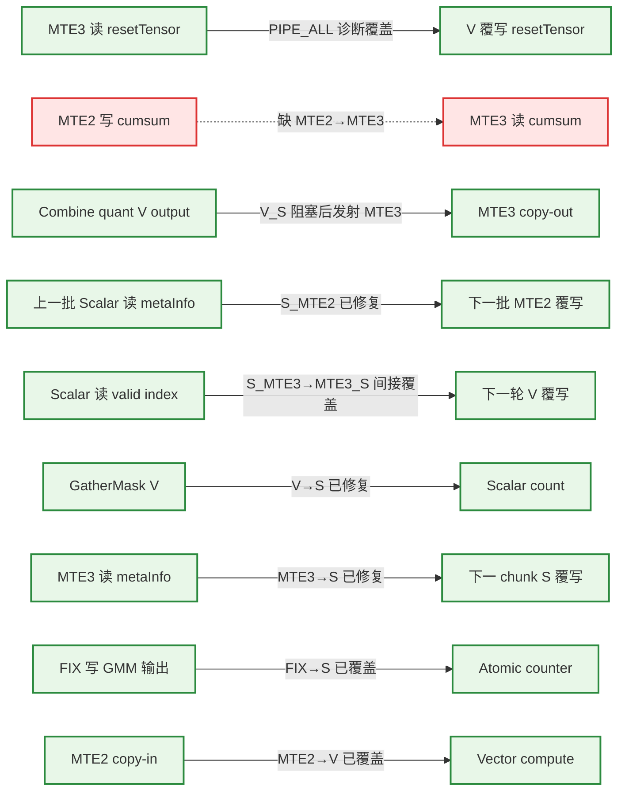
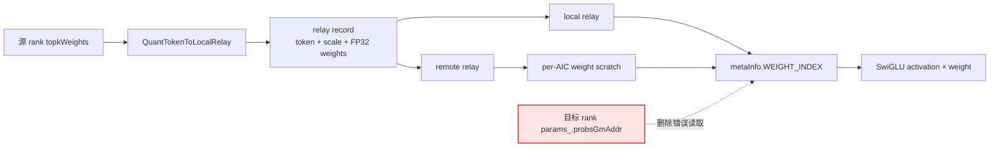

# MegaMoeLayered 流水同步审计报告

复审日期：2026-07-31

目标文件：`mega_moe_layered.h`

分析模式：`full`（含分文件分析、覆盖率检查和独立二次确认）

源码基线：`546465ffabb8e9d825c0d34617c441c030053ba4`

本次基于最新 HEAD 重新审计。提交 `da04265b0` 修复的 5 处同步和 `0da2bc075` 新增的
combine metadata `S_MTE2` 均确认正确，且未引入 HardEvent 冲突。结合 A5 芯片 PIPE_V
内部依赖由编译器保证的约束，删除纯 V→V 误报，并纠正 combine `V_S` 传递同步误判；
当前确认 1 组缺失同步，仅影响 A8W4。A8W8 可达的 `resetTensor_` 依赖已在工作树中使用
`PipeBarrier<PIPE_ALL>()` 进行诊断性覆盖，待功能验证后应收窄为 `MTE3_V`。

## 1. 算子基本信息

- Kernel 入口：`mega_moe_apt.cpp:36-74` 的 `mega_moe`
- Kernel 类型：`KERNEL_TYPE_MIX_AIC_1_2`（`mega_moe_apt.cpp:44`）
- 核比例：1 个 AIC + 2 个 AIV
- URMA layered 路径：`mega_moe_apt.cpp:62-70`
- AIC/AIV 通过 `if constexpr (g_coreType == AIC/AIV)` 分流；两个 AIV 还通过 `subBlockIdx_` 分工。
- 目标芯片为 A5：同一 PIPE_V 内的 RAW/WAR/WAW 依赖由编译器保证，本报告不要求额外
  `PipeBarrier<PIPE_V>()`；V 与 MTE2/MTE3/S 之间的跨流水依赖仍需检查。
- 当前实现不使用 `TPipe/TQue/EnQue/DeQue`，主要依赖 HardEvent、CrossCore、`SyncAll`、GM flag 轮询和 Hcomm `Drain`。
- AIC 内普通 Cube 流水同步按规则由框架处理；本报告的缺失同步主要位于 AIV。

涉及的核心 kernel 文件：

1. `mega_moe_apt.cpp`
2. `mega_moe_layered.h`
3. `mega_moe_base.h`
4. `mega_moe_impl.h`
5. `block_epilogue_swiglu_mx_quant.h`
6. `mega_moe_combine_send.h`
7. `moe_distribute_dispatch_v2/op_kernel/quantize_functions.h`

地址布局辅助文件 `mega_moe_workspace_info.h`、`mega_moe_impl_base.h` 已检查，无同步指令。

## 2. 函数调用图


## 3. 关键指令流水归属

| 指令/位置 | 流水 | Tensor/区域 | 读写 | Stage |
|---|---|---|---|---|
| `GatherMask`，`layered.h:745-746` | V | `maskBuf`、`roundSendCnt` | 读/写 | Send mask compute |
| `DataCopyPad`，`layered.h:648` | MTE3 | `resetTensor_` → flag GM | 读/写 | Reset copy-out |
| `DataCopyPad`，`layered.h:1129-1131` | MTE2 | cumsum GM → `cumsumInfoTensor_` | 读/写 | Restore |
| `DataCopyPad`，`layered.h:1153-1154` | MTE3 | `cumsumInfoTensor_` → GM | 读/写 | Persist |
| `PipeBarrier`，`layered.h:1662` | ALL | 等待 `resetTensor_` 的前序 MTE3 读取完成 | 同步 | A8W8 diagnostic fence |
| `DataCopy`，`layered.h:1331` | MTE3 | `metaInfoTensor_` → GM | 读/写 | Dispatch metadata |
| `GatherMask`，`layered.h:1402-1403` | V | mask/index → `roundTokenCnt` | 读/写 | Dispatch gather |
| `ComputeMaxExp/Scale/FpX`，`layered.h:896-903` | V | `mxTempTensor_`、`xOutTensor1_` | 读/写 | Relay quant |
| `ComputeMaxExp/Scale/FpX`，`layered.h:2229-2236` | V | `mxTempBuf`、`xOutBuf` | 读/写 | Shared quant |
| `DataCopy`，`layered.h:1806` | MTE2 | triple GM → `metaInfoTensor` | 读/写 | Combine copy-in |
| `ComputeMaxExp/Scale/Fp8`，`combine_send.h:124-128` | V | `floatTemp`、`ubQuantData` | 读/写 | Combine quant |
| `DataCopyPad`，`combine_send.h:97` | MTE3 | `ubQuant` → staging/local GM | 读/写 | Combine copy-out |
| `WriteNbi`，`combine_send.h:104` | S/通信 | staging GM → remote GM | 读/写 | URMA publish |
| SwiGLU/quant helpers，`block_epilogue...h:632-713` | V | `gluRes/maxExp/halfScale/output` | 读/写 | Epilogue |
| Epilogue copy-out，`block_epilogue...h:793-801` | MTE3 | quant UB → GM | 读/写 | Epilogue copy-out |
| `AtomicAdd`，`block_epilogue...h:808` | S | group ready flag | 写 | Publish |

## 4. 数据依赖关系图



红色虚线表示确认缺失同步；绿色实线表示已有同步或诊断性屏障覆盖。

## 5. 同步排查结果

### 5.1 确认问题：缺失同步

以下结论均经过独立二次确认。

| # | 位置 | 依赖关系 | 类型 | 建议修复 | 风险 |
|---:|---|---|---|---|---|
| 1 | `layered.h:1129 → 1153` | A8W4 下 MTE2 恢复 cumsum 前缀 → MTE3 搬出包含该前缀的区域；`:1148 S_MTE3` 不等待 MTE2 | RAW，MTE2→MTE3 | `:1153` 前增加 `MTE2_MTE3`；或在 `:1129` 后建立可传递的 MTE2→S→MTE3 链 | 高，仅 A8W4 |

A8W8 的 Weight1Type 为 FP8，`ENABLE_A8W4 == false`，不会进入该 cumsum GM 恢复分支。

### 5.2 本次确认已修复

| 旧问题 | 当前同步 | 复核结论 |
|---|---|---|
| `GatherMask` 的 `roundSendCnt` 在 Scalar 消费前未同步 | `layered.h:747 V_S` | 已位于 `:748 totalSendCnt +=` 前，正确 |
| `roundTokenCnt` 在分支和 `continue` 前未同步 | `layered.h:1405 V_S` | 已覆盖所有 Scalar 消费和提前 `continue`，正确 |
| `metaInfoTensor_` chunk 回边 MTE3→S | `layered.h:1332 MTE3_S` | 每个 copy 后立即同步，正确 |
| float top-k weight chunk 回边 S→MTE2 | `layered.h:2048 S_MTE2` | 正确 |
| bf16 top-k 临时缓冲回边 V→MTE2 | `layered.h:2062 V_MTE2` | 正确 |
| combine metadata 跨 batch 回边 S→MTE2 | `layered.h:1805 S_MTE2` | 已位于下一批 `:1806 DataCopy` 前，正确 |
| `resetTensor_` MTE3→V 复用 | `layered.h:1662 PIPE_ALL` | A8W8 可达的诊断性覆盖；功能验证通过后建议改为定向 `MTE3_V` |

前 6 处 `SyncFuncStatic` 都由 Set/Wait 自成完整事件对；相同 event ID 的复用发生在前一对已经
消费后，未发现冲突或未配对。新增 reset `PIPE_ALL` 不占用 event ID。

### 5.3 确认问题：过度同步

| 位置 | 当前同步 | 实际需要 | 优化建议 | 性能影响 |
|---|---|---|---|---|
| `layered.h:528` | `PipeBarrier<PIPE_ALL>` | 仅等待初始化 `Duplicate` 的 PIPE_V | 改为 `PipeBarrier<PIPE_V>()`，不可直接删除 | 避免初始化阶段全流水排空 |
| `layered.h:772` | 每个 mask round `PIPE_ALL` | 槽位复用需 MTE3→V；最终发布 count 需 MTE3→S | 每轮改精确 `MTE3_V`，round 循环后、count 写前补一次 `MTE3_S`；更优为双 event 管理 ping-pong | 当前每轮破坏 V/MTE3 并行 |
| `layered.h:1050` | `PipeBarrier<PIPE_ALL>` | 前方只有 Scalar 地址/GM 读，初始化状态已由 2386/2388 和 2142/2154 发布 | 删除 | 消除 dispatch sender 启动时的无效全流水停顿 |
| `layered.h:1111` | `MTE2_V` | 搬入后无 V consumer；调用者 `:1195/:1218 MTE2_MTE3` 已保护 MTE3 搬出 | 删除 | 每个 local relay token 少一次无效事件往返 |
| `layered.h:2012-2013` | `S_V` Set/Wait | Cast 的输入已由 2010-2011 的 `MTE2_V` 覆盖，无 Scalar producer | 删除该 `S_V` | 减少每个共享专家一次事件往返 |
| `layered.h:2251` | 双 event drain 后再 `PIPE_ALL` | 2249/2250 已等待两路 MTE3；调用者 2386 还会再次 `PIPE_ALL` | 删除 2251 | 避免 shared input 结束处重复全流水排空 |
| `combine_send.h:65` | 每 token 执行 `MTE2_S` | metadata 每 batch 仅由 `layered.h:1806` 搬入一次 | 将一次 `MTE2_S` 放到 token 循环前，删除逐 token 重复等待 | 降低 combine token 循环事件开销 |
| `combine_send.h:257、281` | 每 token 前及函数尾执行 `MTE3_MTE2` | 实际 MTE3 在 `:97` 后已由 `:98 MTE3_S` 等待；nonquant remote 分支无 MTE3 | 删除重复等待 | 减少每 token/每 group 的事件开销 |
| `combine_send.h:263` | 量化后 `V_S` | 正确性已覆盖，但实际数据消费者是后续 `:97 MTE3` | 改为更精确的 `V_MTE3`，避免阻塞无关 Scalar | 提高 quant 与 metadata Scalar 处理的并行度 |
| `block_epilogue...h:805-806` | 无条件 `MTE3_S` | 普通 MoE 的非空 group flag 需要；shared epilogue 传 `nullptr` 时无 Scalar consumer | 将 `MTE3_S` 移入 `if (groupFlagListGmAddr_ != nullptr)`，置于 AtomicAdd 前 | 消除 shared GMM1 每 tile 的无效事件 |

### 5.4 已正确覆盖

| 依赖 | 已有同步 |
|---|---|
| `topkIdsTensor_`：V 清零 → MTE2 覆盖 → V Compare | `layered.h:730 V_MTE2`、`:737 MTE2_V` |
| A5 的纯 PIPE_V 依赖：relay/shared/combine/epilogue quant 链及 `Muls → Cast` | 由 A5 编译器保证 PIPE_V 内部依赖，不要求手工 V barrier |
| `GatherMask` 结果 → Scalar count/index 消费 | `layered.h:747 V_S`、`:1405 V_S` |
| metadata MTE3 copy → 下一 chunk Scalar 覆写 | `layered.h:1332 MTE3_S` |
| `validTopkIndexTensor_` 当前轮 Scalar 读 → 后续轮 V 覆写 | 有 Scalar 读的路径必经 `layered.h:1330 S_MTE3 → :1332 MTE3_S`，Scalar 恢复后才发射下一轮 V |
| `resetTensor_` 前序 MTE3 读 → 后续 V 覆写 | `layered.h:1662 PIPE_ALL` 诊断性覆盖；验证后应收窄为 `MTE3_V` |
| combine metadata Scalar 读 → 下一批 MTE2 覆写 | `layered.h:1805 S_MTE2` |
| combine quant V 写 → layered MTE3 搬出 | `combine_send.h:263 V_S` 阻塞 Scalar；Wait 返回后才发射 `:97 MTE3`，形成传递覆盖 |
| Relay 量化输出 V → MTE3 → ready flag S | `layered.h:906 V_MTE3`、`:908 MTE3_S`、`:912 PIPE_ALL` |
| 5-buffer local relay 的 MTE2/MTE3 槽位复用 | `layered.h:1186-1223` 的 event 1～5 配对 |
| Remote relay flag snapshot：MTE2 写 → S 读 → 下一轮 MTE2 覆写 | `layered.h:1261 MTE2_S`、`:1286 S_MTE2` |
| float/bf16 top-k weight chunk 回边 | `layered.h:2048 S_MTE2`、`:2062 V_MTE2` |
| GMM2 FIX 写数据 → Scalar 发布 combine counter | `mega_moe_impl.h:139-149`、`:157-161` 的 `FIX_S` |
| A8W4 GMM 输出 → status/sequence 发布 | `mega_moe_impl.h:898-908` 的 `FIX_S` |
| GMM1 AIC/AIV tile 协作 | `mega_moe_base.h:135-153` 的 mode 4、flag 4～7 CrossCore 配对 |
| Epilogue MTE3 数据写 → 普通 MoE group flag `AtomicAdd` | `block_epilogue...h:805-808 MTE3_S`（仅非空 flag 路径必要） |
| Combine staging GM 写 → Hcomm `WriteNbi` | `mega_moe_combine_send.h:98 MTE3_S` |
| `DeQuantMxFp8` 内 VEC store → load | `mega_moe_combine_send.h:179,188 LocalMemBar` |
| `metaPtr[0]=tokenIdx` → `metaPtr[1]=ready` 的普通流水顺序 | 两次 `WriteGmByPassDCache` 均属 PIPE_S，同流水指令顺序成立；跨核发布语义另见 5.6 |

HardEvent Set/Wait 检查：

- `ExpertTokenNumCopyOut` 的 event 配对正确。
- `CopyTokensFromLocalRelay` 的五槽 prime/steady/drain 闭合。
- `Unpermute` 和 `SharedExpertCopyInput` 的 event 0/1 双缓冲配对闭合。
- 未发现静态 tensor event ID 6/7 误用。

CrossCore 检查：

- mode 4 flag 4/5：AIC FIX → AIV V，配对正确。
- mode 4 flag 6/7：AIV V → AIC FIX，配对正确。
- 未发现孤立 Wait、提前 return 跳过 Set 或 flag 冲突。

### 5.5 SyncAll 路径计数

| 路径 | `SyncAll<false>` | `SyncAll<true>` |
|---|---:|---:|
| AIC，`sharedExpertNum_==0` | 1（2388） | AIC 不属于 true 域 |
| AIV，`sharedExpertNum_==0` | 1（2388） | 4（2154×2、2459、2475） |
| AIC，`sharedExpertNum_>0` | 3（2369、2388、2398） | AIC 不属于 true 域 |
| AIV，`sharedExpertNum_>0` | 3（2369、2388、2398） | 4（2154×2、2459、2475） |

所有参与核在各自同步域内次数一致，未发现 `SyncAll` 路径不一致导致的挂死风险。

### 5.6 需要人工确认

`layered.h:953` 先以 `WriteGmByPassDCache` 写 token ID，`:955` 再写 READY。独立复核出现两种判定：

- 从普通流水依赖看，两次操作均属 PIPE_S，同流水保序，不需要 `PIPE_ALL`。
- 从规则库 4.5 的跨核“payload → READY”发布协议看，应在二者之间恢复 `PipeBarrier<PIPE_ALL>()`。

由于这里不是规则示例中的“MTE3 数据写 → Scalar 状态写”，而是两次 bypass Scalar store，当前缺少
该 API 的跨核可见性/内存排序契约，故不计入 1 组确认缺失同步。建议由平台文档或反汇编确认
`WriteGmByPassDCache` 对不同核观察者的发布顺序；无法确认时，按协议安全侧恢复 `:954` 屏障。

`layered.h:2142` 先以 `WriteGmByPassDCache` 更新本地 `syncCount`，`:2148` 随即把该 GM 地址
作为 Hcomm `WriteNbi` 的 DMA 源。当前项目代码无法证明 bypass Scalar store 与 Hcomm DMA read
之间存在 DDR release/fence；若 Hcomm 不隐含该保证，远端可能收到旧 count。建议核对 Hcomm
契约，不能确认时在首次 `WriteNbi` 前增加适用 A5 的 DDR/全流水发布屏障。

同理，`:1331 MTE3 → :1441 AtomicAdd`、`:907 MTE3 → :911 ready` 和 epilogue MTE3 copy-out
→ group flag 已有精确的 `MTE3_S`。直接流水依赖已覆盖；若项目通信规范强制“数据→状态只能用
`PIPE_ALL`”，则还应按规范升级这些位置。修复前建议在目标 SoC 上检查编译后的流水指令序列，
并做大 batch、多 chunk、`topK=1`、A8W4/A4W4、shared expert 和 combine quant 覆盖测试。

## 6. 覆盖率报告

| 文件 | 分析状态 | 覆盖说明 |
|---|---|---|
| `mega_moe_apt.cpp` | 已分析 | kernel 入口、模板分支、Kernel 类型 |
| `mega_moe_layered.h` | 已分析 | 全部可达成员函数、条件分支、循环回边、跨函数依赖 |
| `mega_moe_base.h` | 已分析 | CrossCore、`SyncFuncStatic`、GM barrier |
| `mega_moe_impl.h` | 已分析 | generic/A8W4/A4W4 的 AIC/AIV GMM 主链 |
| `block_epilogue_swiglu_mx_quant.h` | 已分析 | SwiGLU、量化、MTE3 copy-out、状态发布 |
| `mega_moe_combine_send.h` | 已分析 | layered combine、quant、URMA 发送、跨调用回边 |
| `quantize_functions.h` | 已分析 | 当前路径可达的 MicroAPI 量化叶子 |
| `mega_moe_workspace_info.h` | 已检查 | 仅地址布局，无流水 API |
| `mega_moe_impl_base.h` | 已检查 | 常量/layout/policy，无流水 API |
| SDK `kernel_operator`、Hcomm、Blaze、Te | 外部叶子 | 在项目内 API 调用边界截止 |

覆盖率：项目内可达同步相关 kernel 文件和函数 100%。

## 7. 风险等级总评

- 本次累计确认已修复：7 组，其中 A8W8 可达的 1 组使用 `PIPE_ALL` 作诊断性覆盖。
- 因 A5 PIPE_V 内部依赖由编译器保证，删除纯 V→V 同步误报：5 组。
- 当前确认缺失同步：1 组，风险为高，但仅影响 A8W4；A8W8 路径当前无确认缺失项。
- 确认过度同步：10 处。
- 新增诊断性 `PIPE_ALL`：1 处，验证完成后应收窄，不计入既有 10 处优化清单。
- 协议级待确认：2 类（bypass Scalar payload/READY，以及 Scalar GM store→Hcomm DMA read）。
- CrossCore 配对问题：0。
- `SyncAll` 路径计数问题：0。
- 总体评估：**有风险**；A8W8 的 reset 依赖正在诊断验证。

当前确认的正确性风险为：

1. A8W4 cumsum prefix 在 MTE2 搬入完成前被 MTE3 搬出。

建议先用目标 A8W8 用例验证 reset 问题是否消失；若验证通过，将 `layered.h:1662` 的
诊断性 `PIPE_ALL` 收窄为 `MTE3_V`。A8W4 cumsum 依赖应单独修复，不影响本次 A8W8 定位。

## 8. TopK weight 前移精度问题修复方案

### 8.1 基线、现象与适用范围

本节处理的是**非同步类精度问题**，不改变第 5 节的流水同步结论。

- 分析基线：PR `#9373` 当前 head `ea5f704e97a96ead9c5a7b80605fcacd9cbe2fe6`
- 目标路径：`TopkWeightsPrefetch == true` 的 URMA layered dispatch
- 触发条件：目标专家收到的 token 需要经过 `relayRank != rankId_` 的远端 relay 分支
- 典型现象：`bs=1` 即稳定出现精度错误；self-route 或 `epWorldSize=1` 不触发该地址错误

本报告前 7 节使用的源码基线为 `da04265b0`，因此本节中的行号统一以 PR head
`ea5f704e` 为准。代码修改后行号会移动，实施时应同时使用“文件 + 函数名 + 原始行号”定位。

### 8.2 根因

`MegaMoeLayered::Init()` 将当前 rank 的输入 `topkWeights` 保存为：

```cpp
params_.probsGmAddr = topkWeights;
```

`QuantTokenToLocalRelay()` 会把源 token 的量化数据、scale 和该 token 的全部 TopK weight 写入
源 token 对应的 relay record：

```text
relay record
┌───────────────────────────┬────────────────────┬──────────────────────┬─────────┐
│ quant token               │ quant scale        │ TopK weight (FP32)   │ padding │
│ mxQuantTokenAlignBytes_   │ mxQuantScale...    │ weightAlignBytes_    │ to 512B │
└───────────────────────────┴────────────────────┴──────────────────────┴─────────┘
```

接收端 `CopyGMToGMPerToken()` 中：

- `relayRank == rankId_` 时，`CopyTokensFromLocalRelay()` 从 relay record 中提取 weight，数据来源正确。
- `relayRank != rankId_` 时，`CopyTokensFromRemoteRelay()` 只从 `remoteRecordAddr` 读取 token 和 scale；
  随后 `layered.h:1421-1440` 却从 `params_.probsGmAddr` 读取 weight。

错误分支的实际数据来源为：

```text
token / scale <- 源 rank 的 remoteRecordAddr
weight        <- 当前目标 rank 的 params_.probsGmAddr
```

`remoteRankIdx` 表示 token 的源 rank，而 `params_.probsGmAddr` 只指向当前目标 rank 的输入。
因此远端 token 会携带目标 rank 的 weight。`bs=1` 时两侧 `tokenIndex` 都为 0，这个错误通常表现为
稳定的错误数值而不是随机越界。

该错误在 `ee9fa9726` 中引入。该提交之前远端 relay 分支没有填写 `WEIGHT_INDEX`；该提交虽然增加了
填写逻辑，但选错了 GM 地址。

### 8.3 方案比较

| 方案 | 方法 | 优点 | 缺点 | 结论 |
|---|---|---|---|---|
| A | 继续从 `params_.probsGmAddr` 读取 | 无额外通信 | weight 属于目标 rank，语义错误 | 禁止 |
| B | 从远端 record 只读取选中的 4B weight，直接写 metadata | 额外流量最小 | URMA 4B 非 32B 对齐读写的约束不明确；目标地址位于 metadata 行内偏移 12B | 不推荐 |
| C | 从远端 record 搬运 32B 对齐的完整 weight block 到每核 GM scratch，再由 Scalar 提取选中 weight | 地址、长度均可对齐；不增加 UB；与本地 relay 提取逻辑一致 | 每个远端 token 增加 `weightAlignBytes_` 通信量；每核增加少量 workspace | **推荐** |

以下逐行修改使用方案 C。

### 8.4 修改后的地址布局

先将 weight 的 record 起始地址显式定义为 32B 对齐位置：

```cpp
weightOffsetBytes_ =
    CeilAlign(mxQuantTokenAlignBytes_ + mxQuantScaleAlignBytes_, ALIGN_32);
```

每核 `dispatchL2CommPtr` scratch 从原来的单一 flag snapshot 扩展为：

```text
per-AIC dispatchL2 scratch
┌──────────────────────────────────────┬─────────────────────────────────────────────┐
│ relay flag snapshot                 │ remote weight scratch                       │
│ CeilAlign(bs * sizeof(uint64_t),512)│ L1_TILE_M_256 * weightAlignBytes_, align512 │
└──────────────────────────────────────┴─────────────────────────────────────────────┘
```

`MetaInfoCalAndDispatch()` 每次传给 `CopyGMToGMPerToken()` 的 `copyNum` 不超过
`L1_TILE_M_256`，所以每核只需为 256 行 weight block 预留空间。该空间只由
`subBlockIdx_ == 1` 的 dispatch AIV 使用；不同 `blockIdx_` 使用不同 per-AIC slice，不会互相覆盖。

### 8.5 逐文件修改方法

#### 修改 1：保留/补齐 peermem relay record 的 weight 空间

文件：`mc2/mega_moe/op_kernel/arch35/mega_moe_base.h`

位置：PR head `ea5f704e` 的 `PeermemInfo` 构造函数，约 `94-98` 行。

PR head 已包含下列代码，修复时必须保留。如果从本地旧分支 `0da2bc075` 开始修改，则需要补入：

```cpp
uint32_t tokenScaleBytes = Ops::Base::CeilAlign(dataBytes + scaleBytes, static_cast<uint32_t>(ALIGN_32));
if (tilingData->topkWeightsPrefetch == 1) {
    uint32_t weightBytes = Ops::Base::CeilAlign(
        static_cast<uint32_t>(tilingData->topK * sizeof(float)), static_cast<uint32_t>(ALIGN_32));
    tokenScaleBytes =
        Ops::Base::CeilAlign(tokenScaleBytes + weightBytes, static_cast<uint32_t>(ALIGN_32));
}
uint32_t relayRecordBytes = Ops::Base::CeilAlign(tokenScaleBytes, static_cast<uint32_t>(ALIGN_512));
```

目的：保证 `dispatchRecivePtr` 为每个 `(sourceServer, tokenId)` record 预留包含 weight 的完整空间，
避免后续 `dispatchFlagPtr` 或 `combineSendPtr` 与 relay record 尾部重叠。

#### 修改 2：扩大每核 dispatch L2 scratch

文件：`mc2/mega_moe/op_kernel/arch35/mega_moe_workspace_info.h`

位置：`WorkspaceInfo` 构造函数的 URMA 分支，PR head `ea5f704e` 的 `261-264` 行。

将：

```cpp
dispatchL2CommPtr = base + workspaceSize;
int64_t flagSnapshotBytes = static_cast<int64_t>(tilingData->bs) * static_cast<int64_t>(sizeof(uint64_t));
int64_t dispatchL2ScratchBytes = Ops::Base::CeilAlign(flagSnapshotBytes, static_cast<int64_t>(ALIGN_512));
workspaceSize += static_cast<int64_t>(tilingData->aicNum) * dispatchL2ScratchBytes;
```

替换为：

```cpp
dispatchL2CommPtr = base + workspaceSize;
int64_t flagSnapshotBytes =
    static_cast<int64_t>(tilingData->bs) * static_cast<int64_t>(sizeof(uint64_t));
int64_t dispatchL2FlagSnapshotBytes =
    Ops::Base::CeilAlign(flagSnapshotBytes, static_cast<int64_t>(ALIGN_512));

int64_t remoteWeightScratchBytes = 0;
if (tilingData->topkWeightsPrefetch == 1) {
    int64_t weightAlignBytes = Ops::Base::CeilAlign(
        static_cast<int64_t>(tilingData->topK) * static_cast<int64_t>(sizeof(float)),
        static_cast<int64_t>(ALIGN_32));
    remoteWeightScratchBytes = Ops::Base::CeilAlign(
        static_cast<int64_t>(MegaMoeImpl::L1_TILE_M_256) * weightAlignBytes,
        static_cast<int64_t>(ALIGN_512));
}

int64_t dispatchL2ScratchBytes = dispatchL2FlagSnapshotBytes + remoteWeightScratchBytes;
workspaceSize += static_cast<int64_t>(tilingData->aicNum) * dispatchL2ScratchBytes;
```

无需修改 `mega_moe_tiling.cpp::SetWorkspace()`。该函数使用
`WorkspaceInfo::workspaceSize` 设置 workspace，总大小会随上述构造逻辑自动增加。

#### 修改 3：增加显式 weight offset 和 flag snapshot 大小成员

文件：`mc2/mega_moe/op_kernel/arch35/mega_moe_layered.h`

位置 1：类成员区，PR head `ea5f704e` 的 `194-199` 行。

将：

```cpp
uint32_t mxQuantScaleAlignBytes_ = 0;
uint32_t mxQuantTokenScaleAlignBytes_ = 0;
uint32_t weightAlignBytes_ = 0;
```

改为：

```cpp
uint32_t mxQuantScaleAlignBytes_ = 0;
uint32_t mxQuantTokenScaleAlignBytes_ = 0;
uint32_t weightOffsetBytes_ = 0;
uint32_t weightAlignBytes_ = 0;
```

位置 2：同一成员区，PR head `ea5f704e` 的 `216-220` 行。

将：

```cpp
uint32_t relayRecordBytes_ = 0;
uint64_t sendWorkspaceMetaBytes_ = ALIGN_32;
uint64_t sendWorkspaceServerBytes_ = 0;
uint64_t dispatchL2ScratchBytes_ = 0;
```

改为：

```cpp
uint32_t relayRecordBytes_ = 0;
uint64_t sendWorkspaceMetaBytes_ = ALIGN_32;
uint64_t sendWorkspaceServerBytes_ = 0;
uint64_t dispatchL2FlagSnapshotBytes_ = 0;
uint64_t dispatchL2ScratchBytes_ = 0;
```

#### 修改 4：统一 kernel 侧 relay record 和 scratch 大小计算

文件：`mc2/mega_moe/op_kernel/arch35/mega_moe_layered.h`

位置：`MegaMoeLayered::Init()`，PR head `ea5f704e` 的 `383-399` 行。

将原有 token/scale/weight 和 `dispatchL2ScratchBytes_` 计算替换为：

```cpp
mxQuantScaleNumAlignPerToken_ = Ops::Base::CeilDiv(k_, static_cast<uint32_t>(ALIGN_32));
mxQuantTokenAlignBytes_ =
    Ops::Base::CeilAlign(static_cast<uint32_t>(k_ / A_ELEMS_PER_BYTE), static_cast<uint32_t>(ALIGN_256)) *
    sizeof(ActivationType);
mxQuantScaleAlignBytes_ = mxQuantScaleNumAlignPerToken_ * sizeof(uint8_t);

weightOffsetBytes_ = Ops::Base::CeilAlign(
    mxQuantTokenAlignBytes_ + mxQuantScaleAlignBytes_, static_cast<uint32_t>(ALIGN_32));
mxQuantTokenScaleAlignBytes_ = weightOffsetBytes_;
if constexpr (TopkWeightsPrefetch) {
    weightAlignBytes_ = Ops::Base::CeilAlign(
        static_cast<uint32_t>(topK_ * sizeof(float)), static_cast<uint32_t>(ALIGN_32));
    mxQuantTokenScaleAlignBytes_ = weightOffsetBytes_ + weightAlignBytes_;
}

relayRecordBytes_ =
    Ops::Base::CeilAlign(static_cast<uint64_t>(mxQuantTokenScaleAlignBytes_),
                        static_cast<uint64_t>(ALIGN_512));
sendWorkspaceServerBytes_ =
    static_cast<uint64_t>(ALIGN_32) + static_cast<uint64_t>(m_) * sendWorkspaceMetaBytes_;

uint64_t flagSnapshotBytes = static_cast<uint64_t>(m_) * sizeof(uint64_t);
dispatchL2FlagSnapshotBytes_ =
    Ops::Base::CeilAlign(flagSnapshotBytes, static_cast<uint64_t>(ALIGN_512));
dispatchL2ScratchBytes_ = dispatchL2FlagSnapshotBytes_;
if constexpr (TopkWeightsPrefetch) {
    uint64_t remoteWeightScratchBytes = Ops::Base::CeilAlign(
        static_cast<uint64_t>(MegaMoeImpl::L1_TILE_M_256) *
            static_cast<uint64_t>(weightAlignBytes_),
        static_cast<uint64_t>(ALIGN_512));
    dispatchL2ScratchBytes_ += remoteWeightScratchBytes;
}
```

必须保证这里和 `WorkspaceInfo` 使用相同公式。两侧不一致会导致不同 `blockIdx_` 的 scratch slice
互相重叠，或者最后一个 slice 越过 workspace 尾部。

#### 修改 5：所有 layered weight 访问统一使用 `weightOffsetBytes_`

文件：`mc2/mega_moe/op_kernel/arch35/mega_moe_layered.h`

位置 1：`LoadTopkWeightsToUb()`，PR head `ea5f704e` 的 `845` 行。

删除：

```cpp
uint32_t weightOffsetInUb = mxQuantTokenAlignBytes_ + mxQuantScaleAlignBytes_;
```

并将函数内两个 `xOutTensor[weightOffsetInUb]` 改为：

```cpp
xOutTensor[weightOffsetBytes_]
```

例如 BF16 转 FP32 分支应为：

```cpp
LocalTensor<float> weightFp32Ub =
    xOutTensor[weightOffsetBytes_].template ReinterpretCast<float>();
```

float 分支应为：

```cpp
LocalTensor<TopkWeightsType> weightUb =
    xOutTensor[weightOffsetBytes_].template ReinterpretCast<TopkWeightsType>();
```

位置 2：`CopyTokensFromLocalRelay()`，PR head `ea5f704e` 的 `1285-1290` 行。

将：

```cpp
LocalTensor<ActivationType> weightBuf = copyTmpTensors_[outIdx];
uint32_t weightOffsetInUb = mxQuantTokenAlignBytes_ + mxQuantScaleAlignBytes_;
LocalTensor<int32_t> bufWeightsInt32 =
    weightBuf[weightOffsetInUb].template ReinterpretCast<int32_t>();
```

改为：

```cpp
LocalTensor<ActivationType> weightBuf = copyTmpTensors_[outIdx];
LocalTensor<int32_t> bufWeightsInt32 =
    weightBuf[weightOffsetBytes_].template ReinterpretCast<int32_t>();
```

目的：本地 relay、远端 relay、host peermem 统一使用 32B 对齐的 weight 起始地址。

#### 修改 6：远端 relay 同步搬运 weight block

文件：`mc2/mega_moe/op_kernel/arch35/mega_moe_layered.h`

位置：`CopyTokensFromRemoteRelay()`，PR head `ea5f704e` 的 `1325-1383` 行。

第一步，在原 `scratchAddr` 计算之后增加 weight scratch 基址：

```cpp
GM_ADDR scratchAddr =
    params_.workspaceInfo.dispatchL2CommPtr +
    static_cast<uint64_t>(blockIdx_) * dispatchL2ScratchBytes_;
GM_ADDR remoteWeightScratchAddr = scratchAddr + dispatchL2FlagSnapshotBytes_;
```

第二步，在 `1366-1376` 行 token/scale 的两次 `ReadNbi` 后增加 weight block 搬运：

```cpp
uint64_t remoteCopyOffset = RelayTokenOffset(srcServer, static_cast<uint32_t>(tokenIndex));
GM_ADDR remoteRecordAddr =
    GetRankWinAddrWithOffset(relayRank, dispatchWinOffset_) + remoteCopyOffset;
GM_ADDR tokenDstAddr =
    params_.workspaceInfo.dispatchRevDataPtr +
    static_cast<uint64_t>(rowDstOffsetInCore + copyIdx) * widthA * sizeof(ActivationType);
GM_ADDR scaleDstAddr =
    params_.workspaceInfo.dispatchRevScalePtr +
    static_cast<uint64_t>(rowDstOffsetInCore + copyIdx) * widthAScale * sizeof(QuantScaleOutType);

hcomm_.ReadNbi<true>(channel, tokenDstAddr, remoteRecordAddr,
                     widthA * sizeof(ActivationType));
hcomm_.ReadNbi<true>(channel, scaleDstAddr,
                     remoteRecordAddr + mxQuantTokenAlignBytes_,
                     widthAScale * sizeof(QuantScaleOutType));

if constexpr (TopkWeightsPrefetch) {
    GM_ADDR weightDstAddr =
        remoteWeightScratchAddr +
        static_cast<uint64_t>(copyIdx) * static_cast<uint64_t>(weightAlignBytes_);
    GM_ADDR weightSrcAddr = remoteRecordAddr + weightOffsetBytes_;
    hcomm_.ReadNbi<true>(channel, weightDstAddr, weightSrcAddr, weightAlignBytes_);
}

relayReceivedTensor_.SetValue(copyIdx, int32_t(1));
++receivedCount;
```

第三步，在函数末尾现有的：

```cpp
hcomm_.Drain(channel);
```

之后增加 weight 提取。relay record 中的 weight 已在源 rank 统一存成 FP32，因此这里不需要再区分
原始输入是 `float` 还是 `bfloat16_t`：

```cpp
hcomm_.Drain(channel);

if constexpr (TopkWeightsPrefetch) {
    for (int32_t copyIdx = 0; copyIdx < copyNum; ++copyIdx) {
        int32_t topkIndex =
            metaInfoTensor_[copyIdx * INT32_PER_256B].GetValue(TOPK_INDEX);
        __gm__ int32_t *weightGmI32 = reinterpret_cast<__gm__ int32_t *>(
            remoteWeightScratchAddr +
            static_cast<uint64_t>(copyIdx) * static_cast<uint64_t>(weightAlignBytes_));
        int32_t weightBits =
            ReadGmByPassDCache(weightGmI32 + static_cast<uint32_t>(topkIndex));
        metaInfoTensor_[copyIdx * INT32_PER_256B].SetValue(WEIGHT_INDEX, weightBits);
    }
}
```

`hcomm_.Drain(channel)` 必须位于 Scalar 读取 weight scratch 之前。不能把提取循环放到 while 内部，
否则某些 token 的 weight `ReadNbi` 尚未完成时就可能被 Scalar 消费。

#### 修改 7：删除错误的本地 `params_.probsGmAddr` 读取

文件：`mc2/mega_moe/op_kernel/arch35/mega_moe_layered.h`

位置：`CopyGMToGMPerToken()`，PR head `ea5f704e` 的 `1421-1440` 行。

删除整个：

```cpp
if constexpr (TopkWeightsPrefetch) {
    for (int32_t i = 0; i < copyNum; ++i) {
        // 从 params_.probsGmAddr 读取 weight 的全部代码
    }
}
```

远端分支最终应只保留：

```cpp
if (relayRank == rankId_) {
    CopyTokensFromLocalRelay(
        rowDstOffsetInCore, srcServer, copyNum, widthA, widthAScale, copyInNum);
} else {
    CopyTokensFromRemoteRelay(
        rowDstOffsetInCore, relayRank, srcServer, copyNum, widthA, widthAScale);
}
```

此时两个分支都必须在返回前填好 `metaInfoTensor_[row].WEIGHT_INDEX`：

- local 分支从 `copyTmpTensors_` 中的本地 relay record 提取；
- remote 分支从 `remoteWeightScratchAddr` 中的远端 relay record 提取。

随后原有：

```cpp
SyncFuncStatic<AscendC::HardEvent::S_MTE3, SYNC_EVENT_ID3>();
DataCopy(metaInfoGlobalTensor_[rowDstOffsetInCore * INT32_PER_256B],
         metaInfoTensor_, copyNum * INT32_PER_256B);
```

会将正确的 FP32 weight bits 搬到 `metaInfoPtr`，供激活 epilogue 使用。

### 8.6 修改后的数据流



### 8.7 编译与验证步骤

#### 8.7.1 静态检查

在仓库根目录执行：

```bash
git diff --check
rg -n "params_\\.probsGmAddr" mc2/mega_moe/op_kernel/arch35/mega_moe_layered.h
rg -n "weightOffsetBytes_|dispatchL2FlagSnapshotBytes_|remoteWeightScratchAddr" \
    mc2/mega_moe/op_kernel/arch35/mega_moe_layered.h \
    mc2/mega_moe/op_kernel/arch35/mega_moe_workspace_info.h
```

期望结果：

1. `git diff --check` 不新增空白符错误。
2. `params_.probsGmAddr` 只保留在源 rank 的 `LoadTopkWeightsToUb()`/初始化路径，不再出现在
   `CopyGMToGMPerToken()` 的 remote 分支。
3. host `WorkspaceInfo` 和 kernel `Init()` 同时出现新的 scratch 计算。

#### 8.7.2 Kernel 编译

A5/arch35 环境下执行：

```bash
bash build.sh --opkernel --soc=ascend950 --ops=mega_moe -j16
```

期望：`mega_moe` kernel 编译成功，无模板实例化、GM 地址类型或 workspace 计算错误。

如交付流程使用 JIT 包，再执行：

```bash
bash build.sh --pkg --jit --soc=ascend950 --ops=mega_moe -j16
```

#### 8.7.3 最小精度复现

使用 2 rank、`bs=1`、`topK=2`，人为设置不同 rank 的 weight：

```text
rank0 topkWeights = [0.25, 0.75]
rank1 topkWeights = [0.60, 0.40]
```

让 rank0 的 token 路由到 rank1 持有的专家，并保证目标侧进入 `relayRank != rankId_` 分支。
检查目标侧 `metaInfo.WEIGHT_INDEX`：

```text
期望：等于 rank0 对应 topkIndex 的 weight
修复前：等于 rank1 token0 对应 topkIndex 的 weight
修复后：等于 rank0 token0 对应 topkIndex 的 weight
```

建议临时将 `metaInfoPtr` 中每行第 4 个 `int32` 按 FP32 bits 导出，不要只比较最终输出；这样可以先确认
weight 地址链已经修复，再判断剩余误差是否来自“前移到量化前”本身的数值变化。

#### 8.7.4 回归矩阵

| 维度 | 必测值 | 验证目的 |
|---|---|---|
| `bs` | 1、2、较大 batch | 覆盖最小 record、普通路径和多 chunk |
| route | self-route、同 server 跨 rank、跨 server | 覆盖 local/remote relay 两分支 |
| TopK weight dtype | FP32、BF16 | 验证源侧 BF16→FP32 record 转换 |
| `topK` | 1、2、实际模型值 | 验证 weight block 和索引 |
| quant mode | A8W8、A8W4、A4W4（交付范围内） | 验证不同 `ActivationType` |
| shared expert | 0、非 0 | 确认共享专家不错误使用路由 weight |
| prefetch | 0、1 | `0` 路径结果和 workspace 不应变化 |

通过标准：

1. `TopkWeightsPrefetch=0` 的结果保持基线。
2. self-route 与 remote-route 对同一个源 token 使用相同的 weight bits。
3. FP32/BF16 两种输入在进入 epilogue 前都表现为正确的 FP32 `WEIGHT_INDEX`。
4. bs=1 精度恢复后，再比较权重前移前后的量化误差；如果仍有小幅误差，应单独评估
   “乘 weight 后再 MX 量化”与“GMM2 后乘 weight”的数值非等价性，不能继续归因于地址或同步。

### 8.8 风险与回滚

- Workspace 增量为每个 AIC：

  ```text
  CeilAlign(L1_TILE_M_256 * CeilAlign(topK * sizeof(float), 32), 512)
  ```

  例如 `topK <= 8` 时 `weightAlignBytes_ = 32B`，每个 AIC 增加 8KB。

- 每个远端 token 增加一次 `weightAlignBytes_` 的 URMA read。先以正确性为目标；精度通过后再考虑
  将 token、scale、weight 合并为一次完整 record read，避免在根因未验证前同时改通信流水结构。
- 如果新增方案未通过验证，回滚修改 2～7 即可；修改 1 是正确的 peermem 容量修复，应保留。
- 禁止用恢复 Unpermute 阶段的二次 weight 乘法作为长期修复。那会掩盖错误的 `WEIGHT_INDEX`，
  并可能造成 local 分支重复加权。
