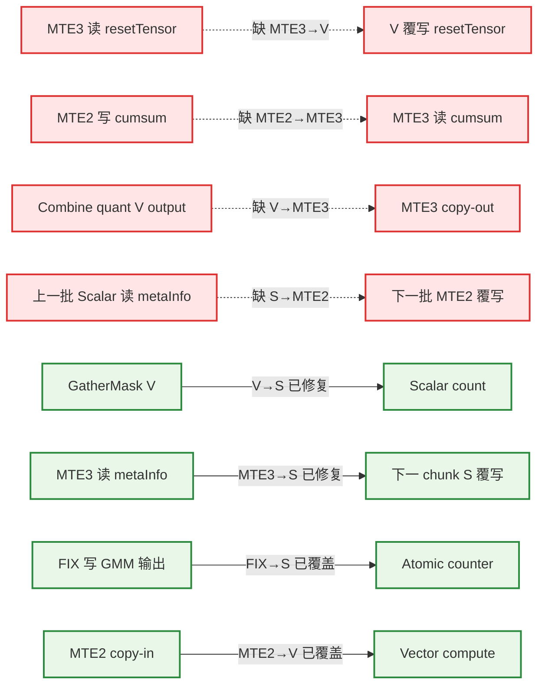

# MegaMoeLayered 流水同步审计报告

复审日期：2026-07-30

目标文件：`mega_moe_layered.h`

分析模式：`full`（含分文件分析、覆盖率检查和独立二次确认）

源码基线：`da04265b0022cac77d076fea8ca4d0a802de0338`

本次为修复后的重新审计。提交 `da04265b0` 新增或移动的 5 处同步均确认正确，且未引入
HardEvent 冲突。结合 A5 芯片 PIPE_V 内部依赖由编译器保证的约束，删除 5 组纯 V→V
同步误报；旧报告中的 14 组问题经代码修复和芯片口径修正后，当前保留 4 组。

## 1. 算子基本信息

- Kernel 入口：`mega_moe_apt.cpp:36-74` 的 `mega_moe`
- Kernel 类型：`KERNEL_TYPE_MIX_AIC_1_2`（`mega_moe_apt.cpp:44`）
- 核比例：1 个 AIC + 2 个 AIV
- URMA layered 路径：`mega_moe_apt.cpp:62-70`
- AIC/AIV 通过 `if constexpr (g_coreType == AIC/AIV)` 分流；两个 AIV 还通过 `subBlockIdx_` 分工。
- 目标芯片为 A5：同一 PIPE_V 内的 RAW/WAR/WAW 依赖由编译器保证，本报告不要求额外
  `PipeBarrier<PIPE_V>()`；V 与 MTE2/MTE3/S 之间的跨流水依赖仍需检查。
- 当前实现不使用 `TPipe/TQue/EnQue/DeQue`，主要依赖 HardEvent、CrossCore、`SyncAll`、GM flag 轮询和 Hcomm `Drain`。
- AIC 内普通 Cube 流水同步按规则由框架处理；本报告的缺失同步主要位于 AIV。

涉及的核心 kernel 文件：

1. `mega_moe_apt.cpp`
2. `mega_moe_layered.h`
3. `mega_moe_base.h`
4. `mega_moe_impl.h`
5. `block_epilogue_swiglu_mx_quant.h`
6. `mega_moe_combine_send.h`
7. `moe_distribute_dispatch_v2/op_kernel/quantize_functions.h`

地址布局辅助文件 `mega_moe_workspace_info.h`、`mega_moe_impl_base.h` 已检查，无同步指令。

## 2. 函数调用图

## 3. 关键指令流水归属

| 指令/位置 | 流水 | Tensor/区域 | 读写 | Stage |
|---|---|---|---|---|
| `GatherMask`，`layered.h:745-746` | V | `maskBuf`、`roundSendCnt` | 读/写 | Send mask compute |
| `DataCopyPad`，`layered.h:648` | MTE3 | `resetTensor_` → flag GM | 读/写 | Reset copy-out |
| `DataCopyPad`，`layered.h:1129-1131` | MTE2 | cumsum GM → `cumsumInfoTensor_` | 读/写 | Restore |
| `DataCopyPad`，`layered.h:1153-1154` | MTE3 | `cumsumInfoTensor_` → GM | 读/写 | Persist |
| `DataCopy`，`layered.h:1331` | MTE3 | `metaInfoTensor_` → GM | 读/写 | Dispatch metadata |
| `GatherMask`，`layered.h:1402-1403` | V | mask/index → `roundTokenCnt` | 读/写 | Dispatch gather |
| `ComputeMaxExp/Scale/FpX`，`layered.h:896-903` | V | `mxTempTensor_`、`xOutTensor1_` | 读/写 | Relay quant |
| `ComputeMaxExp/Scale/FpX`，`layered.h:2228-2235` | V | `mxTempBuf`、`xOutBuf` | 读/写 | Shared quant |
| `DataCopy`，`layered.h:1805` | MTE2 | triple GM → `metaInfoTensor` | 读/写 | Combine copy-in |
| `ComputeMaxExp/Scale/Fp8`，`combine_send.h:124-128` | V | `floatTemp`、`ubQuantData` | 读/写 | Combine quant |
| `DataCopyPad`，`combine_send.h:97` | MTE3 | `ubQuant` → staging/local GM | 读/写 | Combine copy-out |
| `WriteNbi`，`combine_send.h:104` | S/通信 | staging GM → remote GM | 读/写 | URMA publish |
| SwiGLU/quant helpers，`block_epilogue...h:632-713` | V | `gluRes/maxExp/halfScale/output` | 读/写 | Epilogue |
| Epilogue copy-out，`block_epilogue...h:793-801` | MTE3 | quant UB → GM | 读/写 | Epilogue copy-out |
| `AtomicAdd`，`block_epilogue...h:808` | S | group ready flag | 写 | Publish |

## 4. 数据依赖关系图

红色虚线表示确认缺失同步；绿色实线表示已有同步覆盖。

## 5. 同步排查结果

### 5.1 确认问题：缺失同步

以下结论均经过独立二次确认。

| # | 位置 | 依赖关系 | 类型 | 建议修复 | 风险 |
|---:|---|---|---|---|---|
| 1 | `layered.h:648 → 1661` | MTE3 读 `resetTensor_` → V 以 `Duplicate` 覆写同一 UB；`:646`、`:1662` 都是反方向的 V→MTE3 | WAR，MTE3→V | 在 `Duplicate` 前增加 `MTE3_V` | 中，条件触发 |
| 2 | `layered.h:1129 → 1153` | A8W4 下 MTE2 恢复 cumsum 前缀 → MTE3 搬出包含该前缀的区域；`:1148 S_MTE3` 不等待 MTE2 | RAW，MTE2→MTE3 | `:1153` 前增加 `MTE2_MTE3`；或在 `:1129` 后建立可传递的 MTE2→S→MTE3 链 | 高，条件触发 |
| 3 | `combine_send.h:67-69 → 下一次 layered.h:1805` | `CombineTokenGroup` 内 Scalar 读取 triple → 下一批 MTE2 覆写相同 `batchBaseOffset` | 跨函数循环 WAR，S→MTE2 | 下一次 `:1805` 前增加 `S_MTE2`，或在 `CombineTokenGroup` 返回前同步 | 中，条件触发 |
| 4 | `combine_send.h:262-263 → 97` | 量化 V 写 `ubQuant` 的 data/scale → layered MTE3 搬出；现有 `V_S` 方向错误 | RAW，V→MTE3 | 将 `:263` 改为 `SyncFuncStatic<HardEvent::V_MTE3, SYNC_EVENT_ID5>()` | 高 |

优先修复 #2 和 #4；#3 必须按跨函数循环回边处理，不能只看单次调用。

### 5.2 本次确认已修复

| 旧问题 | 当前同步 | 复核结论 |
|---|---|---|
| `GatherMask` 的 `roundSendCnt` 在 Scalar 消费前未同步 | `layered.h:747 V_S` | 已位于 `:748 totalSendCnt +=` 前，正确 |
| `roundTokenCnt` 在分支和 `continue` 前未同步 | `layered.h:1405 V_S` | 已覆盖所有 Scalar 消费和提前 `continue`，正确 |
| `metaInfoTensor_` chunk 回边 MTE3→S | `layered.h:1332 MTE3_S` | 每个 copy 后立即同步，正确 |
| float top-k weight chunk 回边 S→MTE2 | `layered.h:2047 S_MTE2` | 正确 |
| bf16 top-k 临时缓冲回边 V→MTE2 | `layered.h:2061 V_MTE2` | 正确 |

这 5 处 `SyncFuncStatic` 都由 Set/Wait 自成完整事件对；相同 event ID 的复用发生在前一对已经
消费后，未发现冲突或未配对。

### 5.3 确认问题：过度同步

| 位置 | 当前同步 | 实际需要 | 优化建议 | 性能影响 |
|---|---|---|---|---|
| `layered.h:528` | `PipeBarrier<PIPE_ALL>` | 仅等待初始化 `Duplicate` 的 PIPE_V | 改为 `PipeBarrier<PIPE_V>()`，不可直接删除 | 避免初始化阶段全流水排空 |
| `layered.h:772` | 每个 mask round `PIPE_ALL` | 槽位复用需 MTE3→V；最终发布 count 需 MTE3→S | 每轮改精确 `MTE3_V`，round 循环后、count 写前补一次 `MTE3_S`；更优为双 event 管理 ping-pong | 当前每轮破坏 V/MTE3 并行 |
| `layered.h:1050` | `PipeBarrier<PIPE_ALL>` | 前方只有 Scalar 地址/GM 读，初始化状态已由 2385/2387 和 2141/2153 发布 | 删除 | 消除 dispatch sender 启动时的无效全流水停顿 |
| `layered.h:2011-2012` | `S_V` Set/Wait | Cast 的输入已由 2009-2010 的 `MTE2_V` 覆盖，无 Scalar producer | 删除该 `S_V`；保留 2014/2016 的 V barrier | 减少每个共享专家一次事件往返 |
| `layered.h:2250` | 双 event drain 后再 `PIPE_ALL` | 2248/2249 已等待两路 MTE3；调用者 2385 还会再次 `PIPE_ALL` | 删除 2250 | 避免 shared input 结束处重复全流水排空 |
| `block_epilogue...h:805-806` | 无条件 `MTE3_S` | 普通 MoE 的非空 group flag 需要；shared epilogue 传 `nullptr` 时无 Scalar consumer | 将 `MTE3_S` 移入 `if (groupFlagListGmAddr_ != nullptr)`，置于 AtomicAdd 前 | 消除 shared GMM1 每 tile 的无效事件 |

### 5.4 已正确覆盖

| 依赖 | 已有同步 |
|---|---|
| `topkIdsTensor_`：V 清零 → MTE2 覆盖 → V Compare | `layered.h:730 V_MTE2`、`:737 MTE2_V` |
| A5 的纯 PIPE_V 依赖：relay/shared/combine/epilogue quant 链及 `Muls → Cast` | 由 A5 编译器保证 PIPE_V 内部依赖，不要求手工 V barrier |
| `GatherMask` 结果 → Scalar count/index 消费 | `layered.h:747 V_S`、`:1405 V_S` |
| metadata MTE3 copy → 下一 chunk Scalar 覆写 | `layered.h:1332 MTE3_S` |
| Relay 量化输出 V → MTE3 → ready flag S | `layered.h:906 V_MTE3`、`:908 MTE3_S`、`:912 PIPE_ALL` |
| 5-buffer local relay 的 MTE2/MTE3 槽位复用 | `layered.h:1186-1223` 的 event 1～5 配对 |
| Remote relay flag snapshot：MTE2 写 → S 读 → 下一轮 MTE2 覆写 | `layered.h:1261 MTE2_S`、`:1286 S_MTE2` |
| float/bf16 top-k weight chunk 回边 | `layered.h:2047 S_MTE2`、`:2061 V_MTE2` |
| GMM2 FIX 写数据 → Scalar 发布 combine counter | `mega_moe_impl.h:139-149`、`:157-161` 的 `FIX_S` |
| A8W4 GMM 输出 → status/sequence 发布 | `mega_moe_impl.h:898-908` 的 `FIX_S` |
| GMM1 AIC/AIV tile 协作 | `mega_moe_base.h:135-153` 的 mode 4、flag 4～7 CrossCore 配对 |
| Epilogue MTE3 数据写 → 普通 MoE group flag `AtomicAdd` | `block_epilogue...h:805-808 MTE3_S`（仅非空 flag 路径必要） |
| Combine staging GM 写 → Hcomm `WriteNbi` | `mega_moe_combine_send.h:98 MTE3_S` |
| `DeQuantMxFp8` 内 VEC store → load | `mega_moe_combine_send.h:179,188 LocalMemBar` |
| `metaPtr[0]=tokenIdx` → `metaPtr[1]=ready` 的普通流水顺序 | 两次 `WriteGmByPassDCache` 均属 PIPE_S，同流水指令顺序成立；跨核发布语义另见 5.6 |

HardEvent Set/Wait 检查：

- `ExpertTokenNumCopyOut` 的 event 配对正确。
- `CopyTokensFromLocalRelay` 的五槽 prime/steady/drain 闭合。
- `Unpermute` 和 `SharedExpertCopyInput` 的 event 0/1 双缓冲配对闭合。
- 未发现静态 tensor event ID 6/7 误用。

CrossCore 检查：

- mode 4 flag 4/5：AIC FIX → AIV V，配对正确。
- mode 4 flag 6/7：AIV V → AIC FIX，配对正确。
- 未发现孤立 Wait、提前 return 跳过 Set 或 flag 冲突。

### 5.5 SyncAll 路径计数

| 路径 | `SyncAll<false>` | `SyncAll<true>` |
|---|---:|---:|
| AIC，`sharedExpertNum_==0` | 1（2387） | AIC 不属于 true 域 |
| AIV，`sharedExpertNum_==0` | 1（2387） | 4（2153×2、2458、2474） |
| AIC，`sharedExpertNum_>0` | 3（2368、2387、2397） | AIC 不属于 true 域 |
| AIV，`sharedExpertNum_>0` | 3（2368、2387、2397） | 4（2153×2、2458、2474） |

所有参与核在各自同步域内次数一致，未发现 `SyncAll` 路径不一致导致的挂死风险。

### 5.6 需要人工确认

`layered.h:953` 先以 `WriteGmByPassDCache` 写 token ID，`:955` 再写 READY。独立复核出现两种判定：

- 从普通流水依赖看，两次操作均属 PIPE_S，同流水保序，不需要 `PIPE_ALL`。
- 从规则库 4.5 的跨核“payload → READY”发布协议看，应在二者之间恢复 `PipeBarrier<PIPE_ALL>()`。

由于这里不是规则示例中的“MTE3 数据写 → Scalar 状态写”，而是两次 bypass Scalar store，当前缺少
该 API 的跨核可见性/内存排序契约，故不计入 4 组确认缺失同步。建议由平台文档或反汇编确认
`WriteGmByPassDCache` 对不同核观察者的发布顺序；无法确认时，按协议安全侧恢复 `:954` 屏障。

同理，`:1331 MTE3 → :1441 AtomicAdd`、`:907 MTE3 → :911 ready` 和 epilogue MTE3 copy-out
→ group flag 已有精确的 `MTE3_S`。直接流水依赖已覆盖；若项目通信规范强制“数据→状态只能用
`PIPE_ALL`”，则还应按规范升级这些位置。修复前建议在目标 SoC 上检查编译后的流水指令序列，
并做大 batch、多 chunk、`topK=1`、A8W4/A4W4、shared expert 和 combine quant 覆盖测试。

## 6. 覆盖率报告

| 文件 | 分析状态 | 覆盖说明 |
|---|---|---|
| `mega_moe_apt.cpp` | 已分析 | kernel 入口、模板分支、Kernel 类型 |
| `mega_moe_layered.h` | 已分析 | 全部可达成员函数、条件分支、循环回边、跨函数依赖 |
| `mega_moe_base.h` | 已分析 | CrossCore、`SyncFuncStatic`、GM barrier |
| `mega_moe_impl.h` | 已分析 | generic/A8W4/A4W4 的 AIC/AIV GMM 主链 |
| `block_epilogue_swiglu_mx_quant.h` | 已分析 | SwiGLU、量化、MTE3 copy-out、状态发布 |
| `mega_moe_combine_send.h` | 已分析 | layered combine、quant、URMA 发送、跨调用回边 |
| `quantize_functions.h` | 已分析 | 当前路径可达的 MicroAPI 量化叶子 |
| `mega_moe_workspace_info.h` | 已检查 | 仅地址布局，无流水 API |
| `mega_moe_impl_base.h` | 已检查 | 常量/layout/policy，无流水 API |
| SDK `kernel_operator`、Hcomm、Blaze、Te | 外部叶子 | 在项目内 API 调用边界截止 |

覆盖率：项目内可达同步相关 kernel 文件和函数 100%。

## 7. 风险等级总评

- 本次确认已修复：5 组。
- 因 A5 PIPE_V 内部依赖由编译器保证，删除纯 V→V 同步误报：5 组。
- 当前确认缺失同步：4 组，其中最高风险为高。
- 确认过度同步：6 处。
- 协议级待确认：1 类（bypass Scalar payload/READY 发布顺序）。
- CrossCore 配对问题：0。
- `SyncAll` 路径计数问题：0。
- 总体评估：**严重问题**。

主要正确性风险集中在：

1. cumsum、reset scratch 和 combine metadata 的跨流水/循环回边复用；
2. combine 量化结果缺少 V→MTE3，可能搬出或发送未完成的 data/scale。

建议先修复 4 组确认缺失同步，再按过度同步表逐项收窄同步粒度；除明确的通信发布协议外，
不要在修复阶段用新增 `PIPE_ALL` 统一兜底。
