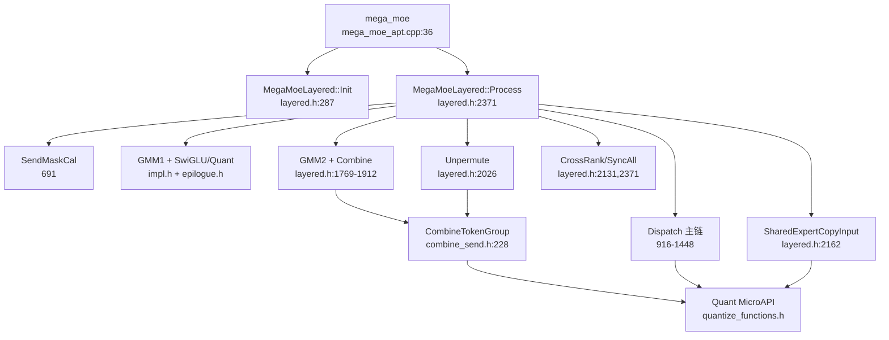
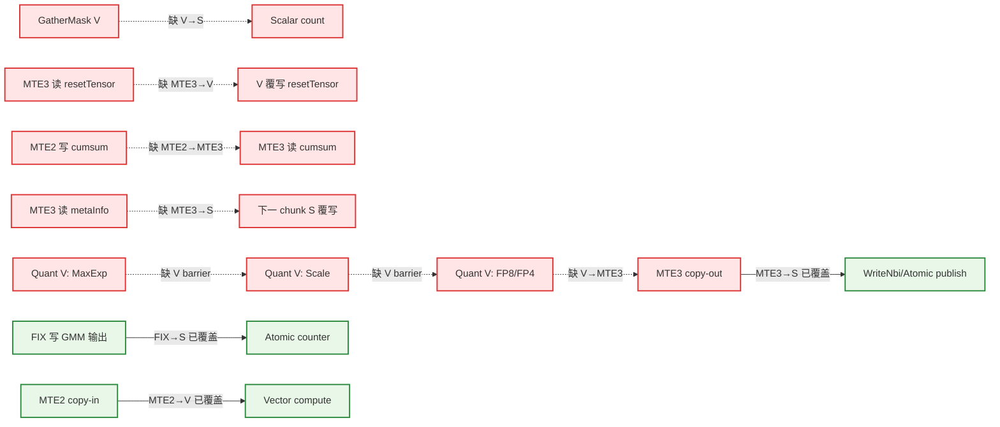

# MegaMoeLayered 流水同步审计报告

审计日期：2026-07-30  
目标文件：`mega_moe_layered.h`  
分析模式：`full`（含分文件分析、覆盖率检查和独立二次确认）

## 1. 算子基本信息

- Kernel 入口：`mega_moe_apt.cpp:36-74` 的 `mega_moe`
- Kernel 类型：`KERNEL_TYPE_MIX_AIC_1_2`（`mega_moe_apt.cpp:44`）
- 核比例：1 个 AIC + 2 个 AIV
- URMA layered 路径：`mega_moe_apt.cpp:62-70`
- AIC/AIV 通过 `if constexpr (g_coreType == AIC/AIV)` 分流；两个 AIV 还通过 `subBlockIdx_` 分工。
- 当前实现不使用 `TPipe/TQue/EnQue/DeQue`，主要依赖 HardEvent、CrossCore、`SyncAll`、GM flag 轮询和 Hcomm `Drain`。
- AIC 内普通 Cube 流水同步按规则由框架处理；本报告的缺失同步主要位于 AIV。

涉及的核心 kernel 文件：

1. `mega_moe_apt.cpp`
2. `mega_moe_layered.h`
3. `mega_moe_base.h`
4. `mega_moe_impl.h`
5. `block_epilogue_swiglu_mx_quant.h`
6. `mega_moe_combine_send.h`
7. `moe_distribute_dispatch_v2/op_kernel/quantize_functions.h`

地址布局辅助文件 `mega_moe_workspace_info.h`、`mega_moe_impl_base.h` 已检查，无同步指令。

## 2. 函数调用图

## 3. 关键指令流水归属

| 指令/位置 | 流水 | Tensor/区域 | 读写 | Stage |
|---|---|---|---|---|
| `GatherMask`，`layered.h:745-746` | V | `maskBuf`、`roundSendCnt` | 读/写 | Send mask compute |
| `DataCopyPad`，`layered.h:648` | MTE3 | `resetTensor_` → flag GM | 读/写 | Reset copy-out |
| `DataCopyPad`，`layered.h:1129-1131` | MTE2 | cumsum GM → `cumsumInfoTensor_` | 读/写 | Restore |
| `DataCopyPad`，`layered.h:1153-1154` | MTE3 | `cumsumInfoTensor_` → GM | 读/写 | Persist |
| `DataCopy`，`layered.h:1331` | MTE3 | `metaInfoTensor_` → GM | 读/写 | Dispatch metadata |
| `GatherMask`，`layered.h:1402-1403` | V | mask/index → `roundTokenCnt` | 读/写 | Dispatch gather |
| `ComputeMaxExp/Scale/FpX`，`layered.h:896-903` | V | `mxTempTensor_`、`xOutTensor1_` | 读/写 | Relay quant |
| `ComputeMaxExp/Scale/FpX`，`layered.h:2227-2234` | V | `mxTempBuf`、`xOutBuf` | 读/写 | Shared quant |
| `DataCopy`，`layered.h:1806` | MTE2 | triple GM → `metaInfoTensor` | 读/写 | Combine copy-in |
| `ComputeMaxExp/Scale/Fp8`，`combine_send.h:124-128` | V | `floatTemp`、`ubQuantData` | 读/写 | Combine quant |
| `DataCopyPad`，`combine_send.h:97` | MTE3 | `ubQuant` → staging/local GM | 读/写 | Combine copy-out |
| `WriteNbi`，`combine_send.h:104` | S/通信 | staging GM → remote GM | 读/写 | URMA publish |
| SwiGLU/quant helpers，`block_epilogue...h:632-713` | V | `gluRes/maxExp/halfScale/output` | 读/写 | Epilogue |
| Epilogue copy-out，`block_epilogue...h:793-801` | MTE3 | quant UB → GM | 读/写 | Epilogue copy-out |
| `AtomicAdd`，`block_epilogue...h:808` | S | group ready flag | 写 | Publish |

## 4. 数据依赖关系图

红色虚线表示确认缺失同步；绿色实线表示已有同步覆盖。

## 5. 同步排查结果

### 5.1 确认问题：缺失同步

以下结论均经过独立二次确认。

| # | 位置 | 依赖关系 | 类型 | 建议修复 | 风险 |
|---:|---|---|---|---|---|
| 1 | `layered.h:746-748` | `GatherMask(V)` 写 `roundSendCnt` → `totalSendCnt +=`(S)；现有 `V_S` 在消费之后 | RAW，V→S | 将 `V_S` 移到 746 后、747 前 | 高 |
| 2 | `layered.h:1402-1428` | `GatherMask(V)` 写 `roundTokenCnt` → 1405 起的 Scalar 判断/计数；现有 1428 同步太晚且可被 `continue` 跳过 | RAW，V→S | 在 1403 后立即加 `V_S`，随后 1428 可删除 | 高 |
| 3 | `layered.h:648 → 1662` | MTE3 读 `resetTensor_` → V 以 `Duplicate` 覆写同一 UB | WAR，MTE3→V | 在调用 `ResetGmm2CombineSyncCounters()` 前加 `MTE3_V` | 中 |
| 4 | `layered.h:1129 → 1153` | A8W4 下 MTE2 恢复 cumsum 前缀 → MTE3 搬出包含该前缀的区域 | RAW，MTE2→MTE3 | 1129 后加 `MTE2_S`，与 1148 的 `S_MTE3` 形成传递链；或 1153 前直接加 `MTE2_MTE3` | 高 |
| 5 | `layered.h:1331 → 下一 chunk 1319` | MTE3 读 `metaInfoTensor_` → 下一 chunk Scalar 覆写复用 UB | 循环 WAR，MTE3→S | 1331 后立即加 `MTE3_S`，或将 1431 下沉到每个 chunk | 高 |
| 6 | `layered.h:896 → 897 → 898/902` | `ComputeMaxExp` 写 maxExp → `ComputeScale` 读；Scale 写 halfScale → FP4/FP8 读 | 两个 RAW，V→V | 896 后、897 后各加一次 `PipeBarrier<PIPE_V>()` | 高 |
| 7 | `layered.h:2227 → 2228 → 2229/2233` | shared input 量化的 maxExp/halfScale 同 PIPE_V RAW；单份 `mxTempBuf` 还有循环回边 | RAW/WAR，V→V | 2227 后、2228 后各加一次 `PipeBarrier<PIPE_V>()` | 高 |
| 8 | `combine_send.h:124 → 126 → 127` | combine quant 的 maxExp/halfScale 同 PIPE_V RAW | 两个 RAW，V→V | 124 后、126 后各加一次 `PipeBarrier<PIPE_V>()` | 高 |
| 9 | `combine_send.h:262-263 → 97` | 量化 V 写 `ubQuant` 的 data/scale → MTE3 搬出；现有 `V_S` 方向错误 | RAW，V→MTE3 | 将 263 改为 `SyncFuncStatic<HardEvent::V_MTE3, SYNC_EVENT_ID5>()` | 高 |
| 10 | `block_epilogue...h:658/688/694 → 704 → 705 → 708/713` | SwiGLU 写 `gluRes` → MaxExp；MaxExp → Scale；Scale → FP8/FP4 | 三个 RAW，V→V | 704 前、704 后、705 后各加一次 `PipeBarrier<PIPE_V>()` | 高 |
| 11 | `layered.h:2103 → 2117` | 当 `topK_==1 && sharedExpertNum_==0` 时，`Muls` 写 `dataResFp32Tensor_` → `Cast` 读 | RAW，V→V | 专家循环结束后、2117 前补 `PipeBarrier<PIPE_V>()` | 高，条件触发 |
| 12 | `layered.h:2074 → 下一 chunk 2048` | float top-k weight：Scalar 读 `topKWeightsTensor_` → 下一 chunk MTE2 覆写 | 循环 WAR，S→MTE2 | chunk 尾部、2121 前加 `S_MTE2` | 中，条件触发 |
| 13 | `layered.h:2063 → 下一 chunk 2061` | bf16 top-k weight：V 读 `tempLocal` → 下一 chunk MTE2 覆写 | 循环 WAR，V→MTE2 | chunk 尾部加 `V_MTE2`；保留 2064 的 `V_S` | 中，条件触发 |
| 14 | `combine_send.h:67-69 → 下一次 layered.h:1806` | Scalar 读 `metaInfoTensor` → 下一批 MTE2 覆写相同 `batchBaseOffset` | 跨函数循环 WAR，S→MTE2 | 1806 前加 `S_MTE2`，或在 `CombineTokenGroup` 返回前同步 | 中，条件触发 |

优先修复 #1、#2、#4、#5、#9：它们直接影响计数、dispatch 元信息或对外发送数据。#6～#10 属于同一类量化流水模式，建议一次性统一修正。

### 5.2 确认问题：过度同步

| 位置 | 当前同步 | 实际需要 | 优化建议 | 性能影响 |
|---|---|---|---|---|
| `layered.h:528` | `PipeBarrier<PIPE_ALL>` | 仅等待初始化 `Duplicate` 的 PIPE_V | 改为 `PipeBarrier<PIPE_V>()`，不可直接删除 | 避免初始化阶段全流水排空 |
| `layered.h:772` | 每个 mask round `PIPE_ALL` | 槽位复用需 MTE3→V；最终发布 count 需 MTE3→S | 每轮改精确 `MTE3_V`，round 循环后、count 写前补一次 `MTE3_S`；更优为双 event 管理 ping-pong | 当前每轮破坏 V/MTE3 并行 |
| `layered.h:1050` | `PipeBarrier<PIPE_ALL>` | 前方只有 Scalar 地址/GM 读，初始化状态已由 2384/2386 和 2151/2152 发布 | 删除 | 消除 dispatch sender 启动时的无效全流水停顿 |
| `layered.h:2012-2013` | `S_V` Set/Wait | Cast 的输入已由 2010-2011 的 `MTE2_V` 覆盖，无 Scalar producer | 删除该 `S_V`；保留 2015/2017 的 V barrier | 减少每个共享专家一次事件往返 |
| `layered.h:2249` | 双 event drain 后再 `PIPE_ALL` | 2247/2248 已等待两路 MTE3；调用者 2384 还会再次 `PIPE_ALL` | 删除 2249 | 避免 shared input 结束处重复全流水排空 |
| `block_epilogue...h:805-806` | 无条件 `MTE3_S` | 普通 MoE 的非空 group flag 需要；shared epilogue 传 `nullptr` 时无 Scalar consumer | 将 `MTE3_S` 移入 `if (groupFlagListGmAddr_ != nullptr)`，置于 AtomicAdd 前 | 消除 shared GMM1 每 tile 的无效事件 |

### 5.3 已正确覆盖

| 依赖 | 已有同步 |
|---|---|
| `topkIdsTensor_`：V 清零 → MTE2 覆盖 → V Compare | `layered.h:730 V_MTE2`、`:737 MTE2_V` |
| `maskBuf`：Compare 写 → GatherMask 读 | `layered.h:743 PipeBarrier<PIPE_V>` |
| Relay 量化输出 V → MTE3 → ready flag S | `layered.h:906 V_MTE3`、`:908 MTE3_S`、`:912 PIPE_ALL` |
| 5-buffer local relay 的 MTE2/MTE3 槽位复用 | `layered.h:1186-1223` 的 event 1～5 配对 |
| Remote relay flag snapshot：MTE2 写 → S 读 → 下一轮 MTE2 覆写 | `layered.h:1261 MTE2_S`、`:1286 S_MTE2` |
| GMM2 FIX 写数据 → Scalar 发布 combine counter | `mega_moe_impl.h:139-149`、`:157-161` 的 `FIX_S` |
| A8W4 GMM 输出 → status/sequence 发布 | `mega_moe_impl.h:898-908` 的 `FIX_S` |
| GMM1 AIC/AIV tile 协作 | `mega_moe_base.h:135-153` 的 mode 4、flag 4～7 CrossCore 配对 |
| Epilogue MTE3 数据写 → 普通 MoE group flag `AtomicAdd` | `block_epilogue...h:805-808 MTE3_S`（仅非空 flag 路径必要） |
| Combine staging GM 写 → Hcomm `WriteNbi` | `mega_moe_combine_send.h:98 MTE3_S` |
| `DeQuantMxFp8` 内 VEC store → load | `mega_moe_combine_send.h:179,188 LocalMemBar` |
| `metaPtr[0]=tokenIdx` → `metaPtr[1]=ready` | 两次 `WriteGmByPassDCache` 均属 PIPE_S，同流水保序；注释掉的 954 `PIPE_ALL` 不需要恢复 |

HardEvent Set/Wait 检查：

- `ExpertTokenNumCopyOut` 的 event 配对正确。
- `CopyTokensFromLocalRelay` 的五槽 prime/steady/drain 闭合。
- `Unpermute` 和 `SharedExpertCopyInput` 的 event 0/1 双缓冲配对闭合。
- 未发现静态 tensor event ID 6/7 误用。

CrossCore 检查：

- mode 4 flag 4/5：AIC FIX → AIV V，配对正确。
- mode 4 flag 6/7：AIV V → AIC FIX，配对正确。
- 未发现孤立 Wait、提前 return 跳过 Set 或 flag 冲突。

### 5.4 SyncAll 路径计数

| 路径 | `SyncAll<false>` | `SyncAll<true>` |
|---|---:|---:|
| AIC，`sharedExpertNum_==0` | 1（2386） | AIC 不属于 true 域 |
| AIV，`sharedExpertNum_==0` | 1（2386） | 4（2152、2457、2473、2152） |
| AIC，`sharedExpertNum_>0` | 3（2386、2396、2367） | AIC 不属于 true 域 |
| AIV，`sharedExpertNum_>0` | 3（2386、2396、2367） | 4（2152、2457、2473、2152） |

所有参与核在各自同步域内次数一致，未发现 `SyncAll` 路径不一致导致的挂死风险。

### 5.5 需要人工确认

二次确认后没有遗留的低置信同步点。报告中的条件触发项均可由代码路径确定；修复前仍建议在目标 SoC 上检查编译后的流水指令序列，并做大 batch、多 chunk、`topK=1`、A8W4/A4W4、shared expert 和 combine quant 覆盖测试。

## 6. 覆盖率报告

| 文件 | 分析状态 | 覆盖说明 |
|---|---|---|
| `mega_moe_apt.cpp` | 已分析 | kernel 入口、模板分支、Kernel 类型 |
| `mega_moe_layered.h` | 已分析 | 全部可达成员函数、条件分支、循环回边、跨函数依赖 |
| `mega_moe_base.h` | 已分析 | CrossCore、`SyncFuncStatic`、GM barrier |
| `mega_moe_impl.h` | 已分析 | generic/A8W4/A4W4 的 AIC/AIV GMM 主链 |
| `block_epilogue_swiglu_mx_quant.h` | 已分析 | SwiGLU、量化、MTE3 copy-out、状态发布 |
| `mega_moe_combine_send.h` | 已分析 | layered combine、quant、URMA 发送、跨调用回边 |
| `quantize_functions.h` | 已分析 | 当前路径可达的 MicroAPI 量化叶子 |
| `mega_moe_workspace_info.h` | 已检查 | 仅地址布局，无流水 API |
| `mega_moe_impl_base.h` | 已检查 | 常量/layout/policy，无流水 API |
| SDK `kernel_operator`、Hcomm、Blaze、Te | 外部叶子 | 在项目内 API 调用边界截止 |

覆盖率：项目内可达同步相关 kernel 文件和函数 100%。

## 7. 风险等级总评

- 确认缺失同步：14 组，其中最高风险为高。
- 确认过度同步：6 处。
- CrossCore 配对问题：0。
- `SyncAll` 路径计数问题：0。
- 总体评估：**严重问题**。

主要正确性风险集中在：

1. `GatherMask` 的 Vector 输出在 Scalar 消费之后才同步；
2. cumsum/metaInfo 等 UB 的跨流水与循环回边复用；
3. 多条量化链缺少同 PIPE_V barrier；
4. combine 量化结果缺少 V→MTE3，可能发送未完成的 data/scale。

建议先修复确认缺失同步，再按过度同步表逐项收窄同步粒度；不要在修复阶段用新增 `PIPE_ALL` 统一兜底。
