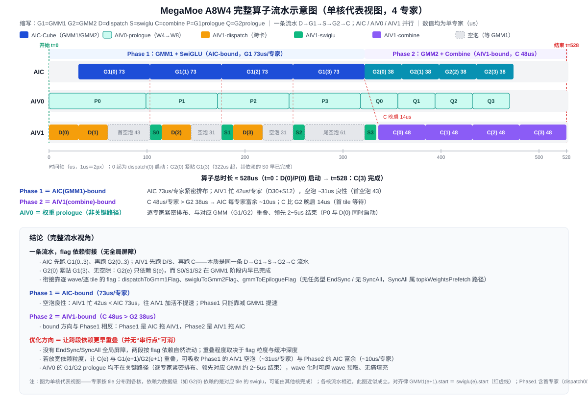
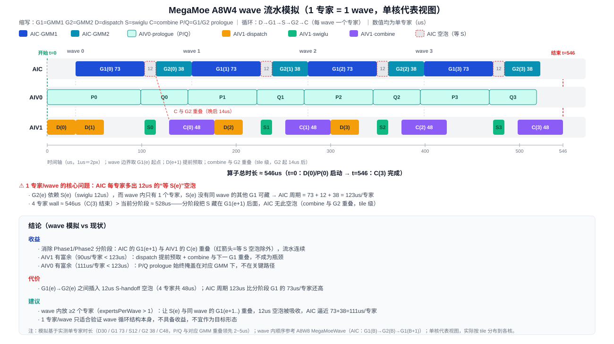
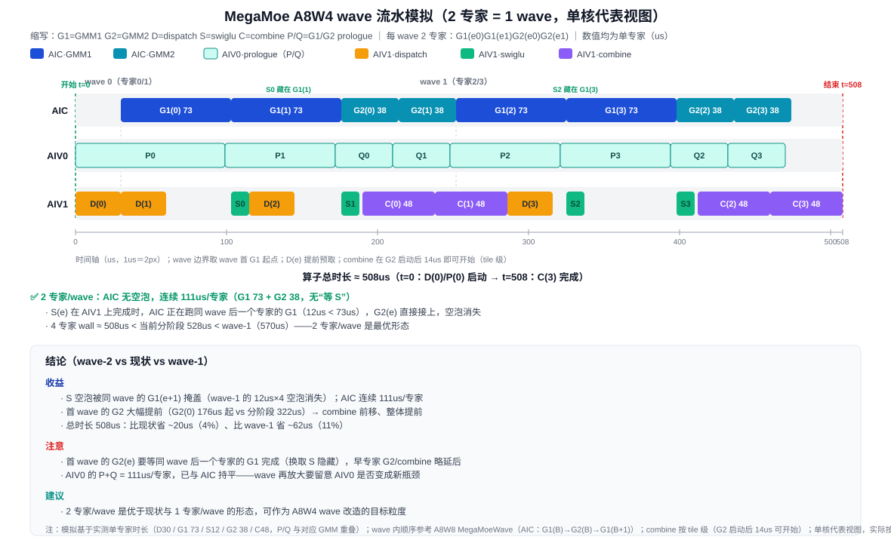
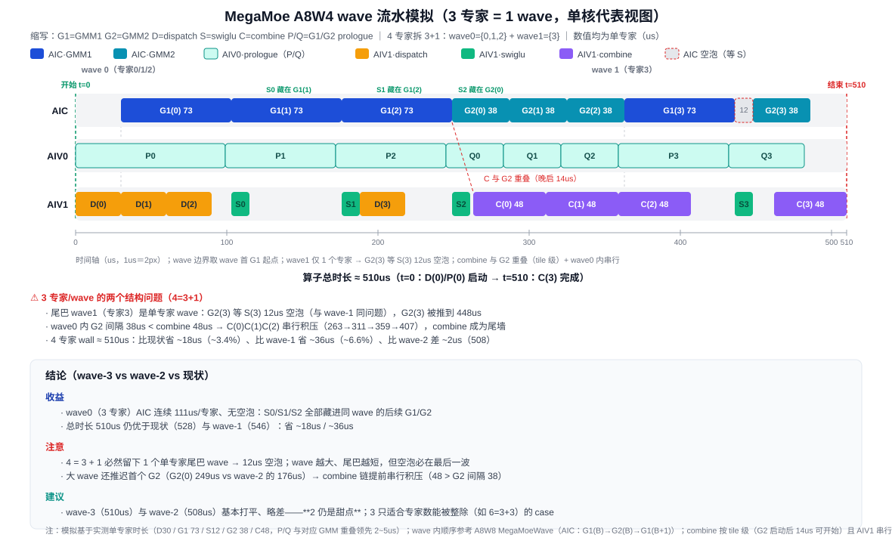
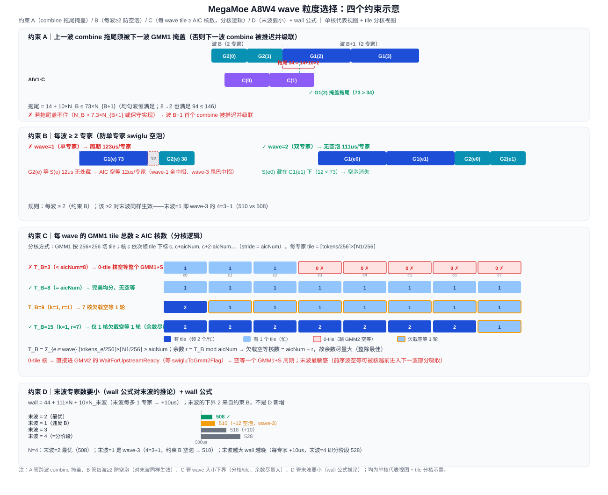

# MegaMoe A8W4 wave 流水改造设计

> 基于 A8W4 关键路径 trace 数据的 wave 流水改造方案设计。
> 配套打点设计见 [`mega_moe_a8w4_critical_path_trace_design.md`](mega_moe_a8w4_critical_path_trace_design.md)。

## 摘要

A8W4 当前走 `MegaMoe` 逐专家/分阶段主流程：AIC 先跑全部专家的 GMM1（Phase1）、再跑全部专家的 GMM2（Phase2），两段的空泡与富余方向相反却无法互相吸收。本设计把 A8W4 迁移到 **wave 滚动流水**（对齐 A8W8 已用的 `MegaMoeWave`），核心结论：

- **目标粒度：2 专家/wave**。AIC 按 `G1(e0)→G1(e1)→G2(e0)→G2(e1)` 连续运行，SwiGLU 的 12us 被同 wave 的另一个 GMM1 掩盖，AIC 无空泡、连续 111us/专家。
- **模拟收益：算子总时长 ≈ 508us**（当前分阶段 ≈ 528us，约 -20us / 4%），且已贴近单核代表视图的模型下限。
- **两个反直觉结论**：① 1 专家/wave 反而更慢（≈546us，每专家多 12us "等 S" 空泡）；② wave 不是越大越好（4 专家/wave 回到 528us），**2 是甜点**。
- **后续真正提速点在 combine**（48us/专家、AIV1-bound），wave 结构救不了它；combine 跨核并行可再降到 ~498us。

> ⚠️ 说明：当前收益量化基于单一 case（4 专家、固定 token 分布）的模拟，真实时长随 token 分布浮动，落地后需用 A8W4 trace 实测复核。

---

## 1. 背景与目标

### 1.1 现状

- A8W8 已使用 `MegaMoeWave`（`mega_moe_wave.h`）：把多个专家组成 wave，使 Dispatch / GMM1 / SwiGLU / GMM2 / Combine 交叠执行。
- **A8W4 仍使用 `MegaMoe` 逐专家主流程**（`mega_moe.h` + `mega_moe_impl.h` 的 `AicComputeA8W4` / `AivGmm2PostA8W4`）。两段之间的衔接是**逐 wave / 逐 tile 的 flag**（`dispatchToGmm1Flag`、`swigluToGmm2Flag`、`gmmToEpilogueFlag`）；A8W4 没有任务型 EndSync、也没有 SyncAll 全局屏障（`SyncAll` 属 topkWeightsPrefetch 路径）。

### 1.2 当前流水的三个结构性浪费

用 A8W4 关键路径 trace 数据把当前流水画出来（单核代表视图，4 专家）：

| 角色 | 职责 | 单专家时长 | 关键路径判断 |
| --- | --- | --- | --- |
| AIC | GMM1 / GMM2 矩阵计算 | 73us / 38us | **Phase1 bound**（73us/专家） |
| AIV0 | GMM1/GMM2 权重 prologue（W4→W8） | 与对应 GMM 重叠、领先 2~5us 结束 | 不在关键路径 |
| AIV1 | Dispatch（跨卡）/ Swiglu / Combine | 30us / 12us / 48us | **Phase2 bound**（48us/专家） |



三个结构性浪费：

1. **Phase1 的 AIV1 空泡 ~31us/专家**（等 GMM1；稳态下限 = 73 − 30 − 12）。
2. **Phase2 的 AIC 富余 ~10us/专家**（combine 48us > G2 38us，AIC 空转）。
3. **两段互补却无法互相吸收**：AIV1 的空泡与 AIC 的富余方向相反，在"全部 G1 → 全部 G2"的分阶段结构下各自独立存在。

### 1.3 目标

把 A8W4 迁移到 wave 滚动流水，使：

- AIC 的 GMM1/GMM2 **连续工作、无空泡**；
- AIV1 的 Dispatch / Swiglu 与 Combine **跨专家重叠**；
- AIV0 的 prologue **跨 wave 预取**（本身就不在关键路径，无代价）；
- 用**最小改动**先验证 wave 循环结构、量化收益，而不是只改代码结构。

---

## 2. 优化点

基于 trace 数据与代码实现，wave 化改造的核心优化点：

| # | 优化点 | 现状（分阶段） | wave 化后 |
| --- | --- | --- | --- |
| 1 | AIC 连续性 | Phase1 G1（73us/专家）+ Phase2 G2（38us/专家）分两段 | `G1(B)→G2(B)→G1(B+1)` 单循环连续 |
| 2 | 消除"等 S"空泡 | 分阶段靠 S 藏在 G1(e+1) 后 | wave 内 S(e) 藏在同 wave 的 G1(e+1)/G2(e) 后 |
| 3 | G2 / combine 前移 | G2(0) 要等全部 G1 完成（322us 才起） | 2 专家/wave 下 G2(0) 176us 就起 |
| 4 | combine 与下一 wave 重叠 | C(e) 只与相邻专家部分重叠 | 结构上保证 C(e) 与下一 wave 的 G1 重叠 |
| 5 | dispatch 提前预取 | D(e) 逐专家 | D(e+1) 在 C(e) 之前完成 |
| 6 | prologue 跨 wave 预取 | P/Q 与对应 GMM 重叠、非关键路径 | 天然可提前，无代价 |

---

## 3. 收益来源与量化

### 3.1 三种形态的模拟对比（4 专家 case，实测单专家时长）

| 形态 | 算子总时长 | 相对现状 | 说明 |
| --- | --- | --- | --- |
| 当前分阶段 | ≈ 528us | — | S 藏在 G1(e+1) 后、AIC 连续，但 G2 全晚 |
| wave-1（1 专家/wave） | ≈ 546us | **+18us（变慢 ~3%）** | 负面案例：G2(e) 等 S(e) 的 12us 空泡无处藏 |
| **wave-2（2 专家/wave）** | **≈ 508us** | **−20us（提升 ~4%）** | **最优**：S 藏好 + G2/combine 前移 |
| wave-3（3 专家/wave） | ≈ 510us | **−18us（提升 ~3.4%）** | 4=3+1：尾 wave 单专家 12us 空泡 + wave0 内 combine 串行积压 |

### 3.2 wave-1：为什么 1 专家/wave 不划算



1 专家/wave 时 AIC 按 `G1(e)→G2(e)` 逐专家跑，而 **G2(e) 依赖 S(e)**（swiglu 12us）；wave 内没有第二个专家可藏，AIC 每个专家插入 **12us "等 S" 空泡**，周期 123us/专家。注意 **combine 仍与 G2 重叠**（tile 级：G2 启动后 14us 首 tile 即可开始，并不等 G2 全部完成），因此 4 专家总时长 ≈ 546us——仍比当前分阶段（528us）慢，根因是 AIC 的 12us 等 S 空泡把 G2 整体推后（最后一个 G2(3) 到 522us，分阶段为 474us），combine 的重叠救不回这段 AIC 空转。

> **结论：1 专家/wave 只适合用来验证 wave 循环结构本身，不是收益形态。**

### 3.3 wave-2：收益形态



2 专家/wave 时 AIC 按 `G1(0)→G1(1)→G2(0)→G2(1)` 跑：**S(0) 做 12us 期间，AIC 正在跑 G1(1)（73us）**，等 S 空泡被吸收，AIC 连续 111us/专家、无空泡。同时第一波 G2(0) 提前到 176us（vs 分阶段 322us），combine 跟着前移，整体 ≈ 508us。

### 3.4 wave-3：4=3+1 为什么不是最优（验证形态）



3 专家/wave 时 AIC 按 `G1(0)→G1(1)→G1(2)→G2(0)→G2(1)→G2(2)` 跑：**wave0 内 S0/S1/S2 全部藏进同 wave 的后续 G1/G2，AIC 连续 111us/专家、无空泡**。但 4 = 3 + 1，**wave1 只剩 1 个专家 → 单专家 wave 的 12us "等 S" 空泡重现**：G2(3) 等到 448us 才起（wave-2 只需 436us）。

wall 由 combine 尾墙决定（末波 C(3) = [462, 510]）：

- wave0 内 G2 间隔 38us < combine 48us → C(0)C(1)C(2) 串行积压（263→311→359→407）；
- C(3) = max(G2(3)+14 = 462, C(2) 结束 407 + 48 = 455) = 462 → **wall ≈ 510us**。

> **结论：wave-3（510us）与 wave-2（508us）基本打平、略差 2us**。4=3+1 的尾巴单专家 wave 空泡（+12us）抵消了 wave0 的 S 隐藏收益，大 wave 还让 wave0 内 combine 串行积压。这也与 3.7 的 wall 公式一致：公式对 N_末波 ≥ 2 成立（末波 2 → 508）；4=3+1 的 N_末波=1 违反约束 B，额外 +12us → 510。**2 仍是甜点；3 只适合专家数能被整除（如 6=3+3）的 case。**

### 3.5 收益来源分解

1. **消除"等 S"空泡**：相对 wave-1，2 专家/wave 把 4 × 12us = 48us 的空泡全部藏掉。
2. **G2 / combine 前移**：相对现状，第一波 G2(0) 提前 146us（322→176），AIV1 的 combine 流提前清空，使最后一波 C(2)/C(3) 能贴着 G2 tile 就绪点（412/450us）启动，尾段缩短约 20us。
3. **AIC / AIV0 满载**：AIC 的 444us GMM 工作连续执行；AIV0 的 P+Q 与 AIC 持平，仍不在关键路径。

### 3.6 为什么 wave-2 已是模型下限（508us）

两个约束同时卡住，wall 无法更低（单核代表视图 + combine 串行模型）：

- **AIC 连续**：G2(3) 最早只能 `30 + 4×73 + 3×38 = 436us` 起；
- **combine 串行**：`C(3) ≥ C(2) 结束 ≥ G2(2) 首 tile(412) + 48 = 460`；
- 因此 **wall ≥ 460 + 48 = 508us**，wave-2 恰好每个约束都顶满。

> **注意：wave 不是越大越好。** N=4（= 当前分阶段结构）因为 G2(0) 被推到 322、第一波 combine 全部延后、AIV1 在 412us 时还忙着 C(1)，C(2)/C(3) 被拖到 432/480us，反而回到 528us。wave-3（4=3+1）≈510us 也比 wave-2 差 2us：尾巴单专家 wave 的 12us 等 S 空泡 + wave0 内 combine 串行积压（C 48 > G2 间隔 38）。**2 专家/wave 是甜点。**

### 3.7 wave 粒度选择逻辑（四个约束 + wall 公式）



设单专家实测：G1=73、S=12、G2=38、C=48；wave B 含 N_B 个专家，同 wave 内 G2 背靠背（间隔 38us）。

**约束 A（关键机制）—— 上一波 combine 拖尾须能被下一波 GMM1 掩盖，否则下一波 combine 被推迟**：波 B 的 combine 从本波首个 G2 起 14us 开始（tile 级），盖住本波背靠背 G2；超出本波最后一个 G2 的**拖尾 = 14 + 10×N_B** us。AIV1 上 combine 串行，波 B+1 的首个 combine 不能早于波 B 最后一个 combine 结束——若拖尾盖不住，下一波 combine 被推迟并沿链级联：

$$14 + 10 N_B \le 73 \times N_{B+1} \quad(\approx N_B \le 7.3 \times N_{B+1})$$

- **均匀波（N_B = N_{B+1}）恒满足** → 均匀分布保证该机制永不触发，这是要避免"上一波极大、下一波极小"的原因；
- tile 级下 **8→2 也不破**（拖尾 94 ≤ 146）；破界需 N_B > 7.3×N_{B+1}（如 15→2），或保守实现（combine 等本波 G2 全完成才起，拖尾变 48×N_B，需 N_B ≤ 1.5×N_{B+1}，此时 8→2、4→2 都破）。

**约束 B —— 每核 wave 内 ≥ 2 个 GMM1 tile（$T_B \ge 2\times aicNum$，硬条件）**：藏住 S 需要“wave 内 GMM1 时段 ≥ S 时长”。swiglu 很快（12us）**一定比 GMM1 少**，故每核 2 个 tile 的 GMM1 时段必 > S，S 必被同 wave 的后续 GMM1 藏住、**不会等 S**。**与专家数无关**（1 个 tile 多的专家贡献每核 2 tile，或 2 个专家各贡献每核 1 tile 均可）。wave-1 的 12us 空泡本质是“每核 tile < 2”（该 case 每专家每核约 1.5 tile）；wave-2 恰好把每核 tile 抬到 ≥2。$2\times aicNum$ 是**硬性下界**（表述明确、杜绝等 S），与约束 C（$T_B\ge aicNum$，防空等）合并后有效下界即 $T_B\ge 2\times aicNum$。

**约束 C —— 每 wave 的 GMM1 tile 总数 ≥ AIC 核数（任务量/核占用）**：GMM1 按 256×256 切 tile（`GMM1_TILE_M=256`、`L1_TILE_N=256`），各 AIC 核按 `loopIdx += blockNum` 步进领 tile。若某 wave 的 GMM1 tile 总数 < AIC 核数，必有核在 GMM1 阶段 0 tile → 直接进 GMM2，而 GMM2 的 `WaitForUpstreamReady` 要等 `swigluToGmm2Flag`（GMM1→S 完成）→ **该核空等一个 GMM1+S 周期**：

$$\sum_{e \in wave} \Big\lceil \tfrac{tokens_e}{256} \Big\rceil \times \Big\lceil \tfrac{N1}{256} \Big\rceil \ge N_{AIC}$$

（N1 = GMM1 输出/中间维；每专家 tile 数 = M-tile × N-tile。）

- **与 token 路由强相关**：稀疏路由下有的专家 token 少（tile 少）甚至为 0（不产生 tile）→ 该 wave 有效 tile 变少，需更大 wave（每波专家数 ≥ ⌈aicNum / 每专家平均 tile⌉）才能凑够 aicNum 个 tile；**本质约束是每波（含末波）T_B ≥ aicNum**（"并入前一波"只是重排，不消除问题）；
- **余数空等（T_B mod aicNum）**：tile 数几乎不可能整除 aicNum → 余数空等不可避免。wave 的 GMM1 阶段 = ⌈T_B/aicNum⌉ 轮，前 r = T_B mod aicNum 个核领 k+1 tile、其余 **aicNum−r 个核欠载空等 1 tile**（空等核数 = aicNum − r）→ **在 T_B ≥ aicNum 前提下让余数尽量大（整除 r=0 最佳）**，即每 wave 把 tile 凑满整数轮、余数尽量大以减少欠载核；**该空等主要落在末波**（前序波的欠载核可被越前进入下一波 GMM1 部分吸收）；
- **与"末波取 2"的张力**：wall 公式偏好末波小，但末波也须满足 T_B ≥ aicNum 且余数尽量大；token 稀疏时末波可能需 >2 专家。

**约束 D —— 末波专家数要小（wall 公式对末波的推论）**：combine 尾墙是每波必付的墙，wall = `44+111N+10×N_末波`——末波每多 1 专家，combine 链多 48us、末波 G2 只提前 38us（少一个前序专家）→ **净 +10us/专家**，故末波要尽量小。**末波的下界不是约束 D 新增的，而是约束 B（每核 ≥2 tile，防 S 空泡）对末波同样生效**——末波=1 个“每核 tile<2”的专家即 wave-3 的 4=3+1 尾巴（510 vs 508），比末波每核 ≥2 tile 更差。故末波取**尽量小但满足约束 B（每核 ≥2 tile）与约束 C（每核 ≥1 tile）**；固定“2 专家”只在能凑够 tile 时成立。

**wall 公式（拖尾恒被掩盖时，只与末波大小有关）**：对固定 N，**末波之前的专家数恒为 N − N_末波，前面的波怎么排都不影响**：

$$\text{wall} = 44 + 111\times N + 10\times N_{\text{末波}}$$

（推导：末波首个 G2 = `30 + 111(N−N_末波) + 73N_末波`，加 `14 + 48N_末波` 得 `44 + 111N + 10N_末波`。）

- 末波每多 1 专家 → wall +10us；末波最小合法值 2 → **wall_min = 64 + 111×N**；
- N=4：末波 2 → 508（wave-2）；N=5：末波 2（即 3+2）→ 619、末波 3（即 2+3）→ 629；N=6：末波 2（2+2+2）→ 730、末波 3（3+3）→ 740；N=8：末波 2（2+2+2+2 / 6+2 / 4+2+2 等价）→ 952。

**结论**：
1. 每波（含末波）每核 ≥2 个 GMM1 tile（约束 B，$T_B \ge 2\times aicNum$），拆分不得留下每核 tile<2 的尾巴波（如 `…+1` 的单专家尾巴）；
2. 末波尽量小（约束 D：wall 每多 1 专家 +10us），但须满足约束 B（末波每核 ≥2 tile）与约束 C（末波每核 ≥1 tile）；固定 2 专家仅在能凑够 tile 时成立：wall = 64 + 111N，末波尾墙最小且必付；
3. **每 wave 均匀分布且每核 ≥2 tile（$T_B \ge 2\times aicNum$）**：同时满足 B，且保证约束 A 在 tile 级/保守两种实现下都不触发——最稳的默认值；
4. **wave 大小下界由任务量定（约束 C）**：每 wave（含末波）GMM1 tile 总数 ≥ aicNum，否则核空等；在此前提下余数 T_B mod aicNum 尽量大（整除最佳）以减少欠载核空等（末波最敏感）。

---

## 4. 改造方案

> 本节的"怎么改"落到**函数与数据结构层面**，与现状代码（`MegaMoe::Process()`）和 A8W8 wave 参考（`MegaMoeWave`）一一对应，可直接指导实现。

### 4.1 现状代码结构：两段式 for 循环就是"分阶段"的根源

A8W4 主流程 `MegaMoe::Process()`（`mega_moe.h`）当前是**两个独立的逐专家全量循环**：

```cpp
// —— GMM1 阶段（Phase 1）——
for (localExpertId = 0; localExpertId < moeExpertPerRank_; localExpertId++) {
    AIV1: prefetch dispatch(localExpertId + 1);   // SendCntCal + MetaInfoCalAndDispatch
    GroupMatmulWithSwigluQuant(...);              // GMM1 + SwiGLU
}
EndSync(vecSetSyncCom);   // A8W4 中 vecSetSyncCom==0 → 实为 no-op；prefetch 路径为 allDone 轮询 + SyncAll

// —— GMM2 阶段（Phase 2）——
for (expertIdx = 0; expertIdx < moeExpertPerRank_; expertIdx++) {
    GroupMatmulWithCombine(...);                  // GMM2 + Combine
}
EndGMM2Sync(vecSetSyncCom, gmm2PingPongIdx_);
```

两个 for 之间**没有对 A8W4 生效的任务级 barrier**：`EndSync` / `EndGMM2Sync` 依赖 `vecSetSyncCom`，而 A8W4 的 GMM 走 `gmTileSequence`、不递增它 → `vecSetSyncCom` 恒 0 → **两者对 A8W4 都是 no-op**。真正把"全部 GMM1 完成后才进 GMM2"固定下来的，是**两个独立 for 的循环结构**（AIC 顺序执行：先跑完整个 GMM1 循环，再跑整个 GMM2 循环）。这就是分析中"Phase1 与 Phase2 的互补浪费无法互相吸收"的**代码根源**——wave 化只需改循环结构（逐 wave 交错 GMM1/GMM2）；prefetch 路径的 allDone + SyncAll 才是需要单独处理的真同步。

### 4.2 目标结构：单 wave 滚动循环

把两个循环合并为**一个 wave 循环**，每 wave 含 `expertsPerBatch`（目标 2）个专家，顺序参考 A8W8 `MegaMoeWave::ProcessRoutedExpertWaves`：

```cpp
for (waveBegin = 0; waveBegin < moeExpertPerRank_; waveBegin += waveExpertNum) {
    waveExpertNum = GetWaveExpertCount(waveBegin, moeExpertPerRank_, expertsPerBatch); // 尾 wave 可能不足

    AIV1: dispatch 下一完整 wave；cnt 由 SendCntCal 落 GM，GMM1 consumer 等 flag 后从 GM 读
    AIC : ProcessGmm1Wave(waveBegin, waveEnd);    // GMM1(B) 逐 expert；AIV0 P/Q prologue(B) 与 GMM 同步（共享 scheduler）
    AIC : ProcessGmm2Wave(waveBegin, waveEnd);    // GMM2(B) 直写 GM；combine 由现有 gmm2CombineSyncCounter 逐 row-group 触发
    AIV1: ProcessCombineExperts(waveBegin, waveEnd); // 复用 ProcessCombine（逐 slot 等 gmm2CombineSyncCounter）做 Combine(e)
}
// 收尾：仅剩 AIC→AIV0 的 UB 消费确认回收（参考 wave 路径 EndSync<GMM1_UB_PINGPONG>）
```

- AIC 顺序即 `G1(e0)G1(e1)G2(e0)G2(e1)`，**S(e) 被同 wave 的 G1(e1)/G2(e0) 掩盖**，AIC 连续 111us/专家。
- **A8W4 的 `EndSync`/`EndGMM2Sync` 本为 no-op**（`vecSetSyncCom` 恒 0）→ 无需删 barrier；wave 化关键是**把两个全量 for 改成逐 wave 交错**，去掉"全部 GMM1 完成后才进 GMM2"的结构性串行，靠 wave 内 flag 依赖 + A8W4 现有 GMM2-ready（`gmm2CombineSyncCounter` row-group 粒度）推进；prefetch 路径的 allDone+SyncAll 另作处理。

### 4.3 关键改造点（函数/数据结构级）

| # | 改造点 | 现状（A8W4） | 目标（参考 A8W8 wave） |
| --- | --- | --- | --- |
| 1 | 主循环 | `Process()` 两个 for | 合并为 wave 循环，拆出 `ProcessGmm1Wave` / `ProcessGmm2Wave` / `ProcessCombineExperts(begin, end)` |
| 2 | GMM1 批量 | 循环内直接调 `GroupMatmulWithSwigluQuant` | 包进 `ProcessGmm1Wave`；AIV0 P/Q prologue 与 GMM 同步（同一 scheduler tile 循环驱动），无需跨 wave 预取 |
| 3 | GMM2 批量 | 循环内直接调 `GroupMatmulWithCombine` | 包进 `ProcessGmm2Wave`；combine 由现有 GMM2-ready（tile 级）触发，无需新增 |
| 4 | combine 触发 | 已有 `gmm2CombineSyncCounter`（row-group 粒度、`FIX_S` 同步、逐 slot 归约）+ `gmmToEpilogueFlag`/gmTileSequence 序列软同步 | **复用现有机制，不新增**：`ProcessCombine` 逐 slot 等 `gmm2CombineSyncCounter` == `gmm2NTilesPerGroup_` 提前开 combine（tile 级重叠，晚启 14us）；wave 化只按 wave/expert 管理 slot 复用 |
| 5 | dispatch 预取 | AIV1 独立 `dispatchExpert` 游标解耦生产/消费；cnt 由 `SendCntCal` 落 GM，A8W4 wave consumer 通过专用接口读取已发布值 | 启动时 dispatch 首个完整 wave；每轮 AIV1 在当前 GMM1 期间 dispatch 下一完整 wave |
| 6 | 去串行点 | GMM1 循环后 `EndSync`/allDone/SyncAll | 删除；改 wave 内 flag 推进 |
| 7 | 模板路由 | `apt.cpp` 由 dtype 对决定（`isA8W8DtypePair`→`MegaMoeWave`，否则→`MegaMoe`） | 让 A8W4（fp8×fp4）也进入 wave 实例（见 4.5） |
| 8 | 空专家守卫 | 已有 `UpdateGroupParams` 跳过空专家 | 保留，并 guard `BlockMmad` / `BlockPrologue` 构造（`startLoopIdx < tileNum`），防空专家 flag 溢出 |

### 4.4 依赖、同步与缓冲

- **沿用 wave 粒度 flag（语义不改）**：`dispatchToGmm1Flag`（per-expert × `dispatchFlagSlotsPerExpert_`，专家内按 waveIdx 排布）、`swigluToGmm2Flag[waveIdx]`（`IS_WAVE_FLAG_GRAINED`，GMM2 逐 wave 等该 M-block 的 swiglu tile 完成）；`gmTileSequence`/`gmmToEpilogueFlag` 做 AIC→AIV1 的 GM 写序软同步。
- **A8W4 现状 GMM2 为整 expert 等 swiglu**（`GroupMatmul2CombineA8W4` 未传 `IsWaveFlagGrained`，默认 `false`，等整个 expert 的 `swigluToGmm2Flag` 计数）：对 2 专家/wave **无碍**（wave 内先跑完 GMM1(e0)GMM1(e1) 再进 GMM2，GMM2(e) 等的整 expert swiglu 已就绪），**无需改 flag 粒度**；仅当未来做更细粒度交错才需开启并扩容 swigluToGmm2Flag 的 per-expert 槽数。
- **combine 触发复用 A8W4 现有 GMM2-ready，不新增**：发布侧 `NotifyCombineConsumersOfTileCompletion`（每个 GMM2 tile 写回 + `FIX_S` 后，按 row-group 消费 slot `AtomicAdd`）；等待侧 `ProcessCombine` 逐 slot 等 `gmm2CombineSyncCounter` == `gmm2NTilesPerGroup_` 即提前开 combine（tile 级重叠，晚启 14us）。
- **slot/flag 均 per-expert 静态分配，wave 间天然隔离**：`gmm2CombineSyncCounter` 按 `expertIdx × combineSyncSlotCountPerExpert` 偏移、`dispatchToGmm1Flag` 按 `expertIdx × dispatchFlagSlotsPerExpert_` 偏移——wave B 与 wave B+1 处理不同专家，用的 slot/flag 区不同，**无需环形复用**；只需确认 workspace 对 `combineSyncSlotCountPerExpert × moeExpertPerRank_` 的预留够用（现状已够）。
- **A8W4 的 `EndSync`/`EndGMM2Sync` 均为 no-op**（`vecSetSyncCom` 恒 0，A8W4 GMM 走 `gmTileSequence` 不递增它）→ wave 化**无需删 barrier**，真正改动是**循环结构**（全 GMM1 循环 + 全 GMM2 循环 → 逐 wave 交错）；唯二要处理的：prefetch（TopkWeightsPrefetch）路径的 allDone+SyncAll（真同步，需换 wave 粒度或暂缓），以及 `ExpertTokenNumCopyOut`（读 expert token 数）从原 GMM1 循环后移到所有 wave 结束的收尾。
- **无批次级全局 barrier**：不用 EndSync / SyncAll 做 wave 同步。

### 4.5 两条实施路线（决策点）

- **路线 A（推荐，长期）——把 A8W4 接入 wave 框架**：给 `MegaMoeWave` 增加 `IsA8W4` 模板参数，把 A8W4 特有的 `BlockPrologue`（W4→W8，AIV0）与 fp8×fp4 `BlockMmad` 接进 wave 主循环；`apt.cpp` 的 wave 路由从"仅 A8W8 dtype 对"扩为"含 A8W4"。复用整套 wave 结构（GMM2-ready 扇入、combine 分核、`startBlockIdx_` 游标），改动集中在模板差异，长期维护最干净。
- **路线 B（过渡，风险小）——先在 `MegaMoe::Process()` 内做 wave 循环**：只合并 4.1 的两个 for 为 wave 循环、删除中间 barrier、补 GMM2-ready，不改类层次。改动面小、可快速验证收益；验证后再决定是否抽到 `MegaMoeWave`。
- **建议：先 B 后 A**。B 用最小改动确认"wave 结构 + 2 专家/wave"能拿到模拟的收益（AIC 连续、无等 S、总时长下降），再按 A 把成熟形态沉淀进 wave 框架，避免一上来就动模板矩阵。

### 4.6 分步实施与验收

> **当前状态（路线 B 已落地，已按约束 B/C 精化为动态切波）**：已在 `MegaMoe::Process()` 内实现 `if constexpr (ENABLE_A8W4 && !TopkWeightsPrefetch)` 分支——wave 循环（`GMM1(wave)→GMM2(wave)` 逐 wave 交错），**wave 边界由 GMM1 tile 累计 ≥ 2×aicNum 动态确定**（每专家 tile = ⌈M_e/256⌉×⌈hiddenDim/256⌉，M_e=该专家 token 数），**末波并入**（剩余不足 2 个专家时并入当前 wave，消除"1 专家末波"空泡）；A4W4/generic 与 A8W4-prefetch 保持原两段式（prefetch 的 allDone+SyncAll 真同步暂缓）。待验收：编译 + 精度 + trace。
>
> **dispatch 解耦（已落地）**：dispatch 生产与 GMM1 消费拆为独立 `dispatchExpert` 游标（AIV1 sub==1）。启动时 dispatch 首个完整 wave；每轮 AIV1 先 dispatch 下一完整 wave，同时 AIC/AIV0 进入当前 GMM1，AIV1 预取完后再加入当前 epilogue。`SendCntCal` Phase 3 将 cnt 发布到 `expertRevNumsGlobalTensor_`；dispatch、GMM1 和 GMM2 分别使用独立状态。GMM1 各核在消费 expert 的同一循环中累计 tile 并得到一致的 wave 边界，不再额外扫描 count。原三参数 `UpdateGroupParams(state, expertIdx, sendCnt)` 与非 wave 路径保持不变。待验收：编译（需 CANN 环境）+ 精度 + trace。
>
> **trace 配套修复**：`WriteCriticalPathTrace` 的 `expertsPerWave` 已按编译期常量改为 `(ENABLE_A8W4 && !TopkWeightsPrefetch) ? 2 : 1`；`mega_moe_trace_contract.py` 中 a8w4 contract 的 `experts_per_wave` 由写死 `1` 改为 `"derived_a8w4"`（按 `topk_weights_type` 推导：非 prefetch=2 / prefetch=1），使 runtime config hash 与预期一致（否则报 `runtime_config_hash`/`experts_per_wave` mismatch）。

1. **结构先行**：合并两个 for 为 wave 循环（可先用 `expertsPerBatch = 1` 验证循环结构——按 3.2 这是负面形态，只验证结构、不做目标）。
2. **切 2 专家/wave**：`expertsPerBatch = 2`，确认 AIC 连续（G2(e) 不再等 S(e)）。
3. **循环结构改造（A8W4 无真 barrier 可删）**：A8W4 的 `EndSync`/`EndGMM2Sync` 因 `vecSetSyncCom` 恒 0 本是 no-op；wave 化的实质是把全 GMM1 循环 + 全 GMM2 循环改成逐 wave 交错；prefetch 路径的 allDone+SyncAll 换 wave 粒度或暂缓。
4. **combine 触发复用现有 GMM2-ready**：A8W4 已有 `gmm2CombineSyncCounter`（`NotifyCombineConsumersOfTileCompletion` 发布 + `ProcessCombine` 逐 slot 等待），**无需新增** `PublishGmm2Ready`/`WaitGmm2Ready`；只验证 wave 化后 slot 按 wave/expert 复用不冲突、combine 仍按 row-group 提前触发。
5. **dispatch 预取（已落地整 wave 超前）**：AIV1 sub==1 用独立 `dispatchExpert` 游标解耦 dispatch 生产与 GMM1 消费。启动时 dispatch 首个完整 wave；后续每轮 AIV1 在 AIC/AIV0 执行当前 GMM1 时 dispatch 下一完整 wave。cnt 由 `SendCntCal` 落 GM，GMM1 在原 expert 消费循环中同步累计 tile 并确定 wave 边界。
6. **边界收口**：尾 wave 不足（`GetWaveExpertCount`）、空专家守卫、共享专家保持前后置、combine-quant 路径（`gmm2MmadResPtr` 直写）与 no-quant 路径（GMM2 直写 GM + `FIX_S` 发布）分别验证。
7. **trace 验收**：复用 A8W4 关键路径 trace，保留 GMM1 wave 与 expert 级 GMM2/Combine 采样；逐 tile 的 GMM2-to-Combine 记录因输出量随 shape 快速增长而暂时关闭。量化 AIC 空泡率、G1→S、S→G2、G2→C handoff 等待和算子总时长，与模拟 508us 对比；**确认"真正缩短了哪些等待，而不是只改了代码结构"**。

### 4.7 风险与边界

- **AIV0 潜在共瓶颈**：P+Q ≈ 111us/专家 ≈ AIC；2 专家/wave 下不构成瓶颈，wave > 2 需复查 AIV0 占用。
- **combine 仍是真瓶颈**：48us/专家（AIV1-bound），wave 只消除 G1→G2 空泡、不动 combine；后续靠 combine 跨核并行（→ ~498us）/ 减时长。
- **case 局限**：模拟基于单一 case（4 专家、固定 token 分布）；真实时长随 token 分布浮动，落地后用真实 trace 复核，再决定是否微调 `expertsPerBatch`。
- **同步语义**：wave 化后仍无 EndSync / SyncAll 全局屏障（那是 topkWeightsPrefetch 路径的机制），保持 flag 依赖语义不变，避免引入新的全局同步。

---

## 5. 结论

- A8W4 当前分阶段流水（≈528us）结构上无法让 Phase1 的 AIV1 空泡与 Phase2 的 AIC 富余互相吸收。
- **wave-2（2 专家/wave）是收益形态**：消除"等 S"空泡 + G2/combine 前移，模拟总时长 ≈ 508us（相对现状约 −20us / 4%）。
- 1 专家/wave（546us）与 4 专家/wave（528us）都不如 2 专家/wave，**2 是甜点粒度**。
- 后续真正的提速点在 **combine**（跨核并行 / 减时长），而非 wave 大小。

---

## 6. 参考资料

- `mega_moe_a8w4_critical_path_trace_design.md` —— 关键路径打点设计（本设计的量化前置）
- `mega_moe_wave.h` —— A8W8 wave 流水参考实现
- `mega_moe_impl.h` / `mega_moe.h` —— A8W4 现状主流程
- 模拟图：`tools/critical_path_trace/artifacts/a8w4_pipeline_overview.svg`（现状）、`a8w4_wave1_pipeline_overview.svg`（wave-1）、`a8w4_wave2_pipeline_overview.svg`（wave-2）
