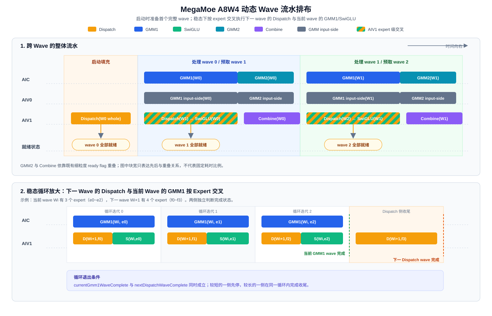
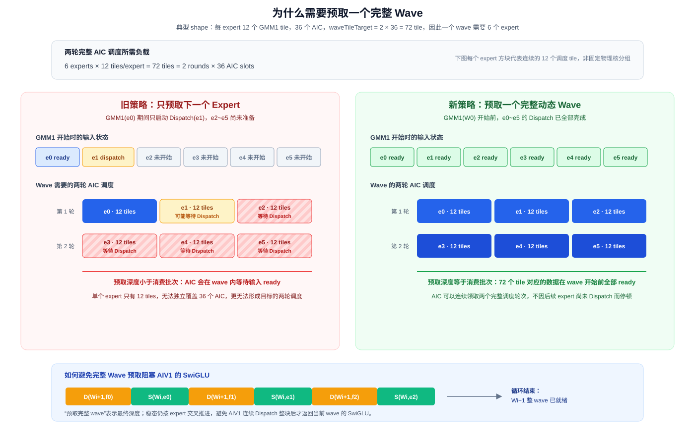

# MegaMoe A8W4 动态 Wave 流水设计

## 1. 文档定位

本文描述 DAV_3510 MegaMoe A8W4 路径的动态 wave 流水方案，作为代码评审、功能验证和后续维护的设计依据。
文档聚焦当前方案的结构、计算规则和同步契约，不展开性能实验过程或候选方案比较。

相关材料：

- `mega_moe_a8w4_wave_design.md`：性能分析、方案演进和实验结论；
- `a8w4_wave_dispatch_decoupling_HANDOFF.md`：开发过程与阶段性交接信息。

## 2. 背景

原 A8W4 主流程按阶段处理全部本卡 MoE 专家：

```text
Dispatch + GMM1 + SwiGLU：expert 0 ... expert E-1
GMM2 + Combine：          expert 0 ... expert E-1
```

这种结构要求所有专家的 GMM1 阶段结束后才能启动第一个专家的 GMM2。不同流水角色在两个阶段中的负载并不
对称，因此阶段边界会放大 AIC、AIV0 和 AIV1 之间的等待，后续专家的 GMM2 与 Combine 也无法及时启动。

另一方面，原先的逐专家预取将下一专家的 Dispatch 与当前专家的 GMM1 锁步，预取深度固定为一个专家。在单专家
GMM1 tile 数较少时，Dispatch 可能无法持续为 AIC 提供下一批输入。

本方案将本卡 MoE 专家划分为运行时确定的 wave，并把下一 wave 的 Dispatch 与当前 wave 的 GMM1 按专家交叉
推进，从而建立以下流水：

```text
启动：Dispatch(wave 0)

稳态：Dispatch(wave i + 1)  ||  GMM1 + SwiGLU(wave i)
                              -> GMM2 + Combine(wave i)
```

## 3. 设计目标

1. 将全量 GMM1、全量 GMM2 的两段式执行改为逐 wave 推进，使 GMM2 和 Combine 能够提前启动。
2. Dispatch 使用独立游标，不再受当前 GMM1 专家游标限制。
3. wave 大小根据实际 expert token 数和 GMM1 tile 数动态确定，适配不同 shape 与路由分布。
4. 启动阶段预取一个完整 wave；稳态阶段保持一个完整 wave 的预取深度。
5. 复用既有 tile-ready、SwiGLU-ready 和 Combine-ready 同步机制，不引入 wave 级全局 barrier。
6. 空专家、尾 wave 和不均匀路由下，各执行角色必须得到一致的 wave 边界。

当前实现范围为：

```cpp
ENABLE_A8W4 && !TopkWeightsPrefetch
```

共享专家执行顺序、A4W4/generic 路径以及 `TopkWeightsPrefetch` 路径不属于本方案的改造范围。

## 4. 执行角色

一组 AIC/AIV 核在 A8W4 流水中的职责如下：

| 角色 | 主要工作 |
| --- | --- |
| AIC | 执行当前 wave 的 GMM1 和 GMM2 |
| AIV0（`subBlockIdx == 0`） | 执行 GMM 输入侧处理，并消费 AIV1 发布的 expert token count |
| AIV1（`subBlockIdx == 1`） | 生成下一 wave 的 Dispatch，并执行当前 wave 的 SwiGLU/Combine |

AIV1 同时承担 Dispatch 生产者和 GMM1 epilogue 消费者。稳态循环必须限制单次 Dispatch 工作量，避免 AIV1 连续
完成整个下一 wave 后才返回当前 wave 的 SwiGLU。

## 5. 动态 Wave 划分

### 5.1 单专家 GMM1 tile 数

对专家 `e`，令其收到的 token 数为 `M_e`。单专家 GMM1 scheduler tile 数为：

```text
expertGmm1TileCount(e)
    = ceil(M_e / GMM1_TILE_M)
      × ceil((hiddenDim / SWIGLU_N_HALF) / L1_TILE_N)
```

当前常量为：

```text
GMM1_TILE_M    = 256
L1_TILE_N      = 256
SWIGLU_N_HALF  = 2
```

A8W4 GMM1 的一个 scheduler tile 分别完成 SwiGLU 的 up 和 gate 两次矩阵计算，因此 N 方向的调度范围是
`hiddenDim / 2`，不能按完整 `hiddenDim` 计算 tile 数。

### 5.2 Wave 目标负载

wave 不是按固定专家数切分，而是按 GMM1 tile 负载切分。原因是不同专家的 token 数不同，同样数量的专家可能
对应完全不同的 AIC 工作量；真正决定 GMM1 持续时间和各核占用情况的是 tile 数。

当前目标负载为：

```text
waveTileTarget = 2 × aicNum
```

这个值来自下面四个流水约束，而不是经验选取的固定常量。

#### 约束 A：上一 Wave 的 Combine 拖尾应被下一 Wave 的 GMM1 掩盖

Combine 在 AIV1 上串行执行。若 wave `i` 很大、wave `i+1` 很小，wave `i` 的 Combine 拖尾可能超过下一 wave
的 GMM1 时段，进而推迟 wave `i+1` 的 Combine，并将延迟继续传递到后续 wave。因此相邻 wave 的计算负载不应
剧烈变化：

```text
combineTail(wave i) <= gmm1Duration(wave i + 1)
```

在早期 trace 使用的单专家时延模型中，上式表现为：

```text
14 + 10 × expertCount(wave i)
    <= 73 × expertCount(wave i + 1)
```

该数值关系只适用于对应测试 shape，但它揭示的设计要求具有普遍性：各 wave 应具有接近的有效计算负载，不能
简单按专家索引任意分段。按实际 GMM1 tile 数达到同一目标后切波，可使常规 wave 的负载近似均匀。

#### 约束 B：每个 AIC 在一个 Wave 内至少获得两个 GMM1 Tile

GMM1 后的 SwiGLU 由 AIV1 执行。若一个 wave 内每核只有一个或不足一个 GMM1 tile，部分 AIC 完成自己的 tile
后会很快进入 GMM2，并等待 SwiGLU 的结果，SwiGLU 时延直接暴露在关键路径上。

为使同 wave 后续的 GMM1 工作能够掩盖先完成 tile 的 SwiGLU，要求：

```text
waveGmm1TileCount >= 2 × aicNum
```

这就是 `waveTileTarget` 的直接来源，也是当前切波策略的主要下界。

#### 约束 C：Wave 的 Tile 数必须足以覆盖全部 AIC

GMM1 tile 由各 AIC 按固定步长领取。若：

```text
waveGmm1TileCount < aicNum
```

则必然有 AIC 在该 wave 中没有 GMM1 工作，却会提前进入 GMM2 并等待上游 ready flag，形成一个 GMM1+SwiGLU
周期的空等。该约束在 token 稀疏、空专家较多时尤其重要。

约束 B 的 `2 × aicNum` 已经包含约束 C 的 `aicNum` 下界，但约束 C 说明了为什么不能按固定专家数切 wave：
专家数量相同并不意味着 tile 数足以覆盖所有核。此外，在满足下界后，tile 数越接近完整的 AIC 调度轮次，各核
负载越均衡。

#### 约束 D：末 Wave 应尽量小，但不能破坏 B/C

最后一个 wave 之后没有新的 GMM1 可以继续掩盖 Combine，因此其 Combine 拖尾会直接成为算子尾墙。早期时延
模型得到：

```text
wall = 44 + 111 × totalExpertCount + 10 × lastWaveExpertCount
```

这些系数依赖测试 shape，但结论稳定：在满足 GMM1 负载下界的前提下，末 wave 的专家数应尽量少。不能为了减小
末 wave 而留下一个负载不足的 wave，否则约束 B/C 所避免的等待会重新出现。

#### 当前切波规则

综合四个约束，当前实现从 wave 起点开始按专家顺序累加 `expertGmm1TileCount`，满足以下条件时结束当前 wave：

```text
accumulatedGmm1Tiles >= waveTileTarget
且结束后至少还剩两个专家
```

第一项落实约束 B/C，并使常规 wave 的 tile 负载接近，从而服务于约束 A；第二项是约束 D 的低成本尾 wave
保护，避免切出常见的单专家尾 wave。若不足两个专家，剩余专家并入当前 wave。到达本卡 MoE 专家末尾时，
无条件结束当前 wave。

需要区分正确性条件和性能条件：尾 wave 即使因为路由稀疏而未达到 `2 × aicNum`，仍能正确执行，只是可能出现
约束 B/C 描述的性能空泡。当前“两专家”守卫并不对任意 token 分布严格证明末 wave 满载；若 trace 表明稀疏
路由下尾 wave 成为瓶颈，应进一步使用尾部 tile 负载回看或相邻 wave 重平衡，而不是继续增加固定专家数规则。

空专家不贡献 tile，但专家游标仍然前进，保证所有角色使用同一专家序列和相同 wave 边界。

### 5.3 为什么不使用固定专家数

固定 `N` 个专家一个 wave 只在各专家 token 数近似相同时有效。例如两个 wave 都包含 6 个专家，但前一个 wave
中的专家各有数百个 token，后一个 wave 大量为空专家，两者的 GMM1 持续时间和 Combine 拖尾掩盖能力完全不同。

以 tile 作为负载单位具有三点直接收益：

1. 与 AIC 实际调度任务一一对应；
2. 自动适应不同 `M_e`、`hiddenDim` 和空专家分布；
3. Dispatch 和 GMM1 可以依据同一组 published count 独立复算出相同边界。

### 5.4 典型 Shape

以单卡 `BS=2880、topK=8、localMoeExpertNum=48、hiddenDim=3072` 为例。若路由均匀，每个本卡专家平均收到：

```text
M_e = BS × topK / localMoeExpertNum
    = 2880 × 8 / 48
    = 480
```

这里 BS 是单卡 token 数。对称路由下，所有 rank 发送的 route item 数和全局专家数都按 `worldSize` 同比例增长，
因此计算单个专家平均 token 数时 `worldSize` 抵消。

单专家 tile 数为：

```text
ceil(480 / 256) × ceil((3072 / 2) / 256)
= 2 × 6
= 12
```

若 `aicNum=36`，则 `waveTileTarget=72`，均匀情况下每个 wave 包含 6 个专家，48 个专家形成 8 个 wave。

## 6. 状态模型

Dispatch、GMM1 和 GMM2 各自维护独立的 `ExpertLoopState`：

```text
dispatchState：下一 wave 的 Dispatch 地址与专家前缀
gmm1State：    当前 wave 的 GMM1 地址与专家前缀
gmm2State：    当前 wave 的 GMM2 地址与专家前缀
```

每个 state 独立保存：

- 当前专家的 `problemShape`；
- 各输入、输出和 scale 的 `baseOffset`；
- 当前专家之前的累计 token 数 `expertBeforeCnt`。

三份状态不能共用。Dispatch 可以领先 GMM1 一个 wave，而 GMM2 又落后于 GMM1；共享状态会使地址偏移随不同角色
的执行进度互相覆盖。

除三份地址状态外，AIV1 使用独立的 `dispatchExpert`，表示下一个尚未 Dispatch 的专家；当前 GMM1 wave 使用
`currentWaveBegin`、`currentGmm1Expert` 和 `currentWaveEnd` 表示消费进度。

## 7. Expert Token Count 发布与消费

动态 wave 边界依赖实际 `M_e`，而 `M_e` 由 AIV1 的 `SendCntCal` 计算。为允许 Dispatch 提前运行，token count
不能继续通过逐专家局部变量传递，而采用 GM 发布—消费机制。

### 7.1 发布

`SendCntCal(expertIdx)` 完成 count 计算后：

1. 将 count 写入 `expertRevTokenNumsPtr` 中该专家、该核对应的槽位；
2. 等待 GM 写入完成；
3. 对 `flagSendCntCalToUpdParamsPtr` 中对应的 ready flag 执行 `AtomicAdd`。

count 槽偏移为：

```text
countOffset = INT32_PER_256B × (expertIdx × aicNum + blockIdx)
```

ready flag 按 expert、AIC block 独立占用 cacheline，避免不同生产者与消费者之间的 cacheline 竞争。

### 7.2 消费

`UpdateGroupParamsFromPublishedCount` 负责推进各自的 `ExpertLoopState` 并读取已发布 count：

- AIC/AIV0 是跨核消费者，先轮询 ready flag，再通过 bypass DCache 读取 count；
- AIV1 是 `SendCntCal` 的同核、顺序消费者，写入和发布已在前序语句完成，可直接读取 count；
- GMM2 在 GMM1 已消费对应专家之后运行，直接读取同一 count 槽。

所有角色都从相同 GM 槽获得 `M_e`，这是不同核独立计算出相同 wave 边界的基础。

## 8. 流水执行过程

### 8.1 整体流水排布

下图以三个 wave 为例。上半部分展示跨 wave 的整体流水，下半部分放大 AIV1 上的专家级交叉顺序。图中块宽只
表达先后与重叠关系，不代表固定耗时比例。



图中的核心关系是：

- 启动阶段先完整 Dispatch `wave 0`，这是无法被前序计算掩盖的流水填充成本；
- 执行 `GMM1(wave i)` 时，AIV1 同时准备完整的 `wave i+1`；
- `GMM2(wave i)` 与 `Combine(wave i)` 通过既有细粒度同步重叠；
- 进入下一轮时，`wave i+1` 已全部 Dispatch，可以直接开始 GMM1；
- 整个过程始终只领先准备一个完整 wave，不会无限向前 Dispatch。

其中 `D(W1) ↔ S(W0)` 不是两个连续的大块，而是在 AIV1 上按专家交叉执行。

两个 wave 的专家数由各自的 tile 负载决定，可能并不相等。图中下一 wave 比当前 wave 多一个专家，因此当前
GMM1 完成后，AIV1 继续完成剩余的 `D(f3)`；反过来，如果下一 wave 更短，Dispatch 一侧先停止，当前 GMM1
继续完成。两侧都完成后才进入当前 wave 的 GMM2 阶段。

### 8.2 为什么需要预取一个完整 Wave

原路径只在处理 GMM1 expert `e` 时 Dispatch expert `e+1`，生产与消费保持固定的一专家距离。这在单专家 tile
较多时可能足够，但在单专家 tile 数小于 AIC 数量时，一个专家只能占用部分 AIC，其他 AIC 会更快进入后续专家。
此时下一专家的输入可能仍在 Dispatch，AIC 只能等待 `dispatchToGmm1Flag`。

以第 5.4 节 shape 为例，单专家只有 12 个 GMM1 tile，而 `aicNum=36`。一个专家无法占满所有 AIC，需要由
多个专家共同形成完整调度负载。只预取一个专家不能保证一个 wave 内所有可并行执行的专家输入都已就绪。



因此预取深度应与消费批次一致：当前 GMM1 消费一个完整 wave，Dispatch 就必须领先准备一个完整 wave。

```text
启动前：准备完整 wave 0
处理 wave i 时：准备完整 wave i + 1
```

这里的“完整”不是固定专家数，而是按照第 5 节相同 tile 累加规则确定的动态 wave。这样下一 wave 开始时，其全部
专家的 Dispatch 已经完成，AIC 不会因逐专家预取深度不足而在 wave 内断粮。

### 8.3 启动阶段

AIV1 从专家 0 开始执行 Dispatch，并根据已得到的 count 累加 GMM1 tile 数，直到形成第一个完整 wave：

```text
for each expert in first wave:
    SendCntCal
    update dispatchState from published count
    update dispatch GM addresses
    dispatch expert input
```

首个 wave 完整 Dispatch 后，AIC/AIV0/AIV1 才进入该 wave 的 GMM1 流程。启动阶段没有前一 wave 可用于隐藏
Dispatch，因此这部分是必要的流水填充成本。

### 8.4 稳态阶段：保持整 Wave 预取深度

每轮同时维护两个相互独立的完成状态：

```text
currentGmm1WaveComplete
nextDispatchWaveComplete
```

如果 AIV1 先连续 Dispatch 完整个下一 wave，它会在较长时间内无法处理当前 wave 的 SwiGLU，反而可能让 AIC
等待。因此“预取一个完整 wave”描述的是总预取深度，不表示 AIV1 要以一个不可打断的 Dispatch 大块执行。

稳态循环将两个完整 wave 拆成专家粒度交叉推进：先让 AIV1 Dispatch 下一 wave 的一个专家，再让各角色处理
当前 wave 的一个 GMM1 专家：

```text
while current GMM1 wave or next Dispatch wave is unfinished:
    if next Dispatch wave is unfinished:
        AIV1 dispatches one expert of next wave

    if current GMM1 wave is unfinished:
        AIC executes GMM1 for one expert
        AIV0 executes the corresponding input-side work
        AIV1 executes the corresponding SwiGLU work
```

因此在两侧均有工作时，AIV1 上的执行顺序为：

```text
Dispatch(next wave expert 0)
SwiGLU(current wave expert 0)
Dispatch(next wave expert 1)
SwiGLU(current wave expert 1)
...
```

Dispatch wave 与当前 GMM1 wave 的专家数可能不同。任一侧达到自己的动态 wave 边界后停止推进，另一侧继续在
同一个循环中完成，不需要额外的收尾循环。

这种结构同时满足两个要求：

- 循环结束时，下一完整 wave 已经全部 Dispatch，维持所需预取深度；
- 循环过程中，AIV1 能在相邻两个专家之间返回当前 wave 的 SwiGLU，不因 Dispatch 大块执行制造新的等待。

### 8.5 GMM2 阶段

当前 wave 的 GMM1 全部完成后，对 `[currentWaveBegin, currentWaveEnd)` 中的非空专家依次执行 GMM2：

```text
for expert in current wave:
    update gmm2State from published count
    update GMM2 GM addresses
    run GMM2 and Combine pipeline
```

GMM2 完成后令 `currentWaveBegin = currentWaveEnd`，进入下一轮。此时下一 wave 已在稳态阶段完成 Dispatch，可立即
开始 GMM1。

## 9. 同步契约

本方案只改变调度结构，不改变既有数据依赖的同步语义。

| 依赖 | 同步方式 | 作用 |
| --- | --- | --- |
| SendCntCal → GMM1 参数更新 | GM count + per-expert ready flag | 保证跨核读取到正确的 `M_e` |
| Dispatch → GMM1 | `dispatchToGmm1Flag` | 保证当前 M tile 的输入已经 Dispatch 完成 |
| GMM1 → SwiGLU | 既有 AIC/AIV1 tile-ready 软同步 | 防止 AIV1 提前读取 GMM1 输出 |
| SwiGLU → GMM2 | `swigluToGmm2Flag` | 保证 GMM2 输入已经生成 |
| GMM2 → Combine | `gmm2CombineSyncCounter` 等既有机制 | 允许满足条件的 row group 提前进入 Combine |

A8W4 路径使用 `gmTileSequence` 管理 AIC/AIV1 的 GM tile 生命周期，`vecSetSyncCom` 不承担该路径的 wave 同步。
整个方案不增加 `SyncAll` 或 `EndSync` 形式的 wave 级全局 barrier。

## 10. 正确性不变量

实现必须持续满足以下条件：

1. 每个本卡 MoE 专家恰好被 Dispatch、GMM1 和 GMM2 各遍历一次；空专家可以跳过计算，但不能跳过游标推进。
2. 所有执行角色以相同专家顺序读取同一组 published count，因此得到相同的 `currentWaveEnd`。
3. `dispatchExpert` 不落后于当前 GMM1 wave，且最多预取下一完整 wave。
4. `dispatchState`、`gmm1State` 和 `gmm2State` 只由各自阶段推进。
5. 当前 wave 的 GMM2 只能在当前 wave 的 GMM1 遍历结束后启动；具体 tile 数据仍由既有细粒度 flag 保证可见性。
6. 最后一个 wave 必须覆盖所有剩余专家，不产生遗漏或重复。
7. `ExpertTokenNumCopyOut` 只能在所有 routed expert wave 完成后执行。

## 11. 边界处理

### 11.1 空专家

count 为 0 时，状态更新函数返回 false，跳过地址绑定和 GMM 调用。该专家不增加 wave tile 数，但专家索引仍递增。

### 11.2 尾 Wave

当达到 tile 目标但仅剩一个专家时不切波，将该专家并入当前 wave。专家总数不足以达到目标时，最后一个 wave 在
专家序列结束处关闭。

### 11.3 不均匀路由

Dispatch 侧和 GMM1 侧都按实际 published count 累加 tile，不假设专家 token 均匀分布。两侧的累加时机不同，
但输入 count、专家顺序和终止规则相同，因此 wave 边界一致。

### 11.4 无后续 Wave

最后一个当前 wave 执行时，AIV1 的 `nextDispatchWaveComplete` 初始即为 true，稳态循环只推进当前 GMM1。

## 12. 兼容性与维护边界

- 共享专家仍在 routed expert wave 之前/之后按原流程处理，不纳入动态 wave 计数。
- `TopkWeightsPrefetch` 路径包含独立的完成判断和全核同步，继续走原两段式流程。
- 非 A8W4 路径继续使用原 `UpdateGroupParams(state, expertIdx, sendCnt)` 和逐专家 count 转发。
- 若修改 GMM1 的 M/N tile 大小、SwiGLU 的 up/gate 调度方式或 AIC 数量语义，必须同步检查第 5 节的 tile 公式。
- 若改变 count 的 GM 布局或 ready flag 布局，必须同步修改 `SendCntCal` 与所有 published-count consumer。
- 若将 Dispatch 迁移到其他物理核或允许异步越序发布，必须重新建立 AIV1 读取 count 的同步契约。

## 13. 验证方案

### 13.1 功能与精度

- 覆盖有空专家、连续空专家和极端倾斜路由；
- 覆盖一个 wave、多个完整 wave 和合并尾 wave；
- 覆盖 `CombineQuantMode` 的现有 A8W4 支持组合；
- 对比改造前后的 expert token count、输出精度和未处理 token 数。

### 13.2 Wave 边界

记录每个 expert 的 `M_e`、单专家 tile 数、`currentWaveBegin/currentWaveEnd`，确认 AIC、AIV0 和 AIV1 的 wave
边界一致，并验证所有 wave 连续覆盖 `[0, moeExpertPerRank)`。

### 13.3 性能

重点观察：

- 下一 wave Dispatch 是否与当前 wave GMM1 重叠；
- AIV1 是否在连续 Dispatch 后延迟当前 expert 的 SwiGLU；
- 当前 wave GMM1 结束后，下一 wave GMM1 是否可以立即启动；
- GMM2/Combine 首次启动时间和末尾拖尾；
- kernel 总耗时相对原两段式路径的变化。

关键路径 trace 仅作为验证手段，不属于运行时方案本身。为控制 trace 输出规模，GMM2/Combine 默认保留专家级
观测，不要求对每个 GMM2 tile 生成记录。
