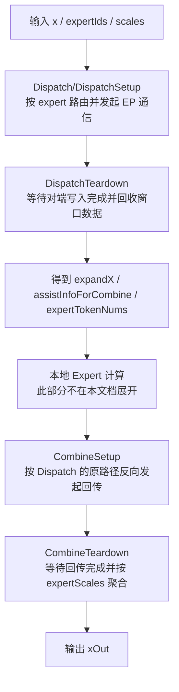
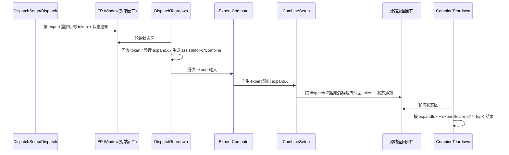
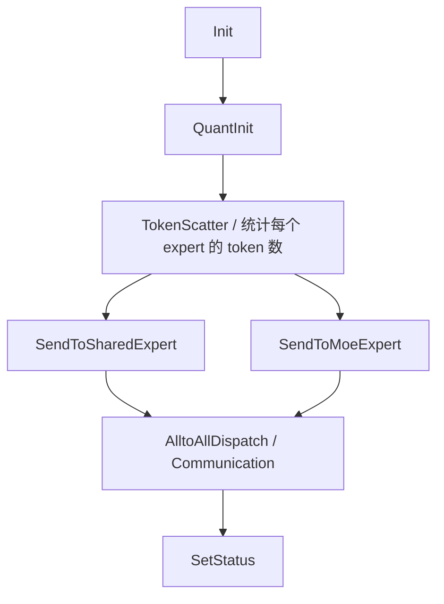
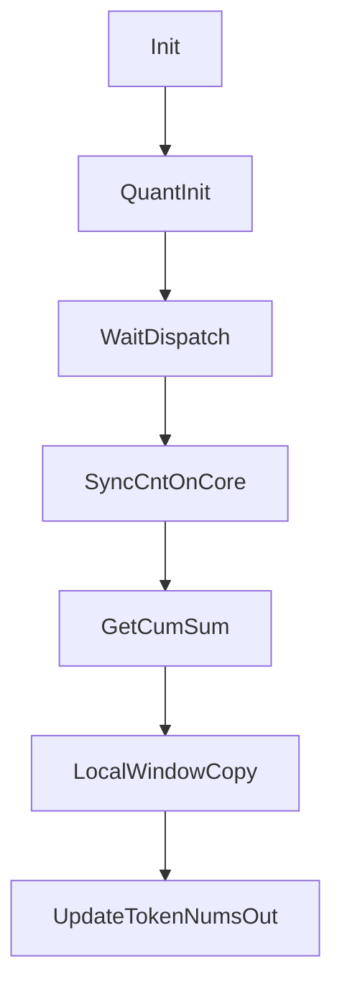
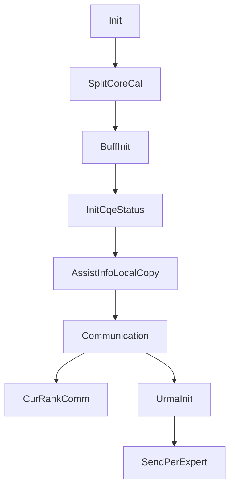
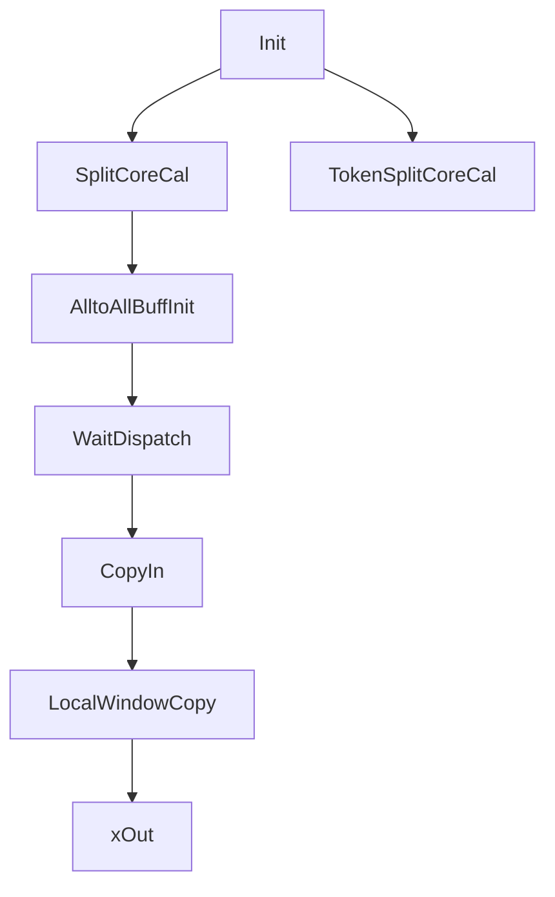

# MoE Dispatch / Combine 端到端通信流程梳理

本文档基于当前 `mc2` 目录下相关算子实现整理，目标是回答三个问题：

1. `dispatch -> combine` 这条链路从头到尾是怎么走的。
2. 每个阶段在代码里由哪些关键函数承接。
3. 这些函数分别主要负责什么。

本文重点覆盖以下算子与实现：

- `moe_distribute_dispatch`
- `moe_distribute_dispatch_setup`
- `moe_distribute_dispatch_teardown`
- `moe_distribute_combine_setup`
- `moe_distribute_combine_teardown`

说明：

- 当前仓内同时存在“单算子版 dispatch/combine”和“setup/teardown 四段式链路”。
- 从 `combine_setup / combine_teardown` 的接口文档和实现依赖关系看，实际通信闭环应按四段式来理解：
  `dispatch_setup -> dispatch_teardown -> combine_setup -> combine_teardown`
- `moe_distribute_dispatch` 可以理解为较早的一体式入口；其 host tiling 和 device 分发逻辑对理解整体路由、量化和通信选择仍然很有参考价值。

---

## 1. 整体时序图



如果从“通信动作”角度看，可以把它拆成两次 AllToAll 风格的数据往返：



---

## 2. 分阶段总览

| 阶段 | 主要输入 | 主要输出 | 关键作用 |
|---|---|---|---|
| Dispatch Host Tiling | `x/expertIds/scales/attrs` | `tilingData` | 校验 shape/attr，决定 window 大小、tilingKey、通信配置 |
| Dispatch Device Kernel | `x/expertIds/...` | `expandX/dynamicScales/expandIdx/...` | 按架构和量化模式选择具体模板实现 |
| DispatchSetup | `x/expertIds/scales/xActiveMask` | `yOut/expandIdx/commCmdInfo` | 对 token 重排，可选量化，只发起通信不等待完成 |
| DispatchTeardown | `x/y/expertIds/commCmdInfo` | `expandX/dynamicScales/assistInfoForCombine/expertTokenNums` | 等待对端完成写入，回收窗口数据并整理 |
| CombineSetup | `expandX/expertIds/assistInfoForCombine` | `quantExpandX/commCmdInfo` | 按 dispatch 的回收路径把 expert 输出反向发回 |
| CombineTeardown | `expandX/quantExpandX/expertIds/expandIdx/expertScales` | `xOut` | 等待回传完成，并按 topK 权重聚合 |

其中表里多次出现的 `expandX`，其第 0 维通常就是文中后面会频繁提到的 `A`。
可以先粗略理解为：

- `BS` 是原始 token 数
- `A` 是路由到当前 rank 后，展开得到的 token 条目数

---

## 3. 小词典：先把常见符号讲清楚

这一节建议在真正读流程前先过一遍。

### 3.1 形状与计数类符号

| 符号 | 含义 | 直觉理解 |
|---|---|---|
| `BS` | 当前 rank 原始输入 token 数 | 输入有多少条 token |
| `globalBs` | EP 域视角下的全局 batch 大小 | 所有 rank 合起来按协议估计的 batch |
| `H` | hidden size | 每条 token 特征长度 |
| `K` | topK expert 数 | 每条 token 会分发给多少个 expert |
| `A` | 当前 rank 在中间阶段承接的展开后 token 条目数 | 路由展开后，这张卡手里实际有多少条 expert 记录 |
| `epWorldSize` | EP 通信域大小 | EP 域有多少张卡 |
| `epRankId` | 当前卡在 EP 域内的 rank | 当前是 EP 域第几张卡 |
| `moeExpertNum` | 全局 MoE expert 总数 | 一共有多少个普通专家 |
| `localMoeExpertNum` / `moeExpertPerRankNum` | 当前 rank 上本地挂载的 MoE expert 数 | 这张卡自己管几个 expert |
| `sharedExpertNum` | 共享专家数量 | 全局有几个共享专家 |
| `sharedExpertRankNum` | 部署共享专家的 rank 数 | 有多少张卡专门拿来放共享专家 |

### 3.2 几个最容易混淆的量

#### `BS` 和 `globalBs` 的区别

- `BS` 是当前 rank 自己输入的 token 数
- `globalBs` 是整个 EP 域按照协议看到的 batch 规模

常见情况：

- 如果所有 rank 的 `BS` 一样，那么通常  
  `globalBs = BS * epWorldSize`
- 如果各 rank 的 `BS` 不一样，那么代码里常用  
  `globalBs = maxBS * epWorldSize`

所以：

- `BS` 更像“本地真实输入”
- `globalBs` 更像“为了通信协议和 buffer 上界而使用的全局估计值”

#### `moeExpertNum` 和 `localMoeExpertNum` 的区别

- `moeExpertNum` 是全局一共有多少个普通 MoE expert
- `localMoeExpertNum` 是当前 rank 分到多少个本地 MoE expert

常见关系：

```text
localMoeExpertNum = moeExpertNum / (epWorldSize - sharedExpertRankNum)
```

前提是：

- 共享专家 rank 不参与普通 MoE expert 的均分

#### `A` 和 `BS * K` 的区别

- `BS * K` 表示“本 rank 原始 token 全部展开后”的理论总条目数
- `A` 表示“最终落到当前 rank 上的展开条目数”

所以二者不是一回事：

- `BS * K` 更像发送前视角
- `A` 更像接收后/本地承接视角

### 3.3 中间张量小词典

| 名字 | 常见 shape | 出现阶段 | 主要作用 |
|---|---|---|---|
| `y` / `yOut` | `(BS * (K + sharedExpertNum), tokenMsgSize)` | `dispatch_setup` 输出 | 发送前重排后的通信消息体 |
| `expandX` | `(A, H)` | `dispatch_teardown` 输出 / `combine_setup` 输入 | 当前 rank 收到或计算后的展开 token |
| `dynamicScales` | `(A,)` 或 `(A, n)` | 量化场景 | 保存量化附加 scale 信息 |
| `expandIdx` | `(BS * K,)` | `dispatch_setup` 输出 / `combine_teardown` 输入 | 记录某 token 在对应 expert 下是第几个条目 |
| `expertTokenNums` | `(localExpertNum,)` | `dispatch_teardown` 输出 | 当前 rank 每个本地 expert 的 token 数或前缀和 |
| `assistInfoForCombine` | `(A * 128,)` | `dispatch_teardown` 输出 / `combine_setup` 输入 | 反向回传时的辅助路由信息 |
| `commCmdInfo` | 一维，长度和 `A/BS/epWorldSize` 有关 | setup/combine_setup 输出，teardown/combine_teardown 输入 | 通信相关辅助信息，接口协议中要求配套传递 |

### 3.4 `expandIdx` 到底记录了什么

这是另一个高频困惑点。

可以把 `expandIdx` 理解成：

- “某条原始 token 被路由到某个 expert 后，在这个 expert 的接收序列里排第几个”

在 `combine_teardown` 里，它和 `expertIds` 一起决定如何从 window 里把 expert 输出重新取回来：

- `expertIds` 告诉你去哪个 expert 槽位找
- `expandIdx` 告诉你在这个 expert 槽位里取第几个 token

### 3.5 `assistInfoForCombine` 到底记录了什么

可以把它理解成：

- `dispatch_teardown` 在收包整理完成后，顺手生成的一张“反向路由辅助表”

它不是原始 token 数据，而是用于回答下面这个问题：

- “combine 阶段如果要把 expert 输出送回原 token 所在 rank，应该沿着什么顺序和什么偏移回去？”

所以：

- `dispatch_teardown` 负责生成它
- `combine_setup` 负责消费它

### 3.6 一眼记住这几个量

如果只记最关键的四个：

- `BS`：本地输入 token 数
- `globalBs`：全局 batch 上界
- `A`：当前 rank 承接的展开后 token 条目数
- `expandIdx`：某 token 在某 expert 下的局部序号

---

## 4. Dispatch 一体式主链路

这一部分主要用于理解“路由、量化、TP/EP 通信模式选择”。

### 4.1 Host 侧：选择 tiling 和通信方案

关键文件：

- `mc2/moe_distribute_dispatch/op_host/op_tiling/moe_distribute_dispatch_tiling.cpp`

关键函数：

| 函数名 | 主要作用 |
|---|---|
| `GetAttrAndSetTilingData` | 读取并落盘基础属性，如 `epWorldSize/tpWorldSize/quantMode` |
| `CheckExpertAttrs` | 校验专家切分是否合法，计算 `localMoeExpertNum` |
| `CheckTensorShape` | 校验输入输出 shape，并推导 `A` |
| `CheckWinSize` | 校验 EP/TP window 是否足够大，避免运行期通信窗口越界 |
| `SetHcommCfg` | 生成 EP AllToAll 与 TP AllGather 的通信配置 |
| `CalTilingKey` | 把 `TP/量化/scales/架构` 编码进 tilingKey |
| `MoeDistributeDispatchA3A5TilingFuncImpl` | A3/A5 路径的 tiling 主入口 |
| `MoeDistributeDispatchA2TilingFuncImpl` | A2 路径的 tiling 主入口 |

### 4.2 Device 侧：模板分派入口

关键文件：

- `mc2/moe_distribute_dispatch/op_kernel/moe_distribute_dispatch.cpp`

关键函数：

| 函数名 | 主要作用 |
|---|---|
| `moe_distribute_dispatch` | kernel 入口；根据 `ArchTag/QuantMode/HasTp/CommMode` 分派到具体实现类 |

这个入口函数本身不做路由计算，核心是“把同一语义分发到不同模板实例”：

- A3/A5 走 `MoeDistributeDispatch<...>`
- A2 MTE 路径走 `MoeDistributeDispatchA2<...>`
- A2 layered 路径走 `MoeDistributeDispatchA2Layered<...>` 或 `MoeDistributeDispatchA2LayeredAicpu<...>`

---

## 5. DispatchSetup：发送侧前半段

### 5.1 目标

`dispatch_setup` 负责：

1. 根据 `expertIds` 对 token 做重排。
2. 按量化模式构造待发送消息。
3. 把数据写入对端 window，并发送完成状态。
4. 算子发起通信后立即退出，不等待接收完成。

### 5.2 关键文件

- `mc2/moe_distribute_dispatch_setup/op_kernel/arch35/moe_distribute_dispatch_setup_arch35.h`
- `mc2/moe_distribute_dispatch_setup/docs/aclnnMoeDistributeDispatchSetup.md`

### 5.3 主流程



### 5.4 关键函数说明

| 函数名 | 主要作用 |
|---|---|
| `Init` | 初始化 shape、window 地址、状态区地址、workspace 和 UB buffer |
| `QuantInit` | 按 `quantMode` 计算每条消息的 token 数据区/scale 附加区布局 |
| `TokenScatter` | 按 `expertIds` 把 token 路由到不同 expert 的发送逻辑 |
| `SendToSharedExpert` | 处理共享专家的发送路径 |
| `SendToMoeExpert` | 处理普通 MoE 专家的发送路径 |
| `QuantProcess` | 量化总入口，根据模式进一步分派 |
| `QuantStatic` | 静态量化 |
| `QuantDynamicPerToken` | per-token 动态量化 |
| `QuantDynamicPerGroup` | per-group 动态量化 |
| `QuantDynamicMxFp8` | MX 量化 |
| `Communication` | 实际驱动 URMA/HCCL 相关通信动作 |
| `CurRankComm` | 处理“发给自己”时的本地回环拷贝 |
| `SetStatus` | 发送完成后更新状态区，供 teardown 轮询 |

---

## 6. DispatchTeardown：接收侧后半段

### 6.1 目标

`dispatch_teardown` 负责：

1. 轮询本卡状态区，等待对端 rank 把数据写完。
2. 从 HCCL window 回收 token。
3. 还原 `expandX` 与可选 `dynamicScales`。
4. 生成 `assistInfoForCombine`，供 `combine_setup` 反向回传使用。
5. 生成 `expertTokenNumsOut`。

### 6.2 关键文件

- `mc2/moe_distribute_dispatch_teardown/op_host/op_tiling/moe_distribute_dispatch_teardown_tiling_base.cpp`
- `mc2/moe_distribute_dispatch_teardown/op_kernel/arch35/moe_distribute_dispatch_teardown_arch35.h`

### 6.3 Host 侧关键函数

| 函数名 | 主要作用 |
|---|---|
| `GetRequiredAttrAndSetTilingData` | 读取 EP 相关基础属性 |
| `GetOptionalAttrAndSetTilingData` | 读取 `quantMode/globalBs/sharedExpert` 等可选属性 |
| `CheckTensorShape` | 校验 `x/y/expertIds/commCmdInfo` 和输出 shape 是否匹配 |
| `CheckHcclBuffSize` | 校验 window 空间是否足够 |
| `SetTilingKey` | 编码量化模式与是否共享专家 |
| `SetHcommCfg` | 生成 EP AllToAll 的通信配置 |
| `MoeDistributeDispatchTeardownTilingFuncImpl` | host tiling 总入口 |

### 6.4 Device 侧主流程



### 6.5 Device 侧关键函数

| 函数名 | 主要作用 |
|---|---|
| `Init` | 初始化 window 地址、状态区、分核信息、UB buffer |
| `QuantInit` | 解释当前量化模式下单条消息体的布局 |
| `WaitDispatch` | 轮询状态区，等待当前核负责的 expert/rank 槽位全部到齐 |
| `SyncCntOnCore` | 把本核负责的 recv token 总数写入 workspace |
| `GetCumSum` | 读取前面各核写入的 recv count，计算当前核输出起始偏移 |
| `LocalWindowCopy` | 从 window 拷出 token，写回 `expandXOut/dynamicScalesOut` |
| `UpdateMultiMoeTokenNumsOut` | 多本地 expert 场景下回填 `expertTokenNumsOut` |
| `UpdateTokenNumsOut` | 最终写出每个 expert 的 token 数或前缀和 |
| `Process` | `WaitDispatch -> SyncAll -> LocalWindowCopy -> UpdateTokenNumsOut` |

### 6.6 这一段的核心理解

- setup 只负责“发”，teardown 负责“等 + 收 + 整理”。
- 状态区不只是到达标志，还携带了 recv count。
- 多核回收时，先把每核负责的 token 数写到 workspace，再做前缀和，保证每个核写 `expandXOut` 的区间连续不重叠。
- `assistInfoForCombine` 是这段的关键产物之一，它定义了 combine 回传阶段的反向路径。

---

## 7. CombineSetup：按原路径反向回传

### 7.1 目标

`combine_setup` 负责：

1. 读取 Expert 计算后的 `expandX`。
2. 依据 `assistInfoForCombine`，按 dispatch_teardown 收集数据的反向路径把结果发回原始 token 所在 rank。
3. 只发起通信，不等待完成；等待和聚合由 `combine_teardown` 负责。

### 7.2 关键文件

- `mc2/moe_distribute_combine_setup/op_host/op_tiling/moe_distribute_combine_setup_tiling_base.cpp`
- `mc2/moe_distribute_combine_setup/op_kernel/arch35/moe_distribute_combine_setup_arch35.h`

### 7.3 Host 侧关键函数

| 函数名 | 主要作用 |
|---|---|
| `GetRequiredAttrAndSetTilingData` | 读取 `group_ep/epWorldSize/epRankId/moeExpertNum` |
| `GetOptionalAttrAndSetTilingData` | 读取共享专家、`globalBs`、通信模式等属性 |
| `GetComplexAttrAndSetTilingData` | 推导 `moeExpertPerRankNum` |
| `CheckTensorShapeSizeAndSetTilingData` | 校验 `A/H/BS/K` 合法性并落盘 |
| `CheckCalcTensorShapeSizeAndSetTilingData` | 校验 `assistInfoForCombine/quantExpandXOut/commCmdInfoOut` 协议 shape |
| `CheckHcclBuffSize` | 校验回传 window 大小是否足够 |
| `SetTilingKey` | 生成 combine_setup 的 tilingKey |
| `MoeDistributeCombineSetupTilingFuncImpl` | host tiling 总入口 |

### 7.4 Device 侧主流程



### 7.5 Device 侧关键函数

| 函数名 | 主要作用 |
|---|---|
| `Init` | 初始化当前 rank 的 window 地址、状态区地址、双缓冲状态位、expert 布局 |
| `SplitCoreCal` | 按 rank 分核，保证同一个 rank 的通信队列由固定核维护 |
| `BuffInit` | 初始化 assistInfo 和 URMA 相关 UB buffer |
| `InitCqeStatus` | 首次通信前把 CQE 状态初始化为无效，避免读到旧 completion |
| `AssistInfoLocalCopy` | 把 `assistInfoForCombine` 从 GM 拷到 UB |
| `Communication` | 外层总流程：按目标 rank 循环发起回传 |
| `CurRankComm` | 对本 rank 的本地回环回传 |
| `UrmaInit` | 准备某个目标 rank 的 URMA SQ/CQ 元信息 |
| `SendPerExpert` | 依据 `assistInfoForCombine` 为每个 expert 组装实际发送区间 |
| `Process` | `BuffInit -> InitCqeStatus -> GenerateSQE -> Communication` |

### 7.6 这一段的核心理解

- `assistInfoForCombine` 可以看成“dispatch_teardown 收回数据时形成的反向路由表”。
- combine_setup 并不是重新做一遍路由推导，而是沿着这张表把 expert 输出送回去。
- 它和 dispatch_setup 一样，也是“只发不等”的 setup 阶段。

说明：

- 从当前 `arch35` kernel 主路径看，`quantExpandXOut/commCmdInfoOut` 在该文件中没有看到直接参与 device 写数的显式逻辑。
- 但 host 侧明确要求它们满足链路协议约束，因此应把它们理解为接口级协议输出，而不是仅凭该入口文件就断言其具体填充细节。

---

## 8. CombineTeardown：等待回传并聚合 topK 结果

### 8.1 目标

`combine_teardown` 负责：

1. 等待 `combine_setup` 对本卡 window 的写入完成。
2. 读取每个 token 对应 topK 专家的输出。
3. 根据 `expandIdx + expertIds + expertScales` 找到对应 expert 输出并乘权重累加。
4. 输出最终 `xOut`。

### 8.2 关键文件

- `mc2/moe_distribute_combine_teardown/op_host/op_tiling/moe_distribute_combine_teardown_tiling_base.cpp`
- `mc2/moe_distribute_combine_teardown/op_kernel/arch35/moe_distribute_combine_teardown_arch35.h`

### 8.3 Host 侧关键函数

| 函数名 | 主要作用 |
|---|---|
| `CheckAttrs` | 校验 EP/共享专家/通信属性 |
| `SetAttrToTilingData` | 把 attr 写入 tilingData，并推导 `moeExpertPerRankNum` |
| `CheckTensorShapeRelation` | 校验 `expandX/quantExpandX/expertIds/expandIdx/expertScales/xOut` 的协议关系 |
| `CheckHcclBuffsize` | 校验回传 window 是否足够 |
| `SetPlatformInfo` | 读取 AIV 数和 UB 大小 |
| `SetWorkspace` | 申请 workspace |
| `SetHcommCfg` | 配置 combine 回传相关通信信息 |
| `MoeDistributeCombineTeardownTilingFuncImpl` | host tiling 总入口 |

### 8.4 Device 侧主流程



### 8.5 Device 侧关键函数

| 函数名 | 主要作用 |
|---|---|
| `Init` | 初始化双缓冲状态位、window 地址、token/rank 分核信息 |
| `SplitCoreCal` | 按 rank 分核，负责状态等待与清理 |
| `TokenSplitCoreCal` | 按 token 分核，负责实际聚合计算 |
| `AlltoAllBuffInit` | 初始化用于回收与聚合的 UB buffer |
| `WaitDispatch` | 等待所有目标 rank 的回传状态到齐，并清理状态区 |
| `CopyIn` | 一次性搬入 `expandIdx/expertIds/expertScales` |
| `LocalWindowCopy` | 对每个 token 按 topK 专家输出做 `Cast -> Muls -> Add` 聚合 |
| `Process` | `AlltoAllBuffInit -> WaitDispatch -> CopyIn -> LocalWindowCopy` |

### 8.6 这一段的核心理解

- `combine_teardown` 真正把 Expert 结果“还原成原 token 输出”。
- 这里的聚合语义是：

```text
对每个 token:
  遍历它的 topK expert
  从 window 中找到对应 expert 输出
  乘 expertScales
  累加得到 xOut[token]
```

说明：

- `quantExpandX` 在接口协议上需要与 `combine_setup` 的对应输出 shape 对齐。
- 但从当前 `arch35` 主路径看，没有看到该输入在该文件中直接参与 device 侧取数，因此更适合理解为链路协议输入。

---

## 9. 贯穿全链路的几个关键数据

### 9.1 `A`

`A` 不是某个单独变量名，而是这条链路里反复出现的一个“中间 shape 维度”。

最容易理解的方式是先把几个量分开：

- `BS`：输入 token 数，也就是原始 batch size
- `K`：每个 token 选出的 topK expert 数
- `A`：当前 rank 在某一阶段真正要承接的“展开后 token 条目数”

这里“展开后”的意思是：

- 原始只有 `BS` 个 token
- 但每个 token 可能会发往多个 expert
- 所以中间表示里，一条 token 可能会变成多条 expert 路由记录
- 这些记录落到某个 rank 上之后，该 rank 持有的总条目数就是 `A`

所以你可以先用一句话记住：

`BS` 是输入 token 数，`A` 是路由展开后当前 rank 手里实际有多少条 token 记录。

#### `A` 在 shape 里通常出现在哪里

在当前代码里，`A` 经常体现在这些 tensor 的第 0 维或相关长度里：

- `expandX` 的第 0 维是 `A`
- `quantExpandXOut` 的第 0 维是 `A`
- `assistInfoForCombine` 的长度通常是 `A * 128`
- `commCmdInfoOut` 的长度常常与 `(A + epWorldSize)` 相关

#### 为什么 `A` 不是简单等于 `BS * K`

因为这里不是“全局所有展开条目”都落在当前 rank 上，而是只计算“当前 rank 实际负责的那部分”。

不同 rank 的 `A` 可能不同，主要取决于：

- 当前 rank 是共享专家 rank 还是普通 MoE 专家 rank
- 本 rank 上挂了多少个本地 expert
- `globalBs` 是否为 0
- `sharedExpertNum/sharedExpertRankNum`

#### 两类 rank 下的 `A`

1. 共享专家 rank

这时 `A` 可以理解成：

- 分到这个共享专家 rank 的 token 条目数

代码里常见约束是：

- `globalBs == 0` 时  
  `A = BS * epWorldSize * sharedExpertNum / sharedExpertRankNum`
- `globalBs != 0` 时  
  `A = globalBs * sharedExpertNum / sharedExpertRankNum`

也就是说，共享专家 rank 的 `A` 更像是“全局 batch 在共享专家侧的均分结果”。

2. 普通 MoE 专家 rank

这时 `A` 可以理解成：

- 当前 rank 上本地 expert 最多可能收到多少条展开 token 记录

代码里常见约束是：

- `globalBs == 0` 时  
  `A >= BS * epWorldSize * min(localMoeExpertNum, K)`
- `globalBs != 0` 时  
  `A >= globalBs * min(localMoeExpertNum, K)`

这里是“大于等于”而不是严格等于，因为它更像容量上界或协议下界，确保 window 和中间 buffer 有足够空间容纳最坏情况。

#### 用一个小例子直观理解

假设：

- `BS = 16`
- `K = 6`
- `epWorldSize = 8`
- `sharedExpertRankNum = 0`
- `moeExpertNum = 32`

那么：

- 每个普通 MoE rank 上本地 expert 数  
  `localMoeExpertNum = 32 / 8 = 4`
- 对某个普通 MoE rank 来说，每个 token 最多只会给它贡献  
  `min(localMoeExpertNum, K) = min(4, 6) = 4`
  条展开记录

因此：

- 如果 `globalBs = 0`，默认等价于 `BS * epWorldSize = 16 * 8 = 128`
- 则这个 rank 的 `A` 至少要能覆盖  
  `128 * 4 = 512`
  条展开记录

这就是为什么很多测试里会看到类似：

- `expandX.shape = (512, H)`
- `quantExpandXOut.shape = (512, tokenMsgSize)`

它不是说原始输入有 512 个 token，而是说：

- 原始输入在全局只有 128 个 token
- 路由展开后，这个 rank 设计上最多要承接 512 条 expert 记录

#### 为什么文档里要特别强调 `A`

因为它在这些阶段必须保持同一套语义：

- `dispatch` host tiling
- `dispatch_teardown` shape 校验
- `combine_setup` shape 校验
- `combine_teardown` shape 校验

如果这些地方对 `A` 的定义不一致，window 槽位和回传路径就会错位。

### 9.2 `assistInfoForCombine`

它是 `dispatch_teardown` 产出、`combine_setup` 消费的关键桥梁。

作用可以概括为：

- 描述 dispatch 收包后，数据在各个 `expert x rank` 槽位上的累计分布。
- combine_setup 利用它沿原路径把 expert 输出发回原 token 所在 rank。

### 9.3 状态区 / 双缓冲标志

setup 与 teardown 两端都依赖 window 状态区：

- setup 写数据后更新状态。
- teardown 轮询状态直到本轮数据全部到齐。
- 每轮通过 `dataState_` 在 0/1 双缓冲区间之间切换，避免新旧轮次互相污染。

---

## 10. 按“读代码顺序”推荐阅读路径

如果是第一次读代码，建议按下面顺序：

1. `moe_distribute_dispatch_teardown/docs/aclnnMoeDistributeDispatchTeardown.md`
2. `moe_distribute_combine_setup/docs/aclnnMoeDistributeCombineSetup.md`
3. `moe_distribute_combine_teardown/docs/aclnnMoeDistributeCombineTeardown.md`
4. `moe_distribute_dispatch/op_host/op_tiling/moe_distribute_dispatch_tiling.cpp`
5. `moe_distribute_dispatch_teardown/op_host/op_tiling/moe_distribute_dispatch_teardown_tiling_base.cpp`
6. `moe_distribute_combine_setup/op_host/op_tiling/moe_distribute_combine_setup_tiling_base.cpp`
7. `moe_distribute_combine_teardown/op_host/op_tiling/moe_distribute_combine_teardown_tiling_base.cpp`
8. `moe_distribute_dispatch_teardown/op_kernel/arch35/moe_distribute_dispatch_teardown_arch35.h`
9. `moe_distribute_combine_setup/op_kernel/arch35/moe_distribute_combine_setup_arch35.h`
10. `moe_distribute_combine_teardown/op_kernel/arch35/moe_distribute_combine_teardown_arch35.h`

---

## 11. 一句话总结

这条链路的本质是：

- `dispatch_setup/dispatch_teardown` 把 token 按 expert 路由到目标 rank；
- 中间完成 expert 计算；
- `combine_setup/combine_teardown` 再沿 dispatch 的反向路径把 expert 输出送回，并按 topK 权重聚合成原 token 输出。

如果你已经在看源码，最需要抓住的不是单个 API 名，而是下面这四个核心概念：

- `A` 的统一定义
- `assistInfoForCombine` 的反向路由作用
- window 状态区的双缓冲切换
- setup 只发不等、teardown 负责等待和整理

---

## 12. 数值化样例推演

这一节不追求完全覆盖所有分支，只想用一组简单参数把主链路“走通一遍”。

### 12.1 样例参数

假设：

- `BS = 2`
- `H = 4`
- `K = 2`
- `epWorldSize = 4`
- `sharedExpertNum = 0`
- `sharedExpertRankNum = 0`
- `moeExpertNum = 8`
- `globalBs = BS * epWorldSize = 8`

那么：

- 每个 rank 的本地 expert 数  
  `localMoeExpertNum = moeExpertNum / epWorldSize = 8 / 4 = 2`
- 对普通 MoE rank 来说  
  `A >= globalBs * min(localMoeExpertNum, K) = 8 * min(2, 2) = 16`

所以在这个样例里，可以把：

- `expandX.shape` 理解成 `(16, H)`

### 12.2 假设 expert 到 rank 的映射

为了简单，假设 8 个 expert 均匀分布在 4 个 rank 上：

| rank | 本地 expert |
|---|---|
| 0 | expert 0, 1 |
| 1 | expert 2, 3 |
| 2 | expert 4, 5 |
| 3 | expert 6, 7 |

再假设当前我们站在 `rank 0` 看输入：

- token0 选择的 topK expert 是 `[1, 2]`
- token1 选择的 topK expert 是 `[0, 6]`

那么从 `rank 0` 视角出发：

- token0 会发给 rank0 的 expert1，以及 rank1 的 expert2
- token1 会发给 rank0 的 expert0，以及 rank3 的 expert6

所以，原始 `BS=2` 条 token，展开后会变成 4 条 expert 路由记录：

| 原始 token | expert | 目标 rank |
|---|---|---|
| token0 | 1 | rank0 |
| token0 | 2 | rank1 |
| token1 | 0 | rank0 |
| token1 | 6 | rank3 |

这就是“为什么会有展开后条目数”的最直观例子。

### 12.3 DispatchSetup 阶段发生了什么

对应关键函数：

- `MoeDistributeDispatchSetup::Init`
- `MoeDistributeDispatchSetup::TokenScatter`
- `MoeDistributeDispatchSetup::SendToMoeExpert`
- `MoeDistributeDispatchSetup::Communication`
- `MoeDistributeDispatchSetup::SetStatus`

在这个样例里，`rank0` 会做这些事：

1. 读取 2 条输入 token 和它们的 `expertIds`
2. 按 `(token, expert)` 展开成 4 条路由记录
3. 将目标是本 rank 的两条记录整理到本地 expert 槽位
4. 将目标是 rank1、rank3 的记录写入它们的 window
5. 更新状态区，告诉对端 teardown 可以开始轮询

如果不考虑量化，`yOut` 可以直观理解成：

| 展开序号 | 内容 | 发往 |
|---|---|---|
| 0 | token0 -> expert1 的特征 | rank0 |
| 1 | token0 -> expert2 的特征 | rank1 |
| 2 | token1 -> expert0 的特征 | rank0 |
| 3 | token1 -> expert6 的特征 | rank3 |

### 12.4 DispatchTeardown 阶段发生了什么

对应关键函数：

- `MoeDistributeDispatchTeardown::WaitDispatch`
- `MoeDistributeDispatchTeardown::SyncCntOnCore`
- `MoeDistributeDispatchTeardown::GetCumSum`
- `MoeDistributeDispatchTeardown::LocalWindowCopy`
- `MoeDistributeDispatchTeardown::UpdateTokenNumsOut`

继续看 `rank0`。

`rank0` 只关心“有哪些 token 最终发到了我本地的 expert0 / expert1”。

从全局 8 条 token 的角度看，任何 token 只要 topK 命中了 expert0 或 expert1，都会被 dispatch 到 rank0。
这些条目最终会被 `dispatch_teardown` 从 window 中收回来，整理成：

- `expandX`
- `expertTokenNums`
- `assistInfoForCombine`

在我们这个局部样例里，至少能确定：

- token0 的 expert1 路由会落在 rank0
- token1 的 expert0 路由会落在 rank0

所以 rank0 最少会回收到这样两条展开记录：

| expandX 中的记录 | 来源 token | 对应本地 expert |
|---|---|---|
| 某条记录 | token0 | expert1 |
| 某条记录 | token1 | expert0 |

`expertTokenNums` 在这个样例下可以直观理解成：

- expert0 收到了多少条 token
- expert1 收到了多少条 token

如果用“数量模式”表示，可能类似：

```text
expertTokenNums = [1, 1]
```

如果用“前缀和模式”表示，可能类似：

```text
expertTokenNums = [1, 2]
```

### 12.5 `assistInfoForCombine` 在样例中的含义

这是最值得单独说清的一步。

`dispatch_teardown` 不只是把 token 收回来，还要记住：

- 这些 token 未来如果做完 expert 计算，要怎么沿原路径返回

在我们的样例里，rank0 本地有两条展开记录：

- token0 对应 expert1
- token1 对应 expert0

那么做完 expert 计算后：

- expert1 的输出要送回 token0 原本所在的 rank
- expert0 的输出要送回 token1 原本所在的 rank

`assistInfoForCombine` 就是在保存这种“未来怎么送回去”的辅助信息。

你可以把它先粗糙地理解成：

- dispatch 收包阶段顺手记下的一张“反向发货单”

### 12.6 本地 Expert 计算

这部分不在本文档重点展开。

你只需要把它想成：

- `dispatch_teardown` 输出 `expandX`
- 本地 expert 网络对 `expandX` 做前向
- 产生新的 `expandX` 作为 `combine_setup` 的输入

即：

```text
dispatch_teardown.expandX -> expert compute -> combine_setup.expandX
```

### 12.7 CombineSetup 阶段发生了什么

对应关键函数：

- `MoeDistributeCombineSetup::AssistInfoLocalCopy`
- `MoeDistributeCombineSetup::Communication`
- `MoeDistributeCombineSetup::CurRankComm`
- `MoeDistributeCombineSetup::UrmaInit`
- `MoeDistributeCombineSetup::SendPerExpert`

在样例里，假设 rank0 上的 expert 计算得到了：

- expert1 对 token0 的输出 `y(token0, expert1)`
- expert0 对 token1 的输出 `y(token1, expert0)`

那么 `combine_setup` 会根据 `assistInfoForCombine` 知道：

- `y(token0, expert1)` 要送回 token0 原始所在位置
- `y(token1, expert0)` 要送回 token1 原始所在位置

如果 token0、token1 原本都来自 rank0，那么这两条可能是本地回环。
如果它们来自别的 rank，那么就会写到对应对端 window。

所以 `combine_setup` 的本质不是重新计算路由，而是：

- 读取 `assistInfoForCombine`
- 按 dispatch 的逆路径反向发回 expert 输出

### 12.8 CombineTeardown 阶段发生了什么

对应关键函数：

- `MoeDistributeCombineTeardown::WaitDispatch`
- `MoeDistributeCombineTeardown::CopyIn`
- `MoeDistributeCombineTeardown::LocalWindowCopy`

这一阶段最终要把每个原始 token 的 topK expert 输出聚合回去。

继续用样例：

- token0 的 topK expert 是 `[1, 2]`
- token1 的 topK expert 是 `[0, 6]`

那么当所有 expert 输出都反向送回原 token 所在 rank 后，`combine_teardown` 会做：

#### token0

1. 找到 expert1 对应的输出
2. 找到 expert2 对应的输出
3. 分别乘以 `expertScales[token0, 0]` 和 `expertScales[token0, 1]`
4. 相加得到 token0 的最终输出

#### token1

1. 找到 expert0 对应的输出
2. 找到 expert6 对应的输出
3. 分别乘以对应权重
4. 相加得到 token1 的最终输出

即：

```text
xOut[token0] = scale(token0,e1) * out(token0,e1) + scale(token0,e2) * out(token0,e2)
xOut[token1] = scale(token1,e0) * out(token1,e0) + scale(token1,e6) * out(token1,e6)
```

这正是 `MoeDistributeCombineTeardown::LocalWindowCopy` 中按 `expertIds + expandIdx + expertScales` 回表并累加的语义。

### 12.9 用一条 token 再串一次

以 `token0` 为例，整个生命周期可以压缩成：

```text
原始 token0
-> dispatch_setup 根据 expertIds=[1,2] 展开成两条记录
-> 一条送到 rank0/expert1，一条送到 rank1/expert2
-> dispatch_teardown 在两个目标 rank 上分别收包整理
-> 各自做 expert 前向
-> combine_setup 按 assistInfoForCombine 把两条 expert 输出反向送回
-> combine_teardown 在 token0 原始所在 rank 收齐两条输出
-> 乘 topK 权重后相加
-> 得到 token0 的最终输出
```

### 12.10 这个样例最该抓住什么

如果你读完样例只记住三件事，就记这三件：

1. 一条 token 在 dispatch 阶段会被展开成多条 `(token, expert)` 路由记录
2. `assistInfoForCombine` 是这些记录回传时的“反向发货单”
3. `combine_teardown` 最终做的是“按 topK expert 输出乘权重求和”

---

## 13. 和 `combine_setup` 代码逐段对照

这一节专门对应你当前正在看的几个文件：

- `mc2/moe_distribute_combine_setup/op_host/op_tiling/moe_distribute_combine_setup_tiling_base.cpp`
- `mc2/moe_distribute_combine_setup/op_kernel/arch35/moe_distribute_combine_setup_arch35.h`
- `mc2/moe_distribute_combine_setup/op_kernel/moe_distribute_combine_setup.cpp`

目标是把前面“数值样例里的动作”直接映射到这些代码。

### 13.1 先看 host 侧：为什么 `combine_setup` 一上来就在校验 shape

关键函数：

| 文件 | 函数名 | 作用 |
|---|---|---|
| `moe_distribute_combine_setup_tiling_base.cpp` | `GetRequiredAttrAndSetTilingData` | 读取 `epWorldSize/epRankId/moeExpertNum` 等基础属性 |
| `moe_distribute_combine_setup_tiling_base.cpp` | `GetOptionalAttrAndSetTilingData` | 读取共享专家、`globalBs`、通信模式等属性 |
| `moe_distribute_combine_setup_tiling_base.cpp` | `GetComplexAttrAndSetTilingData` | 推导 `moeExpertPerRankNum` |
| `moe_distribute_combine_setup_tiling_base.cpp` | `CheckTensorShapeSizeAndSetTilingData` | 校验 `expandX/expertIds` 的 `A/H/BS/K` |
| `moe_distribute_combine_setup_tiling_base.cpp` | `CheckCalcTensorShapeSizeAndSetTilingData` | 校验 `assistInfoForCombine/quantExpandXOut/commCmdInfoOut` 的协议 shape |
| `moe_distribute_combine_setup_tiling_base.cpp` | `CheckHcclBuffSize` | 检查 window 空间是否够用 |
| `moe_distribute_combine_setup_tiling_base.cpp` | `SetPlatformInfo` | 获取 AIV 数、UB 大小、blockDim |
| `moe_distribute_combine_setup_tiling_base.cpp` | `SetTilingKey` | 生成 device 侧选择模板用的 tilingKey |
| `moe_distribute_combine_setup_tiling_base.cpp` | `MoeDistributeCombineSetupTilingFuncImpl` | host tiling 主入口 |

#### 结合样例理解

以前面的样例为例：

- `BS = 2`
- `K = 2`
- `epWorldSize = 4`
- `moeExpertNum = 8`
- `globalBs = 8`
- 普通 MoE rank 上 `localMoeExpertNum = 2`
- 因此 `A >= 8 * min(2, 2) = 16`

那么在 `CheckTensorShapeSizeAndSetTilingData` 里，host 侧会把这些量写进 `tilingData`：

```text
bs = 2
k = 2
h = 4           （如果用样例 hidden size）
a = 16          （按当前 rank 的协议需求）
moeExpertPerRankNum = 2
```

而 `CheckCalcTensorShapeSizeAndSetTilingData` 会进一步检查：

- `assistInfoForCombine.shape[0] == A * 128`
- `quantExpandXOut.shape == (A, tokenMsgSize)`
- `commCmdInfoOut.shape[0] == (A + epWorldSize) * 16`

也就是说，这一层的核心职责不是通信本身，而是：

- 在 host 侧把“回传链路协议”全部提前固定下来

### 13.2 为什么 `combine_setup.cpp` 看起来很薄

关键文件：

- `mc2/moe_distribute_combine_setup/op_kernel/moe_distribute_combine_setup.cpp`

关键函数：

| 函数名 | 作用 |
|---|---|
| `moe_distribute_combine_setup` | kernel 入口，只做 tiling 反序列化和模板实例分发 |

这个文件本身很薄，是因为它主要只做两件事：

1. 取出 `MoeDistributeCombineSetupTilingData`
2. 实例化 `MoeDistributeCombineSetup<DTYPE_EXPAND_X, int32_t>` 并调用 `Init/Process`

所以如果你想真正看业务逻辑，不要停在这个 `.cpp`，而是继续进：

- `MoeDistributeCombineSetup::Init`
- `MoeDistributeCombineSetup::Process`

它们都在：

- `moe_distribute_combine_setup/op_kernel/arch35/moe_distribute_combine_setup_arch35.h`

### 13.3 Device 侧 `Init`：把样例里的“协议量”变成真实地址和偏移

关键函数：

- `MoeDistributeCombineSetup::Init`

这个函数最重要的不是做通信，而是把 host 侧传下来的抽象信息转成可执行的地址语义。

它主要做了这些事：

| 代码动作 | 含义 |
|---|---|
| 读取 `moeDistributeCombineSetupInfo_` | 取得 host tiling 算好的 `A/BS/K/H/epWorldSize/...` |
| 读取 `dataState_` | 取得当前双缓冲使用的是 window 的 0 区还是 1 区 |
| 计算 `axisMaxBS_` | 把 `globalBs` 均摊到单 rank，得到窗口每 expert 的容量上界 |
| 计算 `moeSendNum_` | 当前 rank 需要维护多少个 `(rank, localExpert)` 槽位 |
| 计算 `expertPerSizeOnWin_` | 每个 expert 在 window 上占多大空间 |
| 计算 `epDataOffsetOnWin_` | 当前 rank 在目标 window 数据区的起始偏移 |
| 计算 `epStateOffsetOnWin_` | 当前 rank 在目标状态区的起始偏移 |
| `SplitCoreCal()` | 按 rank 分核，决定当前 AIV 负责哪些目标 rank |

#### 对应到样例

还是看前面的例子：

- `epWorldSize = 4`
- `globalBs = 8`
- `axisMaxBS_ = globalBs / epWorldSize = 2`
- `localMoeExpertNum = 2`

那么对某个普通 MoE rank 来说：

- 每个本地 expert 的窗口容量，大概按“最多容纳 2 条 token”的基准去算
- 当前 rank 一共维护 `epWorldSize * localMoeExpertNum = 4 * 2 = 8` 个发送槽位

所以你可以把 `Init` 理解成：

- 把“我未来要往谁的哪个 expert 槽位写数据”这张地址映射表先算出来

### 13.4 `SplitCoreCal`：为什么 `combine_setup` 先按 rank 分核

关键函数：

- `MoeDistributeCombineSetup::SplitCoreCal`

这一段特别重要。

它的思路是：

- 不按 token 分核
- 而是按目标 rank 分核

原因是：

- 一个目标 rank 对应一套 URMA SQ/CQ/doorbell 维护逻辑
- 最好由固定的 AIV 核负责，避免多个核并发维护同一个队列状态

所以这里把：

- `startRankId_`
- `endRankId_`
- `sendRankNum_`

先算出来，后面 `Communication()` 只循环这段 rank 区间。

这也是为什么 `combine_setup` 的并行粒度和 `combine_teardown` 不一样：

- `combine_setup` 更偏“按通信目标 rank 分工”
- `combine_teardown` 既按 rank 分工等待状态，也按 token 分工做聚合

### 13.5 `AssistInfoLocalCopy`：样例里的“反向发货单”是怎么用起来的

关键函数：

- `MoeDistributeCombineSetup::AssistInfoLocalCopy`

前面文档里说：

- `assistInfoForCombine` 可以看成“反向发货单”

这里就是它第一次被真正拿来用的地方。

这个函数会把 `assistInfoForCombine` 从 GM 拷进 UB。

后面 `Communication()` 会根据这张表判断：

- 当前 expert 对某个目标 rank，到底要发多少条 token
- 这些 token 在 `expandX` 里从哪里开始取
- 对端 window 的哪个 expert 槽位是目标地址

所以：

- `AssistInfoLocalCopy` 本身只是搬运
- 真正的“解释这张表”发生在 `SendPerExpert`

### 13.6 `Communication`：样例里的“反向回传”真正从这里开始

关键函数：

- `MoeDistributeCombineSetup::Communication`

它的主循环结构是：

1. 先把 `assistInfoForCombine` 搬到本地
2. 如果当前核负责的 rank 范围里包含自己，先处理 `CurRankComm`
3. 再对每个目标 rank：
   - `UrmaInit`
   - `SendPerExpert`
   - `PutCommNotifySQE`
   - `SendJFSDoorBell`

可以简化成：

```text
for each target rank in [startRankId_, endRankId_):
    准备该 rank 的通信队列
    根据 assistInfoForCombine 组装要发给它的 expert 数据
    发 SQE
    敲 doorbell
```

#### 对应到样例

假设 rank0 本地 expert 计算完后有两条输出：

- `out(token0, expert1)`
- `out(token1, expert0)`

而 `assistInfoForCombine` 告诉它：

- token0 要回到 rank0
- token1 要回到 rank0

那么：

- 这两条会走 `CurRankComm`

如果换一个样例，某条 expert 输出应该回到 rank2，那么：

- 这条就会在 `Communication` 的 `epIdx = 2` 那轮里被组装并发送

### 13.7 `SendPerExpert`：这是 `combine_setup` 最关键的业务函数

关键函数：

- `MoeDistributeCombineSetup::SendPerExpert`

如果你只想在 `combine_setup` 里挑一个最值得细看的函数，就是它。

它的逻辑是：

1. 遍历当前 rank 下要处理的每个本地 expert
2. 用 `assistInfoForCombine` 取出该 expert 发往某个目标 rank 的前缀和
3. 相邻前缀和相减，得到 `curTokenNum`
4. 再算出：
   - 源地址 `srcAddr`
   - 目标地址 `dstAddr`
   - 对应状态地址 `notifyAddr`
5. 把这些信息塞进待发送的 SQE 模板

核心公式就是：

```text
curTokenNum = prefix[i] - prefix[i-1]
```

这说明 `assistInfoForCombine` 在这里并不是简单的计数表，而更像：

- 按 `(expert, rank)` 排列的前缀和表

#### 对应到样例

假设某个 expert 对 rank2 的前缀和区间是：

```text
prefix before = 3
prefix current = 5
```

那么：

- 当前要发给 rank2 的 token 数就是 `5 - 3 = 2`

再结合 `axisHExpandXTypeSize_`，就能定位：

- 从 `expandX` 的哪一段开始读
- 要往 rank2 的哪个 expert window 槽位写

### 13.8 `CurRankComm`：为什么本地回环不直接复用远端发送逻辑

关键函数：

- `MoeDistributeCombineSetup::CurRankComm`

这个函数处理的是：

- “目标 rank 就是我自己”的情况

它没有走 URMA 发送，而是直接：

- `GM -> UB -> 本地 window`

这么做的原因是：

- 本地回环不需要真的走一遍远端队列和 doorbell
- 但仍然要保持最终 window 布局与远端到达时一致

所以它本质上是在做：

- “按和远端完全相同的目标布局，把数据本地摆好”

### 13.9 `UrmaInit`：这里做的不是业务路由，而是队列准备

关键函数：

- `MoeDistributeCombineSetup::UrmaInit`

这个函数容易看懵，因为里面全是 URMA/HCCL 细节。

你可以先不要陷进去，只记它负责：

1. 取目标 rank 的 SQ/CQ 信息
2. 获取并推进 `PI/CI`
3. 轮询 CQ，确保 SQ 有可用空间
4. 更新当前 rank 对这个目标 rank 的 WQE 模板

所以：

- `UrmaInit` 解决的是“能不能发”
- `SendPerExpert` 解决的是“发什么”

### 13.10 `Process`：把整个 `combine_setup` 串起来

关键函数：

- `MoeDistributeCombineSetup::Process`

它的顺序是：

1. `BuffInit`
2. `InitCqeStatus`
3. `GenerateCommWriteWithNotifySQE`
4. `Communication`

可以把它压缩成一句：

- 先把通信缓冲和 completion 状态准备好，再正式按 `assistInfoForCombine` 发起反向回传

### 13.11 如果你现在要真的读 `combine_setup`，推荐这个顺序

建议在代码里按这个顺序跳：

1. `MoeDistributeCombineSetupTilingFuncImpl`
2. `CheckTensorShapeSizeAndSetTilingData`
3. `CheckCalcTensorShapeSizeAndSetTilingData`
4. `CheckHcclBuffSize`
5. `moe_distribute_combine_setup`
6. `MoeDistributeCombineSetup::Init`
7. `MoeDistributeCombineSetup::SplitCoreCal`
8. `MoeDistributeCombineSetup::Communication`
9. `MoeDistributeCombineSetup::SendPerExpert`
10. `MoeDistributeCombineSetup::CurRankComm`

如果读到 `UrmaInit` 卡住，不要先死磕底层字段，先回到上层抓住这三件事：

- 当前核负责哪些目标 rank
- `assistInfoForCombine` 如何决定每次发多少 token
- 最后一条 WQE 如何承担“通知对端本 rank 发送完成”的语义
