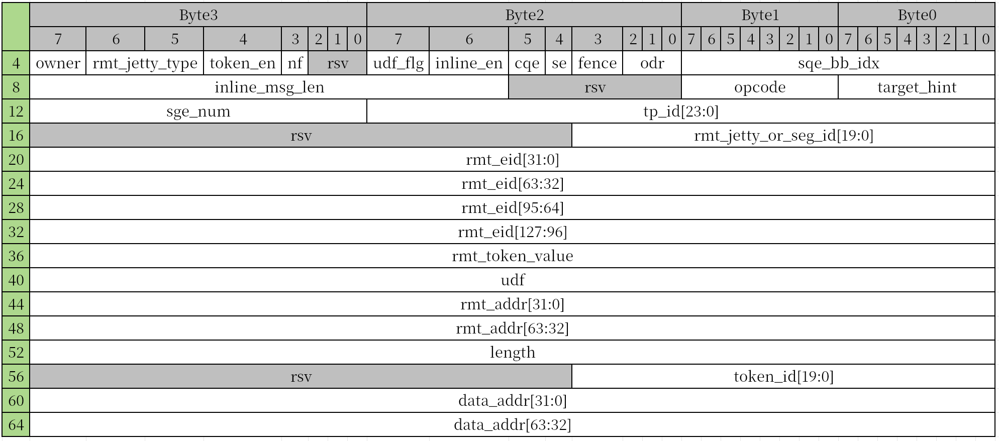
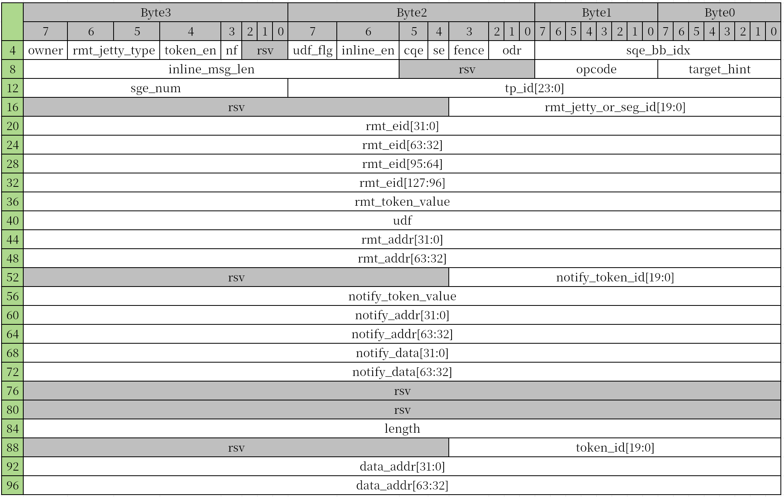
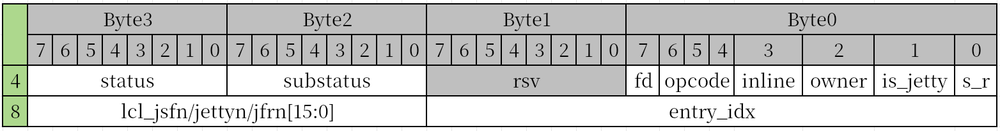
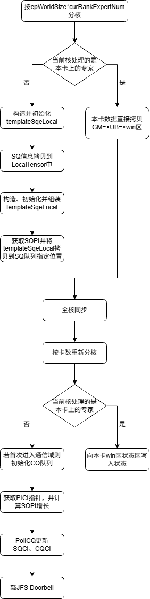

# AIV直驱URMA

## 基础知识

URMA通信基于“Jetty抽象”[^1]，一个Jetty对应一个JFS-JFC资源对。

简单而言，JFS（Jetty For Send）中包括一个SQ队列和JFS Doorbell，前者用于写入WQE（Working Queue Element），后者用于通知硬件芯片处理WQE。WQE在部分地方也可能被称为SQE（Send Queue Element），因此SQ也会被称为WQ。

同理，JFC（Jetty For Completion）也包括一个CQ队列和JFC Doorbell，前者存放CQE（Completion Queue Element），后者用于将软件已经完成处理的CQE通知硬件芯片。

[^1]：https://mp.weixin.qq.com/s/2u47eHAsFX5j5wC5boezjQ

## URMA芯片的两个队列

URMA通信中有两个重要的队列，分别是SQ队列（Send Queue）和CQ队列（Completion Queue）。

两者都是循环队列，都包括一个PI指针（Producer index）和CI指针（Consumer Index）。

```
+--+ +--+      +--+
|  | |  | .... |  |
+--+ +--+      +--+
+--+           +--+
|  |   Send    |  | <-- CI
+--+           +--+
+--+           +--+
|  |   Queue   |  | <-- PI
+--+           +--+
+--+      +--+ +--+
|  | .... |  | |  |
+--+      +--+ +--+


+--+ +--+      +--+
|  | |  | .... |  |
+--+ +--+      +--+
+--+           +--+
|  |  C Queue  |  | <-- CI
+--+           +--+
+--+           +--+
|  |           |  | <-- PI
+--+           +--+
+--+      +--+ +--+
|  | .... |  | |  |
+--+      +--+ +--+
```

### SQ队列

对于SQ队列，图中每一个方块代表一个WQEBB（WQE Basic Block），而一个WQE可能包括多个WQEBB。

SQ队列的CI指针，由芯片（硬件）控制，表示当前位置之前的所有WQE都已经发送完成，但不保证发送成功；
PI指针，由用户（软件）控制，向SQ队列中拷贝WQE后，PI指针应指向写入的最后一个WQEBB的下一个位置。

当用户（软件）敲JFS Doorbell之后，芯片开始处理队列中从CI开始到PI结束的WQEBB（即**发送**操作）。

### CQ队列

对于CQ队列，是由芯片（硬件）通知用户（软件）相应WQE的发送情况，即芯片向队列中写入信息，用户从队列中读取信息。

CQ队列的PI指针，完全由芯片（硬件）控制，用户（软件）完全不感知，也无法获取。
CI指针，也由芯片（硬件）控制，用户（软件）需要记录CI值，并在需要时通过PollCQ操作轮询CQ队列读取是否存在相应CQE，同时记录最后一个CQE中的entry_idx，其表示指向SQE的最后一个WQEBB。

### WQE通信语义

通过WQE中的opcode字段可以设置Normal SQE的通信语义。URMA通信支持的通信语义包括`Send`、`Write`、`Write with notify`、`Read`等等。

当前DispatchSetup中使用`Write`语义，CombineSetup中使用`Write with notify`语义，其余语义暂未实现。

#### Write SQE

Write SQE结构体，占用一个WQEBB：



其中：
- cqe：表示当前WQE是否需要上报CQE
- odr：表示当前WQE是否有保序要求
- rmt_addr：写入的远端地址
- length：发送数据长度
- data_addr：源数据地址

#### Write with notify SQE

Write with notify SQE结构体，占用两个WQEBB：



除了与Write SQE相同的字段外：
- notify_addr：notify写入的地址
- notify_data：notify写入的值

### CQE结构体

一个Normal CQE结构体占用64字节，但一般只需关注`status`、`substatus`和`entry_idx`字段。CQE结构体的前8字节组成如下：



## URMA通信接口

CombineSetup使用的相关通信接口定义在[`moe_distribute_base.h`](../op_kernel/moe_distribute_base.h)。

### 获取URMA Jetty信息

```cpp
__aicore__ inline void GetURMASqInfoTensor(const AscendC::LocalTensor<uint8_t> &sqInfoTensor, GM_ADDR hcclContext, uint32_t dstRankId);
__aicore__ inline void GetURMACqInfoTensor(const AscendC::LocalTensor<uint8_t> &cqInfoTensor, GM_ADDR hcclContext, uint32_t dstRankId);
```

从HCCL组件提供的建链信息`hcclContext`结构体中拷贝第`dstRankId`张卡的SQ或CQ的Jetty信息，保存到`sqInfoTensor`/`cqInfoTensor`中返回。

### 初始化WQE

```cpp
__aicore__ inline void GenerateCommWriteSQE(const AscendC::LocalTensor<uint8_t> &sqeTensor, uint32_t sqeCount = 1);
__aicore__ inline void GenerateCommWriteWithNotifySQE(const AscendC::LocalTensor<uint8_t> &sqeTensor, uint32_t sqeCount = 1);
```

`GenerateCommWriteSQE()`和`GenerateCommWriteWithNotifySQE()`向`sqeTensor`中初始化与dstRank无关的WQE基础信息。

### 更新WQE

```cpp
__aicore__ inline void UpdateCommWriteSQE(const AscendC::LocalTensor<uint8_t> &sqeTensor, const AscendC::LocalTensor<uint8_t> &sqInfoTensor);
__aicore__ inline void UpdateCommWriteWithNotifySQE(const AscendC::LocalTensor<uint8_t> &sqeTensor, const AscendC::LocalTensor<uint8_t> &sqInfoTensor);
```

`UpdateCommWriteSQE()`和`UpdateCommWriteWithNotifySQE()`用于设置与dstRank有关的WQE信息。`sqeTensor`用于存放WQE信息，`sqInfoTensor`为`GetURMASqInfoTensor()`中的返回值`sqInfoTensor`。

```cpp
__aicore__ inline void SetCommWriteSQE(const AscendC::LocalTensor<uint8_t> &sqeTensor, uint64_t dataAddr, uint64_t rmtAddr, uint32_t length, uint8_t cqe);
__aicore__ inline void SetCommWriteWithNotifySQE(const AscendC::LocalTensor<uint8_t> &sqeTensor, uint64_t dataAddr, uint64_t rmtAddr, uint32_t length, uint64_t notifyAddr, uint64_t notifyData, uint8_t cqe);
```

`SetCommWriteSQE()`和`SetCommWriteWithNotifySQE()`用于设置不同WQE的细节信息，包括：待发送数据的源地址、目的地址、发送长度以及是否需要上报CQE。结果通过`sqeTensor`返回。

### 管理CQ

```cpp
__aicore__ inline void PollCommCQUpdateSQCI(const AscendC::LocalTensor<uint8_t> &sqInfoTensor, const AscendC::LocalTensor<uint8_t> &cqInfoTensor, const AscendC::LocalTensor<uint8_t> &cqeTensor, uint32_t &outSqCi, uint32_t &outCqCi, uint32_t &outCqCiLinear);
```

`PollCommCQUpdateSQCI()`的两个主要作用：

1. 读取芯片写入CQE的位置，敲JFC Doorbell，更新芯片CQCI；
2. 从CQE结构体中获取entry_idx，该字段含义为指向SQE的最后一个WQEBB，并更新软件SQCI。

调用`PollCommCQUpdateSQCI()`的时机：

1. 希望检查之前发送通信是否成功的时候；
2. 发送WQE前，当前sqDepth深度不足以放下所有WQE时，通过调用函数更新SQCI以获取更大的SQ队列空间。

### 敲Doorbell

```cpp
__aicore__ inline void SendJFSDoorBell(const AscendC::LocalTensor<uint8_t> &sqInfoTensor, uint32_t sqPi);
__aicore__ inline void SendJFCDoorBell(const AscendC::LocalTensor<uint8_t> &cqInfoTensor, uint32_t cqCi);
```

`SendJFSDoorBell()`和`SendJFCDoorBell()`分别用于敲JFS Doorbell和敲JFC Doorbell。

### 首次进入通信域清空CQ队列

```cpp
__aicore__ inline void InvalidateCqeStatus(const AscendC::LocalTensor<uint8_t> &cqeInfoTensor, const AscendC::LocalTensor<uint8_t> &cqeTensor);
```

当首次进入通信域时，需要调用`InvalidateCqeStatus()`清空原有的CQ队列，入参`cqeInfoTensor`为CQ信息，`cqeTensor`为用户申请的临时空间，用于清空操作。

### 将WQE拷贝至SQ队列

```cpp
__aicore__ inline void PutCommSQE(const AscendC::LocalTensor<uint8_t> &sqInfoTensor, const AscendC::LocalTensor<uint8_t> &sqeTensor, uint32_t sendSqeIdx, uint32_t sqPi);
__aicore__ inline void PutCommNotifySQE(const AscendC::LocalTensor<uint8_t> &sqInfoTensor, const AscendC::LocalTensor<uint8_t> &sqeTensor, uint32_t sendSqeIdx, uint32_t sqPi);
```

`PutCommSQE()`和`PutCommNotifySQE()`用于将一个WQE放入SQ队列中的指定位置。`sqInfoTensor`为WQ信息，`sqeTensor`为WQE，`sendSqeIdx`和`sqPi`表示把当前WQE放入SQ队列当前SQPI指针开始的第sendSqeIdx个位置。

注意：

1. 用户需要自行保证每次敲JFS Doorbell时发送的WQEBB个数不超过SQ队列深度；
2. 在同一个通信域中，用户需要自行记录sqPi、sqCi、cqPi、cqCi、sqPiLinear和cqCiLinear的值。其中Linear值为相应指针**不**对SQ队列/CQ队列深度取模的值。

## AIV直驱URMA通信流程示例

下图以CombineSetup算子为例，介绍AIV直驱URMA通信的流程。



方案通过两次分核，将组装WQE步骤与Jetty解耦，使得在第一次分核中算子可以将SQ队列视为普通的GM目的地址，直接将每个专家组装完成的WQE放入SQ队列的指定位置，从而充分利用AIV核。而其余需要对Jetty做操作的步骤统一放在第二次分核后处理，通过重新分核保证当前AIV直驱URMA通信约束之一“每个Jetty只能由一个AIV核处理”。两次分核之间通过插入全核核间同步，保证在敲JFS Doorbell之前所有WQE已经正确写入相应位置。

但同时，由于解耦后WQE写入函数无法动态获取SQPI与SQCI，使得AIV直驱URMA通信另一约束“每次发送WQEBB个数不能超过SQ队列深度”当前通过CombineSetup算子入参Attr保证，即每次发送的WQE个数为$\max(MoE专家总数/卡数)=256 \ll SQ队列深度$。
