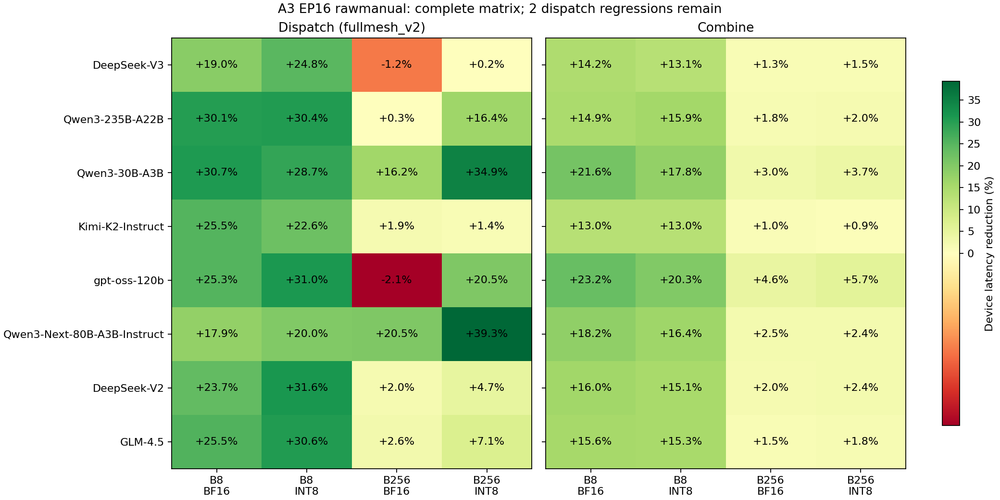
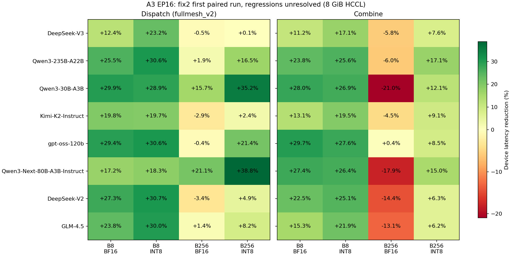

# A3 EP16 泛化回归与性能定位报告（阶段状态）

rawmanual 已完成全部 293 项主精度、15 项补充边界、2 项 INT8 连续变输入和 64 项模型性能配对。Dispatch 几何平均耗时下降 19.11%，30/32 项提升，两个 B256/BF16 形状经三轮配对仍有回退；Combine 32/32 项提升，几何平均下降 9.73%，原 7 项大 BF16 回退均已消除。完整数据见 [rawmanual_complete_matrix](../tests/a3_fullmesh_regression/generalization/results/rawmanual_complete_matrix/summary.json)。rangeinit 对照已通过 8 项 B256/BF16 精度，但采集期间出现额外 16 卡、随后 8 卡占用，性能数据全部隔离，不用于验收。其业务改动已撤回，仅保留诊断补丁，等待独占环境继续处理两项剩余回退。

两项 dispatch 回退：DeepSeek-V3/B256/BF16 三轮分别为 -1.06%/-0.79%/-1.64%，汇总 -1.16%；gpt-oss/B256/BF16 为 -1.05%/-4.14%/-1.03%，汇总 -2.07%。其他形状各一轮配对，汇总按形状等权，不将这两项额外复测重复计入模型数量。所有配对均完整覆盖 16 rank，每 rank 100 次目标 kernel，保留最后 50 次。

H3584/E256/K8/BF16 的独立复测：B128 参考 75.6584 us、候选 72.5997 us，下降 4.04%；B256 参考 137.0122 us、候选 134.0785 us，下降 2.14%。此前 B256 参考侧末 50 次包含一次 17364.073 us 长尾，使均值升至约 481.17 us，中位数仍约 136.59 us；该异常批次完整保留，不删点重算，也不将其视为 72% 优化收益。异常的单一根因尚未确认。新配对在暂停较重离线汇总后重新采集。

当前完整测量针对 rawmanual；rangeinit 对照源码保存为 `diagnostics/rangeinit_vs_rawmanual.diff`，未保留在业务代码中。本提交保存已验证的业务实现和阶段结果；剩余回退处理及远端推送仍待完成。当前设计见 [设计报告](A3_A5_OPTIMIZATION_DESIGN.md)。

## 当前候选验收状态

以下均对应 `rawmanual_artifact_manifest.json` 和 `rawmanual_source.diff` 指定的同一包，未复用旧候选的主精度记录。

| 检查 | 当前结果 |
|---|---|
| Dispatch fullmesh_v2 | 118/118，完整 16 rank |
| Combine | 118/118，完整 16 rank |
| Dispatch→Combine 往返 | 8/8，完整 16 rank |
| 默认 dispatch 大 B/K16 兼容 | 25/25，完整 16 rank |
| Combine 大 B 兼容 | 24/24，完整 16 rank |
| 主精度合计 | 293/293 |
| 补充边界 | 15/15；14 项 8 GiB，H8192/K16/E1024/B256 单独 9 GiB |
| INT8 连续变输入 | BF16/B256 和 FP16/B17 各 16 rank×32 次，全部通过 |
| 同通信域切换、BF16 连续变输入 | 16 项切换和每 rank 32 次连续调用通过 |
| 性能定位探针 | 7 项非量化、4 项 INT8，均有完整 16 rank 数据且精度通过 |
| rawmanual 模型性能矩阵 | 64/64 项完整配对；两项 dispatch 各三轮，其余各一轮 |
| H3584/E256/K8 旧规格性能 | 独立复测 B128 +4.04%、B256 +2.14%；初次长尾批次单列 |

主精度明细见 [rawmanual_precision](../tests/a3_fullmesh_regression/generalization/results/rawmanual_precision/summary.json)：`accuracy.csv` 列出全部形状，`rank_accuracy.csv` 保存 8537 条逐 rank/输出校验记录。浮点指标为空表示对应记录为精确或布尔校验，不表示误差为零。补充检查见 `diagnostics/rawmanual_extra_precision.json`。

7 项非量化探针相对新测参考耗时降低 0.86%～3.15%；4 项 INT8 探针相对此前有效参考降低 1.40%～17.82%，该阶段使用此前参考，后续完整矩阵已另行配对。这些范围只描述探针，不能作为 64 项泛化收益。完整矩阵及旧规格复测现已完成，详见报告开头；两项 dispatch 的三轮回退仍需处理。

2026-09-14 的最终性能参考批次发现额外 8 个设备进程，随后 profiler 缺少部分 rank。只对经命令行、工作目录和 rank 0 库加载来源记录核实的本任务 worker 发出退出信号，由框架清理其余本任务 worker；清理后审计没有本任务残留进程。失败采集保存在本机 `results/failed_profiles/rawmanual_accept1_interference`，不进入收益计算。占用与处理摘要见 `diagnostics/performance_pause_action.json`、`performance_pause_cleanup.json`；完整只读设备观察日志保存在本机。

## 实测环境

A3 单机 8 张物理卡、16 个逻辑设备，EP=16；实测每逻辑设备 40 个 AIV、64 GiB HBM，编译目标 `ascend910_93`。环境为 CANN 9.1.0、驱动 25.5.1、Python 3.9、PyTorch 2.8 / torch_npu 2.8.post4。主矩阵固定 HCCL_BUFFSIZE=8192 MiB，参考与候选使用同一数据生成与精度策略、独立 vendor/cache、原 AllReduce/Exp 预热。最高补充边界单独使用 9216 MiB，不混入性能矩阵。

## 版本与实际覆盖

原始基线为 `093c31e5cce3f44b69dd3480488608c9765b3bed`，上一版 A5→A3 移植为 `b91f6e478e2f864b18ff671f8151751e8600e040`，当前分支为 `dispatch-perf-opt`。

早期默认 dispatch（`comm_alg=""`）使用通用 A3 模板，没有选择新增发送/计数优化所在的 fullmesh_v2 模板。其历史测量仍是有效的默认路径结果，但不能证明该移植分支的精度和收益。新主矩阵显式传入 `fullmesh_v2`；实际 host 日志确认 `isSetFullMeshV2=1`，非量化/INT8 tiling key 分别为 544/546。B257/B512 和 K16 使用默认算法单列。

候选 fix1 完成设备侧修复与下列 269 项精度。后续 fix2 只对 A3 非 hierarchy 的 dispatch host 启用 `isCombinePacked` 窗口校验，59 个设备对象与 fix1 的 SHA-256 完全一致；该字段只影响容量拒绝，不改变序列化 tiling 或窗口地址。已核对历史 rank 初始化日志，所有已通过用例的实际窗口也满足新校验。复用这些不变 kernel 的精度证据，并单独补测最终 host 的临界窗口，证据不冒充为同一 host 包的整批重跑。

参考基线为原始提交加独立 `reference_correctness.patch`，仅修复原有 BS 发送漏写专家权重、对应同步及打包尾部容量；不加入 token 分核、计数合并或 combine 优化。其 4 个 combine V2 设备对象与原始基线逐个相同。

## fix2 历史修改（combine 数据面已被当前方案替换）

1. BS 分核 dispatch 漏写专家权重。原始基线和 b91 在 B32 及以上出现精度失败。单独保存原始基线 B32 BF16 输出，确认数据、三元组、专家计数和接收计数均匹配，只有 256 个有效 token 的 `expand_scales` 错误。现在按打包后的正确偏移写入对应权重，没有修改精度阈值。
2. 移植后 dispatch 重复申请 UB。`SendCumSum` 已申请并填充路由张量及两个 maxSize scratch，发送阶段又申请了一组。B256/H7168/INT8 实测触发 507035，设备指出 VEC 读写 UB 越界。现在保留路由张量，复用已有 scratch 进行计数与量化；同组 B32/B128/B256 BF16/INT8 六项复现全部通过，随后 fullmesh_v2 118 项通过。
3. 打包源缓冲补齐到完整 480B 块。非量化输入还需容纳三元组与权重尾部；量化结果也按最终 Copy 的读取范围分配。BS 发送槽复用同步到实际后继 V 流水。
4. Combine 发送轮宽对应接收缓冲数。轮宽从 recvAivNum 改为 recvAivNum × bufferNum，双 token 接收时减少索引重扫；单缓冲宽度保持原样。B256/20 个接收核时理论轮数从 13 降到 7。
5. Combine 去掉 flag 检查前的 scratch 重复清零。有效 flag 随后全部由搬入覆盖，末尾无效比较位由长度截断忽略。窗口中消费后的 flag 清零仍保留，通信协议与 topK 累加次序不变。该候选已通过 combine 118 项和往返 8 项精度，其完整首轮性能见下文。
6. Dispatch host 容量检查按 A3 packed combine 槽计算，修正检查与实际预留布局的不一致。Kimi-K2/B256 的 2937 MiB 临界配置位于旧需求 2936 MiB 和新需求 2940 MiB 之间，应拒绝；8 GiB 为接受对照。已实测：2937 MiB 在容量检查处按预期返回 561002；8192 MiB 下所有 16 rank 数据、三元组、计数和权重精度通过。此诊断对照不计入 293 项主矩阵。

历史移植来源为 A5 PR5732（token 分核）、PR6074（计数合并与 data-as-flag）、PR10725（收发重叠）、PR11528（发送预取）及小 tiling info 读取。上述第 4、5 项属于旧 packed combine，当前 rawmanual 已恢复 A3 原数据面；当前保留与撤回的来源逐项列于 [设计报告](A3_A5_OPTIMIZATION_DESIGN.md)。UB 生命周期、漏写修复等来自 A3 实测定位，不冒称新的上游 PR。未修改 A5 源码。

## fix2 历史精度实测

| 用例组 | 已通过 | 计划 |
|---|---:|---:|
| Dispatch fullmesh_v2 | 118 | 118 |
| Combine | 118 | 118 |
| Dispatch→Combine 往返 | 8 | 8 |
| 默认 dispatch 大 B/K16 兼容 | 25 | 25 |
| Combine 大 B 兼容 | 24 | 24 |
| 合计（去重） | 293 | 293 |

精度用例调用 10 次，调用间 rank barrier，校验最后一次输出；性能路径不插入此 barrier。所有有效数据、路由三元组、计数和权重均检查，量化继续使用原双标杆策略。重复的六项故障复现不额外增加唯一用例数。

首次大矩阵在 Kimi-K2/B256 被 2 GiB 窗口拒绝。按最大 Kimi-K2/B512 默认算法形状计算需约 5.56 GiB，随后候选和参考基线统一为 8192 MiB。前 50 项 dispatch 结果已逐用例持久化；后续 68 项在新窗口完成，失败父批次中没有持久化验证结果的用例不计通过。

Combine 大 B 首次启动在 `libccl_kernel.so / RunAicpuKfcResInitV2` 加载时报 11002/507018，未进入目标 kernel，因此该次运行不计精度失败或通过。环境恢复后重新执行，24 项全部通过。CPU 框架单元测试前后均执行 171 项，unittest 汇报 6 条 failure、4 条 error、1 条 skip，失败列表一致。failure 含同一测试方法的多条 subtest 记录，不将这些计数直接相减来声称通过项数。原有失败涉及缺失测试资产、配置对齐及 MegaMoe intermediate_hidden 约束，不作为本轮精度成功的依据。

## fix2 历史性能定位与测量

Dispatch 首轮 32 项配对已完成：几何平均耗时下降 18.35%，最大下降 38.75%，四项回退。DeepSeek-V2/B256/BF16 为 -3.44%，Kimi-K2/B256/BF16 为 -2.87%，DeepSeek-V3 与 gpt-oss 的 B256/BF16 分别为 -0.46%/-0.35%。四项均已完成共三轮、交替顺序的配对复测：DeepSeek-V2 平均 -3.36%，Kimi-K2 -2.59%，DeepSeek-V3 -0.43%，gpt-oss +0.17%。前两项为稳定回退；后两项变化很小，gpt-oss 不同轮次还会变号。Combine 首轮 32 项几何平均耗时下降 12.40%，但 7 个 B256/BF16 形状回退 4.51%～20.99%；不得用平均收益掩盖这些回退。H2048/Qwen3-30B 的 Scalar 时间由 22.90 us 增至 33.19 us，MTE2 时间由 15.45 us 增至 32.42 us。已编译 scan1 对照包，将非量化发送改为一次路由扫描，保留 packed flag 和提前接收；7 项精度通过，但性能全部更差，已拒绝并撤回 scan1。H2048/Qwen3-30B 的 Scalar 时间降至约 28.99 us，MTE2 时间却增至约 39.20 us，总耗时从 fix2 的 102.88 us 升至 109.53 us。该对照说明扫描次数不足以解释回退，发送轮次对收发重叠仍有价值。后续 30 发送/10 提前接收核实验（split3）和先检查末块标志实验（flag1）均完成 7 项精度，但性能未改善，均已撤回。由此不能把回退简单归为接收核数量或无效轮询次数。

下表只对应早期发送轮宽候选、H3584/E256/K8/BF16、HCCL 2048 MiB，每项一轮：

| B | 原始基线 us | 早期轮宽候选 us | 耗时降低 |
|---:|---:|---:|---:|
| 128 | 75.2972 | 72.0310 | 4.34% |
| 256 | 136.9690 | 137.6748 | -0.52% |

该试验未消除 B256 的全部回退，也不代表后续加入 scratch 清零优化的最终包。性能统一每 rank 调用 100 次，提取最后 50 个目标 kernel，计算 16 rank 均值；缺少任一 rank、精度失败或配对次数不一致时不生成收益。

此前两轮 B256 原始基线为 136.8663 us，b91 为 137.8476 us，回退约 0.72%。有效 MindStudio 后端 PMU 指标：

| AIV 指标 | 原始基线 | b91 |
|---|---:|---:|
| Vector | 8.36% | 12.52% |
| Scalar | 18.67% | 35.93% |
| MTE2 | 14.87% | 35.44% |
| MTE3 | 81.17% | 51.01% |

各流水并行，不能把比例相加或当作链路带宽利用率。该变化支持检查标量索引扫描、flag 检查与搬入开销，不能直接断言回退完全由线上的打包膨胀造成。

按 [MindStudio MC2 指南](https://github.com/Ascend/msopprof/blob/master/docs/en/user_guide/msopprof_usage.md#collecting-performance-data-of-mc2-operators) 编译独立 PrintTimeStamp 100–104 / GetSystemCycle 包，确认实际 40 AIV，发送/提前接收各 20 个。640 个 rank/core 组合中 608 个有完整三次打印记录，其余存在并发打印交织；打桩开销与 rank 偏移使其不适合汇报收益。默认 msopprof kernel replay 多 rank 失败，其数据弃用；CLI msprof 仅有有效 host trace，device data 为空。上述有效时间和 PMU 来自未打桩包的 torch_npu profiler / MindStudio 后端。

首轮完整数据与逐 rank 校验已导出到 [fix2_first_pass](../tests/a3_fullmesh_regression/generalization/results/fix2_first_pass/summary.json)。该数据保留全部回退项，属于修复前首轮测量，不是最终验收。

## 回退定位实验与当前候选

Dispatch 对 EP≤16、非量化、B≥128、H≥4096、无共享专家 rank 且专家数不是 2 的幂的形状，将计数核上限收敛为 4。最初不区分专家数的实验伤害了 DeepSeek-V3/Qwen235；限制后 8 个 B256 BF16 探针全部精度通过，Kimi/DeepSeek-V2/GLM 单轮耗时分别下降 1.72%/2.00%/2.69%，DeepSeek-V3 为 -0.10%。这些是探针结果，不能替代最终 64 项矩阵。

Combine 后续实验均采用同一参考基线、8192 MiB 窗口、7 个大 B BF16 探针。下列实验不计入最终收益，源码补丁、二进制哈希和测量结果分别归档。

- adaptive：大 B 非量化回退原 A3 unpacked 布局，消费后清理可能被原始数据覆盖的 packed 标志。16 项同通信域切换诊断通过，但无调用间 barrier 的性能测试中有 3 项 rank 5 精度失败；已拒绝并删除该业务头文件。单独重跑其中一个形状通过，因此没有将问题归结为已证实的单一根因。
- separate：保留原 A3 独立标志调度，数据 DMA 以 480B 数据、32B 空隙跨步写入，避免覆盖 packed 标志。16 项切换和每 rank 32 次正、正、负、负输入的连续调用检查通过，7 项性能探针精度也通过，但耗时增加 49.15%～71.77%；已撤回业务代码。15 项额外边界检查中的前 14 项通过，H8192/K16/E1024/B256 被窗口检查拒绝：实际需要 8589 MiB，大于 8192 MiB。该项应以 9 GiB 单独验证，不修改性能矩阵的窗口大小。
- balance：保持 packed 协议，把 B256 提前/随后接收任务从 180/76 改为 140/116。编译、OAT、7 项精度及每 rank 32 次连续变输入检查通过；性能相对参考基线回退 8.76%～26.74%，也比 fix2 更差，已撤回。这说明静态 token 数均分不足以抵消接收组开始时间差异及通信开销。
- allcore：让全部 40 个 AIV 先发送、再各自切换接收，保持 packed 协议。每 rank 32 次连续变输入检查通过；在修复 OPP 后新测的 7 项配对中精度全部通过，但耗时增加 12.07%～28.59%，已撤回分核改动。
- contiguous：连续搬入完整 packed 块，再在 UB 压紧 480B 数据。7 项精度及每 rank 32 次连续变输入检查通过。首次性能采集有 5/7 项缺少 rank，整批归档不计收益；第二次完整 16 rank 采集显示 7 项耗时仍高于参考；设备观察同时发现 11:48:41～11:49:04 UTC 每卡两个 PID，后 3 项可能受并发影响，不能作为独占性能。前 4 项仍回退 4.46%～19.89%，方案已撤回；整批数据仅用于诊断。数据见 `diagnostics/contiguous_combine_vs_reference.csv`。
- rawprefetch：A3 全程保留原连续数据区和独立完成标志，发送先预取下一 token，再处理当前 token；现有队列深度从 1 增至 2，UB 缓冲个数不变。7 项精度、每 rank 32 次连续变输入通过，非量化性能未改善。首 2 项时间段出现双进程采样，不作为独占测量；Qwen3-30B 的 PMU Scalar 时间从约 22.96 us 增至 143.10 us，提示多项队列管理的标量代价需要排除。INT8 补测在 HcclAllreduce 预热阶段报 507018，没有目标算子的验证结果。
- rawmanual：当前完整验收候选。复用 PR11528 的每槽事件与提前输入搬入，替代多项队列管理；非量化以 MTE3→MTE2 保护原始槽复用、MTE2→MTE3 保护发送，量化以 V→MTE2/MTE2→V 保护双输入槽。批尾仍排空数据发送后补发独立标志，发送完成消费所有剩余可复用事件，再重置 TPipe。A3 全程使用原连续数据区和独立标志，接收及累加顺序不变，不按 B/量化模式切换协议。完整 tiling Init 重载保留；补回重载前后 59 个设备对象逐字节一致。

rawmanual 联合批次复用同一通信域，16 项切换、每 rank 32 次变输入、7 个大 BF16 与 4 个 INT8 性能探针全部通过精度，性能数据包含完整 16 rank；期间设备观察未发现每卡多个 PID。7 个大 BF16 探针相对修复 OPP 后的参考耗时下降 0.86%～3.15%；4 个 INT8 探针相对历史参考下降 1.40%～17.82%。后者尚不是重新采集的环境配对，完整验收会刷新全部参考数据。Qwen3-30B/B256/BF16 的 Scalar 时间由参考 22.96 us、队列实验 143.10 us 降至 16.79 us；MTE2 为 14.56 us，参考为 15.51 us；MTE3 为 59.39 us，参考为 59.82 us。流水时间不可相加；该对照支持保留轻量事件实现，但不将单探针结果外推为所有模型收益。

单独启动连续调用时曾在 libccl_kernel.so / RunAicpuKfcResInitV2 报 11002 open so failed，未执行目标 kernel。将诊断连续放入同一通信域后完整通过，没有改动性能预热和统计方法。完整矩阵仍按严格预检和既有计时方法执行。

性能预热阶段曾在标准 HcclAllreduce 的 RunAicpuKfcResInitV2 报 507018，失败采集中目标 combine kernel 为 0 条，已独立归档。之后参考基线环境对照通过，DeepSeek-V3/B256 实测 253.4785 us，与此前 253.4746 us 一致。此环境对照不计入候选性能结果。

## 测试环境加载问题修复

后续探针两次在额外 HcclAllreduce 的 RunAicpuKfcResInitV2 初始化失败。省去 AllReduce 的诊断又暴露 HCCL 后台回调调用 ZerosLike 时 `SpaceRegistry is nullptr`。只恢复随机张量准备未解决问题，省去 AllReduce 的诊断方案已撤回，没有生成可用性能数据。

Host-only `aclnnInit` 加载诊断发现：隔离 OPP 的 `built-in` 为目录软链接，路径实际存在，但 CANN `IsSplitOpp` 判定不存在，随后按旧目录结构查找，未加载任何内置 host 库。复制完整标准 OPP 为真实目录后，加载器成功加载 7 个基础 host 库及指定私有 custom 库。新的 `opp_complete` 保持空 `vendors/config.ini`，不引入系统 issue4501 vendor。修复后原 AllReduce/Exp 流程的参考与 allcore 各 7 个探针均完整执行并通过精度。没有将所有历史 507018 都归因于这一问题；SetDevice 超时及外部占用等故障另行保留。

参考/候选源码及设备对象均不因该环境修复变化。既有通过精度且确认来源的历史结果保留；修复后的测量单独保存，并检查实际加载的基础及自定义库。不会用缺少目标 kernel 的失败采集计算收益。

## 泛化用例与规格来源

生成 293 个精度用例：dispatch 143、combine 142、round-trip 8；另有 64 个性能用例。主要精度 B 为 1/8/32/128/256，尾部与偏载 B 为 17/33/127/255，默认路径兼容 B 为 257/512。性能覆盖每个模型 B8/B256、非量化/INT8、dispatch/combine。额外覆盖 H1024/8192、K1/12/16、E16/1024、FP16、掩码和计数格式。生成数量不等于实测通过数量。

| 官方模型 | H | 路由专家 E | topK | 固定版本配置 |
|---|---:|---:|---:|---|
| deepseek-ai/DeepSeek-V3 | 7168 | 256 | 8 | [config](https://huggingface.co/deepseek-ai/DeepSeek-V3/resolve/e815299b0bcbac849fa540c768ef21845365c9eb/config.json) |
| Qwen/Qwen3-235B-A22B | 4096 | 128 | 8 | [config](https://huggingface.co/Qwen/Qwen3-235B-A22B/resolve/8efa61729e24bd65b1d152b5ab5409052aa80e65/config.json) |
| Qwen/Qwen3-30B-A3B | 2048 | 128 | 8 | [config](https://huggingface.co/Qwen/Qwen3-30B-A3B/resolve/ad44e777bcd18fa416d9da3bd8f70d33ebb85d39/config.json) |
| moonshotai/Kimi-K2-Instruct | 7168 | 384 | 8 | [config](https://huggingface.co/moonshotai/Kimi-K2-Instruct/resolve/fd1984e2b7a3350dbf7305fe73a4ede25c14de50/config.json) |
| openai/gpt-oss-120b | 2880 | 128 | 4 | [config](https://huggingface.co/openai/gpt-oss-120b/resolve/b5c939de8f754692c1647ca79fbf85e8c1e70f8a/config.json) |
| Qwen/Qwen3-Next-80B-A3B-Instruct | 2048 | 512 | 10 | [config](https://huggingface.co/Qwen/Qwen3-Next-80B-A3B-Instruct/resolve/9c7f2fbe84465e40164a94cc16cd30b6999b0cc7/config.json) |
| deepseek-ai/DeepSeek-V2 | 5120 | 160 | 6 | [config](https://huggingface.co/deepseek-ai/DeepSeek-V2/resolve/4461458f186c35188585855f28f77af5661ad489/config.json) |
| zai-org/GLM-4.5 | 5120 | 160 | 8 | [config](https://huggingface.co/zai-org/GLM-4.5/resolve/cbb2c7cfb52fa128a9660cb1a7a78e017899e115/config.json) |
| mistralai/Mixtral-8x7B-v0.1 | 4096 | 8 | 2 | [config](https://huggingface.co/mistralai/Mixtral-8x7B-v0.1/resolve/fc7ac94680e38d7348cfa806e51218e6273104b0/config.json) |

H/E/K 取自上述官方配置，完整快照和 SHA-256 保存在 `tests/a3_fullmesh_regression/generalization/models`。B、通信 dtype、INT8 模式为测试选择；不模拟模型权重量化、专家 GEMM 或共享专家计算。Mixtral 的 8 个专家不满足当前 EP16 均分约束，因此保留来源但不生成伪造的 16 专家模型。

cyclic 路由先交错 rank、再轮转本地专家，保证每 token 专家唯一、rank 和专家任务数最多差 1。只有总任务数可整除时才是完全均衡；随机和集中偏载用例单列。72 组模型/token 组合的唯一性及负载约束已在 CPU 验证。

## 交付与待完成项

最终 host 临界窗口拒绝/接受校验已完成。fix2 的 64 项匹配性能和稳定回退复测已完成；当前 rawmanual 的 293 项主精度、15 项补充边界及 2 项 INT8 连续检查也已完成。rawmanual 的完整性能矩阵及旧规格复测已完成。仍需确认两项 dispatch 剩余回退的处理、定稿及提交/推送。A2/A5、跨机 EP64/128、hierarchy、V3 context、融合 RMSNorm、共享/弹性等未在本轮 EP16 模型矩阵做硬件验收，不从本机结果外推。

设备空闲后已完成上述回归，但后续出现本任务之外的新占用，后续重新通过严格预检，补完精度并启动性能对照。[ep_test 实施规范](/root/workspace/code_develop/ep_test_mega_moe_T/skills/ep-test-implementation/SKILL.md:206) 要求：“检测到占用、设备集合不完整或解析失败时不得绕过预检启动 worker”。没有终止未知进程或绕过预检。

本机完整日志、用例、独立安装包与清单位于 `/root/workspace/code_develop/O1Deepep/a3_ep16_generalization`。关键证据：`results/fix1_coverage.json`、`results/fix2_coverage.json`（显式复用相同 kernel）、`results/fix2_artifact_manifest.json`、`results/host_guard_precision_reuse.json`、`results/baseline_fm2_field_differences.json`、`results/window_requirements.json`、`results/campaign_runs.jsonl`。仓库 `tests/a3_fullmesh_regression/generalization` 保存可复现生成器、官方配置快照、修复/诊断补丁与来源记录。

## 构建与复现注意事项

`rangeinit` 的增量构建曾复用全部 59 个旧设备对象，哈希校验后未运行该产物。非增量构建后确认 8 个 dispatch 对象改变，8 个 combine 对象及其余对象不变，才启动探针。后续涉及 kernel 头文件改动时应执行干净构建并核对相关对象哈希，不能仅凭打包成功认定源码已编入。rawmanual 的首次构建为非增量构建；恢复完整 tiling 重载后未改变 combine 行为，新的干净构建也验证其 8 个 combine 对象仍逐个相同。

所有硬件用例已经停止。当前保留经过完整回归的 rawmanual 业务代码和完整性能/精度证据。两项 dispatch 回退尚未解决，后续验证需要 EP16 独占窗口；本报告没有宣称所有性能回退已经消除。
