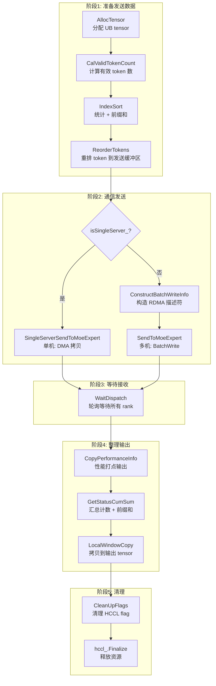

# MoeDistributeDispatchA2::Process() 函数深度分析

## 目录
- [1. 概述](#1-概述)
- [2. 整体流程架构](#2-整体流程架构)
- [3. 数据结构详解](#3-数据结构详解)
- [4. 内存排布](#4-内存排布)
- [5. 子流程详解](#5-子流程详解)
- [6. 时序流水与同步机制](#6-时序流水与同步机制)
- [7. 开发注意事项](#7-开发注意事项)

---

## 1. 概述

### 1.1 功能定位
`MoeDistributeDispatchA2::Process()` 是 MoE (Mixture of Experts) 模型中 **token 分发（dispatch）** 的核心入口函数，运行在昇腾 AI Core 上。

**核心职责**：
1. 将本地 token 按 expert 分组重排
2. 通过 HCCL（华为集合通信库）发送到各 rank
3. 等待接收其他 rank 发来的 token
4. 将接收数据按 expert 维度组织后写入输出 tensor

### 1.2 执行环境
```
┌─────────────────────────────────────────────────────────┐
│                    NPU 服务器集群                         │
├─────────────────────────────────────────────────────────┤
│  Rank 0      Rank 1      Rank 2      ...    Rank N-1   │
│  ┌─────┐    ┌─────┐    ┌─────┐          ┌─────┐        │
│  │AIC  │    │AIC  │    │AIC  │   ...    │AIC  │        │
│  │AIV 0│    │AIV 0│    │AIV 0│          │AIV 0│        │
│  │AIV 1│    │AIV 1│    │AIV 1│          │AIV 1│        │
│  │ ... │    │ ... │    │ ... │          │ ... │        │
│  └─────┘    └─────┘    └─────┘          └─────┘        │
│       ↕ HCCL 窗口通信 (RDMA/DMA) ↕                       │
└─────────────────────────────────────────────────────────┘
```

---

## 2. 整体流程架构

### 2.1 五阶段流水线

```
┌──────────────────────────────────────────────────────────────────────────┐
│                           Process() 主流程                                │
├─────────────┬─────────────┬─────────────┬─────────────┬─────────────────┤
│   阶段1     │   阶段2     │   阶段3     │   阶段4     │     阶段5       │
│   准备发送  │   通信发送  │   等待接收  │   整理输出  │     清理        │
├─────────────┼─────────────┼─────────────┼─────────────┼─────────────────┤
│AllocTensor  │SingleServer │             │CopyPerfInfo │                 │
│↓            │SendToMoe    │WaitDispatch │↓            │SyncAll          │
│CalValidToken│Expert       │             │GetStatus    │↓                │
│Count        │(单机)       │             │CumSum       │CleanUpFlags     │
│↓            │或           │             │↓            │↓                │
│IndexSort    │Construct    │             │LocalWindow  │hccl_.Finalize   │
│↓            │BatchWrite   │             │Copy         │                 │
│ReorderTokens│+            │             │             │                 │
│             │SendToMoe    │             │             │                 │
│             │Expert       │             │             │                 │
│             │(多机)       │             │             │                 │
└─────────────┴─────────────┴─────────────┴─────────────┴─────────────────┘
```

### 2.2 流程图



---

## 3. 数据结构详解

### 3.1 核心常量定义

| 常量名 | 值 | 说明 |
|--------|-----|------|
| `BUFFER_NUM` | 2 | 双缓冲（Ping-Pong）数量 |
| `STATE_SIZE` | 1MB | HCCL 窗口状态区大小 |
| `UB_ALIGN` | 32 | UB 对齐字节数 |
| `BITS32_PER_BLOCK` | 8 | 一个 block (32B) 的 int32 元素数 |
| `SKIP_OFFSET` | 512 | 数据区到 flag 的跳跃偏移 |
| `FLAG_VALUE` | 0xFFFFFFFF | 数据就绪标记值 |

### 3.2 主要成员变量分类

#### 3.2.1 GM（Global Memory）侧 Tensor

```cpp
// 输入
GlobalTensor<XType> xGMTensor_;              // 输入 token [BS, H]
GlobalTensor<int32_t> expertIdsGMTensor_;    // 路由结果 [BS, K]
GlobalTensor<int8_t> xActiveMaskGMTensor_;   // active mask

// 输出
GlobalTensor<ExpandXOutType> expandXOutGMTensor_;   // 重排后 token
GlobalTensor<float> dynamicScalesOutGMTensor_;      // 动态量化 scale
GlobalTensor<int32_t> windowInstatusTensor_;        // 接收窗口状态区
GlobalTensor<int32_t> sendStatusTensor_;            // 发送窗口状态区

// 通信
GlobalTensor<uint32_t> batchWriteInfoTensor_;       // BatchWrite 描述符
```

#### 3.2.2 UB（Unified Buffer）侧 LocalTensor

```cpp
// Token 数据区（Ping-Pong 双缓冲）
LocalTensor<XType> xTensor_[2];              // 原始 token
LocalTensor<ExpandXOutType> xOutTensor_[2];  // 输出 token

// 索引与计数
LocalTensor<int32_t> expertCountTensor_;     // token 在 expert 内的偏移
LocalTensor<int32_t> expertIdsTensor_;       // expertIds 副本
LocalTensor<int32_t> statusTensor_;          // 各 rank 各 expert 的 token 计数
LocalTensor<uint32_t> expertCumsumTensor_;   // expert 维度前缀和
LocalTensor<int32_t> validExpIndexTensor_;   // 有效 expert 索引列表

// 量化相关
LocalTensor<float> smoothScalesTensor_;      // smooth scale
LocalTensor<float> xFloatTensor_;            // 量化中间结果

// 输出相关
LocalTensor<int32_t> epRecvCountsTempLocal_; // 接收计数临时空间
LocalTensor<int32_t> epRecvCountsOutLocal_;  // 接收计数前缀和
```

#### 3.2.3 标量参数

```cpp
uint32_t axisBS_{0};              // Batch Size
uint32_t axisH_{0};               // Hidden Size
uint32_t axisK_{0};               // TopK
uint32_t worldSize_{0};           // EP rank 总数
uint32_t rankId_{0};              // 当前 rank ID
uint32_t aivNum_{0};              // AI Vector Core 数量
uint32_t moeExpertNum_{0};        // MoE expert 总数
uint32_t localMoeExpertNum_{0};   // 每 rank 本地 expert 数
uint32_t dataSizePerRank_{0};     // HCCL 窗口每 rank 数据区大小
uint64_t sendToMoeExpTokenCnt_;   // 实际发送 token 数
```

---

## 4. 内存排布

### 4.1 HCCL 窗口内存布局

```
┌─────────────────────────────────────────────────────────────────────┐
│                    HCCL 窗口（双缓冲）                               │
├──────────────────────────────┬──────────────────────────────────────┤
│      Buffer 0 (totalSize_)   │      Buffer 1 (totalSize_)          │
├──────────────────────────────┼──────────────────────────────────────┤
│                              │                                      │
│  ┌─────────────────────────┐ │  ┌─────────────────────────┐        │
│  │ Status 区 (1MB)         │ │  │ Status 区 (1MB)         │        │
│  └─────────────────────────┘ │  └─────────────────────────┘        │
│                              │                                      │
│  ┌─────────────────────────┐ │  ┌─────────────────────────┐        │
│  │ 数据区 (dataSize_)      │ │  │ 数据区 (dataSize_)      │        │
│  │ [Rank0][Rank1]...[RankN]│ │  │ [Rank0][Rank1]...[RankN]│        │
│  └─────────────────────────┘ │  └─────────────────────────┘        │
│                              │                                      │
│  [bufferChosen 标记]         │  [bufferChosen 标记]                 │
│                              │                                      │
└──────────────────────────────┴──────────────────────────────────────┘
```

### 4.2 单个 Rank 数据区布局

```
每个 rank 的数据区 (dataSizePerRank_ 字节):
┌─────────────────────────────────────────────────────────────────────┐
│  Status 区 (dataOffset_ 字节)                                       │
│  ┌─────────────────────────────────────────────────────────────┐   │
│  │ [expert0 计数][expert1 计数]...[expertN 计数][FLAG 标记]     │   │
│  │    int32        int32           int32       int32=0xFFFFFFFF │   │
│  └─────────────────────────────────────────────────────────────┘   │
├─────────────────────────────────────────────────────────────────────┤
│  Token 数据区                                                       │
│  ┌─────────────────────────────────────────────────────────────┐   │
│  │ [expert0 的 token...][expert1 的 token...]...               │   │
│  │ 每个 token: axisHCommu_ 个元素 (含可能的 scale)              │   │
│  └─────────────────────────────────────────────────────────────┘   │
├─────────────────────────────────────────────────────────────────────┤
│  SKIP_OFFSET (512 字节间隔，防缓存行冲突)                           │
├─────────────────────────────────────────────────────────────────────┤
│  Data FLAG (int32 = 0xFFFFFFFF)                                    │
└─────────────────────────────────────────────────────────────────────┘
```

### 4.3 UB（Unified Buffer）内存排布

```
UB 内存布局（地址从低到高）:
┌─────────────────────────────────────────────────────────────────────┐
│  地址 0（多区域复用，不同阶段使用不同区域）                          │
│  ┌───────────────────────────────────────────────────────────────┐ │
│  │ xTensor_[0] / xOutTensor_[0] (Ping)                           │ │
│  │ 起始: 0, 大小: axisH                                         │ │
│  ├───────────────────────────────────────────────────────────────┤ │
│  │ xTensor_[1] / xOutTensor_[1] (Pong)                           │ │
│  │ 起始: axisH*sizeof(XType), 大小: axisHCommu_                  │ │
│  ├───────────────────────────────────────────────────────────────┤ │
│  │ statusTensor_ / batchWriteU32/U64Tensor_ (复用)               │ │
│  │ 起始: 0, 大小: max(各区域需求)                                │ │
│  └───────────────────────────────────────────────────────────────┘ │
├─────────────────────────────────────────────────────────────────────┤
│  expertCumsumTensor_                                                │
│  起始: max(xLength, statusLength, batchWriteLength)                │
│  大小: moeExpertNum_ + 1                                            │
├─────────────────────────────────────────────────────────────────────┤
│  expertIdsTensor_                                                   │
│  大小: RoundUp(expertIdsCnt_, 8)                                    │
├─────────────────────────────────────────────────────────────────────┤
│  expertCountTensor_                                                 │
│  大小: RoundUp(expertIdsCnt_, 8)                                    │
├─────────────────────────────────────────────────────────────────────┤
│  flagTensor_ / xFloatTensor_ (复用)                                 │
│  大小: axisH (float)                                                │
├─────────────────────────────────────────────────────────────────────┤
│  smoothScalesTensor_                                                │
│  大小: axisH                                                        │
├─────────────────────────────────────────────────────────────────────┤
│  (可选) performanceInfoI32Tensor_                                   │
├─────────────────────────────────────────────────────────────────────┤
│  ... 空闲区域 ...                                                   │
├─────────────────────────────────────────────────────────────────────┤
│  validExpIndexTensor_ (从 UB 末尾向前分配)                          │
│  地址: TOTAL_UB_SIZE - expertIdsLength                              │
└─────────────────────────────────────────────────────────────────────┘
```

---

## 5. 子流程详解

### 5.1 AllocTensor() - UB 空间分配

**功能**：在 UB（Unified Buffer）上分配所有 LocalTensor。

**关键设计**：
1. **地址复用**：不同阶段使用的 tensor 复用相同地址，节省 UB 空间
2. **Ping-Pong 双缓冲**：`xTensor_` 和 `xOutTensor_` 使用双缓冲实现流水线并行
3. **尾部分配**：`validExpIndexTensor_` 从 UB 末尾向前分配，避免冲突

**UB 空间规划表**：
| 区域 | 起始地址 | 大小 | 用途 |
|------|----------|------|------|
| xTensor/xOut 复用区 | 0 | ~axisH*sizeof(type)*2 | Token 数据 |
| status/batchWrite 复用区 | 0 | 取最大值 | 状态/描述符 |
| expertCumsum | max(上述) | (expert+1)*4 | 前缀和 |
| expertIds | 紧接上 | BS*K*4 | 路由表 |
| expertCount | 紧接上 | BS*K*4 | 计数器 |
| flag/xFloat 复用 | 紧接上 | axisH*4 | 标志/量化 |
| smoothScales | 紧接上 | axisH*4 | 量化 scale |
| validExpIndex | UB末尾-BS*K*4 | BS*K*4 | 有效索引 |

---

### 5.2 CalValidTokenCount() - 有效 Token 计算

**功能**：根据 mask 筛选实际参与 dispatch 的 token。

**处理流程**：
```
┌─────────────────────────────────────────────────────────────┐
│                    CalValidTokenCount                       │
├─────────────────────────────────────────────────────────────┤
│  1. 初始化: activeMaskBsCnt_ = axisBS_                      │
│            sendToMoeExpTokenCnt_ = axisBS_ * axisK_         │
├─────────────────────────────────────────────────────────────┤
│  2. 根据 mask 类型处理:                                      │
│     ┌─ isTokenMaskFlag_? ─→ TokenActiveMaskCal()            │
│     │   (统计有效 BS 数，计算 sendToMoeExpTokenCnt_)         │
│     │                                                        │
│     └─ isExpertMaskFlag_? ─→ ExpertActiveMaskCal()          │
│         (生成 expert 级 bitmask)                             │
├─────────────────────────────────────────────────────────────┤
│  3. 创建索引序列: [0, 1, 2, ..., expertIdsCnt_-1]           │
├─────────────────────────────────────────────────────────────┤
│  4. 处理零计算 expert (expertId == moeExpertNum_):          │
│     ZeroComputeExpertMaskCal()                              │
├─────────────────────────────────────────────────────────────┤
│  5. 使用 GatherMask 提取有效索引到 validExpIndexTensor_     │
└─────────────────────────────────────────────────────────────┘
```

**三种 Mask 类型对比**：
| 类型 | 输入 | 处理方式 | 输出 |
|------|------|----------|------|
| 无 mask | - | 全部有效 | validExpIndex = [0, 1, ..., N-1] |
| token mask | int8[BS] | ReduceSum 统计有效 BS | 有效 BS * K 个索引 |
| expert mask | int8[BS*K] | 逐条目比较生成 bitmask | 有效条目索引 |

---

### 5.3 IndexSort() - 统计与前缀和

**功能**：按 expert 统计 token 数并计算前缀和。

**核心数据结构**：
```
statusTensor_ 布局: [worldSize][statusEntryCount]
┌───────────────────────────────────────────────────────────────┐
│  Rank 0: [exp0_cnt][exp1_cnt]...[expN_cnt][FLAG]              │
│  Rank 1: [exp0_cnt][exp1_cnt]...[expN_cnt][FLAG]              │
│  ...                                                          │
│  Rank N: [exp0_cnt][exp1_cnt]...[expN_cnt][FLAG]              │
└───────────────────────────────────────────────────────────────┘

expertCumsumTensor_ 布局:
┌───────────────────────────────────────────────────────────────┐
│ [0][exp0 总数][exp0+exp1 总数]...[所有 expert 总数]           │
│ ↑  ↑                                                        │
│ │  expert 0 的起始偏移 = 0                                   │
│ 前缀和多存一个 0，方便计算                                    │
└───────────────────────────────────────────────────────────────┘
```

**处理流程**：
```cpp
// 1. 初始化 status 数组（清零 + 设置 FLAG）
InitStatusTensor();

// 2. 标量循环统计每个 expert 的 token 数
for (tokenIndex = 0; tokenIndex < sendToMoeExpTokenCnt_; ++tokenIndex) {
    expertIdx = validExpIndexTensor_(tokenIndex);      // 有效索引
    expertId = expertIdsTensor_(expertIdx);            // 目标 expert
    rankId = expertId / localMoeExpertNum_;            // 目标 rank
    expertOffsetInRank = expertId % localMoeExpertNum_; // rank 内偏移

    // 记录 token 是第几个到达该 expert 的
    expertCountTensor_(expertIdx) = statusTensor_(rankId, expertOffsetInRank);

    // 计数器 +1
    statusTensor_(rankId, expertOffsetInRank)++;
}

// 3. 计算全局前缀和
expertCumsumTensor_(0) = 0;
for (expertId = 1; expertId <= moeExpertNum_; expertId++) {
    expertCumsumTensor_(expertId) = expertCumsumTensor_(expertId-1) + count[expertId-1];
}
```

**最后一个核的特殊职责**：
1. 输出 `expandIdx`（每个 token 在其 expert 中的序号）到 GM
2. 将 status 写入 HCCL 发送窗口
3. 在每个 rank 的数据区末尾写入 FLAG 标记

---

### 5.4 ReorderTokens() - Token 重排

**功能**：将 token 从输入按 expert 分组搬运到发送缓冲区。

**发送缓冲区位置计算**：
```
token 在缓冲区中的位置 = (expertOffset + tokenOffset) * axisHCommu_

其中:
  expertOffset = expertCumsumTensor_(expertId) - expertCumsumTensor_(startExpertId)
  tokenOffset  = expertCountTensor_(expertIdx)
```

**流水线处理（Ping-Pong 双缓冲）**：
```
时间线 ──────────────────────────────────────────────────────►

Token 0:
├─ GM→UB(MTE2) ─┼─ 量化(V) ─┼─ UB→GM(MTE3) ─┤
                │           │               │
Token 1:        │           │               │
                ├─ GM→UB ───┼─ 量化 ────────┼─ UB→GM ─┤
                │           │               │         │
Token 2:        │           │               │         │
                │           ├─ GM→UB ───────┼─ 量化 ──┼─ UB→GM ─┤

EVENT_ID0 和 EVENT_ID1 交替使用，实现流水线并行
```

**量化 vs 非量化路径对比**：
| 路径 | 流程 | 事件类型 |
|------|------|----------|
| 非量化 | GM → UB → GM | MTE3_MTE2 / MTE2_MTE3 |
| 量化 | GM → UB(x) → V(量化) → UB(xOut) → GM | V_MTE2 / MTE2_V / V_MTE3 |

---

### 5.5 SendToMoeExpert() / SingleServerSendToMoeExpert() - 通信发送

#### 5.5.1 单机场景（SingleServerSendToMoeExpert）

**条件**：`worldSize_ <= 8`（单服务器内）

**通信方式**：DMA 直接拷贝，不走 RDMA

```
┌─────────────────────────────────────────────────────────────────┐
│              单机 DMA 拷贝流程                                   │
├─────────────────────────────────────────────────────────────────┤
│                                                                 │
│  源: 本 rank 发送窗口                                            │
│  windowOutGM_ + rankIndex * dataSizePerRank_                   │
│                                                                 │
│           ↓ DataCopy (通过 UB 中转)                             │
│                                                                 │
│  目标: 目标 rank 接收窗口                                        │
│  GetWindowsInAddr(rankIndex) + totalSize_ * bufferChosen_      │
│  + dataSizePerRank_ * rankId_                                  │
│                                                                 │
└─────────────────────────────────────────────────────────────────┘
```

**步骤**：
1. 拷贝 status 区（通过 UB 中转）
2. 逐 token 拷贝数据区（Ping-Pong 流水）
3. 拷贝数据末尾的 FLAG 标记

#### 5.5.2 多机场景（SendToMoeExpert）

**条件**：`worldSize_ > 8`（跨服务器）

**通信方式**：HCCL BatchWrite（RDMA 批量写入）

```
┌─────────────────────────────────────────────────────────────────┐
│              多机 RDMA 通信流程                                  │
├─────────────────────────────────────────────────────────────────┤
│                                                                 │
│  核 0:                                                          │
│  ┌─────────────────────────────────────────────────────────┐   │
│  │ 1. 调用 hccl_.BatchWrite<true>(batchWriteInfo_, worldSize_)│ │
│  │ 2. 翻转双缓冲标记 bufferChosenGlobal_(0) = bufferChosen_ ^ 1│ │
│  └─────────────────────────────────────────────────────────┘   │
│                                                                 │
│  最后一个核:                                                    │
│  ┌─────────────────────────────────────────────────────────┐   │
│  │ 处理自发自收（本 rank 发给自己的数据）                     │   │
│  │ 1. 逐 token 从发送窗口拷贝到接收窗口                       │   │
│  │ 2. 写入 FLAG 标记                                         │   │
│  │ 3. DataCacheCleanAndInvalid 刷缓存                        │   │
│  └─────────────────────────────────────────────────────────┘   │
│                                                                 │
└─────────────────────────────────────────────────────────────────┘
```

**BatchWrite 描述符结构**（32 字节/条目）：
```
┌─────────────────────────────────────────────────────────────────┐
│  Offset  │  Size  │  Field                                      │
├─────────────────────────────────────────────────────────────────┤
│  0       │  u64   │  srcAddr (源地址 = 本地发送窗口)             │
│  8       │  u64   │  dstAddr (目标地址 = 远端接收窗口)           │
│  16      │  u64   │  size (传输大小)                             │
│  24      │  u32   │  dataType (HCCL_DATA_TYPE_INT8)             │
│  28      │  u32   │  rankId (目标 rank)                         │
└─────────────────────────────────────────────────────────────────┘
```

---

### 5.6 WaitDispatch() - 等待数据就绪

**功能**：轮询等待所有 rank 的数据到达接收窗口。

**双 FLAG 验证机制**：
```
┌─────────────────────────────────────────────────────────────────┐
│                    双 FLAG 验证流程                              │
├─────────────────────────────────────────────────────────────────┤
│                                                                 │
│  步骤1: 检查 Status FLAG                                        │
│  ┌─────────────────────────────────────────────────────────┐   │
│  │ 读取 windowInstatusTensor_[rank * dataSizePerRank_       │   │
│  │      + statusEntryCount - 1]                             │   │
│  │ 是否等于 FLAG_VALUE?                                     │   │
│  └─────────────────────────────────────────────────────────┘   │
│           │ 等于                  │ 不等于                      │
│           ↓                      ↓                             │
│  步骤2: 检查 Data FLAG       继续轮询                           │
│  ┌─────────────────────────────────────────────────────────┐   │
│  │ 根据各 expert token 计数计算 dataFlagOffset              │   │
│  │ 读取 data flag 是否等于 FLAG_VALUE?                      │   │
│  └─────────────────────────────────────────────────────────┘   │
│           │ 等于                  │ 不等于                      │
│           ↓                      ↓                             │
│  确认该 rank 数据到达       继续轮询                            │
│                                                                 │
└─────────────────────────────────────────────────────────────────┘
```

**数据完整性保证**：
- Status FLAG 先到（发送方在 IndexSort 阶段设置）
- Token 数据后到（发送方在 ReorderTokens 阶段写入）
- Data FLAG 最后到（发送方在数据写入后设置）

**任务分片**：每个核负责 `worldTaskInfo_` 指定的 rank 子集

---

### 5.7 GetStatusCumSum() - 汇总前缀和

**功能**：汇总各 rank 接收到的 token 数，计算全局前缀和。

**数据流转换**：
```
┌─────────────────────────────────────────────────────────────────┐
│  步骤1: 读取 status（带 stride，跳过数据区）                     │
│                                                                 │
│  windowInstatusTensor_ ──DataCopyPad(stride)──► statusTensor_  │
│  布局: [rank0 状态][rank1 状态]...[rankN 状态]                  │
│                                                                 │
├─────────────────────────────────────────────────────────────────┤
│  步骤2: 提取有效 expert 计数                                     │
│                                                                 │
│  statusTensor_ ──DataCopy(stride)──► epRecvCountsTempLocal_    │
│  布局: [rank0 各 expert 计数][rank1 各 expert 计数]...          │
│                                                                 │
├─────────────────────────────────────────────────────────────────┤
│  步骤3: 按 rank 维度做前缀和                                     │
│                                                                 │
│  epRecvCountsTempLocal_[rankN] += epRecvCountsTempLocal_[rankN-1]│
│  结果: [rank0 累计][rank0+1 累计]...[所有 rank 累计]            │
│                                                                 │
├─────────────────────────────────────────────────────────────────┤
│  步骤4: 转置为 [expert, rank] 布局并做全局前缀和                 │
│                                                                 │
│  epRecvCountsTempLocal_ ──GatherMask──► epRecvCountsOutLocal_  │
│  布局: [expert0: rank0..N 前缀和][expert1: rank0..N 前缀和]...  │
│                                                                 │
├─────────────────────────────────────────────────────────────────┤
│  步骤5: 输出 expertTokenNums 和 epRecvCounts 到 GM              │
└─────────────────────────────────────────────────────────────────┘
```

**epRecvCountsOutLocal_ 语义**：
```
epRecvCountsOutLocal_[expert * worldSize + rank]
  = expert 从 rank 0..rank 累计收到的 token 总数

示例 (worldSize=4, localExpertNum=2):
  Expert 0: [rank0 计数, rank0+1 累计, rank0+1+2 累计, 全部累计]
  Expert 1: [rank0 计数, rank0+1 累计, rank0+1+2 累计, 全部累计]
```

---

### 5.8 LocalWindowCopy() - 数据拷贝到输出

**功能**：将接收窗口的数据拷贝到最终输出 tensor。

**输出布局**：
```
expandXOutGM_ 布局: 按 expert 维度排列，同一 expert 的 token 连续存放

┌─────────────────────────────────────────────────────────────────┐
│  Expert 0 的所有 token (来自 rank 0..N)                         │
│  [token_0_0][token_0_1]...[token_0_M0]                         │
├─────────────────────────────────────────────────────────────────┤
│  Expert 1 的所有 token                                          │
│  [token_1_0][token_1_1]...[token_1_M1]                         │
├─────────────────────────────────────────────────────────────────┤
│  ...                                                            │
├─────────────────────────────────────────────────────────────────┤
│  Expert E 的所有 token                                          │
│  [token_E_0][token_E_1]...[token_E_ME]                         │
└─────────────────────────────────────────────────────────────────┘
```

**Token 位置计算**：
```cpp
// token 在输出 tensor 中的位置
currTokensOffset = epRecvCountsOutLocal_(expert * worldSize + rank) - currTokensCount;
//                  ↑ 该 expert 从 rank 0..rank 累计收到的 token 总数
//                                                            ↑ 当前 rank 发给该 expert 的 token 数

// 即: 该 expert 从 rank 0..rank-1 收到的 token 总数 = 起始偏移
```

**动态量化场景处理**：
- 从 token 数据末尾提取 scale（附在数据后）
- 写入 `dynamicScalesOutGMTensor_`

---

### 5.9 CleanUpFlags() - 清理通信 Flag

**功能**：清理 HCCL 窗口中的 flag，为下一次调用做准备。

**清理策略**：
```cpp
if (isSingleServer_) {
    // 单机: 根据 maxMoeExpertNum_ 动态计算
    statusSize = RoundUp((maxMoeExpertNum_ / worldSize_ + 1) * sizeof(uint32_t), UB_ALIGN);
} else {
    // 多机: 固定清理 512 字节
    statusSize = 512U;
}

// 带 stride 批量清零（跳过数据区）
DataCopyPad(windowInstatusTensor_, statusTensor_, {worldSize, statusSize, 0, dstStride, 0});
```

---

## 6. 时序流水与同步机制

### 6.1 多核并行模型

```
┌─────────────────────────────────────────────────────────────────────┐
│                    多核任务分配                                     │
├─────────────────────────────────────────────────────────────────────┤
│                                                                     │
│  TaskInfo::SplitCore(taskNumTotal, aivNum, aivId)                  │
│                                                                     │
│  核 0: [startTaskId=0, endTaskId=baseNum+1)    (有余数时多分1个)   │
│  核 1: [startTaskId=baseNum+1, endTaskId=2*baseNum+2)              │
│  ...                                                                │
│  核 N-1: [startTaskId=(N-1)*baseNum+remainder, endTaskId=total)    │
│                                                                     │
└─────────────────────────────────────────────────────────────────────┘
```

### 6.2 同步点时序图

```
时间轴 ──────────────────────────────────────────────────────────────►

阶段1: 准备发送
├─ AllocTensor()      ──────────────────────────────────────────────►
├─ CalValidTokenCount() ────────────────────────────────────────────►
├─ IndexSort()        ──────────────────────────────────────────────►
├─ ReorderTokens()    ──────────────────────────────────────────────►
                      │
                      ▼
阶段2: 通信发送       │
├─ SyncAll<true>() ◄──┘  ← 全核同步点
├─ SingleServerSendToMoeExpert() / SendToMoeExpert()
                      │
                      ▼
阶段3: 等待接收       │
├─ WaitDispatch()     ──────────────────────────────────────────────►
│  (内部轮询)         │
                      │
                      ▼
├─ SyncAll<true>() ◄──┘  ← 全核同步点
                      │
                      ▼
阶段4: 整理输出       │
├─ CopyPerformanceInfo()
├─ GetStatusCumSum()  ──────────────────────────────────────────────►
├─ LocalWindowCopy()  ──────────────────────────────────────────────►
                      │
                      ▼
阶段5: 清理           │
├─ SyncAll<true>() ◄──┘  ← 全核同步点
├─ CleanUpFlags()
├─ hccl_.Finalize()
```

### 6.3 Ping-Pong 流水线详解

```cpp
// 初始化：预置两个事件标志
SetFlag<HardEvent::MTE3_MTE2>(EVENT_ID0);
SetFlag<HardEvent::MTE3_MTE2>(EVENT_ID1);

for (tokenIndex = start; tokenIndex < end; ++tokenIndex) {
    // 奇偶交替使用 EVENT_ID
    eventId = (tokenIndex & 1) ? EVENT_ID0 : EVENT_ID1;

    // 等待上一轮使用该 eventId 的 MTE3 完成
    WaitFlag<HardEvent::MTE3_MTE2>(eventId);

    // 阶段1: GM → UB (MTE2)
    DataCopy(xTensor_[eventId], srcGM, size);
    SetFlag<HardEvent::MTE2_MTE3>(eventId);

    // 阶段2: UB → GM (MTE3)
    WaitFlag<HardEvent::MTE2_MTE3>(eventId);
    DataCopy(dstGM, xTensor_[eventId], size);
    SetFlag<HardEvent::MTE3_MTE2>(eventId);
}

// 等待所有操作完成
WaitFlag<HardEvent::MTE3_MTE2>(EVENT_ID0);
WaitFlag<HardEvent::MTE3_MTE2>(EVENT_ID1);
```

**时序示意**：
```
Token 0: ──Wait(ID0)──┼──MTE2──┼──Set──┼──Wait──┼──MTE3──┼──Set──►
                      │        │       │        │        │
Token 1:              │──Wait(ID1)──┼──MTE2──┼──Set──┼──Wait──┼──MTE3──┼──Set──►
                      │            │        │       │        │        │
Token 2:              │            │──Wait(ID0)──(复用ID0)──┼──MTE2──┼──...

双缓冲效果：MTE2 和 MTE3 在不同 token 上并行执行
```

### 6.4 量化流水线（QuantProcess）

```
┌─────────────────────────────────────────────────────────────────────┐
│                    动态量化流水线                                    │
├─────────────────────────────────────────────────────────────────────┤
│                                                                     │
│  阶段1: GM → UB (MTE2)                                             │
│  ┌─────────────────────────────────────────────────────────────┐   │
│  │ DataCopy(xTensor_[PING], xGMTensor_[tokenIdx], axisH_)      │   │
│  └─────────────────────────────────────────────────────────────┘   │
│                          │                                         │
│                          ▼                                         │
│  阶段2: 类型转换 (V)                                                │
│  ┌─────────────────────────────────────────────────────────────┐   │
│  │ Cast(xFloatTensor_, xTensor_[PING], axisH_)                 │   │
│  └─────────────────────────────────────────────────────────────┘   │
│                          │                                         │
│                          ▼                                         │
│  阶段3: (可选) Smooth Scale 乘法 (V)                               │
│  ┌─────────────────────────────────────────────────────────────┐   │
│  │ Mul(xFloatTensor_, xFloatTensor_, smoothScalesTensor_)      │   │
│  └─────────────────────────────────────────────────────────────┘   │
│                          │                                         │
│                          ▼                                         │
│  阶段4: 计算 max(|x|) 和 dynamicScale (V + S)                      │
│  ┌─────────────────────────────────────────────────────────────┐   │
│  │ Abs → ReduceMax → dynamicScale = 127.0 / max                │   │
│  └─────────────────────────────────────────────────────────────┘   │
│                          │                                         │
│                          ▼                                         │
│  阶段5: 量化 (V)                                                    │
│  ┌─────────────────────────────────────────────────────────────┐   │
│  │ Muls(xFloat, dynamicScale)                                  │   │
│  │ Cast int32 → half → int8                                    │   │
│  └─────────────────────────────────────────────────────────────┘   │
│                          │                                         │
│                          ▼                                         │
│  阶段6: 写入反量化 scale (S + MTE3)                                │
│  ┌─────────────────────────────────────────────────────────────┐   │
│  │ xOutFloatTensor.SetValue(axisH_/4, 1/dynamicScale)          │   │
│  └─────────────────────────────────────────────────────────────┘   │
│                          │                                         │
│                          ▼                                         │
│  阶段7: UB → GM (MTE3)                                             │
│  ┌─────────────────────────────────────────────────────────────┐   │
│  │ DataCopy(sendTokensGlobal[...], xOutTensor_[PONG], size)    │   │
│  └─────────────────────────────────────────────────────────────┘   │
│                                                                     │
└─────────────────────────────────────────────────────────────────────┘
```

---

## 7. 开发注意事项

### 7.1 UB 空间管理

1. **地址复用风险**
   - `statusTensor_`、`batchWriteU32Tensor_`、`xTensor_` 等复用地址 0
   - 必须确保这些 tensor 在不同阶段使用，生命周期不重叠
   - 修改代码时需特别注意阶段间的依赖关系

2. **尾部分配**
   - `validExpIndexTensor_` 从 UB 末尾向前分配
   - 新增 UB tensor 时需检查是否与尾部区域冲突

3. **对齐要求**
   - UB 操作需 32 字节对齐
   - Vector 指令 repeat 粒度为 256 字节

### 7.2 多核同步

1. **关键同步点**
   ```cpp
   SyncAll<true>();  // 全核同步，必须确保所有核都到达
   ```
   - 阶段2 之前（通信发送前）
   - 阶段3 结束（所有数据接收完成后）
   - 阶段5 之前（清理前）

2. **特殊核职责**
   | 核 | 特殊职责 |
   |----|----------|
   | 核 0 | 翻转双缓冲标记、发起 BatchWrite |
   | 核 aivNum_-1 | 输出 expertTokenNums、处理自发自收 |

3. **避免死锁**
   - WaitDispatch 中如果某 rank 无任务（`taskNum == 0`），仍需调用 `SyncAll` 同步

### 7.3 通信机制

1. **双 FLAG 验证**
   - 必须同时检查 status flag 和 data flag
   - 不能只检查一个，否则可能导致数据不完整

2. **FLAG 值**
   ```cpp
   constexpr int32_t FLAG_VALUE = 0xFFFFFFFF;
   ```
   - 使用特定值而非任意非零值，便于调试

3. **SKIP_OFFSET**
   ```cpp
   constexpr uint32_t SKIP_OFFSET = 512;
   ```
   - 数据区到 flag 之间保留 512 字节间隔
   - 防止缓存行冲突（cache line false sharing）

### 7.4 量化处理

1. **模板参数组合**
   ```cpp
   // 静态量化
   StaticQuant = true, DynamicQuant = false

   // 动态量化
   StaticQuant = false, DynamicQuant = true

   // 无量化
   StaticQuant = false, DynamicQuant = false
   ```

2. **动态量化 scale 存放**
   - 附在 token 数据末尾
   - 位置: `axisH_ / sizeof(float)`
   - `LocalWindowCopy` 时需提取并写入 `dynamicScalesOutGMTensor_`

### 7.5 性能优化建议

1. **Ping-Pong 流水线**
   - 充分利用 `EVENT_ID0` 和 `EVENT_ID1` 交替
   - 隐藏 MTE2/MTE3 延迟

2. **批量操作**
   - `GetStatusCumSum` 中使用 GatherMask 批量转置
   - `CleanUpFlags` 中使用带 stride 的 DataCopyPad

3. **减少标量循环**
   - `IndexSort` 中的统计循环是标量操作
   - 可考虑向量化优化（但需权衡复杂度）

### 7.6 调试技巧

1. **性能打点**
   ```cpp
   if (needPerformanceInfo_) {
       RecordRankCommDuration(performanceInfoI32Tensor_, srcRankId, startTime);
   }
   ```

2. **关键检查点**
   - `sendToMoeExpTokenCnt_` 是否正确（经 mask 筛选后）
   - `expertCumsumTensor_` 前缀和是否正确
   - FLAG 是否在正确位置写入

3. **常见问题**
   | 问题 | 可能原因 |
   |------|----------|
   | 死锁 | SyncAll 不匹配、某个核提前返回 |
   | 数据错乱 | UB 地址复用冲突、流水线同步错误 |
   | 通信超时 | FLAG 位置错误、BatchWrite 描述符错误 |

---

## 附录 A: 关键函数调用关系

```
Process()
├── AllocTensor()
├── CalValidTokenCount()
│   ├── TokenActiveMaskCal()      [if isTokenMaskFlag_]
│   ├── ExpertActiveMaskCal()     [if isExpertMaskFlag_]
│   └── ZeroComputeExpertMaskCal() [if zeroComputeExpertNum_ > 0]
├── IndexSort()
│   └── InitStatusTensor()
├── ReorderTokens()
│   └── QuantProcess()            [if DynamicQuant]
├── [单机] SingleServerSendToMoeExpert()
│   └── DataCopy × N (Ping-Pong)
├── [多机] ConstructBatchWriteInfo() + SendToMoeExpert()
│   └── hccl_.BatchWrite()
├── WaitDispatch()
├── CopyPerformanceInfo()
├── GetStatusCumSum()
│   └── GatherMask × N
├── LocalWindowCopy()
│   └── DataCopy × N (Ping-Pong)
├── CleanUpFlags()
└── hccl_.Finalize()
```

---

## 附录 B: 状态转换图

```
┌─────────────────────────────────────────────────────────────────────┐
│                    HCCL 窗口状态转换                                 │
├─────────────────────────────────────────────────────────────────────┤
│                                                                     │
│  初始状态 (CleanUpFlags 后)                                         │
│  ┌─────────────────────────────────────────────────────────────┐   │
│  │ Status: [0][0][0]...[0]                                      │   │
│  │ Data:   [空]                                                 │   │
│  │ Flag:   [0]                                                  │   │
│  └─────────────────────────────────────────────────────────────┘   │
│                          │                                         │
│                          ▼ IndexSort (发送方)                       │
│  Status 就绪                                                        │
│  ┌─────────────────────────────────────────────────────────────┐   │
│  │ Status: [cnt0][cnt1]...[0xFFFFFFFF]                          │   │
│  │ Data:   [空]                                                 │   │
│  │ Flag:   [0]                                                  │   │
│  └─────────────────────────────────────────────────────────────┘   │
│                          │                                         │
│                          ▼ ReorderTokens + Send (发送方)            │
│  数据就绪                                                           │
│  ┌─────────────────────────────────────────────────────────────┐   │
│  │ Status: [cnt0][cnt1]...[0xFFFFFFFF]                          │   │
│  │ Data:   [token 数据...]                                      │   │
│  │ Flag:   [0xFFFFFFFF]                                         │   │
│  └─────────────────────────────────────────────────────────────┘   │
│                          │                                         │
│                          ▼ WaitDispatch (接收方)                    │
│  确认接收，清除 Data Flag                                           │
│  ┌─────────────────────────────────────────────────────────────┐   │
│  │ Status: [cnt0][cnt1]...[0xFFFFFFFF]                          │   │
│  │ Data:   [token 数据...]                                      │   │
│  │ Flag:   [0]                                                  │   │
│  └─────────────────────────────────────────────────────────────┘   │
│                          │                                         │
│                          ▼ CleanUpFlags (下一轮开始前)              │
│  回到初始状态                                                       │
│                                                                     │
└─────────────────────────────────────────────────────────────────────┘
```

---

## 附录 C: Process() 源码速览

```cpp
template <TemplateMC2TypeA2Class>
__aicore__ inline void MoeDistributeDispatchA2<TemplateMC2TypeA2Func>::Process()
{
    if ASCEND_IS_AIV {
        // 阶段1：准备发送数据
        AllocTensor();
        CalValidTokenCount();
        IndexSort();
        ReorderTokens();

        // 阶段2：通信发送
        if (isSingleServer_) {
            SyncAll<true>();
            SingleServerSendToMoeExpert();
        } else {
            ConstructBatchWriteInfo();
            SyncAll<true>();
            SendToMoeExpert();
        }

        // 阶段3：等待接收
        WaitDispatch();

        // 阶段4：整理输出
        CopyPerformanceInfo();
        GetStatusCumSum();
        LocalWindowCopy();

        // 阶段5：清理
        SyncAll<true>();
        CleanUpFlags();
        hccl_.Finalize();
    }
}
```

---

*文档生成时间: 2026-03-14*
*对应源文件: moe_distribute_dispatch_a2.h*