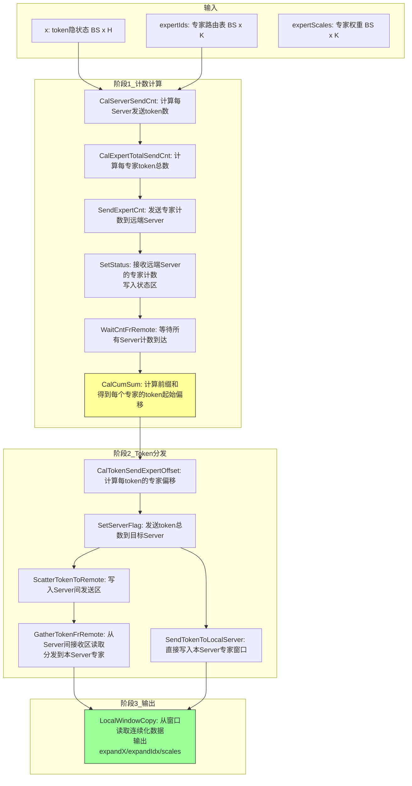
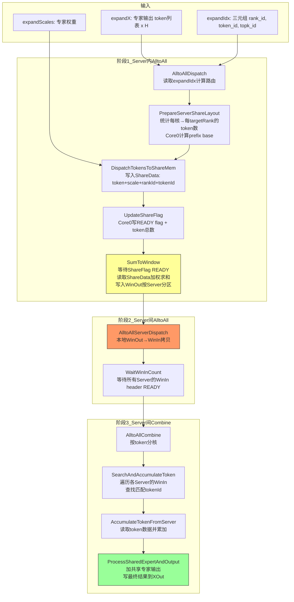
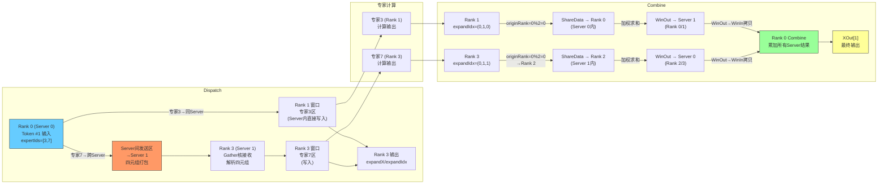

# MoE Dispatch/Combine KFC 模板数据链路分析

> 分析对象：
> - `mc2/moe_distribute_dispatch_v2/op_kernel/arch35/moe_distribute_dispatch_v2_host_kfc.h`
> - `mc2/moe_distribute_combine_v2/op_kernel/arch35/moe_distribute_combine_v2_host_kfc.h`
>
> 适用平台：Ascend 950 (A5, `__NPU_ARCH__ == 3510`)，KFC = Kernel-level Full-mesh Communication

## 1. 通信拓扑与核划分

### 1.1 两级通信架构

KFC 模板采用 **Server 内（Intra-Node）+ Server 间（Inter-Node）** 两级通信。每个 Server 包含 `rankSizePerServer_`（dispatch=2, combine=2）个 Rank。

```
┌─────────────────────────────────────────────────────────┐
│                      Server 0                            │
│  ┌──────────┐  ┌──────────┐                             │
│  │  Rank 0  │  │  Rank 1  │  ← Server 内通过共享窗口通信  │
│  └──────────┘  └──────────┘                             │
└───────┬───────────────┬─────────────────────────────────┘
        │ Server 间      │ Server 间
        │ 通过窗口拷贝    │ 通过窗口拷贝
┌───────┴───────────────┴─────────────────────────────────┐
│                      Server 1                            │
│  ┌──────────┐  ┌──────────┐                             │
│  │  Rank 2  │  │  Rank 3  │                             │
│  └──────────┘  └──────────┘                             │
└─────────────────────────────────────────────────────────┘
```

### 1.2 Dispatch 核划分

`aivNum_` 个 AIV 核分为四组：

| 核 ID 范围 | 数量 | 职责 |
|-----------|------|------|
| `[0, aivUsedCumSum_)` | 2 | CumSum：计算各专家接收 token 数的前缀和 |
| `[aivUsedCumSum_, aivUsedCumSum_+aivUsedRemotComm_)` | serverNum_ | Server 间状态通信：发送 server flag |
| `[cumSum+remot, cumSum+remot+scatter)` | (aivNum_-cumSum-remot)/2 | Scatter：将 token 写入 Server 间发送区 |
| `[cumSum+remot+scatter, aivNum_)` | 剩余 | Gather：从 Server 间接收区读取并分发到专家 |

所有核最后统一执行 `LocalWindowCopy`：从窗口区读取最终数据并输出。

### 1.3 Combine 核划分

Combine 采用两次分核策略：

1. **按 Token 分核**（`SplitCoreByToken`）：将待处理的 token 总数 `selfSendCnt_` 均分到所有核
2. **按 Server 分核**（`SplitCoreByServer`）：将目标 Server 数 `serverNum_` 均分到所有核

---

## 2. 整体 HCCL 窗口内存布局（Dispatch + Combine 共享）

Dispatch 和 Combine **串行执行**（先 Dispatch 分发 token，专家计算后，再 Combine 汇聚结果），它们共享同一块 HCCL 窗口内存。窗口分为**数据区**和**状态区**两大部分，各自再分为前后两个半区（`dataState_` = 0 或 1）实现双缓冲——连续两次调用交替使用不同半区。

### 2.1 数据区整体布局（地址从低到高）

```
HCCL 窗口数据区 (totalWinSizeEp_ 字节)
基址 = GetBaseWindAddrByRankId(ctx, selfRank, originalRank)

地址低 ─────────────────────────────────────────────────────────────────────────────── 地址高
├── 半区 0 (dataState_=0) [0, totalWinSizeEp_/2) ──┤── 半区 1 (dataState_=1) ──────────────────┤
│                                                    │                                            │
│  ◄── Combine 数据区 ──►  ◄── Dispatch 数据区 ──►  │  ◄── Combine 数据区 ──►  ◄── Dispatch ──►│
│                                                    │                                            │
│  [WinOut][WinIn][ShareData]  [各 Rank 专家数据区]  │  [WinOut][WinIn][ShareData]  [各 Rank...] │
│  ↑offset=0                    ↑offset=combineSize  │  ↑offset=halfSize           ↑offset=half+combine│
│  (combine 从半区起始)         (dispatch 在 combine  │                              (同左)                │
│                               之后)                 │                                            │
│                                                    │                                            │
│  winDataSizeOffsetEp_(combine) = dataState_ * half  │                                            │
│  winDataSizeOffsetEp_(dispatch) = dataState_ * half │                                            │
│                                    + combineSize    │                                            │
└────────────────────────────────────────────────────┴────────────────────────────────────────────┘
```

**关键地址计算**：

| 算子 | `winDataSizeOffsetEp_` | 含义 |
|------|----------------------|------|
| Combine | `dataState_ * (totalWinSizeEp / 2)` | 从半区起始位置开始 |
| Dispatch | `dataState_ * (totalWinSizeEp / 2) + axisMaxBS_ * (axisK_ + sharedExpertNum_) * hSizeAlignCombine` | 跳过 Combine 区，从后半部分开始 |

### 2.2 半区内 Combine 数据区详细布局

```
Combine 数据区 (每半区内，从半区起始位置开始)
┌───────────────────────────────────────────────────────────────────────────┐
│  WinOut (windowOutGM_)                    winOutTotalBytes_               │
│  ┌────────────┬────────────┬────────┐                                    │
│  │ Server 0   │ Server 1   │ ...    │  每 slice = winOutSliceBytes_       │
│  │ slice      │ slice      │        │  [header 512B: flag+cnt]            │
│  │            │            │        │  [token0: packedTokenBytes_]        │
│  │            │            │        │  [token1: packedTokenBytes_] ...    │
│  └────────────┴────────────┴────────┘                                    │
│                                                                          │
│  WinIn (windowInGM_ = WinOut + winOutTotalBytes_)  winInTotalBytes_      │
│  ┌────────────┬────────────┬────────┐                                    │
│  │ Server 0   │ Server 1   │ ...    │  布局同 WinOut                       │
│  │ slice      │ slice      │        │  (由本地 WinOut 拷贝而来)            │
│  └────────────┴────────────┴────────┘                                    │
│                                                                          │
│  ShareData (serverShareAddr_[targetLocalRank])                           │
│  ┌──────────────────────────────────────────────────────────────────┐    │
│  │ Flag 区 (shareFlagTotalBytes_)                                    │    │
│  │  [fromRank0: 512B] [fromRank1: 512B] ...                         │    │
│  │   每 512B: [flag=READY(8B)] [tokenCnt(8B)] [padding...]          │    │
│  ├──────────────────────────────────────────────────────────────────┤    │
│  │ Data 区 (shareDataTotalBytes_)                                    │    │
│  │  [fromRank0: maxLocalBs * tokenMetaBytes_]                       │    │
│  │  [fromRank1: maxLocalBs * tokenMetaBytes_] ...                   │    │
│  │   每 token: [data(H*sizeof)] [scale(4B)] [rankId(4B)] [tokenId(4B)]│   │
│  └──────────────────────────────────────────────────────────────────┘    │
└───────────────────────────────────────────────────────────────────────────┘
```

> **注意**：ShareData 的地址 = `GetWinAddrByRankId(rankIdServerInner) + winOutTotalBytes_ + winInTotalBytes_`，即访问的是**同 Server 内其他 Rank** 的窗口（Server 内共享内存），而非本 Rank 窗口的延续。

### 2.3 半区内 Dispatch 数据区详细布局

```
Dispatch 数据区 (每半区内，跳过 Combine 区后开始)
基址 = GetWindAddrByRankId(ctx, selfRank)  ← 已包含 winDataSizeOffsetEp_

┌─────────────────────────────────────────────────────────────────────────────┐
│  目标 Rank 0 数据区            目标 Rank 1 数据区          目标 Rank N ...   │
│  [expert0][expert1]...        [expert0][expert1]...        ...              │
│  每专家: expertPerSizeOnWin_   每专家: expertPerSizeOnWin_                   │
│  = axisMaxBS_ * hAlignWinSize_                                               │
│                                                                              │
│  单个专家区内部 (以 expert0 为例):                                            │
│  ┌──────────────────────────────────────────────────────────────┐           │
│  │ token0              token1            token2            ...  │           │
│  │ [data 480B][flag 32B][data 480B][flag 32B][data 480B][flag]  │           │
│  │  ↑ hCommuSize_ = blockCntPerTokenToExpert_ * 512B (对齐512)  │           │
│  │                                                               │           │
│  │  token 数据内容:                                              │           │
│  │  [token_data(axisH_*sizeof(XType))]                          │           │
│  │  [srcRankId(u32)] [tokenIndex(u32)] [topkId(u32)]            │           │
│  │  [expertScale(float)]                                         │           │
│  └──────────────────────────────────────────────────────────────┘           │
│                                                                              │
│  地址计算:                                                                   │
│  rankGM = GetWindAddrByRankId(ctx, dstRankId)                               │
│         + expertPerSizeOnWin_ * (srcRank * moeExpertPerRank + localExpertId)│
│         + hCommuSize_ * curExpertCnt                                        │
└─────────────────────────────────────────────────────────────────────────────┘
```

### 2.4 状态区整体布局（地址从低到高）

Dispatch 和 Combine 使用不同的状态区偏移，但因串行执行不会冲突：

```
HCCL 窗口状态区
基址 = GetStatusDataSpaceGm(ctx)

地址低 ──────────────────────────────────────────────────────────────── 地址高
├── Dispatch 状态区 ──────────────────────────────────────────────────┤
│                                                                      │
│  [0, 768KB)            Dispatch 每 Rank 通信状态区                    │
│  ├── dataState_=0: [0, 384KB)      (WIN_STATE_OFFSET = 384KB)        │
│  │   └── 每 Rank: [status 32B]  (STATE_OFFSET = 32)                  │
│  │       用于 WaitCntFrRemote / GatherSumRecvCnt                     │
│  └── dataState_=1: [384KB, 768KB)                                    │
│                                                                      │
│  [768KB, 868KB)        Dispatch Server 间 cnt 区                     │
│  (DISPATCH_STATE_WIN_OFFSET = 768KB)                                 │
│  └── 每 Server: [expertCnt data 480B + flag 32B] blocks              │
│      用于 SendExpertCnt / SetStatus (Server 间专家计数交换)            │
│                                                                      │
│  [868KB, 876KB)        Dispatch CumSum 计算区                        │
│  (CUMSUM_CAL_OFFSET = 868KB)                                         │
│  └── 每 AIV: [aivUsedCumSum_ * 32B]                                 │
│      用于 GatherSumRecvCnt 写入 / GetCumSum 读取 (recvCnt 前缀和)     │
│                                                                      │
│  [876KB, ~975KB)       Dispatch CumSum 同步区                        │
│  (CUMSUM_FLAG_OFFSET = 876KB)                                        │
│  └── 每 AIV: [aivUsedCumSum_ * 32B]                                 │
│      用于 CalRecvAndSetFlag 写入 / WaitCumSumFlag 等待 (核间同步)     │
│                                                                      │
├── Combine 状态区 ────────────────────────────────────────────────────┤
│                                                                      │
│  [975KB, 975KB + aivNum * 512B)   Combine 每 Core 通信状态区          │
│  (STATE_WIN_OFFSET = 975KB)                                          │
│  └── 每 Core: [status 512B]                                          │
│                                                                      │
│  (winStatusOffset_ = 64KB + dataState_ * 500KB                       │
│   用于 GetWinStateAddrByRankId, OOM 检查)                            │
│                                                                      │
└──────────────────────────────────────────────────────────────────────┘
```

### 2.5 时序：Dispatch 与 Combine 如何交替使用窗口

```
时间轴 ──────────────────────────────────────────────────────────────────────►

第 1 轮 MoE:
  ┌── Dispatch ──┐     ┌── 专家计算 ──┐     ┌── Combine ──┐
  │ dataState_=0 │     │               │     │ dataState_=0│
  │ 半区0: Disp  │ ... │               │ ... │ 半区0: Comb │
  │ 状态区: Disp │     │               │     │ 状态区: Comb│
  └──────────────┘     └───────────────┘     └─────────────┘

第 2 轮 MoE (双缓冲切换):
  ┌── Dispatch ──┐     ┌── 专家计算 ──┐     ┌── Combine ──┐
  │ dataState_=1 │     │               │     │ dataState_=1│
  │ 半区1: Disp  │ ... │               │ ... │ 半区1: Comb │
  │ 状态区: Disp │     │               │     │ 状态区: Comb│
  └──────────────┘     └───────────────┘     └─────────────┘

  ← Dispatch 和 Combine 在同一半区内不重叠: Combine 在前, Dispatch 在后 →
  ← 半区0和半区1交替使用, 允许第1轮Combine与第2轮Dispatch重叠 →
```

### 2.6 同一半区内 Dispatch 与 Combine 的空间关系

以 `dataState_=0` 为例，展示一个 Rank 的窗口数据区中 Dispatch 和 Combine 如何共存：

```
半区 0 数据区 [0, totalWinSizeEp_/2)
┌─────────────────────────────────────────────────────────┬───────────────────────────────────────────────────────┐
│  Combine 数据区                                           │  Dispatch 数据区                                       │
│  [0, combineRegionSize)                                   │  [combineRegionSize, totalWinSizeEp_/2)               │
│                                                          │                                                       │
│  ┌─────────┬─────────┬────────────┐                      │  ┌─────────┬─────────┬─────────┐                   │
│  │ WinOut  │ WinIn   │ ShareData  │                      │  │ Rank 0  │ Rank 1  │ Rank N  │                   │
│  │ (发往各 │ (各Server│ (Server内  │                      │  │ 专家数据 │ 专家数据 │ 专家数据 │                   │
│  │  Server │  发来的 │  共享区)   │                      │  │ 区      │ 区      │ 区      │                   │
│  │  的结果)│  结果)  │            │                      │  │         │         │         │                   │
│  └─────────┴─────────┴────────────┘                      │  └─────────┴─────────┴─────────┘                   │
│                                                          │                                                       │
│  combineRegionSize =                                     │  dispatchRegionSize =                                 │
│    axisMaxBS_ * (axisK_ + sharedExpertNum_)              │    totalWinSizeEp_/2 - combineRegionSize              │
│    * hSizeAlignCombine                                   │                                                       │
│                                                          │  expertPerSizeOnWin_ =                                │
│  winOutSliceBytes_ =                                     │    axisMaxBS_ * hAlignWinSize_                        │
│    512 + maxLocalBs_ * packedTokenBytes_                 │                                                       │
│  winOutTotalBytes_ =                                     │  hCommuSize_ =                                        │
│    winOutSliceBytes_ * serverNum_                        │    blockCntPerTokenToExpert_ * 512B                   │
│  winInTotalBytes_ = winOutTotalBytes_                    │                                                       │
│  shareFlagTotalBytes_ = 512 * serverRankSize_            │  Dispatch token 在专家区中的偏移:                      │
│  shareDataTotalBytes_ =                                  │    expertPerSizeOnWin_ *                              │
│    tokenMetaBytes_ * maxLocalBs_ * serverRankSize_       │      (srcRank * moeExpertPerRank + localExpertId)     │
│                                                          │    + hCommuSize_ * curExpertCnt                       │
└─────────────────────────────────────────────────────────┴───────────────────────────────────────────────────────┘
```

---

## 3. Dispatch 数据存放区域划分

### 3.1 HCCL 窗口内存布局

每个 Rank 通过 HCCL 获取通信窗口，窗口内存分为 **数据区** 和 **状态区**：

```
HCCL Window (每个 Rank 对应一块)
┌─────────────────────────────────────────────────────────────────┐
│  数据区 (windowGM_)                                              │
│  ┌─────────────────────────────────────────────────────────┐    │
│  │ winDataSizeOffsetEp_ (combine 前半区 + dispatch 半区偏移) │    │
│  ├─────────────────────────────────────────────────────────┤    │
│  │  Rank 0 数据  │ Rank 1 数据 │ ... │ Rank N 数据           │    │
│  │  (每个 expert: expertPerSizeOnWin_ 字节)                  │    │
│  │  布局: [expert0_data][expert0_flag][expert1_data]...      │    │
│  └─────────────────────────────────────────────────────────┘    │
│                                                                  │
│  状态区 (statusDataSpaceGm_)                                     │
│  ┌──────────────────────────────────────────────────────┐       │
│  │ Offset 0:          通信状态区                          │       │
│  │ Offset 384KB:      WIN_STATE_OFFSET (每 rank 状态)     │       │
│  │ Offset 768KB:      DISPATCH_STATE_WIN_OFFSET           │       │
│  │   └─ Server 间 cnt 区 (blockCntExpertPerServer_ * 512B)│       │
│  │ Offset 868KB:      CUMSUM_CAL_OFFSET (cumsum 计算区)   │       │
│  │ Offset 876KB:      CUMSUM_FLAG_OFFSET (cumsum 同步区)  │       │
│  └──────────────────────────────────────────────────────┘       │
└─────────────────────────────────────────────────────────────────┘
```

**数据区单 token 布局**（Server 内通信）：

每个 token 在目标 Rank 窗口中的存储格式为 **Data + Flag 交替**，每 `SPLIT_BLOCK_DATA_SIZE (480B)` 数据后跟 `UB_ALIGN (32B)` flag：

```
┌─────────────────────────────────────────────────────────┐
│  Block 0          │ Flag 0  │ Block 1          │ Flag 1│
│  480B token data  │ 32B     │ 480B token data  │ 32B   │ ...
└─────────────────────────────────────────────────────────┘
  ↑ hCommuSize_ = blockCntPerTokenToExpert_ * 512B (对齐到 512B)
```

token 数据内容：
```
[token_data (axisH_ * sizeof(XType))] [srcRankId] [tokenIndex] [topkId] [expertScale]
```

### 3.2 Server 间发送区布局

Server 间通信使用独立的地址区域，每个 Server 对应一个发送 slice：

```
Server 间发送区 (GetSendAddrBetweenServer)
┌───────────────────────────────────────────────────┐
│  Server 0 slice                │ Server 1 slice  │
│  [tokenCnt(u32)][flag(32B)]    │ ...             │
│  [token0_data][token0_flag]    │                 │
│  [token1_data][token1_flag]    │                 │
│  ...                            │                 │
└───────────────────────────────────────────────────┘
  ↑ 每 slice 起始: SERVER_STATE_ALIGN (512B) 对齐
  ↑ 每 token: sendTokenLengthAlign_ 字节 (含元数据)
```

每个远端 token 携带的元数据（四元组）：
```
[token_data] [srcRankId] [tokenIndex] [expertId_list(K)] [expert_offset_cnt(K)] [expert_scales(K)]
```

### 3.3 Workspace 布局

```
workspaceGM_
├── [0]                           sendCountsOutGM_ (发送计数输出)
├── [epWorldSize * expertNum * 32] recvCntWorkspaceGM_ (接收计数区)
├── [1GB]                          gmMoeCntFlg (cumsum flag)
├── [+32B]                         gmExpertOffsetCnt (专家偏移量)
├── [+20MB]                        gmSendTokenFlg (发送 token flag)
├── [+10MB]                        gmTemp (临时区)
├── [3GB + 1000MB]                 bufferChoseAddr_ (buffer 选择)
```

---

## 4. Dispatch 整体数据发送链路



### 4.1 CumSum 详细流程

```mermaid
flowchart LR
    subgraph 发送端
        A1[CalServerSendCnt<br/>计算每Server的token数]
        A2[CalExpertTotalSendCnt<br/>计算每专家token总数]
        A3[SendExpertCnt<br/>写入目标Server状态区<br/>data + flag]
    end

    subgraph 接收端
        B1[SetStatus<br/>WaitFlag等待flag到达<br/>读取expert cnt]
        B2[写入本Server各Rank状态区<br/>statusTensor → rankGM]
        B3[WaitCntFrRemote<br/>轮询状态区flag]
        B4[GatherSumRecvCnt<br/>GatherMask收集recvCnt]
        B5[写入CUMSUM_CAL_OFFSET区<br/>供其他核读取]
    end

    subgraph CumSum计算
        C1[GetCumSum<br/>读取各核的recvCnt]
        C2[前缀和计算<br/>得到每个专家的起始偏移]
        C3[CalRecvAndSetFlag<br/>写CUMSUM_FLAG_OFFSET<br/>通知所有核]
    end

    A1 --> A2 --> A3
    A3 --> B1
    B1 --> B2 --> B3 --> B4 --> B5
    B5 --> C1 --> C2 --> C3

    style A3 fill:#f96,stroke:#333
    style B5 fill:#69f,stroke:#333
    style C3 fill:#ff9,stroke:#333
```



---

## 5. Combine 数据存放区域划分

### 5.1 窗口内存布局

Combine 的窗口内存布局与 Dispatch 不同，采用 **WinOut + WinIn + ShareData** 三段式：

```
HCCL Window (Combine 使用前半区，Dispatch 使用后半区)
┌──────────────────────────────────────────────────────────────┐
│  WinOut (windowOutGM_)                                        │
│  ┌──────────┬──────────┬──────────┐                          │
│  │Server 0  │Server 1  │ ...      │  每个 slice:              │
│  │slice     │slice     │          │  [header 512B]            │
│  │          │          │          │  [token0: 512B]           │
│  │          │          │          │  [token1: 512B] ...       │
│  └──────────┴──────────┴──────────┘  winOutSliceBytes_        │
│                                                                │
│  WinIn (windowInGM_ = WinOut + winOutTotalBytes_)             │
│  ┌──────────┬──────────┬──────────┐                          │
│  │Server 0  │Server 1  │ ...      │  布局同 WinOut             │
│  │slice     │slice     │          │                            │
│  └──────────┴──────────┴──────────┘  winInSliceBytes_          │
│                                                                │
│  ShareData (serverShareAddr_[targetLocalRank])                │
│  ┌────────────────────────────────────┐                       │
│  │ Flag 区 (shareFlagTotalBytes_)      │                       │
│  │  [fromRank0: 512B][fromRank1: 512B]│  每 512B:              │
│  │   ...                               │  [flag(8B)][cnt(8B)]  │
│  ├────────────────────────────────────┤                       │
│  │ Data 区 (shareDataTotalBytes_)      │                       │
│  │  [fromRank0: maxLocalBs * meta]     │  每个 token:           │
│  │  [fromRank1: maxLocalBs * meta]     │  [data(H*type)]       │
│  │   ...                               │  [scale(4B)]          │
│  │                                     │  [originRankId(4B)]   │
│  │                                     │  [tokenIdInServer(4B)]│
│  └────────────────────────────────────┘                       │
└──────────────────────────────────────────────────────────────┘
```

**WinOut/WinIn 单 token 布局**：

```
┌──────────────────────────────────────────────────────┐
│  Header (512B)  │ Data Block 0 (480B) │ Flag (32B)  │
│  [tokenId(u32)] │ [token_data]        │ [ready_flag] │
│  [padding...]   │ [padding...]        │              │
│                 ├ Data Block 1 (480B) ├ Flag (32B) ──┤
│                 │ [token_data]        │ [ready_flag] │
│                 └─────────────────────┴──────────────┘
│  ← packedTokenBytes_ = (tokenDataBlockNum + 1) * 512B →
```

### 5.2 Workspace 布局

```
workspaceGM_
├── [0]                                    系统保留
├── [16MB]                                 SYSTEM_NEED_WORKSPACE
├── [16MB + coreIdx * 10KB]                maskCalcWorkspaceGM_ (每核私有)
├── [16MB + aivNum * 10KB]                 cntGM_ (token计数表)
│   └─ [aivNum * rowStrideElems]           gmCoreTargetCnt_[coreIdx][targetRank]
├── [cntGM_ + coreTableElems * 4]          baseGM_ (前缀和基址表)
│   └─ [aivNum * rowStrideElems]           gmCoreTargetBase_[coreIdx][targetRank]
```

---

## 6. Combine 整体数据发送链路



### 6.1 Server 内 AlltoAll 详细流程

```mermaid
flowchart LR
    subgraph 每核统计
        A1[读取expandIdx三元组]
        A2[统计本核→每targetLocalRank的token数]
        A3[写入gmCoreTargetCnt_]
    end

    subgraph Core0前缀和
        B1[读取所有核的cnt]
        B2[逐核计算prefix base]
        B3[写入gmCoreTargetBase_]
    end

    subgraph 每核发送
        C1[读回自己的base]
        C2[遍历token写ShareData<br/>token+scale+rankId+tokenIdInServer]
    end

    subgraph Core0写flag
        D1[汇总每targetRank的cnt]
        D2[写READY flag + 总cnt]
    end

    subgraph 每核接收求和
        E1[等待ShareFlag READY]
        E2[读取ShareData所有fromRank的token]
        E3[按tokenIdInServer加权累加]
        E4[写入WinOut对应Server分区]
    end

    A1 --> A2 --> A3
    A3 --> B1 --> B2 --> B3
    B3 --> C1 --> C2
    C2 --> D1 --> D2
    D2 --> E1 --> E2 --> E3 --> E4

    style D2 fill:#ff9,stroke:#333
    style E3 fill:#69f,stroke:#333
```



---

## 7. 一个 Token 的视角：完整生命周期

以下以 **2 Server x 2 Rank = 4 卡**，`BS=4, K=2, H=512, moeExpertNum=8, moeExpertPerRank=2` 为例，追踪 Token #1 在 Dispatch → 专家计算 → Combine 中的完整旅程。

### 7.1 Dispatch 阶段：Token #1 从源 Rank 出发

**初始状态**：Token #1 在 Rank 0（Server 0），expertIds = [3, 7]（路由到专家 3 和专家 7）

```
Server 0                          Server 1
┌────────┬────────┐              ┌────────┬────────┐
│ Rank 0 │ Rank 1 │              │ Rank 2 │ Rank 3 │
│ 专家0,1 │ 专家2,3 │              │ 专家4,5 │ 专家6,7 │
└────────┴────────┘              └────────┴────────┘
```

**Step 1: CalServerSendCnt** — Token #1 的专家 3 在 Rank 1（同 Server），专家 7 在 Rank 3（跨 Server）

```
serverCountTensor_:
  Server 0: 1 token (专家3在本Server)
  Server 1: 1 token (专家7在远端Server)
```

**Step 2: SendExpertCnt + SetStatus** — Rank 0 将专家计数发送给 Server 1

```
Server间状态区 → Server 1:
  [expertCnt_for_rank0: 1] [flag: READY]
```

**Step 3: CumSum** — Server 1 收到计数，计算前缀和

```
recvCnt (Server 1 的 Rank 3):
  来自 Rank 0: 1 token (给专家7)
  来自 Rank 1: 0 token
  来自 Rank 2: 0 token
  来自 Rank 3: 0 token
  → cumsum = [0, 1, 1, 1]
  → 专家7 的起始偏移 = 0，Token #1 将写入位置 0
```

**Step 4: SendTokenToLocalServer** — Token #1 的专家 3 分量写入 Rank 1 窗口

```
Rank 1 窗口数据区:
  [专家2 区] [专家3 区]
               ↓
  ┌─────────────────────────────────────┐
  │ Block0: token_data(480B) + flag(32B)│  ← Token #1 的数据
  │   内容: [H=512维数据][srcRank=0]      │
  │         [tokenIdx=1][topk=0]         │
  │         [expertScale=0.8]            │
  └─────────────────────────────────────┘
```

**Step 5: ScatterTokenToRemote** — Token #1 的专家 7 分量写入 Server 间发送区

```
Server 间发送区 (→ Server 1):
  [header: tokenCnt=1, flag=READY]
  [token0: 480B data + 32B flag]
    内容: [H=512维数据][srcRank=0][tokenIdx=1]
          [expertId_list: 3,7][expert_offset: 0,0]
          [expert_scales: 0.8, 0.6]
```

**Step 6: GatherTokenFrRemote** — Server 1 的 Rank 3 从接收区读取 Token #1

```
Server 1 Rank 3 (Gather 核):
  1. WaitStatusFlag: 读取 Server 0 发来的 tokenCnt = 1
  2. WaitToken: 轮询 flag 直到 Token #1 数据到达
  3. SendToExpert: 解析四元组
     - 专家 3 → Rank 1 (不在本Server，跳过)
     - 专家 7 → Rank 3 (本卡！)
  4. ProcessToken: 写入 Rank 3 窗口的专家 7 区

Rank 3 窗口数据区:
  [专家6 区] [专家7 区]
               ↓
  ┌─────────────────────────────────────┐
  │ Block0: token_data(480B) + flag(32B)│  ← Token #1 (来自 Rank 0)
  └─────────────────────────────────────┘
```

**Step 7: LocalWindowCopy** — Rank 3 从窗口读取 Token #1 并输出

```
输出:
  expandXOut[0] = Token #1 的 H 维数据
  expandIdx[0] = (srcRank=0, tokenIdx=1, topkId=1)
  expandScales[0] = 0.6
```

### 7.2 专家计算阶段

专家 3（Rank 1）和专家 7（Rank 3）分别对 Token #1 执行前向计算，产生输出 `expertOutput_3` 和 `expertOutput_7`。

### 7.3 Combine 阶段：Token #1 的结果汇聚

**输入**（Rank 3 视角）：Token #1 经过专家 7 计算后，`expandIdx = (rank=0, token=1, topk=1)`

**Step 1: AlltoAllDispatch** — Server 内分发到 ShareData

```
Rank 3 Core X 读取 expandIdx:
  originRankId = 0, originTokenId = 1, topkId = 1
  targetLocalRank = 0 % 2 = 0  (Rank 2)

ShareData → Rank 2 的接收区:
  [fromRank3 的 data 区]
  ┌──────────────────────────────────────────────┐
  │ token_data(H维) | scale=0.6 | rankId=0 | tokenIdInServer=1 │
  └──────────────────────────────────────────────┘
```

**Step 2: SumToWindow** — Rank 2 读取 ShareData 并加权求和

```
Rank 2 (Server 1, localRank=0):
  1. 等待 ShareFlag[fromRank3] = READY, cnt = 1
  2. 读取 ShareData[fromRank3]:
     - tokenIdInServer = 1 → 对应 originRank=0, originToken=1
     - tokenServerId = 0 / 2 = 0 (目标 Server 0)
  3. 加权求和: sumLocal += token_data * 0.6
  4. 写入 WinOut → Server 0 slice:
     [header: READY, cnt=1]
     [token0: tokenIdInServer=1, data, flag]
```

**Step 3: AlltoAllServerDispatch** — 本地 WinOut → WinIn 拷贝

```
Rank 2 将自己的 WinOut 拷贝到自己的 WinIn:
  WinOut[Server 0 slice] → WinIn[Server 0 slice]
  (本地拷贝，不经过 HCCL)
```

同时 Server 0 的 Rank 0/1 也将它们的 WinOut 拷贝到各自的 WinIn。

**Step 4: WaitWinInCount** — 等待所有 Server 的 WinIn header 就绪

```
Server 0 Rank 0:
  遍历 WinIn 的每个 Server slice:
    WinIn[Server 0 slice].header.flag == READY? ✓ (本Server)
    WinIn[Server 1 slice].header.flag == READY? ✓ (远端拷贝完成)
```

**Step 5: AlltoAllCombine** — Token #1 最终汇聚

```
Server 0 Rank 0 (Token #1 的归属卡):
  targetTokenId = localRankId(0) * axisBS(4) + tokenId(1) = 1

  遍历各 Server 的 WinIn:
    Server 0 WinIn:
      查找 tokenIdInServer == 1 → 命中!
      → 读取 token_data, 累加到 sumLocal
    Server 1 WinIn:
      查找 tokenIdInServer == 1 → 命中! (来自专家7的结果)
      → WaitTokenBlockReady: 等待 flag
      → LoadTokenToUb: 读取 token_data
      → sumLocal += token_data

  ProcessSharedExpertAndOutput:
    如果有共享专家输出: sumLocal += sharedExpertX[tokenId]
    Cast(sumLocal → ExpandXType)
    写入 XOut[tokenId * axisH]
```

### 7.4 Token #1 完整旅程图



---

## 8. 关键设计要点总结

### 8.1 Dispatch vs Combine 对称性

| 维度 | Dispatch | Combine |
|------|----------|---------|
| 通信方向 | Token → 专家（分发） | 专家输出 → Token（汇聚） |
| Server 内通信 | 直接写目标 Rank 窗口 | ShareData 共享区 + 加权求和 |
| Server 间通信 | 四元组打包发送 | WinOut→WinIn 拷贝 |
| 同步机制 | flag 轮询（480B data + 32B flag） | header READY flag + block flag |
| CumSum | 需要（计算专家偏移） | 不需要（用 prefix base 替代） |
| 核划分 | 四组（CumSum/Remot/Scatter/Gather） | 两次分核（按Token/按Server） |

### 8.2 Flag 同步机制

两阶段都采用 **Data + Flag 交替** 的布局，Flag 值为 `0x3F800000`（float 1.0）。接收方通过轮询 Flag 是否非零判断数据是否就绪，处理完成后清零 Flag 供下一轮使用。

### 8.3 Combine 的两阶段加权

Combine 的核心是 **两阶段累加**：
1. **Server 内**：同 Server 的多个 Rank 对同一 token 的不同专家输出进行加权求和（`scale * token_data`）
2. **Server 间**：不同 Server 对同一 token 的结果进行直接累加（已含权重）

最终结果 = Σ(Server 内加权结果) + 共享专家输出
