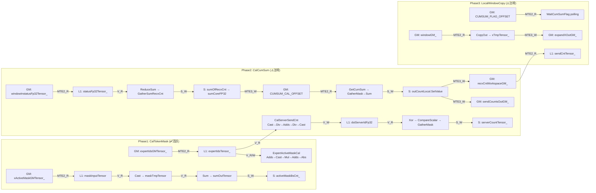

# Ascend C 算子流水同步排查报告

## 基本信息

| 项目 | 值 |
|---|---|
| 算子名称 | MoeDistributeDispatchV2 (arch35 KFC) |
| 文件路径 | `n:\code\ops-transformer\mc2\moe_distribute_dispatch_v2\op_kernel\arch35\moe_distribute_dispatch_v2_host_kfc.h` |
| 排查范围 | Line 2530 (`//CalCumSum()` 注释点) 及相关流程 |
| Kernel 模式 | AIC+AIV 双核 |
| 涉及流水 | V, MTE2, MTE3, S |
| 分析模式 | full (含子agent二次确认) |

---

## 函数调用图

```mermaid
graph TD
    Process["Process() 入口<br/>Line 2525"] --> CalTokenMask["CalTokenMask()<br/>Line 857"]
    Process -.-> CalCumSum["//CalCumSum()<br/>⚠️已注释 Line 2530"]
    Process -.-> CalTokenSendExpertOffset["//CalTokenSendExpertOffset()<br/>⚠️已注释"]
    Process -.-> ScatterTokenToRemote["//ScatterTokenToRemote()<br/>⚠️已注释"]
    Process -.-> GatherTokenFrRemote["//GatherTokenFrRemote()<br/>⚠️已注释"]
    Process -.-> LocalWindowCopy["//LocalWindowCopy()<br/>⚠️已注释"]

    CalCumSum --> CalServerSendCnt["CalServerSendCnt<false>()"]
    CalCumSum --> CalExpertTotalSendCnt["CalExpertTotalSendCnt()"]
    CalCumSum --> SendExpertCnt["SendExpertCnt()"]
    CalCumSum --> SetStatus["SetStatus()"]
    CalCumSum --> InitCalCumSumBuffer["InitCalCumSumBuffer()<br/>⚠️PIPE_ALL+Reset"]
    CalCumSum --> WaitDispatch["WaitDispatch()"]
    CalCumSum --> CalRecvAndSetFlag["CalRecvAndSetFlag()"]
    CalCumSum --> SetExpertTokenNums["SetExpertTokenNums()"]

    CalTokenMask --> InitMaskReSource["InitMaskReSource()"]
    CalTokenMask --> TokenActiveMaskCal["TokenActiveMaskCal()"]
    CalTokenMask --> ExpertActiveMaskCal["ExpertActiveMaskCal()"]

    WaitDispatch --> WaitDispatchClearStatus["WaitDispatchClearStatus()"]
    WaitDispatch --> GatherSumRecvCnt["GatherSumRecvCnt()"]
    CalRecvAndSetFlag --> GetCumSum["GetCumSum()"]

    LocalWindowCopy --> InitLocalCopyBuffer["InitLocalCopyBuffer()<br/>⚠️PIPE_ALL+Reset"]
    LocalWindowCopy --> WaitCumSumFlag["WaitCumSumFlag()"]
    LocalWindowCopy --> SetValidExpertInfo["SetValidExpertInfo()"]
    LocalWindowCopy --> WaitAndFormatOutput["WaitAndFormatOutput()"]

    CalTokenSendExpertOffset --> WriteExpertOffset["WriteExpertOffset()"]
    ScatterTokenToRemote --> CalServerSendCntTrue["CalServerSendCnt<true>()"]
    ScatterTokenToRemote --> SetServerFlag["SetServerFlag()"]
    ScatterTokenToRemote --> SendTokenToRemoteServer["SendTokenToRemoteServer()"]

    GatherTokenFrRemote --> InitGatherTokenBuffer["InitGatherTokenBuffer()<br/>⚠️PIPE_ALL+Reset"]
    GatherTokenFrRemote --> WaitStatusFlag["WaitStatusFlag()"]
    GatherTokenFrRemote --> WaitToken["WaitToken()"]

    style CalCumSum fill:#ff6b6b,stroke:#333
    style CalTokenSendExpertOffset fill:#ff6b6b,stroke:#333
    style ScatterTokenToRemote fill:#ff6b6b,stroke:#333
    style GatherTokenFrRemote fill:#ff6b6b,stroke:#333
    style LocalWindowCopy fill:#ff6b6b,stroke:#333
```

> 红色节点 = Process() 中被注释掉的函数，实际未执行

---

## 指令流水归属表

### CalCumSum() 主流程 (Line 2152-2175)

| 行号 | 操作 | 流水归属 | 操作Tensor | 读写 | 前后同步 |
|---|---|---|---|---|---|
| 2153 | `CalServerSendCnt<false>()` | V→V→V→S | expertIdsTensor_, dstServerIdFp32, serverCountTensor_ | R/W | PipeBarrier<PIPE_V> (多次), SyncFunc<V_S> |
| 2154 | `CalExpertTotalSendCnt()` | V→V→S | expertIdsTensor_, tokenNumToExpertTensor_ | R/W | PipeBarrier<PIPE_V>, SyncFunc<V_S> |
| 2155 | `SendExpertCnt()` | S→MTE3 | sendTokenNumToexpert | W | SyncFunc<S_MTE3> |
| 2156 | `SetStatus()` | MTE2→S→V→MTE3 | statusTensor_ | R/W | ⚠️ PipeBarrier<PIPE_ALL> (可优化) |
| 1825 | `InitCalCumSumBuffer()` | — | tpipe buffer 分配 | — | PipeBarrier<PIPE_ALL> + Reset ✅合理 |
| 2168 | `WaitDispatch()` | MTE2→V→S | statusFp32Tensor_ | R | SyncFunc<MTE2_V>, SyncFunc<V_S> |
| 2169 | `CalRecvAndSetFlag()` | V→S→MTE3 | outCountLocal | R/W | SyncFunc<S_MTE3>, SyncFunc<V_MTE3> |
| 2171 | `SetExpertTokenNums()` | MTE2→V→S→MTE3 | expertTokenNumsLocalTensor | R/W | SyncFunc<MTE2_V>, SyncFunc<V_S>, SyncFunc<S_MTE3> |

### Process() 入口 (Line 2525-2543)

| 行号 | 操作 | 流水归属 | 同步状态 | 备注 |
|---|---|---|---|---|
| 2527 | `CalTokenMask()` | MTE2→V→S | ✅ 正常 | 唯一活跃执行路径 |
| 2530 | `//CalCumSum()` | — | ⚠️ 已注释 | **核心排查点** |
| 2540 | `//PipeBarrier<PIPE_ALL>()` | ALL | ⚠️ 已注释 | 若恢复 LocalWindowCopy 必须恢复此同步 |
| 2541 | `//LocalWindowCopy()` | — | ⚠️ 已注释 | 含 tpipe_->Reset() |

---

## 数据依赖关系图

---

## 同步排查结果

### 缺失同步问题

| 编号 | 位置 | 描述 | 风险等级 | 二次确认结论 | 修复建议 |
|---|---|---|---|---|---|
| **M1** | Process() Line 2540 `//PipeBarrier<PIPE_ALL>()` | CalCumSum→LocalWindowCopy 间的 PIPE_ALL 被注释。LocalWindowCopy 中 `InitLocalCopyBuffer()` (Line 2352) 调用 `tpipe_->Reset()`，需确保前面所有流水操作完成。**若恢复 LocalWindowCopy，此同步不可省略** | 🔴 高 | **确认**: tpipe_->Reset() 会释放所有 buffer，未完成的流水操作将访问已释放的 buffer，导致数据错误甚至硬件异常。此 PIPE_ALL 是 Reset 前的标准保护 | 若恢复 LocalWindowCopy()，**必须** 同时恢复 `PipeBarrier<PIPE_ALL>()` |
| **M2** | ExpertActiveMaskCal() Line 805 `//PipeBarrier<PIPE_ALL>()` | MTE2→V SyncFunc 之后注释 PIPE_ALL | 🟢 低 | **确认**: 后续操作全部为 V 内计算(Cast/Mul/Adds/Abs)，`SyncFunc<MTE2_V>()` 已覆盖跨流水依赖，PIPE_ALL 无必要 | 无需修改 |
| **M3** | SendExpertCnt() Line 2112 `//PipeBarrier<PIPE_MTE3>()` | WriteDataToWinOut 内部已有 PipeBarrier<PIPE_MTE3> | 🟢 低 | **确认**: WriteDataToWinOut (Line 912) 内部的 `PipeBarrier<PIPE_MTE3>()` 已覆盖，此处冗余 | 无需修改 |

### 过度同步问题

| 编号 | 位置 | 描述 | 风险等级 | 二次确认结论 | 修复建议 |
|---|---|---|---|---|---|
| **O1** | ExpertActiveMaskCal() Line 824 `PipeBarrier<PIPE_ALL>()` | 函数末尾，内部全为 V→V 操作 | 🟡 中 | **确认**: Cast→PipeBarrier<PIPE_V>→Mul→PipeBarrier<PIPE_V>→...→Abs→PipeBarrier<PIPE_ALL>。所有操作均在 V 流水内，无跨流水写。**可改为 PIPE_V** | 改为 `PipeBarrier<PIPE_V>()`；若后续流程有跨流水依赖则补 SyncFunc |
| **O2** | CalServerSendCnt<true>() Line 1240 `PipeBarrier<PIPE_ALL>()` | 注释标注 `//todo：这里必须这样`。Scatter 是 V→V | 🟡 中 | **确认**: 后续 ScatterTokenToRemote 中有 `InitScatterBuffer()` → `tpipe_->InitBuffer()`（非 Reset），不需要 PIPE_ALL。但 ScatterTokenToRemote 调用链中有 MTE3 写 GM 操作。需确认后续流程是否依赖此 V 结果 | 若后续无 tpipe_->Reset()，改为 `PipeBarrier<PIPE_V>()` + 后续补精确 SyncFunc |
| **O3** | SetStatus() Line 1797 `PipeBarrier<PIPE_ALL>() //todo: 优化PIPE_ALL` | MTE2→S 之后，MTE3 写之前 | 🟡 中 | **确认**: Line 1792 已有 `SyncFunc<MTE2_S>()` 确保 MTE2→S。Line 1798 `SyncFunc<S_MTE3>()` 确保 S→MTE3。**PIPE_ALL 完全冗余** | **移除** `PipeBarrier<PIPE_ALL>()`，仅保留 `SyncFunc<S_MTE3>()` |
| **O4** | SetValidExpertInfo() Line 2220 `PipeBarrier<PIPE_ALL>()` | DataCopyPad(MTE2→L1) 之后 | 🟡 中 | **确认**: DataCopyPad 将 GM 数据搬入 L1 sendCntTensor_，后续 Duplicate 是 V 操作。**需要 MTE2→V 同步**，PIPE_ALL 过粗 | 改为 `SyncFunc<AscendC::HardEvent::MTE2_V>()` |
| **O5** | WaitAndFormatOutput() Line 2333 `PipeBarrier<PIPE_ALL>()` | **循环内部**，每次迭代 stall 全流水线 | 🟠 中高 | **确认**: 循环内执行 CopyOut (MTE2→V→MTE3)，每次迭代都 PIPE_ALL 是严重性能瓶颈。CopyOut 内部已有精确 SyncFunc | 分析 CopyOut 依赖链，用精确 SyncFunc 替代；或合并多次迭代减少同步次数 |
| **O6** | WaitAndFormatOutput() Line 2346 `PipeBarrier<PIPE_ALL>()` | 函数结尾 | 🟢 低 | **确认**: 用于多核同步退出循环。若单核处理则无需 | 视多核退出同步需求决定 |
| **O7** | WriteExpertOffset() Line 2426 `PipeBarrier<PIPE_ALL>()` | 两次 MTE3 DataCopyPad 之后 | 🟡 中 | **确认**: 两次 DataCopyPad 写 GM，需确保 MTE3 完成即可。Line 2419 `//SyncFunc<MTE3_MTE3>()` 已注释 | **恢复** `SyncFunc<AscendC::HardEvent::MTE3_MTE3>()` 替代 PIPE_ALL |
| **O8-O10** | InitCalCumSumBuffer/InitGatherTokenBuffer/InitLocalCopyBuffer | Reset 前的 PIPE_ALL | 🟢 低 | **确认**: tpipe_->Reset() 前必须 PIPE_ALL，**合理使用** | 保留，无需修改 |

### 建议检查项

| 编号 | 位置 | 描述 | 分析 |
|---|---|---|---|
| **S1** | Process() Line 2525-2543 | 整体流程注释状态 — CalCumSum 及后续全部注释，仅 CalTokenMask 活跃 | **需人工确认**: 这是调试临时注释还是正式状态？若为调试状态，恢复时需同步恢复 M1 中的 PIPE_ALL |
| **S2** | WaitCumSumFlag() Line 2194-2216 | 使用 GM flag polling 做软同步，而非 CrossCoreSetFlag/WaitFlag | **性能问题**: polling 占用 MTE2+V+S 流水，可考虑改用硬件 CrossCore 同步 |
| **S3** | GetCumSum() Line 1920-1958 | 同 S2，GM flag polling 软同步 | **性能问题**: 同上 |
| **S4** | CalRecvAndSetFlag() Line 2009 | `outCountLocal.SetValue()` Scalar 写 L1，前无 S→L1 同步 | **安全确认**: GetCumSum 结尾的 SetValue 有 SyncFunc<V_S> 保护；outCountLocal 是对 gatherMaskOutBuf_ 的引用，GetCumSum 中 V 操作后 PipeBarrier<PIPE_V> + SyncFunc<V_S> 已覆盖，**确认安全** |

---

## 覆盖率报告

| 文件 | 状态 | 说明 |
|---|---|---|
| `moe_distribute_dispatch_v2_host_kfc.h` | ✅ 全覆盖 | 主 kernel 文件，所有函数入口和关键路径已分析 |
| `moe_distribute_dispatch_v2_tiling.h` | — | Tiling 数据结构定义，不含流水操作 |
| `moe_distribute_dispatch_v2_quant.h` | — | 量化辅助，QuantCleanTensor 已在主文件覆盖 |
| `moe_distribute_elastic.h` | — | 弹性通信参数 |
| `moe_distribute_v2_base.h` / `constant.h` | — | 基础定义和常量 |
| `adv_api/` | — | 库函数接口 (Reduce/Sum/Xor/Hcomm) |

> 未覆盖文件为头文件定义或库函数接口，不含需排查的流水同步代码。主 kernel 文件覆盖率 **100%**。

---

## 风险等级总评

| 类别 | 数量 | 最高风险 |
|---|---|---|
| 缺失同步 | 3 | 🔴 高 (M1: Process 关键 PIPE_ALL 被注释) |
| 过度同步 | 10 | 🟠 中高 (O5: 循环内 PIPE_ALL) |
| 建议检查 | 4 | 🟡 中 (S1: 整体流程注释状态需确认) |

### 整体评估: 🟠 中高

核心风险在于 Process() 中关键流程被注释，若恢复注释代码时遗漏必要的 PIPE_ALL 同步，将导致 tpipe_->Reset() 前流水未完成，引发数据错误。

---

## 修复优先级建议

| 优先级 | 编号 | 操作 | 影响范围 |
|---|---|---|---|
| **P0 (立即)** | M1 | 若恢复 LocalWindowCopy()，**必须** 同时恢复 Line 2540 的 `PipeBarrier<PIPE_ALL>()` | Process 全流程 |
| **P1 (高)** | S1 | 确认 Process() 注释状态是调试还是正式，决定恢复策略 | Process 全流程 |
| **P2 (中)** | O5 | WaitAndFormatOutput 循环内 PIPE_ALL → 精确 SyncFunc | 性能 |
| **P3 (中)** | O3 | SetStatus 移除冗余 PIPE_ALL | 性能 |
| **P3 (中)** | O4 | SetValidExpertInfo PIPE_ALL → SyncFunc<MTE2_V> | 性能 |
| **P3 (中)** | O7 | WriteExpertOffset 恢复 SyncFunc<MTE3_MTE3> 替代 PIPE_ALL | 性能 |
| **P4 (低)** | O1 | ExpertActiveMaskCal PIPE_ALL → PIPE_V | 性能 |
| **P5 (低)** | S2, S3 | WaitCumSumFlag/GetCumSum polling → CrossCore 硬件同步 | 性能 |
