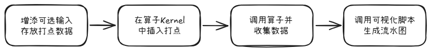

# CocTimer 打点工具

为解决基于MTE通信的通算融合算子无法获取详细流水线信息的问题，基于AscendC API `GetSystemCycle` 构建的高精度 NPU 打点计时系统，用于精确测量 AIC/AIV 各阶段执行时间，并自动生成流水线可视化时间线。

## 目录

- [使用方法](#使用方法)
- [输出文件说明](#输出文件说明)
- [计时项介绍](#计时项介绍)
- [添加新计时项](#添加新计时项)
- [文件清单](#文件清单)

---

## 使用方法


### 增添可选输入

打点工具的基本原理是通过`GetSystemCycle`获取当前 cycle 数，记录在计时缓冲区中。所以对于想要插入打点的算子，都需要增添一个输入张量来存放打点数据。本工具当前采取aclnn直调路径，增添输入需要修改opdef算子原型和aclnn接口定义。下面以AllGatherMatmulV2算子为例：

- 修改op_host目录下文件all_gather_matmul_v2_def.cpp，增添：

```cpp
    aicore_config_910b.Input("timer_buffer")
        .ParamType(OPTIONAL)
        .DataType({ge::DT_INT64, ge::DT_INT64, ge::DT_INT64, ge::DT_INT64,
                   ge::DT_INT64, ge::DT_INT64, ge::DT_INT64, ge::DT_INT64,
                   ge::DT_INT64, ge::DT_INT64, ge::DT_INT64, ge::DT_INT64})
        .Format({ge::FORMAT_ND, ge::FORMAT_ND, ge::FORMAT_ND, ge::FORMAT_ND,
                 ge::FORMAT_ND, ge::FORMAT_ND, ge::FORMAT_ND, ge::FORMAT_ND,
                 ge::FORMAT_ND, ge::FORMAT_ND, ge::FORMAT_ND, ge::FORMAT_ND})
        .UnknownShapeFormat({ge::FORMAT_ND, ge::FORMAT_ND, ge::FORMAT_ND, ge::FORMAT_ND,
                             ge::FORMAT_ND, ge::FORMAT_ND, ge::FORMAT_ND, ge::FORMAT_ND,
                             ge::FORMAT_ND, ge::FORMAT_ND, ge::FORMAT_ND, ge::FORMAT_ND});
```
- 修改op_host目录下文件all_gather_matmul_v2_aclnn.h，增添入参timerBuffer：

```cpp
    ACLNN_API aclnnStatus aclnnAllGatherMatmulV2GetWorkspaceSize(const aclTensor* x1, const aclTensor* x2, const aclTensor* bias, const aclTensor* x1Scale, const aclTensor* x2Scale, const aclTensor* quantScale,
                                                                 const aclTensor* timerBuffer, //新增入参
                                                                 int64_t blockSize, const char* group, int64_t gatherIndex, int64_t commTurn, int64_t streamMode, int64_t groupSize, const char* commMode, aclTensor* output, aclTensor* gatherOut, aclTensor* amaxOut, uint64_t* workspaceSize,aclOpExecutor** executor);
```
- 修改op_host目录下文件all_gather_matmul_v2_aclnn.cpp，对应增添入参timerBuffer；

### 插入打点

首先在Kernel代码中引入头文件`coc_timer_device.hpp`。以AllGatherMatmulV2算子为例，在op_kernel目录下的`all_gather_matmul_aiv_mode.h`（AIV部分）和`gather_matmul.hpp`（AIC部分）两个文件开始加入：
```cpp
#include "../tools/coc_timer/coc_timer_device.hpp"
```
为了识别该路径，在op_host目录下的CMakeLists.txt中对应位置添加mc2/tools：
```cmake
set(all_gather_matmul_v2_depends mc2/common mc2/3rd mc2/tools PARENT_SCOPE)
set(all_gather_matmul_v2_apt_depends mc2/common mc2/3rd mc2/tools PARENT_SCOPE)
```
这些设置好后，在算子Kernel代码中插入打点，记录对应位置的时间戳。每个 Kernel 类需要一个 `CocTimerDevice timer` 成员，按照如下模式进行，其中tik标识一个时间段的开始，tok标识结束，每一个tik和tok之间的时间段后续可视化时都会显示到流水图上。关于tik和tok函数的详细介绍请见[计时项与两种模式](#计时项与两种模式)章节。
```cpp
class MyKernel {
public:
    __aicore__ inline void MyKernel::Init(..., GM_ADDR timerBufferGM,...) {
        timerDevice_.Init(timerBufferGM_);
        timerDevice_.Tik();
    }

    // AIC 路径
    __aicore__ inline void MyKernel::RunAic(Params &params) {
        for (uint32_t i = 0; i < loops; ++i) {
            timerDevice_.Tik(CocTimer::AIC);
            // ... AIC 工作代码 ...
            timerDevice_.Tok<Overwrite>(CocTimer::AIC);
        }
    }

    // AIV 路径
    __aicore__ inline void MyKernel::RunAiv(Params &params) {
        for (uint32_t i = 0; i < loops; ++i) {
            timerDevice_.Tik(CocTimer::AIV);
            // ... AIV 工作代码 ...
            timerDevice_.Tok<Overwrite>(CocTimer::AIV);
        }
    }

private:
    // ... 其他成员 ...
    CocTimerDevice timerDevice_;
};
```
修改完Kernel代码后，需要重新编译算子并安装custom包。
### 调用算子并收集数据
当前支持通过aclnn直调的方式来获取打点数据。需要额外构造timerBuffer输入，并在aclnn两段式调用结束后使用`coc_timer_host.hpp`中的`CocTimerHost::GetTimeResult`函数来解析计时结果。以AllGatherMatmulV2算子为例，需要额外新增的代码如下：
```cpp
#include "../../tools/coc_timer/coc_timer_host.hpp"
void ExportTimeCsv(int rankId, void* timerBufferDeviceAddr) {
    std::string outDir = "output_timer";
    std::cout << "Trying to create: " << outDir << std::endl;
    int ret = mkdir(outDir.c_str(), 0777);
    if (ret != 0 && errno != EEXIST) {
        LOG_PRINT("[ERROR] mkdir failed. ret: %d, errno: %d, %s\n", ret, errno, strerror(errno));
        return;
    }
    std::string csvFilePath = outDir + "/timer_rank_" + std::to_string(rankId) + ".csv";
    auto timeResult = CocTimerHost::GetTimeResult(timerBufferDeviceAddr);
    std::string dataDir = outDir + "/data";
    ret = mkdir(dataDir.c_str(), 0777);
    if (ret != 0 && errno != EEXIST) {
        LOG_PRINT("[ERROR] mkdir failed. ret: %d, errno: %d, %s\n", ret, errno, strerror(errno));
        return;
    }
    std::string rawCsvFilePath = dataDir + "/timer_rank_" + std::to_string(rankId) + "_timeline.csv";
    std::string durCsvFilePath = outDir + "/timer_rank_" + std::to_string(rankId) + ".csv";
    CocTimerHost::WriteAllTimerResults(rawCsvFilePath, durCsvFilePath, timeResult);
    std::cerr << "[Timer] Raw CSV:" << rawCsvFilePath << std::endl;
    std::cerr << "[Timer] Duration CSV:" << durCsvFilePath << std::endl;
}
...
int LaunchOneThreadAllGatherMmV2(Args &args)
{
    ...
    void *timerBufferDeviceAddr = nullptr;
    aclTensor *timerBuffer = nullptr;
    long long timerBufferSize = CocTimerHost::GetTotalTimerBufferSize();
    std::vector<int64_t> timerBufferShape = {timerBufferSize, 1};
    std::vector<int64_t> timerBufferHostData(timerBufferSize, 0);
    ret = CreateAclTensor(timerBufferHostData, timerBufferShape, &timerBufferDeviceAddr,
                          aclDataType::ACL_INT64, &timerBuffer);
    ...
    ret = aclnnAllGatherMatmulV2GetWorkspaceSize(
        x1, x2, bias, x1Scale, x2Scale, quantScale, 
        timerBuffer, // 新增入参
        blockSize, hcomName, gatherIndex, commTurn, streamMode, groupSize,
        "aiv", out, gatherOut, amax, &workspaceSize, &executor);
    ...
    ExportTimeCsv(args.rankId, timerBufferDeviceAddr);
    if (timerBuffer != nullptr) {
        aclDestroyTensor(timerBuffer);
    }
    if (timerBufferDeviceAddr != nullptr) {
        aclrtFree(timerBufferDeviceAddr);
    }
}
...
```
### 可视化

使用命令
```bash
python3 mc2/tools/coc_timer/scripts/process.py <data_dir>/output_timer
```
来可视化算子流水线。其中data_dir为上一步输出csv文件所在目录。打开 Chrome 浏览器访问 `chrome://tracing`，点击 Load 加载生成的 JSON 文件即可查看流水线排布。示例如下：

---

## 输出文件说明

运行后在 `output_timer/` 下生成：

```
output_timer/
├── timer_rank_0.csv                        # Duration CSV：每核每项仅 duration(us)
├── timer_rank_1.csv
└── data/
    ├── timer_rank_0_timeline.csv           # Raw CSV：含 start_cycle, end_cycle, duration_us
    └── timer_rank_1_timeline.csv
```

### Duration CSV 格式

```
group_id,core_type,sub_group_id,KERNEL_TIMING_duration(us),AIC_0_duration(us),AIC_1_duration(us),AIV_0_duration(us),AIV_1_duration(us),AIC_IterCount,AIV_IterCount
0,AIC,0,1234.56,100.0,105.0,0,0,2,0
0,AIV,0,1234.56,0,0,95.0,98.0,0,2
0,AIV,1,1234.56,0,0,93.0,96.0,0,2
```

### Raw CSV 格式

比 Duration CSV 多出 start_cycle 和 end_cycle 列，用于后处理生成时间线：

```
group_id,core_type,sub_group_id,KERNEL_TIMING_start_cycle,KERNEL_TIMING_end_cycle,KERNEL_TIMING_duration_us,AIC_0_start_cycle,AIC_0_end_cycle,AIC_0_duration_us,...
```

### 列名规则

| 计时项类型 | 列名格式 | 示例 |
|-----------|---------|------|
| 固定项 | `NAME_duration(us)` | `KERNEL_TIMING_duration(us)` |
| 动态项（Overwrite 模式） | `NAME_iter_duration(us)` | `AIC_0_duration(us)`, `AIV_RS_1_duration(us)` |
| 动态项（Accumulate 模式） | `NAME_duration(us)` | `SYNPIC_TIME_duration(us)`（无迭代后缀） |

---

## 计时项介绍

### 固定项 vs 动态项

| 类型 | 特点 | 用途 |
|------|------|------|
| 固定项 | 整个 Kernel 生命周期只记录一次 | Kernel 总耗时 |
| 动态项 | 每轮循环可多次 Tik/Tok，自动递增迭代号 | AIC 计算、AIV 通信等循环阶段 |

### Overwrite 模式（默认）

每次迭代**独立记录**到不同 slot，CSV 中出现 `TYPE_0`, `TYPE_1`, `TYPE_2`, ...

```cpp
// AIC 阶段：每次循环独立记录
timer.Tik(CocTimer::AIC);
// ... AIC 工作 ...
timer.Tok<Overwrite>(CocTimer::AIC);   // 默认模板参数可省略
```

输出：`AIC_0=120us, AIC_1=115us, AIC_2=118us, ...`

### Accumulate 模式

所有迭代的耗时**累加**到同一个 slot，CSV 中只有一列 `NAME`（无迭代后缀）。

```cpp
// 通信等待耗时：累加所有迭代
timer.Tik(CocTimer::SYNPIC_TIME);
// ... 等待 ...
timer.Tok<Accumulate>(CocTimer::SYNPIC_TIME);
```

输出：`SYNPIC_TIME=350us`（所有迭代等待时间之和）

**适用场景**：不关心每次迭代的独立耗时，只需总耗时。节省存储空间（仅占 1 个 slot 而非 N 个）。

### 两种模式对比

| | Overwrite | Accumulate |
|---|-----------|------------|
| 存储 | 每次迭代占 1 个 slot | 所有迭代共享 1 个 slot |
| CSV 列名 | `TYPE_0`, `TYPE_1`, ... | `TYPE`（无后缀） |
| 流水线可视化 | 支持（逐迭代排布） | 不参与流水线排布 |
| 适用 | 需要分析每次迭代耗时的阶段 | 只需总耗时的统计项 |

---
## 添加新计时项

### 第一步：在 CocTimerV2.hpp 中注册

打开 `tools/CocTimerV2.hpp`，在对应列表末尾加一行 `X(YOUR_NAME)`：

**固定项**（整轮一次）：
```cpp
#define ASCEND_TIMER_FIXED_LIST \
    X(KERNEL_TIMING_IDX)    \
    X(YOUR_FIXED_NAME)      \   // 新增
    //继续添加
```

**动态项**（每轮迭代多次）：
```cpp
#define ASCEND_TIMER_DYNAMIC_LIST \
    X(AIC)    \
    X(AIV)    \
    X(AIV_RS) \
    X(AIV_AG) \
    X(YOUR_DYNAMIC_NAME) \   // 新增
    //继续添加
```

添加后，enum 值和 CSV 名称映射自动生成，无需修改其他文件。

### 第二步：在 Kernel 中使用

```cpp
// 固定项
timer.Tik();                                         // 记录起点
// ... 工作代码 ...
timer.Tok<Overwrite>(CocTimer::YOUR_FIXED_NAME);  // 记录终点

// 动态项（Overwrite 模式）
timer.Tik(CocTimer::YOUR_DYNAMIC_NAME);
// ... 工作代码 ...
timer.Tok<Overwrite>(CocTimer::YOUR_DYNAMIC_NAME);

// 动态项（Accumulate 模式）
timer.Tik(CocTimer::YOUR_DYNAMIC_NAME);
// ... 工作代码 ...
timer.Tok<Accumulate>(CocTimer::YOUR_DYNAMIC_NAME);
```

### 命名约定

| 规则 | 说明 |
|------|------|
| 仅限字母/数字/下划线 | 不要加逗号或分号 |
| 以 `AIC` 开头 | 该项进入流水线 AIC 轨道 |
| 以 `AIV` 开头 | 该项进入流水线 AIV 轨道 |
| 其他前缀 | 仅出现在 CSV 数值列，不参与流水线排布 |
| 固定项无需前缀 | 固定项不参与流水线，名称自由 |

例如：

| 计时项名称 | 是否参与流水线 | 归属 |
|-----------|--------------|------|
| `AIC` | 是 | AIC 轨道 |
| `AIV` | 是 | AIV 轨道 |
| `AIV_RS` | 是 | AIV 轨道（ReduceScatter 阶段） |
| `AIV_AG` | 是 | AIV 轨道（AllGather 阶段） |
| `SYNPIC_TIME` | 否 | 不以 AIC/AIV 开头，仅出现在 CSV 数值列 |

同一轨道上的 `AIV`、`AIV_RS`、`AIV_AG` 等事件按各自真实 `start_cycle` 展示；如果它们在设备侧有重叠或等待，Chrome Tracing 中会直接体现。事件的 `args` 中保留 `group_id`、`core_type`、`sub_group_id`、`start_cycle`、`end_cycle` 和标签前缀，方便回查原始 CSV。

### 注意事项

- 每个动态项最多支持 **150 次迭代**（`MAX_DYNAMIC_ITER`），超出部分会被丢弃
- 每新增一个动态项，每核存储空间增加 `MAX_DYNAMIC_ITER * 2 * sizeof(int64_t)` = 2400 Bytes
- 核心总数默认 **60**（A2 机器），A3 机器需修改 `N_CORE_COUNT`
- 计时会插入 `PipeBarrier<PIPE_ALL>()`，对流水线有一定影响，正式性能测试请关闭 `ENABLE_TIMER`

---

## 文件清单

| 文件 | 作用 |
|------|------|
| `tools/CocTimerV2.hpp` | 公共定义：枚举、常量、宏开关、计时项注册入口 |
| `tools/CocTimer_device.hpp` | NPU 设备端计时器类 `CocTimerDevice` |
| `tools/CocTimer_host.hpp` | Host 端：数据拷贝、CSV 输出 |
| `tests/dynamic_tiling/utils/process.py` | 后处理：CSV → Chrome Tracing JSON 流水线可视化 |
| `include/catccos/dgemm/device/kernel_adapter.hpp` | Kernel 启动适配：设置 timer buffer |
| `include/catccos/dgemm/device/device_dgemm.hpp` | Device 端封装：分配/释放/导出计时数据 |
