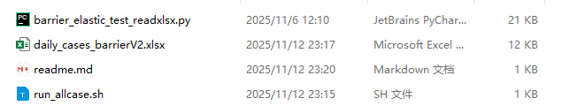
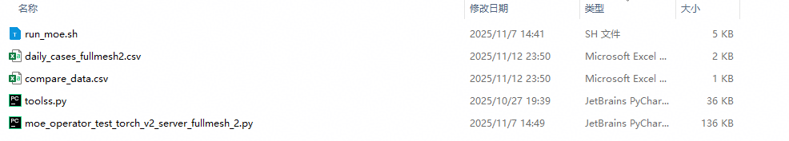
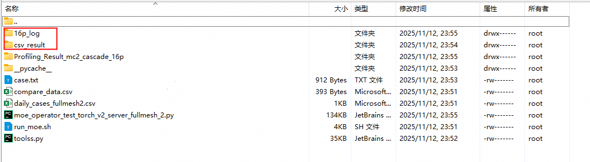
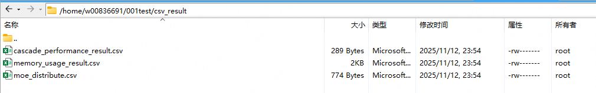
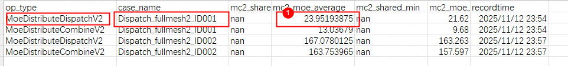
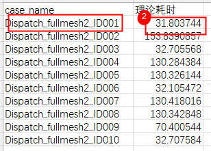

## 1.DistributeBarrierV2 daily说明
**用例目录**：mc2_test\script\barrierV2_test\daily


**执行脚本**：
```
sh run_allcase.sh
```

**日志文件**：daily_barrierV2.log——记录脚本执行过程细节
**结果文件**：barrier_result.csv——记录脚本执行结果
**预期结果**：在脚本目录下生成barrier_result.csv文件，文件中对于每个用例生成如下内容：

```
barrierv2_iter1_redLine_ID1,9,Success
barrierv2_iter1_redLine_ID1,5,Success
barrierv2_iter1_redLine_ID1,6,Success
barrierv2_iter1_redLine_ID1,0,Success
barrierv2_iter1_redLine_ID1,14,Success
barrierv2_iter1_redLine_ID1,8,Success
barrierv2_iter1_redLine_ID1,1,Success
barrierv2_iter1_redLine_ID1,3,Success
barrierv2_iter1_redLine_ID1,4,Success
barrierv2_iter1_redLine_ID1,2,Success
barrierv2_iter1_redLine_ID1,11,Success
barrierv2_iter1_redLine_ID1,10,Success
barrierv2_iter1_redLine_ID1,12,Success
barrierv2_iter1_redLine_ID1,13,Success
barrierv2_iter1_redLine_ID1,7,Success
barrierv2_iter1_redLine_ID1,15,Succes

```
判断依据：
1. 在910C 8卡16die的机器上，需要有16个执行结果（用例名，rank，执行结果）；
2. 结果对顺序没有要求；
3. 要求每个rank（0-15）均有一次，缺少rank在初步认定为有错误（有小概率为误报），需要定位日志文件中是否有错误；


## 2.npu_moe_distribute_combine_v2性能优化 daily说明

**用例目录：**mc2_test\script\C25_dispatch_performance_Test\daily


**执行脚本命令**：
```
bash run_moe.sh daily_cases_fullmesh2.csv moe_operator_test_torch_v2_server_fullmesh_2.py 2 11
```
执行命令完成后文件如下：

**日志文件**：16p_log——记录脚本执行过程细节
**结果文件**：csv_result——记录脚本执行结果

**预期结果**：
1.目前使用cascade_performance_result.csv结果与compare_data.csv的理论耗时对比，低于理论耗时的说明满足性能优化的要求。


**对比**



## 3.AttentionToFFN&FFNToAttention算子daily

**用例目录：**mc2_test\script\attn&ffn\daily

```
#AttentionToFFN脚本+用例+调用文件
AttToFFN_1server_case_daily.csv    
run_AttToFFN.sh
attention2ffn_server_new2.py


#FFNtoAttention脚本+用例+调用文件
FFNtoAtt_1server_case_daily.csv
ffn2attention_server.py
run_FFNToAtt.sh

#公共依赖文件
toolss_attn.py
```
**执行脚本**：
```
sh run_AttToFFN.sh AttToFFN_1server_case_daily.csv attention2ffn_server_new2.py 2 21
sh run_FFNToAtt.sh FFNtoAtt_1server_case_daily.csv ffn2attention_server.py 2 21
```

**日志文件**：目录下16p_log文件夹记录文件
**结果文件**：csv_result——记录脚本执行结果
**预期结果**：在脚本目录下生成attention.csv文件，文件中对于每个用例生成如下内容：

```
Test_AttentionToFFN_level0_ID001,ffn_token_state_0,"('PASS', 100.0)"
Test_AttentionToFFN_level0_ID001,ffn_token_state_1,"('PASS', 100.0)"
Test_AttentionToFFN_level0_ID001,ffn_token_state_2,"('PASS', 100.0)"
Test_AttentionToFFN_level0_ID001,ffn_token_state_3,"('PASS', 100.0)"
Test_AttentionToFFN_level0_ID001,ffn_token_state_4,"('PASS', 100.0)"
Test_AttentionToFFN_level0_ID001,ffn_token_data_0,"('PASS', 100.0)"
Test_AttentionToFFN_level0_ID001,ffn_token_data_1,"('PASS', 100.0)"
Test_AttentionToFFN_level0_ID001,ffn_token_data_2,"('PASS', 100.0)"
Test_AttentionToFFN_level0_ID001,ffn_token_data_3,"('PASS', 100.0)"
Test_AttentionToFFN_level0_ID001,ffn_token_data_4,"('PASS', 100.0)"
```
