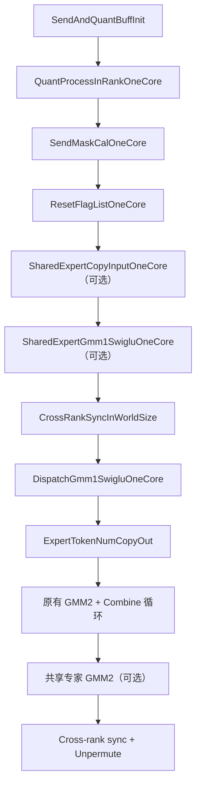
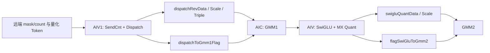

# MegaMoe 单核模块化重构

## PR 概述

本 PR 对 Ascend 950 架构下 MegaMoe 的 Kernel 实现进行模块化重构，将原先集中在
`MegaMoe` 类和 `mega_moe_impl.h` 中的部分计算、通信及 GMM 流水拆分为职责明确的单核或单 block
函数，并按执行单元归档到 `aiv_compute`、`aiv_comm`、`block` 和 `epilogue` 目录。

这里的“单核函数”表示函数只处理调用方分配给当前逻辑 AIV job 或逻辑 block 的工作。MegaMoe
算子本身仍然以完整算子形式运行，仍由 `MegaMoe::Process` 负责组织预处理、跨卡同步、
Dispatch/GMM1/SwiGLU、GMM2/Combine、共享专家和 Unpermute 等完整流程。

本 PR 的主要收益如下：

- 将可独立执行的 AIV 预处理逻辑从 `MegaMoe` 类中解耦。
- 将强耦合的 Dispatch、GMM1 和 SwiGLU 保留为一个单 block 流水模块。
- 使用逻辑 job/block 编号描述模块内分工，降低模块对物理核编号和 MegaMoe 成员变量的依赖。
- 将通用 GMM 计算按 AIC、AIV 和 block epilogue 分层，继续复用 GMM1/GMM2 的公共骨架。
- 保留线上已有的大 BS Combine、共享专家、Layered、不同量化路径等功能。
- 删除已被新模块完全替代的旧成员实现，避免新旧两套逻辑并存。

## 背景与问题

重构前，MegaMoe 的 Dispatch 前处理、Dispatch、GMM1、SwiGLU 以及部分 GMM 公共逻辑主要以
`MegaMoe` 成员函数或大型头文件内联实现存在，存在以下问题：

- 函数直接依赖大量 `MegaMoe` 成员变量，难以按独立执行单元理解和调用。
- 物理核编号、逻辑任务编号和 GM workspace 编号混合使用，后续调整参与核数时容易破坏数据关系。
- Dispatch、GMM1、SwiGLU 的数据依赖和核间同步分散在多个调用点，流水边界不清晰。

## 目标

- 抽取不依赖 `MegaMoe` 类实例的逻辑单核/单 block 函数，使其他算子可以按照相同的数据契约直接复用。
- 将核心选择权留给调用算子。调用方可以只选择设备上的部分物理 AIV 或物理 MIX block 执行模块，
  并通过对应 `JobContext` 的 `totalJobs` 告知模块实际参与计算的逻辑核心数量。
- 将物理核心编号与模块内的逻辑编号解耦。调用方可以自行决定物理 AIV 到逻辑 AIV job、物理 block
  到逻辑 block 的映射方式；抽取函数只要求收到的逻辑编号从 0 开始且连续。
- 允许参与核心的物理编号不连续且不从 0 开始。例如调用方可以选择物理 block `{3, 7, 11}`，
  分别映射为逻辑 block `{0, 1, 2}` 后调用同一个单 block 模块。
- 调用方通过 Context、Args、Scratch 和 State 显式提供运行信息、外部资源、临时空间和流水状态，
  不要求被复用函数读取调用算子的成员变量。
- 保持原有数据布局、跨核通知顺序和计算结果不变。
- 保持 GMM1、Dispatch、SwiGLU 必须由同一个 MIX block 内的 1 个 AIC 和 2 个 AIV 协作。
- 保留大 BS Combine 的动态同步槽位设计和 Layered 路径兼容性。

当前 MegaMoe 仍然选择全部核心，并采用物理编号到逻辑编号的一一映射。该方式只是 MegaMoe
当前的调用策略，不是抽取函数的限制。

## 整体执行流程

重构后的 `MegaMoe::Process` 仍是算子的总调度入口，执行顺序如下：



与重构前相比，算子的阶段顺序没有改变。变化主要是 `Process` 不再直接展开 Dispatch 前处理和
共享专家 GMM1/SwiGLU、Dispatch/GMM1/SwiGLU 的内部细节，而是组装上下文后调用对应模块。

## 核心设计

### 1. 逻辑 AIV job

纯 AIV 模块使用 `AivJobContext`：

```cpp
struct AivJobContext {
    uint32_t jobIndex;
    uint32_t totalJobs;
};
```

`jobIndex` 必须是 `[0, totalJobs)` 范围内从 0 开始的连续逻辑编号。模块内部只按照该编号切分数据，
不调用物理 AIV ID 获取接口。调用方可以自行建立物理 AIV 到逻辑 job 的映射。

当前 MegaMoe 为全核执行，因此初始化时逻辑编号与当前物理 AIV 编号一致；这只是当前调用方式，
不是抽取函数的接口限制。

`TilingByJobContext` 统一负责按逻辑 job 切分一维任务，并处理空任务、尾块和对齐。

#### 模块化通用结构体举例：`AivJobContext`

`AivJobContext` 是当前抽取结构中通用性最高的 Context。它只描述两个与具体算子功能无关的问题：

- 当前物理 AIV 被调用方映射成第几个逻辑 job。
- 本次一共有多少个逻辑 AIV job 参与该模块。

它不包含 Token 地址、Weight 地址、Rank window、量化模式、shape 或 UB Tensor，因此不会绑定
MegaMoe 的具体数据布局和计算功能。

目前以下单核函数都复用了 `AivJobContext`：

| 单核函数 | 如何使用 `AivJobContext` | 同时需要的其他信息 |
| --- | --- | --- |
| `QuantProcessInRankOneCore` | 按逻辑 job 切分需要量化的本卡 Token | `TokenShapeContext`、`QuantProcessArgs/Scratch` |
| `SendMaskCalOneCore` | 按逻辑 job 分配需要处理的全局 expert | `MoeTopologyContext`、`TokenShapeContext`、`SendMaskArgs/Scratch` |
| `ResetFlagListOneCore` | 按逻辑 job 切分需要清零的 flag/counter 区间 | `ResetWorkspaceArgs` 和 reset Tensor |
| `SharedExpertCopyInputOneCore` | 按逻辑 job 切分需要拆分的共享专家输入 Token | `TokenShapeContext`、`SharedExpertPrepareArgs/Scratch` |
| `ResetGmm2CombineSyncCountersOneCore` | 按逻辑 job 切分 Combine counter | `ResetWorkspaceArgs` 和 reset Tensor |

这些函数的计算内容并不相同，但都需要回答“当前 AIV 在本次任务中负责哪一段工作”，因此可以共享
同一个最小调度 Context。

例如调用算子只选择物理 AIV `{2, 5, 9, 14}` 参与 Dispatch 前处理，可以先建立以下映射：

| 物理 AIV ID | 逻辑 `jobIndex` | `totalJobs` |
| --- | --- | --- |
| 2 | 0 | 4 |
| 5 | 1 | 4 |
| 9 | 2 | 4 |
| 14 | 3 | 4 |

每个被选中的物理 AIV 使用自己的逻辑编号构造 Context：

```cpp
// 伪代码：省略各单核函数的模板参数。
AivJobContext job{
    logicalJobIndex, // 由调用算子完成 physical AIV -> logical job 映射
    selectedAivNum   // 本次实际参与模块的 AIV 数量
};

DispatchPrepareContext prepareContext{
    job,
    MoeTopologyContext{rankId, worldSize, expertPerRank},
    TokenShapeContext{tokenNum, topK, tokenHiddenDim}
};

QuantProcessInRankOneCore(prepareContext, quantArgs, quantScratch);
SendMaskCalOneCore(prepareContext, sendMaskArgs, sendMaskScratch);
ResetFlagListOneCore(prepareContext, resetArgs, resetTensor);
SharedExpertCopyInputOneCore(prepareContext, sharedPrepareArgs, sharedPrepareScratch);
```

这些函数内部统一调用 `TilingByJobContext`，只使用 `jobIndex/totalJobs` 计算自己的任务区间，不需要
知道逻辑 job 0 实际来自物理 AIV 0、2 还是其他核心。因此：

- 参与的物理 AIV 可以不连续。
- 参与的物理 AIV ID 可以不从 0 开始。
- 调用方可以根据自身算子流水决定参与核心数量。
- 同一个单核函数不需要为不同算子的物理核布局增加分支。

当前 `DispatchPrepareContext` 是阶段级组合 Context：

```cpp
struct DispatchPrepareContext {
    AivJobContext job;
    MoeTopologyContext topology;
    TokenShapeContext tokenShape;
};
```

其中三个子 Context 的复用情况并不完全相同：

- `AivJobContext` 被上述所有 AIV 单核函数使用，是最通用的部分。
- `TokenShapeContext` 被 Quant、SendMask 和共享专家输入拆分共同使用。
- `MoeTopologyContext` 当前主要由 SendMask 使用，为后续跨 Rank/Expert 模块提供公共拓扑语义。

这说明当前 Context 设计采用的是“通用原子 Context + 阶段级组合 Context”，而不是要求所有单核
函数共享一个包含全部字段的大结构体。

#### 后续通用化展望

后续抽取更多单核模块时，可以继续沿用以下原则。

**1. 保持原子 Context 最小化**

只有同时满足以下条件的信息才放入通用 Context：

- 在一次模块调用期间保持稳定，只读不修改。
- 字段语义与具体算子类无关。
- 能被两个或更多单核模块共同理解和使用。
- 不包含 GM 地址、Tensor view、UB 临时变量或流水可变状态。

例如 `AivJobContext` 和 `BlockJobContext` 只描述逻辑任务编号，适合作为长期稳定的公共接口。

**2. 使用组合代替扩大单个 Context**

如果多个函数只共享部分字段，应优先组合小 Context，而不是持续向一个全局 Context 添加字段。
例如后续可以根据实际复用情况形成：

```cpp
struct AivTokenJobContext {
    AivJobContext job;
    TokenShapeContext tokenShape;
};
```

那么：

- Quant 和共享专家输入拆分只需要 `AivTokenJobContext`。
- SendMask 可以使用 `AivTokenJobContext + MoeTopologyContext`。
- Reset 只需要最小的 `AivJobContext`。

这样能够让函数签名准确表达依赖，也避免 Reset 等函数被迫接收完全不会使用的 topology/shape。

**3. 将模块专属稳定参数命名为 `Config`**

`DispatchGmm1SwigluContext` 和 `SharedExpertGmm1SwigluContext` 当前包含部分公共子 Context，也包含大量
流水专属的稳定参数。后续如果严格执行“Context 表示跨模块公共约束”的规则，可以逐步调整为：

```cpp
DispatchGmm1SwigluOneCore(
    const BlockJobContext &blockJob,
    const BlockWorkspaceContext &workspace,
    const DispatchGmm1SwigluConfig &config,
    const DispatchGmm1SwigluArgs &args,
    DispatchGmm1SwigluScratch &scratch,
    DispatchGmm1SwigluState &state);
```

其中：

- `BlockJobContext` 和 `BlockWorkspaceContext` 是可跨模块复用的底层执行约束。
- `DispatchGmm1SwigluConfig` 只保存该流水特有但调用期间稳定的 shape、模式和 buffer 配置。
- `Args/Scratch/State` 继续分别保存外部资源、临时工作区和可变流水状态。

**4. 扩展 block 级公共 Context**

后续如果继续抽取 GMM2、Combine 或其他 MIX block 模块，可以复用：

- `BlockJobContext`：描述调用方选择的逻辑 block 数及连续逻辑编号。
- `BlockWorkspaceContext`：描述当前物理 block 对应的稳定 GM workspace 槽位。

新的 block 模块只需要增加自己的 `Config/Args/Scratch/State`，不需要重新定义核心编号和 workspace
编号规则。

**5. 明确兼容规则**

公共 Context 一旦被多个算子使用，应尽量保持字段语义稳定。新增功能时优先增加新的小 Context 或
模块 Config；只有新字段确实被多数现有模块共同需要时，才扩展已有公共 Context。这样可以避免一个
算子的功能演进迫使其他复用方同步携带无关字段。

### 2. 逻辑 block 与 workspace 编号分离

Dispatch/GMM1/SwiGLU 使用两个不同的 block 上下文：

```cpp
struct BlockJobContext {
    uint32_t jobIndex;
    uint32_t totalJobs;
};

struct BlockWorkspaceContext {
    uint32_t blockIdx;
    uint32_t blockNum;
};
```

`BlockJobContext` 描述当前阶段的逻辑 block job。一个 MIX block 内的 AIC、AIV0、AIV1 必须传入
完全相同的 `jobIndex/totalJobs`，保证三者处理同一组 tile 和 expert。

`BlockWorkspaceContext` 描述物理 block 在 GM workspace 中的固定存储位置：

- `blockIdx` 是当前 MIX block 的物理 block ID。对同一次 Kernel 启动中的物理 block 而言，它是稳定且
  唯一的，不会因为某个模块只选择了部分 block 而重新编号。
- `blockNum` 是 workspace 布局为物理 block 维度预留的总槽位数，也是计算 expert 之间 GM stride
  时使用的 block 数。当前 MegaMoe 中对应 `aicNum_`。
- `expertRevTokenNumsPtr`、`sendCntFlagPtr` 等按 block 保存的数据均使用
  `[expert][physicalBlock]` 形式寻址。地址计算的核心形式为
  `expertIdx * blockNum * stride + blockIdx * stride`。

因此，`BlockWorkspaceContext` 的作用不是分配计算任务，而是保证每个物理 block 始终读写自己的
workspace 槽位。即使本次只启用物理 block `{3, 7, 11}`，它们仍写入物理槽位 `3/7/11`，不会因为
被映射成逻辑 block `{0, 1, 2}` 而改写槽位 `0/1/2`。这样可以避免以下问题：

- 不同物理 block 因逻辑编号变化而写入同一块 GM。
- 同一个物理 block 在不同阶段调用不同的模块函数时采用不同逻辑编号后，前后阶段访问到不同的 workspace 槽位。
- 使用 `blockNum` 计算 expert stride 时按“参与核心数”压缩布局，导致后续 expert 的地址整体错位。

两种 Context 的职责可以概括为：

| Context | 编号含义 | 是否允许调用方重映射 | 用途 |
| --- | --- | --- | --- |
| `BlockJobContext` | 当前模块内从 0 开始连续的逻辑 block job ID | 允许 | 任务切分、tile 调度和 block 间负载分配 |
| `BlockWorkspaceContext` | 当前 MIX block 的物理 block ID | 不应压缩 | 定位该物理 block 在 GM workspace 中的固定槽位 |

例如物理 block 7 被调用方映射为逻辑 block 1 时，应传入：

```cpp
BlockJobContext blockJob{1, 3};                    // 3 个逻辑 block job 中的第 1 个
BlockWorkspaceContext countWorkspace{7, blockNum}; // 物理 block 7 的固定 GM 槽位
```

一个 MIX block 内的 AIC、AIV0、AIV1 必须使用相同的两组 Context。`BlockWorkspaceContext` 适用于
生产者和消费者按同一物理 block 配对访问的数据；如果后续流程要由另一个物理 block 消费该槽位，
调用方还需要额外提供生产者到消费者的显式映射，不能直接用消费者自己的物理 block ID 替代。

当前 MegaMoe 的 GMM1 和 GMM2 都使用全 block，因此逻辑 block 与物理 workspace block 一一对应。
将两种编号拆开，是为了让被复用模块在部分核或非连续物理核场景下仍能同时获得正确的任务编号和
稳定的 GM 存储编号。

### 3. Context、Args、Scratch、State 分层

抽取函数的参数按生命周期和用途分为四类。分类标准不是字段的数据类型，而是字段在一次模块调用中
是否稳定、是否表示外部资源、是否属于临时存储，以及是否需要随流水推进而变化。

| 类型 | 该类型字段的共同特征 | 当前包含的典型内容 | 生命周期与修改规则 |
| --- | --- | --- | --- |
| `Context` | 描述“这次任务是什么、如何切分和按什么配置执行”；值在一次模块调用期间保持不变；不保存计算过程中的临时结果 | 逻辑编号、拓扑、Token shape、计算模式、buffer 布局和对齐配置 | 通常在算子 `Init` 阶段构造，以 `const` 引用传入，模块只读 |
| `Args` | 描述“数据在哪里”；字段主要是调用方已有的 GM/window/workspace 地址或外部对象引用；不拥有也不复制地址指向的数据 | 输入输出 GM 地址、权重地址、scale 地址、flag 地址、Rank window 地址 | 地址绑定完成后保持稳定，以 `const` 引用传入 |
| `Scratch` | 描述“本核临时使用哪块存储”；字段与 UB/GM Tensor view 和临时累加结果直接相关；不表达任务调度语义 | `LocalTensor`、`GlobalTensor` 视图、UB ring 基址、临时计数和搬运长度 | 调用方在 buffer 初始化阶段建立，模块按引用使用和更新，可在同一次调用内复用 |
| `State` | 描述“流水已经执行到哪里”；通常是少量会随 expert/tile 推进而改变的标量；可能需要在函数返回后继续使用 | `startBlockIdx`、`vecSetSyncCom` 等调度游标和同步状态 | 每次流水调用前初始化，以非 `const` 引用传入并由模块更新 |

四类对象都只保存调用所需的轻量描述或 Tensor view，不复制 Token、Weight 等实际数据。进一步区分
它们的原因是：

- 稳定且与任务定义有关的信息统一放入 `Context`，便于多个内部函数共享同一份只读配置。
- 稳定但代表外部数据绑定的信息统一放入 `Args`，可以直接看出模块依赖哪些 GM 资源。
- 与临时内存布局及中间结果绑定的信息统一放入 `Scratch`，由调用方一次初始化后按引用复用。
- 会改变控制流且需要跨 expert/tile 保留的信息统一放入 `State`，避免混入只读 Context。

MegaMoe 在 `Init` 和 buffer 初始化阶段构造这些对象。原有 Tensor 和 GM 地址通过 Tensor 视图或引用
传入，不复制实际数据。`Params` 由 MegaMoe 作为成员对象持有，避免被调用模块保存指向临时对象的
悬空指针。

### 4. 按执行单元组织头文件

目录划分首先依据代码在哪类执行单元上运行，其次依据代码的主要职责是计算、通信、block 协作还是
GMM 输出处理。

| 目录 | 目录内文件的共同特征 | 归类原因 |
| --- | --- | --- |
| `aiv_compute` | 主要在 AIV 上执行，以 Vector 计算、数据格式转换或 GMM 前后处理计算为主；不负责组织完整 MIX block 流水 | 将纯 AIV 计算与通信搬运、AIC MMAD 分开，便于调用方单独复用 AIV 计算能力 |
| `aiv_comm` | 主要在 AIV 上执行，以 Rank window/GM 数据搬运、通信数据准备和跨阶段同步标志维护为主 | 这些函数的主要产物是可供远端或后续阶段消费的数据布局、计数和通知状态 |
| `block` | 以一个完整 MIX block 为调度粒度，或者承载该 block 中 AIC 侧的核心计算；依赖同 block 内角色分工或同步 | Dispatch/GMM1/SwiGLU 必须保持 1 AIC + 2 AIV 协作，AIC MMAD 也属于 block 的 Cube 计算侧 |
| `epilogue` | 位于 GMM 主计算之后或计算分派边界，负责输出后处理、SwiGLU/量化以及按核类型选择具体实现 | 将矩阵乘主体与输出处理、AIC/AIV 后处理分派解耦 |
| arch35 根目录 | 多类执行单元共同使用的接口定义和聚合入口 | Context 不属于某一种核，聚合头文件也需要统一暴露各子模块 |

各文件的具体职责和放置原因如下：

| 目录/文件 | 主要职责 | 为什么放在这里 |
| --- | --- | --- |
| `mega_moe_single_core_context.h` | AIV 逻辑 job、拓扑、Token shape 和通用切分函数 | 属于所有单核模块共享的调用契约，不绑定某一种计算或通信实现 |
| `mega_moe_single_core.h` | 单核模块兼容聚合头文件 | 作为统一 include 入口放在根目录，向调用方汇总各子目录接口 |
| `aiv_compute/mega_moe_quant_process.h` | 本卡 Token 量化 | 核心工作是 AIV Vector 量化计算和双 buffer 流水 |
| `aiv_compute/mega_moe_shared_expert_prepare.h` | 将共享专家输入的交错 data/scale 拆分为连续布局 | 仅由一个逻辑 AIV job 完成本地数据重排，不涉及 MIX block 协作 |
| `aiv_comm/mega_moe_send_mask.h` | 按专家生成 bitmap/count 并写入目标 Rank window | 结果用于跨 Rank Dispatch，主要职责是通信数据准备和 window 写入 |
| `mega_moe_workspace_reset.h` | Dispatch flag 和 GMM2 Combine counter 清零 | 维护跨阶段同步状态，属于通信/同步基础逻辑 |
| `aiv_comm/mega_moe_token_dispatch.h` | SendCnt、Mask 扫描、Token/Scale/Triple 搬运和 Dispatch 通知 | 负责从远端 window 收集数据、写入 Dispatch workspace 并通知 GMM1 |
| `mega_moe_dispatch_gmm1_swiglu.h` | 单 MIX block 的 Dispatch/GMM1/SwiGLU 总流水 | 需要同时调度同一 block 内 AIC、AIV0 和 AIV1，不能归入纯 AIV 目录 |
| `mega_moe_shared_expert_gmm1_swiglu.h` | 单 MIX block 的共享专家 GMM1/SwiGLU 流水 | 共享专家不需要 Dispatch，但 GMM1/SwiGLU 仍要求同 block 的 AIC 和 AIV 协作 |
| `blaze/gemm/block/mega_moe_group_matmul_compute.h` | Generic 和 A8W4 路径的 AIC MMAD | 内容是 MIX block 中 AIC/Cube 侧的核心矩阵计算 |
| `blaze/prologue/mega_moe_group_matmul_prologue.h` | 按 tile 调度 A8W4 权重展开 | 接收并调用同目录下定义的 Blaze `BlockPrologue`，是底层 prologue 算子与 MegaMoe GMM 调度之间的适配层 |
| `blaze/epilogue/mega_moe_group_matmul_epilogue.h` | 按核类型和 GMM policy 分发 AIC/AIV 实现 | 位于公共 GMM 骨架与具体核实现之间，是计算出口处的分派层 |
| `blaze/epilogue/mega_moe_block_epilogue_swiglu_mx_quant.h` | SwiGLU + MX 量化 epilogue | 定义 GMM 输出后的融合后处理算子，职责属于 epilogue |

## Dispatch 前处理模块

### `QuantProcessInRankOneCore`

原型来源为 `MegaMoe::QuantProcessInRank`。该函数按逻辑 AIV job 切分本卡 Token，将 BF16 输入转换为
后续 Dispatch/GMM1 使用的 FP8 或 FP4 数据和 MX scale。

函数保留双 buffer 及 MTE2、Vector、MTE3 的事件流水。输入输出地址和量化布局由
`QuantProcessArgs` 提供，UB Tensor 由 `QuantProcessScratch` 提供。

### `SendMaskCalOneCore`

原型来源为 `MegaMoe::SendMaskCal`。该函数按全局专家维度把专家分配给逻辑 AIV job，并分 batch
扫描 `topkIds`：

1. 对当前专家生成 bit-packed mask。
2. 通过 `GatherMask` 统计每个 batch 的匹配 route 数。
3. 累加得到该专家的 Token count。
4. 将 `[mask | count]` 写入目标 Rank 的 window 槽位。

Mask 和 count 在源卡一次生成，接收卡的 Dispatch 可直接读取 count，不需要再次完整统计。

### `ResetFlagListOneCore`

原型来源为 `MegaMoe::ResetFlagList`。该函数按逻辑 AIV job 清零：

- SwiGLU 到 GMM2 的完成标志。
- Dispatch 到 GMM1 的 wave 标志。
- SendCnt 到参数更新的同步标志。
- 量化 Combine 模式下的 GMM2/Combine 动态同步 counter。

清零按 `DISPATCH_RESET_BATCH` 限制分批执行，避免大 BS 场景下为一次 reset 申请过大的 UB。

`ResetGmm2CombineSyncCountersOneCore` 是其内部辅助函数，负责清零当前逻辑 AIV job 分到的
Combine counter 区间。

## 共享专家 GMM1/SwiGLU 前半段

### `SharedExpertCopyInputOneCore`

原型来源为 `MegaMoe::SharedExpertCopyInput`。该函数使用 `AivJobContext` 对本卡 Token 分工，将量化
阶段产生的 `[data | scale]` 交错布局拆分到共享专家使用的连续 data 和 scale workspace。

调用算子可以自行选择参与该阶段的物理 AIV，并映射成连续逻辑 job。函数复用量化阶段已经申请的
双 buffer Scratch，不重新申请或复制 UB。

### `SharedExpertGmm1SwigluOneCore`

原型来源为 `MegaMoe::ProcessSharedExpertGmm1`。该函数使用 `BlockJobContext` 表示一个逻辑 MIX
block job，并在函数内部遍历共享专家：

1. 共享专家输入 data/scale 对所有 shared expert 保持不变。
2. 按 `sharedExpertIdx` 计算 Weight1、Weight1 scale 和 A8W4 GMM1 中间结果地址。
3. 按 `sharedExpertIdx` 计算 SwiGLU data/scale 输出偏移并更新 epilogue 地址。
4. 根据 A8W8、A8W4、A4W4/NZ 模式调用对应的单 block GMM1/SwiGLU 路径。
5. 所有共享专家完成后调用 `EndSync` 收尾 Cube/Vector 同步。

共享专家不经过 SendMask、SendCnt 和 Dispatch，因此该函数不需要 `BlockWorkspaceContext` 或
Dispatch flag；但同一个逻辑 block job 的 AIC、AIV0、AIV1 仍必须来自同一个物理 MIX block。

## Dispatch/GMM1/SwiGLU 单 block 流水

### 改造示例：从 MegaMoe 内联流水到可复用单 block 函数

#### 改造前的组织方式

重构前，Dispatch、GMM1 和 SwiGLU 虽然已经有若干成员函数，但完整流水仍直接展开在
`MegaMoe::Process` 中。其结构可以简化为：

```cpp
DispatchBufferConfig dispatchBufferConfig = DispatchBuffInit();
ExpertLoopState dispatchState{initShape, initOffset, 0};
ExpertLoopState gmm1State{initShape, initOffset, 0};
uint64_t curSendCnt = 0;
uint64_t nextSendCnt = 0;

// AIV1 预调度 expert 0。
SendCntCal(0, nextSendCnt);
UpdateGroupParams<AddrUpdateMode::GMM1>(dispatchState, 0, nextSendCnt);
UpdateGlobalBuffer<AddrUpdateMode::GMM1>(dispatchAddrInfo, dispatchState);
MetaInfoCalAndDispatch(dispatchAddrInfo, 0, dispatchBufferConfig);

for (uint32_t expertIdx = 0; expertIdx < moeExpertPerRank_; ++expertIdx) {
    curSendCnt = nextSendCnt;

    // AIV1 预调度 expert e + 1。
    SendCntCal(expertIdx + 1, nextSendCnt);
    UpdateGroupParams<AddrUpdateMode::GMM1>(dispatchState, expertIdx + 1, nextSendCnt);
    UpdateGlobalBuffer<AddrUpdateMode::GMM1>(dispatchAddrInfo, dispatchState);
    MetaInfoCalAndDispatch(dispatchAddrInfo, expertIdx + 1, dispatchBufferConfig);

    // 同 block 的 AIC/AIV 消费 expert e。
    UpdateGroupParams<AddrUpdateMode::GMM1>(gmm1State, expertIdx, curSendCnt);
    UpdateGlobalBuffer<AddrUpdateMode::GMM1>(gmm1AddrInfo, gmm1State);
    GroupMatmulWithSwigluQuant(gmm1AddrInfo, gmm1State, expertIdx, vecSetSyncCom);
}
```

以上代码存在两个层面的耦合：

- 流水编排耦合在 `MegaMoe::Process` 中。其他算子即使需要相同流水，也无法直接调用一个完整模块，
  必须重新复制 expert 循环、预取顺序和收尾同步。
- 各成员函数隐式读取 `params_`、`worldSize_`、`expertPerRank_`、`blockIdx_`、`subBlockIdx_` 以及大量
  成员 Tensor。只看函数签名无法知道其完整输入、workspace、UB 和同步依赖。

此外，旧 GMM1 入口在内部按照当前物理 block 获取调度编号。调用算子无法只选择部分物理 block，
再把它们映射成从 0 开始连续的逻辑 block。

#### 改造后的调用方式

重构后，`MegaMoe::Process` 中该阶段只保留状态初始化和一次模块调用：

```cpp
DispatchGmm1SwigluState gmm1PipelineState{0U, 0};
DispatchGmm1SwigluOneCore<QuantOutType, ActivationType, Weight1Type,
    SwigluQuantOutType, QuantScaleOutType, ENABLE_A8W4,
    GMM1_TILE_M, EPILOGUE_TILE_M, TopkWeightsPrefetch>(
        gmm1PipelineContext_, gmm1PipelineArgs_, params_, epilogueOp_,
        gmm1PipelineScratch_, gmm1PipelineState);
```

调用所需信息被拆成以下对象：

| 对象 | 在本例中的职责 |
| --- | --- |
| `DispatchGmm1SwigluContext` | 提供逻辑 `BlockJobContext`、物理 `BlockWorkspaceContext`、Rank/Expert/shape、tile 和 buffer 配置 |
| `DispatchGmm1SwigluArgs` | 提供 Rank window、Dispatch workspace、Weight1/scale 和各类同步 flag 地址 |
| `Params`、`BlockEpilogue` | 显式提供 GMM 公共参数和 SwiGLU/量化实现，不再从 `MegaMoe` 类实例中隐式取得 |
| `DispatchGmm1SwigluScratch` | 提供 SendCnt、Mask、Triple、Dispatch ring 等 UB/GM Tensor view 和临时累加量 |
| `DispatchGmm1SwigluState` | 保存 `startBlockIdx` 和 Cube/Vector 同步状态，并将最终状态返回调用方 |

`DispatchGmm1SwigluOneCore` 内部再按照职责调用：

| 原职责 | 改造后的函数 |
| --- | --- |
| Dispatch UB/GM Tensor 初始化 | `InitDispatchGmm1SwigluBuffers` |
| 统计当前 expert 从各 Rank 接收的 Token 数 | `SendCntCalOneCore` |
| 扫描 Mask 并搬运 Token、Scale、Triple | `DispatchTokensOneCore`、`CopyDispatchTokensOneCore` |
| 更新当前 expert 的 `M/N/K` 和累计行偏移 | `UpdateGmm1GroupParams` |
| 更新 Token、Weight、Scale、输出和 flag 地址 | `UpdateGmm1GlobalBuffer` |
| 按 A8W8、A8W4、A4W4/NZ 路径执行 GMM1 和 SwiGLU/量化 | `RunGmm1SwigluStageOneCore` |
| 编排 expert 0 预调度、`Dispatch(e + 1)`/`GMM1(e)` 重叠和最终同步 | `DispatchGmm1SwigluOneCore` |

这些函数不是把原成员函数机械改名。改造同时进行了职责拆分和合并：

- 原 `MetaInfoCalAndDispatch` 中的 Mask 扫描、单 Token 搬运和 Triple 写出被拆成更明确的通信函数。
- 原 `UpdateGroupParams`、`UpdateGlobalBuffer` 中与 GMM1 有关的分支被提取为 GMM1 专属函数。
- 原来位于 `Process` 中的 expert 流水循环被合入 `DispatchGmm1SwigluOneCore`，使调用方不会漏掉
  预取顺序或收尾同步。
- 原来由成员变量隐式提供的数据改为 Context、Args、Scratch 和 State 显式传入。
- GMM1 调度改为使用调用方提供的逻辑 `BlockJobContext`，workspace 寻址继续使用物理
  `BlockWorkspaceContext`。

#### “OneCore”的准确含义

对于 `QuantProcessInRankOneCore` 这类纯 AIV 函数，一次调用对应一个逻辑 AIV job。

对于 `DispatchGmm1SwigluOneCore`，一次物理执行仍然是“每个核各自调用一次该函数”，但复用模块的
完整调度单位是一个 MIX block：

- 同一物理 block 的 AIC、AIV0、AIV1 使用相同的 `BlockJobContext` 和 `BlockWorkspaceContext`。
- 编译期 `g_coreType` 和运行时 `GetSubBlockIdx()` 决定当前物理核执行 AIC MMAD、AIV0 前后处理，
  还是 AIV1 SendCnt/Dispatch 等角色。
- 三个物理核在函数内部通过既有 flag 和事件完成数据交接，不能来自三个不同的物理 block。

因此，这里的 `OneCore` 表示函数体以当前物理核为执行粒度，不会在内部再次进行算子级物理分核；
它并不表示 GMM1、Dispatch 和 SwiGLU 可以脱离同一个 MIX block 的三核协作关系。

#### 与原实现的主要区别

| 对比项 | 原实现 | 改造后 |
| --- | --- | --- |
| 调用入口 | `MegaMoe::Process` 内展开完整 expert 流水 | 一个 `DispatchGmm1SwigluOneCore` 入口封装完整单 block 流水 |
| 对算子的依赖 | 成员函数隐式访问大量 `MegaMoe` 成员 | 自由函数只依赖显式传入的数据契约，不需要 `MegaMoe` 类实例 |
| 核心编号 | 直接使用算子的物理 block/core 编号 | 计算调度使用调用方提供的连续逻辑 job，GM 槽位使用稳定物理 block ID |
| 参与核心数 | 与 MegaMoe 全核启动方式绑定 | 调用方通过 `totalJobs` 控制参与的逻辑 block 数 |
| 物理核选择 | 默认物理编号连续且全量参与 | 调用方可选择不连续物理 block，并自主映射为连续逻辑 block |
| 参数依赖 | 需要阅读类成员和多个成员函数才能确认 | Context、Args、Scratch、State 分别声明稳定配置、地址、临时空间和运行状态 |
| UB 管理 | UB Tensor 作为 `MegaMoe` 成员，由成员初始化函数维护 | Scratch 由调用方初始化后按引用传入，可随模块一起复用 |
| 流水正确性 | 依赖 `Process` 中调用顺序保持一致 | `Dispatch(e + 1)`、`GMM1/SwiGLU(e)` 和结束同步收口在模块内部 |
| 模式扩展 | 模式判断散布在算子成员函数中 | A8W8、A8W4、A4W4/NZ 和 TopK weight prefetch 通过模板参数及 Context 分派 |

#### 改造后的优势

- **可复用**：其他算子只要准备相同的 Context、Args、Scratch、State 和 GMM 参数，就可以直接调用
  该流水，不需要继承、构造或复制 `MegaMoe` 类。
- **可控制参与核数**：调用方可以根据自身流水安排选择任意数量的物理 MIX block，并通过
  `BlockJobContext` 给它们分配连续逻辑编号。
- **物理核选择更灵活**：参与的物理 block 可以不连续且不从 0 开始；计算分工不会再被
  `GetBlockIdx()` 形成的物理编号绑定。
- **不破坏三核流水**：Dispatch、GMM1 和 SwiGLU 没有被拆成三个可随意调度的独立入口，而是继续
  在一个总函数中维持同 block 的数据链和同步链。
- **依赖清晰**：从函数签名和结构体即可看到 GM 地址、逻辑调度、物理 workspace、UB 和状态依赖，
  降低后续接入新算子时漏传资源或错用编号的风险。
- **减少重复初始化**：稳定配置和 Tensor view 可以在调用算子的 `Init`/buffer 初始化阶段建立，
  Process 只传引用，不复制 Token、Weight 或 Tensor 数据。
- **保留编译期特化**：函数继续使用 `__aicore__ inline`、模板参数和 `if constexpr`，不同量化路径
  仍可在编译期裁剪；模块化不要求引入运行时虚函数或数据拷贝。
- **更容易维护**：通信搬运、AIC 计算、AIV 后处理和 block 编排分文件放置，修改某一职责时更容易
  检查其数据边界和同步边界。

### 强耦合关系

`DispatchGmm1SwigluOneCore` 不是让三个阶段分别选择任意物理核，而是让同一个 MIX block 内的
1 个 AIC 和 2 个 AIV 使用相同的 `BlockJobContext` 进入同一个流水。



AIV1 负责 SendCnt 和 Dispatch。GMM1 由同 block 的 AIC 执行，向量后处理角色由具体量化路径决定。
所有核使用相同的 expert 顺序、tile 调度游标和 workspace 计数位置，不能在调用侧分别映射到不同
逻辑 block。

### Expert 间流水

流水采用“预取下一个专家，计算当前专家”的方式：

1. AIV1 在进入 expert 循环前计算 expert 0 的 SendCnt，并在非空时完成 Dispatch。
2. 进入 expert `e` 时，将已准备好的 `nextSendCnt` 作为当前专家的 `currentSendCnt`。
3. AIV1 立即计算并 Dispatch expert `e + 1`。
4. 当前 block 同时更新 expert `e` 的 GMM shape、地址和 epilogue 地址。
5. AIC/AIV 执行 expert `e` 的 GMM1 与 SwiGLU/量化。
6. 所有 expert 完成后调用 `EndSync` 收尾未完成的 Cube/Vector 同步。

该顺序保持了原有 `Dispatch(e + 1)` 与 `GMM1/SwiGLU(e)` 的重叠关系。

### Dispatch 数据流

`SendCntCalOneCore` 从每个源 Rank 的 `[mask | count]` 槽位读取 count，计算：

- 当前 expert 从各 Rank 接收的 Token 总数。
- 按 expert、Rank 排列的累计接收数 `cumsumInfo`。
- 当前 workspace block 对应的 `expertRevTokenNums`。

随后 `DispatchTokensOneCore` 按 `worldSize * blockNumPerRank` 切分 Dispatch shard，逐 batch 扫描
远端 mask，计算当前 shard 对应的匹配区间。`CopyDispatchTokensOneCore` 使用 ring buffer 流水搬运：

- 量化后的 Token data。
- 对应的 MX scale。
- `(rankId, tokenId, topkIndex)` Triple 元数据。

每个 shard 写完后，按照实际覆盖的 GMM1 wave 对 `dispatchToGmm1Flag` 做原子累加。AIC 只有在
对应 wave 的 Token 全部到齐后才开始消费，避免读取未完成的 Dispatch 数据。

### GMM1 参数和地址

`UpdateGmm1GroupParams` 为当前 expert 生成 `M/N/K`：

- `M` 为该 expert 实际收到的 Token 数。
- `N` 为 GMM1 输出维度。
- `K` 为输入 hidden size。

`rowOffset` 累加前序 expert 的 `M`，统一推导以下地址：

- Dispatch 后的 Token 和 scale 起始地址。
- 当前 expert 的 Weight1 和 Weight1 scale。
- A8W4 路径的 GMM1 中间结果地址。
- SwiGLU/量化输出地址。
- Dispatch 到 GMM1 的 wave flag 地址。

`RunGmm1SwigluStageOneCore` 根据数据类型和 `groupedMatmulMode` 选择 Generic、NZ 或 A8W4
执行路径。

## 不同计算路径

### Generic A8W8 / A4W4 NZ

- AIC 执行 GMM tile 计算。
- AIC 通过 Cube/Vector flag 与 AIV 后处理同步。
- GMM1 的 AIV 后处理执行 SwiGLU 和 MX 量化。
- `GROUPED_MATMUL_MODE_A8W8_NZ` 和 `GROUPED_MATMUL_MODE_A4W4_NZ` 继续走对应的 NZ 模板实例。

### A8W4

当激活为 FP8、Weight1 为 FP4 时启用专用 A8W4 路径：

- AIV0 执行 Weight 的 W4 到 W8 prologue。
- AIC 执行 MMAD，并将 GMM1 tile 写入 GM 中间区。
- AIV1 等待 AIC tile 完成，从 GM 搬入 UB 后执行 SwiGLU 和量化。
- AIC 与 AIV1 使用 tile ready/accepted 标志限制在途 tile 数，保持原有流水和 GM buffer 复用安全。

### A4W4

A4W4 场景中 GMM1 使用 Generic A4W4 路径；GMM2 根据原有精度策略复用 A8W4 骨架，并对
SwiGLU 量化输出类型进行必要提升。该策略没有在本 PR 中改变。

## GMM 公共逻辑拆分

本 PR 没有将 GMM1 和 GMM2 完全复制成两套实现。两者仍通过 Policy 和公共配置共享核心骨架：

- `GroupMatmulImplGeneric` 负责 Generic 路径的配置、Tensor view、scheduler 和公共 tile 调度。
- `GroupMatmulImplA8W4` 负责 A8W4 路径的公共配置和 tile 调度。
- `GroupMatmulExecGeneric` 根据 `g_coreType` 和 GMM1/GMM2 Policy 分派 AIC 或 AIV 实现。
- `GroupMatmulExecA8W4` 在同一 block 内分派 AIC、AIV0 和 AIV1 的职责。
- `AicComputeGeneric`、`AicComputeA8W4` 承载纯 AIC MMAD。
- `AivGmm1PostGeneric`、`AivGmm1PostA8W4` 承载 GMM1 的 SwiGLU/量化。
- `AivGmm2PostGeneric`、`AivGmm2PostA8W4` 承载无量化 Combine 路径的 AIV 后处理。

GMM1 新增可显式传入 `BlockJobContext` 的入口，路由专家和共享专家的单 block 流水均使用该入口。
原有不带 Context 的重载继续供尚未迁移的兼容路径使用，并在函数内部按当前物理 block 构造
Context；GMM2 也继续保留现有的物理 block 调用入口。

GMM1 和 GMM2 的 `startBlockIdx` 在语义上是独立调度状态。当前 MegaMoe 两阶段均全核运行，因此
GMM2 可以从 GMM1 已归一化的游标继续；接口没有假设未来部分核场景下二者必须使用相同 block 数。

## 大 BS Combine 功能保留

本 PR 基于已支持大 BS Combine 的线上版本重构，并保留以下机制：

- Tiling 提供 `combineSyncSlotCountPerExpert`。
- 每个 expert 拥有独立、动态大小的同步槽位区域。
- 每个槽位独占一个 `INT_CACHELINE`，避免不同 counter 共享 cacheline。
- `GMMAddrInfo::gmm2CombineSyncCounter` 指向当前 expert 的 counter 起点。
- `CalcGroupSyncSlotLayout` 计算 Token group 与同步槽位的对应关系。
- `GetGroupSyncSlotRange` 计算一个 Token group 对应的连续槽位区间。
- `NotifyCombineConsumersOfTileCompletion` 由 GMM2 producer 通知所有负责该 group 的 Combine consumer。
- `ComputeCombineGroupsForCore` 为每个逻辑 consumer 分配 Token group 和组内 Token 区间。
- Generic GMM2 使用 `blockNum * 2` 个逻辑 AIV consumer。
- A8W4/A4W4 配对路径只使用每个 block 的 AIV1，因此逻辑 consumer 数为 `blockNum`。
- Counter reset 按 batch 执行，避免大 workspace 对 UB 容量产生额外要求。

Producer 和 consumer 使用同一个 per-expert counter base 及同一套 slot layout，保证不会因 GMM
模块拆分而破坏 GMM2 到 Combine 的同步链。

`mega_moe_layered.h` 同步适配了动态 counter 地址、逻辑 consumer 数和分批 reset，避免 Layered/URMA
路径继续使用旧的固定 `expert * AIV` counter 布局。

## 旧实现与新函数映射

| 原实现/职责 | 新实现 |
| --- | --- |
| `TilingByCore` 在抽取模块中的分核职责 | `TilingByJobContext` |
| `MegaMoe::QuantProcessInRank` | `QuantProcessInRankOneCore` |
| `MegaMoe::SendMaskCal` | `SendMaskCalOneCore` |
| `MegaMoe::ResetFlagList` | `ResetFlagListOneCore` |
| `MegaMoe::ResetGmm2CombineSyncCounters` | `ResetGmm2CombineSyncCountersOneCore` |
| `MegaMoe::SharedExpertCopyInput` | `SharedExpertCopyInputOneCore` |
| `MegaMoe::ProcessSharedExpertGmm1` | `SharedExpertGmm1SwigluOneCore` |
| 共享专家 GMM1 的 `UpdateSharedGlobalBuffer` 分支 | `UpdateSharedExpertGmm1GlobalBuffer` |
| `GroupMatmulWithSwigluQuant<true>` | `RunSharedExpertGmm1SwigluStageOneCore` |
| `MegaMoe::DispatchBuffInit` | `InitDispatchGmm1SwigluBuffers` |
| `MegaMoe::SendCntCal` | `SendCntCalOneCore` |
| `MegaMoe::CopyGMToGMPerToken` | `FetchDispatchTokenAndMeta`、`StoreDispatchTokenAndMeta`、`CopyDispatchTokensOneCore` |
| `MegaMoe::TripleInfoCalAndDispatch` | `DispatchTokensOneCore` |
| GMM1 的 `UpdateGroupParams` 分支 | `UpdateGmm1GroupParams` |
| GMM1 的 `UpdateGlobalBuffer` 分支 | `UpdateGmm1GlobalBuffer` |
| 路由专家 GMM1/SwiGLU 调用 | `RunGmm1SwigluStageOneCore` |
| Process 中的 Dispatch/GMM1/SwiGLU expert 循环 | `DispatchGmm1SwigluOneCore` |
| Generic GMM AIC 计算 | `AicComputeGeneric` |
| A8W4 GMM AIC 计算 | `AicComputeA8W4` |
| Generic GMM AIV 后处理 | `AivGmm1PostGeneric`、`AivGmm2PostGeneric` |
| A8W4 prologue 和 AIV 后处理 | `AivPrologueA8W4`、`AivGmm1PostA8W4`、`AivGmm2PostA8W4` |

最新清理删除了 `mega_moe.h` 中已经被模块替代的旧成员声明和实现。共享专家 GMM2、Combine、
Cross-rank sync、Unpermute 等仍在使用的原实现没有删除。

## 兼容性与功能影响

- 算子输入、输出、Tiling 数据和 Host 调用方式不变。
- A8W8、A8W4、A4W4 计算路径继续保留。
- Combine 非量化和量化路径继续保留。
- 大 BS Combine 动态同步槽位继续保留。
- 共享专家输入重排和 GMM1/SwiGLU 改为逻辑 job 模块，共享专家 GMM2 和输出处理继续保留。
- Layered/URMA 路径继续保留并适配动态 Combine counter。
- `expertCapacityPerRank` 与 `expertPerRank` 分离，前者表示权重/workspace 容量，后者表示本次实际参与
  路由计算的专家数，避免共享专家或预留专家槽位被错误加入路由循环。
- 本 PR 不改变数学计算定义，预期输出精度与重构前一致。

## 代码变更范围

相对当前上游基线提交，本 PR 当前涉及 18 个文件，累计约为：

```text
2800 insertions(+), 1581 deletions(-)
```

功能重构提交负责新增模块和接入新流水；后续清理提交删除被替代的旧实现。删除代码量较大主要来自
`mega_moe.h` 中旧 Dispatch 前处理与 Dispatch/GMM1 实现，不包含对 GMM2、Combine 或新功能的回退。

## 验证建议

当前代码应重点验证以下内容：

- 编译覆盖 A8W8、A8W4、A4W4 及 NZ 模式。
- 单卡、多卡和不同 EP world size 下的输出精度。
- `expert_token_nums` 与重构前一致。
- 普通 BS 和大 BS 下 Combine quant/non-quant 均无超时、越界和死锁。
- 共享专家开启/关闭场景。
- Layered、MTE、URMA 等现有通信路径。
- 所有 1 AIC + 2 AIV block 的 Dispatch/GMM1/SwiGLU 同步链完整。
- 与重构前基线对比小、中、大 shape 的 Kernel 性能。

本地已完成代码级检查，包括冲突标记检查、旧符号引用检查和 `git diff --check`。当前环境没有
Ascend 950/BiSheng 设备编译与运行环境，设备侧编译、精度、超时和性能结果需要在对应环境补充。
