# MhcPreClampSinkhornBackward 算子功能设计说明书

## 修订历史

| 版本 | 日期 | 修改内容 | 修改人 |
|------|------|----------|--------|
| V1.0 | 2026-05-31 | 初稿 | - |

---

## 1. 需求分析

### 1.1 背景

MHC (Manifold-Constraint Hyper-Connection) 是一种改进的注意力机制连接方式，通过 Sinkhorn 算子对注意力权重进行归一化处理。在原始 MHC 算子（`MhcPreSinkhorn`）的基础上，需要在 Sinkhorn 归一化之前对 logits 进行 clamp（截断）操作，以增强数值稳定性并控制注意力权重的范围。

为此，需要实现：
- **前向算子 `MhcPreClampSinkhorn`**：在 `MhcPreSinkhorn` 的基础上，在 Sinkhorn 归一化之前对 logits 执行 clamp 操作，并额外输出 clamp 前的原始 logits（`hResLogits`）供反向使用
- **反向算子 `MhcPreClampSinkhornBackward`**：在 `MhcPreSinkhornBackward` 的基础上，增加 clamp 反向传播逻辑，即对超出 clamp 范围的梯度置零

### 1.2 功能概述

```
前向：  x @ phi + bias → hcBeforeNorm → RmsNorm → hResLogits → Clamp(min, max) → Softmax → Sinkhorn
反向：  grad_h_res → SinkhornGrad → ClampBwd → ... → grad_x, grad_phi, grad_alpha, grad_bias
```

### 1.3 输入输出

#### 前向算子 MhcPreClampSinkhorn

| 参数 | 类型 | 说明 |
|------|------|------|
| x | BF16/FP16 | 输入张量，shape [B, S, N, C] |
| phi | FP32 | 权重矩阵，shape [N*C, N*N+2*N] |
| alpha | FP32 | 缩放系数，shape [3] |
| bias | FP32 | 偏置向量，shape [N*N+2*N] |
| hin | BF16/FP16 | 输出，shape [B, S, N, C] |
| hPost | FP32 | 后处理变换矩阵，shape [B, S, N] |
| hRes | FP32 | Sinkhorn 前的组合矩阵，shape [B, S, N, N] |
| hPre | FP32 | sigmoid 后的 h_pre（可选），shape [B, S, N] |
| hcBeforeNorm | FP32 | x @ phi 的结果（可选），shape [B, S, N*N+2*N] |
| invRms | FP32 | RmsNorm 的 1/r（可选），shape [B, S, 1] |
| sumOut | FP32 | Sinkhorn 中间 sum 结果（可选），shape [2*iter, B, S, N] |
| normOut | FP32 | Sinkhorn 中间 norm 结果（可选），shape [2*iter, B, S, N, N] |
| **hResLogits** | FP32 | **clamp 前的原始 logits（新增）**，shape [B, S, N, N] |
| clamp_min | FP32 | clamp 下界（新增属性），默认 0.0 |
| clamp_max | FP32 | clamp 上界（新增属性），默认 0.0 |

#### 反向算子 MhcPreClampSinkhornBackward

| 参数 | 类型 | 说明 |
|------|------|------|
| grad_hin | BF16/FP16 | 输入梯度 |
| grad_h_post | FP32 | hPost 梯度 |
| grad_h_res | FP32 | hRes 梯度 |
| x | BF16/FP16 | 前向输入 |
| phi | FP32 | 前向权重 |
| alpha | FP32 | 前向缩放系数 |
| bias | FP32 | 前向偏置 |
| h_pre | FP32 | 前向 hPre |
| hc_before_norm | FP32 | 前向 hcBeforeNorm |
| inv_rms | FP32 | 前向 invRms |
| sum_out | FP32 | 前向 sumOut |
| norm_out | FP32 | 前向 normOut |
| **reduce_out** | FP32 | **前向 hResLogits（clamp 前 logits，新增）** |
| **min** | FP32 | **clamp 下界（新增属性）**，默认 0.0 |
| **max** | FP32 | **clamp 上界（新增属性）**，默认 0.0 |
| grad_x | BF16/FP16 | x 梯度 |
| grad_phi | FP32 | phi 梯度 |
| grad_alpha | FP32 | alpha 梯度 |
| grad_bias | FP32 | bias 梯度 |

---

## 2. 原型设计

### 2.1 前向计算流程

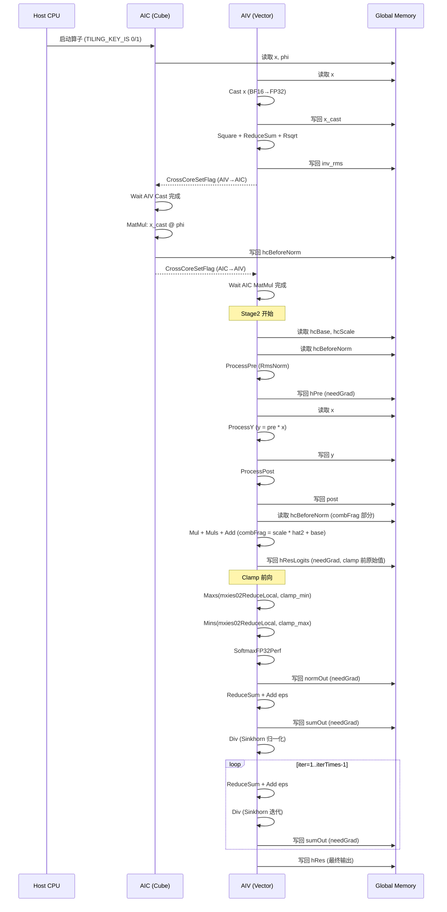

### 2.2 反向计算流程

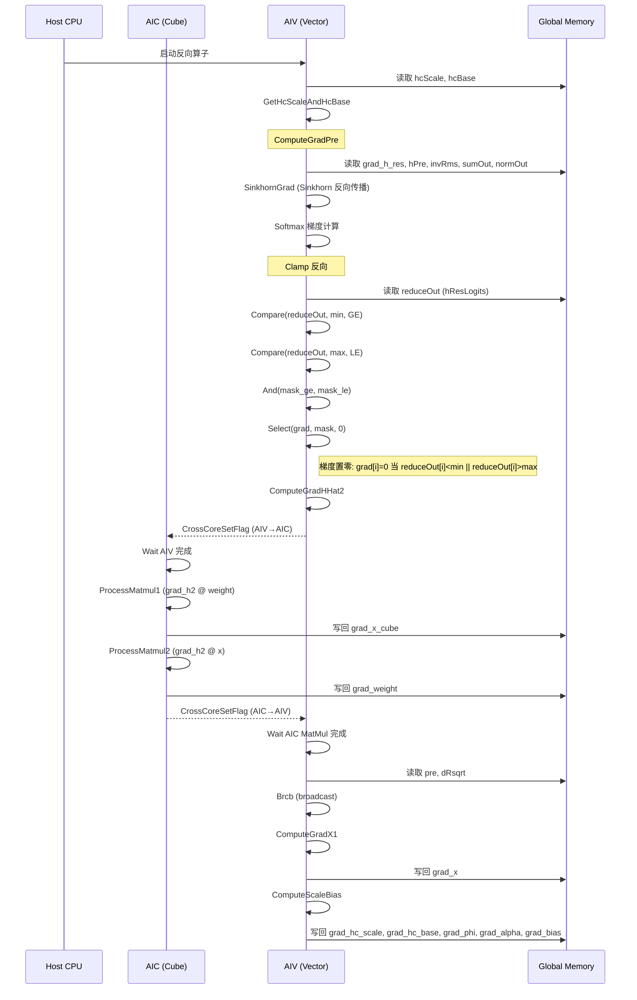

### 2.3 数据流图

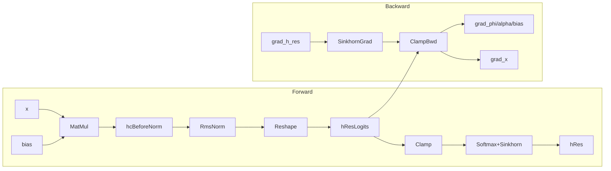

---

## 3. 规格约束

### 3.1 硬件约束

| 项目 | 规格 |
|------|------|
| 支持硬件 | Ascend 910B, Ascend 910_93 |
| 核心类型 | AIC (Cube) + AIV (Vector) 混合 |
| 数据类型 | x/grad_x: BF16/FP16; 其余: FP32 |
| N 维度 | 固定为 4 |
| C 维度 | 任意，按 tile 切分 |

### 3.2 性能约束

| 项目 | 说明 |
|------|------|
| UB 空间 | 有限，需合理分配 buffer |
| 数据搬运 | 使用 DataCopyPad 处理非对齐搬运 |
| 并行策略 | AIC 做 MatMul，AIV 做 Vector 计算 |

### 3.3 功能约束

| 项目 | 说明 |
|------|------|
| clamp 默认值 | min=0.0, max=0.0（默认不生效） |
| clamp 生效条件 | min != 0.0 或 max != 0.0 |
| 反向 clamp | 仅当正向启用了 clamp 时才生效 |

---

## 4. 特性实现方案

### 4.1 Clamp 前向实现

在前向算子的 Sinkhorn 归一化之前，对 logits 执行 clamp 操作：

```cpp
// 1. 保存 clamp 前的原始 logits
CopyOut(mxies02ReduceLocal, hResLogitsGm[offset], ...);

// 2. 执行 clamp
if (clamp_min != 0.0f || clamp_max != 0.0f) {
    Maxs(mxies02ReduceLocal, mxies02ReduceLocal, clamp_min, count);
    Mins(mxies02ReduceLocal, mxies02ReduceLocal, clamp_max, count);
}

// 3. 继续 Softmax + Sinkhorn
SoftmaxFP32Perf(mxies02ReduceLocal, ...);
```

**关键点**：
- `hResLogits` 保存的是 clamp 前的原始 logits，shape 为 `[B, S, N, N]`
- clamp 使用 `Maxs`（下界截断）和 `Mins`（上界截断）实现
- clamp 后的结果直接送入 Softmax

### 4.2 Clamp 反向实现

在反向算子的 `SinkhornGrad` 函数末尾，对 softmax 梯度计算完成后，执行 clamp 反向：

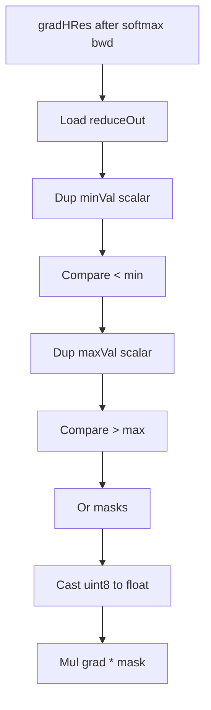

**数学原理**：

前向 clamp 操作：
```
y = clamp(x, min, max) = 
    min, if x < min
    max, if x > max
    x,   otherwise
```

反向传播：
```
∂L/∂x = ∂L/∂y * ∂y/∂x

∂y/∂x = 
    0, if x < min or x > max
    1, otherwise
```

因此，对于 `reduceOut[i] < min || reduceOut[i] > max` 的位置，梯度置零。

**实现细节**：

```cpp
// 1. 从 Global Memory 读取 reduceOut（clamp 前的 logits）
DataCopyPad(reduceOutLocal, reduceOutGlobal_[taskOffset * n_ * n_], ...);

// 2. 生成 maskLow = (reduceOut < min)
Duplicate(scalarLocal, minVal_, calCnt);
Compare(maskLow, reduceOutLocal, scalarLocal, CMPMODE::LT, calCnt);

// 3. 生成 maskHigh = (reduceOut > max)
Duplicate(scalarLocal, maxVal_, calCnt);
Compare(maskHigh, reduceOutLocal, scalarLocal, CMPMODE::GT, calCnt);

// 4. 合并 mask = maskLow OR maskHigh
Or(maskLow, maskLow, maskHigh, calCnt);

// 5. 转换 mask 类型：uint8 → float
Cast(scalarLocal, maskLow, RoundMode::CAST_NONE, calCnt);

// 6. 梯度置零：grad = grad * (1 - mask)
Mul(gradHResLocal_, gradHResLocal_, scalarLocal, calCnt);
```

**注意**：
- `Compare` 返回 `LocalTensor<uint8_t>`，值为 0 或 1
- 不能使用 `ReinterpretCast<float>()` 将 uint8_t 转为 float，因为 `0x01` 的 bit 模式在 float 中表示 `1.4e-45f` 而非 `1.0f`
- 必须使用 `Cast` 做数值转换：0→0.0f, 1→1.0f

### 4.3 接口变更

#### 前向算子 MhcPreClampSinkhorn（相对于 MhcPreSinkhorn）

| 变更类型 | 变更内容 |
|----------|----------|
| 新增输出 | hResLogits: clamp 前的原始 logits |
| 新增属性 | clamp_min: 下界（默认 0.0） |
| 新增属性 | clamp_max: 上界（默认 0.0） |

#### 反向算子 MhcPreClampSinkhornBackward（相对于 MhcPreSinkhornBackward）

| 变更类型 | 变更内容 |
|----------|----------|
| 新增输入 | reduce_out: 前向的 hResLogits |
| 新增属性 | min: clamp 下界（默认 0.0） |
| 新增属性 | max: clamp 上界（默认 0.0） |

---

## 5. 软件设计

### 5.1 模块架构

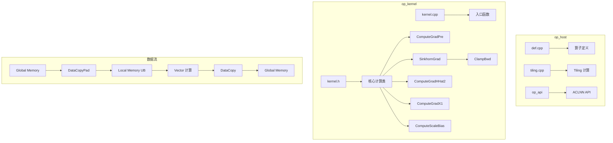

### 5.2 核心类设计

#### 前向算子类图

```mermaid
classDiagram
    class MhcPreClampSinkhornTiling {
        -gert::TilingContext* context_
        -MhcPreClampSinkhornTilingData tilingData_
        -float clamp_min_, clamp_max_
        +GetPlatformInfo()
        +DoOpTiling()
        +GetWorkspaceSize()
        +GetAttr()
        +CalcOpTiling()
        +CalcMembaseOpTiling()
        +CalcMKSplitCoreMembasePart2Tiling()
        +CalcBsSplit()
        +CalcTailBsTiling()
        +CalcStage1Tiling()
    }

    class MhcPreClampSinkhornTilingRegbase {
        -gert::TilingContext* context_
        -MhcPreClampSinkhornTilingData tilingData_
        -float clamp_min_, clamp_max_
        +GetPlatformInfo()
        +DoOpTiling()
        +GetWorkspaceSize()
        +GetAttr()
        +CalcOpTiling()
        +CalcRegbaseOpTiling()
        +CalcMKSplitCorePart2Tiling()
        +CalcRegbaseOpGradoutTiling()
        +CalcMKSplitCorePart2GradoutTiling()
    }

    class MhcPreClampSinkhornTilingData {
        +int64_t bs, hcMult, d
        +int64_t iterTimes
        +float hcEps, normEps
        +float clamp_min, clamp_max
        +int64_t needGrad
        +TCubeTiling mm1TilingData
    }

    class HcCubeCompute~T~ {
        -TPipe* pipe_
        -const MhcPreClampSinkhornTilingData* tiling_
        +Init(xGm, phiGm, pipe)
        +ComputeDecode()
        +CopyInB1()
        +End()
    }

    class HcCubeComputeSplitK {
        -TPipe* pipe_
        -const MhcPreClampSinkhornTilingData* tiling_
        +Init(xGm, phiGm, pipe)
        +ComputeDecode()
        +CopyInB1()
        +End()
    }

    class MhcPreClampSinkhornStage1~T~ {
        +HcCubeCompute~T~ cubeCompute_
        -GlobalTensor~T~ xGm
        -GlobalTensor~float~ phiGm
        -GlobalTensor~float~ invRmsGm
        -GlobalTensor~float~ hcBeforeNormGm
        +Init(x, phi, invRms, hcBeforeNorm, workspace, tilingData, pipe)
        +Process()
    }

    class MhcPreClampSinkhornStage2~T~ {
        -GlobalTensor~T~ xGm
        -GlobalTensor~float~ hcScaleGm, hcBaseGm
        -GlobalTensor~float~ hResLogitsGm
        -LocalTensor~float~ mxies02ReduceLocal
        +Init(x, hcScale, hcBase, y, post, combFrag, hPre, hcBeforeNorm, invRms, sumOut, normOut, hResLogits, workspace, tilingData, pipe)
        +Process()
    }

    class MhcPreClampSinkhornMembaseKSplitCorePart1~T~ {
        +HcCubeComputeSplitK cubeCompute_
        -GlobalTensor~T~ xGm
        -GlobalTensor~float~ hcFnGm
        +Init(x, hcFn, workspace, tilingData, pipe, bsOffset, curBs)
        +Process(bsOffset, curBs)
    }

    class MhcPreClampSinkhornMembaseKSplitCorePart2~T~ {
        -GlobalTensor~T~ xGm
        -GlobalTensor~float~ hcScaleGm, hcBaseGm
        -GlobalTensor~float~ reduceOutGm
        -LocalTensor~float~ mxies02ReduceLocal
        +Init(x, hcScale, hcBase, y, post, combFrag, hPre, hcBeforeNorm, invRms, sumOut, normOut, hResLogits, workspace, tilingData, pipe, bsOffset)
        +Process(bsOffset, curBs)
    }

    MhcPreClampSinkhornStage1 --> HcCubeCompute : 包含
    MhcPreClampSinkhornMembaseKSplitCorePart1 --> HcCubeComputeSplitK : 包含
    MhcPreClampSinkhornStage2 ..> MhcPreClampSinkhornTilingData : 使用
    MhcPreClampSinkhornMembaseKSplitCorePart2 ..> MhcPreClampSinkhornTilingData : 使用
    MhcPreClampSinkhornTiling --> MhcPreClampSinkhornTilingData : 生成
    MhcPreClampSinkhornTilingRegbase --> MhcPreClampSinkhornTilingData : 生成
```

#### 反向算子类图

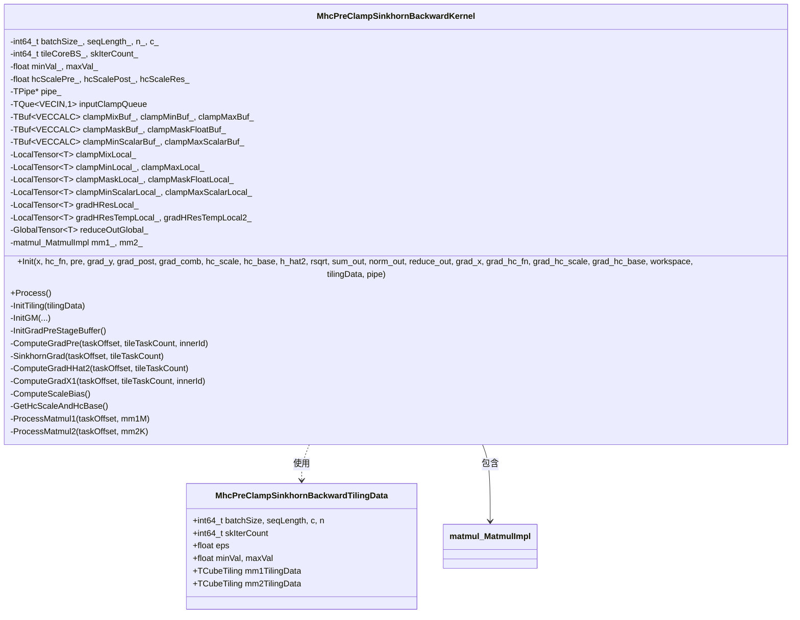

### 5.3 内存布局

#### UB Buffer 分配

```
tempBuf_:
├── preBrcbLocal_          [tileCoreBS_ * n_ / 8 * 8 个 float]
├── dRsqrtBrcbLocal_       [tileCoreBS_ / 8 * 8 个 float]
├── gradYCastLocal_        [onceTask_ * c0_ 个 float]
├── gradXCastLocal_        [onceTask_ * n_ * c0_ 个 float]
├── xCastLocal_            [onceTask_ * n_ * c0_ 个 float]
├── gradHResTempLocal_     [tileCoreBS_ * n_ * 8 * 2 个 float]  ← SinkhornGrad 临时
├── gradHResTempLocal2_    [tileCoreBS_ * n_ * 8 个 float]      ← SinkhornGrad 临时
├── dhatLocal_             [tileCoreBS_ * (n*n+2n) * 2 个 float]
├── rsqrtbrcbLocal_        [对齐后的 tileCoreBS_ * (n*n+2n) 个 float]
├── hat2Scale              [tileCoreBS_ * (n*n+2n) 个 float]
├── dhatBeforeNormLocal    [tileCoreBS_ * (n*n+2n) 个 float]
├── hatLocal               [tileCoreBS_ * (n*n+2n) 个 float]
└── rsqrtTempLocal_        [tileCoreBS_ * (n*n+2n) 个 float]
```

#### Clamp 反向的 Buffer 复用

```
gradHResTempLocal_  → reduceOutLocal（从 Global 搬运的 reduceOut）
gradHResTempLocal2_ → scalarLocal（存储 min/max 标量扩展）
gradHResTempLocal2_.ReinterpretCast<uint8_t>() → maskLow
gradHResTempLocal_[calCnt].ReinterpretCast<uint8_t>() → maskHigh
```

### 5.4 关键函数流程

#### SinkhornGrad

SinkhornGrad 实现 Sinkhorn 算子的反向传播，包含 softmax 梯度计算和 clamp 反向。

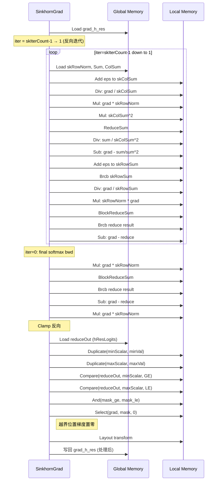

#### ComputeGradHHat2

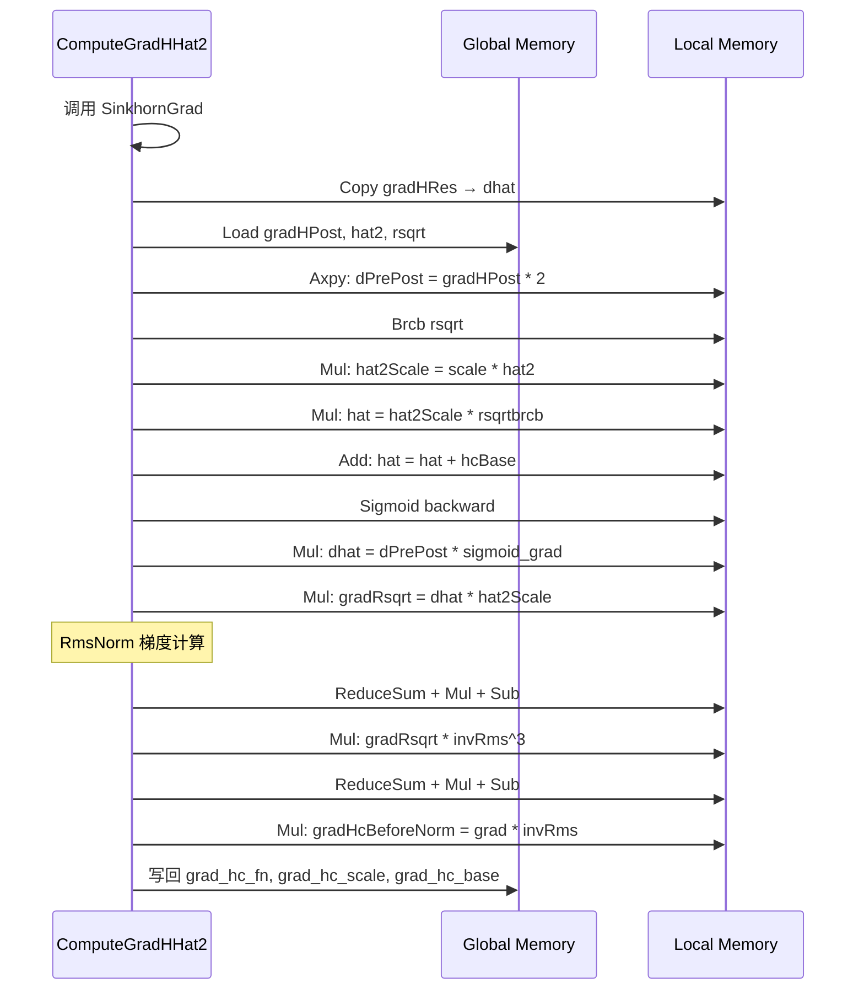

#### ComputeGradX1

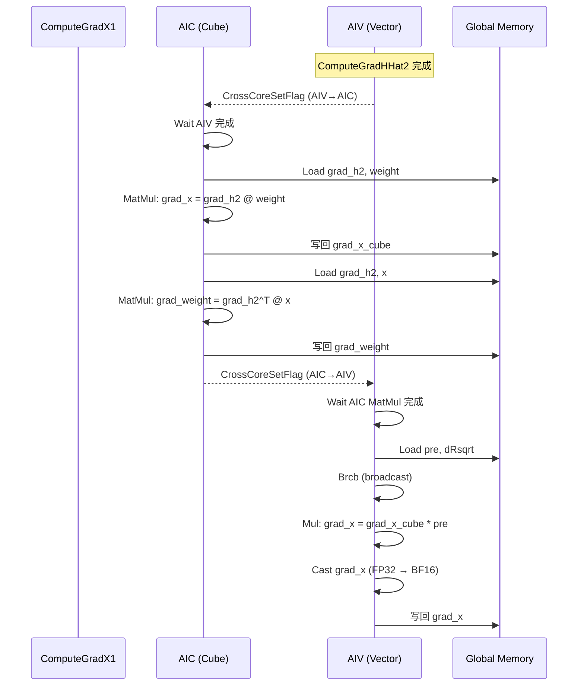

### 5.5 并行策略

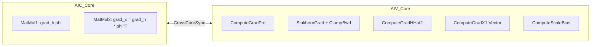

---

## 6. 测试设计

### 6.1 测试策略

| 测试类型 | 说明 |
|----------|------|
| 单元测试 | 验证各子函数正确性 |
| 精度测试 | 对比前向+反向与参考实现 |
| 边界测试 | 测试 clamp 边界值 |
| 性能测试 | 验证算子性能达标 |

### 6.2 测试用例

#### 6.2.1 功能测试

| 用例编号 | 测试场景 | 输入 | 预期结果 |
|----------|----------|------|----------|
| TC-001 | clamp 不生效 | min=0, max=0 | 与原始反向结果一致 |
| TC-002 | clamp 下界生效 | min=0.5, max=0 | reduceOut<0.5 的位置梯度为 0 |
| TC-003 | clamp 上界生效 | min=0, max=0.8 | reduceOut>0.8 的位置梯度为 0 |
| TC-004 | clamp 上下界同时生效 | min=0.1, max=0.9 | 超出 [0.1,0.9] 的位置梯度为 0 |
| TC-005 | 全量 clamp | min=0.5, max=0.5 | 所有位置梯度为 0 |

#### 6.2.2 精度测试

| 用例编号 | 测试场景 | 说明 |
|----------|----------|------|
| TC-010 | 随机输入精度 | 与 PyTorch 参考实现对比，误差 < 1e-3 |
| TC-011 | 全零输入 | 验证梯度为 0 |
| TC-012 | 全一输入 | 验证梯度正确性 |

#### 6.2.3 边界测试

| 用例编号 | 测试场景 | 说明 |
|----------|----------|------|
| TC-020 | min > max | 所有位置梯度为 0 |
| TC-021 | min = max | 所有位置梯度为 0 |
| TC-022 | 极小值输入 | 验证数值稳定性 |
| TC-023 | 极大值输入 | 验证数值稳定性 |

### 6.3 精度验证方法

```python
# 参考实现（PyTorch）
def mhc_pre_clamp_sinkhorn_backward_ref(
    grad_h_res, reduce_out, min_val, max_val
):
    # Sinkhorn backward (简化)
    grad = sinkhorn_backward(grad_h_res)
    
    # Clamp backward
    mask = (reduce_out >= min_val) & (reduce_out <= max_val)
    grad = grad * mask.float()
    
    return grad
```

### 6.4 测试环境

| 项目 | 规格 |
|------|------|
| 硬件 | Ascend 910B |
| 软件 | CANN 8.0+ |
| 框架 | PyTorch 2.x + torch_npu |

---

## 7. 附录

### 7.1 文件清单

| 文件 | 说明 |
|------|------|
| `mhc_pre_clamp_sinkhorn_backward/op_kernel/mhc_pre_clamp_sinkhorn_backward_kernel.h` | 反向算子 kernel 实现 |
| `mhc_pre_clamp_sinkhorn_backward/op_kernel/mhc_pre_clamp_sinkhorn_backward.cpp` | 反向算子入口函数 |
| `mhc_pre_clamp_sinkhorn_backward/op_host/mhc_pre_clamp_sinkhorn_backward_def.cpp` | 反向算子定义 |
| `mhc_pre_clamp_sinkhorn_backward/op_host/op_tiling/arch32/mhc_pre_clamp_sinkhorn_backward_tiling.h` | 反向算子 tiling 数据结构 |
| `mhc_pre_clamp_sinkhorn_backward/op_host/op_tiling/arch32/mhc_pre_clamp_sinkhorn_backward_tiling.cpp` | 反向算子 tiling 实现 |
| `mhc_pre_clamp_sinkhorn_backward/op_host/op_api/aclnn_mhc_pre_clamp_sinkhorn_backward.h` | 反向算子 ACLNN API |
| `mhc_pre_clamp_sinkhorn/op_kernel/mhc_pre_clamp_sinkhorn_m_split_core.h` | 前向 m-split kernel（含 clamp） |
| `mhc_pre_clamp_sinkhorn/op_kernel/mhc_pre_clamp_sinkhorn_m_k_split_core.h` | 前向 k-split kernel（含 clamp） |
| `mhc_pre_clamp_sinkhorn/op_host/mhc_pre_clamp_sinkhorn_def.cpp` | 前向算子定义（含 clamp 属性） |
| `mhc_pre_clamp_sinkhorn/op_host/op_tiling/mhc_pre_clamp_sinkhorn_tiling.h` | 前向算子 tiling 数据结构（含 clamp） |

### 7.2 相关算子

| 算子 | 说明 |
|------|------|
| `MhcPreSinkhorn` | 原始 MHC 前向算子（无 clamp） |
| `MhcPreSinkhornBackward` | 原始 MHC 反向算子（无 clamp） |
| `MhcPreClampSinkhorn` | 增加 clamp 的 MHC 前向算子 |
| `MhcPreClampSinkhornBackward` | 增加 clamp 反向的 MHC 反向算子 |

### 7.3 术语表

| 术语 | 说明 |
|------|------|
| MHC | Manifold-Constraint Hyper-Connection |
| Sinkhorn | Sinkhorn 归一化算法 |
| Clamp | 数值截断操作 |
| hResLogits | clamp 前的原始 logits |
| reduceOut | 反向算子中接收的 hResLogits |
| UB | Unified Buffer，片上统一缓冲区 |
| AIC | AI Core，Cube 计算核心 |
| AIV | AI Vector，向量计算核心 |
| Brcb | Broadcast，数据广播操作 |
| DataCopyPad | 带填充的数据搬运操作 |