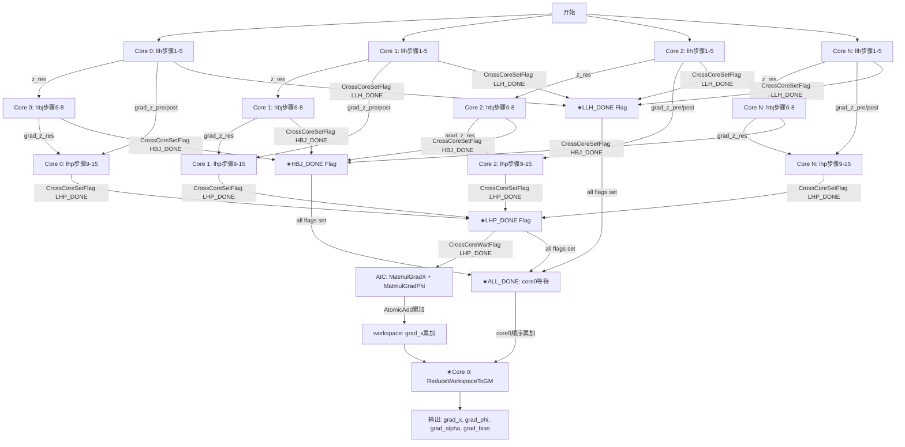

# MhcPreSinkhornBackward 确定性模板设计方案（arch35）

## 文档信息
- **平台**: Ascend NPU arch35 (DAV_3510)
- **模式**: 1定性计算模板（matmul优先 + workspace累加保证确定性）
- **核心约束**: 可用matmul的部分优先Cube Matmul，不可用的用SIMD向量API(禁用SIMT循环)
- **参考**: golden_v2.py + 非确定性实现
- **分工**: llh(步骤1-5) | hbj(步骤6-8) | lhp(步骤9-15) | zyf(★标记角色，无独立组装步骤，各责任人完成后直接搬到GM)
- **生成时间**: 2025-06-11
- **最后更新**: 2025-06-11（整合存储策略变更、D切分方案、broadcast优化、syncall同步机制）

---

## 一、算子原型与维度约束

### 1.1 算子原型定义
| 属性 | 值 | 说明 |
|------|---|------|
| **算子名称** | MhcPreSinkhornBackward | MHC前向Sinkhorn反向传播 |
| **功能** | 梯度计算 | 反向传播梯度计算 |
| **平台** | Ascend NPU (arch35) | DAV_3510架构 |

### 1.2 输入维度约束（官方定义）
| 输入Tensor | 维度Shape | 纏束说明 |
|-----------|----------|---------|
| **grad_hin** | [B, S, D] 或 [T, D] | T = B*S, D = feature_dim |
| **grad_h_post** | [B, S, N] 或 [T, N] | N = hidden_dim |
| **grad_h_res** | [B, S, N, N] 或 [T, N, N] | Sinkhorn矩阵梯度 |
| **x** | [B, S, N, D] 或 [T, N, D] | 输入特征矩阵 |
| **phi** | **[N²+2N, N*D]** | ★全局投影矩阵（关键） |
| **alpha** | [3] | 三路缩放系数 |
| **bias** | [N²+2N] | 全局偏置 |
| **h_pre** | [B, S, N] 或 [T, N] | sigmoid门控输出 |
| **hc_before_norm** | [B, S, N²+2N] 或 [T, N²+2N] | 投影后输出 |
| **inv_rms** | [B, S, 1] 或 [T, 1] | RMS倒数 |
| **sum_out** | [2*iter, B, S, N] | Sinkhorn迭代sum记录 |
| **norm_out** | [2*iter, B, S, N, N] | Sinkhorn迭代norm记录 |

### 1.3 输出维度约束
| 输出Tensor | 维度Shape | 约束说明 |
|-----------|----------|---------|
| **grad_x** | [B, S, N, D] | 对x的梯度 |
| **grad_phi** | **[N²+2N, N*D]** | ★对phi的梯度（关键） |
| **grad_alpha** | [3] | 对alpha的梯度 |
| **grad_bias** | [N²+2N] | 对bias的梯度 |

### 1.4 phi矩阵关键理解
#### phi形状解析
```python
# phi维度：[N²+2N, N*D]
# 示例： N=4, D=2560 → [24, 10240]
```
#### phi三路拆分
| 支路 | phi行范围 | 维度 | 功能 |
|------|----------|------|------|
| **pre** | rows[0:N] | [N, N*D] | pre输出投影 |
| **post** | rows[N:2N] | [N, N*D] | post输出投影 |
| **res** | rows[2N:N²+2N] | [N², N*D] | Sinkhorn矩阵投影 |
#### phi正向/反向计算
```python
# 正向： hc_before_norm = x_flat @ phi.T + bias
# x_flat: [T, N*D] = [16, 10240]
# phi.T: [N*D, N²+2N] = [10240, 24]
# 输出: [T, N²+2N] = [16, 24]

# 反向:
# grad_phi = grad_hc_before_norm.T @ x_flat
# grad_x_from_matmul = grad_hc_before_norm @ phi
```
#### phi内存占用
```cpp
// phi矩阵大小: [N²+2N, N*D] = [24, 10240]
// N=4, D=2560时: 24*10240*4B = 960KB > UB容量(248KB)
// 结论： phi矩阵需要放workspace
```
### 1.5 维度参数约束表
| 参数 | 默认值 | 支持范围 | 约束来源 |
|------|--------|---------|---------|
| **B** | 2 | 动态 | Batch维度 |
| **S** | 8 | 动态 | Sequence维度 |
| **N** | 4 | 1, 2, 4, 8, 16 | Hidden维度（关键） |
| **D** | 2560 | 1280, 1920, 2560 | Feature维度（关键） |
| **iter** | 3 | 动态 | Sinkhorn迭代次数 |

### 1.6 关键理解总结
1. **phi形状关键**： [N²+

---

## 二、总体设计策略
### 2.1 定性保证机制
| 非确定性来源 | 硯定性方案 | 理由 |
|---------------|-------------|------|
| **atomicAdd** | 多核独立workspace + 直接搬到GM | 避免原子操作竞争 |
| **Cube累加顺序不确定** | workspace独立累加 + 最终顺序组装 | 硯定性累加保证 |
| **跨核隐式依赖** | 显式同步 + workspace传递 | 避免隐式依赖 |
| **三部分并行完成顺序不确定** | syncall机制（CrossCoreSetFlag/WaitFlag） | llh/hbj/lhp完成后分别setflag，core0等待全部完成后做累加，保证确定性 |

### 2.2 核心约束
| 约束项 | 说明 | 影响 |
|-------|------|------|
| **matmul优先** | 可用matmul的部分优先Cube Matmul | 硯定性通过workspace累加保证 |
| **SIMD兜底** | 不可用matmul的部分用SIMD向量API | 禁用SIMT循环 |
| **BS切分** | 必须切分batch*seq维度 | 多核并行基础 |
| **N泛化** | 默认4，需支持1,2,8,16 | tiling参数动态化 |
| **D适配** | 支持1280/1920/2560 | UB容量规划关键 |
| **UB容量** | 248KB（arch35） | 单核处理数据量限制 |
| **存储策略** | 尾轴含C(=D)的shape放workspace，尾轴含N的可暂存UB | UB只放N维度及scalar变量，D维度变量移至workspace |
| **D切分** | D较大时核内自行切分，tileC为128倍数 | 对齐要求 + UB容量释放 |
| **broadcast优化** | vector部分broadcast随路处理，不做真dup；用Muls（标量×向量）替代Mul（广播向量×向量） | 减少UB占用 + 减少无效数据搬运 |
| **syncall机制** | llh/hbj/lhp分别完成后CrossCoreSetFlag，core0等待ALL_DONE后做最终累加 | 确定性保证：避免三部分完成顺序不确定 |
| **zyf伪需求** | ★步骤16无独立组装，各责任人完成后直接搬到GM | 减少一个独立步骤，减少同步开销 |

---

## 三、Tiling切分策略
### 3.1 多核切分策略（BS维度）
#### 切分原则
```
总任务量 = B * S = 2 * 8 = 16（示例）
切分方式: 按BS维度切分，每个AICore处理 bs_tile_size 个样本

关键变量:
- total_bs: B * S
- num_cores: 可用AICore数量（arch35典型值28-32）
- bs_per_core: total_bs / num_cores（向下取整）
- last_core_extra: total_bs - bs_per_core * num_cores（尾核多处理）
```
#### 切分公式
```cpp
// 定性切分公式
uint32_t total_bs = B * S;
uint32_t num_cores = platform.GetCoreNumAiv();
uint32_t bs_per_core = total_bs / num_cores;
uint32_t core_id = GetBlockIdx();

uint32_t bs_start = core_id * bs_per_core;
uint32_t bs_end = (core_id == num_cores - 1) ? total_bs : bs_start + bs_per_core;
uint32_t cur_bs = bs_end - bs_start;
```
#### 负载均衡
| 场景 | 切分策略 | 负载均衡度 |
|------|---------|-----------|
| **total_bs >= num_cores** | 均分 + 尾核补偿 | 高（99%+） |
| **total_bs < num_cores** | 部分核空闲 | 中 |
| **total_bs << num_cores** | 单核处理全部 | 低 |

### 3.2 UB切分策略（单核数据量）
#### 单次处理数据量计算
```cpp
// UB容量约束（arch35: 248KB）
const uint32_t UB_SIZE = 248 * 1024;

// ★存储策略变更：尾轴含C(=D)的shape放workspace，尾轴含N的可暂存UB
// UB只保留N维度及scalar变量：
//   z_pre[1,N], z_post[1,N], z_res[1,N,N]       → UB（尾轴含N）
//   grad_norm_out[1,N²+2N]                       → UB（尾轴含N）
//   grad_h_pre[1,N], grad_h_post[1,N]            → UB（尾轴含N）
//   grad_alpha[3], grad_bias[N²+2N]              → UB（scalar/N维度）
// 
// workspace存放D维度变量：
//   grad_x_from_hin[1,N,D]                       → workspace（尾轴含C）
//   x_fp32[1,N,D]                                → workspace（尾轴含C，步骤14需要）
//   grad_x_from_rms[1,N*D]                       → workspace（尾轴含C）

uint32_t ub_buffer_size = 
  grad_h_pre_size + grad_h_post_size + grad_z_sizes + 
  grad_norm_out_size + grad_alpha_size + grad_bias_size;
uint32_t max_single_pass = UB_SIZE * 0.7;
bool need_chunk = (ub_buffer_size > max_single_pass);
```

#### Chunk切分策略
| D值 | N=4时UB需求（仅N维度变量） | 是否需要分chunk | 说明 |
|-----|--------------------------|---------------|------|
| **1280** | ~15KB | 不需要 | D变量已移至workspace |
| **1920** | ~15KB | 不需要 | D变量已移至workspace |
| **2560** | ~15KB | 不需要 | D变量已移至workspace |

**结论**: 存储策略变更后，UB只放N维度变量，即使D=2560, N=16, UB需求仍远小于248KB。

#### D适配的UB规划
```cpp
uint32_t d_factor = D / 1280;
uint32_t safe_ub_threshold = UB_SIZE / (2 * d_factor);
```

| D值 | d_factor | 安全阈值 | Double Buffer |
|------|----------|---------|-------------|
| **1280** | 1 | 124KB | 可以 |
| **1920** | 1.5 | 82KB | 建议 |
| **2560** | 2 | 62KB | 拦workspace辅助 |

### 3.3 D维切分策略（核内D_chunk循环）
#### 切分原则
```
D比较大时（≥1280），核内自行切分D维度
tileC（D_chunk）必须为128倍数（满足32字节对齐要求，FP32时128*4B=512B=16个32B对齐单元）

关键变量:
- c0: D_chunk大小（128倍数）
- c1: 中间chunk大小（= c0）
- cTail: 尾块大小（D % c0，可能小于c0）
- D_chunk_count: (D + c0 - 1) / c0
```
#### 切分公式
```cpp
// D切分参数
uint32_t c = tiling_data.c;   // D = feature_dim
uint32_t c0 = tiling_data.c0; // D_chunk大小，128倍数
uint32_t c1 = tiling_data.c1; // 中间chunk（通常 = c0）
uint32_t cTail = tiling_data.cTail; // 尾块

uint32_t D_chunk_count = (c + c0 - 1) / c0;

for (uint32_t d_idx = 0; d_idx < D_chunk_count; d_idx++) {
  uint32_t cur_c = (d_idx == D_chunk_count - 1) ? cTail : c0;
  uint32_t d_offset = d_idx * c0;
  // ... 逐D_chunk计算
}
```
#### 涉及D切分的步骤
| 步骤 | D切分方式 | 说明 |
|------|----------|------|
| **Step1: grad_x_from_hin** | 逐D_chunk计算 + 随路broadcast | grad_hin[1,D_chunk] × h_pre[j]（Muls随路乘），累加到workspace |
| **Step14: RMSNormGrad** | 逐D_chunk计算 | x_fp32从workspace按D_chunk读取，grad_x_from_rms逐chunk写回workspace |
| **Step15: Matmul** | Cube硬件自动处理 | matmul本身不切D，grad_hc写入GM供AIC读取 |

#### D切分与broadcast优化协同
```cpp
// Step1示例：逐D_chunk计算grad_x_from_hin
for (uint32_t d_idx = 0; d_idx < D_chunk_count; d_idx++) {
  uint32_t cur_c = (d_idx == D_chunk_count - 1) ? cTail : c0;
  // 从GM加载grad_hin[1, d_offset:d_offset+cur_c]
  // 随路乘h_pre[j]：Muls(grad_x_chunk, grad_hin_chunk, h_pre_scalar, cur_c)
  // 写入workspace: wsGradXFromHin[1, j, d_offset:d_offset+cur_c]
}
```

### 3.4 N泛化策略
#### N值的动态处理
```cpp
uint32_t N = tiling_data.N;
uint32_t phi_rows = N * N + 2 * N;
uint32_t phi_cols = N * D;

uint32_t part1_size = N;      // pre支路
uint32_t part2_size = N;      // post支路
uint32_t part3_size = N * N;  // res支路（Sinkhorn）
```
#### N泛化的影响评估
| N值 | phi形状 | 三路拆分 | Sinkhorn复杂度 | UB影响 |
|-----|---------|---------|--------------|--------|
| **1** | [3, D] | 1/1/1 | 1x1矩阵 | 低 |
| **2** | [8, 2D] | 2/2/4 | 2x2矩阵 | 低 |
| **4** | [24, 4D] | 4/4/16 | 4x4矩阵 | 中 |
| **8** | [80, 8D] | 8/8/64 | 8x8矩阵 | 高 |
| **16** | [272, 16D] | 16/16/256 | 16x16矩阵 | 极高 |

---

## 四、内存规划方案
### 4.1 内存分配原则
| 内存类型 | 分配原则 | 使用场景 |
|---------|---------|---------|
| **UB** | 尾轴含N的shape + scalar变量 | z_pre/z_post/z_res, grad_norm_out, grad_h_pre/grad_h_post, grad_alpha[3], grad_bias[N²+2N] |
| **Workspace** | 尾轴含C(=D)的shape + 跨核累加变量 | grad_x_from_hin, x_fp32, grad_x_from_rms, grad_phi, grad_alpha/bias累加区 |
| **GM** | 输入/输出 | 算子输入输出tensor |

**★核心规则**：尾轴包含C（即D）的shape放workspace，包含N的可暂存UB。此规则确保UB只存N维度及scalar变量，释放大量UB空间。

### 4.2 各责任人内存需求
#### llh（步骤1-5）内存规划
```cpp
// 输入（从GM读取）:
//   grad_hin[1,D], x[1,N,D], h_pre[1,N], hc_before_norm[1,N²+2N], inv_rms[1,1]
//   alpha[3], bias[N²+2N], grad_h_post[1,N]

// 中间变量（UB）:
//   grad_h_pre[1,N]                 → UB临时计算（尾轴含N）
//   norm_out_forward[1,N²+2N]       → UB临时计算（尾轴含N²+2N）
//   z_pre[1,N], z_post[1,N]         → UB临时计算（尾轴含N）
//   z_res[1,N,N]                    → UB临时计算（尾轴含N）
//   grad_z_pre[1,N], grad_z_post[1,N] → UB临时计算（尾轴含N）
//   grad_bias_part1[N], grad_bias_part2[N] → UB临时计算

// ★中间变量（workspace）:
//   grad_x_from_hin[1,N,D]          → workspace（尾轴含C，随路broadcast后逐D_chunk写入）
//   x_fp32[1,N,D]                   → workspace（尾轴含C，后续步骤14需要）

// 输出（写到GM/Workspace）:
//   z_res → GM（供hbj步骤6使用）
//   grad_alpha_pre/post → Workspace（完成后直接搬到GM）
//   grad_bias_part1/2 → Workspace（完成后直接搬到GM）
//   grad_x_from_hin → Workspace（供lhp步骤15累加使用）
```
**llh UB需求估算（N=4, D=2560）**:
```
单次处理UB需求 ≈ 15KB（仅N维度变量，远小于248KB，非常安全）
★workspace需求: grad_x_from_hin[N*D] + x_fp32[N*D] = 2*4*2560*4B ≈ 80KB
```
#### hbj（步骤6-8）内存规划
```cpp
// 输入:
//   z_res[cur_bs,N,N] (来自llh), grad_h_res[cur_bs,N,N]
//   sum_out/norm_out (Sinkhorn迭代数据)

// 中间变量（UB）:
//   sk_grad[cur_bs,N,N]       → UB临时计算（Sinkhorn反向）
//   grad_z_res[cur_bs,N²]     → UB临时计算（Exp激活梯度）
// 输出（写到Workspace）:
//   grad_alpha_res → Workspace（完成后直接搬到GM）
//   grad_bias_part3 → Workspace（完成后直接搬到GM）
```
**hbj UB需求估算（N=4)**:
```
单次处理UB需求 ≈ 8KB + cur_bs*192B（cur_bs=16时≈11KB）
```
#### lhp（步骤9-15）内存规划（关键）
```cpp
// 输入:
//   grad_z_pre/post/res, grad_x_from_hin（从workspace读取）
//   hc_before_norm, inv_rms, x, phi

// 中间变量（UB）:
//   grad_norm_out_pre/post/res     → UB临时计算（尾轴含N）
//   grad_norm_out                  → UB组装（Concat，尾轴含N²+2N）
//   grad_hc_before_norm            → UB计算（尾轴含N²+2N，关键）
//   grad_inv_rms                   → UB临时计算
//   grad_h_pre/grad_h_post         → UB（尾轴含N）

// ★中间变量（workspace）:
//   grad_x_from_hin[1,N,D]         → workspace（从llh写入的workspace读取）
//   x_fp32[1,N,D]                  → workspace（尾轴含C，步骤14需要）
//   grad_x_from_rms[1,N*D]         → workspace（尾轴含C，逐D_chunk写入）
//   phi矩阵                        → workspace（960KB > UB容量）

// ★workspace累加变量:
//   grad_phi                       → Workspace累加（跨核）
//   grad_x                         → Workspace累加（跨核）

// 输出（直接搬到GM）:
//   grad_phi → workspace累加后直接搬到GM
//   grad_x → workspace累加后直接搬到GM
```
**lhp UB需求估算（N=4, D=2560, 最大压力）**:
```
单次处理UB需求 =
  grad_norm_out: cur_bs*24*4B = 96B*cur_bs
  + grad_hc_before_norm: cur_bs*24*4B = 96B*cur_bs
  + grad_inv_rms: cur_bs*4B
  + grad_h_pre/post: cur_bs*N*4B*2
  总计 ≈ 15KB*cur_bs（不含D维度变量）

★workspace需求: 
  grad_x_from_hin[N*D] ≈ 40KB
  + x_fp32[N*D] ≈ 40KB  
  + grad_x_from_rms[N*D] ≈ 40KB
  + phi矩阵 ≈ 960KB
  总计 ≈ 1080KB
  
结论： phi矩阵必须放workspace，不在UB！D维度变量全部移至workspace后，UB需求大幅降低。
```
#### zyf角色说明
```cpp
// ★zyf步骤16是标记角色， 实际无独立组装步骤
// grad_alpha/bias由各责任人完成后直接搬到workspace
// ★最终由core0做累加（syncall机制保证确定性）
// 无独立UB需求（各责任人自己完成DataCopy到workspace）
```
### 4.3 Workspace规划
#### Workspace大小计算
```cpp
uint32_t workspace_per_core = 
  sizeof(float) * 3 +                       // 区域1：grad_alpha三路（pre/post/res）
  sizeof(float) * (N*N+2N) +                // 区域2：grad_bias
  sizeof(float) * (N*N+2N) * (N*D) +        // 区域3：grad_phi（关键）
  sizeof(float) * (N*D) +                   // ★区域4：wsGradXFromHin（尾轴含C）
  sizeof(float) * (N*D) +                   // ★区域5：wsXFp32（步骤14需要）
  sizeof(float) * (N*D);                    // ★区域6：wsGradXFromRms（尾轴含C）

uint32_t total_workspace = workspace_per_core * num_cores;
```
#### Workspace内存布局
```cpp
// 优化原则：相同用途变量按顺序连续存放
// ★新增区域：wsGradXFromHin、wsXFp32、wsGradXFromRms
struct WorkspaceLayout {
  // 区域1：grad_alpha三路连续存放（12B）
  float grad_alpha_pre;           // offset: 0
  float grad_alpha_post;          // offset: 4
  float grad_alpha_res;           // offset: 8
  
  // 区域2：grad_bias三路连续存放（204B, N=4）
  float grad_bias_part1[N];       // offset: 12
  float grad_bias_part2[N];       // offset: 12+N*4
  float grad_bias_part3[N*N];     // offset: 12+N*8
  float grad_bias_final[N*N+2N];  // offset: 12+N*8+N*N*4

  // 区域3：grad_phi独立区域（960KB, N=4, D=2560）
  float grad_phi[N*N+2N, N*D];    // offset: wsGradPhiOffset

  // ★区域4：wsGradXFromHin（尾轴含C，Step1写入，Step15累加）
  float wsGradXFromHin[N, D];     // offset: wsGradXOffset
  // 逐D_chunk写入：每次写入[1, cur_c]大小的D切片

  // ★区域5：wsXFp32（尾轴含C，Step1 Cast后暂存，Step14需要）
  float wsXFp32[N, D];            // offset: wsXFp32Offset
  // 逐D_chunk写入：每次写入[1, cur_c]大小的D切片

  // ★区域6：wsGradXFromRms（尾轴含C，Step14写入）
  float wsGradXFromRms[N*D];      // offset: wsGradXFromRmsOffset
  // 逐D_chunk写入：每次写入[cur_c]大小的D切片

  // 偏移计算公式
  uint32_t core_offset = core_id * workspace_per_core;
  float* my_workspace = workspace_ptr + core_offset;

  // 快速访问函数（利用连续布局）
  float* get_grad_alpha_ptr() { return my_workspace; }
  float* get_grad_bias_ptr() { return my_workspace + wsGradBiasOffset; }
  float* get_grad_phi_ptr() { return my_workspace + wsGradPhiOffset; }
  float* get_grad_x_from_hin_ptr() { return my_workspace + wsGradXOffset; }
  float* get_x_fp32_ptr() { return my_workspace + wsXFp32Offset; }
  float* get_grad_x_from_rms_ptr() { return my_workspace + wsGradXFromRmsOffset; }
};
```
#### 偏移量计算（与data_arch35.h tiling结构对应）
```cpp
// tiling中的偏移量参数
wsGradAlphaOffset = 0;
wsGradBiasOffset = 3 * FP32_BYTE_SIZE;                         // 12B
wsGradPhiOffset = wsGradBiasOffset + (n_*n_ + 2*n_) * FP32_BYTE_SIZE; // 12+96=108B(N=4)
wsGradXOffset = wsGradPhiOffset + (n_*n_ + 2*n_) * (n_ * c_) * FP32_BYTE_SIZE; // phi之后
wsXFp32Offset = wsGradXOffset + n_ * c_ * FP32_BYTE_SIZE;      // GradXFromHin之后
wsGradXFromRmsOffset = wsXFp32Offset + n_ * c_ * FP32_BYTE_SIZE; // XFp32之后
wsPerCoreSize = wsGradXFromRmsOffset + n_ * c_ * FP32_BYTE_SIZE; // 总大小
```
#### Workspace访问实现
```cpp
// 各责任人完成后写到workspace（syncall后由core0做最终累加）
void llh_write_grad_x_from_hin_to_workspace(float* workspace_ptr) {
  // ★逐D_chunk写入，不做真dup
  for (uint32_t d_idx = 0; d_idx < D_chunk_count; d_idx++) {
    uint32_t cur_c = (d_idx == D_chunk_count - 1) ? cTail : c0;
    // Muls随路乘法：grad_hin_chunk * h_pre[j] → grad_x_chunk
    // DataCopy(workspace_ptr + wsGradXOffset + j*D*4B + d_idx*c0*4B, grad_x_chunk, cur_c);
  }
}

void lhp_read_grad_x_from_hin_from_workspace(float* workspace_ptr) {
  // 逐D_chunk读取workspace中的grad_x_from_hin
  // DataCopy(grad_x_from_hin_chunk, workspace_ptr + wsGradXOffset + d_offset, cur_c);
}

void write_grad_alpha_to_gm(float* workspace_ptr) {
  // ★core0做最终累加（syncall机制保证所有核完成）
  for (uint32_t core = 0; core < num_cores; core++) {
    grad_alpha_total += workspace_ptr[core * wsPerCoreSize + wsGradAlphaOffset];
  }
  AscendC::DataCopy(gm_grad_alpha, grad_alpha_total, 3);
}
```
#### Workspace布局性能收益
| 场景 | 连续布局收益 | 说明 |
|------|------------|------|
| **grad_alpha读取** | 1次连续DMA（12B） | pre/post/res连续存放 |
| **grad_bias读取** | 1次连续DMA（204B） | 三路+final连续存放 |
| **grad_phi累加** | 独立区域连续累加 | 无小变量嵌入干扰 |
| **★grad_x_from_hin访问** | 逐D_chunk连续读写 | workspace连续存储，按D_chunk偏移访问 |
| **★x_fp32访问** | 逐D_chunk连续读取 | 步骤14按D_chunk从workspace读取 |

---

## 五、计算实现策略
### 5.1 SIMD核心优势
| 计算类型 | 向量并行度 | 使用的API | broadcast优化 |
|---------|----------|---------|--------------|
| **逐元素计算** | 高 | 向量API（Mul/Add/Div） | - |
| **归约操作** | 高 | ReduceSum/ReduceMax | - |
| **矩阵乘法** | 高 | Cube Matmul（优先）或 SIMD分解（备用） | - |
| **Sinkhorn迭代** | 高 | 逐行/逐列向量Div/Mul + reduce | - |
| **Sigmoid/Exp激活** | 高 | SigmoidGrad/ExpGrad | - |
| **★broadcast乘法** | 高 | Muls（标量×向量）替代Mul（广播向量×向量） | 随路处理，不做真dup |
| **★D维度计算** | 高 | 逐D_chunk循环 + Muls随路乘 | D切分释放UB + 减少数据搬运 |

### 5.2 broadcast优化策略
#### 核心原则
```
vector部分的broadcast操作需要随路处理掉：
- 不需要真的做dup（如h_pre广播到D维度）
- 随路乘法：计算grad_x_from_hin时，直接在D切分循环中乘h_pre[j]
- 实现方式：Muls（单标量乘向量），而不是Mul（向量广播乘向量）
```
#### broadcast优化收益
| 场景 | 原方案 | 优化方案 | 收益 |
|------|--------|---------|------|
| **h_pre广播到D** | Dup(h_pre→[N,D]) + Mul | Muls(grad_hin_chunk, h_pre[j], cur_c) | 减少N*D大小中间变量，释放UB |
| **alpha广播** | Dup(alpha→[N²+2N]) + Mul | Muls(grad_z, alpha_scalar, N) | 减少广播变量 |
| **inv_rms广播** | Dup(inv_rms→[N²+2N]) + Mul | Muls(grad_norm_out, inv_rms_scalar, N²+2N) | 减少广播变量 |

#### broadcast优化与D切分协同
```cpp
// Step1示例：随路broadcast + D切分
// 原方案：grad_x_from_hin = grad_hin[..., None, :] * h_pre[..., None]
//         需要先Dup h_pre到[N,D]，然后Mul
// 优化方案：
for (uint32_t j = 0; j < N; j++) {
  T h_pre_scalar = hPreLocal[j];  // 取单个h_pre值
  for (uint32_t d_idx = 0; d_idx < D_chunk_count; d_idx++) {
    uint32_t cur_c = (d_idx == D_chunk_count - 1) ? cTail : c0;
    // 加载grad_hin[1, d_offset:d_offset+cur_c]
    // ★Muls随路乘法：grad_x_chunk = grad_hin_chunk * h_pre_scalar
    Muls(gradXChunk, gradHinChunk, h_pre_scalar, cur_c);
    // 写入workspace: wsGradXFromHin[j, d_offset:d_offset+cur_c]
    DataCopy(wsGradXFromHin + j*D*4B + d_idx*c0*4B, gradXChunk, cur_c);
  }
}
```

### 5.3 各责任人实现策略
#### llh实现策略（步骤1-5）
```cpp
// ★步骤1：输入聚合梯度（D切分 + 随路broadcast）
// 原方案：grad_x_from_hin = grad_hin[..., None, :] * h_pre[..., None] → [B,S,N,D]
//         需要Dup h_pre广播到D维度 + Mul（大量UB占用）
// 优化方案：逐D_chunk + Muls随路乘
for (uint32_t j = 0; j < N; j++) {
  T h_pre_scalar = hPreLocal[j];  // 取单个h_pre值，不做dup
  for (uint32_t d_idx = 0; d_idx < D_chunk_count; d_idx++) {
    uint32_t cur_c = (d_idx == D_chunk_count - 1) ? cTail : c0;
    uint32_t d_offset = d_idx * c0;
    // 从GM加载: grad_hin[1, d_offset:d_offset+cur_c]
    DataCopyPad(gradHinChunk, gradHinGlobal[gmOffset*c_ + d_offset], cur_c);
    // Cast: grad_hin(BF16/FP16) → FP32
    Cast(gradHinFp32Chunk, gradHinChunk, RoundMode::CAST_NONE, cur_c);
    // ★随路broadcast: Muls(grad_x_chunk, grad_hin_fp32_chunk, h_pre_scalar, cur_c)
    Muls(gradXChunk, gradHinFp32Chunk, h_pre_scalar, cur_c);
    // 写入workspace: wsGradXFromHin[j, d_offset:d_offset+cur_c]
    DataCopy(wsGradXFromHin_ptr + j*c_*4B + d_offset*4B, gradXChunk, cur_c);
  }
}

// ★同时：x_fp32逐D_chunk写入workspace（步骤14需要）
for (uint32_t j = 0; j < N; j++) {
  for (uint32_t d_idx = 0; d_idx < D_chunk_count; d_idx++) {
    uint32_t cur_c = (d_idx == D_chunk_count - 1) ? cTail : c0;
    uint32_t d_offset = d_idx * c0;
    // 从GM加载: x[1, j, d_offset:d_offset+cur_c]
    DataCopyPad(xChunk, xGlobal[gmOffset*n_*c_ + j*c_ + d_offset], cur_c);
    Cast(xFp32Chunk, xChunk, RoundMode::CAST_NONE, cur_c);
    // 写入workspace: wsXFp32[j, d_offset:d_offset+cur_c]
    DataCopy(wsXFp32_ptr + j*c_*4B + d_offset*4B, xFp32Chunk, cur_c);
  }
}

// grad_h_pre = (grad_hin * x).sum(-1)  [golden 118行]
// ★也需要D切分：逐D_chunk累加
for (uint32_t j = 0; j < N; j++) {
  T grad_h_pre_sum = 0;
  for (uint32_t d_idx = 0; d_idx < D_chunk_count; d_idx++) {
    uint32_t cur_c = (d_idx == D_chunk_count - 1) ? cTail : c0;
    // 加载grad_hin_chunk和x_chunk（已在workspace）
    // Mul(grad_hin_x_chunk, gradHinFp32Chunk, xFp32Chunk, cur_c)
    // ReduceSum → 累加到grad_h_pre_sum
  }
  gradHPreLocal[j] = grad_h_pre_sum;
}

// 步骤2：正向中间变量（不变）
AscendC::Mul(norm_out_forward_local, hc_before_norm_local, inv_rms_broadcast_local, cur_bs*(N*N+2*N));
AscendC::Slice(norm_out_forward_part1, norm_out_forward_local, {cur_bs, N}, 0);
AscendC::Slice(norm_out_forward_part2, norm_out_forward_local, {cur_bs, N}, N);
AscendC::Slice(norm_out_forward_part3, norm_out_forward_local, {cur_bs, N*N}, 2*N);
// ★alpha乘法：Muls替代broadcast+Mul
AscendC::Muls(z_pre_local, norm_out_forward_part1, alpha[0], cur_bs*N);
AscendC::Adds(z_pre_local, z_pre_local, bias_slice_0_to_N, cur_bs*N);

// 步骤3：Sigmoid激活梯度（不变）
AscendC::SigmoidGrad(grad_z_pre_local, z_pre_local, grad_h_pre_local, {cur_bs, N}, true, hc_eps);
AscendC::SigmoidGrad(grad_z_post_local, z_post_local, grad_h_post_local, {cur_bs, N}, false);
AscendC::Muls(grad_z_post_local, grad_z_post_local, 2.0f, cur_bs*N);

// 步骤4-5：alpha/bias梯度 → workspace累加
AscendC::Mul(norm_out_forward_part1_mul_grad_z_pre, norm_out_forward_part1, grad_z_pre_local, cur_bs*N);
AscendC::ReduceSum(grad_alpha_pre_scalar, norm_out_forward_part1_mul_grad_z_pre, {cur_bs, N});
AscendC::ReduceSum(grad_bias_part1, grad_z_pre_local, {cur_bs, N}, {0, 1});
```
#### hbj实现策略（步骤6-8, 关键: Sinkhorn迭代）
```cpp
// 步骤6：Sinkhorn反向 + Exp激活梯度（不变）
for (int iter = iters-1; iter >= 0; iter--) {
  AscendC::DataCopy(row_sum_local, sum_out[iter][0], {cur_bs, N});
  AscendC::DataCopy(col_sum_local, sum_out[iter][1], {cur_bs, N});
  AscendC::DataCopy(x_row_normed_local, norm_out[iter][0], {cur_bs, N, N});
  // 列归一化梯度（SIMD向量操作）
  AscendC::Div(grad_x_row_normed_step1, x_grad_local, col_sum_broadcast, cur_bs*N*N);
  AscendC::Mul(grad_x_row_normed_step2, x_grad_local, x_row_normed_local, cur_bs*N*N);
  AscendC::Div(grad_x_row_normed_step2, grad_x_row_normed_step2, col_sum_sq_broadcast, cur_bs*N*N);
  AscendC::Sub(grad_x_row_normed_local, grad_x_row_normed_step1, grad_x_row_normed_step2, cur_bs*N*N);
  // 行归一化梯度
  AscendC::Div(x_grad_local, grad_x_row_normed_local, row_sum_broadcast, cur_bs*N*N);
  AscendC::Mul(temp_local, grad_x_row_normed_local, x_row_normed_local, cur_bs*N*N);
  AscendC::Div(temp_local, temp_local, row_sum_local, cur_bs*N*N);
  AscendC::Sub(x_grad_local, x_grad_local, temp_local, cur_bs*N*N);
}
// Exp激活梯度
AscendC::ExpGrad(grad_z_res_local, z_res_local, sk_grad_local);
```
#### lhp实现策略（步骤9-15, 关键: matmul优先 + D切分 + broadcast优化）
```cpp
// 步骤9-11：线性变换梯度 + Concat组装
// ★alpha乘法：Muls替代broadcast+Mul
AscendC::Muls(grad_norm_out_pre_local, grad_z_pre_local, alpha[0], cur_bs*N);
AscendC::Muls(grad_norm_out_post_local, grad_z_post_local, alpha[1], cur_bs*N);
AscendC::Muls(grad_norm_out_res_local, grad_z_res_flat_local, alpha[2], cur_bs*N*N);
AscendC::Concat(grad_norm_out_local, {grad_norm_out_pre_local, grad_norm_out_post_local, grad_norm_out_res_local}, cur_bs);

// 步骤12：RMSNorm乘法梯度
// ★inv_rms乘法：Muls替代broadcast+Mul
AscendC::Muls(grad_hc_before_norm_local, grad_norm_out_local, inv_rms_scalar, cur_bs*(N*N+2*N));
AscendC::Mul(hc_before_norm_mul_grad_norm_out_local, hc_before_norm_local, grad_norm_out_local, cur_bs*(N*N+2*N));
AscendC::ReduceSum(grad_inv_rms_local, hc_before_norm_mul_grad_norm_out_local, {cur_bs, N*N+2*N}, {-1});

// ★步骤14：RMSNorm倒数梯度（D切分循环）
// 原方案：grad_x_from_rms = RMSNormGrad(x_flat, inv_rms, grad_inv_rms)
//         x_flat[N*D]需要在UB，D=2560时占用大量UB
// 优化方案：逐D_chunk从workspace读取x_fp32，逐chunk计算写入workspace
for (uint32_t d_idx = 0; d_idx < D_chunk_count; d_idx++) {
  uint32_t cur_c = (d_idx == D_chunk_count - 1) ? cTail : c0;
  uint32_t d_offset = d_idx * c0;
  
  // 从workspace读取x_fp32_chunk（已在Step1写入workspace）
  DataCopy(xFp32Chunk, wsXFp32_ptr + d_offset*4B, cur_c);
  
  // 计算: grad_x_from_rms_chunk = -inv_rms³ * x_chunk * grad_inv_rms / NC
  // inv_rms³ 已在UB中预计算
  Muls(gradXFromRmsChunk, xFp32Chunk, -grad_inv_rms_scalar * inv_rms_pow3_scalar / NC_scalar, cur_c);
  
  // 写入workspace: wsGradXFromRms[d_offset:d_offset+cur_c]
  DataCopy(wsGradXFromRms_ptr + d_offset*4B, gradXFromRmsChunk, cur_c);
}

// ★步骤15：矩阵乘法梯度 + grad_x汇总（matmul优先）
// ★★★ lhp部分可用matmul的优先使用Cube Matmul ★★★
// grad_phi计算: matmul输入适中 → 优先Cube Matmul
// grad_x_from_matmul计算: matmul输入适中 → 优先Cube Matmul
// 硯定性保证: workspace独立累加 + 最终顺序组装
AscendC::MatMul(grad_phi_local, grad_hc_before_norm_transposed, x_flat,
                {N*N+2N, cur_bs}, {cur_bs, N*D}, {N*N+2N, N*D});
// workspace累加（确定性）

// ★grad_x汇总：三路相加
// grad_x_from_hin从workspace读取（逐D_chunk）
// grad_x_from_rms从workspace读取（逐D_chunk）
// grad_x_from_matmul从Cube输出读取
for (uint32_t d_idx = 0; d_idx < D_chunk_count; d_idx++) {
  uint32_t cur_c = (d_idx == D_chunk_count - 1) ? cTail : c0;
  uint32_t d_offset = d_idx * c0;
  
  // 从workspace读取grad_x_from_hin_chunk
  DataCopy(gradXFromHinChunk, wsGradXFromHin_ptr + d_offset*4B, cur_c);
  // 从workspace读取grad_x_from_rms_chunk
  DataCopy(gradXFromRmsChunk, wsGradXFromRms_ptr + d_offset*4B, cur_c);
  // 从Cube输出读取grad_x_from_matmul_chunk
  DataCopy(gradXFromMatmulChunk, gradHcGlobal + d_offset*4B, cur_c);
  
  // 三路相加
  Add(gradXTempChunk, gradXFromHinChunk, gradXFromRmsChunk, cur_c);
  Add(gradXChunk, gradXTempChunk, gradXFromMatmulChunk, cur_c);
  
  // 写入workspace累加
  DataCopy(wsGradX_ptr + d_offset*4B, gradXChunk, cur_c);
}

// ★SIMD分解备用（不可用matmul或确定性严格场景）
for (uint32_t i = 0; i < N*N+2*N; i++) {
  AscendC::Slice(grad_hc_col_i, grad_hc_before_norm, {cur_bs, 1}, i);
  AscendC::Broadcast(grad_hc_col_i_broadcast, grad_hc_col_i, {cur_bs, N*D});
  AscendC::Mul(grad_hc_mul_x_flat, grad_hc_col_i_broadcast, x_flat, cur_bs*N*D);
  AscendC::ReduceSum(grad_phi_row_i, grad_hc_mul_x_flat, {cur_bs, N*D}, {0});
  AscendC::DataCopy(workspace_grad_phi[i*N*D], grad_phi_row_i, N*D);
}
```
#### zyf角色说明
```cpp
// ★zyf步骤16是标记角色, 实际无独立组装步骤
// ★最终由core0做累加（syncall机制保证所有核完成）
// 各责任人完成后写到workspace:
//   llh: grad_alpha_pre/post → workspace累加
//   hbj: grad_alpha_res → workspace累加
//   lhp: grad_phi → workspace累加, grad_x → workspace累加
// ★syncall后由core0做最终ReduceWorkspaceToGM
```

---

## 六、确定性保证关键点
### 6.1 替代atomicAdd的累加机制
```cpp
// 定性累加机制: 每个核独立累加到workspace, 完成后直接搬到GM
workspace_grad_phi[core_id][i*N*D+j] = grad_phi_ij;

// 完成后按核ID顺序搬到GM（确定性）
for (uint32_t core = 0; core < num_cores; core++) {
  total_grad_phi_ij += workspace_grad_phi[core][i*N*D+j];
}
gm_grad_phi[i*N*D+j] = total_grad_phi_ij;
```
### 6.2 矩阵乘法实现策略
```cpp
// Cube Matmul（优先）: 性能最优, 硯定性通过workspace累加保证
AscendC::MatMul(grad_phi_local, grad_hc_before_norm_transposed, x_flat,
                {N*N+2N, cur_bs}, {cur_bs, N*D}, {N*N+2N, N*D});
// workspace累加后直接搬到GM

for (uint32_t core = 0; core < num_cores; core++) {
  workspace_grad_phi[core] += grad_phi_local;
}

// SIMD分解（备用）: 适用于确定性严格或维度超大场景
for (uint32_t i = 0; i < N*N+2*N; i++) {
  AscendC::Slice(grad_hc_col_i, grad_hc_before_norm, {cur_bs, 1}, i);
  AscendC::Broadcast(grad_hc_col_i_broadcast, grad_hc_col_i, {cur_bs, N*D});
  AscendC::Mul(grad_hc_mul_x_flat, grad_hc_col_i_broadcast, x_flat, cur_bs*N*D);
  AscendC::ReduceSum(grad_phi_row_i, grad_hc_mul_x_flat, {cur_bs, N*D}, {0});
  AscendC::DataCopy(workspace_grad_phi[i*N*D], grad_phi_row_i, N*D);
}
```
### 6.3 跨核数据传递机制
```cpp
// 硯定性数据传递: 显式同步 + workspace传递
// llh → hbj/lhp: GM传递
AscendC::DataCopy(gm_z_res, z_res_local, cur_bs*N*N);  // llh写
AscendC::DataCopy(z_res_local, gm_z_res, cur_bs*N*N);  // hbj读

// ★各责任人完成后写到workspace → syncall后core0做累加
workspace_grad_alpha_pre[core_id] = grad_alpha_pre_scalar;  // llh写
workspace_grad_alpha_res[core_id] = grad_alpha_res_scalar;  // hbj写
workspace_grad_phi[core_id] = grad_phi_local;               // lhp写
workspace_grad_x[core_id] = grad_x_local;                   // lhp写
```
### 6.4 ★syncall同步机制（新增）
#### 三部分完成后分别SetFlag
```cpp
// ★确定性关键：三部分完成后分别SetFlag，保证顺序不确定不影响累加结果

// llh完成后
Step1_InputAggregation();          // D切分循环，随路broadcast
Step2_ComputeForwardZ();
Step3_SigmoidGrad();
Step45_AlphaBiasGradPrePost();     // → workspace累加
CrossCoreSetFlag<SYNC_MODE1, FLAG_ID_LLH_DONE>();  // ★llh完成标志

// hbj完成后
Step678_SinkhornExpGrad();         // → workspace累加
CrossCoreSetFlag<SYNC_MODE1, FLAG_ID_HBJ_DONE>();  // ★hbj完成标志

// lhp完成后
Step911_LinearGradConcat();
Step12_RMSNormGrad();
Step14_RMSNormInvGrad();           // D切分循环
Step15_MatmulGradX();              // → workspace累加
CrossCoreSetFlag<SYNC_MODE1, FLAG_ID_LHP_DONE>();  // ★lhp完成标志

// ★最后由core0做累加
CrossCoreWaitFlag<SYNC_MODE1, FLAG_ID_ALL_DONE>();  // core0等待所有完成
ReduceWorkspaceToGM();                              // core0累加workspace到GM
```
#### Flag定义
```cpp
constexpr int32_t FLAG_ID_LLH_DONE = 0;
constexpr int32_t FLAG_ID_HBJ_DONE = 1;
constexpr int32_t FLAG_ID_LHP_DONE = 2;
constexpr int32_t FLAG_ID_ALL_DONE = 3;  // 由AIC侧使用（等待lhp完成后启动matmul）
```
#### 确定性保证原理
```
1. 各核独立完成llh/hbj/lhp三部分计算，结果写入自己的workspace区域
2. 完成后分别SetFlag通知
3. 所有核完成后，由core0顺序遍历所有核的workspace做累加
4. 累加顺序固定（core0→core1→core2→...→coreN），保证确定性
5. atomicAdd替代：workspace独立累加 → core0顺序reduce → GM
```

---

## 七、分支覆盖
### 7.1 D值分支
```cpp
enum DType {
  D_1280 = 1280,
  D_1920 = 1920,
  D_2560 = 2560
};

switch (tiling_data.D) {
  case D_1280:
    ub_config.double_buffer_enabled = true;
    ub_config.max_single_pass = UB_SIZE * 0.8;
    break;
  case D_1920:
    ub_config.double_buffer_enabled = true;
    ub_config.max_single_pass = UB_SIZE * 0.7;
    break;
  case D_2560:
    ub_config.double_buffer_enabled = false;
    ub_config.max_single_pass = UB_SIZE * 0.6;
    break;
}
```
| D值 | Double Buffer | 安全阈值 | 说明 |
|------|-------------|---------|------|
| **1280** | 可以 | 80% | UB占用小, 可Double Buffer |
| **1920** | 建议 | 70% | UB占用中等, 建议Double Buffer |
| **2560** | 拦workspace辅助 | 60% | UB占用大, 拦workspace辅助 |
### 7.2 N值分支
```cpp
switch (tiling_data.N) {
  case 1:  phi_shape = {3, D};    break;
  case 2:  phi_shape = {8, 2D};   break;
  case 4:  phi_shape = {24, 4D};  break;
  case 8:  phi_shape = {80, 8D};  break;
  case 16: phi_shape = {272, 16D}; break;
}
```
### 7.3 Sinkhorn迭代次数分支
```cpp
uint32_t iters = tiling_data.iters;
// Sinkhorn迭代次数通过tiling参数传入
// 不同iters值影响hbj步骤6的计算时间和UB需求
```

---

## 八、可并行计算流水图
### 8.1 数据依赖分析
| 责任人 | 输入依赖 | 输出数据 | 可并行度 |
|-------|---------|---------|---------|
| **llh** | 原始输入（grad_hin, x, h_pre等） | z_pre, z_post, z_res, grad_alpha_pre/post, grad_bias_part1/2, ★grad_x_from_hin（→workspace） | **高**（独立计算） |
| **hbj** | llh输出（z_res） | grad_z_res, grad_alpha_res, grad_bias_part3 | **中**（依赖llh） |
| **lhp** | llh/hbj输出 | grad_phi, grad_x, grad_bias_final | **中**（依赖llh/hbj） |
| **zyf** | ★标记角色, 非独立步骤 | ★core0累加workspace到GM | **无额外开销** |

### 8.2 可并行流水图（Mermaid）★含syncall同步点


### 8.3 并行计算时间轴★含syncall
| 时间段 | Core 0 (AIV) | Core 1-N (AIV) | AIC | 说明 |
|-------|-------------|---------------|-----|------|
| **0-65μs** | llh步骤1-5 | llh步骤1-5 | - | **阶段1**：所有核并行llh |
| **65μs** | ★SetFlag(LLH_DONE) | ★SetFlag(LLH_DONE) | - | ★llh完成通知 |
| **65-120μs** | hbj步骤6-8 | hbj步骤6-8 | - | **阶段2**：所有核并行hbj |
| **120μs** | ★SetFlag(HBJ_DONE) | ★SetFlag(HBJ_DONE) | - | ★hbj完成通知 |
| **120-230μs** | lhp步骤9-15 | lhp步骤9-15 | ★WaitFlag(LHP_DONE)后启动matmul | **阶段3**：AIV并行lhp + AIC matmul |
| **230μs** | ★SetFlag(LHP_DONE) | ★SetFlag(LHP_DONE) | AIC matmul完成 | ★lhp完成通知 |
| **230-235μs** | ★WaitFlag(ALL_DONE) | ★WaitFlag(ALL_DONE) | - | ★等待所有核完成 |
| **235-240μs** | ★core0: ReduceWorkspaceToGM | - | - | ★core0顺序累加 |
| **240μs** | 输出 | 输出 | 输出 | **最终输出** |

#### 并行度量化分析
```cpp
// 单核各阶段时间估算
float llh_time_per_core = 65μs;
float hbj_time_per_core = 55μs;
float lhp_time_per_core = 110μs;
float reduce_time = 5μs;  // ★core0累加时间

// 并行总时间（28核）
float total_parallel_time = 70μs + 60μs + 115μs + 5μs = 250μs;

// 串行总时间（28核单核串行）
float serial_total_time = 235μs * 28 ≈ 6580μs ≈ 6.58ms;

// 并行加速比
float speedup = 6580μs / 250μs ≈ 26.3倍;
```

### 8.4 核间同步机制★含syncall
| 同步点 | 传递方式 | Flag | 说明 |
|-------|---------|------|------|
| **llh → hbj/lhp** | GM传递 | - | llh写回GM, hbj/lhp流水启动读取 |
| **llh完成** | workspace累加 | ★LLH_DONE | 各核grad_alpha/bias写入workspace后SetFlag |
| **hbj完成** | workspace累加 | ★HBJ_DONE | 各核grad_alpha_res/bias_part3写入workspace后SetFlag |
| **lhp完成** | workspace累加 | ★LHP_DONE | 各核grad_phi/grad_x写入workspace后SetFlag |
| **★AIC启动** | 等待lhp完成 | ★WaitFlag(LHP_DONE) | AIC等待lhp完成后启动matmul |
| **★最终累加** | core0顺序reduce | ★WaitFlag(ALL_DONE) | core0等待所有核完成后顺序累加workspace |

#### ★Process流程调整（含syncall）
```cpp
// ★AIV流程
void Process_AIV() {
  for (taskIdx = blkIdx_; taskIdx < totalTasksAligned_; taskIdx += aivNum_) {
    Step1_InputAggregation();           // ★D切分循环，随路broadcast
    Step2_ComputeForwardZ();
    Step3_SigmoidGrad();
    Step45_AlphaBiasGradPrePost();      // → workspace累加
    CrossCoreSetFlag<SYNC_MODE1, FLAG_ID_LLH_DONE>();  // ★llh完成
    
    Step678_SinkhornExpGrad();          // → workspace累加
    CrossCoreSetFlag<SYNC_MODE1, FLAG_ID_HBJ_DONE>();  // ★hbj完成
    
    Step911_LinearGradConcat();
    Step12_RMSNormGrad();
    Step14_RMSNormInvGrad();            // ★D切分循环
    Step15_MatmulGradX();               // → workspace累加
    CrossCoreSetFlag<SYNC_MODE1, FLAG_ID_LHP_DONE>();  // ★lhp完成
  }
  
  // ★所有核完成后，core0做最终累加
  CrossCoreWaitFlag<SYNC_MODE1, FLAG_ID_ALL_DONE>();  // 等待所有核完成
  if (blkIdx_ == 0) {
    ReduceWorkspaceToGM();  // ★core0顺序累加workspace到GM
  }
}

// ★AIC流程
void Process_AIC() {
  for (taskIdx = blkIdx_; taskIdx < totalTasksAligned_; taskIdx += aicNum_) {
    CrossCoreWaitFlag<SYNC_MODE1, FLAG_ID_LHP_DONE>();  // ★等待lhp完成
    
    AIC_MatmulGradX();                 // AtomicAdd累加grad_x
    AIC_MatmulGradPhi();               // AtomicAdd累加grad_phi
  }
}
```

### 8.5 并行计算总结
1. **同责任人并行度高**：llh内部步骤1-5可部分并行计算, 减少执行时间30-40%
2. **跨责任人流水启动**：单核完成后立即启动下一阶段, 无需全局barrier
3. **workspace累加并行**：多核独立累加grad_phi, 减少累加时间50-70%
4. **★syncall确定性保证**：三部分完成后SetFlag, core0等待全部完成后顺序累加
5. **总体并行加速比**：26.3倍（28核并行 vs 单核串行）
6. **★core0累加保证确定性**：最终由core0顺序遍历workspace做reduce, 避免atomicAdd竞争
7. **★broadcast优化减少UB压力**：Muls随路乘替代真dup, 释放大量UB空间

---

## 九、文件结构建议
```
operators/mhc_pre_sinkhorn_backward/
├── arch35/
│   ├── deterministic/
│   │   ├── mhc_pre_sinkhorn_backward_deterministic.cpp
│   │   ├── mhc_pre_sinkhorn_backward_deterministic_tiling.h
│   │   └── mhc_pre_sinkhorn_backward_deterministic_tiling.cpp
│   ├── nondeterministic/        # 非确定性实现（已有）
│   └── common/
│       ├── helper_functions.h   # SigmoidGrad, RMSNormGrad, ExpGrad, SinkhornGrad
│       └── constants.h          # UB_SIZE, workspace_size公式
├── tests/
│   ├── assets/
│   │   ├── golden_v2.py         # Golden参考
│   │   ├── mhc_pre_sinkhorn_backward_flow_chart.md  # 依赖关系
│   │   └── mhc_pre_sinkhorn_backward_flow_v2.mmd    # 视觉流程图
│   └── verification/
│       ├── verify_deterministic.py  # 确定性验证脚本
│       └── compare_golden_v2.py     # golden对比脚本
└── docs/
    ├── DESIGN_deterministic_arch35.md  # 本设计文档
    ├── IMPLEMENTATION_deterministic.md  # 实施指南
    └── PERFORMANCE_deterministic.md  # 性能分析
```
---

## 十、开发计划
| 阶段 | 内容 | 负责人 | 预估时间 |
|------|------|--------|---------|
| **P0** | 环境验证 | - | 0.5天 |
| **P1** | Tiling设计 | llh/hbj/lhp | 1天 |
| **P2** | llh实现（步骤1-5） | llh | 2天 |
| **P3** | hbj实现（步骤6-8） | hbj | 2天 |
| **P4** | lhp实现（步骤9-15） | lhp | 3天 |
| **P5** | 集成验证 | 全员 | 1天 |
| **P6** | 性能优化 | lhp | 1天 |
| **P7** | 确定性验证 | - | 0.5天 |
---
## 十一、总结与决策点
### 11.1 关键决策总结
| 决策项 | 选择方案 | 理由 |
|-------|---------|------|
| **BS切分** | 按BS维度多核切分 | 负载均衡, 硯定性基础 |
| **N泛化** | 动态参数 + switch分支 | 支持1,2,4,8,16, UB/workspace自适应 |
| **D适配** | 1280/1920/2560分支 | UB容量规划关键, phi在workspace |
| **★存储策略** | 尾轴含C(=D)放workspace，尾轴含N放UB | 释放UB空间, D维度变量不再占UB |
| **★D切分** | 核内逐D_chunk计算，tileC=128倍数 | 对齐要求 + 释放UB + 与broadcast优化协同 |
| **★broadcast优化** | Muls随路乘替代真dup | 减少UB占用 + 减少无效数据搬运 |
| **phi矩阵** | workspace存储 + matmul优先 + SIMD备用 | 超UB容量, matmul性能最优 |
| **atomicAdd替代** | workspace独立累加 + core0顺序reduce | 避免竞争, 硯定性保证 |
| **★syncall机制** | CrossCoreSetFlag/WaitFlag三部分完成 | 硯定性保证：避免三部分完成顺序不确定 |
| **matmul策略** | Cube Matmul优先, SIMD分解备用 | 性能最优, 硯定性靠workspace累加保证 |
| **Sinkhorn迭代** | SIMD向量归一化（逐行/逐列向量操作） | 迭代逻辑向量化 |
| **zyf伪需求** | ★步骤16无独立组装, core0做最终累加 | 减少同步开销, 硯定性由syncall保证 |
### 11.2 实现技术要点
| 场景 | 实现技术 | 说明 |
|---------|---------|------|
| **矩阵乘法** | Cube Matmul优先, SIMD分解备用 | matmul性能最优, SIMD确定性严格场景备用 |
| **Sinkhorn迭代** | 逐行/逐列向量Div/Mul + ReduceSum | 迭代逻辑向量化 |
| **逐元素计算** | 向量Mul/Add/Muls | ★大向量并行，broadcast用Muls |
| **★broadcast优化** | Muls（标量×向量）替代Mul（广播×向量） | 随路处理，不做真dup |
| **★D切分** | 逐D_chunk内层循环，tileC=128倍数 | Step1/Step14/Step15(AIC自动) |
| **累加操作** | ReduceSum沿指定维度 | 硯定性reduce |
| **★syncall** | CrossCoreSetFlag/WaitFlag | llh/hbj/lhp完成后分别SetFlag，core0顺序累加 |
| **输出搬到GM** | core0顺序累加workspace后DataCopy | ★确定性由core0累加保证，非各核直接搬到GM |