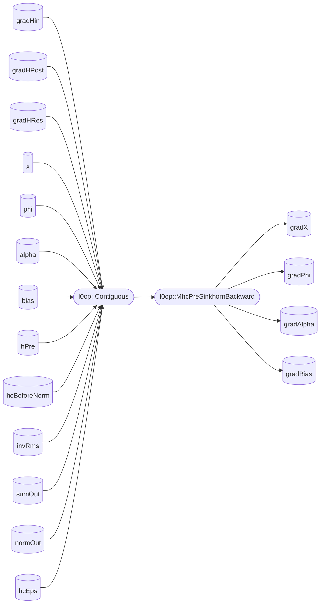

# aclnnMhcPreSinkhornBackward

## 产品支持情况


|产品      | 是否支持 |
|:----------------------------|:-----------:|
|<term>Ascend 950PR/Ascend 950DT</term> |      √     |
|<term>Atlas A3 训练系列产品/Atlas A3 推理系列产品</term>|    √     |
|<term>Atlas A2 训练系列产品/Atlas A2 推理系列产品</term>|    √     |
|<term>Atlas 200I/500 A2 推理产品</term>|      ×     |
|<term>Atlas 推理系列产品</term>|      ×     |
|<term>Atlas 训练系列产品</term>|      ×     |


## 功能说明

- 接口功能：MhcPreSinkhornBackward是MhcPreSinkhorn的反向算子。计算对应的梯度反向传播。

## 计算公式

### 第一部分计算H_res_grad
设当前梯度为 $\mathbf{grad}_{\text{curr}} = \mathbf{grad}_{\text{output}}$，共进行 $\mathbf{num\_iters}$ 次迭代。

#### 前 $\mathbf{num\_iters} - 1$ 次迭代

对迭代编号 $i = \mathbf{num\_iters} - 1, \mathbf{num\_iters} - 2, \dots, 1$，依次执行：

$$
\begin{aligned}
    \mathbf{dot\_prod}_{2i+1} &= \sum_{\dim=-2,\text{keepdim}=\text{True}} \left( \mathbf{grad}_{\text{curr}} \cdot \mathbf{norm\_out}_{2i+1} \right) \\
    \\
    \mathbf{grad}_{\text{curr}} &\gets \frac{{ \mathbf{grad}_{\text{curr}}} - \mathbf{dot\_prod}_{2i+1}} { \mathbf{sum\_out}_{2i+1} }, \\
    \\
    \mathbf{dot\_prod}_{2i} &= \sum_{\dim=-1,\text{keepdim}=\text{True}} \left( \mathbf{grad}_{\text{curr}} \cdot \mathbf{num\_out}_{2i} \right), \\
    \\
    \mathbf{grad}_{\text{curr}}  &\gets  \frac{{ \mathbf{grad}_{\text{curr}}} - \mathbf{dot\_prod}_{2i}} { \mathbf{sum\_out}_{2i} }, \\
\end{aligned}
$$

#### 最后一次迭代

$$
\begin{aligned}
    \mathbf{dot\_prod}_{1} &= \sum_{\dim=-2,\text{keepdim}=\text{True}} \left( \mathbf{grad}_{\text{curr}} \cdot \mathbf{norm\_out}_{1} \right), \\
    \\
    \mathbf{grad}_{\text{curr}} &\gets \frac{{ \mathbf{grad}_{\text{curr}}} - \mathbf{dot\_prod}_{1}} { \mathbf{sum\_out}_{1} }, \\
    \\
    \mathbf{dot\_prod}_{0} &= \sum_{\dim=-1,\text{keepdim}=\text{True}} \left( \mathbf{grad}_{\text{curr}} \cdot \mathbf{num\_out}_{0} \right), \\
    \\
    \mathbf{{H\_res\_grad}}  &\gets  \left( \mathbf{grad}_{\text{curr}} -  \mathbf{dot\_prod}_{0} \right) \cdot { \mathbf{norm\_out}_{0} }, \\
\end{aligned}
$$
### 输入


  $gamma\_grad ∈ [N, D]$

### 输出组合梯度计算

- 正向公式：

  $$
  H\_in = \sum_{i=1}^{N} x[{B,S,i,:}] · H\_pre_n[B,S,i]
  $$
- 反向计算：

$$
\begin{aligned}
H\_pre\_grad &= \text{Reduce}\left(H\_in\_grad.\text{unsqueeze}(-2) \odot x, \text{dim}=-1\right) \quad ([B,S,N]) \\
x\_grad\_vec3 &= H\_in\_grad \times H\_pre \quad ([B,S,N,D])
\end{aligned}
$$

### 门控激活层梯度计算

#### Sigmoid门控反向（H_pre）

- 正向公式：

  $$
  H\_pre = \text{Sigmoid}(\alpha\_pre * H\_pre\_1 + bias\_pre) + hc\_eps
  $$
- 反向计算：

$$
\begin{aligned}
s &= H\_pre - hc\_eps \\
H\_pre\_2\_grad &= H\_pre\_grad \odot s \odot (1 - s) \\
H\_pre\_1\_grad &= H\_pre\_2\_grad \cdot \alpha\_pre \\
\alpha\_pre\_grad &= \sum_{b,s,n}^{B,S,N} \left(H\_pre\_2\_grad \cdot H\_pre\_1\right) \\
bias\_pre\_grad &= \sum_{b,s}^{B,S} H\_pre\_2\_grad \quad ([N])
\end{aligned}
$$

#### Sigmoid门控反向（H_post）

- 正向公式：

  $$
  H\_post = \text{Sigmoid}(\alpha\_post * H\_post\_1 + bias\_post) * 2
  $$
- 反向计算：

$$
\begin{aligned}
H\_post\_2\_grad &= H\_post\_grad \odot \left(H\_post \cdot \left(1 - \frac{H\_post}{2}\right)\right) \\
H\_post\_1\_grad &= H\_post\_2\_grad \cdot \alpha_{post} \\
\alpha_{post\_grad} &= \sum_{b,s,n}^{B,S,N} \left(H\_post\_2\_grad \cdot H_{post\_1}\right) \\
bias\_post\_grad &= \sum_{b,s}^{B,S} H\_post\_2\_grad \quad ([N])
\end{aligned}
$$

#### 残差连接反向（H_res）

- 正向公式：

  $$
  H\_res = \alpha\_res * H\_res\_1 + bias\_res
  $$
- 反向计算：

$$
\begin{aligned}
H\_res\_2\_grad &= H\_res\_grad \cdot \alpha_{res} \quad ([B,S,N,N]) \\
\alpha\_res\_grad &= \sum_{b,s,i,j}^{B,S,N,N} \left(H\_res\_grad \cdot H\_res\_2\right) \\
bias\_res\_grad &= \sum_{b,s}^{B,S} H\_res\_grad \quad ([N,N]) \\
H\_res\_1\_grad &= \text{Reshape}(H\_res\_2\_grad) \quad ([B,S,N^2])
\end{aligned}
$$

### RMS归一化融合反向

#### RMSNorm Fusion反向

- 正向公式：

  $$
  H\_mix\_tmp = H\_mix * inv\_rms
  $$
- 反向计算：

$$
\begin{aligned}
H\_mix\_tmp\_grad &= \text{Concat}(H\_pre\_1\_grad, H\_post\_1\_grad, H\_res\_1\_grad) \quad ([B,S,2N+N^2]) \\
H\_mix\_grad &= H\_mix\_tmp\_grad \cdot inv\_rms \\
inv\_rms_{grad} &= \sum_{\text{last\_dim}} \left(H\_mix\_tmp\_grad \cdot H\_mix\right) \quad ([B,S,1])
\end{aligned}
$$

### 线性投影层梯度计算

#### 矩阵乘法反向

- 正向公式：

  $$
  H\_mix = x\_rs @ phi^T
  $$

  $$
  x\_rs = x * gamma
  $$
- 反向计算：

$$
\begin{aligned}
x\_rs\_grad &= H\_mix\_grad @ phi \quad ([B,S,ND]) \\
X &= \text{Reshape}(x\_rs, [B\cdot S, ND]) \\
G &= \text{Reshape}(H\_mix\_grad, [B\cdot S, 2N+N^2]) \\
phi_{grad} &= G^T @ X \quad ([2N+N^2, ND])
\end{aligned}
$$

#### 特征缩放反向

- 正向公式：

  $$
  x\_rs = x * gamma
  $$
- 反向计算：

$$
\begin{aligned}
x\_grad\_mm &= x\_rs\_grad * gamma \\
gamma\_grad &= \sum_{b=1}^{B}\sum_{s=1}^{S} (x * x\_rs\_grad)\quad ([N,D])
\end{aligned}
$$

### RMS归一化梯度计算

- 正向公式：

  $$
  inv\_rms = \frac{1}{\sqrt{\frac{1}{n}\sum_{i=1}^{n}x_i^2 + eps}}, \quad 其中\ n = N * D
  $$
- 反向计算：

$$
\begin{aligned}
x\_rs\_grad\_inv &= - \left(\frac{inv\_rms\_grad \cdot {inv\_rms}^3}{N*D}\right) \cdot x\_rs \\
x\_rs\_grad &= x\_grad\_mm + x\_rs\_grad\_inv \\
x\_grad\_vec1 &= \text{Reshape}(x\_rs\_grad, [B,S,N,D]) \\
x\_grad &= x\_grad\_vec3 + x\_grad\_vec1
\end{aligned}
$$

### 符号说明

| 符号 | 含义 |
|------|------|
| $\mathbf{grad}_{\text{curr}}$ | 当前梯度（迭代中间变量） |
| $\mathbf{grad}_{\text{input}}$ | 最终输入梯度（输出） |
| $\mathbf{num\_out}_k$ | 第 $k$ 个归一化方向向量（对应 `norm_out[k]`） |
| $\mathbf{sum\_out}_k$ | 对应的缩放系数（对应 `sum_out[k]`） |
| $\cdot$ | 点积（内积） |
| $\sum_{\dim=d,\text{keepdim}=\text{True}}$ | 在指定维度上求和并保持维度 |


## 函数原型

算子分为两段式接口，必须先调用`aclnnMhcPreSinkhornBackwardGetWorkspaceSize`接口获取入参并根据计算流程计算所需workspace大小，再调用`aclnnMhcPreSinkhornBackward`接口执行计算。

```c++
aclnnStatus aclnnMhcPreSinkhornBackwardGetWorkspaceSize(
    const aclTensor *gradHin,
    const aclTensor *gradHPost,
    const aclTensor *gradHRes,
    const aclTensor *x,
    const aclTensor *phi,
    const aclTensor *alpha,
    const aclTensor *bias,
    const aclTensor *hPre,
    const aclTensor *hcBeforeNorm,
    const aclTensor *invRms,
    const aclTensor *sumOut,
    const aclTensor *normOut,
    double hcEps,
    aclTensor *gradX,
    aclTensor *gradPhi,
    aclTensor *gradAlpha,
    aclTensor *gradBias,
    uint64_t *workspaceSize,
    aclOpExecutor **executor)
```

```c++
aclnnStatus aclnnMhcPreSinkhornBackward(
    void *workspace,
    uint64_t workspaceSize,
    aclOpExecutor *executor,
    aclrtStream stream)
```

## aclnnMhcPreSinkhornBackwardGetWorkspaceSize

### 参数说明

<table style="undefined;table-layout: fixed; width: 1550px">
        <colgroup>
            <col style="width: 220px">
            <col style="width: 120px">
            <col style="width: 300px">  
            <col style="width: 400px">  
            <col style="width: 212px">  
            <col style="width: 100px">
            <col style="width: 190px">
            <col style="width: 145px">
            </colgroup>
        <thead>
        <tr>
            <th>参数名</th>
            <th>输入/输出</th>
            <th>描述</th>
            <th>使用说明</th>
            <th>数据类型</th>
            <th>数据格式</th>
            <th>维度(shape)</th>
            <th>非连续Tensor</th>
        </tr></thead>
        <tbody>
        <tr>
            <td>gradHin</td>
            <td>输入</td>
            <td>输出h_in的梯度</td>
            <td>不支持空Tensor。</td>
            <td>BFLOAT16 </td>
            <td>ND</td>
            <td>(B,S,D)</td>
            <td>√</td>
        </tr>
        <tr>
            <td>gradHPost</td>
            <td>输入</td>
            <td>输出h_post的梯度</td>
            <td>不支持空Tensor。</td>
            <td>FLOAT32 </td>
            <td>ND</td>
            <td>(B,S,N)</td>
            <td>√</td>
        </tr>
        <tr>
            <td>gradHRes</td>
            <td>输入</td>
            <td>输出h_res的梯度</td>
            <td>不支持空Tensor。</td>
            <td>FLOAT32 </td>
            <td>ND</td>
            <td>(B,S,N,N)</td>
            <td>√</td>
        </tr>
        <tr>
            <td>x</td>
            <td>输入</td>
            <td>前向输入x</td>
            <td>不支持空Tensor。</td>
            <td>BFLOAT16 </td>
            <td>ND</td>
            <td>(B,S,N,C)</td>
            <td>√</td>
        </tr>
        <tr>
            <td>phi</td>
            <td>输入</td>
            <td>前向参数phi</td>
            <td>不支持空Tensor。</td>
            <td>FLOAT32 </td>
            <td>ND</td>
            <td>(ND, 2N+N*N)</td>
            <td>√</td>
        </tr>
        <tr>
            <td>alpha</td>
            <td>输入</td>
            <td>前向参数alpha</td>
            <td>不支持空Tensor。</td>
            <td>FLOAT32 </td>
            <td>ND</td>
            <td>(3)</td>
            <td>√</td>
        </tr>
        <tr>
            <td>bias</td>
            <td>输入</td>
            <td>前向参数bias</td>
            <td>不支持空Tensor。</td>
            <td>FLOAT32 </td>
            <td>ND</td>
            <td>(2N+N^2)</td>
            <td>√</td>
        </tr>
        <tr>
            <td>hPre</td>
            <td>输入</td>
            <td>前向保存的中间结果h_pre</td>
            <td>不支持空Tensor。</td>
            <td>FLOAT32 </td>
            <td>ND</td>
            <td>(B,S,N)</td>
            <td>√</td>
        </tr>
        <tr>
            <td>hcBeforeNorm</td>
            <td>输入</td>
            <td>前向保存的中间结果hc_before_norm</td>
            <td>不支持空Tensor。</td>
            <td>FLOAT32 </td>
            <td>ND</td>
            <td>(B,S,N*N+2*N)</td>
            <td>√</td>
        </tr>
        <tr>
            <td>invRms</td>
            <td>输入</td>
            <td>前向保存的中间结果inv_rms</td>
            <td>不支持空Tensor。</td>
            <td>FLOAT32 </td>
            <td>ND</td>
            <td>(B,S,1)</td>
            <td>√</td>
        </tr>
        <tr>
            <td>sumOut</td>
            <td>输入</td>
            <td>Sinkhorn变换正向计算保存的中间sum结果</td>
            <td>不支持空Tensor。</td>
            <td>FLOAT32 </td>
            <td>ND</td>
            <td>(2*sk_iter_count,B,S,N)</td>
            <td>√</td>
        </tr>
        <tr>
            <td>normOut</td>
            <td>输入</td>
            <td>Sinkhorn变换正向计算保存的中间norm结果</td>
            <td>不支持空Tensor。</td>
            <td>FLOAT32 </td>
            <td>ND</td>
            <td>(2*sk_iter_count,B,S,N,N)</td>
            <td>√</td>
        </tr>
        <tr>
            <td>hcEps</td>
            <td>输入</td>
            <td>数值稳定性参数</td>
            <td>默认值1e-6</td>
            <td>DOUBLE </td>
            <td>-</td>
            <td>-</td>
            <td>-</td>
        </tr>
        <tr>
            <td>gradX</td>
            <td>输出</td>
            <td>输入x的梯度</td>
            <td>-</td>
            <td>BFLOAT16</td>
            <td>ND</td>
            <td>(B,S,N,C)</td>
            <td>-</td>
        </tr>
        <tr>
            <td>gradPhi</td>
            <td>输出</td>
            <td>参数phi的梯度</td>
            <td>-</td>
            <td>FLOAT32</td>
            <td>ND</td>
            <td>(2N+N^2, ND)</td>
            <td>-</td>
        </tr>
        <tr>
            <td>gradAlpha</td>
            <td>输出</td>
            <td>参数alpha的梯度</td>
            <td>-</td>
            <td>FLOAT32</td>
            <td>ND</td>
            <td>(3)</td>
            <td>-</td>
        </tr>
        <tr>
            <td>gradBias</td>
            <td>输出</td>
            <td>参数bias的梯度</td>
            <td>-</td>
            <td>FLOAT32</td>
            <td>ND</td>
            <td>(2N+N^2)</td>
            <td>-</td>
        </tr>
        </tbody>
    </table>

### 返回值

返回aclnnStatus状态码。

第一段接口完成入参校验，出现以下场景时报错：

<table style="undefined;table-layout: fixed;width: 1155px"><colgroup>
    <col style="width: 319px">
    <col style="width: 144px">
    <col style="width: 671px">
    </colgroup>
        <thead>
            <th>返回值</th>
            <th>错误码</th>
            <th>描述</th>
        </thead>
        <tbody>
            <tr>
                <td>ACLNN_ERR_PARAM_NULLPTR</td>
                <td>161001</td>
                <td>必选参数或者输出是空指针。</td>
            </tr>
            <tr>
                <td>ACLNN_ERR_PARAM_INVALID</td>
                <td>161002</td>
                <td>gradY、x、hcFn等输入变量的数据类型和数据格式不在支持的范围内。</td>
            </tr>
            <tr>
                <td>ACLNN_ERR_RUNTIME_ERROR</td>
                <td>361001</td>
                <td>API内存调用npu runtime的接口异常。</td>
            </tr>
        </tbody>
    </table>

## aclnnMhcPreSinkhornBackward

### 参数说明

<table style="undefined;table-layout: fixed; width: 1155px"><colgroup>
    <col style="width: 144px">
    <col style="width: 125px">
    <col style="width: 700px">
    </colgroup>
    <thead>
        <tr>
        <th>参数名</th>
        <th>输入/输出</th>
        <th>描述</th>
        </tr></thead>
    <tbody>
        <tr>
        <td>workspace</td>
        <td>输入</td>
        <td>在Device侧申请的workspace内存地址。</td>
        </tr>
        <tr>
        <td>workspaceSize</td>
        <td>输入</td>
        <td>在Device侧申请的workspace大小，由第一段接口aclnnMhcPreSinkhornBackwardGetWorkspaceSize获取。</td>
        </tr>
        <tr>
        <td>executor</td>
        <td>输入</td>
        <td>op执行器，包含了算子计算流程。</td>
        </tr>
        <tr>
        <td>stream</td>
        <td>输入</td>
        <td>指定执行任务的Stream。</td>
        </tr>
    </tbody>
    </table>

### 返回值

返回aclnnStatus状态码，具体参见[aclnn返回码](../../../docs/zh/context/aclnn返回码.md)。

## 约束说明

### 确定性计算

- aclnnMhcPreSinkhornBackward默认确定性实现。

### 规格约束

| 规格项 | 规格 | 规格说明 |
|:--- |:--- |:--- |
| sk_iter_count | 20 | Sinkhorn迭代次数当前仅支持20。 |
| N | 4 | 输入Tensor中N维度的大小仅支持4。 |

## 调用示例

示例代码如下，仅供参考，具体编译和执行过程请参考[编译与运行样例](../../../docs/zh/context/编译与运行样例.md)。

```c++
#include <iostream>
#include <vector>
#include <algorithm>
#include "acl/acl.h"
#include "aclnnop/aclnn_mhc_pre_sinkhorn_grad.h"

#define CHECK_RET(cond, return_expr) \
  do {                               \
    if (!(cond)) {                   \
      return_expr;                   \
    }                                \
  } while (0)

#define LOG_PRINT(message, ...)     \
  do {                              \
    printf(message, ##__VA_ARGS__); \
  } while (0)

int64_t GetShapeSize(const std::vector<int64_t>& shape) {
  int64_t size = 1;
  for (int64_t dim : shape) {
    size *= dim;
  }
  return size;
}

int InitAcl(int32_t device_id, aclrtContext& context, aclrtStream& stream) {
  aclError ret = aclInit(nullptr);
  CHECK_RET(ret == ACL_SUCCESS, LOG_PRINT("aclInit failed, error: %d\n", ret); return -1);

  ret = aclrtSetDevice(device_id);
  CHECK_RET(ret == ACL_SUCCESS, LOG_PRINT("aclrtSetDevice failed, error: %d\n", ret); return -1);

  ret = aclrtCreateContext(&context, device_id);
  CHECK_RET(ret == ACL_SUCCESS, LOG_PRINT("aclrtCreateContext failed, error: %d\n", ret); return -1);

  ret = aclrtSetCurrentContext(context);
  CHECK_RET(ret == ACL_SUCCESS, LOG_PRINT("aclrtSetCurrentContext failed, error: %d\n", ret); return -1);

  ret = aclrtCreateStream(&stream);
  CHECK_RET(ret == ACL_SUCCESS, LOG_PRINT("aclrtCreateStream failed, error: %d\n", ret); return -1);

  return 0;
}

int CreateAclTensor(
    const std::vector<float>& host_data,
    const std::vector<int64_t>& shape,
    void*& device_addr,
    aclTensor*& tensor,
    aclDataType data_type = ACL_FLOAT) {
  int64_t element_size = (data_type == ACL_BF16) ? 2 : 4;
  int64_t size = GetShapeSize(shape) * element_size;

  aclError ret = aclrtMalloc(&device_addr, size, ACL_MEM_MALLOC_HUGE_FIRST);
  CHECK_RET(ret == ACL_SUCCESS, LOG_PRINT("aclrtMalloc failed, error: %d\n", ret); return -1);

  ret = aclrtMemcpy(device_addr, size, host_data.data(), size, ACL_MEMCPY_HOST_TO_DEVICE);
  CHECK_RET(ret == ACL_SUCCESS, LOG_PRINT("aclrtMemcpy failed, error: %d\n", ret); return -1);

  std::vector<int64_t> strides(shape.size(), 1);
  for (int64_t i = shape.size() - 2; i >= 0; --i) {
    strides[i] = strides[i + 1] * shape[i + 1];
  }

  tensor = aclCreateTensor(
      shape.data(), shape.size(),
      data_type, strides.data(), 0,
      ACL_FORMAT_ND, shape.data(), shape.size(),
      device_addr);
  CHECK_RET(tensor != nullptr, LOG_PRINT("aclCreateTensor failed\n"); return -1);

  return 0;
}

int CreateEmptyAclTensor(
    const std::vector<int64_t>& shape,
    void*& device_addr,
    aclTensor*& tensor,
    aclDataType data_type = ACL_FLOAT) {
  int64_t element_size = (data_type == ACL_BF16) ? 2 : 4;
  int64_t size = GetShapeSize(shape) * element_size;

  aclError ret = aclrtMalloc(&device_addr, size, ACL_MEM_MALLOC_HUGE_FIRST);
  CHECK_RET(ret == ACL_SUCCESS, LOG_PRINT("aclrtMalloc failed, error: %d\n", ret); return -1);

  std::vector<int64_t> strides(shape.size(), 1);
  for (int64_t i = shape.size() - 2; i >= 0; --i) {
    strides[i] = strides[i + 1] * shape[i + 1];
  }

  tensor = aclCreateTensor(
      shape.data(), shape.size(),
      data_type, strides.data(), 0,
      ACL_FORMAT_ND, shape.data(), shape.size(),
      device_addr);
  CHECK_RET(tensor != nullptr, LOG_PRINT("aclCreateTensor failed\n"); return -1);

  return 0;
}

int main() {
  const int32_t device_id = 0;
  const int64_t B = 2;
  const int64_t S = 512;
  const int64_t N = 8;
  const int64_t C = 4096;
  const int64_t sk_iter_count = 4;

  aclrtContext context;
  aclrtStream stream;
  CHECK_RET(InitAcl(device_id, context, stream) == 0, return -1);

  std::vector<int64_t> gradYShape = {B, S, C};
  std::vector<int64_t> gradPostShape = {B, S, N};
  std::vector<int64_t> gradCombFragShape = {B, S, N * N};
  std::vector<int64_t> xShape = {B, S, N, C};
  std::vector<int64_t> hcFnShape = {N * N + 2 * N, N * C};
  std::vector<int64_t> hcScaleShape = {3};
  std::vector<int64_t> hcBaseShape = {N * N + 2 * N};
  std::vector<int64_t> preShape = {B, S, N};
  std::vector<int64_t> hcBeforeNormShape = {B, S, N * N + 2 * N};
  std::vector<int64_t> rsqrtShape = {B, S, 1};
  std::vector<int64_t> sumOutShape = {2 * sk_iter_count, B, S, N};
  std::vector<int64_t> normOutShape = {2 * sk_iter_count, B, S, N, N};

  int64_t gradYSize = GetShapeSize(gradYShape);
  int64_t gradPostSize = GetShapeSize(gradPostShape);
  int64_t gradCombFragSize = GetShapeSize(gradCombFragShape);
  int64_t xSize = GetShapeSize(xShape);
  int64_t hcFnSize = GetShapeSize(hcFnShape);
  int64_t hcScaleSize = GetShapeSize(hcScaleShape);
  int64_t hcBaseSize = GetShapeSize(hcBaseShape);
  int64_t preSize = GetShapeSize(preShape);
  int64_t hcBeforeNormSize = GetShapeSize(hcBeforeNormShape);
  int64_t rsqrtSize = GetShapeSize(rsqrtShape);
  int64_t sumOutSize = GetShapeSize(sumOutShape);
  int64_t normOutSize = GetShapeSize(normOutShape);

  std::vector<float> gradYHost(gradYSize, 1.0f);
  std::vector<float> gradPostHost(gradPostSize, 1.0f);
  std::vector<float> gradCombFragHost(gradCombFragSize, 1.0f);
  std::vector<float> xHost(xSize, 1.0f);
  std::vector<float> hcFnHost(hcFnSize, 1.0f);
  std::vector<float> hcScaleHost(hcScaleSize, 1.0f);
  std::vector<float> hcBaseHost(hcBaseSize, 1.0f);
  std::vector<float> preHost(preSize, 1.0f);
  std::vector<float> hcBeforeNormHost(hcBeforeNormSize, 1.0f);
  std::vector<float> rsqrtHost(rsqrtSize, 1.0f);
  std::vector<float> sumOutHost(sumOutSize, 1.0f);
  std::vector<float> normOutHost(normOutSize, 1.0f);

  void* gradYDevice = nullptr;
  void* gradPostDevice = nullptr;
  void* gradCombFragDevice = nullptr;
  void* xDevice = nullptr;
  void* hcFnDevice = nullptr;
  void* hcScaleDevice = nullptr;
  void* hcBaseDevice = nullptr;
  void* preDevice = nullptr;
  void* hcBeforeNormDevice = nullptr;
  void* rsqrtDevice = nullptr;
  void* sumOutDevice = nullptr;
  void* normOutDevice = nullptr;
  void* gradXDevice = nullptr;
  void* gradHcFnDevice = nullptr;
  void* gradHcScaleDevice = nullptr;
  void* gradHcBaseDevice = nullptr;

  aclTensor* gradYTensor = nullptr;
  aclTensor* gradPostTensor = nullptr;
  aclTensor* gradCombFragTensor = nullptr;
  aclTensor* xTensor = nullptr;
  aclTensor* hcFnTensor = nullptr;
  aclTensor* hcScaleTensor = nullptr;
  aclTensor* hcBaseTensor = nullptr;
  aclTensor* preTensor = nullptr;
  aclTensor* hcBeforeNormTensor = nullptr;
  aclTensor* rsqrtTensor = nullptr;
  aclTensor* sumOutTensor = nullptr;
  aclTensor* normOutTensor = nullptr;
  aclTensor* gradXTensor = nullptr;
  aclTensor* gradHcFnTensor = nullptr;
  aclTensor* gradHcScaleTensor = nullptr;
  aclTensor* gradHcBaseTensor = nullptr;

  CHECK_RET(CreateAclTensor(gradYHost, gradYShape, gradYDevice, gradYTensor, ACL_BF16) == 0, return -1);
  CHECK_RET(CreateAclTensor(gradPostHost, gradPostShape, gradPostDevice, gradPostTensor, ACL_FLOAT) == 0, return -1);
  CHECK_RET(CreateAclTensor(gradCombFragHost, gradCombFragShape, gradCombFragDevice, gradCombFragTensor, ACL_FLOAT) == 0, return -1);
  CHECK_RET(CreateAclTensor(xHost, xShape, xDevice, xTensor, ACL_BF16) == 0, return -1);
  CHECK_RET(CreateAclTensor(hcFnHost, hcFnShape, hcFnDevice, hcFnTensor, ACL_FLOAT) == 0, return -1);
  CHECK_RET(CreateAclTensor(hcScaleHost, hcScaleShape, hcScaleDevice, hcScaleTensor, ACL_FLOAT) == 0, return -1);
  CHECK_RET(CreateAclTensor(hcBaseHost, hcBaseShape, hcBaseDevice, hcBaseTensor, ACL_FLOAT) == 0, return -1);
  CHECK_RET(CreateAclTensor(preHost, preShape, preDevice, preTensor, ACL_FLOAT) == 0, return -1);
  CHECK_RET(CreateAclTensor(hcBeforeNormHost, hcBeforeNormShape, hcBeforeNormDevice, hcBeforeNormTensor, ACL_FLOAT) == 0, return -1);
  CHECK_RET(CreateAclTensor(rsqrtHost, rsqrtShape, rsqrtDevice, rsqrtTensor, ACL_FLOAT) == 0, return -1);
  CHECK_RET(CreateAclTensor(sumOutHost, sumOutShape, sumOutDevice, sumOutTensor, ACL_FLOAT) == 0, return -1);
  CHECK_RET(CreateAclTensor(normOutHost, normOutShape, normOutDevice, normOutTensor, ACL_FLOAT) == 0, return -1);

  CHECK_RET(CreateEmptyAclTensor(xShape, gradXDevice, gradXTensor, ACL_BF16) == 0, return -1);
  CHECK_RET(CreateEmptyAclTensor(hcFnShape, gradHcFnDevice, gradHcFnTensor, ACL_FLOAT) == 0, return -1);
  CHECK_RET(CreateEmptyAclTensor(hcScaleShape, gradHcScaleDevice, gradHcScaleTensor, ACL_FLOAT) == 0, return -1);
  CHECK_RET(CreateEmptyAclTensor(hcBaseShape, gradHcBaseDevice, gradHcBaseTensor, ACL_FLOAT) == 0, return -1);

  double hcEps = 1e-6;

  uint64_t workspaceSize = 0;
  aclOpExecutor* executor = nullptr;

  aclnnStatus ret = aclnnMhcPreSinkhornBackwardGetWorkspaceSize(
      gradYTensor, gradPostTensor, gradCombFragTensor,
      xTensor, hcFnTensor, hcScaleTensor, hcBaseTensor,
      preTensor, hcBeforeNormTensor, rsqrtTensor,
      sumOutTensor, normOutTensor, hcEps,
      gradXTensor, gradHcFnTensor, gradHcScaleTensor, gradHcBaseTensor,
      &workspaceSize, &executor);
  CHECK_RET(ret == ACL_SUCCESS, LOG_PRINT("aclnnMhcPreSinkhornBackwardGetWorkspaceSize failed, error: %d\n", ret); return -1);

  void* workspace = nullptr;
  if (workspaceSize > 0) {
    ret = aclrtMalloc(&workspace, workspaceSize, ACL_MEM_MALLOC_HUGE_FIRST);
    CHECK_RET(ret == ACL_SUCCESS, LOG_PRINT("aclrtMalloc workspace failed, error: %d\n", ret); return -1);
  }

  ret = aclnnMhcPreSinkhornBackward(workspace, workspaceSize, executor, stream);
  CHECK_RET(ret == ACL_SUCCESS, LOG_PRINT("aclnnMhcPreSinkhornBackward failed, error: %d\n", ret); return -1);

  ret = aclrtSynchronizeStream(stream);
  CHECK_RET(ret == ACL_SUCCESS, LOG_PRINT("aclrtSynchronizeStream failed, error: %d\n", ret); return -1);

  LOG_PRINT("MhcPreSinkhornBackward execution succeeded\n");

  if (workspace != nullptr) {
    aclrtFree(workspace);
  }
  aclDestroyTensor(gradYTensor);
  aclDestroyTensor(gradPostTensor);
  aclDestroyTensor(gradCombFragTensor);
  aclDestroyTensor(xTensor);
  aclDestroyTensor(hcFnTensor);
  aclDestroyTensor(hcScaleTensor);
  aclDestroyTensor(hcBaseTensor);
  aclDestroyTensor(preTensor);
  aclDestroyTensor(hcBeforeNormTensor);
  aclDestroyTensor(rsqrtTensor);
  aclDestroyTensor(sumOutTensor);
  aclDestroyTensor(normOutTensor);
  aclDestroyTensor(gradXTensor);
  aclDestroyTensor(gradHcFnTensor);
  aclDestroyTensor(gradHcScaleTensor);
  aclDestroyTensor(gradHcBaseTensor);

  aclrtFree(gradYDevice);
  aclrtFree(gradPostDevice);
  aclrtFree(gradCombFragDevice);
  aclrtFree(xDevice);
  aclrtFree(hcFnDevice);
  aclrtFree(hcScaleDevice);
  aclrtFree(hcBaseDevice);
  aclrtFree(preDevice);
  aclrtFree(hcBeforeNormDevice);
  aclrtFree(rsqrtDevice);
  aclrtFree(sumOutDevice);
  aclrtFree(normOutDevice);
  aclrtFree(gradXDevice);
  aclrtFree(gradHcFnDevice);
  aclrtFree(gradHcScaleDevice);
  aclrtFree(gradHcBaseDevice);

  aclrtDestroyStream(stream);
  aclrtDestroyContext(context);
  aclFinalize();

  return 0;
}
```

## 实现说明（不对外，代码上库评审需要，md上gitee前删除）

### 计算图一



## 附录（不对外，代码上库评审需要，md上gitee前删除）

<font color="#FF0000">**（暂时只对内，md文件上传gitee前需删除！！）**</font>

### 1. 归属领域

transformer/mhc

### 2. Pytorch AtenIR

```
func: npu_mhc_pre_sinkhorn_grad(Tensor grad_hin, Tensor grad_h_post, Tensor grad_h_res, Tensor x, Tensor phi, Tensor alpha, Tensor bias, Tensor h_pre, Tensor hc_before_norm, Tensor inv_rms, Tensor sum_out, Tensor norm_out, float hc_eps = 1e-6) -> (Tensor, Tensor, Tensor, Tensor)
```

### 3. AtenIR参数描述

非pytorch标准AtenIR，自定义AtenIR

### 4. HostAPI接口约束

无

### 5. HostAPI异常处理

以下场景会出现异常校验：

1.输入的gradHin、gradHPost、gradHRes、x、phi、alpha、bias、hPre、hcBeforeNorm、invRms、sumOut、normOut等输入变量是空指针时。

2.输入的gradHin、gradHPost、gradHRes、x、phi、alpha、bias、hPre、hcBeforeNorm、invRms、sumOut、normOut等输入变量的数据类型和数据格式不在支持的范围内。

3.输入的gradHin、gradHPost、gradHRes、x、phi、alpha、bias、hPre、hcBeforeNorm、invRms、sumOut、normOut等输入变量的shape的维度大小和支持值范围不在支持的范围内。

### 6. 兼容性说明

1. 功能兼容性：兼容 Pytorch框架定义；
2. 平台兼容性：新增David平台；
3. 接口兼容性：新增；
4. 行为兼容性：新增；
5. 性能兼容性：新增；
6. 资源兼容性：新增；
7. 错误处理兼容性：新增；
