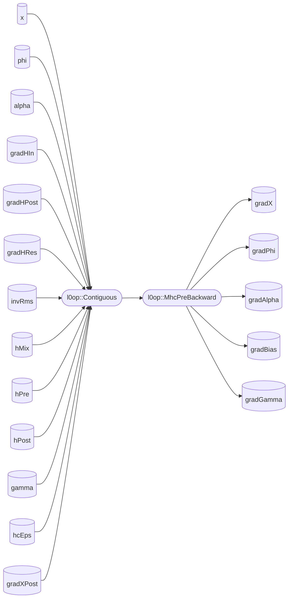

# aclnnMhcPreBackward

## 产品支持情况


| 产品                                                     | 是否支持 |
| :------------------------------------------------------- | :------: |
| <term>Ascend 950PR/Ascend 950DT</term>                   |    √    |
| <term>Atlas A3 训练系列产品/Atlas A3 推理系列产品</term> |    ×    |
| <term>Atlas A2 训练系列产品/Atlas A2 推理系列产品</term> |    ×    |
| <term>Atlas 200I/500 A2 推理产品</term>                  |    ×    |
| <term>Atlas 推理系列产品</term>                          |    ×    |
| <term>Atlas 训练系列产品</term>                          |    ×    |

## 功能说明

- 接口功能：MhcPreBackward是MhcPre的反向算子，MhcPre算子基于一系列计算得到mHC（Manifold-Constrained Hyper-Connections）架构中的$H^{res}$和$H^{post}$投影矩阵以及Atten或MLP层的输入矩阵$h^{in}$

## 计算公式

### 输入

- 算子输入

  $x ∈ R[B,S,N,D]$

  $phi ∈ R[ND,2N+N*N]$

  $alpha ∈ R[3]$

  $H\_in\_grad ∈ R[B,S,D]$ （输出梯度）

  $H\_post\_grad ∈ R[B,S,N]$ （输出梯度）

  $H\_res\_grad ∈ R[B,S,N,N]$ （输出梯度）

  $gamma ∈ R[N, D]$

  $hc\_eps$
- 前向缓存张量

  $inv\_rms ∈ R[B,S,1]$ （或 $R[B,S]$ ，需unsqueeze转 $R[B,S,1]$ ）

  $H\_mix ∈ R[B,S,2N+N^2]$

  $H\_pre∈ R[B,S,N]$

  $H\_post∈ R[B,S,N]$
- 重计算张量

  $[H\_pre\_1,H\_post\_1,H\_res\_2] =  H\_mix * inv\_rms  ∈ R[B,S,N^2+2N]$
- 张量切分

  $[alpha\_{pre}, alpha\_{post},alpha\_{res}] = alpha ∈ R[3]$

### 输出

- 梯度输出：

  $x\_{grad} ∈ R[B,S,N,D]$

  $phi\_{grad} ∈ R[ND,2N+N^2]$

  $alpha\_{scales\_grad} ∈ R[3]$ （ $alpha\_pre\_grad, alpha\_post\_grad, alpha\_res\_grad$ 拼接）

  $bias\_{grad} ∈ R[2N+N^2]$ （ $bias\_pre\_grad, bias\_post\_grad, bias\_res\_grad$ 拼接）

  $gamma\_grad ∈ [N, D]$

### 输出组合梯度计算

- 正向公式：

  $$
  H\_in = \sum_{i=1}^{N} x[{B,S,i,:}] · H\_pre_n[B,S,i]
  $$
- 反向计算：

$$
\begin{aligned}
H\_pre\_grad &= \text{Reduce}\left(H\_in\_grad.\text{unsqueeze}(-2) \odot x, \text{dim}=-1\right) \quad ([B,S,N]) \\
x\_grad\_vec3 &= H\_in\_grad \times H\_pre \quad ([B,S,N,D])
\end{aligned}
$$

### 门控激活层梯度计算

#### Sigmoid门控反向（H_pre）

- 正向公式：

  $$
  H\_pre = \text{Sigmoid}(\alpha\_pre * H\_pre\_1 + bias\_pre) + hc\_eps
  $$
- 反向计算：

$$
\begin{aligned}
s &= H\_pre - hc\_eps \\
H\_pre\_2\_grad &= H\_pre\_grad \odot s \odot (1 - s) \\
H\_pre\_1\_grad &= H\_pre\_2\_grad \cdot \alpha\_pre \\
\alpha\_pre\_grad &= \sum_{b,s,n}^{B,S,N} \left(H\_pre\_2\_grad \cdot H\_pre\_1\right) \\
bias\_pre\_grad &= \sum_{b,s}^{B,S} H\_pre\_2\_grad \quad ([N])
\end{aligned}
$$

#### Sigmoid门控反向（H_post）

- 正向公式：

  $$
  H\_post = \text{Sigmoid}(\alpha\_post * H\_post\_1 + bias\_post) * 2
  $$
- 反向计算：

$$
\begin{aligned}
H\_post\_2\_grad &= H\_post\_grad \odot \left(H\_post \cdot \left(1 - \frac{H\_post}{2}\right)\right) \\
H\_post\_1\_grad &= H\_post\_2\_grad \cdot \alpha_{post} \\
\alpha_{post\_grad} &= \sum_{b,s,n}^{B,S,N} \left(H\_post\_2\_grad \cdot H_{post\_1}\right) \\
bias\_post\_grad &= \sum_{b,s}^{B,S} H\_post\_2\_grad \quad ([N])
\end{aligned}
$$

#### 残差连接反向（H_res）

- 正向公式：

  $$
  H\_res = \alpha\_res * H\_res\_1 + bias\_res
  $$
- 反向计算：

$$
\begin{aligned}
H\_res\_2\_grad &= H\_res\_grad \cdot \alpha_{res} \quad ([B,S,N,N]) \\
\alpha\_res\_grad &= \sum_{b,s,i,j}^{B,S,N,N} \left(H\_res\_grad \cdot H\_res\_2\right) \\
bias\_res\_grad &= \sum_{b,s}^{B,S} H\_res\_grad \quad ([N,N]) \\
H\_res\_1\_grad &= \text{Reshape}(H\_res\_2\_grad) \quad ([B,S,N^2])
\end{aligned}
$$

### RMS归一化融合反向

#### RMSNorm Fusion反向

- 正向公式：

  $$
  H\_mix\_tmp = H\_mix * inv\_rms
  $$
- 反向计算：

$$
\begin{aligned}
H\_mix\_tmp\_grad &= \text{Concat}(H\_pre\_1\_grad, H\_post\_1\_grad, H\_res\_1\_grad) \quad ([B,S,2N+N^2]) \\
H\_mix\_grad &= H\_mix\_tmp\_grad \cdot inv\_rms \\
inv\_rms_{grad} &= \sum_{\text{last\_dim}} \left(H\_mix\_tmp\_grad \cdot H\_mix\right) \quad ([B,S,1])
\end{aligned}
$$

### 线性投影层梯度计算

#### 矩阵乘法反向

- 正向公式：

  $$
  H\_mix = x\_rs @ phi^T
  $$

  $$
  x\_rs = x * gamma
  $$
- 反向计算：

$$
\begin{aligned}
x\_rs\_grad &= H\_mix\_grad @ phi \quad ([B,S,ND]) \\
X &= \text{Reshape}(x\_rs, [B\cdot S, ND]) \\
G &= \text{Reshape}(H\_mix\_grad, [B\cdot S, 2N+N^2]) \\
phi_{grad} &= G^T @ X \quad ([2N+N^2, ND])
\end{aligned}
$$

#### 特征缩放反向

- 正向公式：

  $$
  x\_rs = x * gamma
  $$
- 反向计算：

$$
\begin{aligned}
x\_grad\_mm &= x\_rs\_grad * gamma \\
gamma\_grad &= \sum_{b=1}^{B}\sum_{s=1}^{S} (x * x\_rs\_grad)\quad ([N,D])
\end{aligned}
$$

### RMS归一化梯度计算

- 正向公式：

  $$
  inv\_rms = \frac{1}{\sqrt{\frac{1}{n}\sum_{i=1}^{n}x_i^2 + eps}}, \quad 其中\ n = N * D
  $$
- 反向计算：

$$
\begin{aligned}
x\_rs\_grad\_inv &= - \left(\frac{inv\_rms\_grad \cdot {inv\_rms}^3}{N*D}\right) \cdot x\_rs \\
x\_rs\_grad &= x\_grad\_mm + x\_rs\_grad\_inv \\
x\_grad\_vec1 &= \text{Reshape}(x\_rs\_grad, [B,S,N,D]) \\
x\_grad &= x\_grad\_vec3 + x\_grad\_vec1
\end{aligned}
$$

## 函数原型

每个算子分为两段式接口，必须先调用`aclnnMhcPreBackwardGetWorkspaceSize`接口获取计算所需workspace大小以及包含了算子计算流程的执行器，再调用`aclnnMhcPreGra`d接口执行计算。

```c++
aclnnStatus aclnnMhcPreBackwardGetWorkspaceSize(  
    const aclTensor     *x,
    const aclTensor     *phi,
    const aclTensor     *alpha,
    const aclTensor     *gradHIn,
    const aclTensor     *gradHPost,
    const aclTensor     *gradHRes,
    const aclTensor     *invRms,
    const aclTensor     *hMix,
    const aclTensor     *hPre,
    const aclTensor     *hPost,
    const aclTensor     *gamma,
    const aclTensor     *gradXPostOptional,
    double               hcEps,
    const aclTensor     *gradX,
    const aclTensor     *gradPhi,
    const aclTensor     *gradAlpha,
    const aclTensor     *gradBias,
    const aclTensor     *gradGamma,
    uint64_t            *workspaceSize,
    aclOpExecutor       **executor)
```

```c++
aclnnStatus aclnnMhcPreBackward(
    void             *workspace, 
    uint64_t          workspaceSize, 
    aclOpExecutor    *executor, 
    aclrtStream stream)
```

## aclnnMhcPreBackwardGetWorkspaceSize

- **参数说明：**

### 参数说明


| 参数名            | 输入/输出 | 描述                                              | 使用说明                                                                   | 数据类型          | 数据格式 | 维度(shape)                | 非连续Tensor |
| ----------------- | --------- | ------------------------------------------------- | -------------------------------------------------------------------------- | ----------------- | -------- | -------------------------- | ------------ |
| x                 | 输入      | 待计算数据，表示网络中mHC层的输入数据。           | 不支持空Tensor。                                                           | BFLOAT16、FLOAT16 | ND       | (B,S,N,D)、(T,N,D)         | √           |
| phi               | 输入      | mHC的参数矩阵。                                   | 不支持空Tensor。                                                           | FLOAT32           | ND       | (2N+N\*N,N\*D)             | √           |
| alpha             | 输入      | mHC的缩放参数alpha。                              | 不支持空Tensor。                                                           | FLOAT32           | -        | (3)                        | -            |
| gradHIn           | 输入      | hIn作为Atten/MLP层的输入。正向输出hIn对应的梯度。 | 不支持空Tensor。                                                           | BFLOAT16、FLOAT16 | ND       | (B,S,D)、(T,D)             | √           |
| gradHPost         | 输入      | 正向输出hPost对应的梯度。                         | 不支持空Tensor。                                                           | FLOAT32           | ND       | (B,S,N)、(T,N)             | √           |
| gradHRes          | 输入      | 正向输出hRes对应的梯度。                          | 不支持空Tensor。                                                           | FLOAT32           | ND       | (B,S,N,N)、(T,N,N)         | √           |
| invRms            | 输入      | 正向RmsNorm计算的invRms。                         | 不支持空Tensor。                                                           | FLOAT32           | ND       | (B,S)、(T)                 | √           |
| hMix              | 输入      | 正向计算流x@phi的结果                             | 不支持空Tensor。                                                           | FLOAT32           | ND       | (B,S,2N+N\*N)、(T,2N+N\*N) | √           |
| hPre              | 输入      | 正向sigmoid计算之后的hPre矩阵                     | 不支持空Tensor。                                                           | FLOAT32           | ND       | (B,S,N)、(T,N)             | √           |
| hPost             | 输入      | 正向的hPost输出                                   | 不支持空Tensor。                                                           | FLOAT32           | ND       | (B,S,N)、(T,N)             | √           |
| gamma             | 输入      | RmsNorm的缩放系数gamma                            | 不支持空Tensor。                                                           | FLOAT32           | ND       | (N,D)                      | √           |
| gradXPostOptional | 可选输入  | post反向输出的gradX                               | 不支持空Tensor。                                                           | FLOAT32           | ND       | (B,S,N,D)、(T,N,D)         | √           |
| hcEps             | 输入      | hPre的sigmoid后的eps参数                          | 默认值为1e-6                                                               | FLOAT32           | -        | -                          | -            |
| gradX             | 输出      | x对应的梯度。                                     | 与输入x的维度、数据类型保持一致                                            | BFLOAT16、FLOAT16 | ND       | (B,S,N,D)、(T,N,D)         | √           |
| gradPhi           | 输出      | phi对应的梯度。                                   | 与输入phi的维度保持一致                                                    | FLOAT32           | ND       | (B,S,2N+N\*N)、(T,2N+N\*N) | √           |
| gradAlpha         | 输出      | alpha对应的梯度。                                 | 与输入alpha维度保持一致。                                                  | FLOAT32           | ND       | (3)                        | -            |
| gradBias          | 输出      | bias对应的梯度。                                  | -                                                                          | FLOAT32           | ND       | (2N+N\*N)                  | -            |
| gradGamma         | 输出      | gamma对应的梯度。                                 | 当输入gamma不为nullptr时，此变量才会输出。与输入gamma的Shape维度保持一致。 | FLOAT32           | ND       | (N,D)                      | √           |

### 返回值

返回aclnnStatus状态码，具体参见[aclnn返回码](../../../docs/zh/context/aclnn返回码.md)。

第一段接口完成入参校验，出现以下场景时报错：


| 返回值                  | 错误码 | 描述                                                                       |
| ----------------------- | ------ | -------------------------------------------------------------------------- |
| ACLNN_ERR_PARAM_NULLPTR | 161001 | 必选参数或者输出是空指针。                                                 |
| ACLNN_ERR_PARAM_INVALID | 161002 | 输入变量，如x、phi、gamma、alpha……的数据类型和数据格式不在支持的范围内。 |
| ACLNN_ERR_RUNTIME_ERROR | 361001 | API内存调用npu runtime的接口异常。                                         |

## aclnnMhcPreBackward

### 参数说明


| 参数名        | 输入/输出 | 描述                                                                         |
| :------------ | :-------- | :--------------------------------------------------------------------------- |
| workspace     | 输入      | Device侧申请的workspace内存地址，需与第一段接口返回的workspaceSize匹配。     |
| workspaceSize | 输入      | Device侧workspace内存大小，由`aclnnMhcPreBackwardGetWorkspaceSize`接口返回。 |
| executor      | 输入      | 算子执行器，由第一段接口创建，包含计算流程和参数信息。                       |
| stream        | 输入      | 指定执行计算任务的Stream，需提前创建并绑定Device。                           |

### 返回值

返回aclnnStatus状态码，具体参见[aclnn返回码](../../../docs/zh/context/aclnn返回码.md)。

## 约束说明

### 确定性计算

- aclnnMhcPreBackward默认采用确定性实现，相同输入多次调用结果一致

### 公共约束

- x等输入参数不能为空Tensor，否则返回失败。
- 所有输入/输出Tensor的数据格式仅支持`ACL_FORMAT_ND`；

### 规格约束


| 规格项 | 规格      | 规格说明                                                                |
| :----- | :-------- | :---------------------------------------------------------------------- |
| T或B*S | 1~65536   | B*S 或T支持512~ 65536范围（训练及推理Prefill），支持1~512（推理Decode） |
| n      | 4、6、8   | n目前支持4, 6, 8                                                        |
| D      | 512~16384 | D支持512~16384范围以内，需满足D为64对齐                                 |

## 调用示例

调用示例代码如下，仅供参考，具体编译和执行过程请参考[编译与运行样例](../../../docs/zh/context/编译与运行样例.md)。

```c++
#include <iostream>
#include <vector>
#include <numeric>
#include "acl/acl.h"
#include "aclnnop/aclnn_mhc_pre_backward.h"

#define CHECK_RET(cond, return_expr) \
  do {                               \
    if (!(cond)) {                   \
      return_expr;                   \
    }                                \
  } while (0)

#define LOG_PRINT(message, ...)     \
  do {                              \
    printf(message, ##__VA_ARGS__); \
  } while (0)

int64_t GetShapeSize(const std::vector<int64_t>& shape) {
  int64_t shapeSize = 1;
  for (auto i : shape) {
    shapeSize *= i;
  }
  return shapeSize;
}

void PrintOutResult(std::vector<int64_t> &shape, void** deviceAddr) {
  auto size = GetShapeSize(shape);
  std::vector<short> resultData(size, 0);
  auto ret = aclrtMemcpy(resultData.data(), resultData.size() * sizeof(resultData[0]),
                         *deviceAddr, size * sizeof(resultData[0]), ACL_MEMCPY_DEVICE_TO_HOST);
  CHECK_RET(ret == ACL_SUCCESS, LOG_PRINT("copy result from device to host failed. ERROR: %d\n", ret); return);
  for (int64_t i = 0; i < size; i++) {
    LOG_PRINT("mean result[%ld] is: %e\n", i, resultData[i]);
  }
}

int Init(int32_t deviceId, aclrtContext* context, aclrtStream* stream) {
  // 固定写法，AscendCL初始化
  auto ret = aclInit(nullptr);
  CHECK_RET(ret == ACL_SUCCESS, LOG_PRINT("aclInit failed. ERROR: %d\n", ret); return ret);
  ret = aclrtSetDevice(deviceId);
  CHECK_RET(ret == ACL_SUCCESS, LOG_PRINT("aclrtSetDevice failed. ERROR: %d\n", ret); return ret);
  ret = aclrtCreateContext(context, deviceId);
  CHECK_RET(ret == ACL_SUCCESS, LOG_PRINT("aclrtCreateContext failed. ERROR: %d\n", ret); return ret);
  ret = aclrtSetCurrentContext(*context);
  CHECK_RET(ret == ACL_SUCCESS, LOG_PRINT("aclrtSetCurrentContext failed. ERROR: %d\n", ret); return ret);
  ret = aclrtCreateStream(stream);
  CHECK_RET(ret == ACL_SUCCESS, LOG_PRINT("aclrtCreateStream failed. ERROR: %d\n", ret); return ret);
  return 0;
}

template <typename T>
int CreateAclTensor(const std::vector<T>& hostData, const std::vector<int64_t>& shape, void** deviceAddr,
                    aclDataType dataType, aclTensor** tensor) {
  auto size = GetShapeSize(shape) * sizeof(T);
  // 调用aclrtMalloc申请device侧内存
  auto ret = aclrtMalloc(deviceAddr, size, ACL_MEM_MALLOC_HUGE_FIRST);
  CHECK_RET(ret == ACL_SUCCESS, LOG_PRINT("aclrtMalloc failed. ERROR: %d\n", ret); return ret);
  // 调用aclrtMemcpy将host侧数据拷贝到device侧内存上
  ret = aclrtMemcpy(*deviceAddr, size, hostData.data(), size, ACL_MEMCPY_HOST_TO_DEVICE);
  CHECK_RET(ret == ACL_SUCCESS, LOG_PRINT("aclrtMemcpy failed. ERROR: %d\n", ret); return ret);

  // 计算连续tensor的strides
  std::vector<int64_t> strides(shape.size(), 1);
  for (int64_t i = shape.size() - 2; i >= 0; i--) {
    strides[i] = shape[i + 1] * strides[i + 1];
  }

  // 调用aclCreateTensor接口创建aclTensor
  *tensor = aclCreateTensor(shape.data(), shape.size(), dataType, strides.data(), 0, aclFormat::ACL_FORMAT_ND,
                            shape.data(), shape.size(), *deviceAddr);
  return 0;
}

int main() {
  // 1. （固定写法）device/context/stream初始化，参考AscendCL对外接口列表
  // 根据自己的实际device填写deviceId
  int32_t deviceId = 0;
  aclrtContext context;
  aclrtStream stream;
  auto ret = Init(deviceId, &context, &stream);
  CHECK_RET(ret == ACL_SUCCESS, LOG_PRINT("Init acl failed. ERROR: %d\n", ret); return ret);

  // 2. 构造输入与输出，需要根据API的接口自定义构造
  std::vector<int64_t> xShape = {1024, 4, 512};         // T, N, D
  std::vector<int64_t> phiShape = {24, 2048};           // 2 * N + N * N, N * D
  std::vector<int64_t> alphaShape = {3};                // 固定大小
  std::vector<int64_t> gradHInShape = {1024, 512};      // T, D
  std::vector<int64_t> gradHPostShape = {1024, 4};      // T, N
  std::vector<int64_t> gradHResShape = {1024, 4, 4};    // T, N, N
  std::vector<int64_t> invRmsShape = {1024};            // T
  std::vector<int64_t> hMixShape = {1024, 24};          // T, 2 * N + N * N
  std::vector<int64_t> hPreShape = {1024, 4};           // T, N
  std::vector<int64_t> hPostShape = {1024, 4};          // T, N
  std::vector<int64_t> gammaShape = {4, 512};           // N, D
  std::vector<int64_t> gradXShape = {1024, 4, 512};     // T, N, D
  std::vector<int64_t> gradPhiShape = {24, 2048};       // 2 * N + N * N, N * D
  std::vector<int64_t> gradAlphaShape = {3};            // 固定大小
  std::vector<int64_t> gradBiasShape = {24};            // 2 * N + N * N
  std::vector<int64_t> gradGammaShape = {4, 512};       // N, D

  void* xDeviceAddr = nullptr;
  void* phiDeviceAddr = nullptr;
  void* alphaDeviceAddr = nullptr;
  void* gradHInDeviceAddr = nullptr;
  void* gradHPostDeviceAddr = nullptr;
  void* gradHResDeviceAddr = nullptr;
  void* invRmsDeviceAddr = nullptr;
  void* hMixDeviceAddr = nullptr;
  void* hPreDeviceAddr = nullptr;
  void* hPostDeviceAddr = nullptr;
  void* gammaDeviceAddr = nullptr;
  void* gradXDeviceAddr = nullptr;
  void* gradPhiDeviceAddr = nullptr;
  void* gradAlphaDeviceAddr = nullptr;
  void* gradBiasDeviceAddr = nullptr;
  void* gradGammaDeviceAddr = nullptr;

  aclTensor* x = nullptr;
  aclTensor* phi = nullptr;
  aclTensor* alpha = nullptr;
  aclTensor* gradHIn = nullptr;
  aclTensor* gradHPost = nullptr;
  aclTensor* gradHRes = nullptr;
  aclTensor* invRms = nullptr;
  aclTensor* hMix = nullptr;
  aclTensor* hPre = nullptr;
  aclTensor* hPost = nullptr;
  aclTensor* gamma = nullptr;
  aclTensor* gradX = nullptr;
  aclTensor* gradPhi = nullptr;
  aclTensor* gradAlpha = nullptr;
  aclTensor* gradBias = nullptr;
  aclTensor* gradGamma = nullptr;

  std::vector<short> xHostData(1024 * 4 * 512, 1.0);
  std::vector<float> phiHostData(24 * 2048, 1.0);
  std::vector<float> alphaHostData(3, 1.0);
  std::vector<short> gradHInHostData(1024 * 512, 1.0);
  std::vector<float> gradHPostHostData(1024 * 4, 1.0);
  std::vector<float> gradHResHostData(1024 * 4 * 4, 1.0);
  std::vector<float> invRmsHostData(1024, 1.0);
  std::vector<float> hMixHostData(1024 * 24, 1.0);
  std::vector<float> hPreHostData(1024 * 4, 1.0);
  std::vector<float> hPostHostData(1024 * 4, 1.0);
  std::vector<float> gammaHostData(4 * 512, 1.0);
  std::vector<short> gradXHostData(1024 * 4 * 512, 0);
  std::vector<float> gradPhiHostData(24 * 2048, 0);
  std::vector<float> gradAlphaHostData(3, 0);
  std::vector<float> gradBiasHostData(24, 0);
  std::vector<float> gradGammaHostData(4 * 512, 0);

  ret = CreateAclTensor(xHostData, xShape, &xDeviceAddr, aclDataType::ACL_BF16, &x);
  CHECK_RET(ret == ACL_SUCCESS, return ret);
  ret = CreateAclTensor(phiHostData, phiShape, &phiDeviceAddr, aclDataType::ACL_FLOAT, &phi);
  CHECK_RET(ret == ACL_SUCCESS, return ret);
  ret = CreateAclTensor(alphaHostData, alphaShape, &alphaDeviceAddr, aclDataType::ACL_FLOAT, &alpha);
  CHECK_RET(ret == ACL_SUCCESS, return ret);
  ret = CreateAclTensor(gradHInHostData, h_in_gradShape, &gradHInDeviceAddr, aclDataType::ACL_BF16, &gradHIn);
  CHECK_RET(ret == ACL_SUCCESS, return ret);
  ret = CreateAclTensor(gradHPostHostData, gradXShape, &gradHPostDeviceAddr, aclDataType::ACL_FLOAT, &gradHPost);
  CHECK_RET(ret == ACL_SUCCESS, return ret);
  ret = CreateAclTensor(gradHResHostData, gradPhiShape, &gradHResDeviceAddr, aclDataType::ACL_FLOAT, &gradHRes);
  CHECK_RET(ret == ACL_SUCCESS, return ret);
  ret = CreateAclTensor(invRmsHostData, gradHPostShape, &invRmsDeviceAddr, aclDataType::ACL_FLOAT, &invRms);
  CHECK_RET(ret == ACL_SUCCESS, return ret);
  ret = CreateAclTensor(hMixHostData, gradHResShape, &hMixDeviceAddr, aclDataType::ACL_FLOAT, &hMix);
  CHECK_RET(ret == ACL_SUCCESS, return ret);
  ret = CreateAclTensor(hPreHostData, invRmsShape, &hPreDeviceAddr, aclDataType::ACL_FLOAT, &hPre);
  CHECK_RET(ret == ACL_SUCCESS, return ret);
  ret = CreateAclTensor(hPostHostData, hMixShape, &hPostDeviceAddr, aclDataType::ACL_FLOAT, &hPost);
  CHECK_RET(ret == ACL_SUCCESS, return ret);
  ret = CreateAclTensor(gammaHostData, hPreShape, &gammaDeviceAddr, aclDataType::ACL_FLOAT, &gamma);
  CHECK_RET(ret == ACL_SUCCESS, return ret);
  ret = CreateAclTensor(gradXHostData, hPostShape, &gradXDeviceAddr, aclDataType::ACL_BF16, &gradX);
  CHECK_RET(ret == ACL_SUCCESS, return ret);
  ret = CreateAclTensor(gradPhiHostData, xShape, &gradPhiDeviceAddr, aclDataType::ACL_FLOAT, &gradPhi);
  CHECK_RET(ret == ACL_SUCCESS, return ret);
  ret = CreateAclTensor(gradAlphaHostData, phiShape, &gradAlphaDeviceAddr, aclDataType::ACL_FLOAT, &gradAlpha);
  CHECK_RET(ret == ACL_SUCCESS, return ret);
  ret = CreateAclTensor(gradBiasHostData, alphaShape, &gradBiasDeviceAddr, aclDataType::ACL_FLOAT, &gradBias);
  CHECK_RET(ret == ACL_SUCCESS, return ret);
  ret = CreateAclTensor(gradGammaHostData, hPreShape, &gradGammaDeviceAddr, aclDataType::ACL_FLOAT, &gradGamma);
  CHECK_RET(ret == ACL_SUCCESS, return ret);

  float hc_eps = 1e-6;

  // 3. 调用CANN算子库API，需要修改为具体的Api名称
  uint64_t workspaceSize = 80 * 1024 * 1024;
  aclOpExecutor* executor;

  // 调用aclnnMhcPreBackward第一段接口
  ret = aclnnMhcPreBackwardGetWorkspaceSize(x, phi, alpha, gradHIn, gradHPost, gradHRes, invRms,
        hMix, hPre, hPost, gamma, hc_eps, gradX, gradPhi, gradAlpha, gradBias, gradGamma, &workspaceSize, &executor);
  CHECK_RET(ret == ACL_SUCCESS, LOG_PRINT("aclnnMhcPreBackwardGetWorkspaceSize failed. ERROR: %d\n", ret); return ret);

  // 根据第一段接口计算出的workspaceSize申请device内存
  void* workspaceAddr = nullptr;
  if (workspaceSize > 0) {
    ret = aclrtMalloc(&workspaceAddr, workspaceSize, ACL_MEM_MALLOC_HUGE_FIRST);
    CHECK_RET(ret == ACL_SUCCESS, LOG_PRINT("allocate workspace failed. ERROR: %d\n", ret); return ret);
  }

  // 调用aclnnMhcPreBackward第二段接口
  ret = aclnnMhcPreBackward(workspaceAddr, workspaceSize, executor, stream);
  CHECK_RET(ret == ACL_SUCCESS, LOG_PRINT("aclnnMhcPreBackward failed. ERROR: %d\n", ret); return ret);

  // 4. （固定写法）同步等待任务执行结束
  ret = aclrtSynchronizeStream(stream);
  CHECK_RET(ret == ACL_SUCCESS, LOG_PRINT("aclrtSynchronizeStream failed. ERROR: %d\n", ret); return ret);

  // 5. 获取输出的值，将device侧内存上的结果拷贝至host侧，需要根据具体API的接口定义修改
  PrintOutResult(xShape, &dxDeviceAddr);
  PrintOutResult(phiShape, &dkDeviceAddr);
  PrintOutResult(alphaShape, &dvDeviceAddr);
  PrintOutResult(biasShape, &dxRopeDeviceAddr);
  PrintOutResult(hPostShape, &dkRopeDeviceAddr);

  // 6. 释放aclTensor和aclScalar，需要根据具体API的接口定义修改
  aclDestroyTensor(x);
  aclDestroyTensor(phi);
  aclDestroyTensor(alpha);
  aclDestroyTensor(gradHIn);
  aclDestroyTensor(gradHPost);
  aclDestroyTensor(gradHRes);
  aclDestroyTensor(invRms);
  aclDestroyTensor(hMix);
  aclDestroyTensor(hPre);
  aclDestroyTensor(hPost);
  aclDestroyTensor(gamma);
  aclDestroyTensor(gradX);
  aclDestroyTensor(gradPhi);
  aclDestroyTensor(gradAlpha);
  aclDestroyTensor(gradBias);
  aclDestroyTensor(gradGamma);

  // 7. 释放device资源
  aclrtFree(xDeviceAddr);
  aclrtFree(phiDeviceAddr);
  aclrtFree(alphaDeviceAddr);
  aclrtFree(gradHInDeviceAddr);
  aclrtFree(gradHPostDeviceAddr);
  aclrtFree(gradHResDeviceAddr);
  aclrtFree(invRmsDeviceAddr);
  aclrtFree(hMixDeviceAddr);
  aclrtFree(hPreDeviceAddr);
  aclrtFree(hPostDeviceAddr);
  aclrtFree(gammaDeviceAddr);
  aclrtFree(gradXDeviceAddr);
  aclrtFree(gradPhiDeviceAddr);
  aclrtFree(gradAlphaDeviceAddr);
  aclrtFree(gradBiasDeviceAddr);
  aclrtFree(gradGammaDeviceAddr);
  if (workspaceSize > 0) {
    aclrtFree(workspaceAddr);
  }
  aclrtDestroyStream(stream);
  aclrtDestroyContext(context);
  aclrtResetDevice(deviceId);
  aclFinalize();

  return 0;
}


```

## 实现说明（不对外，代码上库评审需要，md上gitee前删除）

### 计算图一



## 附录（不对外，代码上库评审需要，md上gitee前删除）

<font color="#FF0000">**（暂时只对内，md文件上传gitee前需删除！！）**</font>

### 1. 归属领域

transformer/mhc

### 2. Pytorch AtenIR

```
func: npu_mhc_pre_backward(Tensor x, Tensor phi, Tensor alpha, Tensor grad_h_in, Tensor grad_h_post, Tensor grad_h_res, Tensor inv_rms, Tensor h_mix, Tensor h_pre, Tensor h_post, *, Tensor gamma, float hc_eps = 1e-6, Tensor grad_x_post = none) -> (Tensor, Tensor, Tensor, Tensor, Tensor)
```

### 3. AtenIR参数描述

非pytorch标准AtenIR，自定义AtenIR

### 4. HostAPI接口约束

无

### 5. HostAPI异常处理

以下场景会出现异常校验：

1.输入的x、phi、alpha、gradHIn、gradHPost、gradHRes、invRms、hMix、hPre、hPost、gamma(可选输入)是空指针时。

2.输入的x、phi、alpha、gradHIn、gradHPost、gradHRes、invRms、hMix、hPre、hPost、gamma(可选输入)的数据类型和数据格式不在支持的范围内。

3.输入的x、phi、alpha、gradHIn、gradHPost、gradHRes、invRms、hMix、hPre、hPost、gamma(可选输入)的shape的维度大小和支持值范围不在支持的范围内。

4.可选输入参数gamma和可选输出gradGamma应配对，校验需同时做。

### 6. 兼容性说明

1. 功能兼容性：兼容 Pytorch框架定义；
2. 平台兼容性：新增David平台；
3. 接口兼容性：新增；
4. 行为兼容性：新增；
5. 性能兼容性：新增；
6. 资源兼容性：新增；
7. 错误处理兼容性：新增；

